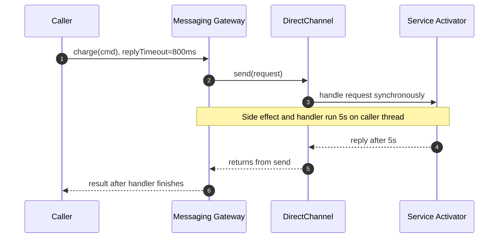
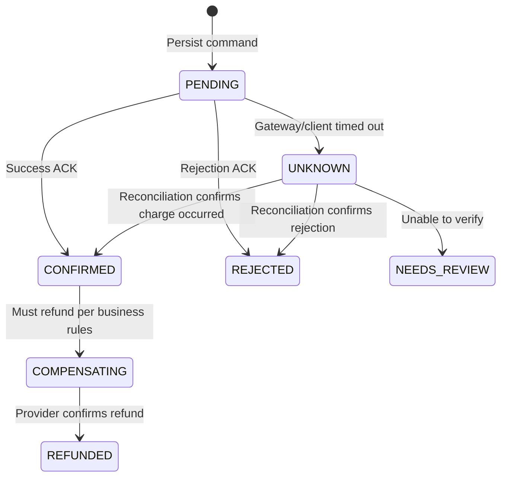
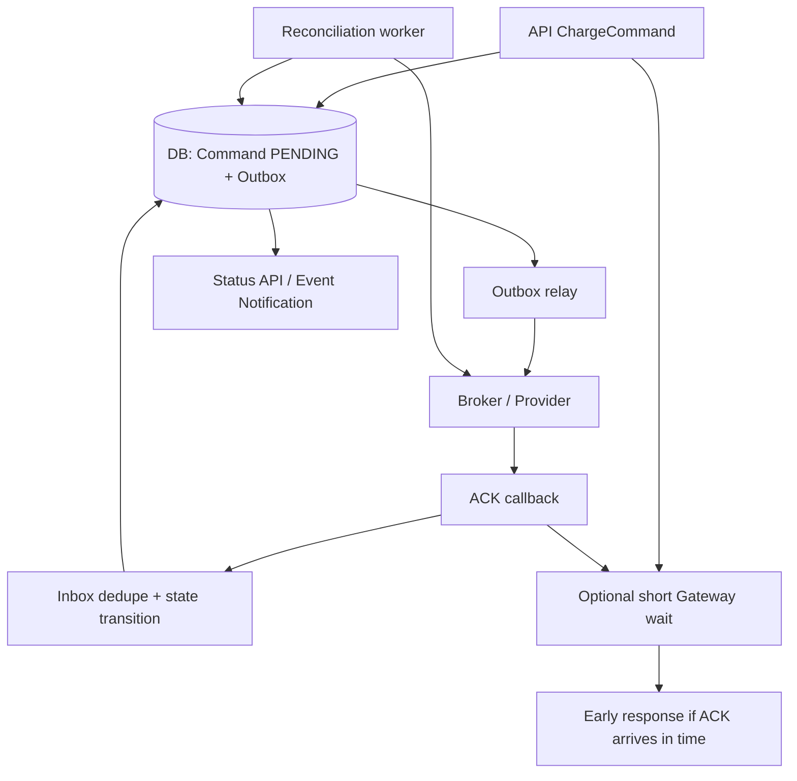
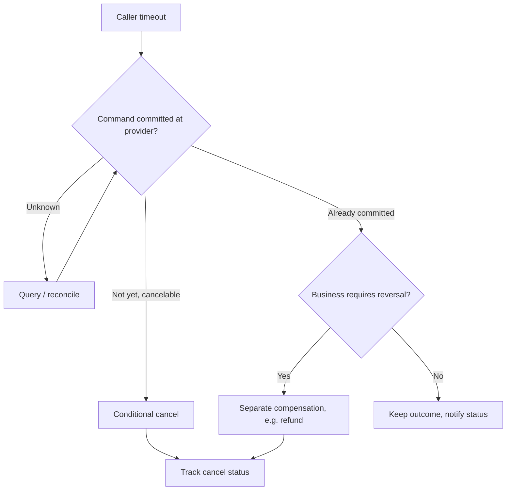
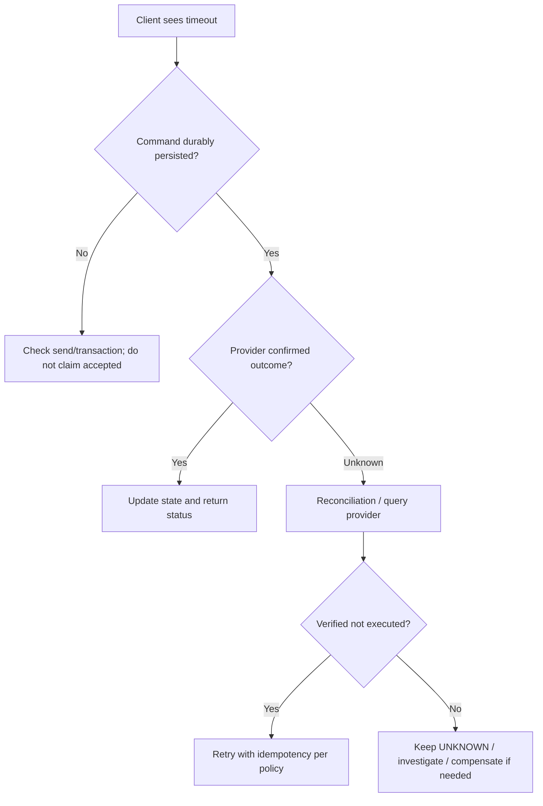

# Gateway Times Out While the Reply Still Triggers Side Effects

## 1. Problem: The Caller Stopped Waiting, Yet Business Logic Kept Running

In the **SPRING_INTEGRATION_PATTERN** module, we learn how to implement *Enterprise Integration Patterns* with Spring Integration to build loosely coupled and extensible message flows. When combining Router, Filter, Transformer, Splitter, Aggregator, Gateway, retry, error channel, and correlation into a system, **Gateway** serves as a convenient bridge between synchronous Java calls and underlying message processing.

A subtle bug appears when developers treat a **Gateway timeout** as a signal that the command was canceled. For example:

1. An API calls `chargeGateway.charge(command)` and only wants to wait at most 800 ms.
2. The Gateway sends `ChargeCommand` into an `ExecutorChannel`. A worker calls an external payment gateway.
3. After 800 ms, no reply has arrived; the Gateway returns `null` or throws `MessageTimeoutException` depending on configuration.
4. The API returns "no result yet" to the client.
5. In the second second, the worker **still completes the charge command**, writes to the database or sends a notification, and only then produces a reply.
6. The client assumes the prior attempt failed and re-sends the command. Without idempotency, the account can be charged twice.

**Root issue:** **A reply timeout is a limit on *how long the caller waits for an answer*, not a guarantee that processing is automatically canceled or already-executed side effects are rolled back**.

In this lesson, "side effects" include database writes, charging money, reservations, locking inventory, creating shipments, emitting events, or sending emails. These effects can occur **before** a reply is built, **after** the Gateway has timed out, or even after the HTTP client disconnected.

### Learning Objectives

After this lesson, you will be able to:

1. Distinguish `requestTimeout`, `replyTimeout`, HTTP client timeouts, and business execution deadlines.
2. Explain the difference between a single-thread synchronous Gateway and a flow handing off to another thread.
3. Determine why a late reply cannot be used to conclude a side effect did not happen.
4. Design command IDs, idempotency, `UNKNOWN` status, status queries, and reconciliation.
5. Organize error handling, retries, cancellation, compensation, and durable state at the proper boundaries.
6. Write tests proving the Gateway timed out **before** the worker committed its side effect.

## 2. Gateway Uses Two Different Timeouts

In Spring Integration Messaging Gateways, two common settings are:

| Property | What It Bounds | What It Does **Not** Bound |
| --- | --- | --- |
| `requestTimeout` | Wait time to **send the request into the input channel** if sending can block, such as a full bounded `QueueChannel` | Downstream service runtime, partner transaction time, or reply wait time |
| `replyTimeout` | Time the Gateway **waits to receive a reply** after the request was sent and control returned to the Gateway | Work still running on a worker, committed transactions, or effects in external systems |
| HTTP/gRPC client timeout | Bounds how long the client waits for an API response | Whether the backend or broker keeps working after the connection closes |
| Provider/adapter timeout | Bounds a specific network call or technical task | Whether the partner received and committed the side effect |
| Business `deadlineAt` | Deadline for completing a command under the application contract | Automatic cancellation or rollback without extra coordination |

Per Spring Integration documentation, a Gateway's `requestTimeout` only has clear effect when the channel can block `send()`; meanwhile, `replyTimeout` starts when the thread **returns to the Gateway side** to wait for a reply—**not necessarily** the instant the method was invoked.

Configuring `@Gateway(replyTimeout=800L)` does not mean the entire method always finishes within 800 ms. The underlying channel and threading model determine when—or whether—the Gateway ever enters the reply-wait phase.

### 2.1. Do Not Believe One "Timeout" Applies Everywhere

```text
HTTP deadline             3.0 s
Gateway request send      <= 0.2 s if channel can block
Gateway reply wait        <= 0.8 s after async hand-off
Provider call timeout     2.5 s
Business reconciliation   may extend past HTTP deadline
```

This is an **example of timers with different start points**, not a fixed additive execution schedule. Build an overall budget from your SLA and measure in practice. If a response must finish within 3 seconds, you cannot simply set `replyTimeout=3000` and ignore everything occurring before the Gateway begins waiting.

## 3. Two Threading Models Lead to Two Different Timeout Behaviors

### 3.1. Downstream Is All DirectChannel: Timeout Does Not Interrupt a Running Handler

With `DirectChannel` and chained synchronous handlers, the Gateway sends the request on **the caller's own thread**. If a Service Activator takes 5 seconds to return, that thread must wait for the handler to finish or throw; `replyTimeout=800ms` cannot forcibly abort a call running on the same thread.



Key takeaway: **`replyTimeout` is not a preemptive execution timeout for a slow synchronous handler**. If you need to bound provider calls, configure timeouts on the HTTP/database adapter and consider controlled asynchronous design.

### 3.2. With ExecutorChannel/Queue/Broker: Gateway Can Time Out Before the Worker

When the request is handed off to an `ExecutorChannel` or another asynchronous boundary, the Gateway can return and wait on the reply channel. Then `replyTimeout` takes effect: the caller stops waiting, **yet the worker is not automatically canceled**.

```mermaid
sequenceDiagram
    autonumber
    participant C as Caller
    participant G as Messaging Gateway
    participant Q as ExecutorChannel
    participant W as Payment worker
    participant P as Payment provider
    C->>G: charge(cmd), replyTimeout=800ms
    G->>Q: send(request)
    Q-->>G: Request handed off
    Q->>W: handle(cmd)
    W->>P: charge(commandId)
    Note over G,W: 800ms passes, worker still running
    G-->>C: null or timeout exception
    P-->>W: charge accepted, after 2s
    W->>W: Persist state / emit event
    W-->>G: late reply tries sending to replyChannel
    Note over G,W: Old caller is gone; late reply is not received by caller
```

Sending a reply to a temporary reply channel after timeout may find no consumer left or hit framework/version-specific late-reply handling. **Never rely on a late reply path to drive business operations**: persist processing state by `commandId` and expose results through a dedicated API/event.

### 3.3. Timeout Does Not Mean Cancel

One of the most common misconceptions is:

```text
Gateway timeout == worker stopped == provider charge rolled back
```

This chain of reasoning is **false**. A timeout only speaks to waiting duration. `Thread.interrupt()`, canceling a `Future`, network client timeouts, canceling a reactive subscription, or an HTTP disconnect **do not guarantee** out-of-process transactions stopped. Once the receiver committed, reversing it usually requires a **compensating command** with its own business rules.

## 4. `null`, `MessageTimeoutException`, and Business Errors Have Different Meanings

When waiting for a reply expires, a Messaging Gateway can return `null` by default; starting in Spring Integration **6.2**, `@MessagingGateway(errorOnTimeout=true)` lets you request a `MessageTimeoutException` instead of `null` (or send an `ErrorMessage` to an error channel if configured).

| Outcome Seen by Caller | What Can Be Concluded | What Must **Not** Be Concluded |
| --- | --- | --- |
| Gateway returns `null` on timeout | Caller received no reply within the configured limit | Command wasn't processed, transaction rolled back |
| `MessageTimeoutException` | Gateway didn't receive reply in time; clearer error representation | Side effect at worker/provider couldn't happen |
| `ReplyRequiredException` | Handler was required to reply but produced none | An external command was never executed |
| Provider returns `REJECTED` with matching correlation | A known business outcome | Should not turn this known outcome into a timeout |
| Provider reports connection error | Outcome could not be verified via that call | May have committed before connection dropped |
| Reply `ACCEPTED` received | Confirmation received from handler/provider | Does not prove all other downstream side effects completed |

**Defining states:** For operations like payments, `UNKNOWN`/`PENDING_CONFIRMATION` may be a reasonable outcome when the wait deadline expires, because **it is unknown** whether the receiver succeeded. Never turn a timeout unconditionally into `FAILED` without reconciliation.

### 4.1. Delivery Errors Do Not Replace Business Outcomes

`errorChannel` captures/routes exceptions from flows; it does not durably persist every `ChargeCommand` and does not restore an expired reply-wait session. If outcomes must never be lost, you need state persistence, a redelivery-capable message source, and duplicate handling.

## 5. Java: Gateway Configured With Timeouts and Async Hand-Off

The following example uses a Gateway with an explicit reply timeout, an `ExecutorChannel` so the worker runs independently, and a Service Activator invoking an adapter. The records are **illustrative types for a hypothetical system**, not built-in Spring Integration APIs.

### 5.1. Gateway Interface

```java
import org.springframework.integration.annotation.Gateway;
import org.springframework.integration.annotation.MessagingGateway;

record ChargeCommand(
        String commandId,
        String orderId,
        long amountMinor,
        String idempotencyKey) {
}

record ChargeReply(String commandId, String providerStatus) {
}

// Spring Integration 6.2+: timeout becomes an explicitly handleable error.
@MessagingGateway(errorOnTimeout = true)
public interface ChargeGateway {

    @Gateway(
            requestChannel = "chargeCommands",
            requestTimeout = 200L,
            replyTimeout = 800L)
    ChargeReply charge(ChargeCommand command);
}
```

When using `@MessagingGateway` in an application, register `@IntegrationComponentScan` on an appropriate configuration class so the framework generates the interface proxy. If on a version prior to 6.2, check Gateway API support for `errorOnTimeout` rather than assuming annotation support.

### 5.2. Async Channel With Bounded Executor

```java
import org.springframework.context.annotation.Bean;
import org.springframework.context.annotation.Configuration;
import org.springframework.integration.channel.ExecutorChannel;
import org.springframework.integration.config.EnableIntegration;
import org.springframework.integration.annotation.IntegrationComponentScan;
import org.springframework.messaging.MessageChannel;
import org.springframework.scheduling.concurrent.ThreadPoolTaskExecutor;

@Configuration
@EnableIntegration
@IntegrationComponentScan
public class ChargeFlowConfiguration {

    @Bean
    public ThreadPoolTaskExecutor chargeExecutor() {
        ThreadPoolTaskExecutor executor = new ThreadPoolTaskExecutor();
        executor.setCorePoolSize(4);
        executor.setMaxPoolSize(8);
        executor.setQueueCapacity(100);
        executor.setThreadNamePrefix("charge-worker-");
        return executor;
    }

    @Bean
    public MessageChannel chargeCommands(ThreadPoolTaskExecutor chargeExecutor) {
        return new ExecutorChannel(chargeExecutor);
    }
}
```

`ExecutorChannel` decouples execution threads from the Gateway. Configure capacity, rejection policy, and monitor backlogs; it does **not** durably persist messages across restarts. A task accepted by the executor also does not guarantee the provider received the charge or that a reply will arrive in time.

### 5.3. Service Activator Executing Business Logic and Returning Reply

```java
import org.springframework.integration.annotation.ServiceActivator;
import org.springframework.stereotype.Component;

@Component
public class ChargeHandler {
    private final ChargeApplicationService chargeService;

    public ChargeHandler(ChargeApplicationService chargeService) {
        this.chargeService = chargeService;
    }

    @ServiceActivator(inputChannel = "chargeCommands")
    public ChargeReply handle(ChargeCommand command) {
        // Hypothetical port defined by the project:
        // apply() must be idempotent by commandId/idempotencyKey,
        // persist/query state, and handle unknown outcomes.
        ChargeOutcome outcome = chargeService.apply(command);
        return new ChargeReply(command.commandId(), outcome.status());
    }
}
```

`ChargeApplicationService` and `ChargeOutcome` are application types you must implement; the snippet does not prove an external charge API supports idempotency. If `apply()` sends an HTTP request and times out, the handler still must query/reconcile per contract rather than inferring `REJECTED`.

**Key point:** if `apply()` already collected funds before the Gateway timed out, the Gateway returning an error to the caller **does not reverse those funds**. The handler can still build a reply after the client has stopped waiting.

## 6. Anti-Pattern: Retrying Immediately When Gateway Returns Timeout

```java
// ANTI-PATTERN: every timeout creates a new commandId and charges again.
public ChargeReply chargeTwiceOnTimeout(Order order) {
    try {
        return chargeGateway.charge(new ChargeCommand(
                "attempt-1", order.id(), order.amountMinor(), "idempotency-1"));
    } catch (MessageTimeoutException timeout) {
        // Dangerous: provider may have already charged attempt 1.
        return chargeGateway.charge(new ChargeCommand(
                "attempt-2", order.id(), order.amountMinor(), "idempotency-2"));
    }
}
```

The snippet illustrates the bug; `Order` and `chargeGateway` are hypothetical dependencies. Because the second attempt uses both a new command ID and a new idempotency key, the provider may treat this as **a completely separate charge**.

### 6.1. Why Simply Increasing Timeout Might Not Solve It

Raising `replyTimeout` from 800 ms to 10 seconds can lower timeout rates, yet more Gateway threads sit blocked waiting. When a broker/provider hangs for longer than 10 seconds, the problem persists; meanwhile the HTTP client may already have timed out earlier. Increasing timeouts is an **SLA/capacity decision**, not a solution for missing idempotency or unknown states.

### 6.2. Why Retry Advice Also Needs a Clear Contract

`RequestHandlerRetryAdvice` is helpful when technical errors are retryable. Yet if the retried operation is `charge()` with side effects, you must know:

- Is there a stable idempotency key per logical action?
- Does the provider guarantee returning the same result when called again with that key?
- If the response is lost after commit, is there a query API by `commandId`/provider reference to verify?
- Which timeout merely stops waiting, and which timeout actually prevents the command from executing?
- Is a new attempt allowed to create a new side effect, or only look up the previous one?

Retries must never be used to turn an unknown state into an assumed known state.

## 7. Proper Design: commandId, Idempotency, and Durable State

Identifiers should have clear, distinct roles:

| Identifier | What Is It For? | Notes |
| --- | --- | --- |
| `orderId` | Identifies the business entity | One order can have multiple commands or attempts. |
| `commandId` | Identifies a specific command or attempt | Used to query/reconcile the command after timeout. |
| `idempotencyKey` | Prevents a logical operation from repeating at the receiver | May need to **stay identical across re-sends** of the same action. |
| `correlationId` | Matches ACK/reply to the right command | Usually points to `commandId`, propagated across adapters. |
| `eventId` | Deduplicates callback/redelivery events | Kept stable across redeliveries. |
| `traceId` | Cross-service observability | Does not replace `commandId` or idempotency key. |

Example command payload:

```json
{
  "orderId": "order-42",
  "commandId": "charge-42-attempt-1",
  "idempotencyKey": "charge-order-42",
  "amountMinor": 125000,
  "currency": "VND"
}
```

If the system decides to **re-send the exact same charge action** because the result is unknown, it should generally keep the same `idempotencyKey` per provider contract and query prior status before issuing a brand-new charge. Different `commandId`s may be used per transport attempt while preserving a link to the **logical operation** and corresponding ACK correlation.

### 7.1. State Machine Instead of "Timeout = Failed"



This diagram shows **application rules**, not built-in integration states. Depending on contract, a Gateway timeout **does not necessarily** mutate command state right away: an independent business worker can keep it `PENDING` until an ACK arrives or the command deadline expires. What matters is that **a caller that stopped waiting receives an honest status**, and a place exists to query the final result.

### 7.2. Outbox, Inbox, and Status API

For systems that must resume across restarts:

1. In one database transaction, create `command_attempt(PENDING)` and an `outbox_event` holding the dispatch request.
2. An outbox relay sends the command to the broker, using publisher confirms where supported.
3. The receiving consumer processes the command by idempotency key and ACKs after durable persistence.
4. An ACK listener stores the event and deduplicates by `eventId` in an inbox, updating command state atomically.
5. Clients use `GET /charges/{commandId}` or callbacks/events to learn the result after the Gateway stops waiting.
6. A reconciliation worker checks commands stuck in `UNKNOWN`/`PENDING`, reconciling with the provider before deciding on retry/compensation.



In this model, the Gateway is an **early-response optimization**, not the sole source of business truth. When the Gateway times out or the JVM restarts, the database and outbox/inbox continue driving the workflow.

## 8. Races Between Timeout, Late ACKs, and Re-Sent Commands

A real-world race:

```text
t=0ms    API saves command charge-42, sends to provider
t=800ms  Gateway times out; client receives PENDING_CONFIRMATION
t=900ms  User clicks Retry in UI
t=1000ms Provider completes the first charge
t=1100ms First charge callback arrives; may redeliver due to broker redelivery
```

If the frontend generates a new command with a new `idempotencyKey`, two charges can both succeed. If the backend lets a late callback overwrite a state already finalized by another workflow path, data can also be clobbered.

### 8.1. Atomic State Transitions

An illustrative PostgreSQL schema:

```sql
CREATE TABLE charge_command (
    command_id       TEXT PRIMARY KEY,
    order_id         TEXT NOT NULL,
    idempotency_key  TEXT NOT NULL,
    state            TEXT NOT NULL,
    provider_ref     TEXT,
    deadline_at      TIMESTAMPTZ NOT NULL,
    updated_at       TIMESTAMPTZ NOT NULL,
    version          BIGINT NOT NULL DEFAULT 0
);

CREATE UNIQUE INDEX uq_charge_logical_operation
    ON charge_command (order_id, idempotency_key);

CREATE TABLE processed_charge_ack (
    event_id         TEXT PRIMARY KEY,
    command_id       TEXT NOT NULL,
    received_at      TIMESTAMPTZ NOT NULL
);
```

Application performs a conditional update:

```sql
UPDATE charge_command
SET state = 'CONFIRMED',
    provider_ref = :providerReference,
    updated_at = NOW(),
    version = version + 1
WHERE command_id = :commandId
  AND state IN ('PENDING', 'UNKNOWN');
```

If 0 rows are updated, inspect the current state: duplicate ACK, already-refunded command, mismatched key, or an anomaly needing investigation. Never emit `OrderPaid` a second time merely because the callback arrived again.

**Note:** The `(order_id, idempotency_key)` constraint illustrates a model where that pair is unique. When an application stores **multiple attempts** for one idempotency key, separate the **logical operation** table from the **attempt** table and adjust unique constraints accordingly. Do not copy the illustrative schema verbatim if one logical operation permits multiple attempts.

### 8.2. Inbox and Outbox Transactions

Inserting `processed_charge_ack(eventId)`, updating command state, and appending a business event to the outbox should occur **within the same database transaction** when they belong to one consistent state change. Only after commit should the message source be ACKed per design.

If a relay sends an event and crashes before marking it sent, the broker may receive the event twice; consumers need idempotency. Never claim "system-wide exactly-once" merely because a transaction exists or a broker supports internal transactional publishing.

## 9. Cancellation and Compensation: Two Different Actions

When a user closes a tab or a client times out, you may want to cancel the task. However, distinguish:

- **Stop waiting:** Gateway/caller stops waiting for a reply; the worker may still run.
- **Request cancellation:** sends a cancel signal/command; the worker checks state and can stop **if not yet at the commit point**.
- **Compensation:** once a side effect has committed, issues **a new business operation** such as a refund or releasing a reservation, with its own result, retries, and idempotency.



Never write logic like "catch `TimeoutException` and immediately call `refund()`" without knowing whether funds were charged. If the charge completes after the refund or the refund fails to find the transaction, state becomes tangled. You need correlation to the provider transaction, **idempotency for both charge and refund**, and explicit orchestration rules.

### 9.1. Canceling a Task in the JVM Does Not Guarantee Canceling External Work

`Future.cancel(true)`, `Thread.interrupt()`, canceling a reactive subscription, or `CompletableFuture` cannot guarantee an HTTP call or stored procedure halts at the desired instant. Cancellation is considered successful only when the worker/provider **confirms** it and no commit can still occur; otherwise, keep status as `UNKNOWN`/`CANCEL_PENDING` for reconciliation.

## 10. Gateway, Router, Filter, and Error Flow Errors Are Not Equivalent

| Symptom | Possible Actual Source | Handling to Consider |
| --- | --- | --- |
| Gateway exceeds `replyTimeout` | Slow worker, lost ACK, reply to wrong channel, no reply | Return `PENDING_CONFIRMATION`/explicit timeout error, save command ID, and reconcile. |
| `requestTimeout` when sending to channel | Bounded queue full or send blocked | Check whether enqueued successfully before resending; monitor queue. |
| Handler returns `null` | No reply message; may be business logic or bug | `requiresReply=true` if the contract mandates a reply. |
| Filter drops request | Never reaches reply-producing branch | `throwExceptionOnRejection` or rejected branch with explicit business outcome. |
| Router sends to wrong channel | Reply never returns to Gateway or request misses handler | Check correlation, mapping, default route, and channel resolution. |
| Worker throws async exception | Error occurs on another thread | Configure `errorChannel`/error flow, save command state, and never swallow errors. |
| Adapter call to provider times out | Provider-side side-effect status uncertain | Query provider by idempotency key/reference; do not blindly retry. |
| Reply arrives after Gateway stopped waiting | Reply is late yet worker may have committed | Persist result durably; do not rely on temporary reply channels. |

`errorOnTimeout=true` helps callers **distinguish** timeouts from ordinary `null` outcomes. It does **not** trigger rollbacks or worker cancellation. Likewise, adding `requiresReply=true` only changes handler behavior when no reply is produced; it does not verify business outcomes in external systems.

## 11. Reproducible Test: Gateway Times Out, Worker Still Commits

A useful test must prove **two events in order**:

1. The Gateway finished waiting and returned `null` or a timeout exception.
2. Afterward, the worker is allowed to proceed and commits the side effect.

Simply calling `Thread.sleep()` and asserting a count makes tests depend on thread scheduling and turn flaky. Use `CountDownLatch` to control the pre-commit gate.

### 11.1. Test Configuration With ExecutorChannel

```java
import java.util.concurrent.CountDownLatch;
import java.util.concurrent.atomic.AtomicInteger;
import org.springframework.context.annotation.Bean;
import org.springframework.context.annotation.Configuration;
import org.springframework.context.annotation.Import;
import org.springframework.integration.annotation.Gateway;
import org.springframework.integration.annotation.IntegrationComponentScan;
import org.springframework.integration.annotation.MessagingGateway;
import org.springframework.integration.annotation.ServiceActivator;
import org.springframework.integration.channel.ExecutorChannel;
import org.springframework.integration.config.EnableIntegration;
import org.springframework.messaging.MessageChannel;
import org.springframework.scheduling.concurrent.ThreadPoolTaskExecutor;

record DemoCharge(String commandId) {}

// Use default errorOnTimeout = false to assert a null reply.
@MessagingGateway
interface SlowChargeGateway {
    @Gateway(requestChannel = "slowChargeRequests", replyTimeout = 150L)
    String submit(DemoCharge command);
}

final class SlowChargeHandler {
    final CountDownLatch started = new CountDownLatch(1);
    final CountDownLatch allowCommit = new CountDownLatch(1);
    final CountDownLatch committed = new CountDownLatch(1);
    final AtomicInteger committedCount = new AtomicInteger();

    @ServiceActivator(inputChannel = "slowChargeRequests")
    public String charge(DemoCharge command) throws InterruptedException {
        started.countDown();
        if (!allowCommit.await(5, java.util.concurrent.TimeUnit.SECONDS)) {
            throw new IllegalStateException("Test setup did not release worker");
        }
        // Simulate side effect committed after Gateway stopped waiting.
        committedCount.incrementAndGet();
        committed.countDown();
        return "ACCEPTED"; // May become a late reply.
    }
}

@Configuration
@EnableIntegration
@IntegrationComponentScan(basePackageClasses = SlowChargeGateway.class)
@Import(SlowChargeHandler.class)
class SlowChargeTestConfig {
    @Bean
    ThreadPoolTaskExecutor slowChargeExecutor() {
        ThreadPoolTaskExecutor executor = new ThreadPoolTaskExecutor();
        executor.setCorePoolSize(1);
        executor.setMaxPoolSize(1);
        executor.setQueueCapacity(5);
        executor.setThreadNamePrefix("test-charge-");
        return executor;
    }

    @Bean
    MessageChannel slowChargeRequests(ThreadPoolTaskExecutor slowChargeExecutor) {
        return new ExecutorChannel(slowChargeExecutor);
    }
}
```

The types above live in **the same test package**; `@IntegrationComponentScan` discovers the Gateway interface and `@Import` registers the handler. The test itself intentionally simulates a side effect with a counter to prove the principle—it does **not** simulate real financial transactions.

### 11.2. JUnit 5 Verifying Timeout Happens Before Side Effect

```java
import static org.junit.jupiter.api.Assertions.*;

import java.util.UUID;
import java.util.concurrent.TimeUnit;
import org.junit.jupiter.api.Test;
import org.springframework.beans.factory.annotation.Autowired;
import org.springframework.test.context.junit.jupiter.SpringJUnitConfig;

@SpringJUnitConfig(SlowChargeTestConfig.class)
class LateReplySideEffectTest {
    @Autowired SlowChargeGateway gateway;
    @Autowired SlowChargeHandler handler;

    @Test
    void workerCanCommitAfterGatewayAlreadyTimedOut() throws Exception {
        try {
            // Worker is blocked on the latch, so Gateway cannot receive a reply.
            String reply = gateway.submit(new DemoCharge(UUID.randomUUID().toString()));
            assertNull(reply);

            assertTrue(handler.started.await(1, TimeUnit.SECONDS));
            assertEquals(0, handler.committedCount.get());

            // Gateway already returned, yet the worker can still proceed.
            handler.allowCommit.countDown();
            assertTrue(handler.committed.await(2, TimeUnit.SECONDS));
            assertEquals(1, handler.committedCount.get());
        } finally {
            handler.allowCommit.countDown(); // Avoid hanging worker if assertion fails.
        }
    }
}
```

This test must not be used to benchmark exact 150 ms timing across CI machines; its purpose is proving the **ordering relationship**: the reply already timed out, yet the side effect can still happen. A late reply later emitted by the Service Activator may be rejected or find no receiver on the temporary reply channel depending on framework mechanics. Thus the test does not assert that the client receives the late reply.

When enabling `@MessagingGateway(errorOnTimeout=true)` in Spring Integration 6.2+, replace `assertNull` with an assertion for the contracted timeout exception; the test must still prove the worker proceeds afterward. Do not coerce every exception into `MessageTimeoutException`, since bean/configuration errors have a different nature.

### 11.3. Extended Testing Matrix

| Test Case | Setup | What Must Be Verified |
| --- | --- | --- |
| Synchronous DirectChannel | Handler runs long on caller thread | `replyTimeout` does not forcibly abort a running handler. |
| Slow ExecutorChannel | Worker waits on latch longer than `replyTimeout` | Gateway stops waiting before worker completes. |
| Late reply | Worker returns reply after timeout | Old caller does not rely on late reply as business truth. |
| Client retry | Two requests with same logical operation/idempotency key | Provider/service does not create two charges. |
| Retry with new key | Two requests with different idempotency keys | Test demonstrates duplication risk without a policy. |
| Crash after provider commit | Provider confirms; app crashes before DB update | Reconciliation recovers outcome without re-charging. |
| Crash after DB commit, before ACK | Broker redelivers event | Inbox does not apply side effect twice. |
| Concurrent timeout and callback | Two threads update command state | Atomic transition; never overwrites with invalid state. |
| Cancel before/right at commit | Send cancel request as worker approaches side effect | Explicit cancel confirmation state; never assume interrupt = rollback. |
| Filter returns no reply | Filter drops message in request/reply flow | Gateway returns intentional timeout/error; error flow is observable. |
| Queue full | Bounded channel rejects additional messages | `requestTimeout` and retry policy tested separately. |
| HTTP client timeout | Client disconnects while worker still runs | Status API/notification provides outcome after old connection drops. |

Integration tests with real or simulated brokers/providers must check publisher confirms, ACKs, transactions, redeliveries, and database rows. You cannot prove exactly-once or recoverability solely with Gateway unit tests.

## 12. Observability: Separating "Caller Timeout" From "Business Completed"

If a dashboard counts Gateway timeouts as "payment failed", it can report failures while revenue was actually collected. Use two state axes:

| Axis | Example Values | Meaning |
| --- | --- | --- |
| **Gateway/caller outcome** | `REPLIED`, `REPLY_TIMEOUT`, `SEND_FAILED` | Outcome of one caller's request/reply interaction. |
| **Business command state** | `PENDING`, `UNKNOWN`, `CONFIRMED`, `REJECTED`, `REFUNDED` | Persisted/reconciled business truth by command ID. |

Example structured logs emitted by the application:

```text
event=command_created       commandId=C42 orderId=O42 state=PENDING
event=gateway_request_sent  commandId=C42 channel=chargeCommands
event=gateway_reply_timeout commandId=C42 waitMs=800
event=provider_ack          commandId=C42 providerRef=PX42 status=ACCEPTED
event=command_confirmed     commandId=C42 state=CONFIRMED
event=late_reply_observed   commandId=C42 callerWaiting=false
```

These lines are **not Spring Integration default logs**. Implementing them requires propagating correlation IDs through message headers and adapters; avoid logging tokens/PII, and never use `commandId` as an excessively high-cardinality metric label.

### 12.1. Useful Metrics and Alerts

- `gateway_reply_timeout_total` by flow/operation.
- `command_pending`/`command_unknown` counts and oldest command age.
- `provider_latency` distribution compared against `gateway_reply_wait` and HTTP deadlines.
- Rates of late ACKs, duplicate ACKs, and retries with same vs. different idempotency keys.
- Unpublished outbox backlog, inbox duplicates, DLQ counts, and reconciliation errors.
- Committed charges/refunds **independent** of successful Gateway replies.
- Executor queue depth, active threads, rejections, and end-to-end latency.

In particular, alert if "Gateway timeouts" rise while "provider confirmed" also rises: that signals **late outcomes**, not evidence that the provider is rejecting transactions.

## 13. Choosing a Response Model Matched to Processing Time

Not every business operation should wait for a synchronous reply:

| Duration and Requirements | Appropriate Approach | Notes |
| --- | --- | --- |
| Very fast, in-JVM, no hard-to-reverse side effects | Synchronous Gateway with proper timeout | Ensure handlers never block indefinitely; define error policy. |
| Usually fast, occasionally slow | Persist command ID and state durably; try short reply wait | Timeout returns unconfirmed status with a status query endpoint. |
| Over broker/provider, may take minutes | `202 Accepted` API, status URL, or callback/event | Do not hold threads waiting; let clients fetch final outcome. |
| Must finish across restarts | Outbox/inbox, idempotent consumer, reconciliation | Temporary replies are just a convenience, not source of truth. |
| Needs cancellation or compensation | Workflow/state machine with cancel/compensate conditions | Cancel does not auto-roll back committed side effects. |

For HTTP APIs, `202 Accepted` fits when a request is **accepted for processing** without a final outcome yet; return `commandId` or a status URL. If the command has not been durably saved yet, never promise the request is safely accepted just because the Gateway sent it into an in-RAM `ExecutorChannel`.

### 13.1. Illustrative API Contract

```http
POST /charges
Idempotency-Key: charge-order-42

HTTP/1.1 202 Accepted
Content-Type: application/json

{
  "commandId": "charge-42-attempt-1",
  "state": "PENDING_CONFIRMATION",
  "statusUrl": "/charges/charge-42-attempt-1"
}
```

This is an **illustrative protocol example**, not a default format provided by Spring Integration. An API can return 200/201 when the result is confirmed in time, yet it must clearly distinguish two states: "command accepted" and "executed successfully".

## 14. Diagnostic Procedure When Clients Time Out While Work Still Occurs

1. **Identify which timeout:** Gateway `replyTimeout`, send `requestTimeout`, HTTP client timeout, adapter/provider timeout, or business deadline?
2. **Identify threads:** Does the flow use `DirectChannel` end-to-end, or `ExecutorChannel`/QueueChannel/broker handing off to workers?
3. **Inspect message IDs:** Were `commandId`, `idempotencyKey`, `correlationId`, and `eventId` preserved across adapters/Transformers?
4. **Build a timeline:** timestamps of Gateway timeout, provider commit, ACK receipt, DB commit, and reply emission.
5. **Check the status store:** Does the command have durable state, outbox/inbox, and a reconciliation worker?
6. **Check retries:** Are clients/SDKs/retry advice generating new keys or repeating side effects?
7. **Check late replies:** Was the reply handled outside the old Gateway or dropped due to no remaining consumer? Never treat this as proof the provider failed.
8. **Fix error boundaries:** Rejections are business events; timeouts mean unconfirmed; routing/Filter bugs need error flows.
9. **Add controlled fault tests:** crashes, late replies, duplicate callbacks, and races between timeouts and ACKs.
10. **Monitor post-deployment metrics:** separate caller timeout rates from command completion rates.



## 15. Lab Exercise: Handling Callbacks Arriving After the Gateway Deadline

Build a `ReserveInventory` flow with a worker simulating delay and a `PENDING` state in the database:

1. Set Gateway `replyTimeout=500ms` with requests passing through a bounded `ExecutorChannel`.
2. Use a latch to pause the worker before commit; verify the Gateway stops waiting before the latch is released.
3. Release the worker after timeout; verify the reservation is written once even though the caller received a timeout.
4. Switch to a synchronous `DirectChannel`; explain why `replyTimeout` does not automatically interrupt the running method.
5. Add `commandId` and `idempotencyKey`; send the same command twice and prove stock is not reserved twice.
6. Simulate the provider committing and then losing connection before the reply; return `UNKNOWN` and query the provider before retrying.
7. Send late and duplicate callbacks/ACKs; persist `eventId` in an inbox, perform conditional state updates, and never emit `InventoryReserved` twice.
8. Simulate a user canceling a reservation while no result exists yet; distinguish pre-commit cancel from post-commit reservation release.
9. Add a Status API or callback so users can verify the final outcome even after the original Gateway timed out.
10. Add logs/metrics separating `gateway_reply_timeout`, `reservation_committed`, `duplicate_ack`, and `reconciliation_completed`.

**Self-Assessment Questions**

- Why does a Gateway `replyTimeout` not always cut short a synchronous `DirectChannel` chain?
- If the Gateway returned `null`, what do you know for sure about the provider?
- Why does a `MessageTimeoutException` not mean the command was canceled?
- When is retrying with a new `commandId` yet the same `idempotencyKey` appropriate?
- Why should you never immediately issue a refund command when a charge call times out?
- Is a late reply sent to a temporary reply channel the source of truth for a transaction?
- Why does `errorChannel` not replace a command state table?
- If the HTTP client times out before the Gateway, what can happen?
- Which message-loss or duplicate-side-effect windows do outbox and inbox respectively close?
- Which log/metric fields are needed to distinguish caller timeouts from committed charges?

## 16. References

- [Spring Integration Reference — Messaging Gateways](https://docs.spring.io/spring-integration/reference/gateway.html): `requestTimeout`, `replyTimeout`, direct/multithreaded flow behavior, Gateways without replies, and timeout handling.
- [Spring Integration Javadoc — @Gateway](https://docs.spring.io/spring-integration/docs/6.5.0/api/org/springframework/integration/annotation/Gateway.html): per-method send/receive reply timeouts.
- [Spring Integration Javadoc — @MessagingGateway](https://docs.spring.io/spring-integration/docs/6.5.0/api/org/springframework/integration/annotation/MessagingGateway.html): `errorOnTimeout` since 6.2 and default timeout settings.
- [Spring Integration Javadoc — MessagingGatewaySupport](https://docs.spring.io/spring-integration/docs/6.5.0/api/org/springframework/integration/gateway/MessagingGatewaySupport.html): reply timeout and error channel handling mechanics.
- [Spring Integration Reference — Message Channels](https://docs.spring.io/spring-integration/reference/channel.html): `DirectChannel`, `ExecutorChannel`, and sync/async boundaries.
- [Spring Integration Reference — Error Handling](https://docs.spring.io/spring-integration/reference/error-handling.html): distinguishing synchronous, asynchronous exceptions, and `errorChannel`.

> **Takeaway:** **A Gateway timeout only ends waiting for a reply; it does not prove the worker or provider stopped executing the command.** For operations with side effects, use idempotency, correlation, durable state, status queries, and reconciliation. Retry or compensate only after determining business state—never solely because the caller ran out of wait time.
