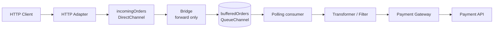
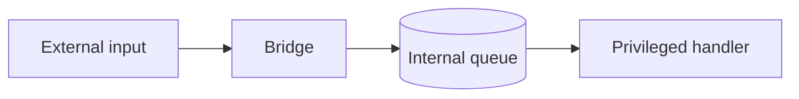
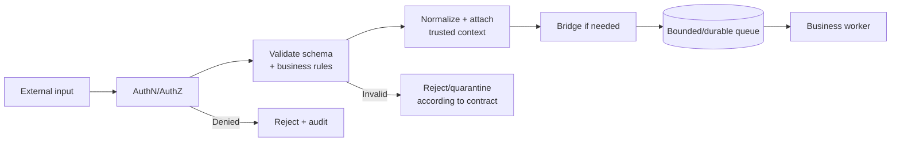
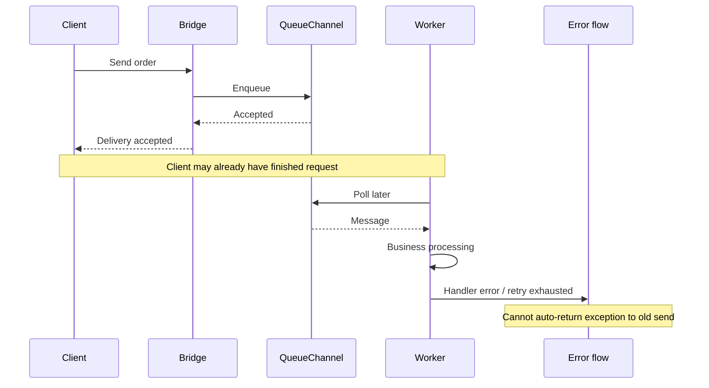
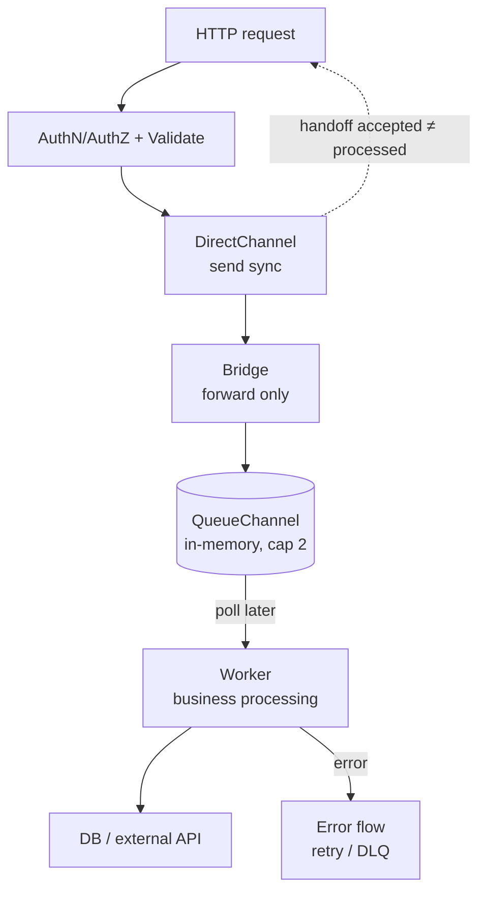

# Bridge Hiding the Real Communication Boundary

## 1. Common Architectural Mistake: Channels Are Connected, Yet the Handoff Boundary Vanishes

A Spring Integration application receives orders from an HTTP gateway, pushes them into a queue, checks them with a Filter, normalizes them via a Transformer, and uses a Router to send to payment or inventory services. The development team adds a **Bridge** to connect two channels so the flow stays concise:

```text
httpIngress -> Bridge -> ordersBuffer -> paymentWorker -> paymentGateway
```

Later, a dashboard shows `httpIngress.send(...)` returned success. The operations team concludes the order reached the payment service. In reality, the message may have only **entered `QueueChannel`**, not yet picked up by a worker, not yet validated, not yet committed, and prone to loss on JVM shutdown if the queue sits only in memory.

This is the mistake of **"a Bridge hiding the real communication boundary"**: the diagram shows one seamless line, yet omits changes in **message ownership, threads, processing timing, durability, errors, transactions, ACKs, and each party's responsibilities**.

This lesson belongs to the **Common Mistakes** chapter of module **SPRING_INTEGRATION_PATTERN**. The module teaches how to implement Enterprise Integration Patterns (EIP) with Spring Integration to build loosely coupled, extensible message flows—practicing Router, Filter, Transformer, Splitter, Aggregator, Gateway, retry, error channel, and correlation, along with testing and monitoring processing branches.

After this lesson, you will be able to:

1. Explain accurately that a Bridge connects channels and does **not** automatically add delivery guarantees.
2. Identify sync/async boundaries when bridging `DirectChannel` to `QueueChannel` or `ExecutorChannel`.
3. Design distinct **accepted, persisted, processed, and acknowledged** contracts.
4. Show where validation, authorization, timeouts, retries, error channels, and transactions belong.
5. Maintain traceability using correlation IDs, audits, metrics, and labeled topologies.
6. Test cases where the Bridge forwarded a message while downstream has not yet processed it, plus failure scenarios.
7. Decide when to use a Bridge versus a Gateway, Adapter, Transformer, Router, or a more explicit service contract.

## 2. What Does a Bridge in Spring Integration Actually Do?

**Messaging Bridge** is an EIP pattern connecting two messaging paths, forwarding a message from a source channel to a target channel. In Spring Integration, you can use the DSL `.bridge()` to create a forwarding endpoint in a flow.

A conceptual example:

```java
@Bean
IntegrationFlow bridgeFlow() {
    return IntegrationFlow.from("incomingOrders")
            .bridge()
            .channel("bufferedOrders")
            .get();
}
```

A Bridge fits when the intent is purely **forwarding messages** between two channels without business transformation. However, the name "bridge" does not mean it automatically:

- Verifies the sender is authorized to act.
- Validates payload schema or business validity.
- Persists messages to durable storage.
- Creates a cross-system transaction.
- Waits for downstream consumers to finish processing.
- Generates a business acknowledgement or HTTP caller reply.
- Guarantees exactly-once, idempotency, or cross-cluster ordering.
- Wraps errors of every subsequent endpoint and routes them to one shared error channel.

A Bridge can **preserve the meaning of the forwarded message**, yet actual operational guarantees depend on **the channel types and endpoints at both ends**. Before adding a Bridge, answer the question: **after forwarding completes, who owns the message?**

### How Does a Bridge Differ From Neighboring Components?

| Component | Primary Purpose | When to Consider |
| --- | --- | --- |
| **Bridge** | Forward messages between channels | Need to connect flows while intentionally keeping business content unchanged |
| **Gateway** | Provide a request/reply interface or flow entry contract | Caller needs results, timeouts, and clear error semantics |
| **Channel Adapter** | Connect an external system to a message channel | Involves HTTP, broker, file, JDBC, mail, or external services |
| **Transformer** | Change payload structure/type | Two sides have different data contracts |
| **Filter** | Block or pass messages by condition | Need policy-based validation or filtering |
| **Router** | Decide target channel/branch | Multiple processing paths depending on message properties |
| **Service Activator** | Execute business processing | Need to invoke services, run checks, or trigger side effects |

Never cram complex business logic into a Bridge and still call it a "harmless connector"; nor should you use a Bridge to disguise communication across bounded contexts that have independent versioning and recovery requirements.

## 3. Analyze Communication Boundaries Before Drawing Diagrams

Explicitly mark **who sends, who receives, what channel types exist, where messages reside, when results arrive, and who retries**.



Despite the continuous arrows, there may be three very different boundaries:

| Boundary | Event That Actually Occurred | What Is Not Yet Proven |
| --- | --- | --- |
| Client -> API | Request arrived and passed ingress | Payload accepted under contract, durably persisted |
| DirectChannel -> Bridge -> QueueChannel | Message moved to a buffering channel | Worker processed it, DB committed, partner received it |
| QueueChannel -> Polling consumer -> Gateway | A consumer picked up the message and called downstream | External party returned success, side effect is idempotent |

**Common point of confusion:** `DirectChannel` usually invokes subscribers on the sender thread, whereas `QueueChannel` buffers messages for a polling consumer to pull later. Therefore, a Bridge connecting these two channels **does not erase the difference in processing timing**. If `send` returns once `QueueChannel` accepts the message, the caller may already be gone before downstream runs.

### Write Contracts in Business Language

Avoid naming an API method simply `processOrder()` if it actually only enqueues. Names and responses should state precisely:

- `submitOrder(...)`: receives the request and can return an error if unaccepted.
- `acceptForProcessing(...)`: confirms receipt at the published guarantee level.
- `processOrder(...)`: use only when the contract genuinely covers the business outcome.
- `getOrderStatus(id)`: allows reconciling asynchronous processing status.

If HTTP returns `202 Accepted`, define whether "accepted" means **placed into an in-memory buffer**, **committed to a durable broker**, or **persisted as a DB record**. The same HTTP status code carries totally different guarantees if the contract stays vague.

## 4. Channel Types Change What a Bridge Means

A Bridge does not determine all path characteristics. The two connected ends determine a great deal.

| Channel Type | Typical Behavior | Risk If Undocumented |
| --- | --- | --- |
| `DirectChannel` | Synchronous dispatch to subscriber, usually same thread | Caller assumes whole flow finished even though Bridge hands off to a queue |
| `QueueChannel` | Buffers messages for consumer `receive()` or later polling | Acceptance does not equal processing; queue can fill or lose data on restart |
| `ExecutorChannel` | Hands work to an executor, usually off-thread | `send()` can return before handler completes; errors happen on another thread |
| `PublishSubscribeChannel` | Sends to multiple subscribers | Must evaluate each subscriber's errors, order, and executor config |
| Channel with `MessageStore` | Can store messages off-heap/out-of-memory | Durability depends on store, transactions, TTL, and commit semantics |
| Broker via outbound/inbound adapter | Crosses process/network boundaries | Requires ACK contracts, serialization, versioning, retries, partitions, and DLQ |

Never call a Bridge a "network bridge" just because it sits between two architectural layers on a diagram. A `BridgeHandler` within one `ApplicationContext` **does not magically bridge JVM A to JVM B**. Cross-process communication requires explicit transport adapters/gateways with defined guarantees and failure modes.

### 4.1. A Full Queue Is Not a "Self-Healing" Error

If `bufferedOrders` has finite capacity and is full, forwarding via a Bridge can be rejected, blocked, or fail depending on timeout and channel config. Explicitly design behavior for **the Bridge's sender** and upstream adapters.

An anti-pattern:

```java
// API intake path: never checks handoff outcome.
incomingOrders.send(message);
return "ORDER_PROCESSED";
```

The return value of `send` only expresses channel acceptance under the send contract; it does not verify the payment worker finished. When the Bridge/`QueueChannel` has trouble, errors can surface as `MessageDeliveryException` or another rejection signal. Never silently swallow errors and ACK upstream.

### 4.2. Message Ordering Does Not Cross Every Boundary

Queues can feel FIFO, yet with multiple consumers, executors, or retries, **completion order** can diverge from **enqueue order**. If the business requires ordering per account/order ID, design partitioning/correlation, concurrency limits, or resequencing as needed. A Bridge provides no system-wide ordering guarantee.

## 5. Verifiable Example: Bridge Connecting DirectChannel to QueueChannel

This model is deliberately minimal to expose the boundary. Messages are accepted into a buffer while **no business worker runs**. Thus tests prove you must not equate Bridge forwarding success with business success.

Assumes Spring Boot 3.x, Java 17+, Spring Integration managed by Spring Boot:

```gradle
dependencies {
    implementation("org.springframework.boot:spring-boot-starter-integration")
    testImplementation("org.springframework.boot:spring-boot-starter-test")
}
```

Create `BridgeBoundaryConfiguration.java`:

```java
package example.bridgeboundary;

import org.springframework.context.annotation.Bean;
import org.springframework.context.annotation.Configuration;
import org.springframework.integration.channel.DirectChannel;
import org.springframework.integration.channel.QueueChannel;
import org.springframework.integration.config.EnableIntegration;
import org.springframework.integration.dsl.IntegrationFlow;
import org.springframework.messaging.MessageChannel;

@Configuration
@EnableIntegration
public class BridgeBoundaryConfiguration {

    @Bean
    public MessageChannel incomingOrders() {
        return new DirectChannel();
    }

    @Bean
    public QueueChannel bufferedOrders() {
        // In-memory capacity only, not durability.
        return new QueueChannel(2);
    }

    @Bean
    public IntegrationFlow orderBridgeFlow() {
        return IntegrationFlow.from("incomingOrders")
                .bridge()
                .channel("bufferedOrders")
                .get();
    }
}
```

**Explanation:**

- `incomingOrders` is a `DirectChannel`. Senders dispatch synchronously to the Bridge endpoint under `DirectChannel` semantics.
- `.bridge()` represents the message forwarding step.
- `bufferedOrders` is a `QueueChannel` of capacity 2; messages must later be pulled by another consumer.
- **There is no Filter, validator, DB persistence handler, or payment handler** in this flow. Even an invalid payload passes right through.
- All data in the demo `QueueChannel` resides in memory; when the JVM dies, there is no guarantee messages survive.

### Test 1: Forwarded to Queue Does Not Mean Processed

Create `BridgeBoundaryTest.java`:

```java
package example.bridgeboundary;

import static org.assertj.core.api.Assertions.assertThat;

import org.junit.jupiter.api.Test;
import org.springframework.beans.factory.annotation.Autowired;
import org.springframework.beans.factory.annotation.Qualifier;
import org.springframework.integration.channel.QueueChannel;
import org.springframework.messaging.Message;
import org.springframework.messaging.MessageChannel;
import org.springframework.messaging.support.MessageBuilder;
import org.springframework.test.context.junit.jupiter.SpringJUnitConfig;

@SpringJUnitConfig(BridgeBoundaryConfiguration.class)
class BridgeBoundaryTest {

    @Autowired
    @Qualifier("incomingOrders")
    MessageChannel incomingOrders;

    @Autowired
    @Qualifier("bufferedOrders")
    QueueChannel bufferedOrders;

    @Test
    void sendAcceptedOnlyMeansBufferedNotProcessed() {
        Message<String> order = MessageBuilder
                .withPayload("ORD-101")
                .setHeader("correlationId", "batch-77")
                .build();

        boolean accepted = incomingOrders.send(order);

        assertThat(accepted).isTrue();

        // No business consumer exists yet; message is only waiting in queue.
        assertThat(bufferedOrders.getQueueSize()).isEqualTo(1);

        Message<?> queued = bufferedOrders.receive(0);
        assertThat(queued).isNotNull();
        assertThat(queued.getPayload()).isEqualTo("ORD-101");
        assertThat(queued.getHeaders().get("correlationId"))
                .isEqualTo("batch-77");
    }

    @Test
    void bridgeDoesNotValidateBusinessPayload() {
        Message<String> malformed = MessageBuilder
                .withPayload("NOT_AN_ORDER_ID")
                .build();

        assertThat(incomingOrders.send(malformed)).isTrue();

        Message<?> queued = bufferedOrders.receive(0);
        assertThat(queued).isNotNull();
        assertThat(queued.getPayload()).isEqualTo("NOT_AN_ORDER_ID");
    }
}
```

The second test intentionally sends invalid data across a Bridge **without validation**. That demonstrates a gap in the minimal topology, not a configuration to expose directly to the Internet. If an ingress adapter accepts untrusted input, validate and authorize at the proper boundary before considering the message accepted under contract.

In a test suite sharing one context across tests, ensure queues are drained or tests are isolated so they do not depend on execution order. A `QueueChannel` holding leftover messages from a previous test will skew capacity assertions.

### Extended Test 2: Testing Overload Errors at the Queue Itself

To test `QueueChannel` semantics, you do not have to route through a Bridge: you can directly exercise a small-capacity channel with timeout 0 in an isolated test context.

```java
QueueChannel small = new QueueChannel(1);

Message<String> one = MessageBuilder
        .withPayload("ORD-1").build();
Message<String> two = MessageBuilder
        .withPayload("ORD-2").build();

assertThat(small.send(one, 0)).isTrue();
assertThat(small.send(two, 0)).isFalse();
assertThat(small.getQueueSize()).isEqualTo(1);
```

This proves the target channel can reject messages when out of capacity. With a Bridge in between, **do not guess the exact exception/timeout surfaced to the caller without checking the specific Bridge, channel, and adapter config**. Still, the mandatory business contract remains the same: when a message is unaccepted, the source must know and have a way to retain it.

## 6. Bridge Obscures Differences Between Accepted, Persisted, and Processed

A dashboard showing only `"Bridge forwarded successfully"` is insufficient. Separate these columns:

| Status | Signal / Evidence | What Can Be Concluded |
| --- | --- | --- |
| `RECEIVED` | Inbound adapter received request/message | System observed data at ingress |
| `ACCEPTED` | Target channel accepted the message | Message crossed that handoff boundary |
| `PERSISTED` | Durable broker/store committed per contract | Evidence exists to survive designed failure modes |
| `PROCESSING` | Consumer dequeued and began handler | Work is currently executing |
| `PROCESSED` | Business side effect confirmed | Work completed under explicit criteria |
| `ACKNOWLEDGED` | Source ACKed/committed | Delivery confirmed per adapter |
| `FAILED` / `UNKNOWN` | Error or insufficient evidence | Requires redelivery/reconciliation policy |

These statuses are a **recommended operational model**, not statuses automatically emitted by a Bridge or Spring Integration. The ordering of `PERSISTED`, `PROCESSED`, and `ACKNOWLEDGED` can vary by architecture and transaction design—which is precisely why it must be documented in the contract.

### HTTP Response Example

If an order intake API returns `202 Accepted` right after a Bridge pushes to an in-memory `QueueChannel`, clients may believe the order is safely persisted. If the JVM crashes before a consumer processes it, no durable store holds the message for recovery.

A better contract:

1. Define the API's true acceptance threshold, such as "durably committed to the broker".
2. Emit the corresponding success response only after reaching that published threshold.
3. Return a request ID / idempotency key so callers can poll status and safely retry on timeout.
4. When durable persistence fails, return an explicit error status; never silently treat it as handled.

No general pattern guarantees exactly-once merely by inserting a Bridge into a flow.

## 7. Validation and Authorization Must Sit at Real Boundaries

A Bridge simply forwards messages; it has no idea whether the sender is allowed to place orders for a tenant or whether payloads satisfy schemas.

Uncontrolled topology:



If the downstream handler has permission to charge payments or write to DB, bridging external messages straight into an internal queue **opens an unverified business execution path**. Naming an internal channel `internalOrders` does not enforce authorization.

Safer topology:



When designing:

- Authenticate identities at HTTP/broker boundaries using appropriate mechanisms.
- Authorize by tenant, operation, environment, topic, and resource.
- Validate schemas and size limits before entering long-lived queues.
- Never trust client-supplied `tenantId` or `role` headers unless verified and reconstructed in a trusted context.
- Attach system-controlled correlation/trace IDs or verify them per contract.
- Avoid mutating raw payloads without reconcilability; if transforming, keep needed references.
- Strictly guard any bridge toward a control channel or error channel: **business messages must never become SpEL control expressions** due to miswired channels.

A Bridge is not the place to invent an obscure "permission filter". Use adapters, Filters, Transformers, or service boundaries with clear ownership.

## 8. Error Propagation and Error Channels: Where Do Errors Go?

This is another boundary frequently masked by the Bridge abstraction.

### 8.1. Inside a Synchronous Chain

When a `DirectChannel` invokes a Bridge and forwarding to the next channel fails **synchronously**, the exception can propagate back to the sender. If the downstream handler also sits on the same synchronous `DirectChannel` chain, the handler's exception can bubble back to the caller.

Still, never assume every exception goes to the global `errorChannel`. An error channel receives `ErrorMessage`s only where the framework or application **actually publishes** errors.

### 8.2. After Crossing Into Asynchronous Processing

If a Bridge feeds into a `QueueChannel`, the caller may already finish before the polling consumer processes the message. Failures in the consumer later **do not automatically turn into synchronous exceptions on the earlier send call**.

Define clearly:

- Which error handler and error channel does the polling endpoint use?
- Is `RequestHandlerRetryAdvice` attached?
- Once retries exhaust, does the error flow write to DLQ/quarantine or only log?
- Are `failedMessage`, original payload, and correlation ID preserved?
- If a Gateway is waiting for a reply, what are its timeout and error rules?
- Is there a queryable status so clients can learn final outcomes?



**Never equate `send() == true` with "downstream never fails".** Send outcomes apply only under the channel contract and synchronous steps that genuinely completed.

## 9. Transaction, ACK, and Durable Storage Boundaries

Example of an inbound adapter receiving messages from a broker:

```text
Broker record
   -> inbound adapter
   -> DirectChannel
   -> Bridge
   -> in-memory QueueChannel
   -> polling worker
   -> database
```

If the adapter **ACKs the broker as soon as the message enters the in-memory queue**, crashing before the worker writes to DB can lose data. Conversely, if the broker is not ACKed due to a transaction rollback and redelivers the message, downstream may receive duplicates.

A Bridge does not automatically solve either problem.

| Failure Point | Risk | Required Mitigation |
| --- | --- | --- |
| Before target channel accepts | Source thinks message delivered though unaccepted | Never falsely ACK/commit; return error or retry delivery |
| Inside in-memory `QueueChannel`, unprocessed | JVM restart wipes buffer | Durable broker/store or keep message at source |
| Committed DB, broker not yet ACKed | Broker redelivers; duplicate side effects | Idempotency keys, unique constraints, reconciliation |
| Worker repeatedly errors | Queues/backlogs and retries grow | Retry budget, backoff, DLQ/quarantine, alerting |
| Bridge connects two distinct stores | No cross-resource transaction | Outbox/inbox or properly designed & tested transaction strategy |

Never use the phrase "the Bridge guarantees exactly-once". If deduplication is required, inspect both **delivery semantics** and **business side effects**. A stable idempotency key, audit trail, and proper transactions matter far more than simply forwarding messages between channels.

### When Is a Durable Channel or Broker Needed?

If messages must survive restarts, scale across multiple instances, or cross process boundaries, contract-backed durable storage is mandatory. An in-memory `QueueChannel` is appropriate only when the application **tolerates data loss** or another source retains the original for replay.

Even having a `MessageStore` or broker does not automatically ensure correctness: evaluate ACK policies, commit timing, retention, serializer/version compatibility, authorization, dead-lettering, and idempotency. A Bridge cannot replace these architectural decisions.

## 10. Headers, Correlation IDs, and Traceability

To trace how many Bridges a message crossed and where it was processed, use **identifiers that stay stable across steps**:

- `businessId` or `orderId`: business identity, usable for idempotency when appropriate.
- `correlationId`: links requests, batches, or Splitter/Aggregator fragments.
- `sourceSystem` and `receivedAt`: identify ingress source and timestamp.
- `schemaVersion`: aids deserialization, recovery, and replay.
- `originalPayloadRef`: safe reference to original payload if reconciliation is needed.
- `traceId`: connects spans and logs when using distributed tracing.

**Do not put full trust in `MessageHeaders.ID`.** Creating new messages, transforming, or replaying can generate new message IDs. Maintain a stable application key if business requirements demand tracing across hops and retries.

Example creating a message at ingress:

```java
Message<String> order = MessageBuilder
        .withPayload("ORD-101")
        .setHeader("correlationId", "batch-77")
        .setHeader("schemaVersion", 1)
        .setHeader("sourceSystem", "orders-http")
        .build();
```

Note: headers traveling through a message pipeline are not automatically **trustworthy**, especially headers originating from external HTTP or brokers. Security fields must be verified/rebuilt at ingress, and sensitive payloads or headers must never leak into metrics/logs.

### A Minimal Audit Record

```json
{
  "event": "MESSAGE_HANDOFF",
  "correlationId": "batch-77",
  "boundary": "incomingOrders->bufferedOrders",
  "fromChannel": "incomingOrders",
  "toChannel": "bufferedOrders",
  "handoffResult": "ACCEPTED",
  "durable": false,
  "processed": false
}
```

These fields are an **application-defined log model**. Setting `durable=false` in the demo makes clear that an in-memory `QueueChannel` does not guarantee survival across restarts. In production, flags should reflect runtime evidence from the broker/store; never set `durable=true` just because a channel name contains "queue".

## 11. How Bridges Create Hidden Coupling

A Bridge looks like a thin connector yet can create hidden coupling between two teams:

1. **Schema coupling:** Team A changes payload from `String` to `OrderCommand`; the Bridge does not convert it. Team B receives the wrong type.
2. **Timeout coupling:** Team A has 200 ms to answer HTTP; Team B adds 30 seconds of retries after the queue. Results cannot return over the old request without reply design.
3. **Ordering coupling:** Team B enables parallel workers, altering completion order; Team A assumed end-to-end FIFO.
4. **Security coupling:** A trusts a `tenantId` header; B uses that header to look up resources without verification.
5. **Error-handling coupling:** B's failures land on a poller error channel while A has no status query API.
6. **Deployment-version coupling:** A deploys a new schema before B; the queue holds incompatible messages.
7. **Capacity coupling:** B's throughput drops, queue fills, and A lacks a backpressure policy.

The Bridge did not invent these risks out of thin air. The problem is **missing boundary contracts**, leaving risks concealed behind an innocent-looking connector.

### Fix: Document the Handoff Contract

At minimum, have documentation or tests specifying:

| Question | Example Verifiable Answer |
| --- | --- |
| What is the input contract? | `OrderCreated` schema version 2, max payload size |
| Who is authorized to send? | Only authenticated Service A within tenant scope |
| When is it considered accepted? | After durable store/broker commit succeeds |
| What are max timeouts? | HTTP 500 ms; enqueue 100 ms; async processing |
| What if the queue is full? | Reject/503 or nack; source retains message |
| Where do consumer errors go? | Retry 3 times, then quarantine/DLQ and audit |
| How is status queried? | Correlation ID + status API |
| Is ordering preserved? | Per `orderId`; no cross-tenant ordering promised |
| How are replays handled? | Idempotent, with approval/attempt caps |
| During new version rollouts? | Support schema v1/v2 during transition window |

An explicit contract lets both teams evolve internals more independently, **aligning with the loose-coupling goal** of Enterprise Integration Patterns.

## 12. When a Bridge Accidentally Connects Sensitive Channels

Certain channels have special roles, such as `errorChannel` or channels feeding a Control Bus. Connecting them with a Bridge without checking message contents/origins can cause much worse damage than a normal business queue.

### 12.1. Bridging Straight Into Control Bus

```text
Untrusted inbound payload
    -> Bridge
    -> controlChannel
    -> Control Bus evaluates SpEL
```

This is a severe risk: client payloads could be evaluated as bean control expressions. Never use a Bridge to forward arbitrary client SpEL strings into a Control Bus. Build an admin API with a **fixed command allowlist, authentication/authorization, auditing**, and strict limits on which flows can send to control channels.

### 12.2. Bridging Error Channel Into a Business Channel

`ErrorMessage` typically carries a `Throwable` payload. Forwarding it directly to a handler expecting `OrderCommand` can cause type errors and error loops. Error handling requires an explicit **error flow** to classify errors, extract `failedMessage` when present, and route to quarantine/DLQ/metrics per policy.

### 12.3. Bridging Into a QueueChannel With No Consumer

Messages are accepted and accumulate until the queue fills or the JVM runs out of memory. Monitor queue depth, oldest message age, active consumer counts, and endpoint status. A Bridge never substitutes for confirming the receiving side can consume.

## 13. Flow Diagrams and Observability Must Show Handoff Points

To avoid misleading diagrams, label every boundary:



Diagrams should show:

- **Channel type:** Direct, Queue, Executor, PublishSubscribe, and store backing.
- **Thread boundary:** where callers hand off to different workers.
- **Process boundary:** whether communication crosses brokers/networks.
- **Durability boundary:** where exactly data is durably persisted.
- **Acknowledgment boundary:** at which step the source ACKs.
- **Error path:** which exceptions return to caller vs. enter error flows.
- **Reply path:** how Gateways/requesters obtain business outcomes.
- **Ownership:** which service owns retaining and recovering messages.

When a flow strings multiple Bridges together, never count endpoints and declare "observed". Observe **evidence at each handoff** and actual consumer state.

### Recommended Metrics

| Suggested Metric | What It Detects |
| --- | --- |
| `handoff_accepted_total` | Messages accepted at the boundary |
| `handoff_rejected_total` | Messages rejected by target channel |
| `channel_send_duration` | Time sender threads spend blocked/waiting |
| `queue_depth` and `queue_capacity` | Buffer filling up or missing consumers |
| `oldest_message_age` | Messages waiting past SLA |
| `worker_inflight` | Messages dequeued but unfinished |
| `worker_completed_total` | Business completion; never confuse with enqueue |
| `worker_failed_total` | Failures after handoff |
| `error_channel_backlog` | Error path is also backed up |
| `retry_attempts_total` | Repeated work amplifying load |
| `aggregator_pending_groups` | Incomplete Splitter/Aggregator branches |

These are **suggested metric names**, not built-in metrics emitted by all Spring Integration setups. When implementing with Micrometer and tracing, use low-cardinality labels; never put payloads or individual message IDs into metric tags.

## 14. Impact of Bridges on Other EIPs

| EIP | Wrong Assumption When Bridge Hides Boundary | What Design Should Clarify |
| --- | --- | --- |
| **Router** | Bridging then routing means all branches processed | Each branch has its own queue, retries, and state |
| **Filter** | Payloads crossing a Bridge are implicitly valid | Validate before or after at explicit points; manage discards |
| **Transformer** | Schemas don't change across a Bridge | If contracts differ, use Transformers and versioning |
| **Splitter** | One message entering a queue stays one unit of work | Fan-out produces many fragments; size capacity by fragment count |
| **Aggregator** | Empty queue means batch is done | Incomplete correlation groups may still be waiting |
| **Gateway** | Successful send equals successful request/reply | Requires explicit reply/error channels and deadlines |
| **Retry** | Bridge retries automatically when receiver fails | Retries belong on handlers/adapters with explicit budgets |
| **Error channel** | All exceptions from Bridge and downstream return to one place | Sync and async paths have different error semantics |
| **Correlation** | Message IDs never change | Use stable business/correlation keys across transforms/replays |

With Splitter in particular, one incoming message can fan out into dozens of fragments. Bridging to an intermediate queue does not prevent **missing or failing fragments** from leaving an Aggregator waiting until timeout. Monitor release strategies, group expiration, and fragment compensation/replay.

## 15. When Should You Keep a Bridge vs. Replace It?

**Keep a Bridge** when it simply connects two channels within the same bounded context and all of these are clear:

- The sole goal is forwarding messages with no schema change or business decision.
- Responsibilities on both ends are documented in a contract.
- Channel types, threads, timeouts, retries, durability, and error paths are observable and tested.
- It creates no shortcut to sensitive handlers, Control Bus, or unauthorized resources.

**Replace the Bridge or add dedicated steps** when:

- The two sides have different schemas/versions: use a Transformer and contract tests.
- Authentication and authorization are needed: enforce boundaries in secure adapters/services.
- Filtering/routing is needed: use Filter/Router with discard paths and tests.
- Request/reply is needed: use a Gateway with explicit timeout/reply/error semantics.
- Cross-process communication is needed: use an explicit broker/adapter/transport rather than assuming Bridge provides networking.
- Crash survival is needed: use a durable store/broker with ACKs/transactions.
- Business services must run: use Service Activators/handlers with proper retries and idempotency.

A safe refactoring process:

1. **Redraw the current topology** with channel types and every Bridge.
2. **Mark real boundaries** (thread/process/transaction/security/durability).
3. **Document contracts** for every handoff: accepted, persisted, processed, error.
4. **Add verification tests** for current behavior, including timeouts and invalid messages.
5. **Place validation/authorization at the right boundary** before altering bridges.
6. **Separate error channels and status query paths** for asynchronous processing.
7. **Replace segments incrementally** without unintended changes to reply/error behavior.
8. **Compare before/after metrics**: ingress, queue depth, processed, DLQ, latency.
9. **Test redelivery/replay** with idempotency and realistic data.
10. **Update diagrams and runbooks** so operators do not misread status.

## 16. Incident Runbook: "API Succeeded, Yet Orders Disappeared"

During an incident, never patch it merely by adding another Bridge or raising `QueueChannel` capacity. Diagnose boundary by boundary:

1. **Confirm input message:** do you have request ID, source record, schema version, and correlation ID?
2. **Locate acceptance point:** did the adapter/`DirectChannel` receive it, and did the Bridge forward to the target channel?
3. **Check channel type:** in-memory `QueueChannel` or durable broker? Did any instance restart in that window?
4. **Inspect the queue:** is the message waiting, are consumers attached, what are backlog, oldest age, full queues, or send timeouts?
5. **Inspect consumers:** are workers running, polling, holding in-flight tasks, retrying, or failing?
6. **Inspect downstream:** did the database/partner API execute side effects, time out, or return errors?
7. **Inspect error paths:** where are `ErrorMessage`s published, and are `failedMessage` and raw references preserved?
8. **Inspect ACK/commit:** when did upstream ACK? Could redelivery, duplicates, or loss between commits happen?
9. **Reconcile:** use business/idempotency keys and data stores to determine whether the message still exists or partially processed.
10. **Recover safely:** replay from durable sources if available; never blindly re-send when unsure whether side effects already happened.

Record findings in a table tracking `RECEIVED / ACCEPTED / PERSISTED / PROCESSING / PROCESSED / ACKNOWLEDGED`. If evidence is missing for a milestone, mark `UNKNOWN` instead of inferring success because the Bridge logged no errors.

## 17. Pre-Release Review Checklist

- [ ] Every Bridge has a clear rationale and explicit source/target channel names.
- [ ] Diagrams specify channel types, thread boundaries, and process boundaries.
- [ ] APIs never treat `send() == true` as proof of completed business processing.
- [ ] Validation and authorization sit at untrusted source boundaries.
- [ ] Messages are never arbitrarily bridged into a Control Bus or error channel.
- [ ] Schema, version, and payload size contracts are defined.
- [ ] Queue-full policy exists: bounded wait, reject, backpressure, or durable buffering.
- [ ] Durability is backed by real store/ACK/transaction evidence, not inferred from channel names.
- [ ] Policies exist for retries, error flows, DLQ/quarantine, and message recovery.
- [ ] Correlation IDs and original payload references exist when business reconciliation needs them.
- [ ] Idempotency keys exist for messages subject to redelivery/replay.
- [ ] Tests cover cases where send succeeds while downstream has not yet run.
- [ ] Tests verify post-async-boundary errors are not misattributed to the old caller.
- [ ] Metrics track queue depth, oldest age, worker in-flight, processed, and error counts.
- [ ] Runbooks exist for schema rollouts and stopped workers.

## 18. Lab Exercises

**Exercise 1 — Distinguish accepted vs. processed.** Run `BridgeBoundaryConfiguration`, send an order, and then only read from `QueueChannel`. Explain why `send()` returning true does not mean a business handler ran.

**Exercise 2 — Forgotten validation.** Send `NOT_AN_ORDER_ID` through the Bridge. Observe it enters the queue anyway, add a validation step with an explicit discard/error flow, and verify invalid messages are rejected per contract.

**Exercise 3 — Survival across restarts.** Compare bridging to an in-memory `QueueChannel` vs. a broker/durable store. Design a crash test after handoff but before processing, specifying when the source ACKs and how replay works.

**Exercise 4 — Bounded queue.** Set capacity to 1 and generate a burst of messages. Define send timeouts, rejection outcomes, and how the source retains data when enqueuing fails.

**Exercise 5 — Request/reply.** An HTTP caller wants payment confirmation within 3 seconds, yet the worker behind the queue occasionally runs for 10 seconds. Redesign the API or Gateway/reply contract, distinguishing timeouts from business failures.

**Exercise 6 — Untrusted headers.** Clients send `tenantId` and `role` in headers. Add an ingress step to authenticate and rebuild trusted metadata; explain why a Bridge is not a security filter.

**Exercise 7 — Splitter/Aggregator.** One message splits into 10 fragments and crosses a Bridge into a queue. One fragment errors/times out. Add metrics and correlation-group handling so it does not wait indefinitely.

**Exercise 8 — Incident tracing.** Emit event logs per handoff with correlation ID, boundary, and accepted/persisted/processed flags. When a worker stops, pinpoint where the message sits from logs and metrics without guessing.

## 19. Self-Assessment Questions

1. Does a Bridge automatically add validation, authorization, or transactions?
2. What is the difference between a Bridge connecting `DirectChannel` to `DirectChannel` vs. `DirectChannel` to `QueueChannel`?
3. Why does `send() == true` not prove a payment handler ran successfully?
4. Does a Bridge inside one Spring context automatically create cross-process communication?
5. When a worker behind a `QueueChannel` fails, does the exception automatically propagate to the already-completed HTTP request?
6. If a `QueueChannel` resides only in memory, what risk arises on JVM restart?
7. Why should `accepted`, `persisted`, `processed`, and `acknowledged` be separated in monitoring?
8. Why is bridging an untrusted source directly into a Control Bus dangerous?
9. With Splitter/Aggregator, does a queue depth of 0 prove all correlation groups completed?
10. What signs indicate a Bridge should be replaced with a Gateway, Adapter, or Transformer?
11. Which metadata must be preserved to trace messages across channels, transformers, and replays?
12. If producers outpace consumers, where should the overload policy live and who owns it?

**Takeaway:** **A Bridge is a channel connector, not a complete communication contract**. A loosely coupled Spring Integration architecture is truly safe only when every handoff point defines clear ownership, execution timing, security, durability, ACKs, retries, error paths, and observability. Expose real boundaries in your topologies, tests, and metrics; never let a Bridge arrow make the system report "processed" while messages are only sitting in a queue.
