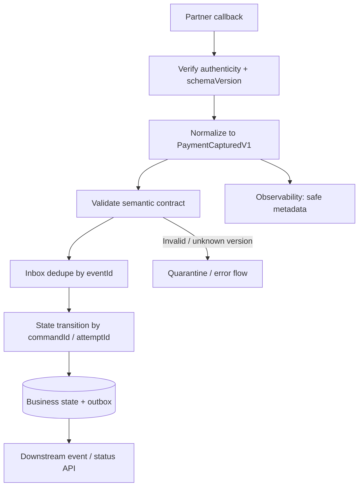
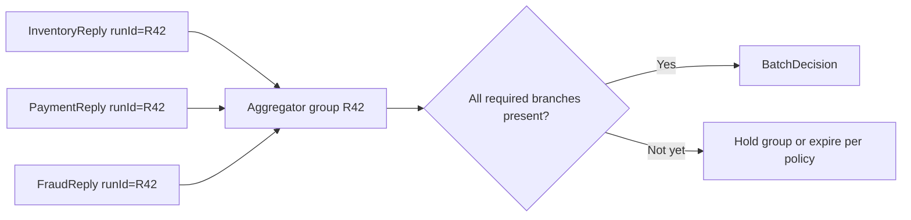
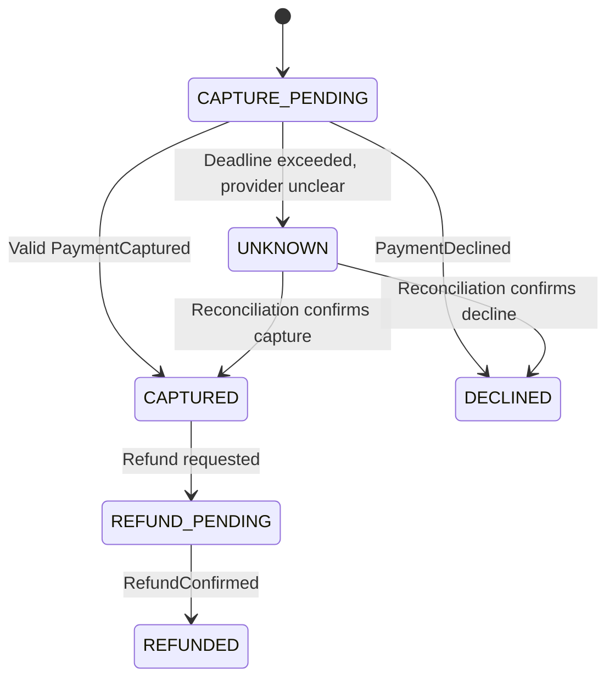

# Using Patterns to Mask an Unclear Message Contract

## 1. Problem: The Flow Has Every Pattern, Yet Still Processes Incorrectly

In the **SPRING_INTEGRATION_PATTERN** module, the goal is implementing *Enterprise Integration Patterns* with Spring Integration to create loosely coupled, extensible, testable, and observable message flows. Router, Filter, Transformer, Splitter, Aggregator, Gateway, retry, error channel, and correlation provide useful mechanics, yet **they cannot fix an ill-defined message contract on their own**.

Consider a system receiving payment callbacks:

```json
{
  "id": "42",
  "type": "paid",
  "amount": 125000,
  "time": "2026-11-21T08:00:00Z"
}
```

The development team adds a Router to pick channels by `type`, a Filter to drop "invalid" messages, a Transformer to rename fields, an Aggregator to join callbacks, retry advice to retry on errors, and an error channel to receive exceptions. Every component can be configured, yet fundamental questions remain unanswered:

- Is `id` the **order ID**, payment ID, event ID, or callback delivery ID?
- Does `paid` mean **authorized**, **captured**, or **settled**?
- Is `amount=125000` in major units or minor units of which currency? Does it include fees?
- Is `time` the transaction timestamp, callback creation time, or consumer receipt time?
- Can callbacks arrive **twice**, **out of order**, **after timeout**, or from a **different schema version**?
- When a Router has no mapping or a Filter drops a message, is permanent discard allowed?
- Does "processed successfully" mean message received, sent to a channel, written to the ledger, or entire workflow completed?

No pattern can answer these on behalf of producer and consumer. When those questions remain unclear, piling on more patterns usually only **hides the problem behind complex configurations and error branches**.

> **Principle:** **A message contract is an input to integration design, not an accidental byproduct of wiring EIPs together.** Before routing, filtering, transforming, aggregating, or retrying, agree on what event the message represents, which fields are required, validity conditions, identities, and delivery rules.

### Lesson Objectives

After this lesson, you will be able to:

1. Recognize signs that a complex pipeline is compensating for ambiguous message schemas or semantics.
2. Design a contract covering **payload, metadata, versioning, timestamps, identities, correlation, idempotency, and errors**.
3. Distinguish commands, events, and replies; avoid confusing "received" with "executed".
4. Place validation/normalization at the proper boundaries and use Router/Transformer/Gateway in their right roles.
5. Specify behavior for duplicate, out-of-order, missing-field, unsupported-version, or late messages.
6. Write contract tests and migration plans before changing production flows.

## 2. Recognizing the Anti-Pattern From Symptoms

| Symptom | Common Pattern "Band-Aid" | Underlying Contract Problem Hidden |
| --- | --- | --- |
| Consumers interpret `paid` differently | Add per-consumer Routers/Filters | Business event state was never defined. |
| One ID field carries multiple meanings | Add complex correlation expressions | Event ID, command ID, business ID, and attempt ID are not separated. |
| Old messages break on schema changes | Chain multiple Transformers and fallbacks | No versioning and compatibility convention. |
| Aggregator groups never release | Raise timeout or force release after N messages | Required result set and group completion convention are unknown. |
| Gateway frequently times out while provider succeeds | Retry once more and raise `replyTimeout` | Missing `UNKNOWN` state, idempotency, and business deadline. |
| Orders processed twice | Add a payload Filter before the handler | Missing stable event ID and durable deduplication policy. |
| Messages "disappear" | Route errors/unknowns to `nullChannel` | No explicit reject, quarantine, DLQ, and alerting policy. |
| Impossible to explain wrong outcomes | Attach a Wire Tap logging full payloads | Missing reason codes, versions, correlation, and loggable data rules. |
| Side effect ran yet ACK failed | Enable unconditional retry advice | Missing delivery and idempotency contract across external boundary. |

**Using many patterns is not a flaw by itself.** A complex flow may be appropriate if it solves a genuinely complex problem. The mistake is **failing to specify accurately what constitutes a valid message and expected outcome**, forcing every EIP to guess.

## 3. What Layers Make Up a Message Contract?

Do not view a contract merely as a JSON Schema file. A schema defines shape and data types, whereas a good integration contract also specifies **meaning, ownership, workflow, timing, and errors**.

| Contract Layer | Question to Answer | Example |
| --- | --- | --- |
| **Business meaning** | What does the message declare happened or must happen? | `PaymentCaptured` confirms funds were captured by the provider. |
| **Schema** | Which fields are required, what types, which enums/ranges are valid? | `amountMinor` is a positive integer; `currency` is ISO 4217 code. |
| **Identity** | How are event, command, aggregate, and attempt identified? | `eventId`, `commandId`, `orderId`, `paymentAttemptId`. |
| **Timing** | What do occurrence time, receipt time, and deadlines mean? | `occurredAt` is when provider confirmed capture, in UTC. |
| **Versioning** | When adding/removing/redefining fields, do consumers stay compatible? | `eventType=PaymentCaptured`, `schemaVersion=1`. |
| **Delivery** | Can duplicates, late arrivals, reordering, or disconnects occur? | Consumer supports **at-least-once** and dedups by `eventId`. |
| **Outcomes / errors** | Which ACKs are business outcomes; which errors are retryable? | `CAPTURED`, `DECLINED`, `UNKNOWN` are distinct states. |
| **Security** | Who may read payloads/headers; which fields may be logged? | Never put PAN, CVV, or tokens into diagnostic events. |
| **Operations** | Who owns the schema, tracks contract violations, and handles rollbacks? | Contract tests, versioning, DLQ, and named owner. |

### 3.1. Commands, Events, and Replies Do Not Replace One Another

```text
Command: CapturePayment(commandId, amountMinor, currency)
    Meaning: "Please execute capture"; does not yet say it succeeded.

Event: PaymentCaptured(eventId, commandId, captureReference, ...)
    Meaning: "Capture occurred" per producer's definition.

Reply: CaptureAccepted(commandId, processingStatus)
    Meaning: may only confirm the request was received, not that funds were collected.
```

A Gateway receiving an `ACCEPTED` reply does not prove the producer emitted a valid `PaymentCaptured`. Clarify whether it means **"accepted for processing"** or **"completed"**, along with transaction milestones and authoritative source.

The Gateway pattern handles request/reply; it does not define the meaning of an acknowledgement for you.

### 3.2. Payloads and Transport Headers Have Different Roles

- **Payload** should carry the minimal business facts an independent consumer needs.
- **Headers** can carry `correlationId`, `replyChannel`, `errorChannel`, routing keys, or tracing metadata for integration.
- **Envelope** on a broker/API can carry `eventId`, `eventType`, `schemaVersion`, `occurredAt` outside the payload.
- **Contract** must state where each field lives, because HTTP/JMS/Kafka/AMQP do not necessarily preserve all Spring Message headers across adapters.

Never make a business consumer depend on internal headers like `MessageHeaders.ID` if events can be reconstructed during redelivery or message transformation. A Spring message ID is not automatically a **durable event ID**.

## 4. Rewriting the Example Into an Explicit Contract

Suppose the business decides to emit `PaymentCaptured` only once the provider confirms capture. A version 1 event can be specified as:

```json
{
  "eventType": "PaymentCaptured",
  "schemaVersion": 1,
  "eventId": "evt-cap-00042",
  "commandId": "cmd-cap-00042",
  "paymentAttemptId": "pay-attempt-00042",
  "orderId": "order-42",
  "amountMinor": 125000,
  "currency": "VND",
  "providerCaptureRef": "provider-cap-910",
  "occurredAt": "2026-11-21T08:00:00Z"
}
```

Here:

- `PaymentCaptured` **only** states capture was confirmed by the provider; it does not imply the order shipped or ledger settlement finished.
- `eventId` is issued by the producer and stays **stable** for one logical event; broker redeliveries must keep the same ID.
- `commandId` links the outcome to the earlier capture command.
- `paymentAttemptId` distinguishes payment attempts; `orderId` is the order identity.
- `amountMinor` is **the smallest unit of `currency`**. For `VND`, in this model one minor unit is one dong. Avoid ambiguous `amount` or floating-point numbers for money.
- `providerCaptureRef` supports looking up/reconciling the external transaction; it is not a secret token.
- `occurredAt` is the business event timestamp at the defined source, in UTC. Consumers can store `receivedAt` separately.

### 4.1. Contracts Must Include Invariants

| Rule | How to Verify |
| --- | --- |
| `eventType` must be `PaymentCaptured` with supported version | Validate at boundary; never route unknown versions to "success". |
| IDs and provider reference are non-blank | Reject/quarantine if missing; never fabricate fake IDs to fill gaps. |
| `amountMinor > 0` and valid `currency` | Validate types/values; reconcile against issued command. |
| `commandId` and `paymentAttemptId` match a waiting record | Reject updating wrong aggregate or wrong attempt. |
| Duplicate callback with same `eventId` never runs side effects twice | Inbox / idempotent handler. |
| Event arriving when already `REFUNDED` needs explicit policy | Audit/reconcile; never overwrite back to `CAPTURED`. |
| Every committed event has an SLA-compliant delivery path | Outbox/broker/durable subscription per requirements. |

**Contracts must name exact producer and consumer owners.** Never force each consumer to guess whether `paid` means authorization, capture, or settlement.

## 5. Diagram: Patterns in Their Proper Roles Once the Contract Is Locked



Now each EIP has clear boundaries:

- **Transformer** normalizes structure without inventing business meaning.
- **Filter/Validator** checks technical conditions without silently swallowing mandatory commands/events.
- **Router** routes by normalized event type or field.
- **Aggregator** gathers parts per predefined correlation and release policy.
- **Gateway** provides a request/reply interface with timeouts; wait expiration does not cancel side effects.
- **Retry/error channel** handles transport failures and diagnostic routing; cannot fix a missing contract.
- **Application service** manages state transitions, idempotency, transactions, and emitting subsequent events.

## 6. Java: Internal Message Types With Verifiable Semantics

The example below uses Java 17+ and records. Types are illustrated modularly so they can fit into a project's domain package; they are not built-in Spring Integration types.

```java
import java.time.Instant;

record PaymentCapturedV1(
        String eventId,
        String commandId,
        String paymentAttemptId,
        String orderId,
        long amountMinor,
        String currency,
        String providerCaptureRef,
        Instant occurredAt) {
}
```

Validation does not rely solely on JSON parsing succeeding. Extract a pure Java contract class:

```java
import java.util.Currency;

final class PaymentCapturedContract {
    private PaymentCapturedContract() {}

    static void validate(PaymentCapturedV1 event) {
        if (event == null
                || blank(event.eventId())
                || blank(event.commandId())
                || blank(event.paymentAttemptId())
                || blank(event.orderId())
                || blank(event.providerCaptureRef())
                || event.occurredAt() == null
                || event.amountMinor() <= 0) {
            throw new IllegalArgumentException(
                    "PaymentCapturedV1 missing required field or invalid value");
        }

        if (blank(event.currency())
                || !event.currency().matches("[A-Z]{3}")) {
            throw new IllegalArgumentException("currency must be uppercase ISO 4217");
        }

        try {
            Currency.getInstance(event.currency());
        } catch (IllegalArgumentException invalidCurrency) {
            throw new IllegalArgumentException(
                    "unsupported currency", invalidCurrency);
        }
    }

    private static boolean blank(String value) {
        return value == null || value.isBlank();
    }
}
```

This validator checks **syntax and minimal value domains**. It does not prove a provider actually captured funds; that requires callback origin verification (signatures, source identity, protocol) and matching against internal commands. Also specify policies for skewed timestamps, product-supported currencies, and matching command amounts.

### 6.1. Contracts Should Avoid Ambiguous Fields

Avoid types like:

```java
record GenericEvent(
        String id,
        String type,
        Object value,
        String status,
        Object extra) {
}
```

`Object` types, generic `value` fields, or unbounded `status` strings force each consumer to cast or infer differently. You may use a shared transport envelope, yet **business payloads still need schemas and semantics per event type**.

## 7. Normalization Boundary: Transformers Must Not "Invent" Contracts

Suppose a partner adapter receives callbacks in its own schema. Once the callback's **source is authenticated** and classified as **capture succeeded**, it can be converted into an internal event.

```java
import java.time.Instant;

record PartnerCapturedNotification(
        String providerEventId,
        String commandReference,
        String attemptReference,
        String orderReference,
        long capturedMinor,
        String currencyCode,
        String captureReference,
        Instant capturedAt) {
}
```

```java
import org.springframework.integration.IntegrationMessageHeaderAccessor;
import org.springframework.integration.annotation.Transformer;
import org.springframework.integration.support.MessageBuilder;
import org.springframework.messaging.Message;
import org.springframework.stereotype.Component;

@Component
public class CapturedEventNormalizer {

    @Transformer(inputChannel = "verifiedPartnerCaptures",
                 outputChannel = "validatedCapturedEvents")
    public Message<PaymentCapturedV1> normalize(
            PartnerCapturedNotification source) {
        PaymentCapturedV1 event = new PaymentCapturedV1(
                source.providerEventId(),
                source.commandReference(),
                source.attemptReference(),
                source.orderReference(),
                source.capturedMinor(),
                source.currencyCode(),
                source.captureReference(),
                source.capturedAt());

        PaymentCapturedContract.validate(event);

        // Copy only contracted metadata; never copy all external headers.
        return MessageBuilder.withPayload(event)
                .setHeader("eventType", "PaymentCaptured")
                .setHeader("schemaVersion", 1)
                .setHeader("eventId", event.eventId())
                .setHeader(
                        IntegrationMessageHeaderAccessor.CORRELATION_ID,
                        event.commandId())
                .build();
    }
}
```

In this example, `verifiedPartnerCaptures` is **a channel where the adapter already verified callback signatures/authentication and classified status properly**, not raw unverified callbacks from the Internet. If the provider only sent `AUTHORIZED`, the normalizer must never rewrite it into `PaymentCaptured`. If a provider **lacks a durable event ID**, design a deterministic way to derive/store a stable ID from verified transaction identifiers; never generate a fresh UUID on every redelivery and call it deduplication.

`MessageBuilder.withPayload(...)` intentionally creates a new Spring message with only controlled headers. Avoid `MessageBuilder.fromMessage(raw)` when the raw message carries `Authorization`, cookies, or headers disallowed downstream; that method can copy headers from the input message.

## 8. Routers and Filters Only Enforce Explicit Policies

Once a message is validated, a Router can pick a branch from a normalized value. For example, ledger adapters split by system-supported currency:

```java
import org.springframework.integration.annotation.Router;
import org.springframework.stereotype.Component;

@Component
public class CapturedEventRouter {

    @Router(inputChannel = "validatedCapturedEvents")
    public String selectLedgerChannel(PaymentCapturedV1 event) {
        return switch (event.currency()) {
            case "VND" -> "domesticCapturedEvents";
            case "USD" -> "foreignCapturedEvents";
            default -> "unsupportedCapturedCurrency";
        };
    }
}
```

These channels must be declared by the application with matching handlers. `unsupportedCapturedCurrency` should **not** default to `nullChannel`: this is a provider-confirmed event the system lacks a handler for yet; it must be recorded, alerted on, and resolved.

### 8.1. Why `Filter` Is Not "Data-Cleansing" Magic

Consider a Filter:

```spel
payload != null && payload.status == 'paid'
```

If a payload lacks `status`, the Filter may reject or fail evaluation depending on config. If `paid` means different things across two providers, the Filter will silently drop or mistakenly keep messages. **Value definitions and rejection conditions belong in the contract**, not left to an expression to "figure out".

Separate three outcomes:

1. **Valid:** continue processing the message.
2. **Business rejection:** emit a `Rejected(reasonCode)` result or corresponding event.
3. **Contract violation / unrecognized:** route to quarantine/error flow; never equate with valid rejection.

For financial messages, untracked discards are a design flaw even when a Filter or Router is syntactically valid.

## 9. Correlation, Sequencing, and Release: Metadata Must Have Meaning

An Aggregator works properly only if it knows **which messages belong to the same group** and **when the group is complete**. You cannot choose a sound `CorrelationStrategy` or `ReleaseStrategy` if the contract fails to answer:

- Does a `batchId` represent one processing request or a new retry run?
- What are the exact names of the three expected replies? Are any branches optional?
- If one branch does not reply, emit a partial result or expire?
- If two callbacks from the same branch arrive, which message counts?
- When a late ACK arrives after group completion, reconcile or discard?



A Splitter can automatically populate `CORRELATION_ID`, `SEQUENCE_NUMBER`, and `SEQUENCE_SIZE` for child messages. However, callbacks from three external partners **do not automatically carry those headers**. Simply raising `groupTimeout` or using `group.size()==3` lets duplicate messages release the group while `FRAUD` is still missing. Define groups using a lifecycle-stable ID, required branch set, and missing/duplicate rules before configuring the Aggregator.

## 10. Retries, Error Channels, and Timeouts Cannot Fix Ambiguous Semantics

A contract must specify retryable cases and completion criteria:

| Scenario | Should Retry? | What Contract Must Clarify |
| --- | --- | --- |
| Transient broker/network error | Yes, bounded with backoff | `eventId` stays unchanged on redelivery; when does ACK/commit occur? |
| Schema/version mismatch | Never retry same payload forever | Which versions consumers support; what is the quarantine/DLQ path? |
| Provider returns `DECLINED` | Usually a business outcome, not a connection error | Distinguish decline from capture/authorization. |
| Gateway exceeds `replyTimeout` | Never assume failure | Worker may still create side effects; query by command ID. |
| Duplicate ACK | Never re-execute side effect | Inbox/idempotency keyed by stable event ID. |
| Out-of-order events | May need buffering, reconciliation, or rejection | Which ordering is guaranteed; by `attemptId` or version? |
| Unroutable message | Fail fast/quarantine per policy | Never silently send to `nullChannel`. |
| Downstream commits then crashes before broker ACK | Broker may redeliver | Consumer must be idempotent; never promise exactly-once across DB and broker. |

With synchronous `DirectChannel`s, exceptions normally propagate to the sender. With `ExecutorChannel`s, pollers, or inbound adapters, exceptions can go to `errorChannel`/error flows on another thread. **`ErrorMessage` reports processing failures**—it does not fix schemas, infer business outcomes for you, or guarantee durable message replay.

### 10.1. "At Least Once" Must Pair With Idempotency

Producers may resend after disconnects or crashes. Consumers should process stable event IDs:

```sql
CREATE TABLE consumed_event (
    consumer_name VARCHAR(100) NOT NULL,
    event_id      VARCHAR(128) NOT NULL,
    consumed_at   TIMESTAMP WITH TIME ZONE NOT NULL,
    PRIMARY KEY (consumer_name, event_id)
);
```

During processing, insert the receipt marker and update business state **in the same transaction**. If the event ID already exists, do not repeat side effects. For HTTP side effects outside the DB transaction, add an outbox or provider-supported idempotency key.

Never use `MessageHeaders.ID` as a default idempotency key if Spring messages are reconstructed across producers/Transformers: that key can change even for the same event.

## 11. State Transition Contracts and Late Results

A `PaymentCaptured` event may arrive **after** the Gateway timed out or after the order was canceled. Simply routing by `eventType` and unconditionally setting `state=PAID` will overwrite a state that is no longer valid.

An illustrative business state machine:



**This is an application-defined state machine.** It is not automatically managed by the Spring Integration Router. State transition rules should be enforced inside a transaction:

```sql
UPDATE payment_attempt
SET state = 'CAPTURED',
    provider_capture_ref = :captureReference,
    version = version + 1
WHERE attempt_id = :paymentAttemptId
  AND command_id = :commandId
  AND state IN ('CAPTURE_PENDING', 'UNKNOWN');
```

The application must inspect **the affected row count**. If 0 rows changed, it could be a duplicate message, mismatched attempt, already `REFUNDED` state, or nonexistent command. Never blindly emit shipping/refund commands just because the payload is named `PaymentCaptured`.

**The contract must also specify reconciliation rules:** if the provider captured funds while the system received a late callback, who is the source of truth, when is the query API called, and when are compensating commands issued? A Gateway timeout only says the caller stopped waiting, not whether a side effect happened.

## 12. Contract Tests: Testing Schema and Meaning Before the Flow

Once you have `PaymentCapturedContract`, test invalid data in fast unit tests before booting a Spring context:

```java
import static org.junit.jupiter.api.Assertions.*;

import java.time.Instant;
import org.junit.jupiter.api.Test;

class PaymentCapturedContractTest {

    private PaymentCapturedV1 validEvent() {
        return new PaymentCapturedV1(
                "evt-42",
                "cmd-42",
                "attempt-42",
                "order-42",
                125_000L,
                "VND",
                "provider-capture-42",
                Instant.parse("2026-11-21T08:00:00Z"));
    }

    @Test
    void acceptsCompleteCapturedEvent() {
        assertDoesNotThrow(
                () -> PaymentCapturedContract.validate(validEvent()));
    }

    @Test
    void rejectsMissingStableEventId() {
        PaymentCapturedV1 original = validEvent();
        PaymentCapturedV1 invalid = new PaymentCapturedV1(
                "", original.commandId(), original.paymentAttemptId(),
                original.orderId(), original.amountMinor(),
                original.currency(), original.providerCaptureRef(),
                original.occurredAt());

        assertThrows(IllegalArgumentException.class,
                () -> PaymentCapturedContract.validate(invalid));
    }

    @Test
    void rejectsNegativeAmountAndUnclearCurrency() {
        PaymentCapturedV1 original = validEvent();
        PaymentCapturedV1 invalid = new PaymentCapturedV1(
                original.eventId(), original.commandId(),
                original.paymentAttemptId(), original.orderId(),
                -1, "vnd", original.providerCaptureRef(),
                original.occurredAt());

        assertThrows(IllegalArgumentException.class,
                () -> PaymentCapturedContract.validate(invalid));
    }
}
```

These tests verify the data contract; they do **not** yet verify provider signatures, transactions, or idempotency logic. When integrating with brokers/HTTP, add producer-consumer contract tests and verify actual serialized/deserialized records.

### 12.1. Recommended Contract Test Matrix

| Category | Test Case | Expected Result |
| --- | --- | --- |
| Schema | Missing `eventType`/`schemaVersion` | Reject/quarantine; never route as valid event. |
| Schema | Unknown field added in minor version | Follows agreed compatibility policy. |
| Semantics | `AUTHORIZED` mistaken for `CAPTURED` | Never emits `PaymentCaptured`. |
| Money | Negative `amountMinor`, unknown currency, command mismatch | Reports contract violation; never writes to ledger. |
| Identity | Missing `eventId` or duplicate callback | Rejects missing ID; deduplicates duplicates. |
| Correlation | `commandId` matches yet `attemptId` differs | Does not update the wrong attempt. |
| Ordering | `RefundConfirmed` arrives before `PaymentCaptured` | Explicit retention/reconciliation policy; never silently dropped. |
| Timing | Event arrives after Gateway timeout | State and status API still provide accurate outcome. |
| Error | Router sees unknown version/provider | Error/quarantine flow records reason code. |
| Durability | Consumer commits then crashes before ACK | Redelivery does not execute side effects twice. |
| Privacy | Callback contains tokens or PII | Diagnostic logs never leak prohibited data. |

If multiple teams own producers, add **consumer-driven contract tests** or CI schema compatibility checks. Changing the meaning of a field is a breaking change even if the field's name and type stay unchanged.

## 13. Versioning and Migrations Without Breaking Existing Consumers

A long-lived contract must support upgrades without turning all older events into "unknown". For example:

| Change | Risk Level | How to Handle |
| --- | --- | --- |
| Adding an optional field with clear default/meaning | Usually compatible | Test older parsers and missing-field behavior. |
| Changing `amount` from major to minor units with same name/type | **Very high** | Bump `schemaVersion`; never change semantics silently. |
| Changing `paid` from authorization to capture | **Very high** | Rename event type/contract; explicit migration. |
| Removing a field consumers actively use | Breaking change | Support both versions or coordinate upgrade plan. |
| Adding an enum value | Potentially breaking for exhaustive switches | Consumers must handle unknown branch explicitly; contract tests. |
| Changing `eventId` generation across redeliveries | Severe idempotency impact | Keep IDs stable and test replay/legacy events. |

A rollout plan:

1. Publish contract version 1 with canonical valid and invalid sample payloads.
2. Inventory producers, consumers, adapters, and owners for each component.
3. Add validation and metrics for legacy messages before enforcing rejection.
4. Roll out new producer schemas on schedule; consumers can read both versions during the transition window.
5. Monitor unknown/invalid rates and DLQ/quarantine backlogs.
6. Retire the old version only after contracted retention/replay windows expire and all consumers have migrated.

Never "quick-fix" missing required fields by letting a Transformer insert arbitrary defaults without understanding meaning. For instance, generating a random `commandId` when a callback omits it destroys correlation to real commands, causing bugs far harder to diagnose than rejecting invalid data.

## 14. Observability: Log Contract Facts, Not Everything

When errors occur, investigators need to know **which event**, **which contract version**, **why it was invalid**, and **which boundaries it crossed**:

```text
event=contract_received   eventType=PaymentCaptured schemaVersion=1
event=contract_validated  eventType=PaymentCaptured result=PASS
event=message_routed      eventType=PaymentCaptured target=domesticCapturedEvents
event=inbox_duplicate     eventType=PaymentCaptured reason=DUPLICATE_EVENT_ID
event=state_rejected      eventType=PaymentCaptured reason=ATTEMPT_MISMATCH
event=contract_rejected   eventType=PaymentCaptured reason=UNSUPPORTED_VERSION
```

These are **illustrative application-emitted logs**, not Spring Integration's default log format. Never log raw callbacks containing secrets, tokens, card details, or PII. Allowlist fields, enforce retention and access controls, and avoid putting `eventId` or `orderId` into high-cardinality metric labels.

Measure:

- `invalid_contract_total` by producer, event type, version, and reason code.
- `unknown_version_total`, `unknown_route_total`, mapping/transformer errors.
- Duplicate rate by `eventId` and correlation mismatch counts.
- `outbox_backlog`, `consumer_lag`, late arrival counts, and reconciliation results.
- Gateway timeout rate **separately from** business task completion rate.
- `aggregator_group_age`, incomplete-branch group rate, and partial results.

Wire Tap can assist debugging, yet must never be used to "discover contracts" by logging all sensitive production payloads. Observability must serve as **proof the contract is enforced**, not a new source of data leaks.

## 15. Pre-Pattern Design Checklist

Complete this table jointly with producers and consumers before building an integration flow:

| Mandatory Question | Example Answer for `PaymentCaptured` |
| --- | --- |
| Is this a command, event, or reply? | Event confirming capture from provider. |
| Which business condition triggers emission? | Provider confirms successful capture, not just authorization. |
| Who owns the contract? | Payment Integration team, with versioning and change process. |
| What is the required payload/schema? | `eventId`, `commandId`, `attemptId`, `orderId`, amount, currency, provider ref, timestamp. |
| What belongs in headers and survives brokers? | `correlationId` for routing/tracing; durable IDs stay in envelope/payload. |
| Can duplicates, reordering, or late events happen? | Yes; inbox, conditional transitions, and reconciliation are mandatory. |
| What happens on invalid / unknown version? | Quarantine, alert, and owner handling; never `nullChannel`. |
| Is an immediate reply required? | No; provide a status API when processing exceeds Gateway deadline. |
| Can events be dropped? | No; outbox and durable broker subscriptions per SLA. |
| Which fields may be logged? | Event type, version, reason code, and approved metadata. |

Once this table is clear, **patterns become implementation tools**: Transformers standardize schemas, Routers select channels, Aggregators assemble per contract, Gateways expose interfaces, and retry/error channels fulfill error policies. Conversely, when the contract is murky, adding patterns only increases branch count without increasing correctness.

## 16. Lab Exercise: Rescuing a Pattern-Heavy Callback Flow Lacking a Contract

A system receives events:

```json
{
  "id": "payment-42",
  "status": "success",
  "total": 100.50,
  "time": "2026-11-21 15:00:00"
}
```

The current flow has `Filter(status == 'success')`, `Transformer(total * 100)`, `Router` by provider, `Aggregator` by `id`, and `Gateway(replyTimeout=1000ms)`. Operations found duplicate payments, groups missing branches, and late ACKs.

Do the following:

1. List all ambiguities in `id`, `success`, `total`, timestamp, and provider; question the owners before changing code.
2. Pick an accurate event type (`PaymentAuthorized`, `PaymentCaptured`, or `PaymentSettled`) instead of reusing one name for every milestone.
3. Define a new schema version with explicit `eventId`, `commandId`, `paymentAttemptId`, `amountMinor`, `currency`, and `occurredAt`.
4. Write validation and contract tests for amount, IDs, timestamps, unknown versions, duplicate events, and unsupported statuses.
5. Fix the Transformer to convert only per defined mappings; never infer currency or IDs via arbitrary defaults.
6. Fix the Router so unknown providers/events go to a quarantine branch with a consumer and reason code.
7. If an Aggregator is needed, define `groupId`, required branch count, expiry, and duplicate rules; never rely on an ambiguous `id`.
8. Design Gateway timeouts to return an unconfirmed status without treating side effects as failed; add a status API.
9. Simulate two callbacks with the same `eventId`, one callback arriving after timeout, and one callback from the legacy schema; verify idempotency and migration.
10. Add contract-compliance logs/metrics and explain accurately why each message was processed, rejected, or reconciled.

**Self-Assessment Questions**

- Why can a Router with complete mappings still route incorrectly from a business perspective?
- Why is a syntactically valid schema not enough to conclude `paid` means capture?
- What are the differences among `eventId`, `commandId`, `correlationId`, and `traceId`?
- Why can't an Aggregator automatically know which branches are mandatory if the contract does not specify?
- When the Gateway times out while the provider already committed, which state prevents blind retries?
- Why is `nullChannel` not a good handling strategy for unknown contract versions?
- When changing the meaning of `amount` while keeping the same data type, why is that still a breaking change?
- What must be tested before deploying a Transformer supporting two schema versions?

## 17. References

- [Spring Integration Reference — Message](https://docs.spring.io/spring-integration/reference/message.html): message structure, payloads, and headers.
- [Spring Integration Reference — Transformer](https://docs.spring.io/spring-integration/reference/transformer.html): message transformation and Transformer responsibilities.
- [Spring Integration Reference — Router](https://docs.spring.io/spring-integration/reference/router.html): channel selection by routing keys and mappings.
- [Spring Integration Reference — Aggregator](https://docs.spring.io/spring-integration/reference/aggregator.html): correlation, release strategies, and message groups.
- [Spring Integration Reference — Messaging Gateways](https://docs.spring.io/spring-integration/reference/gateway.html): request/reply, timeouts, and reply contracts.
- [Spring Integration Reference — Error Handling](https://docs.spring.io/spring-integration/reference/error-handling.html): synchronous errors, asynchronous errors, and error flows.
- [CloudEvents Specification](https://github.com/cloudevents/spec): a reference way to standardize event metadata; use when aligned with your system's contract, not mandatory for every message.
- [JSON Schema Specification](https://json-schema.org/specification): describes data shape; must be complemented with semantic and delivery rules.

> **Takeaway:** **No EIP can compensate for an ambiguous message contract.** Define what the event/command states, which schemas and versions are supported, which IDs handle correlation/dedup, what outcomes/errors mean, and what delivery guarantees apply. Only with a clear contract can Spring Integration enable Router, Filter, Transformer, Aggregator, Gateway, and error flows to work accurately, testably, and extensibly.
