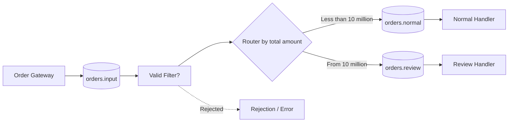
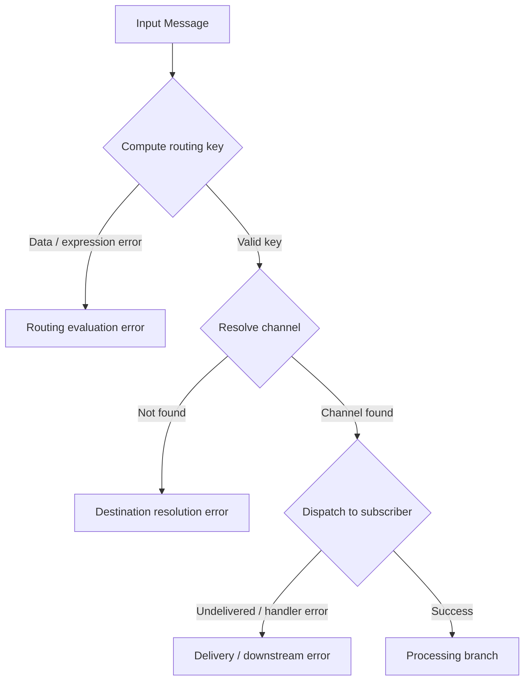

# Message Router Decides the Destination Channel

## 1. What Problem Does Message Router Solve?

In an integration application, the same type of message may need to be processed along **different routes**. Orders with a small total amount are processed automatically, while high-value orders require approval; domestic transaction notifications are sent to one system, while international transactions go to another. If all of this is written in a single service with multiple `if/else` statements directly calling the target services, the routing logic becomes tightly coupled with business logic, making it hard to extend and hard to observe.

**Message Router** is an Enterprise Integration Pattern (EIP) used to **decide the destination channel (output channel)** for a message based on a rule. In Spring Integration, a router is a **message endpoint**: it receives a `Message<?>` from an input channel, evaluates a condition or computes a *routing key*, and then forwards the message to the destination channel determined by configuration.

Example of an order processing flow:



Here:

- `Order Gateway` is the entry point that receives requests and sends messages into the flow.
- `orders.input`, `orders.normal`, `orders.review` are **message channels**: connection points that do not make business decisions on their own.
- `Filter` decides **whether to let the message proceed**.
- `Router` decides **if allowed to proceed, which channel the message goes to**.
- `Normal Handler` and `Review Handler` perform the business work after receiving the message.

A **router does not perform approval processing** and does not transform the order value itself. That belongs to the handler or transformer on the destination branch. Separating these three responsibilities is the core focus of the `SPRING_INTEGRATION_PATTERN` module: implementing Enterprise Integration Patterns with Spring Integration to build loosely coupled and extensible message flows, combining Filter, Transformer, Splitter, Aggregator, Gateway, retry, error channel, correlation, and branch-level testing.

### Learning Objectives

After this lesson, you will be able to:

1. Explain the flow **message → routing key → channel mapping → output channel → subscriber**.
2. Choose conditions based on payload, headers, or trusted metadata.
3. Configure a router with Spring Integration Java DSL, including multiple clearly named branches.
4. Distinguish between Router, Filter, Recipient List, and Publish–Subscribe.
5. Design branches with unmapped keys, branches with no subscriber, error handling branches, and avoid gateways waiting indefinitely for replies.
6. Test thresholds and branches, and observe routing decisions, trace/correlation, and channel overload behavior.

## 2. Where Does the Router Sit in an Integration Flow?

### 2.1. Input, Condition, Output

A router can be viewed as a **decision point**:

```text
                      Message<Order>
                            |
                            v
                 +-------------------+
                 | Message Router    |
                 | key = policy(msg) |
                 +-------------------+
                            |
               +------------+------------+
               |                         |
          key = normal              key = review
               |                         |
         channelMapping             channelMapping
               |                         |
               v                         v
         orders.normal              orders.review
               |                         |
               v                         v
         Normal Handler             Review Handler
```

Conceptually:

1. **Receive a message** from the input channel.
2. **Compute a routing key** using a function/expression/configuration; for example, `normal` or `review`.
3. **Resolve the destination** via a mapping from key to channel name/bean, or via the resolution mechanism of the specific router type.
4. **Send the message** to the destination channel and let the subscriber on that channel continue processing.

**The routing key does not necessarily match the channel name.** For example, the key `review` can map to the `orders.review` bean. This creates a separate configuration layer between the **business decision** and the **technical address**, allowing you to change the channel without rewriting the routing expression.

### 2.2. Is a Message Transformed When Passing Through a Router?

With a standard Content-Based Router, its primary job is **distribution**, not creating a new payload. Headers and payload typically continue to be forwarded to the receiving branch via Spring Integration's dispatch mechanism, but you should not rely on the message ID remaining immutable across all subsequent steps: a transformer, gateway, splitter, adapter, or custom component may create a new message.

When payload normalization is needed, use a dedicated **Transformer**:

```text
orders.input -> Transformer (normalize) -> Router -> orders.review
                                           |
                                           +-----> orders.normal
```

Whether to place the Transformer before or after the Router depends on the routing condition:

| Arrangement | Makes sense when | Risk |
|---|---|---|
| Transformer → Router | Data sources have multiple schemas; the router needs a standard DTO. | If the transformer fails, the router does not receive the message. |
| Router → Per-branch Transformer | Each target system uses a different format. | Common normalization code may be duplicated across branches. |
| Filter → Router | Invalid messages must be excluded before computing the key. | The rejection path must be handled explicitly so request–reply is not lost. |
| Router → Per-branch Filter | Each branch has its own validation rules. | Branches must handle validation themselves; routing may occur on untrusted data. |

## 3. Criteria for a Router to Choose a Destination Channel

### 3.1. Based on Payload Content

This is a **Content-Based Router**: it reads business data and then chooses the route. Example:

```java
import java.math.BigDecimal;

record Order(String id, BigDecimal total, String currency) {}

String routeKey(Order order) {
    BigDecimal threshold = new BigDecimal("10000000");
    return order.total().compareTo(threshold) >= 0
            ? "review"
            : "normal";
}
```

The expression above has a clear **boundary rule**: a total **equal to** 10 million also goes to `review`. If the boundary-equal case is omitted, threshold tests might miss bugs caused by using `>` instead of `>=`.

For the rule to be meaningful, ensure beforehand that:

- `total` is non-`null` and greater than 0 if required by the business contract.
- Currency is handled appropriately: comparing against `10_000_000` without checking currency can be wrong for USD/EUR orders.
- Fields used for routing belong to a validated schema, not arbitrary user-spoofable data.

### 3.2. Based on Message Headers

Many routing decisions fit metadata well: authenticated tenant, environment, partition, source, transaction type, or version. For example:

```text
Header: region=VN -> shipping.vn
Header: region=SG -> shipping.sg
Header: region=US -> shipping.us
```

In Spring Integration, there are specialized routers such as **Header Value Router** for reading header values. Headers avoid modifying the payload just to carry routing information, but **headers are not inherently trustworthy**: at HTTP/broker boundaries, clients can supply forged headers. If tenant/role headers are used for routing, validate and reconstruct their values at the trusted boundary.

For example, `traceId` should be used for **tracing**, not as a business decision condition, unless explicitly required by design. Separating *observability metadata* from *routing metadata* helps avoid confusing routing logic.

### 3.3. Based on Payload Type or Expression

Sometimes routing does not need to inspect fields:

- **Payload Type Router:** routes by Java type, such as `OrderCreated`, `PaymentCaptured`, `InventoryAdjusted`.
- **Expression Evaluating Router:** evaluates a configured expression against the message; suited for concise policies, requiring checks on field/header access and `null` handling.
- **Method Invoking Router:** invokes a bean method to obtain the routing key; suited when the policy contains Java logic that needs to be tested and reused.

Spring Integration also provides other distribution mechanisms such as **Recipient List Router**, but not all variants should be treated as interchangeable: some choose **a single branch**, some produce **multiple recipients**, and some directly return a channel or a list of channels.

## 4. Complete Java DSL: One Request, Two Destination Channels

### 4.1. Business Requirements

We implement a synchronous flow:

1. `OrderGateway.submit(Order)` receives an order and returns a `Receipt`.
2. A Filter verifies that the total is **positive** and non-`null`.
3. The Router returns routing key `normal` if `total < 10_000_000`, otherwise `review`.
4. Mapping `normal → orders.normal` and `review → orders.review`.
5. Each branch has its own service activator returning a different result.

The example targets **Java 17+, Spring Boot 3.x, and Spring Integration 6.x** with the `spring-boot-starter-integration` dependency. The `record` types and interface are placed in the same package; in a real project, each public type should be in its own Java file.

### 4.2. Flow and Channel Configuration

```java
import java.math.BigDecimal;

import org.springframework.context.annotation.Bean;
import org.springframework.context.annotation.Configuration;
import org.springframework.integration.annotation.Gateway;
import org.springframework.integration.annotation.IntegrationComponentScan;
import org.springframework.integration.annotation.MessagingGateway;
import org.springframework.integration.channel.DirectChannel;
import org.springframework.integration.config.EnableIntegration;
import org.springframework.integration.dsl.IntegrationFlow;
import org.springframework.messaging.MessageChannel;

record Order(String orderId, BigDecimal total) {}
record Receipt(String orderId, String status) {}

@MessagingGateway
interface OrderGateway {
    @Gateway(requestChannel = "orders.input")
    Receipt submit(Order order);
}

@Configuration
@EnableIntegration
@IntegrationComponentScan
class OrderRouterConfiguration {

    @Bean(name = "orders.input")
    MessageChannel ordersInput() {
        return new DirectChannel();
    }

    @Bean(name = "orders.normal")
    MessageChannel ordersNormal() {
        return new DirectChannel();
    }

    @Bean(name = "orders.review")
    MessageChannel ordersReview() {
        return new DirectChannel();
    }

    @Bean
    IntegrationFlow chooseOrderDestination() {
        return IntegrationFlow.from("orders.input")
                // Filter before Router so total cannot be null.
                .filter(Order.class,
                        order -> order.total() != null
                                && order.total().signum() > 0,
                        spec -> spec.throwExceptionOnRejection(true))
                // Routing key is explicitly mapped to a channel name.
                .route(Order.class,
                        order -> order.total()
                                .compareTo(new BigDecimal("10000000")) >= 0
                                ? "review" : "normal",
                        spec -> spec
                                .channelMapping("review", "orders.review")
                                .channelMapping("normal", "orders.normal"))
                .get();
    }

    @Bean
    IntegrationFlow processNormalOrders() {
        return IntegrationFlow.from("orders.normal")
                .handle(Order.class, (order, headers) ->
                        new Receipt(order.orderId(), "ACCEPTED"))
                .get();
    }

    @Bean
    IntegrationFlow processReviewOrders() {
        return IntegrationFlow.from("orders.review")
                .handle(Order.class, (order, headers) ->
                        new Receipt(order.orderId(), "PENDING_REVIEW"))
                .get();
    }
}
```

For Spring to register the `OrderGateway` interface, the example uses `@IntegrationComponentScan` within the same package scope. The bean methods create **three channels with stable names**. The last two `IntegrationFlow` beans register handlers receiving from the two destination channels; if either is missing, a valid route can still fail when dispatching to a channel with no subscriber.

### 4.3. Calling the Gateway and Observing Results

```java
// orderGateway is a bean injected by Spring into a service/controller.
Receipt a = orderGateway.submit(
        new Order("ORD-101", new BigDecimal("850000")));
// a.status() == "ACCEPTED"

Receipt b = orderGateway.submit(
        new Order("ORD-102", new BigDecimal("10000000")));
// b.status() == "PENDING_REVIEW"
```

Results per branch:

| Order | Total Amount | Key Returned by Router | Destination Channel | Receipt |
|---|---:|---|---|---|
| ORD-101 | 850,000 | `normal` | `orders.normal` | `ACCEPTED` |
| ORD-102 | 10,000,000 | `review` | `orders.review` | `PENDING_REVIEW` |
| ORD-103 | 12,500,000 | `review` | `orders.review` | `PENDING_REVIEW` |
| ORD-104 | 0 | Not routed | Rejected by Filter | Exception |
| ORD-105 | `null` | Not routed | Rejected by Filter | Exception |

**Do not confuse:** in this example, `PENDING_REVIEW` is a **simulated result** from a separate handler—it **does not mean it has already been approved**. A real system may need to persist state, process the review asynchronously, and notify the result later. In that case, the request–reply contract must be adapted accordingly.

### 4.4. How Is the Message Returned to the Gateway?

Because the route uses `DirectChannel`, the handler and gateway can execute on the same synchronous call chain. Spring Integration's infrastructure uses the request's reply context to return the `Receipt` to the gateway; routing selects a branch without changing request–reply semantics.

When replacing one of the two branches with an `ExecutorChannel` or `QueueChannel`, consider:

- The reply may arrive **later**; the gateway needs a timeout and a contract for handling late responses.
- Errors occurring in an asynchronous branch may be routed through an error flow instead of being thrown directly on the caller thread.
- `QueueChannel` requires a poller/consumer; without a poller, messages enter the queue but are never processed.
- Transactions and MDC/thread-locals do not automatically propagate across thread boundaries.
- Using an in-memory queue does not automatically provide durability, at-least-once, or exactly-once guarantees.

Simply changing the channel type does **not** guarantee that gateway behavior stays the same.

## 5. Routing Key, Channel Mapping, and Fallback Branches

### 5.1. Distinguishing Three Concepts

| Concept | Example | Primary Owner |
|---|---|---|
| Decision data | `order.total = 12_500_000` | Message payload/headers. |
| Routing key | `review` | Router policy/expression. |
| Channel destination | `orders.review` | Channel mapping / destination address configuration. |

When changing the destination from `orders.review` to `orders.manualReview`, you may only need to update the mapping if the `review` policy has not changed. Conversely, if the review threshold changes from 10 million to 20 million, update the policy in one place rather than renaming all channels.

### 5.2. An Unmapped Routing Key

Suppose the policy returns `international` while only `normal` and `review` are configured. Do **not guess** the behavior; depending on the router type and configuration, the system may try resolving the key as a channel name, use a default output channel, ignore it if allowed, or raise an error when the destination cannot be resolved.

Aspects to define explicitly:

- **Channel mapping:** Which keys are allowed and which channels do they map to?
- **Channel-key fallback:** Should the router try treating the key directly as a channel name?
- **Default output channel:** Should messages that do not match any mapping be sent to a fallback branch?
- **Resolution required:** Is failing to find a channel considered an error?
- **Outcome:** What does the gateway return, what does the error channel record, and who is responsible for handling it?

For critical business logic, **control the list of valid keys** and write tests for unknown keys. Never return an unvalidated string from payload/headers and assume it is safe to resolve as a channel bean name.

### 5.3. When to Use a Default Channel?

A fallback branch makes sense when the business contract includes a **needs-review** state—for example, orders of an unsupported type are routed to `orders.unclassified` for storage and manual handling. Do not turn a configuration bug (such as a misspelled channel name) into silent message dropping.

```text
Router
  normal          -> orders.normal
  review          -> orders.review
  other / unknown -> orders.unclassified  (if allowed by design)
```

The `unclassified` branch needs a consumer, storage/recovery mechanism, metrics, and alerts. **Default does not mean safely dropping messages**. If there is no business policy for unknown keys, failing fast with a traceable error is usually better than false success.

### 5.4. Failing to Find a Subscriber After Finding the Channel

Two distinct failures:

1. **Cannot resolve channel:** invalid mapping/key or missing channel bean.
2. **Channel exists but has no suitable subscriber/consumer:** for example, `orders.review` is a `DirectChannel`, but the review handler has not started, is stopped, or is not registered.

In the second case, the router **has already decided the destination**, but delivery fails or cannot be processed as expected. The error may surface through dispatch/gateway depending on the channel and sync/async flow; do not assume a message waits inside a `DirectChannel` until a consumer returns.

## 6. How Does Router Differ from Filter, Recipient List, and Publish–Subscribe?

| Pattern | Question Answered | Typical Output | Example |
|---|---|---|---|
| **Message Filter** | Keep the whole message or discard it? | Continue or reject/discard. | Only orders with a positive amount are processed. |
| **Content-Based Router** | Which channel to send the message to based on content? | One chosen destination in the common case. | High-value order → review. |
| **Recipient List Router** | Which recipients in a list should receive it? | One or more destinations based on conditions. | International order → fraud and customs. |
| **Publish–Subscribe** | Which registered subscribers receive the broadcast? | Fan-out to subscribers per channel configuration. | `OrderCreated` → audit, notification, analytics. |
| **Splitter** | How many parts should a large message be split into? | Multiple child messages. | Order with 5 items → 5 item messages. |
| **Aggregator** | When should grouped messages be combined? | Combined result after release. | Collect results for all 5 items. |

**Terminology note:** A Router in general is not strictly limited to a single destination; some routers allow returning multiple destinations. Therefore, stating "a router always has only one output" is inaccurate. In the Java DSL example in section 4, the policy is designed to **choose exactly one branch**.

### 6.1. Do Not Use Filter to Replace Router

Example of incorrect responsibility:

```text
orders.input -> Filter(amount < 10 million) -> normalHandler
             -> Filter(amount >= 10 million) -> reviewHandler
```

If two filters are chained sequentially on a single path, a message rejected by the first filter can **never** reach the second filter. To split into two branches, place a **Router** or configure proper conditional fan-out; do not chain multiple filters expecting them to create parallel paths.

### 6.2. Do Not Confuse Publish–Subscribe with Business-Key Routing

`PublishSubscribeChannel` fits when the same event must be observed by **every matching subscriber**. A standard router chooses a channel by rule rather than replicating messages to all recipients. Conversely, a pub/sub channel does not inherently know which orders are high-value so as to deliver only to the review department.

If multiple recipients are needed with different conditions per recipient, consider **Recipient List Router** or a dedicated fan-out flow; do not force a single-destination router into acting as an aggregate-result coordinator.

### 6.3. Router Does Not Automatically Aggregate Results Across Branches

When a flow uses a Splitter to create multiple messages or a Recipient List to send to multiple endpoints, **having multiple results does not make the router automatically combine them**. If the business requires "complete only when both the fraud check and inventory check succeed," you must design **Scatter–Gather/Aggregator**, a correlation key, a release strategy, timeouts, and missing-part handling.

## 7. Error Behavior, Timeouts, and Retries on Routing Branches

### 7.1. Three Distinct Error Locations



Distinguish between:

- **Routing evaluation error:** wrong payload type, missing field, expression throws an exception, or policy does not support the data.
- **Destination resolution error:** key is unmapped or channel does not exist per the router contract.
- **Delivery/processing error:** valid channel, but downstream is unavailable, consumer is stopped, queue is full, or handler fails.

These three errors have different retry policies. Infinitely retrying an unmapped key solves nothing; conversely, transient downstream timeouts may be retried within limits if requirements allow.

### 7.2. Synchronous and Asynchronous

With `DirectChannel`, an exception thrown during synchronous dispatch can propagate back to the caller/gateway. With an executor, poller, broker, or message-driven adapter, errors may be converted into an `ErrorMessage` on an `errorChannel` in supported configurations. **Do not assume** all exceptions automatically go to the same error channel, or that the router itself retries failed messages.

When building a retry policy:

1. Identify **which errors are retryable** and which should fail immediately (invalid key, validation failure).
2. Bound the retry count, backoff, jitter, and total duration.
3. Distinguish **entered the channel** from **business processing succeeded**.
4. Ensure idempotency if the target endpoint has side effects (charging payment, placing order, issuing invoice).
5. Provide an error flow, dead-letter/recovery, or an explicit failure response.

### 7.3. Gateway Must Have a Clear Reply Path

In the example, each branch returns a `Receipt`. If a branch ends with a one-way outbound adapter or a Filter discard without returning a result, a synchronous gateway may wait until timeout. That is **not** the router "failing to choose," but rather an **incomplete branch request–reply contract**.

The design should clarify:

| Scenario | Expected Behavior |
|---|---|
| Normal route succeeds | Return `Receipt(ACCEPTED)`. |
| Review route only records approval request | Return `PENDING_REVIEW` acknowledgement or design an async API; do not pretend it is already approved. |
| Filter rejects | Return a business rejection or exception per contract. |
| Router cannot find channel | Configuration/unknown-route error with logs, metrics, and recovery/alerting. |
| Downstream overloaded | Report overload/timeout, bounded retry, or buffer as required. |

## 8. Router and Loosely Coupled Flow Design

### 8.1. Separating Policy, Mapping, and Handler

An architecture with clear responsibilities:

```text
Inbound Adapter / Gateway
       |
       v
Input Channel
       |
       v
Validation Filter
       |
       v
Routing Policy -------> routing key
       |                       |
       |                  Channel Mapping
       |                       |
       +-----------------------+
                 |
        +--------+--------+
        |                 |
  Channel normal     Channel review
        |                 |
  Normal Service      Review Service
```

- **Policy:** business-driven; should have unit tests and a clear rule owner.
- **Mapping:** module-boundary configuration; manages channel names, fallbacks, and invalid routing.
- **Handler:** executes independent branch logic; does not need to know how the router computes keys.
- **Channel:** defines delivery semantics — synchronous, asynchronous, buffered or unbuffered.

When adding an `orders.international` branch, we extend the policy and mapping, create the new channel/handler, and add tests. The normal handler does not need to know the review handler exists.

### 8.2. When Must Routing Policy Be Treated as Mutable Data?

If routing paths change via configuration (amount thresholds, business regions, product attributes):

- Define a **version** or effective timestamp for the policy when auditing is needed.
- Control modification permissions: a wrong route can send data to an unauthorized system.
- Test mappings for **all valid keys** before deployment.
- Log the routing decision with business ID and trace ID to know which policy a specific request used.
- Avoid recomputing the routing key inconsistently in multiple places if data changes during processing.

For strict requirements, **the applied routing decision** can also be recorded as a distinct business event rather than inferred solely from the target consumer's logs.

## 9. Observing the Router and Tracing Processing Branches

### 9.1. Message History Is Only Part of the Picture

Spring Integration can record **Message History** when tracking is enabled; history helps identify tracked components, but it does not automatically capture the full business reason for a route, individual predicate results, or activity outside the JVM.

Add **structured logs** at the decision point and at the receiving branch:

```text
event=ROUTE_DECIDED orderId=ORD-102 traceId=t-102
    key=review destination=orders.review

event=BRANCH_ENTERED orderId=ORD-102 traceId=t-102
    channel=orders.review handler=reviewOrderService

event=ORDER_PROCESSED orderId=ORD-102 traceId=t-102
    outcome=PENDING_REVIEW
```

These three events answer three different questions:

1. **Where did the Router intend to send it?**
2. **Did the destination branch handler actually receive the message?**
3. **Did the business logic on that branch complete?**

If logs show `ROUTE_DECIDED` without `BRANCH_ENTERED`, check mapping, channel, subscriber/consumer, executor, or queue — do not jump to concluding the routing policy is wrong. If `BRANCH_ENTERED` is present without `ORDER_PROCESSED`, check the handler, timeouts, retries, and error flow.

### 9.2. Keep Different IDs Separate

| ID | Used For |
|---|---|
| `messageId` | Identifying a specific message; may change when the flow creates a new message. |
| `orderId` / business ID | Linking steps to the same business entity. |
| `traceId` | Connecting the observability journey across steps and services when propagated. |
| `correlationId` | Linking related messages, especially with Splitter/Aggregator. |

The router does not automatically generate a correlation ID for all business flows. If a Splitter branch emits multiple child messages, correlation and sequence must be designed/maintained properly; the router itself only decides where to send the message and does not guarantee reassembling partial results.

Across an `ExecutorChannel` or broker, do not rely solely on the previous thread's MDC/thread-local; pass needed context in the message/transport and use configured tracing propagation mechanisms.

### 9.3. Per-Branch Metrics

Measure:

- Number of messages **entering the router** per unit of time.
- Number of messages routed by **key/destination**.
- Rate of **unknown keys, unresolved destinations**, and **dispatch failures**.
- **Latency** of each branch and count of succeeded/failed completions.
- **Queue depth, oldest message age, executor saturation** if branches are asynchronous.
- Retry count, error-channel volume, timeouts, and unreleased Aggregator groups if applicable.

Do not use a `routeKey` containing personal data or unbounded values as a metric label; this can cause **cardinality explosion**. Use only a bounded set of labels and log business IDs in logs/traces under appropriate security policies.

## 10. Testing the Router per Branch

### 10.1. Unit Testing the Routing Policy

As rules grow, extract them into a pure Java component to test in isolation. Example:

```java
import java.math.BigDecimal;

final class OrderRoutePolicy {
    private static final BigDecimal REVIEW_THRESHOLD =
            new BigDecimal("10000000");

    String keyFor(Order order) {
        if (order == null || order.total() == null
                || order.total().signum() <= 0) {
            throw new IllegalArgumentException("Invalid total");
        }
        return order.total().compareTo(REVIEW_THRESHOLD) >= 0
                ? "review" : "normal";
    }
}
```

In a real design, that policy can be injected into the Router to avoid duplicating business rules. The complete Java DSL example in section 4 keeps lambdas inline to make the principle clear; when refactoring, **ensure the policy and filter share the same validation contract**.

Test boundary cases:

| Input | Expected Key | Reason |
|---|---|---|
| 1 | `normal` | Positive and below threshold. |
| 9,999,999 | `normal` | Just below threshold. |
| 10,000,000 | `review` | Equal to threshold requires review. |
| 10,000,001 | `review` | Above threshold. |
| 0 / negative / `null` | Reject | Must not be routed with contract-violating data. |

### 10.2. Integration Test for Gateway → Router → Handler

Spring Test/JUnit 5 test example for `OrderRouterConfiguration` in section 4:

```java
import java.math.BigDecimal;

import org.junit.jupiter.api.Test;
import org.springframework.beans.factory.annotation.Autowired;
import org.springframework.messaging.MessagingException;
import org.springframework.test.context.junit.jupiter.SpringJUnitConfig;

import static org.junit.jupiter.api.Assertions.assertEquals;
import static org.junit.jupiter.api.Assertions.assertThrows;

@SpringJUnitConfig(OrderRouterConfiguration.class)
class OrderRouterFlowTest {

    @Autowired
    private OrderGateway gateway;

    @Test
    void belowThresholdGoesToNormal() {
        Receipt result = gateway.submit(
                new Order("O-1", new BigDecimal("9999999")));
        assertEquals("ACCEPTED", result.status());
    }

    @Test
    void thresholdGoesToReview() {
        Receipt result = gateway.submit(
                new Order("O-2", new BigDecimal("10000000")));
        assertEquals("PENDING_REVIEW", result.status());
    }

    @Test
    void aboveThresholdGoesToReview() {
        Receipt result = gateway.submit(
                new Order("O-3", new BigDecimal("12000000")));
        assertEquals("PENDING_REVIEW", result.status());
    }

    @Test
    void invalidAmountIsRejectedBeforeRouting() {
        assertThrows(MessagingException.class, () ->
                gateway.submit(new Order("O-4", BigDecimal.ZERO)));
    }
}
```

**Test limitations:** the tests above verify the outcomes corresponding to each branch's handler, but do not prove all error configurations or async behaviors. Additional tests are needed for unknown keys, branches with no consumer, full channels, downstream exceptions, timeouts, and mapping changes. When testing exceptions, assert the actual exception type produced by your Spring Integration version and gateway configuration rather than assuming all failures share the same class.

### 10.3. Testing Routing to the Right Channel

To prove the routing decision itself rather than only checking the business result:

1. Use an input message with a known business ID and trace ID.
2. Attach an interceptor or test handler to each channel in a **test configuration**.
3. Send an order below the threshold, and verify the message enters `orders.normal` and **does not** enter `orders.review`.
4. Send an order at the threshold, and verify the opposite.
5. Produce an unmapped key in a separate policy test, and verify the configured error/default behavior.
6. For asynchronous channels, use a latch/await with a timeout rather than a fixed `Thread.sleep` to guess completion.

If production destinations have side effects, mock/stub them in tests to avoid real charges or corrupt data writes.

## 11. Common Pitfalls

| Misconception | Problem Caused | Right Approach |
|---|---|---|
| “The Router processes business logic on the destination branch.” | Routing mixed with handlers, high code coupling. | Router chooses the channel; handlers execute business logic. |
| “The routing key is the channel name.” | Loses the mapping configuration layer, hard to refactor. | Separate business keys from channel bean IDs. |
| “A Router always sends to exactly one place.” | Overlooks Recipient List or multi-destination routers. | Decide single-destination vs. multi-destination per the pattern used. |
| “Filter and Router are the same.” | Chaining filters fails to create parallel branches. | Filter keeps/drops; Router chooses destinations. |
| “An existing channel means a consumer is running.” | A `DirectChannel` with no subscriber can fail on send. | Test branch endpoint subscribers and lifecycle. |
| “Unknown keys are always safely ignored.” | Messages lost or pushed to the wrong channel via fallback. | Configure key mappings, defaults, and resolution policy explicitly. |
| “Entering a QueueChannel means processing is done.” | Premature success reporting. | Distinguish accepted/enqueued from processed/committed. |
| “The Router automatically retries outbound errors.” | Overload or message loss without recovery. | Use an independent retry/error flow with limits and idempotency. |
| “The Router automatically gathers replies from all branches.” | Gateway misses replies or loses parallel results. | Use correlation and Splitter/Aggregator/Scatter–Gather if required. |
| “Logging at the Router is enough to know processing succeeded.” | Shows only intent, not delivery or outcome. | Log decision, receipt at branch, and outcome by trace/business ID. |
| “Client-sent headers are always trustworthy.” | Misrouting by tenant/region or data leakage. | Validate, normalize, and allowlist routing keys at the boundary. |

## 12. Extended Practice Exercises

1. **Add an international route:** extend `Order` with `currency`, sending non-`VND` orders to `orders.international`. Define precedence: where does a high-value international order go? Express the decision with a truth table.
2. **Header routing:** create a flow routing by an authenticated `region` header. Check keys outside the allowed set and ensure messages cannot be sent to arbitrary channel beans.
3. **Default route:** add `orders.unclassified` with a consumer that records classification errors. Test that messages are not dropped, while also not treating an unknown key as successful processing.
4. **Lifecycle:** temporarily stop the `orders.review` handler while the Router remains active. Observe the gateway response and design a strategy for pausing intake, durable buffering, or reporting overload.
5. **Fan-out:** an order needs simultaneous inventory and fraud checks. Decide when to use Recipient List / Publish–Subscribe and when an Aggregator is needed for a combined result.
6. **Tracing:** attach `traceId`, `orderId`, log `ROUTE_DECIDED` and `BRANCH_ENTERED`, then trigger an error on the review branch. Pinpoint where the failure starts without logging sensitive full payloads.
7. **Load testing:** replace the review branch with a bounded queue and polling consumer. Make the producer faster than the consumer to observe backlog, rejected sends, timeouts, and retry policies.

### Self-Check Questions

**Question 1:** An order has a total of exactly 10 million, and the policy uses `compareTo(threshold) >= 0`. What key does the Router choose? **Answer:** `review`.

**Question 2:** The Router returned key `review`, but channel `orders.review` has no consumer. Can we conclude the order was processed? **No.** A routing decision is distinct from successful delivery and processing.

**Question 3:** To send the same event to three independent subscribers, must we use a single-destination Content-Based Router? **No.** Publish–Subscribe or Recipient List is more appropriate depending on conditions and recipients.

**Question 4:** If an input message is invalid and rejected by a Filter, does it reach the Router? **No**, in a Filter → Router flow. An explicit rejection response is needed if the caller is waiting for a reply.

**Question 5:** Is logging `"route=review"` sufficient for traceability? **Not yet.** You also need evidence that the branch channel/handler received it and the business endpoint completed, linked via trace/business IDs.

**Conclusion:** **Message Router decides the destination channel; it does not replace business processing at the destination.** A well-designed Spring Integration flow clearly separates source data, routing-key policy, key-to-channel mapping, dispatch mechanism, and per-branch handlers. When applying Enterprise Integration Patterns, validate data before routing, explicitly define fallback/error paths, handle timeouts/retries according to synchronous or asynchronous semantics, and observe and test each branch. This keeps message flows loosely coupled, extensible, and traceable when incidents occur.
