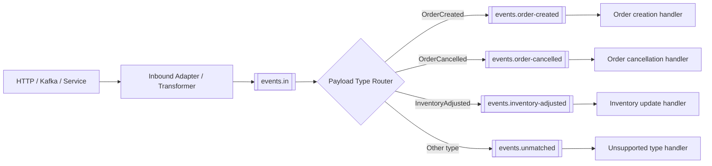
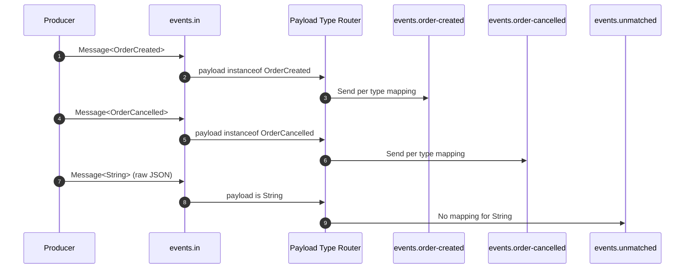
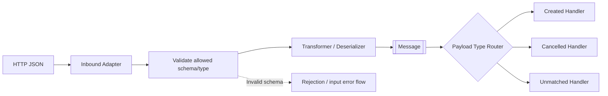
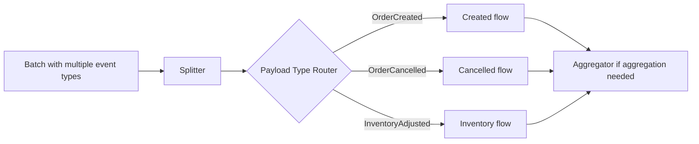

# Payload Type Router

An integration flow can receive multiple event types: `OrderCreated`, `OrderCancelled`, `InventoryAdjusted`, or `PaymentConfirmed`. All of them arrive through a single entry point, yet each type requires different processing. A **Payload Type Router** selects the **destination Message Channel based on the Java type of the `payload`** carried by the message, instead of writing `if` branches inside every handler.

This is an implementation of the **Message Router** pattern from **Enterprise Integration Patterns (EIP)** in **Spring Integration**. In the `SPRING_INTEGRATION_PATTERN` module, the goal is not only to write a Router, but also to understand **when to route by type**, how to combine it with Filter, Transformer, Gateway, Splitter/Aggregator, how to handle unrecognized types, retry/error channels, correlation, and how to test and observe each branch.

> **Core Principle:** A payload type router answers the question **"What Java type is the object inside `message.getPayload()`?"**. It does not automatically infer `status`, `eventType`, HTTP `Content-Type`, JSON field names, or compile-time generic types.

## 1. Why Route by Data Type?

Suppose an application receives order events from multiple sources. Once events are converted into appropriate Java objects, the processing requirements can be straightforward:

| Java Payload | Destination Channel | Branch Responsibility |
| --- | --- | --- |
| `OrderCreated` | `events.order-created` | Initialize the order processing workflow. |
| `OrderCancelled` | `events.order-cancelled` | Update cancellation status and trigger compensating actions if needed. |
| `InventoryAdjusted` | `events.inventory-adjusted` | Synchronize inventory quantities. |
| Unsupported type | `events.unmatched` | Quarantine, record the unknown type, and handle according to policy. |

If the application has only a single handler with many `instanceof` checks, that class becomes coupled to every business domain. Adding a new event type forces the central handler to modify both routing and processing logic. Separating the Router from destination handlers lets you define **the route selection policy once** and keep each branch focused solely on its own job.



The diagram illustrates **logical flow inside the application**; it does not implicitly create Kafka topics, HTTP endpoints, or durable queues. Each `Message Channel` still requires configuration and an appropriate consumer/handler.

### 1.1. When Is This Choice Particularly Useful?

- **Polymorphic input:** a single gateway or inbound adapter forwards different command/event types into the same flow.
- **Each type has its own pipeline:** an order-created event must check inventory, a cancellation event must compute compensation, and an inventory event only updates a projection.
- **Strongly typed DTOs already exist:** JSON/XML/Avro data has been validated and converted into Java objects of classes permitted by the system.
- **Separating routing from business logic:** the Router selects the channel; a Service Activator or application service executes the business rules.

Conversely, if every message is an `OrderEvent` differing only by `status` or `priority`, a **Content-Based Router** is usually more suitable. An `OrderEvent(status="CREATED")` and an `OrderEvent(status="CANCELLED")` share the **same payload type**; a Payload Type Router will not separate them into two different routes on its own.

## 2. What Is Payload Type in Spring Integration?

Spring Messaging represents a message with `Message<T>`, consisting of:

- **`payload`**: the actual data being sent, such as an `OrderCreated` instance.
- **`headers`**: metadata supporting routing, correlation, reply/error channels, tracing, or other integration concerns.

Example:

```java
import org.springframework.messaging.Message;
import org.springframework.messaging.support.MessageBuilder;

record OrderCreated(String orderId, int itemCount) {}

Message<OrderCreated> message = MessageBuilder
    .withPayload(new OrderCreated("ORD-101", 2))
    .build();

Class<?> actualPayloadType = message.getPayload().getClass();
// actualPayloadType == OrderCreated.class
```

In this case, the Router can branch on `OrderCreated.class`. If the actual payload is instead a `String` containing JSON `{"type":"OrderCreated",...}`, the Java type seen by the Router **is `String`** — not `OrderCreated`. An appropriate Transformer/deserializer is needed **before the Router**, or you should switch to routing by controlled content/metadata.

### 2.1. Distinguishing Declared Type from Runtime Type

```java
Object event = new OrderCreated("ORD-102", 1);
Message<Object> envelope = MessageBuilder.withPayload(event).build();

// Even though the variable is declared as Object, the actual payload is OrderCreated.
assert envelope.getPayload().getClass() == OrderCreated.class;
```

The Router relies on **the object type present at runtime**. A generic `Message<Object>` does not force the payload to route as `Object.class`. However, a collection's generic type is typically erased at runtime: both `List<OrderCreated>` and `List<OrderCancelled>` may just be `ArrayList` when running. Therefore, do not rely on generic element types to split branches when the payload is merely a standard collection.

### 2.2. Payload Type Is Not an HTTP Header

| Case | What Does the Router See? | Consequence |
| --- | --- | --- |
| Payload is `new OrderCreated(...)` | `OrderCreated` | Can be mapped accurately by type. |
| Payload is a JSON string | `String` | Must be converted first or routed by content. |
| Payload is `byte[]` from a broker | `byte[]` | Must be decoded/deserialized beforehand. |
| Payload is `Map<String, Object>` | Actual Map class, e.g. `LinkedHashMap` | Cannot automatically infer event type from a `type` key inside the Map. |
| Payload is a subclass | Runtime subclass type | Must verify parent/child matching rules for the version and configuration used. |
| Payload is `List<...>` | Runtime collection class | Cannot reliably distinguish element types via generics. |

In particular, **do not trust an external client's `type` header directly** to instantiate arbitrary Java classes. Only allow predefined payload types/schemas validated at the input boundary, avoiding turning the routing mechanism into an unintended object instantiation vector.

## 3. How Does Payload Type Router Differ from Other Routers?

Spring Integration offers several routing styles. While all select channels, they answer different questions:

| Router Type | Routing Basis | Example |
| --- | --- | --- |
| **Payload Type Router** | Actual Java type of the payload. | `OrderCreated` → order creation route. |
| **Header Value Router** | Value of a controlled header. | `region=APAC` → regional branch. |
| **Content-Based/Expression Router** | Data inside the payload or an expression. | `priority=true` → priority route. |
| **Recipient List Router** | List of recipients per configuration/policy. | One notification sent to multiple subscribers. |
| **Exception Type Router** | Exception type within an error-handling context. | `TimeoutException` → retry route; data error → rejection route. |

When **business types are represented by distinct Java classes**, Payload Type Router is usually concise and readable. When **the same class carries different values**, use a content/header router instead of creating extra classes just to avoid reading a field.

### 3.1. Router and Filter Do Not Replace Each Other

**Filter** answers "may this message proceed?"; **Router** answers "which channel should it go to?". A common flow is:

```text
Inbound → Transformer (JSON → Java DTO) → Filter (schema/conditions)
        → Payload Type Router → Per-event-type Handler
```

If a message type is unsupported, the `events.unmatched` destination can act as an **intentional rejection/quarantine branch**. If a message violates common rules, a Filter can block it **before it reaches the Router**. Deserialization errors happen even earlier and need their own error path — do not lump everything together as "unmatched type."

## 4. Implementing `routeByType` with Spring Integration Java DSL

Assume the application uses Java with `record` support, Spring Framework, Spring Integration, and compatible Spring Test/JUnit 5. This example focuses on **routing by Java type**, without real ERP integration and without requiring Kafka or RabbitMQ.

### 4.1. Defining Event Types

```java
record OrderCreated(String orderId, int itemCount) {}

record OrderCancelled(String orderId, String reason) {}

record InventoryAdjusted(String sku, int delta) {}
```

Each record represents a **distinct event** with its own data contract. Do not place authentication tokens, passwords, or unnecessary personal data into events or headers solely for routing convenience.

### 4.2. Defining Destination Channels and the Router

```java
import org.springframework.context.annotation.Bean;
import org.springframework.context.annotation.Configuration;
import org.springframework.integration.channel.QueueChannel;
import org.springframework.integration.config.EnableIntegration;
import org.springframework.integration.dsl.IntegrationFlow;

@Configuration
@EnableIntegration
class EventTypeRoutingConfiguration {

    @Bean("events.order-created")
    QueueChannel createdEvents() {
        return new QueueChannel(20);
    }

    @Bean("events.order-cancelled")
    QueueChannel cancelledEvents() {
        return new QueueChannel(20);
    }

    @Bean("events.inventory-adjusted")
    QueueChannel inventoryEvents() {
        return new QueueChannel(20);
    }

    @Bean("events.unmatched")
    QueueChannel unmatchedEvents() {
        return new QueueChannel(20);
    }

    @Bean
    IntegrationFlow routeEventsByType() {
        return IntegrationFlow.from("events.in")
            .routeByType(spec -> spec
                .channelMapping(OrderCreated.class.getName(),
                    "events.order-created")
                .channelMapping(OrderCancelled.class.getName(),
                    "events.order-cancelled")
                .channelMapping(InventoryAdjusted.class.getName(),
                    "events.inventory-adjusted")
                .defaultOutputChannel("events.unmatched"))
            .get();
    }
}
```

**Reading part by part:**

1. `IntegrationFlow.from("events.in")` defines the flow's message entry point; Spring Integration can auto-create/register the corresponding input channel if no bean with that name exists and configurations do not conflict.
2. `.routeByType(...)` declares a Router using the **payload's type** as the routing criterion.
3. `channelMapping(SomeType.class.getName(), "destination")` binds a Java type name to a channel. In the example, `class.getName()` avoids typos from manually writing fully qualified class names as strings.
4. `.defaultOutputChannel("events.unmatched")` creates a **fallback branch** for payload types without a matching route under the router policy; this branch must have a clear handling mechanism.
5. The `QueueChannel(20)` beans are used only for observing results and testing; they do not persist across restarts, invoke business logic automatically, or guarantee retention of every message if full.

**Snippet limitations:** To turn this into a production application, you need consumers/pollers or integration flows processing each channel, queue capacity/timeout policies, transaction or broker configuration if durability is required, and error handling/monitoring. Do not interpret a single `channelMapping` line as proof that an external system has successfully processed the message.

### 4.3. Execution Flow by Payload



The diagram shows the **same input channel**, while messages travel to **different output channels**. In real applications, mapped routes need receivers; the `events.unmatched` channel should not exist merely on paper without an operational handling process.

## 5. Testing the Payload Type Router

The test example below uses JUnit 5 and `@SpringJUnitConfig`. Because the output channels are `QueueChannel` instances, the test can read messages out to verify **the right branch received the message and no wrong branch did**. Place the test in the same package as the records and configuration in section 4.

```java
import static org.junit.jupiter.api.Assertions.*;

import org.junit.jupiter.api.Test;
import org.springframework.beans.factory.annotation.Autowired;
import org.springframework.context.ApplicationContext;
import org.springframework.integration.channel.QueueChannel;
import org.springframework.messaging.Message;
import org.springframework.messaging.MessageChannel;
import org.springframework.messaging.support.MessageBuilder;
import org.springframework.test.context.junit.jupiter.SpringJUnitConfig;

@SpringJUnitConfig(EventTypeRoutingConfiguration.class)
class EventTypeRouterTest {

    @Autowired
    ApplicationContext context;

    private MessageChannel input() {
        return context.getBean("events.in", MessageChannel.class);
    }

    private QueueChannel destination(String name) {
        return context.getBean(name, QueueChannel.class);
    }

    @Test
    void routesRecognizedTypesAndCapturesUnknownType() {
        OrderCreated created = new OrderCreated("ORD-001", 2);
        OrderCancelled cancelled = new OrderCancelled("ORD-002", "requested");
        InventoryAdjusted stock = new InventoryAdjusted("SKU-07", -1);

        assertTrue(input().send(MessageBuilder.withPayload(created).build()));
        assertTrue(input().send(MessageBuilder.withPayload(cancelled).build()));
        assertTrue(input().send(MessageBuilder.withPayload(stock).build()));

        // Raw JSON string not yet converted into an OrderCreated object.
        String rawJson = "{\"eventType\":\"OrderCreated\"}";
        assertTrue(input().send(MessageBuilder.withPayload(rawJson).build()));

        Message<?> fromCreated = destination("events.order-created").receive(0);
        Message<?> fromCancelled = destination("events.order-cancelled").receive(0);
        Message<?> fromInventory = destination("events.inventory-adjusted").receive(0);
        Message<?> fromUnknown = destination("events.unmatched").receive(0);

        assertNotNull(fromCreated);
        assertNotNull(fromCancelled);
        assertNotNull(fromInventory);
        assertNotNull(fromUnknown);

        assertEquals(created, fromCreated.getPayload());
        assertEquals(cancelled, fromCancelled.getPayload());
        assertEquals(stock, fromInventory.getPayload());
        assertEquals(rawJson, fromUnknown.getPayload());

        assertNull(destination("events.order-created").receive(0));
        assertNull(destination("events.order-cancelled").receive(0));
        assertNull(destination("events.inventory-adjusted").receive(0));
        assertNull(destination("events.unmatched").receive(0));
    }
}
```

The test above verifies **four behaviors**: each Java type is routed to its exact queue, and raw JSON of type `String` goes to the fallback. The `receive(0)` assertions fit synchronous dispatch and in-memory queues in this example. If you replace the input/intermediate channel with an executor or asynchronous broker, switch to conditional waiting with an appropriate timeout instead of expecting immediate receipt.

### 5.1. What Is Not Yet Proven by This Unit/Integration Flow Test?

- There is no HTTP/Kafka adapter, so **actual deserialization** is not tested.
- There are no real business handlers or ERP systems, so side effects and transactions are not proven.
- The example queues are in-memory, so recovery after restart is not tested.
- There is no multithreading, high load, full-queue, completion-order, or race-condition testing.
- Subclasses/proxies/generic payloads are not verified; add tests if the system routes based on inheritance.
- A request–reply gateway receiving a final result is not tested.

This is why tests should be layered: **Router mapping tests** → **flow tests with handlers** → **adapter/broker tests** → **end-to-end business tests**.

## 6. Unsupported Types: Designing a Fallback Instead of Losing Data

An application might start with `OrderCreated` and `OrderCancelled`, and later another service adds `OrderReturned`. If the producer sends the new object while the consumer has not updated its mapping, a flow with only old mappings will not know where to send the message.

Policy options:

| Policy | When Is It Appropriate? | Risks to Control |
| --- | --- | --- |
| **`defaultOutputChannel` to fallback** | Want to isolate unsupported types for logging and later processing. | Fallback must have a consumer, retention, and alerts; not just a channel name. |
| **Raise routing error** | Out-of-contract event types are critical errors that the caller must see. | Sync/async paths receive errors differently; test exceptions/error flows. |
| **Filter irrelevant types before Router** | Unrelated types are permitted to be skipped. | Confirm dropping complies with contract and does not lose needed events. |
| **Send to controlled quarantine/DLQ** | Need investigation/replay when new schemas appear. | Need access control, retention limits, sensitive-data handling, and replay procedures. |

**Recommendation:** For events with business value, usually establish a clear fallback, an **unmatched type** metric, and a version-incompatibility handling process. `events.unmatched` in the example is an observation point; to make it durable, connect it to appropriate storage/adapters.

### 6.1. Fallback Is Not Automatic Error Handling

A message falling into `defaultOutputChannel` **does not automatically** become an `ErrorMessage`. It is a **normal routing decision** of the Router. Likewise, the Router cannot recover from an **earlier** failure when JSON could not be decoded: that is a Transformer/adapter error and belongs on its own error path.

### 6.2. Why Not Turn the Fallback into a "Trash Bin"?

If thousands of unknown event types enter an in-memory queue without a consumer, the queue will fill up, causing errors or backpressure. If the fallback merely logs `message.toString()`, sensitive payloads may leak. If it silently drops them, important business events may be lost without anyone noticing.

An operational fallback needs at minimum: **normalized unsupported-type code, opaque correlation ID, counts/rates, storage or rejection policy, and threshold-based alerts**.

## 7. Type-Based Router and the Input Data Transformation Pipeline

At an HTTP endpoint, the request body is usually JSON; on Kafka, the payload may be bytes; in JDBC, the data is rows/columns. If you invoke a Payload Type Router **before** meaningful decoding, vastly different business messages may all share `String`, `byte[]`, or `Map`.



### 7.1. Type Discriminator and Deserializer Have Different Responsibilities

If the sender emits:

```json
{
  "eventType": "ORDER_CREATED",
  "schemaVersion": 2,
  "eventId": "EVT-1001",
  "orderId": "ORD-009"
}
```

then an **authorized mapper** can use `eventType` + `schemaVersion` to pick the `OrderCreated` DTO. From there, the Payload Type Router routes by the **class of the constructed DTO**. Conversely, a header/content router could pick the channel using `eventType` without creating multiple subclasses.

The choice depends on the input contract, version management, and testability. Avoid deserializers that allow external payloads to specify **arbitrary Java class names** for automatic instantiation; restrict with an **allowlist of trusted event types** and explicit validation.

### 7.2. Type Before and After Transformer May Differ

```text
Before Transformer:       payload is String (raw JSON)
After Transformer:        payload is OrderCreated
After another Transformer: payload is NormalizedOrderCommand
```

Where the Router is placed determines which type it sees. If the Router must choose based on the **original event type**, preserve/normalize valid type information before converting to a shared DTO, or place the Router where sufficient type information still exists. Once all events are converted into `NormalizedOrderCommand`, a Payload Type Router sees **only one type** and cannot route by the original event without reading content/headers.

## 8. Inheritance, Interfaces, Proxies, and Generics: Common Sources of Confusion

Consider the design:

```java
sealed interface OrderEvent permits OrderCreatedEvent, OrderCancelledEvent {}

record OrderCreatedEvent(String id) implements OrderEvent {}

record OrderCancelledEvent(String id) implements OrderEvent {}
```

Creating a hierarchy can clarify the contract. However, when a Router has mappings for both a parent/interface type and a subtype, **the mapping selection policy and conflict resolution should not be guessed from class appearance alone**. Check the matching behavior of `PayloadTypeRouter` in the exact version you are using and write tests for the real types; pay special attention to multiple interfaces, dynamic proxies, or framework-generated subclasses.

Safe principles:

1. **Prefer explicit mappings for important concrete payload types** when strict branch separation is required.
2. **Do not treat `List<OrderCreated>` as a different runtime class from `List<OrderCancelled>`** when the actual objects are the same collection type.
3. If types become dynamic proxies, framework wrappers, or unexpected subclasses, test the router with the final payload, not just an imagined DTO.
4. If you need complex prioritized `instanceof` logic, consider an explicit expression/method Router instead of assuming implicit inheritance rules.
5. If multiple distinct types must go to the same branch, mapping multiple types to **the same channel name** is a simple solution, provided that branch's handler accepts all of those types.

**Using inheritance does not automatically mean better architecture.** For event integration, separate records and explicit mappings are often easier to test than hierarchies built solely to drive routing.

## 9. Integrating with Gateway, Filter, Splitter, and Aggregator

A Router does not stand alone. In EIP, it is usually one step among other endpoints.

### 9.1. Gateway in Front of the Router

With `@MessagingGateway(defaultRequestChannel="events.in")`, callers can invoke a Java method to publish events without knowing individual output channel names. However:

- `void publish(Object event)` does not automatically guarantee asynchronous or durable processing; behavior depends on channels and transports.
- If the gateway **requires a reply**, every branch must have a handler returning a contract-compliant reply and a proper reply path. An `unmatched` branch that only queues messages for inspection **will not automatically produce a reply**, causing callers to wait or receive nothing.
- Do not put sensitive data into headers just for gateway/router convenience; payload type alone is enough for routing in this example.

### 9.2. Filter Before Router

A **Filter checking required fields** can block an event missing `orderId` before routing. This differs from `defaultOutputChannel`, which handles **no matching type**. Distinguish between a recognized type with invalid payload data and a payload of a new, unsupported type.

Example policy:

```text
Message<OrderCreated>
    → Filter: valid orderId?  No → orders.invalid
    → Payload Type Router:    OrderCreated → orders.created

Message<UnknownEvent>
    → Payload Type Router:    No match → events.unmatched
```

### 9.3. Splitter Before Router

A batch may contain multiple event types. A Splitter breaks it into individual parts, and a Payload Type Router classifies each child message. Ensure the Splitter **produces properly typed payloads**; if it only emits `Map` or `String`, routing will depend on that wrapper type.



**Aggregator warning:** If the Router sends parts to handlers running at different speeds, or if a branch's Filter drops a message, the Aggregator may never receive enough parts to complete. Define the correlation key, group release/expiry, and late arrivals; do not assume having a Router means the Aggregator will automatically assemble groups properly.

### 9.4. Type-Based Routing in Error Flows

On the error path, you may need to classify exceptions by type to decide between retry and quarantine. That is **exception routing**, not reusing the business payload Router by default; the payload here may be an `ErrorMessage` wrapping the exception. If using a type-based Router in an error branch, verify **the actual runtime type of the error payload** and maintain separate mapping responsibilities.

## 10. Errors, Retries, and Timeouts on Routing Branches

The Router picking a channel does not prove the handler finished. Each branch can fail differently:

| Scenario | Boundary | Approach to Consider |
| --- | --- | --- |
| Missing type mapping | Router | Fallback or explicit error per contract. |
| Mapped to channel with no subscriber | Channel/endpoint wiring | Configure handler/flow; test startup and branches. |
| Destination queue full | Backpressure/channel | Bound send wait, choose fail-fast or durable storage. |
| `OrderCreated` handler data error | Validation/handler | Do not infinitely retry unchanged; route to rejection with reason. |
| Outbound ERP timeout | Adapter or network client | Dedicated timeout, retry with backoff, status check, and idempotency. |
| Replayed event | Producer/broker/consumer | Stable idempotency key and side-effect control. |

### 10.1. Send Timeout Is Not Processing Timeout

If the flow uses `DirectChannel` for `events.order-created`, the handler may run synchronously on the caller thread. Setting a short `sendTimeout` does not interrupt a handler calling an ERP for several seconds. Switching to `ExecutorChannel` may release the caller sooner, but **does not automatically provide persistence**; the executor can still saturate and reject tasks.

With `QueueChannel`, send timeout applies when a bounded queue is full; `receive(timeout)` applies to the consumer/poller when the queue is empty. These timeouts **differ** from Gateway reply timeout, Aggregator timeout, and HTTP client timeout.

### 10.2. Do Not Accidentally Retry Creating an Order Twice

Suppose `OrderCreated` was sent to the order creation branch. The ERP created the order, but the response was lost. If the consumer retries without an idempotency key, the system may create a duplicate order even though the Router picked the right branch.

A sound design requires stable business/event identifiers (such as `eventId` and `orderId` per contract), completion confirmation, bounded retries, and sometimes a transactional outbox or compensation. **The Router only chooses direction; it does not provide end-to-end exactly-once delivery.**

### 10.3. Error Channel Does Not Receive Every Failure Under One Rule

In a synchronous branch, exceptions may propagate back to the caller; in an async/poller branch, endpoints and adapters can emit `ErrorMessage` to an error channel when configured. An event routed to a fallback by policy is not an exception. **Do not conflate `unmatched type`, `invalid data`, `downstream timeout`, and `failed handler` into one vague error state.**

## 11. Observing the Type Router: Knowing Which Type Goes to Which Branch

For an entry point handling multiple event types, observability should show **classification ratios** and **processing health per branch**:

- Total messages arriving at `events.in` and counts sent to each destination.
- Message count going to `events.unmatched`, grouped by **approved type classifications**.
- Latency of each handler and outbound adapter, not just Router time.
- Error/timeout/retry rates per event type.
- Queue depth, queue age, and consumer capacity across branches.
- Opaque correlation ID / trace ID to link logs across Splitter/Aggregator or multiple services.

Example structured log:

```text
event=integration_routed
flow=eventIntake
router=payloadTypeRouter
payload_type=OrderCreated
destination=events.order-created
outcome=routed
correlation_id=3a2984f2-9259-4d7d-996a-66bc0194fb76
```

This is only an **illustrative log format**, not fields emitted automatically by the framework. When including class names in logs/metrics, restrict to a finite allowlisted set of types; never log `message.toString()`, payloads, tokens, or personal information. Avoid using per-request correlation IDs as **metric labels**, because their cardinality is high and they may link to sensitive data.

### 11.1. A Useful Operational Alert

If `events.unmatched` was previously near zero and spikes sharply after a producer deploys a new version, check **schema/version/DTO mapping** first. Either the event is not yet recognized by the deserializer, or a new type lacks a mapping. Do not apply a quick "drop all" fallback just to push the chart back to zero.

## 12. Testing Critical Boundaries Beyond the Happy Path

| Scenario | What to Verify |
| --- | --- |
| Valid `OrderCreated` | Reaches only `events.order-created`, received by the right handler type. |
| Valid `OrderCancelled` | Reaches only `events.order-cancelled`, does not invoke order creation branch. |
| Valid `InventoryAdjusted` | Reaches only inventory branch; message preserves valid data/correlation. |
| Raw JSON `String` | Not mistaken for `OrderCreated`; transformed or routed to fallback as designed. |
| Unsupported type | Routed to fallback or fails explicitly; never silently dropped out of contract. |
| Subclass/interface/proxy | Mapping behavior matches real type structure; covered by dedicated tests. |
| Batch/Splitter | Parts have proper types, correlation groups do not mix; dropped parts handled. |
| Handler failure/ERP timeout | Retries/error flow and uncertain states managed explicitly. |
| Full queue/slow downstream | Backpressure, timeouts, and never falsely reporting business completion. |
| Same event replay | Idempotency prevents unintended duplicate side effects. |
| Logger/tracing | Traceable per branch without logging raw payloads or secrets. |

Routing tests should include **negative assertions**: verify not only that the message *arrived* at the right branch, but also that it *did not* arrive at wrong branches. For asynchronous flows, use conditional waiting with a timeout; avoid checking too early, which causes flaky tests.

## 13. Common Pitfalls

### Pitfall 1 — Assuming JSON `eventType` Is the Payload Type

The inbound adapter's payload is a `String`. The JSON inside has an `eventType` field, yet the type router still sees `String`. **Fix:** use a Transformer/deserializer with a type allowlist, or a content-based Router if that matches the contract.

### Pitfall 2 — Putting All Events in One Record, Expecting Routing by Status

`OrderEvent(status="CREATED")` and `OrderEvent(status="CANCELLED")` have the exact same class. **Fix:** choose a content/header Router, or redesign event types when the differences genuinely warrant separate types.

### Pitfall 3 — Using Generic Collections to Infer Element Types

`ArrayList<OrderCreated>` and `ArrayList<OrderCancelled>` are not two distinct runtime classes. **Fix:** use a Splitter to emit individually typed events, or use a wrapper DTO with an explicit type discriminator.

### Pitfall 4 — Forgetting the Fallback Branch

A new event type arrives, the flow has no mapping, and nobody knows where the message went. **Fix:** declare `defaultOutputChannel` or a contract-defined error, monitor unmatched events, and establish a replay/upgrade process.

### Pitfall 5 — Treating the Router as the Place to Run All Business Logic

A Router only selects a route. If routing conditions call multiple APIs and write to a database, responsibilities become hard to test and retry. **Fix:** put checks and side effects into appropriate endpoints/services, and have the Router decide based on normalized results.

### Pitfall 6 — Treating a Successful Mapping as Successful Processing

Sending to `events.order-created` does not prove the ERP created the order, the broker persisted it, or the transaction committed. **Fix:** monitor handlers, acknowledgements, transactions, idempotency, and final state.

### Pitfall 7 — Letting External Data Pick Java Class Names

An untrusted type header can cause incorrect decoding or instantiate unintended classes. **Fix:** validate schema/version against an allowed event list, separating data intake from routing decisions on controlled Java DTOs.

## 14. Practice Exercises

**Exercise 1 — Add an event type.** Add record `PaymentConfirmed(paymentId, orderId)` and channel `events.payment-confirmed`. Update `.channelMapping(...)`, create a handler, and test that the new message goes only to the payment branch while existing messages still follow their routes.

**Exercise 2 — Transform before Router.** Build an inbound flow accepting JSON strings with `eventType`. Design an allowlist-based deserializer for `OrderCreated`/`OrderCancelled`. Verify that unsupported types cannot instantiate arbitrary classes.

**Exercise 3 — Test a hierarchy.** Create an interface `DomainEvent` and two implementing records. Test differences when mapping only the interface, only concrete classes, or both; document the observed result **in your actual Spring Integration version** rather than guessing from `instanceof`.

**Exercise 4 — High load.** Limit the order-creation branch channel to capacity 1 and stop the consumer from polling. Observe the second send; design a failed-send/backpressure policy and ensure false business-success states are never returned.

**Exercise 5 — Splitter/Aggregator.** A batch containing three different event types is split into individual messages by a Splitter. After the Router classifies them, design correlation, release, and expiry to build a summary batch report, including when one branch fails or finishes late.

## 15. Pre-Deployment Checklist

| Question | Passing Criterion |
| --- | --- |
| Is the payload already the right Java type? | Deserialized/transformed and validated against a trusted schema. |
| Is type-based routing truly needed? | Differences live at the class level; if only field values differ, use a content/header router. |
| Are class name mappings correct? | Tested for every concrete type and any supported inheritance cases. |
| Do output channels have consumers? | Handlers/flows and appropriate queue policies exist, not just channel names. |
| Where do unsupported types go? | Explicit fallback or error, metrics, and controlled handling/replay. |
| Is sensitive data in payloads/headers/logs? | Keep only needed fields; do not leak secrets/PII across external branches. |
| Is there a request–reply Gateway? | Every branch has a reply/error contract, correlation, and proper deadline. |
| Is there a Splitter/Aggregator? | Group key, release/expiry, late results, and missing-branch handling defined. |
| Could retries/timeouts cause duplicate work? | Idempotency in place, distinguishing send failures from completed side effects. |
| Do tests cover both positive and negative cases? | Right branch, not wrong branch, unmatched, deserialization, errors, overload. |
| Are errors and type distributions observable? | Metrics for finite types, branches, handler latency, retries, and backlog. |

## Conclusion

**Payload Type Router** routes messages based on **the actual runtime Java type of `payload`**. In Spring Integration, `.routeByType(...)` binds each event type to a corresponding Message Channel, separating **route selection** from business logic inside each handler. Once data is converted into strongly typed DTOs, this provides a readable, extensible, and testable solution for an entry point receiving multiple event types.

A complete design goes beyond the mapping table: **distinguishing runtime types from JSON/headers, controlling external types, defining fallbacks, handling channels without consumers, backpressure, retries, error flows, correlation, idempotency, and observability**. Combining these boundaries with Filter, Transformer, Gateway, Splitter, and Aggregator ensures the integration flow works reliably not only on the happy path, but also when new data types arrive, a branch slows down, or a target system fails.
