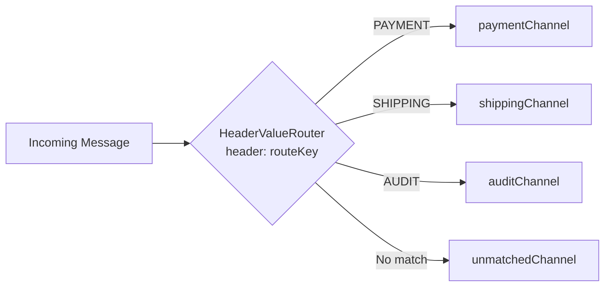
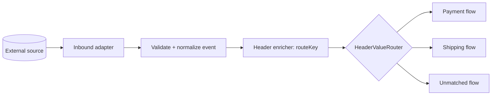
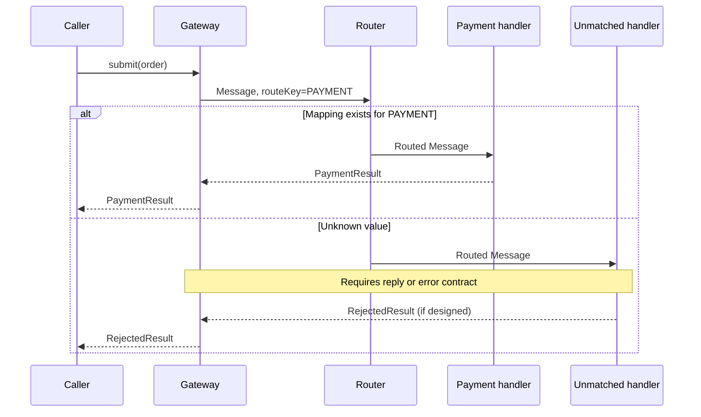
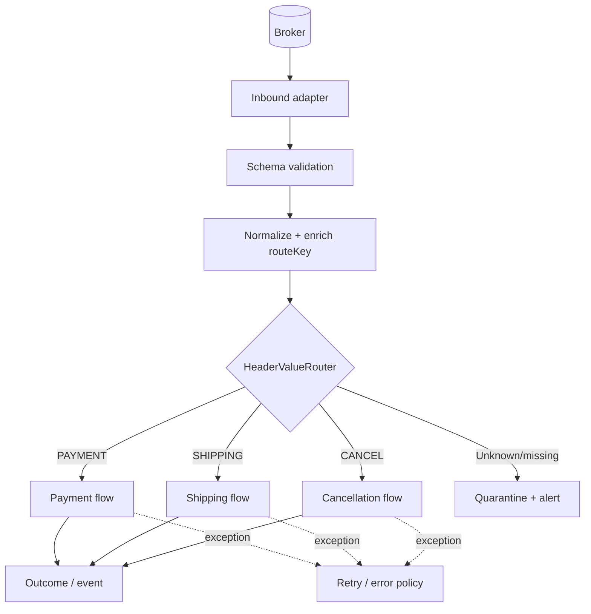

# Header Value Router

In **Spring Integration**, a **Message Router** decides which channel a message is sent to based on a routing rule. With **header-value routing**, the rule does not need to inspect the payload directly: the Router reads **the value of a selected header**, matches it against configured mappings, and forwards the message to the corresponding channel.

For example, a system receives several kinds of order events. An upstream component sets the `routeKey` header to `PAYMENT`, `SHIPPING`, or `AUDIT`. **HeaderValueRouter** picks the appropriate processing channel without a chain of `if/else` statements inside every service. This separation of responsibilities aligns with the goal of the `SPRING_INTEGRATION_PATTERN` module: implementing **Enterprise Integration Patterns** (EIP) such as Router, Filter, Transformer, Splitter, Aggregator, Gateway, retry, error channel, and correlation so processing branches remain **loosely coupled, testable, and extensible**.

After this lesson, you will be able to:

- Explain how `HeaderValueRouter` selects a destination and distinguish a **routing key** from business data.
- Configure `HeaderValueRouter`, `channelMapping`, and a fallback channel in Spring Integration Java DSL.
- Handle missing headers, unknown values, or wrong types without accidentally losing messages.
- Understand the relationships among Router, Filter, Gateway, Splitter/Aggregator, and error flows.
- Test each routing branch along with preserving payload, headers, and correlation.

## 1. What Problem Does Header-Value Routing Solve?

A Spring message has two main parts:

```text
Message<OrderEvent>
├── payload
│   ├── eventId      = "evt-101"
│   ├── orderId      = "ORD-1001"
│   └── eventType    = "PAYMENT"
└── headers
    ├── id           = Spring message UUID
    ├── routeKey     = "PAYMENT"
    ├── traceId      = "trace-a1"
    └── correlationId= "request-789"
```

Here, `eventType` in the payload belongs to the **event contract** and should survive serialization/replay; `routeKey` in the header is a **routing decision** computed or verified at the integration boundary. The two values can be identical, though they do not have to be: for example, an adapter might map several event types into the same `BILLING` processing group.



**The Router forwards the message to a destination**; it is not a payload transformer and does not process payments or shipping itself. Handlers/flows on the destination channels perform the business work.

### Distinguishing from Similar Patterns

| Pattern | Question It Answers | Primary Behavior |
| --- | --- | --- |
| **Header Value Router** | "Which channel corresponds to this header value?" | Selects a channel by a routing key in headers. |
| **Payload-type / Content-based Router** | "Which branch does the message type or content require?" | Routes based on data/type or an expression. |
| **Filter** | "Should the message continue?" | Accepts or rejects; may use a discard channel. |
| **Recipient List Router** | "Which recipients should receive the message?" | Can send to multiple channels per a recipient list. |
| **Transformer** | "What representation should the payload/headers change to?" | Produces a transformed message/value. |

Header-value routing is typically a **one-branch-per-key** choice. If the business requires sending the same event simultaneously to both billing and reporting, design an appropriate **fan-out / Recipient List Router / Publish-Subscribe** flow rather than assuming `HeaderValueRouter` automatically copies messages to every branch.

## 2. How HeaderValueRouter Works

`org.springframework.integration.router.HeaderValueRouter` is a router dedicated to reading **one specific header**. For instance, when configured to read `routeKey`, the Router can process according to a mapping table:

| `headers.routeKey` | Destination Channel | Illustrative Meaning |
| --- | --- | --- |
| `PAYMENT` | `paymentChannel` | Process payment-related events. |
| `SHIPPING` | `shippingChannel` | Process shipping workflow. |
| `AUDIT` | `auditChannel` | Send to business audit recording flow. |
| `UNKNOWN` | `unmatchedChannel` (if fallback is configured) | Queue for classification or review. |
| Missing header | Needs explicit missing-key policy | Never assume the message will magically enter the right channel. |

**Routing key** is the value used to determine the destination. `channelMapping` maps **routing key → channel name**; a channel with that name must be declared or resolvable in the application context.

### Two Layers to Keep Separate

1. **Key extraction:** read `routeKey` from message headers. With `HeaderValueRouter`, the header name is configured when creating the router.
2. **Channel resolution:** translate that key into an actual channel using declared mappings and fallback/error policies.

If a mapping is missing, the final behavior depends on the configuration of **default output channel**, **resolution required**, and channel name resolution. Never let a producer release a new value into production without test coverage for the unmatched case.

### Can Any Header Name Be Used?

You can use a custom header such as `routeKey`, `businessArea`, or `processingLane`, but the name and type must be consistent across producer, transformer, and router. A Spring message header stores an `Object` per key; if one producer sets `"PAYMENT"` as a `String` while another sets an enum or lowercase `"payment"`, mapping lookups may behave unexpectedly. **Normalizing at the boundary** is safer than assuming keys will always be auto-converted.

## 3. Java DSL Configuration with HeaderValueRouter

The example below uses **Java 17+**, Spring Integration, and `QueueChannel` beans to easily observe message paths. In a real application, replace these queues with business execution flows, broker adapters, or service activators as appropriate.

```java
import org.springframework.context.annotation.Bean;
import org.springframework.context.annotation.Configuration;
import org.springframework.integration.channel.QueueChannel;
import org.springframework.integration.dsl.IntegrationFlow;
import org.springframework.integration.router.HeaderValueRouter;

@Configuration
class OrderHeaderRoutingConfig {

    @Bean
    QueueChannel paymentChannel() {
        return new QueueChannel();
    }

    @Bean
    QueueChannel shippingChannel() {
        return new QueueChannel();
    }

    @Bean
    QueueChannel auditChannel() {
        return new QueueChannel();
    }

    @Bean
    QueueChannel unmatchedChannel() {
        return new QueueChannel();
    }

    @Bean
    HeaderValueRouter routeKeyRouter() {
        HeaderValueRouter router = new HeaderValueRouter("routeKey");
        router.setChannelMapping("PAYMENT", "paymentChannel");
        router.setChannelMapping("SHIPPING", "shippingChannel");
        router.setChannelMapping("AUDIT", "auditChannel");
        router.setDefaultOutputChannelName("unmatchedChannel");
        return router;
    }

    @Bean
    IntegrationFlow headerRoutingFlow(HeaderValueRouter routeKeyRouter) {
        return IntegrationFlow.from("routerInput")
                .route(routeKeyRouter)
                .get();
    }
}
```

**Reading top to bottom:**

1. A producer sends a `Message<?>` to `routerInput`.
2. `routeKeyRouter` reads the value of the `routeKey` header.
3. `PAYMENT` → `paymentChannel`, `SHIPPING` → `shippingChannel`, `AUDIT` → `auditChannel`.
4. Any unmapped value is routed to `unmatchedChannel` per the example's fallback configuration.
5. The `QueueChannel` beans hold messages for a consumer to receive/poll. Without a consumer, messages do not turn into business actions on their own.

`setDefaultOutputChannelName(...)` is **a policy chosen by the application**, not a guarantee that any unconfigured Router has this fallback. Do not automatically use `nullChannel` as a fallback if you need to prevent data loss or detect when a producer sends a new routing key.

### Sending a Sample Message with routeKey

```java
import org.springframework.messaging.Message;
import org.springframework.messaging.MessageChannel;
import org.springframework.messaging.support.MessageBuilder;

record OrderEvent(String eventId, String orderId, String eventType) {}

class OrderProducer {

    void sendPaymentEvent(MessageChannel routerInput) {
        OrderEvent event = new OrderEvent("evt-101", "ORD-1001", "PAYMENT");

        Message<OrderEvent> message = MessageBuilder.withPayload(event)
                .setHeader("routeKey", "PAYMENT")
                .setHeader("traceId", "trace-a1")
                .setHeader("correlationId", "request-789")
                .build();

        boolean accepted = routerInput.send(message);
        // accepted indicates send status at the channel boundary,
        // not that the payment business operation has completed.
    }
}
```

When a message passes through the router, **the payload does not need to change**. Headers such as `traceId` and `correlationId` can travel with the message for downstream tracing or grouping; across subsequent adapters/transformers, test header propagation behavior.

**Design point:** Do not hardcode `routeKey` to `PAYMENT` for all messages in production. Typically, an intake component will **check the validated event type**, apply mapping rules, and only then set the header. `HeaderValueRouter` performs routing; it does not validate the correctness of business content.

## 4. Where Should the Header Be Set and Normalized?

Set `routeKey` right where the producer **knows the classification with certainty**, or in a dedicated normalization step before the Router. For example:



A `Header Enricher` can add or compute headers from the payload, trusted sources, and business configuration. The DSL example below assumes the payload exposes `eventType()`:

```java
IntegrationFlow.from("validatedEvents")
        .enrichHeaders(headers -> headers
                .headerFunction("routeKey", message ->
                        ((OrderEvent) message.getPayload()).eventType()))
        .channel("routerInput")
        .get();
```

This illustrates **header enrichment**; a real application must check that `eventType` belongs to the allowed set before using it. Do not cast payloads arbitrarily if the channel receives multiple message types; split flows by type or use a normalization service with an explicit contract.

### Distinguishing Routing Headers from Data That Must Be Persisted

- **`eventId`, `orderId`, `eventType`** may be essential event-contract fields and should remain in the payload/event envelope if receivers must interpret them on replay.
- **`routeKey`** can be recomputed from durable fields or derived from an internal policy. It is a routing hint, not a substitute for the business event.
- **`traceId`** supports observability; **`correlationId`** links processing or groups messages; neither is automatically a deduplication identifier.
- Headers from HTTP/Kafka/AMQP do not automatically share the same names, types, or trustworthiness when mapped to Spring headers. Verify and test adapter-specific header mapping.

A stored version of an event may be replayed over a different transport. If crucial information existed only in the `routeKey` of a single transmission, the new system might no longer know how to interpret the event. Therefore, **keep business truth in the durable data contract**, while headers optimize and coordinate the flow.

## 5. Missing Headers, Unmatched Values, and Missing Channels

A production Router must define **abnormal branches** thoroughly, not just exact matches:

| Scenario | Risk | Handling to Consider |
| --- | --- | --- |
| Missing `routeKey` header | Cannot extract a routing key. | Fallback to `unmatchedChannel`, or fail validation explicitly before Router. |
| Unknown value `REFUND` | Producer deployed a new event type ahead of consumer. | Keep message in unclassified branch; alert / schema compatibility tests. |
| Case mismatch (`payment`) | Treated as a different key from `PAYMENT`. | Normalize to canonical values and test. |
| Wrong type (`Integer`, custom enum, collection) | Mapping may not match or may convert unexpectedly. | Normalize to a single type, typically a fixed `String`. |
| Mapping points to nonexistent channel name | Message cannot be delivered to destination. | Verify beans/channels at startup and in integration tests. |
| Destination channel handler fails | Router picked the branch, yet processing can fail. | Define error/retry policy; do not equate routing success with business success. |

### Policy Options

**Fallback channel:** Send the message to `unmatchedChannel` for audit, quarantine, or manual handling. Appropriate when you do not want to lose new events or need to track producer changes.

**Fail fast:** With a strict contract, validate the key before the Router or configure the router to require destination resolution, raising an error when routing fails. Exceptions propagate to the caller or error mechanism depending on endpoints/channels; there is no universal rule that all errors automatically go to `errorChannel`.

**Ignore:** You can use `nullChannel` or set resolution as non-required when discarding is allowed. This is a **potentially message-losing decision** and must be documented in the contract, instrumented with metrics, and tested.

In most critical business flows, **a traceable fallback or controlled error** is safer than silently dropping unknown values.

## 6. Do Not Use Routing Headers as a Security Mechanism

A header such as `routeKey=ADMIN` or `routeKey=PAYMENT` can be mis-sent upstream or intentionally forged, especially when messages originate from HTTP clients or untrusted sources. **HeaderValueRouter is not an authorization filter.**

Principles to apply:

1. **Authenticate the source and check authorization** before allowing a message into sensitive branches. Routes should be computed only from authenticated data or overwritten by a trusted component.
2. **Allowlist destination channels:** Map known keys to specific channels. Never let arbitrary user input become a channel name dynamically resolved in the application context.
3. **Do not trust externally supplied `userId`, `tenantId`, or `traceId`** as proof of authentication or sufficient permissions. Every security decision must rely on trusted mechanisms.
4. **Isolate sensitive data branches:** Control adapter read/write permissions, and do not log payment payloads or personal data merely to diagnose routing.
5. **Contract versioning:** When adding routing keys, coordinate changes between producer and consumer; deploy fallback/compatibility before enabling new types if needed.

In multi-tenant systems, a `tenantId` may influence destination choice, but must never be accepted just because a client placed it in a header. Compare against verified identity/claims and allowed scopes.

## 7. When a Router Sits Between a Gateway and Asynchronous Branches

A Gateway typically submits a request and waits for a reply; HeaderValueRouter only picks **the path**. If the chosen branch sends no reply, calling the Gateway may hang until timeout or fail to receive the expected result.



If `unmatchedChannel` only logs without replying, the `RejectedResult` branch in the diagram **does not happen automatically**. The caller will experience no-reply/timeout behavior per the Gateway configuration. Therefore, if explicit business replies are desired, design result types such as `Accepted`, `Rejected`, and `UnsupportedEventType`, and ensure every branch requiring a reply honors that contract.

### Reply and Error Headers

In Spring Integration, headers like `replyChannel` and `errorChannel` can participate in request–reply/error flows. If a Transformer or adapter constructs a new message, verify preservation/mapping of this metadata. **Do not use `routeKey` in place of reply correlation**: a branch key like `PAYMENT` may be shared across many concurrent requests and is insufficient to correlate replies back to the right caller.

## 8. HeaderValueRouter in a Splitter/Aggregator Pipeline

Suppose an order is split by a Splitter into four processing requests; each child message carries a routing header to reach the right service:

```text
OrderBatch #B-100
     │
  Splitter
     ├── Item 1  routeKey=WAREHOUSE_A ─► Warehouse A ─┐
     ├── Item 2  routeKey=WAREHOUSE_B ─► Warehouse B ─┤
     ├── Item 3  routeKey=WAREHOUSE_A ─► Warehouse A ─┤─► Aggregator
     └── Item 4  routeKey=WAREHOUSE_B ─► Warehouse B ─┘
             HeaderValueRouter chooses the branch for each item
```

The Router can use different `routeKey` values on individual child messages, while **`correlationId` must identify the same group to be aggregated**. `sequenceNumber` and `sequenceSize` (when generated/configured) help the Aggregator track position and item count. Routing and grouping headers **do not replace each other**:

| Header/ID | Purpose | Can It Be Identical Across Messages? |
| --- | --- | --- |
| `routeKey` | Choose the channel to process the current message. | Yes — multiple items going to Warehouse A. |
| `correlationId` | Identify messages belonging to one aggregation group. | Yes — items from the same split batch. |
| `sequenceNumber` | Position of the message in the group per splitter convention. | Usually distinct across elements in a group. |
| Durable `eventId`/`commandId` | Identify an event or operation for deduplication when needed. | Per contract; do not default to message ID. |

### An Abnormal Branch Can Prevent the Aggregator from Completing

If child message `routeKey=WAREHOUSE_C` has no mapping and gets routed to `nullChannel`, the Aggregator may receive only 3 of 4 results while waiting for all four messages. Safer designs include:

- Returning an `ItemUnsupportedRoute` result while **preserving correlation/sequence** so the group can complete and report per-item errors.
- Or configuring a timeout/release strategy for incomplete groups, explicitly deciding whether to emit a partial result or mark the batch failed.
- Tracking message inflow/outflow per branch and group states to detect lost items.

Do not use `routeKey` as a group key just because both sit in headers: a single group often contains messages from **multiple branches**.

## 9. Error Handling, Retries, and Observability

There are at least three distinct failure modes when operating a Router:

| Incident | Example | Handling Approach |
| --- | --- | --- |
| **Cannot route** | Missing key, unknown value, wrong mapping. | Fallback, pre-Router validation, quarantine, or fail fast per contract. |
| **Routed but undeliverable** | Destination channel has no suitable consumer, send fails. | Check topology/endpoint lifecycle; use error handling and alerts. |
| **Delivered but downstream handler fails** | Payment API times out or database is unavailable. | Bounded retry at appropriate boundary, error channel, and idempotency. |

Filter's `discardChannel`, Router's `defaultOutputChannel`, and `errorChannel` handle **different categories of situations**. Sending an unmapped message to a fallback channel is **not** equivalent to throwing an exception; sending a message to `errorChannel` also does not automatically describe "unsupported event type" as a business result.

When deciding on retries, ask: will a new attempt change the outcome? An unknown route key caused by an un-updated contract will usually **not** be fixed by immediate retries. By contrast, a transient network failure on an outbound HTTP call on the routed branch can be retried. For operations like creating an order, keep a stable idempotency key so retries do not create duplicate side effects.

### Suggested Metrics

Track `router_received_total`, `router_routed_total{route="PAYMENT"}`, `router_unmatched_total`, `router_delivery_failed_total`, and processing duration per branch. These are **illustrative application-defined metric names**, not counters auto-created by Spring. Use **bounded route labels**; do not use `orderId`, `eventId`, or free-form header values as labels because they cause high cardinality.

Alongside metrics, structured logs can record: controlled `eventId`, normalized `routeKey`, destination channel, delivery status, and `traceId`. When messages cross async channels or reactive bridges, MDC/ThreadLocal does not automatically propagate across every thread; verify tracing context propagation.

## 10. Testing HeaderValueRouter: Verify Every Branch, Not Just the Predicate

A unit test verifying `eventType -> routeKey` is helpful, but **does not prove** the Router mapped the right channel name or that the fallback works. With the configuration from section 3, you can use JUnit 5 and Spring Test to send messages through `routerInput` and read from destination channels:

```java
import static org.junit.jupiter.api.Assertions.assertEquals;
import static org.junit.jupiter.api.Assertions.assertNotNull;
import static org.junit.jupiter.api.Assertions.assertNull;
import static org.junit.jupiter.api.Assertions.assertTrue;

import org.junit.jupiter.api.Test;
import org.springframework.beans.factory.annotation.Autowired;
import org.springframework.beans.factory.annotation.Qualifier;
import org.springframework.integration.channel.QueueChannel;
import org.springframework.messaging.Message;
import org.springframework.messaging.MessageChannel;
import org.springframework.messaging.support.MessageBuilder;
import org.springframework.test.context.junit.jupiter.SpringJUnitConfig;

@SpringJUnitConfig(OrderHeaderRoutingConfig.class)
class HeaderValueRouterTest {

    @Autowired
    @Qualifier("routerInput")
    MessageChannel input;

    @Autowired
    @Qualifier("paymentChannel")
    QueueChannel payments;

    @Autowired
    @Qualifier("shippingChannel")
    QueueChannel shipping;

    @Autowired
    @Qualifier("unmatchedChannel")
    QueueChannel unmatched;

    @Test
    void routesPaymentAndUnknownKeyToSeparateChannels() {
        OrderEvent payment = new OrderEvent("evt-1", "ORD-1", "PAYMENT");
        assertTrue(input.send(MessageBuilder.withPayload(payment)
                .setHeader("routeKey", "PAYMENT")
                .setHeader("traceId", "trace-1")
                .build()));

        Message<?> paymentResult = payments.receive(1_000);
        assertNotNull(paymentResult);
        assertEquals(payment, paymentResult.getPayload());
        assertEquals("trace-1", paymentResult.getHeaders().get("traceId"));
        assertNull(shipping.receive(0));
        assertNull(unmatched.receive(0));

        OrderEvent unknown = new OrderEvent("evt-2", "ORD-2", "REFUND");
        assertTrue(input.send(MessageBuilder.withPayload(unknown)
                .setHeader("routeKey", "REFUND")
                .build()));

        Message<?> fallback = unmatched.receive(1_000);
        assertNotNull(fallback);
        assertEquals(unknown, fallback.getPayload());
        assertNull(payments.receive(0));
        assertNull(shipping.receive(0));
    }
}
```

This test uses **`QueueChannel` as observation destinations**, avoiding the need to start a real payment system. For production flows, add tests with real adapters or mocked external dependencies. The example tests only two illustrative cases; complete testing should cover `SHIPPING`, `AUDIT`, missing headers, wrong types, invalid channel names, downstream errors, and concurrent requests.

### Recommended Test Matrix

| Test Case | Expected Result |
| --- | --- |
| `routeKey=PAYMENT` | Only `paymentChannel` receives the message; required payload/headers stay intact. |
| `routeKey=SHIPPING` | Only `shippingChannel` receives the message. |
| `routeKey=AUDIT` | Only `auditChannel` receives the message. |
| `routeKey=REFUND` | Goes to fallback or controlled error per contract, never silently vanishes. |
| Missing / wrong-type header | Error/fallback state defined and verified per framework version. |
| Downstream failure | Error flow, retry policy, sender state, and observability match expectations. |
| Message from untrusted source | Cannot choose privileged branch solely via a forged header. |
| Parallel branches after Splitter | Correlation and sequence preserved; Aggregator collects properly and does not hang forever when a branch is dropped. |

## 11. Common Design Mistakes

**1. Picking the channel directly from an uncontrolled header.** If clients can write arbitrary channel bean names, data can reach unintended handlers. Use normalized routing keys and an **allowlist mapping**.

**2. Storing durable data only in headers.** When a message is serialized or replayed via another adapter, `eventType` can be lost. Keep business facts in the payload/event contract and test header mapping.

**3. Having no fallback for new types.** A producer adds `REFUND`, causing the flow to fail or drop messages. Define an unrecognized-key policy and roll out compatible changes when contracts evolve.

**4. Treating the Router as a Filter.** A Router picks a branch; it does not carry "accepted" or "rejected" semantics by itself. If rejection with a reason is needed, create a result type or dedicated reject branch.

**5. Assuming the Router clones messages.** A single routing key does not broadcast to every channel. Use Recipient List Router or Publish-Subscribe when multiple destinations are genuinely needed.

**6. Using `routeKey` as the correlation key.** Two different orders can share `PAYMENT`, causing the Aggregator to merge unrelated groups. Design correlation IDs for **the exact processing group**.

**7. Assuming every exception goes to `errorChannel`.** Exceptions in synchronous flows can propagate to the caller; behavior depends on channels and endpoints. Check actual configuration.

**8. Testing only header values without testing delivery.** A mapping function returning `PAYMENT` does not prove bean `paymentChannel` exists or has a consumer. Test the full flow and fallback branch.

## 12. Case Study Exercise: Order Event Routing

A service receives three event types: `OrderPaid`, `OrderReadyToShip`, and `OrderCancelled`. Event producers publish them via a broker. The application needs:

- `OrderPaid` → payment/revenue recognition branch.
- `OrderReadyToShip` → shipping branch.
- `OrderCancelled` → cancellation/refund branch.
- New types or missing headers → **quarantine** and alert, never ignore.
- Each branch may experience timeouts; if retried, duplicate processing of the same event must be prevented.

An appropriate design:



**Implementation guidance:**

1. Use a durable event contract with `eventId`, `eventType`, `orderId`, and event timestamp.
2. Authenticate source and schema at the inbound adapter/initial validation; map `eventType` to a `routeKey` within `{PAYMENT, SHIPPING, CANCEL}`.
3. Declare explicit `channelMapping` entries and an `unmatchedChannel` backed by a real consumer that stores/records messages.
4. Give each branch its own service/adapter, preserve required business identifiers, and control retries by error type.
5. If using a Gateway or a flow requiring replies, explicitly design responses for both unsupported event types and timeouts.
6. With Splitter/Aggregator on the shipping branch, use a batch/run-scoped `correlationId`, never sharing `routeKey` as the aggregation key.
7. Test normal branches, missing headers, unknown values, redelivery, consumer errors, and traceability via `traceId`.

**Self-assessment question:** If a message has `routeKey=PAYMENT` and `routerInput.send(...)` returns `true`, can we conclude the payment succeeded? **No.** That only proves the send operation was accepted under channel semantics. Business outcomes must come from branch confirmation and durable state at the target system.

## Summary

- **HeaderValueRouter** reads a designated header and uses its value to choose a channel per configured mappings and resolution policy.
- **`channelMapping`** defines **routing key → channel** mappings, while a **fallback** must be explicitly designed for unmatched values or missing data.
- Keep **durable event types/IDs in the payload or event contract**, using headers for routing; never trust routing headers from untrusted sources as authentication proof.
- **Router, Filter, Transformer, Recipient List Router, and Gateway** solve different problems; choose based on flow semantics, not mere API convenience.
- When routing between **Splitter/Aggregator** branches, keep **routeKey** separate from **correlationId**, preserve required metadata, and handle unsupported branches explicitly.
- Test **both normal paths and error/fallback paths**, and monitor delivery, retries, error handling, and observability so you know where messages actually go.
