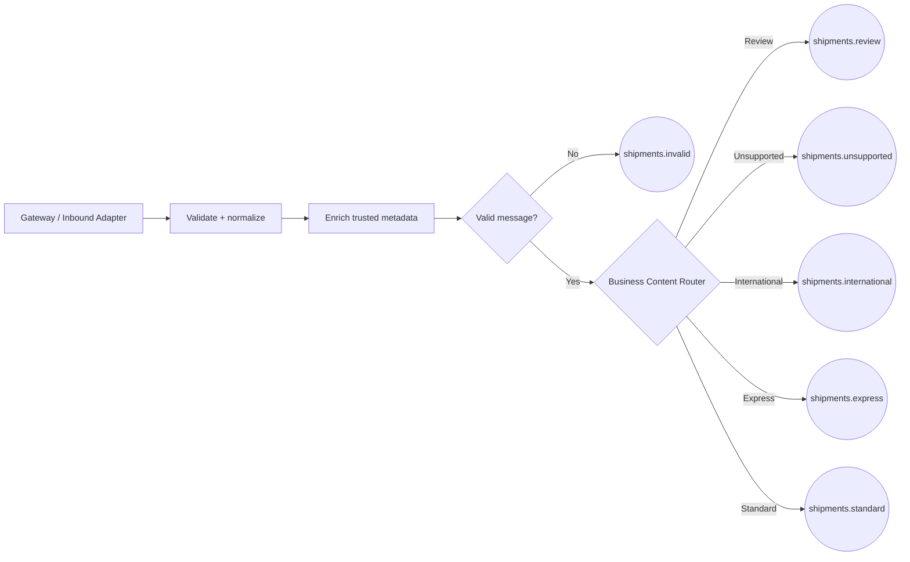
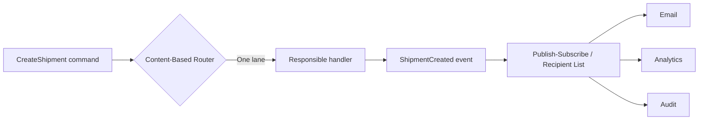
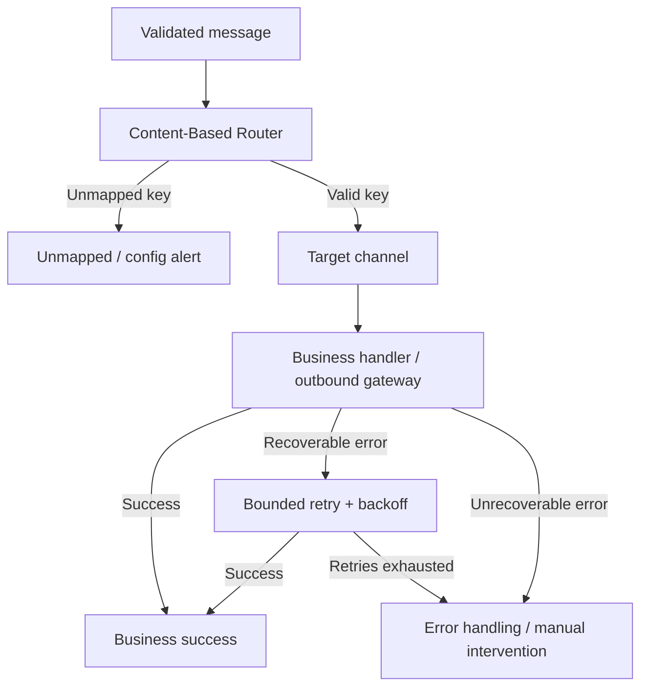

# Business Content-Based Router

> **Chapter:** Message router  
> **Module:** `SPRING_INTEGRATION_PATTERN` — learning to implement Enterprise Integration Patterns with Spring Integration to build loosely coupled, extensible message flows; practicing Router, Filter, Transformer, Splitter, Aggregator, Gateway, retry, error channel, correlation, testing, and observing branches. This lesson dives into **Content-Based Router**: determining destinations based on **business rules and message content**, rather than solely on channel names.

## 1. Learning Objectives

After this lesson, you will be able to:

1. Distinguish **business routing** from technical routing, data filtering, payload transformation, and distributing one event to multiple recipients.
2. Express routing rules as a **decision table**, priority order, and a pure, independently testable decision function.
3. Combine trusted payload/headers with `Content-Based Router` in Spring Integration Java DSL; use `channelMapping` and `defaultOutputChannel` properly.
4. Design separate branches for **invalid**, **unsupported**, **manual review**, and **technical error**, avoiding turning missing data into a wrong business conclusion.
5. Test **selected and unselected branches**, and trace decisions via correlation ID, policy version, and downstream execution results.
6. Recognize the impact of retries, metadata sources, sync/async execution, and multi-step routing on flow reliability.

## 2. Why Must a Router Understand Business Content?

A shipping system receives shipment creation requests from the website, sales system, and partners. All requests may enter the same `shipments.in` channel, yet not all are processed identically:

- Goods needing special inspection must go through **manual review**.
- Unsupported destination countries must enter a **reasoned rejection branch**.
- High-value international orders need **review** before being sent to the carrier.
- Eligible domestic orders requesting express delivery can use the **express flow**.
- Remaining valid domestic orders go to the **standard flow**.

If the intake component calls each service directly using a chain of `if/else` mixed with I/O operations, any policy change easily forces changes to integration code. **Content-Based Router** isolates branch selection into a dedicated endpoint while each branch handles its specialized processing.



The diagram separates **invalid data** from **valid but unsupported data**. Both need appropriate responses, though not necessarily the same error or the same owning team.

## 3. Content-Based Router as an EIP Pattern

**Message Router** selects one or more next paths for a message. **Content-Based Router** is the variant that makes decisions based on **message content**: payload fields, business headers, or normalized/enriched data.

In Spring Integration, a Router is typically attached after an input channel and configured to forward messages to output channels. It can derive its routing key from:

| Decision Source | Example | What to Watch |
| --- | --- | --- |
| **Payload field** | `destinationCountry`, `declaredValue`, `expressRequested` | Validate data types and consistency |
| **Business header** | `tenantRegion`, `riskLevel`, `customerTier` | Verify/overwrite headers that clients could forge |
| **Payload type** | `CreateShipmentCommand`, `CancelShipmentCommand` | Types must be deserialized against a trusted schema |
| **Enrichment result** | Customer tier from Customer Service | Enricher must run **before** the Router that uses the data |
| **Policy function** | `routePolicy.decide(request)` | Rules should be pure, versioned, and independently testable |

**Business routing is not equivalent to load balancing.** Deciding "this order needs review" belongs to business logic; deciding "send request to instance A or B to distribute load" belongs to infrastructure/transport. In a real system, both can coexist but must remain clearly separated.

### 3.1. Distinguishing Easily Confused Endpoints

| EIP / Component | Question | Example |
| --- | --- | --- |
| **Filter** | May the message continue? | Drop requests missing an order ID or with non-positive amount |
| **Transformer** | How should the data representation change? | Normalize country code to ISO 3166-1 alpha-2 |
| **Header/Content Enricher** | What missing information should be added? | Fetch `customerTier` from a trusted service |
| **Content-Based Router** | Which business branch should the message take? | International, express, manual review |
| **Recipient List Router** | Which selected destinations should receive the message? | Send notifications to audit and billing |
| **Publish-Subscribe Channel** | How should one message be broadcast to registered subscribers? | `ShipmentCreated` event to multiple interested parties |
| **Service Activator** | How is business logic executed on the chosen branch? | Call carrier API |

The Router **chooses the path**; it does not itself guarantee an action succeeded at the destination. A successful `send()` or channel routing does not mean the carrier system created the shipment.

## 4. Turning Business Rules into a Decision Table

Use the following example data:

```json
{
  "shipmentId": "SHP-701",
  "destinationCountry": "VN",
  "declaredValue": 1500000,
  "restrictedGoods": false,
  "expressRequested": true,
  "customerTier": "GOLD"
}
```

Learning assumptions (not legal regulations or actual carrier policies):

1. `shipmentId`, country, declared value, and customer tier must be valid. Customer tier is **fetched from a trusted source**, not taken from a buyer's self-reported value.
2. Items marked `restrictedGoods=true` must go to **manual review**.
3. The system supports only `VN`, `SG`, and `TH`; other countries go to the **unsupported** branch.
4. For international orders (`SG` or `TH`), declared values **above 5,000,000** require manual review; remaining international orders go to the international branch.
5. For domestic orders (`VN`), `GOLD` customers requesting express go to the express branch. `REGULAR` customers requesting express must be reviewed rather than **silently downgrading the service**.
6. Remaining valid domestic orders go to the standard branch.

### 4.1. Priority Order Is Part of the Policy

| Order | Condition Evaluated After Validation PASSES | Decision Outcome |
| --- | --- | --- |
| 1 | `restrictedGoods == true` | `MANUAL_REVIEW` |
| 2 | Destination country outside supported set | `UNSUPPORTED_COUNTRY` |
| 3 | Country != `VN` and `declaredValue > 5_000_000` | `MANUAL_REVIEW` |
| 4 | Country != `VN` | `INTERNATIONAL` |
| 5 | Domestic, express requested, customer ineligible | `MANUAL_REVIEW` |
| 6 | Domestic, express, `GOLD` customer | `DOMESTIC_EXPRESS` |
| 7 | Domestic, express not requested | `DOMESTIC_STANDARD` |

This is a **first-match** rule: once a condition matches, subsequent conditions below it are not evaluated. For instance, restricted goods going to an unsupported country go to `MANUAL_REVIEW` under the **illustrated priority policy**. If the business wants to reject unsupported countries before review, change the order explicitly, update tests and policy version — never tweak order casually in code.

### 4.2. Classification Outcome Differs from Channel Name

The Router should produce a business-meaningful **routing key** (`MANUAL_REVIEW`, `INTERNATIONAL`, etc.) and map it to a channel (`shipments.review`, `shipments.international`, etc.).

```text
payload / trusted metadata
    |
    v
Business policy: decide(request)
    |
    +-- routing key: DOMESTIC_EXPRESS
    |
    v
channel mapping
    |
    +-- target channel: shipments.express
```

Separating these two layers allows topology configuration to change without altering the business question "what kind of order is this?". Conversely, channel names must not be freely specified by external senders.

## 5. Writing a Pure Java Policy Without I/O Inside the Router

A good policy function has clear inputs and outputs, **reads no hidden data, and produces no side effects**. Create an `enum` for branches to avoid scattering raw routing strings.

```java
import java.math.BigDecimal;
import java.util.Locale;
import java.util.Set;

record ShipmentRequest(
    String shipmentId,
    String destinationCountry,
    BigDecimal declaredValue,
    boolean restrictedGoods,
    boolean expressRequested,
    String customerTier
) {}

enum ShippingLane {
    MANUAL_REVIEW,
    UNSUPPORTED_COUNTRY,
    INTERNATIONAL,
    DOMESTIC_EXPRESS,
    DOMESTIC_STANDARD
}

final class ShippingRoutePolicy {
    private static final Set<String> SUPPORTED_COUNTRIES =
        Set.of("VN", "SG", "TH");

    private static final Set<String> ALLOWED_TIERS =
        Set.of("GOLD", "REGULAR");

    private static final BigDecimal INTERNATIONAL_REVIEW_THRESHOLD =
        new BigDecimal("5000000");

    private ShippingRoutePolicy() {}

    static boolean valid(ShipmentRequest request) {
        return request != null
            && request.shipmentId() != null
            && !request.shipmentId().isBlank()
            && request.destinationCountry() != null
            && request.destinationCountry().trim().matches("[A-Za-z]{2}")
            && request.declaredValue() != null
            && request.declaredValue().signum() > 0
            && ALLOWED_TIERS.contains(request.customerTier());
    }

    static ShippingLane decide(ShipmentRequest request) {
        if (!valid(request)) {
            throw new IllegalArgumentException("Validate before routing");
        }

        String country = request.destinationCountry()
            .trim().toUpperCase(Locale.ROOT);

        if (request.restrictedGoods()) {
            return ShippingLane.MANUAL_REVIEW;
        }

        if (!SUPPORTED_COUNTRIES.contains(country)) {
            return ShippingLane.UNSUPPORTED_COUNTRY;
        }

        if (!"VN".equals(country)) {
            if (request.declaredValue()
                .compareTo(INTERNATIONAL_REVIEW_THRESHOLD) > 0) {
                return ShippingLane.MANUAL_REVIEW;
            }
            return ShippingLane.INTERNATIONAL;
        }

        if (request.expressRequested()
            && !"GOLD".equals(request.customerTier())) {
            return ShippingLane.MANUAL_REVIEW;
        }

        return request.expressRequested()
            ? ShippingLane.DOMESTIC_EXPRESS
            : ShippingLane.DOMESTIC_STANDARD;
    }
}
```

**Code explanation:**

- `valid(...)` checks the minimum contract. A two-letter country code outside the allowlist is **syntactically valid**, and is then routed to `UNSUPPORTED_COUNTRY`.
- `decide(...)` evaluates in the order of the decision table. The `> 5_000_000` rule does not trigger for exact value 5,000,000; tests must pin down this boundary.
- The function only processes already-present data; it does not call CRM, create shipments, or return dynamic user-supplied channel names.
- Data like `customerTier` must be supplied beforehand by an **enrichment step from a trusted source** before the Router. The example assumes that step already occurred to stay focused on routing.
- In real systems, currency units and conversion rules must be defined. Avoid comparing values across multiple currencies against a single unitless threshold. Here all declared values are assumed to share one normalized currency unit.

### 5.1. Why Not Call External Services Directly Inside `decide(...)`?

A router that both calls a credit-check API and selects a branch makes past decisions hard to reproduce, slows down tests, and obscures whether an error was a **lookup failure** or **no matching route**. Better organization:

```text
Inbound -> Validate -> Enrich(customerTier/riskLevel)
        -> Business Router (pure decision)
        -> Chosen channel -> Business handler
```

The Enricher owns lookup, timeouts, retries, and clarifying stale/missing data; the Router uses only the verified snapshot. If values change over time, decide whether to **use the snapshot at intake** or **look up right before execution**, and record the version/timestamp for traceability.

## 6. Spring Integration Java DSL: From Routing Key to Channel

The example below uses Java 17+ (`record`) with Spring Integration Java DSL. Handlers simply print payloads to illustrate paths. For production use, declare appropriate Spring Integration dependencies, configure the Spring application, and replace console handlers with business services/adapters.

### 6.1. Messaging Gateway

```java
import org.springframework.integration.annotation.Gateway;
import org.springframework.integration.annotation.MessagingGateway;

@MessagingGateway
interface ShipmentGateway {
    @Gateway(requestChannel = "shipments.in")
    void submit(ShipmentRequest shipment);
}
```

The Gateway lets business code call `shipmentGateway.submit(...)` without knowing downstream channel names/types. `void` does not mean the request has finished at the external shipping system.

### 6.2. Input Filter, Router, and Illustrative Handlers

```java
import org.springframework.context.annotation.Bean;
import org.springframework.context.annotation.Configuration;
import org.springframework.integration.annotation.IntegrationComponentScan;
import org.springframework.integration.config.EnableIntegration;
import org.springframework.integration.dsl.IntegrationFlow;

@Configuration
@EnableIntegration
@IntegrationComponentScan
class ShipmentRoutingConfiguration {

    @Bean
    IntegrationFlow shipmentIngress() {
        return IntegrationFlow.from("shipments.in")
            // Allow only valid requests to reach the Router.
            .filter(ShipmentRequest.class, ShippingRoutePolicy::valid,
                spec -> spec.discardChannel("shipments.invalid"))

            // Function returns routing key; mapping specifies actual channel.
            .route(ShipmentRequest.class,
                request -> ShippingRoutePolicy.decide(request).name(),
                spec -> spec
                    .channelMapping("MANUAL_REVIEW", "shipments.review")
                    .channelMapping("UNSUPPORTED_COUNTRY", "shipments.unsupported")
                    .channelMapping("INTERNATIONAL", "shipments.international")
                    .channelMapping("DOMESTIC_EXPRESS", "shipments.express")
                    .channelMapping("DOMESTIC_STANDARD", "shipments.standard")
                    .defaultOutputChannel("shipments.unmapped"))
            .get();
    }

    @Bean
    IntegrationFlow invalidShipments() {
        return IntegrationFlow.from("shipments.invalid")
            .handle(m -> System.out.println("INVALID: " + m.getPayload()))
            .get();
    }

    @Bean
    IntegrationFlow reviewShipments() {
        return IntegrationFlow.from("shipments.review")
            .handle(m -> System.out.println("REVIEW: " + m.getPayload()))
            .get();
    }

    @Bean
    IntegrationFlow unsupportedShipments() {
        return IntegrationFlow.from("shipments.unsupported")
            .handle(m -> System.out.println("UNSUPPORTED: " + m.getPayload()))
            .get();
    }

    @Bean
    IntegrationFlow internationalShipments() {
        return IntegrationFlow.from("shipments.international")
            .handle(m -> System.out.println("INTERNATIONAL: " + m.getPayload()))
            .get();
    }

    @Bean
    IntegrationFlow expressShipments() {
        return IntegrationFlow.from("shipments.express")
            .handle(m -> System.out.println("EXPRESS: " + m.getPayload()))
            .get();
    }

    @Bean
    IntegrationFlow standardShipments() {
        return IntegrationFlow.from("shipments.standard")
            .handle(m -> System.out.println("STANDARD: " + m.getPayload()))
            .get();
    }

    @Bean
    IntegrationFlow unmappedShipments() {
        return IntegrationFlow.from("shipments.unmapped")
            .handle(m -> System.out.println("UNMAPPED: " + m.getPayload()))
            .get();
    }
}
```

The examples `ShipmentRequest`, `ShippingLane`, `ShippingRoutePolicy`, `ShipmentGateway`, and `ShipmentRoutingConfiguration` are assumed to reside in the same application/package for this lesson. When splitting into production files, organize packages, component scanning, and tests appropriately for your project.

Example sending several requests **whose trusted metadata was verified at ingress**:

```java
shipmentGateway.submit(new ShipmentRequest(
    "SHP-701", "VN", new BigDecimal("1500000"),
    false, true, "GOLD"));

shipmentGateway.submit(new ShipmentRequest(
    "SHP-702", "SG", new BigDecimal("900000"),
    false, false, "REGULAR"));

shipmentGateway.submit(new ShipmentRequest(
    "SHP-703", "VN", new BigDecimal("1500000"),
    true, true, "GOLD"));

shipmentGateway.submit(new ShipmentRequest(
    "SHP-704", "FR", new BigDecimal("900000"),
    false, false, "REGULAR"));

shipmentGateway.submit(new ShipmentRequest(
    "SHP-705", "VN", BigDecimal.ZERO,
    false, false, "REGULAR"));
```

Illustrative output (abbreviated payloads):

```text
EXPRESS: SHP-701
INTERNATIONAL: SHP-702
REVIEW: SHP-703
UNSUPPORTED: SHP-704
INVALID: SHP-705
```

### 6.3. Meaning of the Default Branches

In the example, `decide(...)` only returns enum values that are mapped, so `shipments.unmapped` normally **does not appear**. This branch serves as a defensive path if policy and mapping drift out of sync during a configuration change.

It is important to **distinguish**:

- `shipments.invalid`: messages missing or violating required fields, blocked by the Filter **before the Router**.
- `shipments.unsupported`: structurally valid messages whose country falls outside supported policy.
- `shipments.review`: valid data requiring human/system business review.
- `shipments.unmapped`: decision could not map to an output channel per configuration, requiring policy/topology diagnosis.
- **Error channel / exception flow:** technical failures at lookup, send, handler, or outbound adapter; `defaultOutputChannel` cannot be relied upon as an automatic failover route for runtime exceptions.

**Successfully routed** does not mean **successfully processed**. The example handlers only write to the console; real systems must decide when to confirm shipment creation, how to retry, and how to handle duplicates.

## 7. Multi-Condition Rules: Preventing Drift as Policies Grow

Business routing is usually more intricate than `urgent ? A : B`. Typical risks include:

### 7.1. Two Conditions Holding Simultaneously

A high-value international request may also contain restricted goods. Define **explicit precedence** and maintain the policy as a tested decision table. Never allow two branches to execute the same command when business rules permit only **one logical owner** to perform the action.

### 7.2. Missing Values and Unsupported Values Are Different

`destinationCountry=null` is **invalid input**. `destinationCountry="FR"` may be a valid ISO code that is **outside supported scope**. Collapsing both into `STANDARD` causes the Router to send tasks to a handler incapable of fulfilling them.

### 7.3. Boundary Value Semantics

`declaredValue > 5_000_000` and `>= 5_000_000` behave differently right at the threshold. Use `BigDecimal` for monetary comparisons, keep units consistent, and clarify rounding/FX conversion. Policies must have **near-threshold boundary tests**, not just very small and very large values.

### 7.4. Rules Can Change Over Time

Today international orders require review starting at 5 million; tomorrow the threshold may change. A message sitting in a queue processed after a policy change may yield a different decision than when it arrived. There are two main approaches:

1. **Evaluate at processing time:** apply current rules when the Router executes; sensible when policy must always be up to date, though replay behavior needs care.
2. **Evaluate with pinned policy version:** record the policy version/snapshot applied to the message to reproduce decisions; useful for audits or contract-bound workflows.

Align on one approach system-wide; **do not assume old messages automatically use the new policy** or that every message keeps the old policy.

## 8. Metadata and Trust Boundaries Before the Router

To make sound content-based decisions, data reaching the Router must be complete and trustworthy:

| Data | Usable Source | Required Controls |
| --- | --- | --- |
| `destinationCountry` | Payload from customer/partner | Normalize, validate country code, check support rules |
| `declaredValue` | Normalized transaction payload | Currency unit, numeric type, edit permissions, anti-tampering |
| `customerTier` | Trusted Customer Profile/CRM | Enrich before Router; never trust client-supplied tier headers |
| `restrictedGoods` | Business classifier / internal policy | Source, version, timestamp, and verification authority |
| `traceId` / `correlationId` | Ingress/tracing system | Propagate across channels/brokers; never use as idempotency key |

### 8.1. Enricher Must Run Before Routes Needing Metadata

If `customerTier` is missing, the Router **should not** silently default the customer to `REGULAR`. Split the flow into `Validate → Enrich tier → Validate metadata → Router`, or route missing-tier cases to a controlled error/review branch. Do not query CRM hidden inside `decide(...)`, as that mixes classification outcomes with network availability.

### 8.2. Never Derive Channel Names Directly from Untrusted Data

For instance, accepting a `targetChannel="internal.paymentAdmin"` header and dispatching straight to it is dangerous. Map inputs into **allowlisted routing keys**, then map keys to internal channels. Producer access control, channel/adapter security, and validation must be enforced at system boundaries, never relying solely on a router expression.

### 8.3. Should Routing-Only Information Live in Headers?

Headers fit `riskLevel`, `customerTier`, and `routingZone` when those values are flow-control metadata. Payloads fit when data is part of the business contract that must be persisted or forwarded to other systems. Both need schemas and tests. Across brokers/HTTP, **headers are not guaranteed to be preserved intact**; verify mapping, serialization, and header size limits.

## 9. One Message, Multiple Destinations, and Idempotency

In the shipment creation example, each command must have **one responsible branch** to avoid creating duplicate shipments. Once the shipment is created, however, a `ShipmentCreated` **event** may need to be delivered to email, analytics, and audit.



| Pattern | Characteristic | When to Choose |
| --- | --- | --- |
| **Content-Based Router** | Chooses a branch by business rules | Selecting the right shipment creation flow |
| **Recipient List Router** | Sends to a conditional set of recipients | Sending events only to relevant departments |
| **Publish-Subscribe Channel** | Broadcasts events to channel subscribers | Multiple systems need to know the same event |

**Do not assume "having multiple subscribers" means broadcast.** `DirectChannel` dispatches to a single subscriber; `PublishSubscribeChannel` has different semantics. When consumers must be isolated regarding failures and latency, design appropriate async/durability boundaries.

### Idempotency and Correlation

A Router choosing a branch may be invoked again if a broker redelivers a message or processing retries. Every **command with side effects** needs an appropriate idempotency key, such as `shipmentId + operation`, to avoid creating two shipments. `correlationId` aids tracing messages across the same workflow; it **does not prevent duplicate side effects by itself**.

If a shipment is split by a Splitter into multiple parcels routed to different warehouses, the Aggregator needs a **correlation strategy**, **release strategy**, timeouts, and handling for duplicate/late results. Routing individual parcels does not mean the Aggregator automatically knows the order is complete.

## 10. Synchronous, Asynchronous, and Error Handling Per Branch

A Spring Integration Router can send messages to a `DirectChannel`, `ExecutorChannel`, `QueueChannel`, or an outbound broker adapter. Channel selection and delivery guarantees **are not the same thing**.

| Destination | When Is the Send Considered Successful at the Near Boundary? | What Remains Unproven? |
| --- | --- | --- |
| `DirectChannel` | Message dispatched to subscriber with sync semantics | That external targets committed the transaction |
| `ExecutorChannel` | Message handed off / scheduled on executor | That the handler finished or called APIs successfully |
| `QueueChannel` | Message placed into the queue | That a consumer polled, processed, or persisted across restarts |
| External broker via adapter | Transport-level ack/confirm received, if any | That the remote consumer succeeded in business logic |

### 10.1. Distinguishing Unroutable Errors from Destination Processing Errors



**`defaultOutputChannel` only handles missing routes per Router policy**, not automatic failover when a downstream handler throws an exception. Failures on `DirectChannel` typically propagate to the caller; failures across async/poller boundaries may be turned into an `ErrorMessage` via configured error channels. Test your exact configuration instead of assuming all exceptions automatically land in one global error channel.

### 10.2. Retry Where Recovery Is Possible

Retries generally fit around outbound handlers/API calls, with timeouts, max attempts, backoff, error classification, and a terminal path when exhausted. **Do not** retry the entire flow from the Gateway if doing so risks repeating earlier side-effecting steps. When a shipment-creation call times out, the first attempt might already have succeeded at the carrier; use an idempotency key or check status before resending.

### 10.3. Never Automatically Reroute to Another Business Branch on Error

An order routed to `MANUAL_REVIEW` must not fall back to `DOMESTIC_STANDARD` merely because the review system is temporarily unavailable. That **alters the business decision**, not technical failover. If a fallback exists, it must be an approved policy preserving safety conditions.

## 11. Observing "Why Did It Take This Branch?"

In production support, the key question is not just which channel received a message, but also **why** the policy picked that channel and whether processing completed.

Log a logical **routing decision record**, for example:

```json
{
  "shipmentId": "SHP-701",
  "policyVersion": "shipping-routing-v1",
  "decision": "DOMESTIC_EXPRESS",
  "reasonCode": "ELIGIBLE_DOMESTIC_EXPRESS",
  "targetChannel": "shipments.express",
  "occurredAt": "2026-11-21T04:00:00Z"
}
```

This is an **illustrative audit structure**, not a default message/header auto-generated by Spring Integration. If recording decisions exactly once is required, design an appropriate store or audit event. Never perform arbitrary blocking I/O for durable auditing directly inside the routing-key function.

### 11.1. Signals That Help Monitor Every Branch

| Measurement Point | Suggested Signals | Question |
| --- | --- | --- |
| Ingress | Message count, source, schema | How many requests arrived? |
| Filter | Invalid count, reason | How many messages were blocked before Router? |
| **Business Router** | Routing key, policy version, reason code, count per lane | Why did the message enter this branch? |
| Target channel | Dispatch result, queue depth, wait time | Did it reach the destination channel? |
| Handler/outbound | Processing result, downstream timeout, retry attempts | Did the destination complete the business task? |
| Error/review flow | Error class, backlog count, age | How much work still needs intervention? |

`ChannelInterceptor`, Wire Tap, metrics, and distributed tracing complement each other. `correlationId`/`shipmentId` belong in logs/traces; **never use `shipmentId` as a metric tag** due to high cardinality. Payloads may contain personal or financial data; log only necessary fields, masking or omitting sensitive attributes.

### 11.2. Saving the Decision Once When Reproducibility Matters

If the flow must guarantee the Router and downstream handlers **see the exact same decision**, construct an immutable `RoutingDecision` before the Router and carry it in a trusted payload/header:

```java
record RoutingDecision(ShippingLane lane, String reasonCode,
                       String policyVersion) {}

record RoutedShipment(ShipmentRequest shipment,
                      RoutingDecision decision) {}

// Concept in a dedicated Transformer/Enricher step:
ShippingLane lane = ShippingRoutePolicy.decide(request);
RoutedShipment routed = new RoutedShipment(
    request,
    new RoutingDecision(lane, "RULE_MATCHED", "shipping-routing-v1"));
```

The Router then reads `routed.decision().lane()` instead of calling the policy a second time. In larger systems, the reason code should come from the specific policy branch rather than an illustrative constant `RULE_MATCHED`. Evaluating once avoids inconsistent results if dynamic lookup/policies shift mid-flight; you still must specify policy version and auditing on message replay.

## 12. Testing the Policy and the Full Routing Path

Proper testing covers **positive branches**, **negative branches**, **boundary values**, and error cases. Unit testing the policy alone will not catch a wrong `channelMapping` or missing subscriber; integration testing the Router and channels is the essential next layer.

### 12.1. Business Matrix

| Input Data | Expected | Easy-to-Miss Bug |
| --- | --- | --- |
| `VN`, GOLD, express, unrestricted | `DOMESTIC_EXPRESS` | Trusting an unverified tier header |
| `VN`, REGULAR, non-express | `DOMESTIC_STANDARD` | Sending all REGULAR orders to review |
| `VN`, REGULAR, express | `MANUAL_REVIEW` | Silently downgrading express against example policy |
| `SG`, value 5,000,000 | `INTERNATIONAL` | Using `>=` instead of `>` |
| `SG`, value 5,000,001 | `MANUAL_REVIEW` | Missing international value threshold |
| `TH`, restricted goods | `MANUAL_REVIEW` | Putting international rule ahead of restricted rule |
| `FR`, unrestricted | `UNSUPPORTED_COUNTRY` | Misrouting unsupported country |
| `FR`, restricted goods | `MANUAL_REVIEW` per sample order | Reordering rules without updating decisions |
| `VN`, amount 0 | `shipments.invalid` | Letting invalid data reach the Router |
| Empty `customerTier` | `shipments.invalid` or pre-Router enrichment error | Defaulting tier to REGULAR |
| Unmapped routing key | `shipments.unmapped` if configured | Dropping messages with no signal |
| `shipments.express` handler throws exception | Technical error path | Rerouting to standard |

### 12.2. Unit Tests for Pure Rules

```java
import static org.junit.jupiter.api.Assertions.assertEquals;

import java.math.BigDecimal;
import org.junit.jupiter.api.Test;

class ShippingRoutePolicyTest {

    private ShipmentRequest request(String country, String amount,
                                    boolean restricted, boolean express,
                                    String tier) {
        return new ShipmentRequest("SHP-900", country,
            new BigDecimal(amount), restricted, express, tier);
    }

    @Test
    void choosesExpressForEligibleDomesticRequest() {
        assertEquals(ShippingLane.DOMESTIC_EXPRESS,
            ShippingRoutePolicy.decide(
                request("VN", "1000000", false, true, "GOLD")));
    }

    @Test
    void restrictedGoodsTakePrecedenceOverInternationalRoute() {
        assertEquals(ShippingLane.MANUAL_REVIEW,
            ShippingRoutePolicy.decide(
                request("TH", "1000000", true, false, "REGULAR")));
    }

    @Test
    void exactInternationalThresholdDoesNotTriggerReview() {
        assertEquals(ShippingLane.INTERNATIONAL,
            ShippingRoutePolicy.decide(
                request("SG", "5000000", false, false, "REGULAR")));
    }

    @Test
    void aboveInternationalThresholdTriggersReview() {
        assertEquals(ShippingLane.MANUAL_REVIEW,
            ShippingRoutePolicy.decide(
                request("SG", "5000001", false, false, "REGULAR")));
    }

    @Test
    void unknownCountryIsAnExplicitBusinessOutcome() {
        assertEquals(ShippingLane.UNSUPPORTED_COUNTRY,
            ShippingRoutePolicy.decide(
                request("FR", "1000000", false, false, "REGULAR")));
    }
}
```

These tests verify the **decision table** without starting a Spring context. They do not prove any channel actually receives messages.

### 12.3. Integration Tests Should Also Assert Absence on Other Branches

In Spring Test/JUnit, build a context containing `ShipmentGateway`, the flow, and test channel handlers that capture received messages. For a valid `DOMESTIC_EXPRESS` request, assert:

1. `shipments.express` receives **exactly one message** with the expected payload/headers.
2. `shipments.standard`, `shipments.international`, `shipments.review`, and `shipments.unsupported` do **not** receive that message.
3. No messages arrive on `shipments.invalid` or `shipments.unmapped`.
4. Whenever metadata sources or policies change, new conditions have tests matching the corresponding rule version.
5. If destination channels are asynchronous, wait using a **bounded timeout** rather than arbitrary `Thread.sleep()`.

Add tests for downstream handlers throwing exceptions, duplicate message deliveries, and brokers/adapters stripping correlation headers. Those belong to the **execution path**, distinct from the policy function's business decision.

## 13. Anti-Patterns in Business-Content Routing

| Anti-Pattern | Consequence | How to Improve |
| --- | --- | --- |
| **Rules mixed with side effects** | Router calls APIs, writes DB; hard to test and retry | Pure decision + dedicated Handler/Enricher |
| **Trusting route values from clients** | Messages can enter unauthorized channels | Validate data, allowlist key → channel mappings |
| **Missing rule precedence** | Two matching conditions yield unpredictable results | Decision table, explicit priorities, and boundary tests |
| **Missing = default standard** | Missing data treated as normal business traffic | Separate invalid, unknown, unsupported, technical failure |
| **Failing over handler errors to another branch** | Can violate business rules or duplicate side effects | Separate retry/error/compensation; never silently change decisions |
| **Using `double` for monetary thresholds** | Floating-point representation breaks boundary checks | `BigDecimal`, defined units, and rounding rules |
| **Metric tags containing `shipmentId`** | High cardinality explodes monitoring costs | Put IDs in logs/traces; metrics use only lane/reason/version |
| **Enriching after the Router** | Rules evaluate missing or stale tier/risk | Enrich before any step requiring the metadata |
| **Omitting negative branch assertions** | Messages may be misrouted or duplicated | Assert both selected branch and unselected branches |

## 14. Applied Exercise

A payment platform receives `PaymentRequest` with `amount`, `currency`, `country`, `riskLevel`, and `merchantTier`. Example policy:

- `riskLevel=HIGH` → `payments.review`.
- Unsupported country → `payments.unsupported`.
- `riskLevel=LOW`, eligible currency and merchant → `payments.fastLane`.
- Other valid transactions → `payments.standard`.
- If Risk Service does not respond → technical error / bounded retry, **never default to LOW**.

Complete the following:

1. Draw the flow `Gateway → Validate → Enrich riskLevel → Router → handlers` and separate invalid, unsupported, review, and technical error paths.
2. Write an ordered decision table, including a transaction that is both from an unsupported country and high risk.
3. Design a routing key enum and channel mapping; never use a client-supplied `targetChannel` header to pick arbitrary beans.
4. Specify policy version, correlation, and idempotency key; explain why retrying a timed-out transaction risks charging twice.
5. Build a test matrix covering amount thresholds, missing metadata, rule conflicts, out-of-order/replays, and unselected branches.

**Hint:** Use `Filter` for malformed data, `Enricher` for risk from a trusted source, `Content-Based Router` for business decisions, and `Gateway/Service Activator` for payment processing. Never send one transaction down two side-effecting handlers simultaneously. Emit `PaymentSucceeded` only after obtaining proof of an actual successful payment state.

## 15. Summary

**Business Content-Based Router** turns message attributes into an **explainable, testable, and versionable branch decision**. What matters is not just returning a channel name, but also **trusted inputs, rule ordering, clear semantics for invalid/unsupported/review branches, and the relationship between routing decisions and downstream outcomes**.

In Spring Integration, keep **Filter, Transformer/Enricher, Router, and Service Activator** focused on separate responsibilities. Use `channelMapping` to link routing keys to channels, `defaultOutputChannel` to handle unmapped keys, and design dedicated **retries, error channels, correlation, idempotency, tracing, and tests** for every branch. A sound design tells you **why a message was routed there**, **how far it got**, and **when the business operation truly completed**.

**References:** Gregor Hohpe & Bobby Woolf, *Enterprise Integration Patterns* (Content-Based Router, Message Router, Recipient List); official Spring Integration documentation on Routers, Java DSL, Message Channels, Content Enricher, Gateways, and Error Handling.
