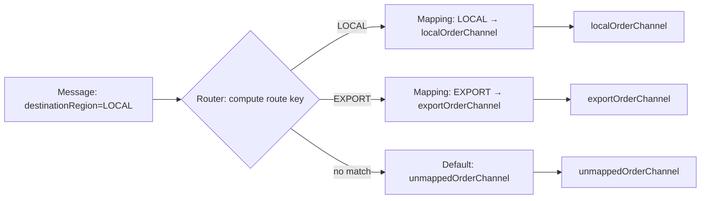
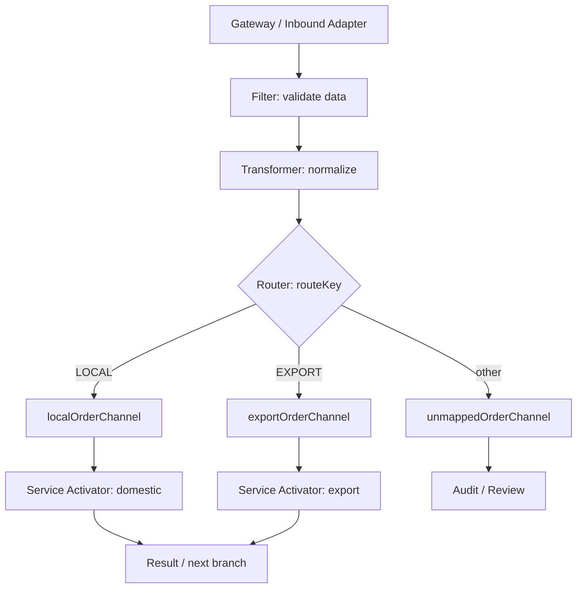

# Channel Mapping and Route Names in Spring Integration

In an integration system, order, payment, or notification messages often need to travel to different processing branches. For example, domestic orders go to the domestic fulfillment handler; export orders go to the documentation handler; unrecognized data goes to an inspection branch. **Message Router** decides each Message's path, while **channel mapping** links *the routing decision value* to an *actual Message Channel* in the application.

In the **Message router** chapter of the `SPRING_INTEGRATION_PATTERN` module, this lesson explains how to name routes, name channels, map between them, and verify routes in Spring Integration. This forms the foundation for combining Router with Gateway, Filter, Transformer, Splitter, Aggregator, retry, error channel, and correlation in Enterprise Integration Patterns (EIP) that are loosely coupled, extensible, and observable.

## 1. Distinguishing Route Key, Channel Mapping, and Channel Name

Suppose a Message carries:

```json
{
  "orderId": "ORD-2401",
  "destinationRegion": "LOCAL",
  "total": 1250000
}
```

A Router inspects `destinationRegion` and decides:

- `LOCAL` → `localOrderChannel`.
- `EXPORT` → `exportOrderChannel`.
- Other values → `unmappedOrderChannel`.

Three concepts must be kept distinct:

| Concept | Example | Meaning |
| --- | --- | --- |
| **Route key** (routing value) | `LOCAL`, `EXPORT` | Value computed by the routing expression/function from the Message |
| **Channel mapping** | `LOCAL → localOrderChannel` | Lookup table mapping route keys to transport destinations |
| **Channel name** | `localOrderChannel` | Bean name of the `MessageChannel` that Spring Integration resolves to send the Message |
| **Default route** | `unmappedOrderChannel` | Destination for unmapped values, when configured |
| **External address** | HTTP URL, Kafka topic, AMQP queue | External integration resource, involved only when channels/adapters are wired accordingly |

The route name is **the logical label of the decision**, whereas the channel name is **the connection point between endpoints in Spring Integration**. A route key `EXPORT` does not require a channel bean named `EXPORT`: mapping lets you use `exportOrderChannel` instead of coupling the business model to infrastructure naming.



**A channel is not a route.** A channel transfers Messages between endpoints; the Router is the endpoint making the *channel-selection* decision. A Router can decide by payload, headers, data type, or a business method.

## 2. Why Use Channel Mapping?

If routing logic returns channel names directly:

```java
String channelName = order.destinationRegion().equals("LOCAL")
        ? "localOrderChannel"
        : "exportOrderChannel";
```

then business code knows infrastructure bean names. When renaming a channel, you must edit routing logic or scatter channel name strings across multiple places. Moreover, that condition routes every value other than `LOCAL` to the export line, even if the data is malformed.

With **channel mapping**, the routing function can return only the business label:

```java
String routeKey = order.destinationRegion();
// "LOCAL", "EXPORT", or an unsupported value
```

Then a mapping table determines the destination channel:

```text
Route keys                Channel bean names
------------------------------------------------
LOCAL                   → localOrderChannel
EXPORT                  → exportOrderChannel
(unknown, no mapping)   → unmappedOrderChannel
```

This approach helps:

1. **Decouple policy from wiring:** business classification rules do not need to know channel implementation details.
2. **Centralize route management:** easily inspect all branches that can receive Messages and spot missing mappings.
3. **Clear testing:** send representative Messages for each route key and observe destination channels.
4. **Easier refactoring:** change consumer/channel topology while keeping `LOCAL` and `EXPORT` codes used by upstream systems unchanged.

Mapping does not create channels on its own, does not rename handlers, and is not an inter-application transport mechanism. **Destination channel beans must still exist or have a valid destination resolution mechanism.**

## 3. Which Mechanisms Does a Router Use to Select Channels?

Spring Integration offers multiple router types. All choose a destination, though the source of the route key varies:

| Router Type | Decision Source | Example |
| --- | --- | --- |
| Header Value Router | Value of a Message header | `eventType=PAYMENT` |
| Payload Type Router | Java type of the payload | `PaymentEvent.class` |
| Expression-based Router | Expression evaluated against the Message | `payload.region` |
| Method-based Router / `@Router` | Return value of a Java method | `calculateRoute(order)` |
| Recipient List Router | List of target destinations | Same event sent to audit and processing |

Not all router types carry the same relationship to mapping. **Channel mapping is especially valuable for routers that compute a logical value and map it to channel names**, such as header- or expression-based routers. Payload Type Routers can map by payload class name; Recipient List Routers target a set of recipients rather than a single logical label.

Some routers can also use **direct channel names** or references to `MessageChannel` objects; in that case, a mapping table is not strictly necessary. Still, clarity of the route contract and handling of invalid values remain critical.

### Route Keys Are Not Java Method Names or HTTP Routes

In this lesson:

- `LOCAL` is a route key.
- `localOrderChannel` is a channel bean name.
- `handleLocalOrder()` might be a consumer method name.
- `/orders/local` might be the URL of an inbound adapter or API.

These are four distinct identifiers. Never assume matching names imply automatic wiring. Endpoints are connected via Spring Integration configuration.

## 4. Creating Channel Mappings with Java DSL

The example below uses Spring Integration Java DSL. Orders with `destinationRegion` equal to `LOCAL` or `EXPORT` go to their corresponding `QueueChannel`. Unsupported values go to a default channel for consumer inspection.

### 4.1. Configuring Channels and Flow

```java
package example.integration;

import java.math.BigDecimal;

import org.springframework.context.annotation.Bean;
import org.springframework.context.annotation.Configuration;
import org.springframework.integration.channel.DirectChannel;
import org.springframework.integration.channel.QueueChannel;
import org.springframework.integration.config.EnableIntegration;
import org.springframework.integration.dsl.IntegrationFlow;
import org.springframework.messaging.MessageChannel;
import org.springframework.messaging.PollableChannel;

@Configuration
@EnableIntegration
public class OrderRoutingConfiguration {

    public record OrderEvent(
            String orderId,
            String destinationRegion,
            BigDecimal total) {
    }

    @Bean
    public MessageChannel ordersInput() {
        return new DirectChannel();
    }

    @Bean
    public PollableChannel localOrderChannel() {
        return new QueueChannel(20);
    }

    @Bean
    public PollableChannel exportOrderChannel() {
        return new QueueChannel(20);
    }

    @Bean
    public PollableChannel unmappedOrderChannel() {
        return new QueueChannel(20);
    }

    @Bean
    public IntegrationFlow orderRoutingFlow() {
        return IntegrationFlow.from("ordersInput")
                .route(OrderEvent.class,
                        OrderEvent::destinationRegion,
                        spec -> spec
                                .channelMapping("LOCAL", "localOrderChannel")
                                .channelMapping("EXPORT", "exportOrderChannel")
                                .defaultOutputChannel("unmappedOrderChannel"))
                .get();
    }
}
```

The flow executes in these steps:

1. A producer sends a `Message<OrderEvent>` to `ordersInput`.
2. The Router reads the `OrderEvent` payload and extracts `destinationRegion` as the route key.
3. For keys `LOCAL` or `EXPORT`, the router looks up `channelMapping`.
4. The Message is delivered to the matching channel name. When unmapped, `defaultOutputChannel` selects the fallback branch.
5. Consumers on each `QueueChannel` can receive Messages via `receive()` or a polling endpoint.

**The returned route key has no `orders` prefix:** it only needs to match the left-hand key of `channelMapping`. The destination bean name must match the right-hand value. Together these two strings form a configuration contract.

The `QueueChannel` beans used here make it easy to test which destination received the Message. In real applications, they can be replaced with `DirectChannel`, adapter-backed channels, or other consumer topologies; logical routing rules stay intact as long as destination names remain stable.

### 4.2. Sending Messages and Observing Routes

```java
package example.integration;

import java.math.BigDecimal;

import org.springframework.context.annotation.AnnotationConfigApplicationContext;
import org.springframework.messaging.Message;
import org.springframework.messaging.MessageChannel;
import org.springframework.messaging.PollableChannel;
import org.springframework.messaging.support.MessageBuilder;

import example.integration.OrderRoutingConfiguration.OrderEvent;

public class OrderRoutingDemo {

    public static void main(String[] args) {
        try (var context = new AnnotationConfigApplicationContext(
                OrderRoutingConfiguration.class)) {

            MessageChannel input =
                    context.getBean("ordersInput", MessageChannel.class);
            PollableChannel local =
                    context.getBean("localOrderChannel", PollableChannel.class);
            PollableChannel export =
                    context.getBean("exportOrderChannel", PollableChannel.class);
            PollableChannel unmapped =
                    context.getBean("unmappedOrderChannel", PollableChannel.class);

            input.send(MessageBuilder.withPayload(new OrderEvent(
                    "ORD-101", "LOCAL", new BigDecimal("300000"))).build());
            input.send(MessageBuilder.withPayload(new OrderEvent(
                    "ORD-102", "EXPORT", new BigDecimal("900000"))).build());
            input.send(MessageBuilder.withPayload(new OrderEvent(
                    "ORD-103", "UNKNOWN", new BigDecimal("400000"))).build());

            Message<?> localMessage = local.receive(0);
            Message<?> exportMessage = export.receive(0);
            Message<?> unknownMessage = unmapped.receive(0);

            System.out.println(localMessage.getPayload());   // ORD-101
            System.out.println(exportMessage.getPayload());  // ORD-102
            System.out.println(unknownMessage.getPayload()); // ORD-103
        }
    }
}
```

The comments `ORD-101`, `ORD-102`, `ORD-103` indicate **the order IDs inside the payload**; printing the full record outputs all three fields `orderId`, `destinationRegion`, and `total`. Calls to `receive(0)` in the example can return `null` if a channel is empty; the sample assumes the synchronous `send` calls succeed and the queues have capacity.

In systems needing direct feedback, inspect the `send()` return value and use appropriate timeouts. A successful `send()` indicates the channel layer accepted the Message, **not that the business consumer finished processing**.

## 5. How Should Route Names Be Chosen for Clarity?

Route names should express **stable business rules**; channel names should express **the processing destination or branch role**.

| Naming Style | Example | Assessment |
| --- | --- | --- |
| Business-meaningful route keys | `LOCAL`, `EXPORT`, `REVIEW_REQUIRED` | Easy to explain in logs and tests |
| Role-based channel names | `localOrderChannel`, `reviewOrders` | Easy to identify endpoints/consumers |
| Naming all channels with uppercase keys | `LOCAL`, `EXPORT` | Works if beans exist, but blurs logical labels with infrastructure names |
| Index-generated route keys | `1`, `2`, `3` | Hard to read with many branches |
| Vague channel names | `out1`, `main2` | Hard to trace as flows evolve |
| Route keys taken directly from external input | `clientSuppliedChannelName` | Allows external data to dictate channel names unexpectedly |

To avoid subtle bugs:

- **Standardize casing** of route keys. `LOCAL`, `local`, and `Local` are distinct strings unless normalized beforehand.
- **Use real bean names** on the right side of `channelMapping`. Renaming a bean without updating the mapping breaks routing.
- **Keep route keys stable** when multiple producers or consumers share the contract.
- **Avoid temporary positional names**, such as `stage2Out`, when the channel serves a clear business responsibility.
- **Manage finite route sets** with enums/constants when appropriate; define unsupported-value behavior explicitly.

An application can place an enum in the payload:

```java
public enum OrderRoute {
    LOCAL,
    EXPORT,
    REVIEW_REQUIRED
}
```

This prevents typos in Java code, though when interacting with JSON/brokers you still need serialization rules, conversion logic, and handling for unknown enum values from clients. An enum does not automatically create `MessageChannel` beans or mappings.

## 6. Handling Unmapped Routes

One of the most important decisions is: **If the router returns a route key not present in the mapping table, what happens?**

In the section 4 example, key `UNKNOWN` goes to `unmappedOrderChannel` via `defaultOutputChannel`. That branch can be used for auditing, rejecting requests, or alerting operations.

Without a default route, Spring Integration may try to resolve the key directly as a channel name or throw a destination resolution failure, depending on router type and settings like `resolutionRequired`. Therefore, never assume unknown values are ignored or routed to a channel named identically to the route key. Design and test this policy explicitly.

| Policy | When Appropriate | What to Watch |
| --- | --- | --- |
| **Default output channel** | Need to retain and classify unrecognized Messages | Default branch must have a consumer or proper storage |
| **Fail fast** | Invalid route indicates configuration bug or strict contract violation | Error path must record route key and source info |
| **Intentional discard** | Fire-and-forget flow with out-of-scope Messages | Needs metrics/audit; never drop requests awaiting replies |
| **Normalize route key before Router** | Differences are purely input formatting like whitespace/case | Never silently alter genuinely distinct event types |

**Never use `nullChannel` to mask configuration bugs.** Spring Integration provides `nullChannel` to intentionally consume and discard Messages. Only route there when business rules permit dropping data and observability/reply needs are already satisfied.

### 6.1. Fallback Does Not Replace Validation

If `destinationRegion` comes from an API, the system can proactively validate allowed values before the router runs. When an invalid value represents a bad request, return a structured error response. If it is an event from an integration source whose route definitions are not yet aligned, the default channel can hold the event for follow-up processing.

A good fallback reflects **the business meaning of an unmatched route**, rather than dumping every misunderstood Message onto an arbitrary consumer.

## 7. Header-Based Routing and Metadata Trustworthiness

Sometimes the decision lives in a header like `eventType` or `routeKey`:

```java
Message<OrderEvent> message = MessageBuilder
        .withPayload(order)
        .setHeader("routeKey", "EXPORT")
        .setHeader("businessOrderId", order.orderId())
        .build();
```

With **Header Value Router**, routing uses the header value and mappings like `EXPORT → exportOrderChannel`. Header-based routing helps when endpoints should not inspect deep payload structures just to choose a branch.

However, understand who sets the header:

1. A header computed internally by a **trusted Transformer/adapter** from validated data can be a valid route key source.
2. A header sent directly by an **external client** is not inherently trustworthy. Allowing clients to supply arbitrary channel names lets them steer Messages into unintended branches.
3. When Messages cross HTTP, Kafka, AMQP, or other brokers, verify **header mappers** and transport formats: not all internal Spring Messaging headers propagate automatically across services.

**Never turn a route key into an access-control check.** Business authorization must be verified at appropriate boundaries/endpoints; the router only picks paths based on data it is configured to trust.

## 8. Channel Names Resolved in the Application Context

When configuring `channelMapping("LOCAL", "localOrderChannel")`, `localOrderChannel` is normally **a `MessageChannel` bean name** in the Spring application context. The router sends Messages to the channel resolved from that name by the Integration infrastructure.

Common issues:

| Symptom | Possible Cause | How to Verify |
| --- | --- | --- |
| Route key is right, yet no Message reaches expected channel | Mapping points to wrong bean name | Cross-check bean names and `channelMapping` values |
| Channel not found error | Channel undeclared or name mismatch | Check bean configuration and startup/runtime errors |
| Message enters right channel, yet produces no result | Channel has no consumer, consumer errored, or waiting for poll | Inspect channel handlers/pollers |
| Multiple Messages mix into one branch | Two route keys point to the same channel unintentionally | Audit mappings, consumers, and logs |
| Behavior differs between test and production | Beans/channels or mapping config overridden | Check active profile configurations |

Having two route keys map to one channel is **valid when intentional**. For instance, `LOCAL` and `PICKUP` both going to `domesticProcessing`. This merges paths; it does not duplicate Messages.

Conversely, if you want **one Message sent to multiple channels**, look at `RecipientListRouter` or `PublishSubscribeChannel` rather than expecting simple channel mapping to fan out.

## 9. Channel Mapping in Multi-Branch Systems

In a larger flow, mappings connect with other EIP patterns:



This flow allows each branch to evolve independently. However, two questions must be answered before scaling out:

**Does a result need to return to the Gateway?** If so, every valid branch must reach an appropriate reply mechanism. An `unmappedOrderChannel` that only logs without replying can leave a request-reply Gateway waiting until timeout.

**Does one order span multiple branches?** If an order splits into parts, you need `Splitter`, `Aggregator`, and correlation metadata. A Router selecting one channel by key does not split or aggregate on its own.

### 9.1. Combining with Splitter/Aggregator

Suppose an order has three line items, each routed by product category. Placing a Router after a Splitter lets individual child Messages traverse different channels:

```text
             Order: 3 items
                   |
                Splitter
                   |
       +-----------+-----------+
       |           |           |
     Item 1      Item 2      Item 3
    corr=G       corr=G      corr=G
    seq=1/3      seq=2/3     seq=3/3
       |           |           |
       +------ Router ----------+
       |           |           |
   electronics   books       clothing
       |           |           |
       +-----------+-----------+
                   |
              Aggregator
```

Channel mapping selects the branch for **each item**; it does not replace `correlationId`, `sequenceNumber`, or `sequenceSize` metadata. If one branch is blocked by a Filter or discards an unknown Message to `nullChannel`, the Aggregator may receive fewer items than expected and never release the group.

If even one item needs review, design explicitly: either return a **review result** into the group or allow partial completion via timeout/release strategy. Never alter mappings and assume the Aggregator will still receive every item.

### 9.2. Router Combined with Retry and Error Channels

Unresolvable destinations, consumer errors, and channel send failures are distinct situations:

- **Invalid route key:** may be a data error; handle via default branch or rejection per contract.
- **Mapping points to wrong bean:** configuration bug; fail fast and fix the mapping.
- **Consumer API call times out:** processing failure; apply bounded retries, backoff, and error flow.
- **Message accepted yet handler retries:** requires a stable idempotency key to prevent duplicate business effects.

With `DirectChannel`, exceptions can propagate synchronously back to the caller. With `QueueChannel` or executors/pollers, error handling depends on asynchronous infrastructure and `errorChannel` configuration; never assume error Messages automatically return to the original producer.

## 10. Testing Channel Mapping Instead of Just the Routing Function

Unit testing `OrderEvent::destinationRegion` only proves the key is computed right. **Integration testing** must prove that key guides Messages to the right channel and prevents leaks into other channels.

### 10.1. JUnit 5 for Three Mapping Cases

```java
package example.integration;

import static org.junit.jupiter.api.Assertions.*;

import java.math.BigDecimal;

import org.junit.jupiter.api.Test;
import org.springframework.context.annotation.AnnotationConfigApplicationContext;
import org.springframework.messaging.Message;
import org.springframework.messaging.MessageChannel;
import org.springframework.messaging.PollableChannel;
import org.springframework.messaging.support.MessageBuilder;

import example.integration.OrderRoutingConfiguration.OrderEvent;

class OrderRoutingIntegrationTest {

    @Test
    void shouldMapKnownRouteKeysAndUseDefaultForUnknown() {
        try (var context = new AnnotationConfigApplicationContext(
                OrderRoutingConfiguration.class)) {
            MessageChannel input =
                    context.getBean("ordersInput", MessageChannel.class);
            PollableChannel local =
                    context.getBean("localOrderChannel", PollableChannel.class);
            PollableChannel export =
                    context.getBean("exportOrderChannel", PollableChannel.class);
            PollableChannel unmatched =
                    context.getBean("unmappedOrderChannel", PollableChannel.class);

            Message<OrderEvent> first = MessageBuilder.withPayload(
                    new OrderEvent("ORD-1", "LOCAL", BigDecimal.ONE))
                    .setHeader("businessOrderId", "ORD-1")
                    .build();
            Message<OrderEvent> second = MessageBuilder.withPayload(
                    new OrderEvent("ORD-2", "EXPORT", BigDecimal.TEN))
                    .build();
            Message<OrderEvent> third = MessageBuilder.withPayload(
                    new OrderEvent("ORD-3", "UNKNOWN", BigDecimal.ONE))
                    .build();

            assertTrue(input.send(first));
            assertTrue(input.send(second));
            assertTrue(input.send(third));

            Message<?> a = local.receive(0);
            Message<?> b = export.receive(0);
            Message<?> c = unmatched.receive(0);

            assertNotNull(a);
            assertNotNull(b);
            assertNotNull(c);

            assertEquals("ORD-1", ((OrderEvent) a.getPayload()).orderId());
            assertEquals("ORD-2", ((OrderEvent) b.getPayload()).orderId());
            assertEquals("ORD-3", ((OrderEvent) c.getPayload()).orderId());
            assertEquals("ORD-1", a.getHeaders().get("businessOrderId"));

            assertNull(local.receive(0));
            assertNull(export.receive(0));
            assertNull(unmatched.receive(0));
        }
    }
}
```

In this setup, `ordersInput` is a `DirectChannel`; the router dispatches synchronously into `QueueChannel` beans with ample capacity. Thus, `receive(0)` after each `send` is deterministic. With executors, brokers, or polling consumers, use conditional waiting within a timeout instead of assuming immediate completion.

### 10.2. Additional Cases to Cover

1. **Key casing differences:** `LOCAL`, `local`, `Local`; verify normalization policy.
2. **Missing or blank key:** enforce fail fast, default, or business error response.
3. **Mapping to misspelled channel name:** prove failures are surfaced with informative logs.
4. **Two keys to one channel:** verify intentional path convergence.
5. **Default route:** unknown Messages never leak into valid business branches.
6. **Request-reply Gateway:** every branch returns a result or appropriate error before timeout.
7. **Splitter/Aggregator:** child Messages across routes retain sufficient correlation metadata for reassembly.
8. **Retries and errors:** consumer failures are not mistaken for bad route keys and do not duplicate side effects.

A thorough test verifies **the input route key, receiving channel, preserved payload/headers, and emptiness of unselected branches**.

## 11. Observing and Troubleshooting Routing

When operating many routes, operators need to know *which Message arrived, which route key was computed, which mapping applied, and which channel received it*.

A structured routing log might look like:

```json
{
  "stage": "order-router",
  "messageId": "<uuid>",
  "businessOrderId": "ORD-2401",
  "routeKey": "EXPORT",
  "targetChannel": "exportOrderChannel",
  "decision": "MAPPED",
  "correlationId": null
}
```

The `targetChannel` field in the log is application-recorded observability data, not a header automatically created by Spring Integration. `correlationId` appears only when the flow provides correlation metadata; never fabricate dummy values just to make logs look complete.

| Suggested Metric | Purpose |
| --- | --- |
| `router.input.count` | Count Messages entering the Router |
| `router.route.count{routeKey=...}` | Observe traffic per route key |
| `router.default.count` | Detect unmapped keys or new data shapes |
| `router.error.count` | Detect channel resolution or send failures |
| `channel.queue.depth` | Monitor backlog on buffered channels |
| `consumer.error.count` | Distinguish post-Router failures from Router failures |

These metric names are **naming suggestions**, not defaults automatically emitted by Spring Integration/Actuator. Instrument via Micrometer, logging/tracing, and appropriate channels/handlers.

When routing breaks, inspect in practical order: **read route key → check mapping table → verify channel bean exists → check Message arrived at channel → check consumer → inspect error flow**. This separates policy bugs, configuration bugs, and business processing errors.

## 12. Route and Mapping Design Checklist

- **Define the route key set:** business meaning, data type, casing standard, and invalid values.
- **Name channels purposefully:** use stable bean names reflecting consumer responsibility.
- **Declare explicit mappings:** every primary route needs path tests.
- **Choose default/fail policy:** never let unknown Messages fall into critical business branches.
- **Protect boundaries:** never trust unverified route headers from external sources.
- **Consider fan-out:** if multiple recipients are needed, pick a pattern supporting multi-channel delivery.
- **Design request-reply:** ensure the Gateway never hangs forever on a default branch.
- **Preserve correlation:** when routing child Messages, ensure the Aggregator receives full group metadata.
- **Separate errors from retries:** bad routes, wrong channels, and consumer errors need distinct policies.
- **Measure per branch:** log route key, destination channel, business key, and processing outcome appropriately.

Channel mapping turns a business-meaningful routing decision into a concrete Message path in Spring Integration. When route names and channel names stay cleanly separated, and mappings are tested for both happy paths and fallbacks, the Router collaborates smoothly with other endpoints while remaining easy to change, observe, and maintain.
