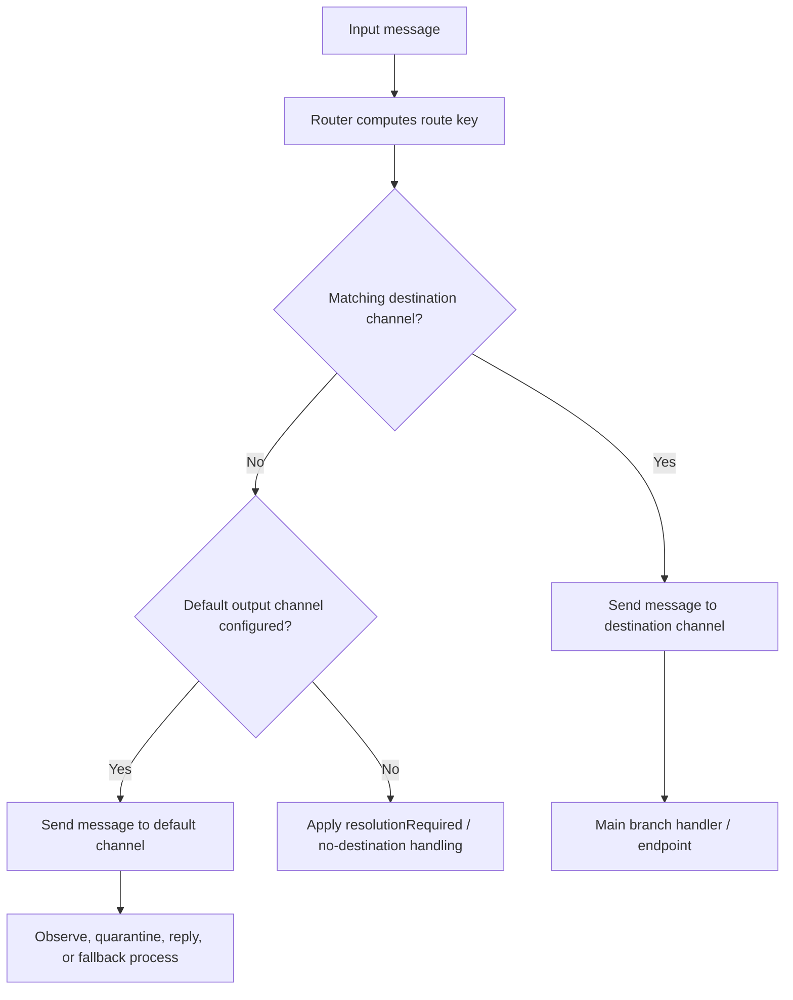
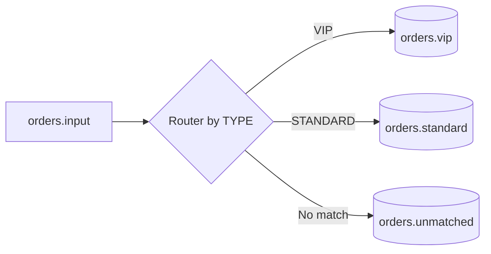
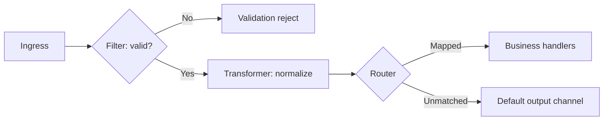
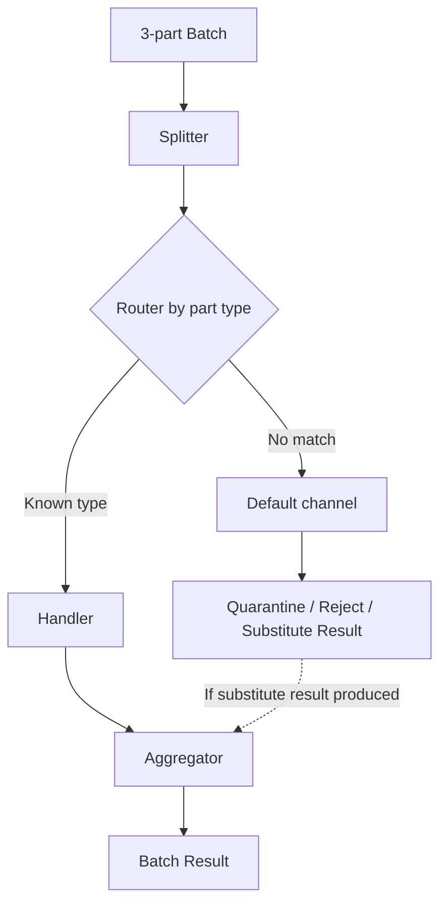

# Default Output Channel When No Route Matches in Spring Integration

## Lesson Objectives

In integration systems, not every message matches a known routing rule. For example, an order processing application has two routes `VIP` and `STANDARD`, yet receives a message labeled `WHOLESALE` newly added by a partner system. When the Router cannot resolve a destination channel, the system must behave explicitly: reject, send to a fallback processor, or intentionally discard.

**Default output channel** is a **Message Router** configuration in Spring Integration that receives a message when the Router **cannot find a matching destination channel**. It is a mechanism to control the no-route case; the default channel itself does not automatically fix business errors, retry messages, or send messages to a dead-letter queue.

This lesson belongs to the **Message router** chapter in the **SPRING_INTEGRATION_PATTERN** module. The module practices Enterprise Integration Patterns to build loosely coupled, extensible message flows, combining Router, Filter, Transformer, Splitter, Aggregator, Gateway, retry, error channel, and correlation, while testing and observing processing branches.

After this lesson, you will be able to:

1. Describe accurately when a Router uses `defaultOutputChannel`.
2. Distinguish an unmatched route from a message send failure or a handler failure after successful routing.
3. Configure a default channel using Spring Integration Java DSL and choose an appropriate channel type.
4. Test that valid messages take the right branch, unmatched messages reach the fallback, and headers are preserved.
5. Design controlled handling for unrecognized messages: inspection, logging, alerting, quarantine, or error responses.
6. Avoid pitfalls when a Router sits inside a Gateway, Splitter/Aggregator, or retryable flow.

## 1. The Problem: Router Cannot Find Where to Send a Message

Consider an order flow:

```text
Inbound message
    |
    v
Message Router (reads orderType)
    |--- VIP -----------> vipChannel
    |--- STANDARD ------> standardChannel
    |
    +--- WHOLESALE ???   no mapping
```

If the application defines only `VIP` and `STANDARD` mappings, a `WHOLESALE` message has no configured destination in the routing model. Three common policies exist:

| Policy | Behavior | When to Choose |
| --- | --- | --- |
| **Fail fast** | Router raises an error when no route matches | Unknown message types are contract errors the caller must know immediately |
| **Default output channel** | Sends unmatched messages to a fallback channel | Need to capture or handle unknown types separately without losing messages |
| **Intentional discard** | Sends to a discard destination after business confirmation allows it | Unneeded messages, with metrics and explicit discard criteria |

For example, an `orders.unmatched` channel lets you observe and decide the fate of unrecognized messages. Never automatically route all unknown messages to the `STANDARD` branch if that branch executes real business logic: a new order type could be processed incorrectly without anyone noticing.

### Key Concepts

- **Route key**: value computed by the Router from payload or headers, e.g. `VIP`, `STANDARD`, `WHOLESALE`.
- **Channel mapping**: maps a route key to a channel, e.g. `VIP -> orders.vip`.
- **Resolved destination**: the target channel the Router actually resolves after applying configuration rules.
- **Default output channel**: channel used by the Router when **no destination is resolved**; it is not a lower-priority branch or a catch-all exception handler.

A message may be routed successfully while the handler on the destination channel throws an exception. In that case, the Router does not fall back to the default channel; appropriate retry and error-handling mechanisms are needed.

## 2. Decision Flow of the Default Output Channel



Read this diagram at the **routing decision** level. Resolving a destination channel can involve more steps than a mapping lookup: some Routers support resolving channel names from route keys and offer a `channelKeyFallback` option.

Actual ordering and handling of nonexistent keys depend on the Router type and the Spring Integration version and configuration in use. Therefore, when requiring **only explicit mappings to be permitted**, control resolving route keys directly into channel names rather than assuming unknown keys always reach default.

### A Concrete Scenario

```text
Mappings:
  VIP      -> orders.vip
  STANDARD -> orders.standard

Default:
  orders.unmatched

Computed route keys:
  VIP       -> orders.vip
  STANDARD  -> orders.standard
  WHOLESALE -> orders.unmatched (when no other channel resolves)
  UNKNOWN   -> orders.unmatched (when no other channel resolves)
```

Naming it `orders.unmatched` emphasizes that the message **has no accepted route**; it does not imply the system processed the order successfully.

## 3. How Default Output Channel Differs from Commonly Confused Settings

| Setting / Mechanism | Question Answered | Not Equivalent To |
| --- | --- | --- |
| `defaultOutputChannel` | When no destination is resolved, where does the Router send the message? | `errorChannel`, retries, or exception-handling branches |
| `resolutionRequired` | Does the Router require resolving a destination channel? | Automatically creating a new route or routing to default |
| `channelKeyFallback` | Can the key be used directly as a channel name when no explicit mapping exists? | A business fallback path |
| `ignoreSendFailures` | For multi-destination Routers, how are individual send failures handled? | A catch-all for handler exceptions |
| `errorChannel` | How are error messages routed in error-message-capable contexts? | An automatic sink for all unmatched route keys |
| `nullChannel` | Intentionally discards messages sent to this channel | Storage or auditing for failed messages |

### Relationship with `resolutionRequired`

If there is no default output channel and the Router finds no receiver, the Router can throw a routing error when `resolutionRequired` is enabled; if configured as not required, the message may end at the Router with no further path. These behaviors must follow business requirements, be verified by tests, and remain observable in operations.

When **a valid default output channel exists**, an unrouted message can be forwarded there instead of triggering missing-destination failure handling.

### Relationship with `channelKeyFallback`

Some mapping routers allow looking up a channel by the exact name returned as the route key when no explicit mapping matches. For instance, key `WHOLESALE` could accidentally match a channel bean with that same name even if you only declared `VIP` and `STANDARD` mappings.

If operational policy requires that **any key outside the allowlist goes to `orders.unmatched`**, disable channel-name fallback when supported by the DSL/router, or define the route contract explicitly in another way. Test unknown keys even when other channels already exist in the context.

## 4. Java DSL Example: Router with a Default Channel

The example application reads strings formatted as `TYPE:ORDER_ID`:

```text
VIP:ORD-100
STANDARD:ORD-101
WHOLESALE:ORD-102
MALFORMED
```

We design:

- `orders.input`: receives requests.
- `orders.vip`: channel for VIP.
- `orders.standard`: channel for STANDARD.
- `orders.unmatched`: channel receiving unrouted types.
- A Router computing route keys from the string prefix, accepting only two explicit mappings.

To simplify testing, the three outputs use `QueueChannel`: we can read them via `receive()` without starting background handlers.



### Spring Integration Configuration

```java
import org.springframework.context.annotation.Bean;
import org.springframework.context.annotation.Configuration;
import org.springframework.integration.channel.DirectChannel;
import org.springframework.integration.channel.QueueChannel;
import org.springframework.integration.config.EnableIntegration;
import org.springframework.integration.dsl.IntegrationFlow;
import org.springframework.messaging.MessageChannel;
import org.springframework.messaging.PollableChannel;

@Configuration
@EnableIntegration
public class OrderRouterConfig {

    @Bean("orders.input")
    MessageChannel orderInput() {
        return new DirectChannel();
    }

    @Bean("orders.vip")
    PollableChannel vipQueue() {
        return new QueueChannel();
    }

    @Bean("orders.standard")
    PollableChannel standardQueue() {
        return new QueueChannel();
    }

    @Bean("orders.unmatched")
    PollableChannel unmatchedQueue() {
        return new QueueChannel();
    }

    @Bean
    IntegrationFlow orderRoutingFlow() {
        return IntegrationFlow.from("orders.input")
            .route(String.class, OrderRouterConfig::routeKey,
                spec -> spec
                    .channelMapping("VIP", "orders.vip")
                    .channelMapping("STANDARD", "orders.standard")
                    .channelKeyFallback(false)
                    .defaultOutputChannel("orders.unmatched"))
            .get();
    }

    private static String routeKey(String payload) {
        int separator = payload.indexOf(':');

        if (separator <= 0) {
            return "UNRECOGNIZED";
        }

        return payload.substring(0, separator);
    }
}
```

**Meaning of each setting:**

1. `IntegrationFlow.from("orders.input")` opens the flow with an input channel.
2. `route(String.class, OrderRouterConfig::routeKey, ...)` computes the key from the `String` payload.
3. `channelMapping("VIP", "orders.vip")` and `channelMapping("STANDARD", "orders.standard")` define allowed destinations.
4. `channelKeyFallback(false)` prevents unmapped keys from resolving directly to existing channel bean names.
5. `defaultOutputChannel("orders.unmatched")` specifies the receiver when the Router resolves no destination channel.
6. `QueueChannel` does not invoke handlers automatically. In tests, we pull outputs actively.

In the corresponding Spring Integration Java DSL version, Router configuration APIs are exposed via `RouterSpec`. When using Spring Integration with Spring Boot, include the Spring Integration dependency and configuration creating the beans; the example above uses Spring configuration independent of Spring Boot.

### Sending a Message into the Flow

```java
import org.springframework.messaging.Message;
import org.springframework.messaging.support.MessageBuilder;

Message<String> input = MessageBuilder.withPayload("WHOLESALE:ORD-102")
    .setHeader("traceId", "trace-102")
    .setHeader("tenantId", "tenant-a")
    .build();

ordersInput.send(input);
```

Variable `ordersInput` is the `MessageChannel` bean named `orders.input` retrieved from the Spring context. For this message, the Router returns route key `WHOLESALE`; there is no mapping for that key and `channelKeyFallback` is disabled, so the message goes to `orders.unmatched`.

Key point: **payload and business headers stay intact** when forwarded by the Router to the chosen channel. The default channel can read `traceId` to analyze the message source and notify the sender.

## 5. Testing Valid Routes and the Default Channel

To prove behavior, tests must verify all three assertions:

- Mapped keys go to the **right** channel.
- Unmapped keys go to the **default channel**.
- Other channels **do not receive** unexpected messages.

We use JUnit 5, Spring Test, and AssertJ.

```java
import static org.assertj.core.api.Assertions.assertThat;

import org.junit.jupiter.api.Test;
import org.springframework.beans.factory.annotation.Autowired;
import org.springframework.beans.factory.annotation.Qualifier;
import org.springframework.messaging.Message;
import org.springframework.messaging.MessageChannel;
import org.springframework.messaging.PollableChannel;
import org.springframework.messaging.support.MessageBuilder;
import org.springframework.test.context.junit.jupiter.SpringJUnitConfig;

@SpringJUnitConfig(OrderRouterConfig.class)
class OrderRouterTest {

    @Autowired
    @Qualifier("orders.input")
    MessageChannel input;

    @Autowired
    @Qualifier("orders.vip")
    PollableChannel vip;

    @Autowired
    @Qualifier("orders.standard")
    PollableChannel standard;

    @Autowired
    @Qualifier("orders.unmatched")
    PollableChannel unmatched;

    private static Message<String> request(String body) {
        return MessageBuilder.withPayload(body)
            .setHeader("traceId", "trace-102")
            .setHeader("tenantId", "tenant-a")
            .build();
    }

    @Test
    void vipMessageUsesMappedChannel() {
        assertThat(input.send(request("VIP:ORD-100"))).isTrue();

        Message<?> received = vip.receive(2_000);
        assertThat(received).isNotNull();
        assertThat(received.getPayload()).isEqualTo("VIP:ORD-100");
        assertThat(standard.receive(0)).isNull();
        assertThat(unmatched.receive(0)).isNull();
    }

    @Test
    void standardMessageUsesMappedChannel() {
        assertThat(input.send(request("STANDARD:ORD-101"))).isTrue();

        Message<?> received = standard.receive(2_000);
        assertThat(received).isNotNull();
        assertThat(received.getPayload()).isEqualTo("STANDARD:ORD-101");
        assertThat(vip.receive(0)).isNull();
        assertThat(unmatched.receive(0)).isNull();
    }

    @Test
    void unknownKeyGoesToDefaultChannel() {
        assertThat(input.send(request("WHOLESALE:ORD-102"))).isTrue();

        Message<?> received = unmatched.receive(2_000);
        assertThat(received).isNotNull();
        assertThat(received.getPayload())
            .isEqualTo("WHOLESALE:ORD-102");
        assertThat(received.getHeaders().get("traceId"))
            .isEqualTo("trace-102");
        assertThat(received.getHeaders().get("tenantId"))
            .isEqualTo("tenant-a");

        assertThat(vip.receive(0)).isNull();
        assertThat(standard.receive(0)).isNull();
    }

    @Test
    void malformedTypeAlsoGoesToDefaultChannel() {
        assertThat(input.send(request("MALFORMED"))).isTrue();

        Message<?> received = unmatched.receive(2_000);
        assertThat(received).isNotNull();
        assertThat(received.getPayload()).isEqualTo("MALFORMED");
        assertThat(vip.receive(0)).isNull();
        assertThat(standard.receive(0)).isNull();
    }
}
```

The test uses `DirectChannel` to route synchronously before asserting, and no other pollers consume from the queues. If the application switches these channels to asynchronous, calling `receive(0)` on another channel cannot strictly prove a message will never arrive late; use appropriate observation windows and bounds.

**Do not cram all cases into one test if you want to pinpoint which case failed.** When sharing a Spring test context, drain queues or isolate state if tests may run concurrently.

### Important Additional Tests

Also test:

1. A route key differing only in casing, such as `vip`, enters the default channel if classification is case-sensitive.
2. A message carrying a type newly added to a business enum that lacks a Router mapping yet.
3. Normalizing input payloads before computing keys to prevent whitespace bugs.
4. `traceId` and business ID headers preserved across branches.
5. Without a consumer on the default channel, the queue can grow; enforce capacity and monitoring or attach an intake handler.

## 6. Choosing Business Semantics for the Default Channel

**Routing fallback is not automatically business fallback.** An unrouted message needs a responsible intake policy. At least four designs exist:

| Default Channel Design | Handling | Consequence |
| --- | --- | --- |
| **Quarantine channel** | Records the message and unrecognized reason for inspection | Good when partners introduce new message types |
| **Validation/rejection channel** | Builds a structured error response for the caller | Fits synchronous Gateways/APIs |
| **Audit-only channel** | Counts and records unmatched events with sensitive fields masked | Fits when business permits dropping after recording |
| **Compatibility channel** | Transforms and re-routes when legacy types can be normalized | Fits version migrations; requires an allowlist |

Naming the channel `orders.unmatched` is usually clearer than `orders.error` because "no route" may not be an exception. If a message violates its contract, the default channel's handler **can explicitly return an error** or forward to an error flow; that is an application decision.

### Never Swallow Default Messages

A `QueueChannel` with no consumer accumulates messages. In learning examples this helps testing, but in production you need at least:

- A handler or poller to process waiting messages.
- Bounded queue capacity or an appropriate persistent message store.
- Retention rules, retries, and handling when the fallback branch itself fails.
- Metrics by unmatched message count and key type.
- Never logging full payloads or headers containing sensitive data.

When unrecognized messages fall into multiple groups, another Router can classify further on the default channel—such as splitting review vs. quarantine. However, define a clear stopping point so default routes never loop.

## 7. Combining Filter, Transformer, and Router

A common three-step design:



Distinguish three situations:

- **Invalid input**: missing required fields or wrong types; Filter/validator rejects before routing.
- **Valid but unsupported type**: well-structured data whose type is not yet supported; Router sends to the default output channel.
- **Mapped type but processing failed**: Router found the destination, yet the handler failed; handled via exceptions/retries/error flows.

These three have different business meanings and reporting paths. Never silently funnel validation errors or exceptions into the default channel.

### Example: Normalizing the Route Key

When inputs arrive from multiple partners, instead of routing directly on raw strings, use a DTO:

```java
record IncomingOrder(String orderId, String type, String source) {}

String normalizedType(IncomingOrder order) {
    if (order.type() == null) {
        return "UNRECOGNIZED";
    }

    return order.type().trim().toUpperCase(java.util.Locale.ROOT);
}
```

The Router then computes keys from `IncomingOrder` and maps normalized values; structurally invalid data should be caught before routing. Crucially, **never treat a client-supplied route key as unconditionally trustworthy** when it gates operations with different privilege levels.

## 8. Default Channel with Multiple Routing Destinations

Not every Router returns a single channel. A recipient-list router or multi-destination Router can send one message to multiple branches. In that setting:

- Some recipients being valid and others invalid **is not equivalent** to "no route."
- `defaultOutputChannel` is the fallback when the Router **resolves no matching destination**, not a copy sink for every routed message.
- `ignoreSendFailures` governs send errors across multiple recipients and does not turn the default channel into a catch-all for send failures.
- To audit every message, use a dedicated publish/subscribe branch or wire tap, not the default channel.

For testing, verify the exact **recipient count** requirement: one message routed to one channel, multiple valid recipients, or zero recipients. If a handler requires an aggregated result from multiple branches, design correlation and an Aggregator rather than assuming the Router completes the workflow.

## 9. Gateway: No Route and Reply Contracts

A request-reply Gateway normally awaits a result or exception to return to the caller. If a message matches no route, three scenarios arise:

1. **Default channel has a replying handler**: the Gateway can receive a reply saying "unsupported order type."
2. **Default channel only logs audit without replying**: the Gateway may block until `replyTimeout` because the path produces no result.
3. **Router requires resolution, has no default, and finds no route**: errors can propagate back to the caller on synchronous paths, or enter configured error handling.

Therefore, when connecting a Router behind a Gateway, design an explicit response or exception for the unsupported case.

A business response might look like:

```json
{
  "status": "REJECTED",
  "code": "UNSUPPORTED_ORDER_TYPE",
  "orderId": "ORD-102",
  "message": "Order type WHOLESALE is not supported"
}
```

This is only an example application contract, not a payload generated automatically by Spring Integration. In one-way broker flows, instead of replying, the application can emit an error event or store the message for review.

**Note:** A fallback `QueueChannel` will not send a reply merely because a message sits in its queue. A consumer/poller must produce a response if the Gateway expects a result.

## 10. Splitter, Aggregator, and Correlation with a Fallback Channel

Suppose a Splitter produces three child messages, each passing through a Router:



If two parts process normally while one part goes to quarantine and **emits no result**, the Aggregator may receive only 2 of 3 messages when `sequenceSize=3`. It will not release on completion-count if the third part never arrives.

Options:

- **Substitute result**: the default branch produces a `PartResult(status=UNSUPPORTED)` carrying full correlation/sequence metadata so the Aggregator completes and returns an aggregated report with errors.
- **Custom release strategy**: allow completion upon a termination marker, timeout, or business rule; distinguish complete vs. partial results.
- **Split groups upfront**: route unsupported items to a separate group, or reject the batch before the Splitter if partial results are unacceptable.
- **Controlled cancellation**: transition the batch to an explicit failed state and clean up message groups per policy.

**Never send unmatched messages to default and assume the Aggregator will still receive all parts.** Routing design must go hand in hand with correlation, group completion, and idempotency design.

### Headers to Preserve

For child messages, explicitly define propagation for:

| Header | Why Needed |
| --- | --- |
| `traceId` | Trace the same batch across branches |
| `batchId` / `orderId` | Link via stable business keys |
| `correlationId` | Group messages belonging to the same batch |
| `sequenceNumber` | Identify which element was processed |
| `sequenceSize` | Support waiting for all parts when count is known upfront |
| `originalType` | Analyze why a message landed on the default branch |

When a handler builds a new message, verify which headers are copied; never rely on `id` or `timestamp` to join logs since they can change over a message's lifecycle.

## 11. Retries and Error Channels: Limits of Default Output

### Case 1 — No Route

```text
routeKey = WHOLESALE
mapping = {VIP, STANDARD}
default = orders.unmatched
    |
    v
orders.unmatched
```

This is the case `defaultOutputChannel` solves.

### Case 2 — Right Route, Yet Handler Fails

```text
routeKey = VIP
    |
    v
orders.vip --> VIP handler --> exception
```

The Router resolved the destination `orders.vip`. When the downstream handler throws an exception, the message **is not rerouted** to `orders.unmatched`. The application needs retries, an error channel, or error responses appropriate to the channel and endpoint types.

### Case 3 — Destination Channel Rejects or Send Fails

For example, a bounded channel is full or the consumer is unavailable. This is a **delivery** issue. A `defaultOutputChannel` meant for **unresolvable routes** cannot serve as a general retry coordinator for delivery failures. If business rules require routing to an alternate channel upon delivery failure, design controlled failover logic considering duplicates and partial handler execution.

### Which Retries Make Sense?

Normally, resending a `WHOLESALE` message into the Router with the exact same mappings still produces `unmatched`. Retrying only helps when conditions can change—for example, mappings are updated or a downstream handler hit a transient outage.

For unsupported types, establish a **quarantine → evaluate → update routing rules → replay** workflow with idempotency keys and version control. Never put unmapped messages into an infinite retry loop.

### ErrorChannel Differs from Default Channel

Spring Integration can represent failures as `ErrorMessage` in asynchronous error flows or error-emitting components. Inspect `failedMessage` when provided by the exception and propagate `traceId` for observability. The default channel does not automatically receive every `ErrorMessage`; error handling is its own separate flow.

## 12. Observing and Operating the Default Channel

When bringing a default output channel into production, monitor key metrics:

| Metric | Meaning |
| --- | --- |
| `router_unmatched_total{routeKey}` | Count of messages with no destination resolved, by key |
| `router_unmatched_rate` | Rate of unsupported types; catches upstream changes |
| `router_default_queue_depth` | Messages waiting in the default channel |
| `router_unmatched_age` | Oldest unprocessed message |
| `router_default_handler_errors_total` | Errors while handling/quarantining on the default branch |
| `router_replayed_total` | Messages replayed after updating rules |
| `router_unmatched_result_total{outcome}` | Messages rejected, replayed, or successfully resolved |

These are **illustrative application-defined metric names**, not counters asserted to be emitted automatically by Spring Integration. Combine Micrometer/observation, structured logging, and queue depth checks per project.

A redacted structured log might look like:

```text
traceId=trace-102 orderId=ORD-102 event=route_unmatched
routeKey=WHOLESALE destination=orders.unmatched source=checkout
```

Never log tokens, credentials, or payloads containing personal data just because a message hit the default channel. If replay is needed, use storage with explicit access controls and retention limits.

### When to Alert?

- Unmatched messages spike abruptly right after a deployment.
- Route keys outside the allowlist begin appearing.
- The default queue fills up or lacks a consumer.
- A message waits beyond SLA.
- Repeated replays still hit the same unmapped key.

One aggregate "routed messages" counter is not enough: distinguish **mapped**, **unmatched**, **delivery failed**, and **business failed**.

## 13. Common Pitfalls and Fixes

| Symptom | Common Cause | How to Fix |
| --- | --- | --- |
| Unknown key enters an unexpected channel | Router has bean-name channel-key fallback enabled | Control `channelKeyFallback` and test mappings |
| Message missing from default queue | Router resolved another channel, or a handler/poller consumed it | Inspect route key, mappings, subscribers, and received counts |
| Unrouted message is lost | No default, resolution not required, or another path dropped it | Configure fail-fast/default explicitly and add metrics |
| VIP handler fails yet default never receives it | Default handles only unresolved destinations | Configure retry/error flows for the handler |
| Gateway times out on unrecognized message | Default channel only stores messages without replying | Return an explicit reject reply/error message |
| Aggregator waits forever | Default branch emits no part result | Emit substitute result, custom release, or fail group |
| Default queue grows unbounded | Missing consumer/retention/capacity | Add handler, bounded capacity, storage, and alerts |
| Same message replayed multiple times | Missing idempotency key or replay state | Assign business message IDs and check prior outcomes |
| Routing on untrusted header | Client-supplied headers unverified | Normalize and validate at ingress |

## 14. Practice Exercises

### Exercise 1 — Configure a Default Channel

Use `OrderRouterConfig` from section 4 and send:

```text
VIP:ORD-1
STANDARD:ORD-2
WHOLESALE:ORD-3
MALFORMED
```

Verify `orders.vip` receives one message, `orders.standard` receives one message, and `orders.unmatched` receives two messages. Ensure every message retains its input `traceId` header.

### Exercise 2 — Compare Fail-Fast and Default

In an **isolated test configuration**, remove the default output channel and enable `resolutionRequired`. Send an invalid route key and record the exception. Then restore the default channel and observe the difference. Avoid reusing the same context with leftover messages in queues.

### Exercise 3 — Control Channel-Key Fallback

Create a channel whose name matches an unmapped route key. Test the Router with `channelKeyFallback` enabled vs. disabled and observe the outcome. Explain why allowlist mappings and unknown-route tests matter in contexts with many channel beans.

### Exercise 4 — Validation Before Router

Replace the string payload with `IncomingOrder`. Use a Filter or validator to reject orders missing `orderId`; use the Router to classify structurally valid order types. Distinguish validation rejections from unmatched unsupported order types.

### Exercise 5 — Gateway with Error Replies

Create a Gateway calling the Router and a handler on `orders.unmatched` producing an `UNSUPPORTED_ORDER_TYPE` error DTO. Verify the caller receives the reply within the contract timeout rather than waiting on an unconsumed queue.

### Exercise 6 — Splitter/Aggregator and Fallback

Split a batch into three parts where one part has an unsupported type. Test having the default channel emit `PartResult(status=UNSUPPORTED)` so the Aggregator still gets all parts. Check `correlationId`, `sequenceNumber`, and the aggregated result.

### Exercise 7 — Observation and Replay

Add a metric counting unmatched messages by route key and persist minimal events for replay; then add a mapping for a new route key and run an idempotent replay. Ensure previously completed business operations are not duplicated.

## 15. Design Checklist

Before wiring a Message Router into a real application, answer:

1. What is the **valid route key set**, and who is authorized to add new types?
2. Do **explicit mappings** cover all supported values?
3. Could **channel-key fallback** resolve an unknown key to an existing channel?
4. When **no route exists**, should it fail fast, use a default channel, or intentionally discard?
5. Does the **default channel** have a consumer, capacity, retries, retention, and monitoring?
6. Does a message on the default branch need a **reply** (Gateway), storage for review, or an event?
7. Do **delivery errors** and **handler errors** have separate handling mechanisms?
8. If the message belongs to a batch, do Aggregator **correlation/release** semantics remain intact?
9. Are **mapped, unmatched, malformed, fallback-by-key, and header propagation** all tested?
10. Are **`traceId`, business keys, and idempotency keys** present for safe observation and replay?

### Key Takeaway

**The default output channel is the destination for messages when the Router cannot determine a target route.** It turns "not knowing where to send a message" into an observable branch handled by explicit rules. Separate the **no-route** event from post-routing processing failures, control resolving channels from route keys, and thoroughly design consumers, timeouts, replies, retries, correlation, and observability. A well-tested fallback lets a Spring Integration system safely evolve message types without silently pushing data down the wrong business branch.
