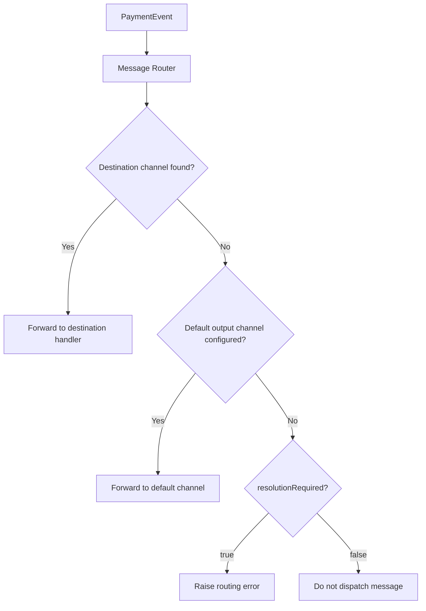
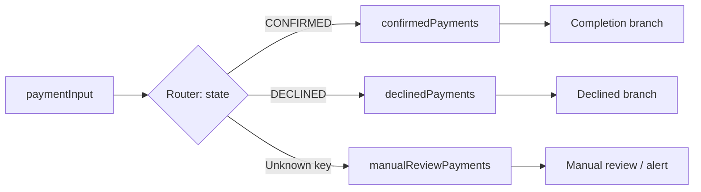
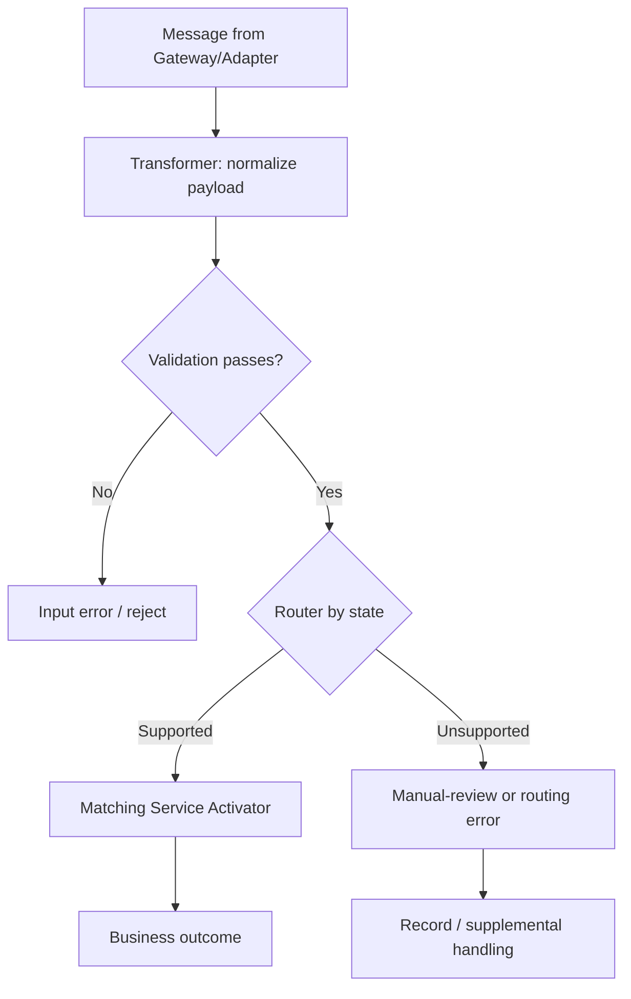
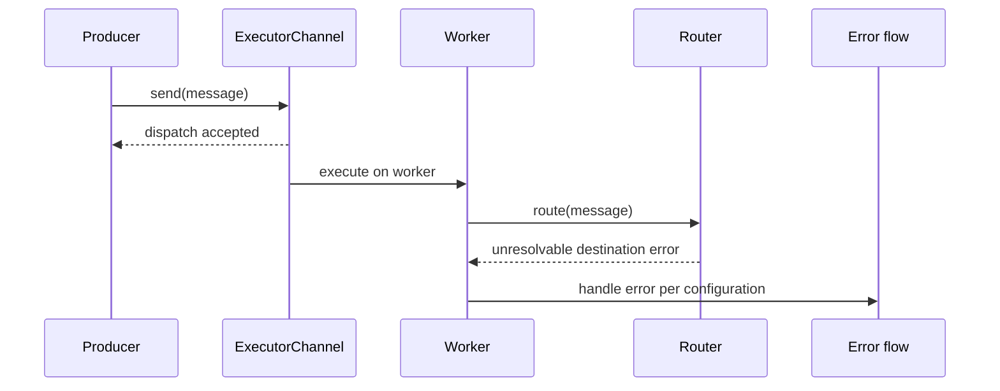
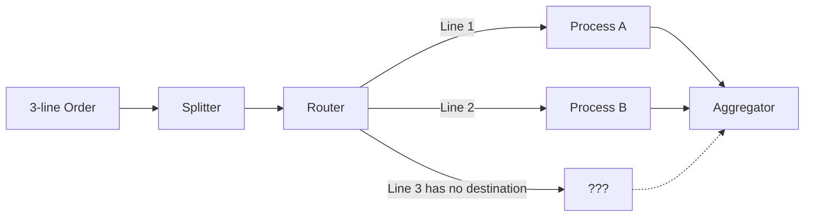

# Resolution Required and Unroutable Messages in Spring Integration

> **Chapter:** Message router  
> **Lesson:** Resolution required and unroutable messages  
> **Context:** Enterprise Integration Patterns with Spring Integration for building loosely coupled, extensible message flows using Router, Filter, Transformer, Splitter, Aggregator, Gateway, retry, error channel, correlation, and observability tools.

## 1. The Problem: Router Cannot Find Where to Send a Message

A system receives payment messages and selects a branch based on state:

- `CONFIRMED` → process successful payment.
- `DECLINED` → process declined payment.
- `PENDING_REVIEW` → the system does not yet have a corresponding branch.

For the last state, what should the Router do? Throw an exception, send to a fallback channel, or drop the message? Ignoring this scenario can cause messages to vanish silently from the business flow or leave callers waiting for a reply until timeout.



In Spring Integration, **`resolutionRequired`** is a key Router configuration governing behavior when **no output channel can be resolved**. Understanding this setting prevents silent message loss while allowing explicit policies for unclassified messages.

Lesson objectives:

1. Distinguish **routing key**, **channel mapping**, and **actual destination channel**.
2. Understand `resolutionRequired`, `defaultOutputChannel`, and `channelKeyFallback`.
3. Design observable and testable error or fallback branches.
4. Distinguish **no destination** errors from **send-to-destination failed** errors.
5. Combine Router with Filter, Gateway, retry, error channel, and correlation.

## 2. How Does a Router Determine a Destination?

Message Router is an Enterprise Integration Pattern that selects a message's destination based on payload content, headers, or custom rules.

Example:

```text
Message<PaymentEvent>
  payload: PaymentEvent("PAY-001", "CONFIRMED")
  headers: {businessKey: "PAY-001", traceId: "trace-a1"}

                         |
                         v
                    Router reads state
                         |
                         v
               Routing key = CONFIRMED
                         |
                         v
          channelMapping("CONFIRMED", "confirmedPayments")
                         |
                         v
                  confirmedPayments
```

Three components to keep distinct:

| Component | Example | Meaning |
| --- | --- | --- |
| **Routing key** | `CONFIRMED` | Value computed by the Router from the message |
| **Channel mapping** | `CONFIRMED → confirmedPayments` | Configuration mapping keys to channel names |
| **Target `MessageChannel`** | Bean `confirmedPayments` | Actual object receiving the message |

A routing key **does not have to** match the channel name. This separation lets you rename channels or reorganize flows without requiring business payloads to change.

An unmapped key does not immediately force an error: the Router may try resolving the key as a channel name if **channel-key fallback** is enabled, or forward to a **default output channel** when no destination matches.

## 3. What Is `resolutionRequired` Used For?

For Routers built on Spring Integration's routing infrastructure, `resolutionRequired` controls the reaction when **no destination is resolved**.

- **`resolutionRequired = true`:** if no output channel is resolved and no suitable fallback/default applies, the Router raises a routing error instead of dropping the message. This fits critical messages that must be tracked.
- **`resolutionRequired = false`:** the Router is allowed not to dispatch the message when no destination is found. The message reaches no business handler; the application must instrument its own observability when dropping intentionally.

In standard Spring Integration Routers, default behavior typically requires resolving a destination; when designing a critical flow, declare `resolutionRequired(true)` explicitly so readers see the contract clearly.

**Distinction needed:** this setting addresses **no channel being selected**; it does not prove that the channel received successfully or that the handler completed business processing.

For example: the Router picks `confirmedPayments`, yet that channel has no subscriber or its backing executor has run out of capacity. That is a dispatch/delivery error, not purely a "destination not found" case.

### Why Is Silently Dropping Messages Dangerous?

Suppose a service receives 1,000 payment commands:

```text
CONFIRMED       800
DECLINED        150
PENDING_REVIEW   50
-------------------
Total         1,000
```

If the Router knows only the first two states and `resolutionRequired=false`, the remaining 50 messages may never proceed to further processing. The sender may still see submission into the flow as completing normally. Without tracking, reconciliation will miss 50 transactions.

For messages of high business value, choose one of two transparent policies: **fail fast** to raise an error, or **route to a fallback channel** to record and handle later.

## 4. Three Settings to Distinguish

| Setting | Responsibility | When to Use |
| --- | --- | --- |
| `resolutionRequired` | Controls whether failing to resolve an output channel must raise an error | Enforce mandatory routing or permit unrouted messages |
| `defaultOutputChannel` | Specifies fallback channel when no rule resolves a destination | Manual review, quarantine, or unclassified processing branch |
| `channelKeyFallback` | Allows using routing key as a channel name when no explicit mapping exists | Enable when channel names are part of the contract; disable to allowlist routing keys |

Example decision table:

| Routing Key | Explicit Mapping | Key-Name Fallback | Default Channel | Result |
| --- | --- | --- | --- | --- |
| `CONFIRMED` | Yes | Not needed | Yes or No | Goes to mapped channel |
| `PENDING_REVIEW` | No | Disabled | Yes | Goes to default channel |
| `PENDING_REVIEW` | No | Disabled | No, `resolutionRequired=true` | Raises error |
| `PENDING_REVIEW` | No | Disabled | No, `resolutionRequired=false` | Not dispatched |
| `otherChannel` | No | Enabled; channel bean exists | Yes or No | May resolve by channel name |

The table covers the common single-destination Router case. For multi-destination Routers, multiple channels may be involved; check the resolution and dispatch mechanics of that specific Router type.

### Order of Reasoning

1. The Router computes a key or set of keys.
2. The Router checks configured mappings.
3. If permitted, the Router may treat the key as a channel name to resolve.
4. If no destination matches, the Router checks the default channel.
5. When still unresolved, `resolutionRequired` decides whether to raise an error or skip.

Never confuse **default output channel** with **default business outcome**. Routing a message to a manual-review channel does not mean payment succeeded.

## 5. Complete Example: Router with a Fallback Processing Channel

The example uses **Spring Integration Java DSL**. An application receives `PaymentEvent` with `state`. Two known states go to dedicated channels; any unsupported state goes to `manualReviewPayments`.

For easy observation in this lesson, destinations are `QueueChannel` beans. In real systems, they can be `DirectChannel` with Service Activators, or channels consumed by pollers/adapters.

### 5.1. Router Configuration

```java
package example.integration;

import org.springframework.context.annotation.Bean;
import org.springframework.context.annotation.Configuration;
import org.springframework.integration.channel.DirectChannel;
import org.springframework.integration.channel.QueueChannel;
import org.springframework.integration.config.EnableIntegration;
import org.springframework.integration.dsl.IntegrationFlow;
import org.springframework.messaging.MessageChannel;

@Configuration
@EnableIntegration
public class PaymentRouterConfiguration {

    public record PaymentEvent(String paymentId, String state) {}

    @Bean
    public MessageChannel paymentInput() {
        return new DirectChannel();
    }

    @Bean
    public QueueChannel confirmedPayments() {
        return new QueueChannel();
    }

    @Bean
    public QueueChannel declinedPayments() {
        return new QueueChannel();
    }

    @Bean
    public QueueChannel manualReviewPayments() {
        return new QueueChannel();
    }

    @Bean
    public IntegrationFlow paymentRoutingFlow() {
        return IntegrationFlow.from("paymentInput")
            .route(
                PaymentEvent.class,
                PaymentEvent::state,
                spec -> spec
                    .channelMapping("CONFIRMED", "confirmedPayments")
                    .channelMapping("DECLINED", "declinedPayments")
                    .channelKeyFallback(false)
                    .defaultOutputChannel("manualReviewPayments")
                    .resolutionRequired(true)
            )
            .get();
    }
}
```

Explanation:

- `PaymentEvent::state` extracts the routing key from the payload.
- `channelMapping(...)` maps the two recognized states.
- `channelKeyFallback(false)` forces routing to adhere strictly to mapped keys, preventing an undeclared key from accidentally matching a channel bean name and getting used as a destination.
- `defaultOutputChannel("manualReviewPayments")` routes remaining messages to a separate processing branch.
- `resolutionRequired(true)` emphasizes the policy that a destination must be found; for unmapped messages, the default channel satisfies this requirement.

**Point to remember:** setting both `resolutionRequired(true)` and `defaultOutputChannel(...)` is conceptually valid. When the default channel resolves, the Router does not have to throw an error merely because the routing key was unknown. To make *an unknown key actually fail*, remove the default channel and disable key fallback.

With `QueueChannel`, sending a message into the queue only means the message sits in application memory waiting for a receiver to poll. This lesson uses it to inspect outputs; production environments need pollers/consumers and durable storage when messages must not be lost on shutdown.

### 5.2. Messages Reaching Each Destination



Logic trace:

| Payload | Receiving Channel | Reason |
| --- | --- | --- |
| `PaymentEvent("PAY-1", "CONFIRMED")` | `confirmedPayments` | Explicit mapping exists |
| `PaymentEvent("PAY-2", "DECLINED")` | `declinedPayments` | Explicit mapping exists |
| `PaymentEvent("PAY-3", "PENDING_REVIEW")` | `manualReviewPayments` | No mapping, uses default |
| `PaymentEvent("PAY-4", null)` | `manualReviewPayments` | No mappable key, uses default |

In real systems, validate and normalize nulls/unknown values before making business decisions; the default channel is a place to record anomalies, not an input validation mechanism.

## 6. Fail-Fast Policy: Raising an Error When No Destination Exists

Some systems treat any state outside the allowed list as a contract violation. For example, financial events from a partner committed to emitting only `CONFIRMED` or `DECLINED`. If another state appears, raise an error so the integration team investigates immediately.

You can replace the Router configuration in section 5 with this variant:

```java
@Bean
public IntegrationFlow strictPaymentRoutingFlow() {
    return IntegrationFlow.from("paymentInput")
        .route(
            PaymentRouterConfiguration.PaymentEvent.class,
            PaymentRouterConfiguration.PaymentEvent::state,
            spec -> spec
                .channelMapping("CONFIRMED", "confirmedPayments")
                .channelMapping("DECLINED", "declinedPayments")
                .channelKeyFallback(false)
                .resolutionRequired(true)
        )
        .get();
}
```

This is an **alternative** to the earlier `paymentRoutingFlow`; do not register both simultaneously as consumers of `paymentInput`.

Mechanism:

```text
PAY-1, CONFIRMED
    -> mapping exists
    -> confirmedPayments

PAY-2, UNKNOWN
    -> mapping does not exist
    -> no key-name fallback
    -> no defaultOutputChannel
    -> resolutionRequired=true
    -> exception at Router
```

The concrete exception type may be wrapped by Spring Integration in `MessagingException` or a delivery/routing exception depending on flow and version. In tests or API layers, assert the actual error type rather than assuming every Router throws the exact same subclass.

### Sender Reaction When the Router Is Synchronous

If the flow uses `DirectChannel` and the exception is thrown on the sending thread, the `send` call or synchronous Messaging Gateway can usually observe the exception. An HTTP API layer can translate it into a contract error response, such as "unknown payment state."

If an `ExecutorChannel` or asynchronous inbound adapter sits before the Router, the sender may already have returned before the Router fails. In that case, configure an error handler/error channel and monitor from the worker/adapter side.

## 7. Policy Allowing Dropped Messages: Use Very Intentionally

Some events can genuinely be ignored. For instance, an analytics system receives many events solely for metrics, while a Router handles only campaign-related events. If an event is irrelevant, developers may intentionally permit selecting no destination.

Variant:

```java
@Bean
public IntegrationFlow optionalEventRoutingFlow() {
    return IntegrationFlow.from("optionalEventInput")
        .route(
            PaymentRouterConfiguration.PaymentEvent.class,
            PaymentRouterConfiguration.PaymentEvent::state,
            spec -> spec
                .channelMapping("CONFIRMED", "confirmedPayments")
                .channelKeyFallback(false)
                .resolutionRequired(false)
        )
        .get();
}
```

This illustrative flow requires an `optionalEventInput` channel and should be declared only as a **dedicated configuration** when the application explicitly decides to permit dropping. It does not use a default channel.

For an unresolved key, the Router may send the message to no channel. That is not business success. When choosing this policy, document clearly why dropping is valid.

**Minimum prerequisites before dropping:**

- The event carries no mandatory processing requirement.
- Losing one message does not corrupt order, payment, or reconciliation state.
- Metrics/counters or audits exist so you know how many messages were dropped.
- Tests explicitly verify the drop policy per routing key category.
- Senders understand that accepted send does not guarantee a handler processed it.

Never use `resolutionRequired(false)` to hide missing channel configurations or unimplemented routes.

## 8. `channelKeyFallback` and Unintended Routing Risks

Suppose the application context already defines these channels:

```text
confirmedPayments
declinedPayments
internalAdminChannel
manualReviewPayments
```

If the Router receives routing key `internalAdminChannel` and `channelKeyFallback` is allowed, the Router can attempt to resolve that channel name directly, even though it is absent from business `channelMapping`.

In multi-source environments, **routing keys must not implicitly determine internal bean names**. For a fixed set of states/event types, the following configuration is clearer:

```java
.route(
    PaymentEvent.class,
    PaymentEvent::state,
    spec -> spec
        .channelMapping("CONFIRMED", "confirmedPayments")
        .channelMapping("DECLINED", "declinedPayments")
        .channelKeyFallback(false)
        .defaultOutputChannel("manualReviewPayments")
)
```

This acts as a configuration-level allowlist routing diagram. It still **does not replace authentication, authorization, or data validation**. Invalid states should be blocked or sent to review per contract, while access permissions must be decided from authenticated data.

### Difference Between Default Output and Key-Name Fallback

- `channelKeyFallback` tries treating an unmapped key as a channel name.
- `defaultOutputChannel` is the receiver when no other channel is selected.
- `resolutionRequired` only decides whether resolving a channel is mandatory when no matching choice exists.

Disabling fallback and setting a default ensures keys outside the allowlist go to default instead of accidentally hitting an internal channel sharing the key's name.

## 9. "No Destination" Differs from "Send to Destination Failed"

These two errors are often lumped together as "the Router stopped working," yet their fixes are completely different.

### 9.1. Cannot Resolve Channel

Scenario:

```text
routingKey = PENDING_REVIEW
mappings   = {CONFIRMED, DECLINED}
default    = none
fallback   = false
```

No channel is selected. `resolutionRequired=true` enforces fail-fast. The fix is adding a valid routing rule, setting a default channel, or intentionally permitting drops.

### 9.2. Channel Resolved, Yet Dispatch Fails

Scenario:

```text
routingKey = CONFIRMED
mapping    = confirmedPayments
channel    = bean exists
subscriber = none (for a subscribable channel)
```

The Router resolved a valid channel. Still, sending can fail because the channel has no subscriber, the handler throws an exception, a queue is full, or an executor rejects the task.

This is a **delivery/dispatch** error, not the core case governed by `resolutionRequired`. The fix lies in subscribers, capacity, endpoint lifecycle, and error handling. Toggling `resolutionRequired` will not magically make a broken handler work again.

| Symptom | Where to Look for Root Cause | What to Check |
| --- | --- | --- |
| Key outside allowlist, no handler hit | Routing expression, channel mappings | Is there a default? Is fallback enabled? What is `resolutionRequired`? |
| Wrong channel mapping name | Channel resolver / bean name | Do bean and name match? |
| Router picks right channel, yet nobody processes | Subscriber or poller | Is handler registered? Is poller running? |
| Queue holds messages, yet downstream idle | Poller, consumer, scheduler | Is a component polling and processing the queue? |
| Sends rejected under high load | Executor, bounded queue | What are pool/queue/rejection policies? |
| Handler throws exception | Service, adapter, transaction | Are retry/error flows, timeouts, and idempotency in place? |

A channel bean existing does not guarantee messages finish the pipeline. Especially with `QueueChannel`, the channel accepts the message first and a poller picks it up later.

## 10. Router, Filter, and Validation Errors Have Different Roles

Suppose events carry these states:

```text
CONFIRMED
DECLINED
PENDING_REVIEW
??? (malformed string)
null
```

There are three kinds of problems:

1. **Validation:** state is blank or violates the data schema.
2. **Routing:** state is valid, yet lacks a dedicated handler.
3. **Delivery:** handler was chosen, yet sending/processing failed.

A clean flow separates these decisions:



A Filter can exclude messages, yet if it merely *discards* inside a request-reply flow, the Gateway may receive no response. When validation errors must be reported to callers, design an exception or structured rejection branch rather than silently dropping messages.

A Router is not a full validator; `resolutionRequired` only catches that no output channel could be chosen under current rules.

## 11. Handling Unroutable Messages in a Request-Reply Gateway

A Gateway typically bridges a Java call into a message flow and may wait for a result.

Example contract:

```java
public interface PaymentGateway {
    PaymentResult submit(PaymentEvent event);
}
```

With an unsupported state:

- **Fail-fast Router:** can propagate the error back to the caller if the path is synchronous and exceptions propagate.
- **Default output channel:** message enters fallback processing; if the Gateway needs a reply, the fallback branch **must return a meaningful business result** or raise an explicit error.
- **Drop permitted:** Gateway may wait until reply timeout or encounter missing-reply behavior depending on configuration.

Example result on the default branch:

```java
public record PaymentResult(
    String paymentId,
    String status,
    String reason) {}

public PaymentResult manualReview(PaymentEvent event) {
    return new PaymentResult(
        event.paymentId(),
        "REQUIRES_REVIEW",
        "Payment state is not yet supported");
}
```

This illustrates a service method that a Service Activator on the default branch can invoke. It lets the API state clearly "moved to review" instead of conflating it with "paid."

If the default branch only logs or pushes to a queue without replying, a request-reply Gateway still needs its own timeout policy or an explicit "accepted for review" reply.

### Setting Appropriate Timeouts

Even when the Router finds a channel, the Gateway may wait a long time due to a slow or asynchronous handler. Define reply timeouts and error handling separately from `resolutionRequired`; one parameter does not substitute for the other.

## 12. Error Channels, Retries, and Asynchronous Routers

In a synchronous flow via `DirectChannel`, Router errors typically occur on the caller thread and can be caught by the caller. When adding an `ExecutorChannel`:



Here, the producer may have moved on before the Router throws. Therefore, define **where errors arise and how they travel**:

- Error handler or error channel matching the async component/adapter.
- Logging/metrics for rejected messages and offending routing keys.
- Recovery actions: fix mapping, bounded retry, route to dead-letter, or manual intervention.
- Audit trail preserving links among `businessKey`, `traceId`, and the failure.

### Should Unroutable Errors Be Retried?

Normally, **no** — immediately retrying the exact same message when the Router lacks a mapping for its key yields the exact same result unless data or configuration changes. Retries make sense when failures stem from temporarily unavailable resources or after configuration/capacity is repaired.

Distinguish:

| Failure | Immediate Retry? | Primary Remedy |
| --- | --- | --- |
| Unmapped key from new schema | Usually no | Update contract/mappings or send to review |
| Null key from corrupt data | No | Validation / reject and notify source |
| Temporary executor saturation | Possible, with backoff | Backpressure, concurrency limits |
| Downstream API timeout | Possible, with idempotency | Retry advice, timeout, and recovery |
| Deleted or misspelled channel bean | Do not fix with blind retries | Fix configuration, verify deployment |

A request that already caused side effects before retrying needs an idempotency key to avoid duplicate transactions.

## 13. Correlation and Group Handling When a Router Has No Destination

A particularly critical scenario is **Splitter → Router → Aggregator**.



A Splitter typically attaches group metadata such as `correlationId`, `sequenceNumber`, and `sequenceSize`. If the Router drops one child message because of `resolutionRequired(false)`, the Aggregator may receive only 2 of 3 elements and wait forever or until group timeout.

**Rule:** if downstream requires all elements to complete a group, never silently drop unroutable child messages.

Handle via one of these approaches:

1. Route unrouted child messages to a default branch that emits `LineResult.FAILED` to the Aggregator as a structurally valid result.
2. Design a dedicated release/expiry strategy for incomplete groups and handle partial processing explicitly.
3. Validate the entire set of states before the Splitter to avoid creating uncompletable groups.
4. Record `correlationId` and `businessKey` to trace missing elements.

Never overwrite framework-generated correlation/sequence headers just to bypass release rules. Adjust correlation and release strategies in the proper components.

### Multi-Destination Routers

Some Routers can choose multiple output channels (such as recipient lists). When one key fails to resolve while others succeed, distinguish per-destination **resolution** vs. **dispatch** rules of that specific Router type. Options like ignoring send failures do not replace `resolutionRequired`.

Before using recipient-list routing in financial or audit flows, decide whether **all** subscribers must receive the message or **one** destination suffices, then test both missing channels and per-branch delivery failures.

## 14. Testing with JUnit 5: Mappings and Default Branch

The following tests use `PaymentRouterConfiguration` from section 5. Because outputs are `QueueChannel` beans, we can explicitly inspect where the Router sent each message.

```java
package example.integration;

import static org.junit.jupiter.api.Assertions.*;

import org.junit.jupiter.api.Test;
import org.springframework.beans.factory.annotation.Autowired;
import org.springframework.beans.factory.annotation.Qualifier;
import org.springframework.integration.channel.QueueChannel;
import org.springframework.messaging.Message;
import org.springframework.messaging.MessageChannel;
import org.springframework.messaging.support.MessageBuilder;
import org.springframework.test.context.junit.jupiter.SpringJUnitConfig;

@SpringJUnitConfig(PaymentRouterConfiguration.class)
class PaymentRouterTest {

    @Autowired
    @Qualifier("paymentInput")
    private MessageChannel paymentInput;

    @Autowired
    @Qualifier("confirmedPayments")
    private QueueChannel confirmedPayments;

    @Autowired
    @Qualifier("declinedPayments")
    private QueueChannel declinedPayments;

    @Autowired
    @Qualifier("manualReviewPayments")
    private QueueChannel manualReviewPayments;

    @Test
    void confirmedStateGoesToConfirmedChannel() {
        var payment = new PaymentRouterConfiguration.PaymentEvent(
            "PAY-101", "CONFIRMED");

        assertTrue(paymentInput.send(
            MessageBuilder.withPayload(payment)
                .setHeader("businessKey", "PAY-101")
                .build()));

        Message<?> routed = confirmedPayments.receive(1_000);
        assertNotNull(routed);
        assertSame(payment, routed.getPayload());
        assertEquals(
            "PAY-101",
            routed.getHeaders().get("businessKey"));
        assertNull(manualReviewPayments.receive(0));
    }

    @Test
    void unknownStateGoesToDefaultChannel() {
        var payment = new PaymentRouterConfiguration.PaymentEvent(
            "PAY-102", "PENDING_REVIEW");

        assertTrue(paymentInput.send(
            MessageBuilder.withPayload(payment).build()));

        Message<?> routed = manualReviewPayments.receive(1_000);
        assertNotNull(routed);
        assertSame(payment, routed.getPayload());
        assertNull(confirmedPayments.receive(0));
        assertNull(declinedPayments.receive(0));
    }

    @Test
    void declinedStateGoesToDeclinedChannel() {
        var payment = new PaymentRouterConfiguration.PaymentEvent(
            "PAY-103", "DECLINED");

        assertTrue(paymentInput.send(
            MessageBuilder.withPayload(payment).build()));

        Message<?> routed = declinedPayments.receive(1_000);
        assertNotNull(routed);
        assertSame(payment, routed.getPayload());
    }
}
```

What these tests prove:

- Mapped keys go to the right channel.
- Unsupported keys go to the default channel instead of vanishing silently.
- The Router preserves payloads and required business headers.
- No stray messages hit unrelated channels in the tested cases.

Because this is a synchronous flow example targeting test queues, passing does not prove real handlers finished work or that messages survive restarts.

### Testing Strict Mode Without a Default

For the `strictPaymentRoutingFlow` variant in section 6, use a Spring test context with **only one Router subscribed to `paymentInput`**. Then verify an unmapped key throws an error:

```java
var unknown = new PaymentRouterConfiguration.PaymentEvent(
    "PAY-404", "UNKNOWN");

assertThrows(RuntimeException.class, () ->
    paymentInput.send(
        MessageBuilder.withPayload(unknown).build()));
```

Using `RuntimeException` in this small snippet avoids coupling to how exceptions are wrapped by the framework. In real project tests, verify the cause chain and specific error codes promised by the API. Never put both the strict flow and default flow subscribing to the same input in one test context, because `DirectChannel` is unicast and may dispatch to either consumer depending on dispatcher strategy.

### Testing Drop Policy

With `resolutionRequired(false)` and no default, do not check only that `send` throws no error. Explicitly assert no message appears on outputs and that a dedicated counter/metric records messages dropped per policy. If the goal is "zero message loss," this test should fail and point toward adding a default channel or fail-fast.

## 15. Operating and Observing Unroutable Messages

A Router can be configured accurately yet cause business failures when new upstream states appear. Do not rely solely on exception logs to spot this.

Metrics to track:

| Metric | Question to Answer |
| --- | --- |
| Inbound message count | How many messages reached the Router? |
| Message count per key | How are `CONFIRMED`/`DECLINED`/unknown ratios shifting? |
| Messages entering default channel | Are unsupported states appearing? |
| Channel resolution failures | Was a mapping missed or channel name misspelled in deployment? |
| Post-selection send failures | Is there congestion, missing subscribers, or resource exhaustion? |
| Wait time in default/manual-review | Is the unclassified backlog growing or shrinking? |
| Completion rate per business key | Are critical messages getting lost between steps? |

Useful log example:

```text
WARN payment-router
  paymentId=PAY-102
  routeKey=PENDING_REVIEW
  action=MANUAL_REVIEW
  traceId=trace-102
```

Log only approved fields; never log auth tokens, payment card numbers, or full payloads containing sensitive information.

When deploying Micrometer Observation / OpenTelemetry, connect traces and correlation across Router, Service Activators, Gateways, and adapters. Telemetry clarifies whether a message was dropped by policy, fell into default due to a missing mapping, or failed after routing.

## 16. Common Pitfalls

### 16.1. Setting `resolutionRequired(false)` to Hide Errors

The Router stops throwing exceptions, yet business messages have nowhere to go. Data goes missing with zero alerts. Use this setting only for messages genuinely safe to drop.

### 16.2. Having `defaultOutputChannel` Without a Consumer

Messages move to the default channel, yet nobody processes them. With `QueueChannel`, messages pile up in the queue; with subscribable channels, dispatch can fail. Verify the entire default processing path, not just Router selection.

### 16.3. Assuming `resolutionRequired(true)` Always Errors on Unknown Keys

If `defaultOutputChannel` is configured and resolves, unknown keys go to default. If `channelKeyFallback` is enabled, an unknown key may also match a channel name. To fail fast on any key outside the allowlist, disable fallback and omit default.

### 16.4. Conflating Data Errors with Routing Errors

A `null` state from a malformed upstream schema differs from a valid new state lacking a handler yet. Handle differently: validation/reject for bad schemas, manual review or contract upgrade for new states.

### 16.5. Router Picks a Channel, Yet Gateway Still Times Out

The Router only picks where to send; if the chosen branch returns no reply, the Gateway waits until timeout. Design response contracts for every branch, especially the default branch.

### 16.6. Dropping Child Messages Prevents Aggregator Completion

A dropped child message leaves the group short of elements. Preserve proper correlation/sequence metadata and define failure-result or group-timeout strategies.

### 16.7. Infinitely Retrying Configuration Bugs

If a mapping is missing due to a deployment omission, immediately retrying the same message keeps failing and adds load. Fix configuration or move messages to durable storage for later replay.

## 17. Practice Exercise: Designing a Zero-Loss Router

**Context:** An application receives `ShipmentEvent(orderId, status)` with states `CREATED`, `IN_TRANSIT`, `DELIVERED`, and `RETURN_REQUESTED`. The current version knows only the first three states.

### Requirements

1. Define a Router reading `status` from the payload and mapping the three known states to dedicated channels.
2. Disable `channelKeyFallback` to prevent routing to unapproved channel names.
3. Create `unknownShipmentEvents` as the default output channel for unhandled states.
4. Attach a Service Activator or poller consuming from the default channel, recording `orderId`, status, and reason for review.
5. Write a test verifying `RETURN_REQUESTED` reaches the fallback branch and is not dropped.
6. Create an alternative strict configuration without a default channel and with `resolutionRequired(true)`; test that an out-of-allowlist key raises an exception.
7. Explain when `resolutionRequired(false)` is acceptable and why it is unsuitable for shipment events requiring reconciliation.
8. Move the Router behind an `ExecutorChannel`; design an error flow for asynchronous routing errors.
9. If a multi-parcel order passes through a Splitter and Aggregator, explain how to handle an unroutable parcel while still completing or failing the group properly.

### Expected Observations

| Test Case | Expected Result |
| --- | --- |
| `CREATED` | Goes to created branch |
| `IN_TRANSIT` | Goes to in-transit branch |
| `DELIVERED` | Goes to delivered branch |
| `RETURN_REQUESTED` with default | Goes to unknown/default for review |
| `RETURN_REQUESTED` with strict | Raises routing error |
| `RETURN_REQUESTED` with drop policy | Not dispatched; requires explicit business decision and observability |
| Valid mapping, yet downstream idle | Inspect subscriber/poller; do not blame `resolutionRequired` |

### Self-Assessment Questions

**Question 1:** Does `resolutionRequired=true` guarantee every message reaches the right handler?

*No. It requires the Router to resolve a destination per configuration. Sending and downstream processing can still fail.*

**Question 2:** When `defaultOutputChannel` is present, does an unmapped key always throw an exception?

*No. When the Router selects no normal channel, default can receive the message and avoid a missing-destination error.*

**Question 3:** Why is `channelKeyFallback(false)` usually recommended for fixed business routing keys?

*To prevent an undeclared key from acting as an internal channel name, violating the routing contract.*

**Question 4:** With a request-reply Gateway, what happens to the caller if the Router drops the message?

*The caller may receive no reply and wait until timeout or trigger specific requires-reply handling.*

**Question 5:** When a Router sits between a Splitter and an Aggregator, why is dropping an unroutable message dangerous?

*The Aggregator may miss an element, fail to satisfy its release condition, and stall until timeout/expiry.*

## 18. Production Implementation Checklist

- **Routing contract:** explicitly declare valid keys, mappings, processing order, and behavior when new keys appear.
- **Resolution policy:** choose `resolutionRequired(true/false)` deliberately; critical messages usually require fail-fast or default.
- **Fallback policy:** control `channelKeyFallback`; avoid exposing internal bean names as an uncontrolled routing API.
- **Default channel:** ensure a real consumer/handler, reply or error-recording rules, and never equate default with success.
- **Validation:** separate schema errors from valid but not-yet-supported states.
- **Error handling:** distinguish missing-route errors from send/dispatch failures and downstream service errors.
- **Request-reply:** every branch needing to return results to a Gateway must have a reply or clear timeout rules.
- **Correlation:** never silently drop child messages before an Aggregator; preserve group headers and release strategies.
- **Asynchronous flows:** align error channels, retries, executor capacity, and backpressure.
- **Observability:** track unknown routing keys, default channel counts, error counts, and final processing outcomes.
- **Testing:** verify valid routes, missing routes, default, strict mode, drop policy, and downstream failures.

**Key takeaway:** `resolutionRequired` answers *"Must the Router find a destination?"*. `defaultOutputChannel` answers *"If no normal destination matches, where does the message go?"*. `channelKeyFallback` answers *"May an unmapped key be treated as a channel name?"*. Designing these three decisions alongside error, request-reply, and observability contracts enables a Spring Integration flow to handle unroutable messages under full control.
