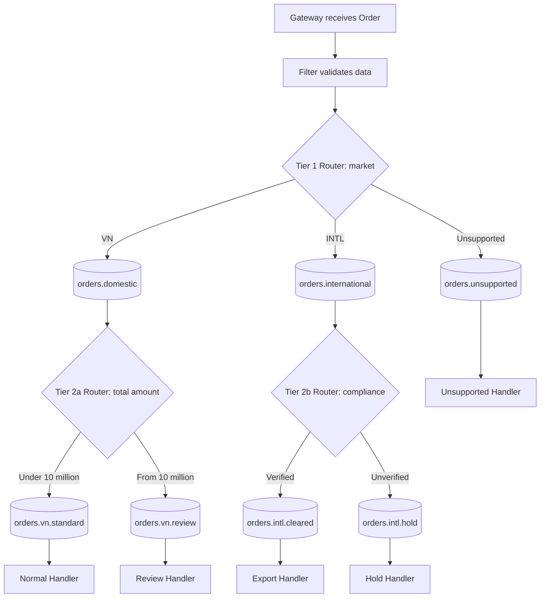
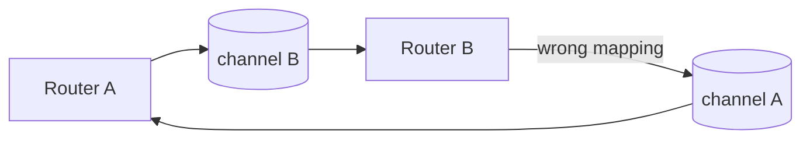

# Hierarchical Routers and Multi-Stage Routing

## 1. Why Do We Need Hierarchical Routers?

In an integration system, a single routing decision is sometimes not enough. Domestic and international orders require different policies; within each group, further classification is needed based on value, risk level, or verification status. Writing every decision and business action inside one giant `if/else` block creates tight coupling, making adding branches and testing difficult.

**Hierarchical routing** organizes decisions into tiers: the first tier determines **the broad destination group**, while subsequent tiers choose **specific branches** within that group. **Multi-stage routing** describes a message passing sequentially through routers, potentially passing through Filters, Transformers, Gateways, or other endpoints between routing stages.

Example of an order flow in Spring Integration:



In the diagram, the Router **does not execute approval business logic** and **does not transform the payload itself**. A Router receives a message, computes a routing key, resolves an output channel, and forwards the message to the corresponding consumer. Leaf handlers are responsible for producing results or calling external systems.

The `SPRING_INTEGRATION_PATTERN` module uses Enterprise Integration Patterns with Spring Integration to build loosely coupled, extensible flows. This hierarchical style is especially useful when combining Router with Filter, Transformer, Splitter, Aggregator, Gateway, retry, error channel, and correlation, because each stage can be tested, observed, and error-handled independently.

**After this lesson, learners should know how to:** distinguish hierarchical routing from fan-out and Routing Slip; design a tree of routing keys/channel mappings; implement it with Java DSL; preserve message context across tiers; handle unmatched keys, errors, and loops; and test every root-to-leaf path.

## 2. Distinguishing Routing Models

### 2.1. Single-Step Router

```text
orders.input -> Router(amount >= 10_000_000?)
                   | true  -> orders.review
                   | false -> orders.normal
```

There is only one decision point. If both destination channels connect straight to final handlers, the message does not pass through a second router.

### 2.2. Hierarchical Router

```text
orders.input -> Router 1 (market)
                 | domestic -> Router 2a (amount)
                 |              | standard
                 |              | review
                 | international -> Router 2b (compliance)
                 |                   | cleared
                 |                   | hold
                 | unsupported -> rejection handler
```

In this model, the tier-1 router **does not need to know** domestic value thresholds or international compliance rules; each tier-2 router owns only its own group.

### 2.3. Multi-Stage Routing

A path can combine multiple endpoints:

```text
Input -> Filter -> Region Router
                   -> Normalization Transformer
                   -> Priority Router
                   -> Outbound Gateway
                   -> Remote-Result Router
                   -> Final Handler
```

Not every step above is a Router. **Filter** keeps or rejects whole messages; **Transformer** changes data representation; **Gateway** handles request–reply exchanges; **Router** chooses channels. Separating responsibilities cleanly keeps flows easy to evolve.

| Concept | Problem Solved | Key Difference |
|---|---|---|
| **Hierarchical Router** | Select branches across multiple classification levels. | A higher-tier choice selects the downstream router. |
| **Multi-stage routing** | Make routing decisions sequentially at multiple points in time. | Can interleave Transformers, Enrichers, Gateways, and Handlers. |
| **Recipient List** | Choose one or more recipients from a list. | Can dispatch a message to **multiple destinations in parallel**. |
| **Publish–Subscribe** | Broadcast to a channel's subscribers. | Fan-out; not inherently a multi-level decision tree. |
| **Routing Slip** | Route a message through a predefined itinerary of endpoints. | The processing route is carried/managed as a step list, unlike each router computing policy at its own tier. |
| **Splitter / Aggregator** | Split into multiple child messages / reassemble grouped messages. | Changes message count; typically requires correlation and release strategies. |

The example below designs each valid message to traverse **one root-to-leaf path ending at exactly one leaf**, making it fit a synchronous Gateway returning a single result. That **does not mean** all Spring Integration router types are always restricted to one destination.

## 3. Designing the Tree Before Writing Java DSL

### 3.1. Identifying Trusted Inputs

Consider the payload:

```java
record OrderCommand(
        String orderId,
        String market,
        java.math.BigDecimal amountVnd,
        boolean complianceCleared) {}
```

- `orderId` is the business identifier.
- `market` accepts `VN` or `INTL`; other values take the unsupported branch.
- `amountVnd` is **the amount already converted and validated in VND** at the system boundary; do not compare USD and VND directly against the same threshold.
- `complianceCleared` is **a verified result from a trusted source**, not a client-supplied flag used to bypass checks.

This is a simulated domain for teaching routing, not production-ready approval/compliance logic.

### 3.2. Contract of Each Tier

| Tier | Key | Input Channel | Output Channel | Rule |
|---|---|---|---|---|
| 0: validation | None | `orders.input` | Keep or reject | Non-blank ID, non-null market, positive amount. |
| 1: market | `domestic` | `orders.input` | `orders.domestic` | `market=VN`. |
| 1: market | `international` | `orders.input` | `orders.international` | `market=INTL`. |
| 1: market | `unsupported` | `orders.input` | `orders.unsupported` | Other values. |
| 2a: domestic | `standard` | `orders.domestic` | `orders.vn.standard` | Under 10 million. |
| 2a: domestic | `review` | `orders.domestic` | `orders.vn.review` | 10 million or more. |
| 2b: international | `cleared` | `orders.international` | `orders.intl.cleared` | Verified. |
| 2b: international | `hold` | `orders.international` | `orders.intl.hold` | Unverified. |

Two concepts must remain separate: **routing key** (e.g., `review`) is the policy outcome; **channel bean name** (e.g., `orders.vn.review`) is the technical address. `channelMapping` links the two.

### 3.3. Truth Table for Paths

| Market | Amount (VND) | Cleared | Path | Simulated Result |
|---|---:|---|---|---|
| `VN` | 800,000 | Any | domestic → standard | `ACCEPTED` |
| `VN` | 10,000,000 | Any | domestic → review | `PENDING_REVIEW` |
| `INTL` | 8,000,000 | `true` | international → cleared | `READY_FOR_EXPORT` |
| `INTL` | 8,000,000 | `false` | international → hold | `PENDING_COMPLIANCE` |
| `OTHER` | 8,000,000 | Any | unsupported | `REJECTED_UNSUPPORTED_MARKET` |
| `VN` | `null` or ≤ 0 | Any | Rejected by Filter | Exception |

Path constraints can be written as an invariant: **every valid message is routed by tier 1 exactly once; if domestic/international is chosen, it passes through only the matching tier-2 router and reaches exactly one leaf handler**. Writing the invariant first helps define complete tests.

## 4. Implementing with Spring Integration Java DSL

The example targets **Java 17+, Spring Boot 3.x, and Spring Integration 6.x** with the `spring-boot-starter-integration` dependency. Types reside in the same package; split `public` types into separate Java files when integrating into a project.

### 4.1. Gateway, Model, and Channels

```java
import java.math.BigDecimal;

import org.springframework.context.annotation.Bean;
import org.springframework.context.annotation.Configuration;
import org.springframework.integration.annotation.Gateway;
import org.springframework.integration.annotation.IntegrationComponentScan;
import org.springframework.integration.annotation.MessagingGateway;
import org.springframework.integration.channel.DirectChannel;
import org.springframework.integration.config.EnableIntegration;
import org.springframework.integration.dsl.IntegrationFlow;
import org.springframework.messaging.MessageChannel;

record OrderCommand(
        String orderId,
        String market,
        BigDecimal amountVnd,
        boolean complianceCleared) {}

record RoutingReceipt(
        String orderId,
        String route,
        String status) {}

@MessagingGateway
interface OrderGateway {
    @Gateway(requestChannel = "orders.input")
    RoutingReceipt submit(OrderCommand order);
}

@Configuration
@EnableIntegration
@IntegrationComponentScan
class HierarchicalRoutingConfig {
    private static final BigDecimal REVIEW_THRESHOLD =
            new BigDecimal("10000000");

    @Bean(name = "orders.input")
    MessageChannel input() {
        return new DirectChannel();
    }

    // Intermediate channels connecting tier 1 to tier 2.
    @Bean(name = "orders.domestic")
    MessageChannel domestic() {
        return new DirectChannel();
    }

    @Bean(name = "orders.international")
    MessageChannel international() {
        return new DirectChannel();
    }

    // Leaf channels connecting tier-2 Routers to handlers.
    @Bean(name = "orders.vn.standard")
    MessageChannel vnStandard() {
        return new DirectChannel();
    }

    @Bean(name = "orders.vn.review")
    MessageChannel vnReview() {
        return new DirectChannel();
    }

    @Bean(name = "orders.intl.cleared")
    MessageChannel intlCleared() {
        return new DirectChannel();
    }

    @Bean(name = "orders.intl.hold")
    MessageChannel intlHold() {
        return new DirectChannel();
    }

    @Bean(name = "orders.unsupported")
    MessageChannel unsupported() {
        return new DirectChannel();
    }

    // Tier 0: Filter; Tier 1: Market Router.
    @Bean
    IntegrationFlow routeByMarket() {
        return IntegrationFlow.from("orders.input")
                .filter(OrderCommand.class,
                        order -> order.orderId() != null
                                && !order.orderId().isBlank()
                                && order.market() != null
                                && order.amountVnd() != null
                                && order.amountVnd().signum() > 0,
                        spec -> spec.throwExceptionOnRejection(true))
                .route(OrderCommand.class,
                        order -> switch (order.market()) {
                            case "VN" -> "domestic";
                            case "INTL" -> "international";
                            default -> "unsupported";
                        },
                        spec -> spec
                                .channelMapping("domestic", "orders.domestic")
                                .channelMapping("international",
                                        "orders.international")
                                .channelMapping("unsupported",
                                        "orders.unsupported"))
                .get();
    }

    // Tier 2a: domestic market messages only.
    @Bean
    IntegrationFlow routeDomesticByAmount() {
        return IntegrationFlow.from("orders.domestic")
                .route(OrderCommand.class,
                        order -> order.amountVnd()
                                .compareTo(REVIEW_THRESHOLD) >= 0
                                ? "review" : "standard",
                        spec -> spec
                                .channelMapping("standard",
                                        "orders.vn.standard")
                                .channelMapping("review",
                                        "orders.vn.review"))
                .get();
    }

    // Tier 2b: international market messages only.
    @Bean
    IntegrationFlow routeInternationalByCompliance() {
        return IntegrationFlow.from("orders.international")
                .route(OrderCommand.class,
                        order -> order.complianceCleared()
                                ? "cleared" : "hold",
                        spec -> spec
                                .channelMapping("cleared",
                                        "orders.intl.cleared")
                                .channelMapping("hold",
                                        "orders.intl.hold"))
                .get();
    }

    // Leaf handlers: return simulated request-reply results.
    @Bean
    IntegrationFlow processDomesticStandard() {
        return IntegrationFlow.from("orders.vn.standard")
                .handle(OrderCommand.class, (order, headers) ->
                        new RoutingReceipt(order.orderId(),
                                "VN/STANDARD", "ACCEPTED"))
                .get();
    }

    @Bean
    IntegrationFlow processDomesticReview() {
        return IntegrationFlow.from("orders.vn.review")
                .handle(OrderCommand.class, (order, headers) ->
                        new RoutingReceipt(order.orderId(),
                                "VN/REVIEW", "PENDING_REVIEW"))
                .get();
    }

    @Bean
    IntegrationFlow processInternationalCleared() {
        return IntegrationFlow.from("orders.intl.cleared")
                .handle(OrderCommand.class, (order, headers) ->
                        new RoutingReceipt(order.orderId(),
                                "INTL/CLEARED", "READY_FOR_EXPORT"))
                .get();
    }

    @Bean
    IntegrationFlow processInternationalHold() {
        return IntegrationFlow.from("orders.intl.hold")
                .handle(OrderCommand.class, (order, headers) ->
                        new RoutingReceipt(order.orderId(),
                                "INTL/HOLD", "PENDING_COMPLIANCE"))
                .get();
    }

    @Bean
    IntegrationFlow rejectUnsupportedMarket() {
        return IntegrationFlow.from("orders.unsupported")
                .handle(OrderCommand.class, (order, headers) ->
                        new RoutingReceipt(order.orderId(),
                                "UNSUPPORTED",
                                "REJECTED_UNSUPPORTED_MARKET"))
                .get();
    }
}
```

### 4.2. Reading the Configuration by Responsibility

- `routeByMarket()` validates input and selects `domestic`, `international`, or `unsupported`; it has no knowledge of domestic thresholds or international compliance procedures.
- `routeDomesticByAmount()` receives only from `orders.domestic` and chooses standard/review.
- `routeInternationalByCompliance()` receives only from `orders.international` and chooses cleared/hold.
- The final `IntegrationFlow` beans **register leaf endpoints**, returning a `RoutingReceipt` without executing real transactions.
- `DirectChannel` keeps the example using synchronous dispatch; both routers along the path and the final handler participate in the same gateway request–reply exchange.

`@IntegrationComponentScan` discovers `@MessagingGateway` interfaces in the corresponding package scope. `IntegrationFlow` bean names are not automatically channel names; rely on `@Bean(name=...)` names and explicit mappings.

### 4.3. Running via the Gateway

```java
// orderGateway is injected from the Spring context.
RoutingReceipt vn = orderGateway.submit(
        new OrderCommand("O-101", "VN",
                new BigDecimal("800000"), false));
// vn.route() == "VN/STANDARD", vn.status() == "ACCEPTED"

RoutingReceipt review = orderGateway.submit(
        new OrderCommand("O-102", "VN",
                new BigDecimal("10000000"), false));
// review.route() == "VN/REVIEW", review.status() == "PENDING_REVIEW"

RoutingReceipt intl = orderGateway.submit(
        new OrderCommand("O-103", "INTL",
                new BigDecimal("20000000"), true));
// intl.route() == "INTL/CLEARED"

RoutingReceipt unknown = orderGateway.submit(
        new OrderCommand("O-104", "OTHER",
                new BigDecimal("900000"), false));
// unknown.status() == "REJECTED_UNSUPPORTED_MARKET"
```

The example only **classifies and returns simulated results**: `PENDING_REVIEW` does not mean a human has approved it; `READY_FOR_EXPORT` does not mean a shipping system was called. Production systems need real business handlers, persistence, security, and error/retry policies.

### 4.4. Processing Sequence of a Request

For `O-102`:

1. Gateway constructs a message and sends it to `orders.input`.
2. Filter checks `orderId`, `market`, and `amount`.
3. Tier-1 Router computes key `domestic`, mapped to `orders.domestic`.
4. The consumer of `orders.domestic` is Tier-2a Router, which computes `review` because `amount` equals the threshold.
5. Tier-2a Router maps to `orders.vn.review`.
6. The leaf handler returns `RoutingReceipt("O-102", "VN/REVIEW", "PENDING_REVIEW")`.
7. Request–reply infrastructure returns the result to the gateway.

If a step lacks a subscriber, fails channel resolution, or the handler returns no reply, **do not assume** the gateway outcome will resemble successful cases.

## 5. Preserving Data and Correlation Across Tiers

### 5.1. Messages and ID Types

| Information | Scope | Note |
|---|---|---|
| `messageId` / `MessageHeaders.ID` | A single specific message | Can change when Transformer, Splitter, or adapter creates a new message. |
| `orderId` | Business identifier | Links every step to the same order. |
| `traceId` | Observability journey | Must propagate properly across channels/transports. |
| `correlationId` | Related message group | Critical for Splitter/Aggregator; adding routers alone does not create new group IDs. |
| `replyChannel` | Request–reply return address | Can be an internal reference; never forward verbatim across brokers/JVMs. |

Passing through multiple routers **does not duplicate messages** in this configuration. If a Splitter is added, each part gets its own ID and needs correlation/sequence for the Aggregator to combine results; routers do not automatically build a release strategy.

### 5.2. Fresh Data Before the Next Decision

In practice, `complianceCleared` should come from a verification step:

```text
orders.international
  -> Outbound Gateway queries verification service
  -> Transformer/Enricher builds verified state
  -> Router by clearance
  -> orders.intl.cleared / orders.intl.hold
```

When calling the verification service times out, **never treat a timeout as "failed compliance"** unless the business explicitly specifies so. Use a dedicated error flow or a `VERIFICATION_UNAVAILABLE` state.

When building a new message manually, copy required metadata carefully. Conceptual example (assuming `NormalizedOrder` is an application-defined DTO):

```java
import org.springframework.messaging.Message;
import org.springframework.messaging.support.MessageBuilder;

Message<NormalizedOrder> normalize(Message<OrderCommand> input) {
    OrderCommand source = input.getPayload();
    NormalizedOrder normalized =
            new NormalizedOrder(source.orderId(), source.amountVnd());

    return MessageBuilder.withPayload(normalized)
            .copyHeaders(input.getHeaders())
            .build();
}
```

`copyHeaders` is not a safe default across **trust boundaries**. Filter which headers are allowed to leave for external systems—especially `replyChannel` references, security credentials, and client-supplied headers.

## 6. Error Branches, Fallbacks, and Stopping Conditions

### 6.1. Five Distinct Scenarios

In a multi-tier tree, distinguish at least five failure sources:

1. **Invalid input:** Filter or validation endpoint rejects before computing any key.
2. **Routing expression failure:** key-computing code throws an exception or receives an unexpected payload type.
3. **Unresolvable key:** policy returns a key, yet configuration resolves no matching output channel.
4. **Channel exists, consumer inactive:** downstream endpoint is stopped/unsubscribed, or channel has no subscriber.
5. **Consumer exists, handler fails:** downstream exception, timeout, or failed business execution.

These failure sources require different behaviors. A misconfigured key must not be retried infinitely; a transient downstream connectivity error may be retried within limits with idempotency.

### 6.2. Unmapped Keys and Default Output

A routing key like `domestic` is a **policy value**, whereas `orders.domestic` is a **channel bean**. Depending on router type and configuration, an unmapped key may try resolving as a channel name, route to a default output channel, or raise an error. Never assume every router safely ignores unmatched messages.

In the Java example, key `unsupported` is **intentionally mapped** to a channel whose handler returns `REJECTED_UNSUPPORTED_MARKET`. Callers do not have to guess whether a rejected request succeeded.

| Scenario | Approach to Consider | What to Verify |
|---|---|---|
| Missing `orderId`, amount ≤ 0 | Reject with validation error | Caller receives error and no branch executes. |
| Unsupported market | Rejection/review branch per contract | Explicit handler and reply exist. |
| Mapping typo | Fail fast, configuration alert | Never mask bugs with arbitrary fallbacks. |
| Tier-2 consumer paused | Appropriate buffer or overload rejection | Never leave the gateway hanging indefinitely. |
| International verification timeout | Error/recovery/unknown state | Never treat infrastructure failures as compliance outcomes. |

A default channel is a **business decision**, not a dumping ground for arbitrary messages. Without a subscriber or recovery mechanism, default merely moves the failure elsewhere.

### 6.3. DirectChannel Does Not Buffer Messages for the Next Router

In the example, `orders.domestic` is a `DirectChannel`. If `routeDomesticByAmount` stops, the tier-1 Router may still pick `domestic`, yet sending to the intermediate channel fails. `DirectChannel` does not store messages for replay after the endpoint restarts.

Switching to `QueueChannel` changes semantics:

- Producers can enqueue while capacity remains even before a poller runs.
- Consumers need `receive` or a poller; otherwise messages sit idle.
- When the queue is full, `send` may block or fail on timeout; an overload policy is needed.
- In-memory queues do not guarantee persistence across restarts.
- Request–reply over pollers/executors requires different reply timeout, error handling, and transaction designs than synchronous dispatch.

Never swap channel types as a "quick fix" without defining **accepted**, **processed**, **committed**, and client-retry semantics.

### 6.4. Retries and Error Channels

In synchronous flows using `DirectChannel`, errors in a router or handler can unwind up the call stack to the gateway. In flows with executors, pollers, or async adapters, errors may be wrapped as `ErrorMessage` on an `errorChannel` in supported contexts. **There is no guarantee every exception across every transport automatically arrives at a single global error channel.**

When designing retries:

- Retry only **recoverable** errors (such as transient downstream timeouts); never loop infinitely on validation errors or misspelled channel mappings.
- Bound attempt count, backoff, jitter, and total wait time.
- If a handler has side effects (creating invoices, placing orders), use an **idempotency key** built from stable event/business IDs.
- Track attempt counts and outcomes separately; **Message History is not a reliable retry counter**.
- Define a recovery/dead-letter policy once retries are exhausted.

With a request–reply Gateway, a branch ending in a one-way outbound adapter without returning a reply or contract exception can make the caller wait until timeout even though the Router picked the right channel.

## 7. Avoiding Loops in Multi-Stage Routing

Ideally, hierarchical routing forms a **tree** or a directed acyclic graph (*DAG*). However, a wrong mapping can create a cycle:



On synchronous channels, loops can trigger nested calls until stack overflow. On asynchronous channels, they can spike queue depth, CPU, and traffic until resource exhaustion. Spring Integration does not automatically detect a routing cycle as a business error to break.

To design safely:

1. Define **each router's tier and allowed output channels** before writing code.
2. Verify the channel/endpoint graph has no invalid back-edges to earlier inputs.
3. When genuine iterative processing is required, separate **retry/reprocessing** from **route decisions**, setting max steps, deadlines, and processed states.
4. If using a hop counter (`routingHops`), update and check it at **every** potential loop point; that is an application convention, not a built-in Router safeguard.
5. Test unknown keys, fallbacks, stopped branches, and error recovery, as cycles frequently form there.

A multi-stage flow also does not mean **the more routers, the better**. If a step always forwards from A to B with no condition, a direct channel is clearer than a passthrough router.

## 8. Layering Policies to Reduce Coupling

### 8.1. Separating Policy from DSL

When rules grow complex, move them into a unit-tested Java service:

```java
enum MarketRoute {
    DOMESTIC, INTERNATIONAL, UNSUPPORTED
}

final class MarketRoutePolicy {
    MarketRoute decide(OrderCommand order) {
        return switch (order.market()) {
            case "VN" -> MarketRoute.DOMESTIC;
            case "INTL" -> MarketRoute.INTERNATIONAL;
            default -> MarketRoute.UNSUPPORTED;
        };
    }
}
```

**Note:** the policy above returns an `enum`, whereas the Java DSL Router in section 4 returns a `String`. If swapping logic, align mappings to **the actual value** returned by the router; never blindly keep `channelMapping("domestic", ...)` assuming the enum and lowercase string are identical keys.

Separating policies lets you:

- Unit test rules **without a Spring context**.
- Adjust thresholds/branches via configuration without touching handlers.
- Version policies when auditing historical routing decisions.
- Split ownership: team A owns market dispatch, team B owns the domestic branch, team C owns the international branch.

Not every `if` block warrants a new router tier. If rules are simple with two branches and no independent rate of change, one router with a clear policy suffices. Hierarchy should follow **real responsibility boundaries**, not inflate component count.

### 8.2. When to Insert a Transformer/Gateway Layer

Suppose after market classification, the international branch must fetch verification results:

```text
Tier 1 Router
   |
   +-- international
          |
          +-- Outbound Gateway / Enricher (calls verification service)
          |
          +-- Transformer (normalizes result)
          |
          +-- Tier 2 Router (cleared / hold / unavailable)
```

Use a result object with explicit states like `CLEARED`, `HOLD`, and `UNAVAILABLE`, rather than coercing timeouts into `false` and treating them as compliance decisions. This also lets you test verification-service failures separately from routing tests.

### 8.3. Multi-Stage Routing and Parallel Results

If after a leaf you need to send fraud and inventory checks concurrently, use Recipient List / Publish–Subscribe or **Scatter–Gather**. When a single combined response is required, an **Aggregator** must have a correlation ID, release strategy, timeout, and missing-result policy.

In that case, message count **actually changes**—it is no longer a single root-to-leaf path. A hierarchical router **does not automatically merge** results from two branches; nor can a Gateway infer which results to await unless the flow defines it explicitly.

## 9. Observing and Tracing Each Tier

### 9.1. Logging Decision, Delivery, and Outcome Separately

A suggested application log format:

```text
traceId=trace-O102 orderId=O-102
  event=ROUTE_DECIDED level=1 key=domestic
  destination=orders.domestic

traceId=trace-O102 orderId=O-102
  event=ROUTE_DECIDED level=2 key=review
  destination=orders.vn.review

traceId=trace-O102 orderId=O-102
  event=BRANCH_ENTERED endpoint=processDomesticReview

traceId=trace-O102 orderId=O-102
  event=ROUTING_COMPLETED status=PENDING_REVIEW
```

This is an **application-designed log schema**, not default Spring Integration logging. Each event answers a distinct question:

| Event | Question |
|---|---|
| `ROUTE_DECIDED` | Where did the Router **decide** to send it? |
| `BRANCH_ENTERED` | Did the consumer **actually receive** the message? |
| `ROUTING_COMPLETED` | Did leaf processing **complete** per contract? |
| `ROUTING_FAILED` | Which tier and error category failed? |

If tier-1 logs appear without tier-2 logs, inspect intermediate channels, subscribers, endpoint lifecycle, queues/executors, or dispatch errors. If both tiers decided yet outcome is missing, focus on the leaf handler and downstream.

Spring Integration **Message History** can record tracked components when enabled; it does not automatically capture full **key-selection rationale**, transaction outcomes, or cross-JVM history. Structured logs and distributed tracing complement message history.

### 9.2. Useful Metrics for a Router Tree

| Metric | What It Detects |
|---|---|
| Input count per router/tier | How many messages each tier receives. |
| Routed count by bounded key | Unusual spikes or drops per branch. |
| Rejected / unknown-key count | Out-of-contract inputs or configuration bugs. |
| Dispatch failures | Output channel selected, yet send/intake failed. |
| Branch processing latency | Which branch is slowing down. |
| Queue depth / oldest-message age | Backlogs in async channels. |
| Error / retry / timeout count | Which branches fail or retry repeatedly. |
| Incomplete Aggregator groups | Fan-out requests missing parts. |

Never use `orderId`, `traceId`, or unbounded routing keys as **metric labels**, because cardinality explodes. Keep those IDs in access-controlled, retention-managed logs/traces. Across `ExecutorChannel` or brokers, MDC/thread-locals do not propagate automatically; configure trace-context propagation across messages/transports.

## 10. Testing Every Root-to-Leaf Path

### 10.1. Spring Test + JUnit 5

Synchronous test example based on `HierarchicalRoutingConfig`:

```java
import java.math.BigDecimal;

import org.junit.jupiter.api.Test;
import org.springframework.beans.factory.annotation.Autowired;
import org.springframework.messaging.MessagingException;
import org.springframework.test.context.junit.jupiter.SpringJUnitConfig;

import static org.junit.jupiter.api.Assertions.assertEquals;
import static org.junit.jupiter.api.Assertions.assertThrows;

@SpringJUnitConfig(HierarchicalRoutingConfig.class)
class HierarchicalRoutingTest {
    @Autowired
    private OrderGateway gateway;

    @Test
    void domesticBelowThreshold() {
        RoutingReceipt receipt = gateway.submit(
                new OrderCommand("O-1", "VN",
                        new BigDecimal("9999999"), false));

        assertEquals("VN/STANDARD", receipt.route());
        assertEquals("ACCEPTED", receipt.status());
    }

    @Test
    void domesticAtThresholdNeedsReview() {
        RoutingReceipt receipt = gateway.submit(
                new OrderCommand("O-2", "VN",
                        new BigDecimal("10000000"), true));

        assertEquals("VN/REVIEW", receipt.route());
        assertEquals("PENDING_REVIEW", receipt.status());
    }

    @Test
    void internationalCleared() {
        RoutingReceipt receipt = gateway.submit(
                new OrderCommand("O-3", "INTL",
                        new BigDecimal("5000000"), true));

        assertEquals("INTL/CLEARED", receipt.route());
        assertEquals("READY_FOR_EXPORT", receipt.status());
    }

    @Test
    void internationalNotCleared() {
        RoutingReceipt receipt = gateway.submit(
                new OrderCommand("O-4", "INTL",
                        new BigDecimal("5000000"), false));

        assertEquals("INTL/HOLD", receipt.route());
        assertEquals("PENDING_COMPLIANCE", receipt.status());
    }

    @Test
    void unsupportedMarketHasExplicitRejection() {
        RoutingReceipt receipt = gateway.submit(
                new OrderCommand("O-5", "OTHER",
                        new BigDecimal("5000000"), false));

        assertEquals("UNSUPPORTED", receipt.route());
        assertEquals("REJECTED_UNSUPPORTED_MARKET", receipt.status());
    }

    @Test
    void invalidAmountIsRejectedBeforeRouting() {
        assertThrows(MessagingException.class, () ->
                gateway.submit(
                        new OrderCommand("O-6", "VN",
                                BigDecimal.ZERO, false)));
    }
}
```

These tests verify **end-to-end paths through the Gateway and leaf handlers**, not missing subscribers, async execution, retries, or wrong mappings. To inspect specific channels, attach interceptors or test-only consumers using Spring Integration test support rather than relying solely on handler status strings.

### 10.2. Extended Test Matrix

| Scenario | What to Assert |
|---|---|
| `VN` below threshold | Enters only the standard branch. |
| `VN` at or above threshold | Enters only the review branch. |
| `INTL` verified/unverified | Goes to cleared/hold without touching domestic router. |
| Unknown market | Returns reject reply, never leaks into valid branches. |
| Amount 0, negative, or `null` | Filter rejects before any router executes. |
| Mapping points to nonexistent channel | Explicit error raised, no silent drop. |
| Tier-2 endpoint stopped | Never reports success without a consumer. |
| Payload transformed between tiers | Schema and trace/business context honor contract. |
| Branch queue full | Explicit timeout/backpressure/retry policy enforced. |
| Leaf handler error | Sync/async error handling and recovery match contract. |
| Loop from wrong mapping | Detected/prevented in isolated test config. |

For asynchronous flows, use latches/await conditions with a **timeout**; avoid relying on `Thread.sleep` as sole proof. When external side effects exist (payments, emails, databases), stub/mock them and test idempotency before full integration tests.

## 11. Common Design Mistakes

| Misconception | Consequence | Fix |
|---|---|---|
| “Tier-1 router must know every leaf handler.” | High coupling, hard to add branches. | Each router knows only its own tier's keys and output channels. |
| “Chained routers equal fan-out.” | Wrong message/reply counts. | Distinguish multi-stage from Recipient List / Publish–Subscribe. |
| “Hierarchical Router is the same as Routing Slip.” | Confuses static itineraries with tiered dynamic decisions. | Pick patterns matching required semantics. |
| “Every key and channel share identical names.” | Hard to change mappings, hard to debug resolution. | Separate policy keys from channel bean names. |
| “Unknown keys are always safely ignored.” | Messages lost or misrouted. | Define explicit default/error contracts and test unknown keys. |
| “DirectChannel holds messages when the next router stops.” | Send fails, gateway misses replies. | Design explicit buffering, fallback, or rejection. |
| “Message ID stays unchanged across all tiers.” | Cannot trace across transformers/splitters. | Use business/trace IDs and correlation appropriately. |
| “Channel loops stop on their own.” | Stack overflow or queue saturation. | Design a DAG, and enforce hop limits when valid loops exist. |
| “Gateway with multiple routers always gets a reply.” | One-way leaf or error causes timeout. | Define reply/error behavior for every leaf. |
| “`isRunning=true` means all branches are healthy.” | Misses downstream errors and backlogs. | Combine health, metrics, tracing, and tests. |
| “Retrying an unmapped key fixes the error.” | Infinite failures, wasted resources. | Separate configuration errors from operational errors. |

## 12. Self-Practice Exercises

1. **Extend tier 1:** add market `EU`, define channel `orders.eu` and a tier-2 Router by tax document type. Write the truth table before coding.
2. **Add tier 3:** under `orders.vn.review`, create two further branches `manual` and `escalated` based on verified risk score; ensure every leaf returns a reply.
3. **Add a Transformer:** input contains `amount` and `currency`; normalize `amountVnd` before classification. Handle cases where the exchange rate is unavailable.
4. **Test fallback:** introduce an unmapped key in a separate test configuration; verify default output or exception per chosen policy.
5. **Test paused consumer:** temporarily stop the tier-2 domestic Router, check Gateway behavior, and design a valid intake pause or buffering strategy.
6. **Test loops:** simulate a bug where Router B sends back to Router A; determine which step catches the exceeded hop limit and how to halt safely.
7. **Observability:** attach `traceId`, log `ROUTE_DECIDED` at both tiers and `BRANCH_ENTERED` at the leaf; trigger an error at tier 2 and pinpoint where the message stopped.
8. **Fan-out with aggregation:** from one leaf branch, send parallel fraud and inventory checks. Design correlation, release/timeout, and an Aggregator before returning a combined result to the gateway.

### Self-Check Questions

**Question 1:** An order with `market=VN`, `amountVnd=10_000_000` passes through which decisions? **Answer:** Filter → tier 1 `domestic` → tier 2 `review` → `orders.vn.review`.

**Question 2:** Does an order with `market=INTL`, `complianceCleared=false` pass through the domestic value router? **No.** It passes through tier-2 international and goes to `orders.intl.hold`.

**Question 3:** Tier-1 Router selected `orders.domestic`, yet the tier-2 endpoint is stopped. Can we report processing succeeded? **No.** Routing decision, message delivery, and business processing are three distinct events.

**Question 4:** Is using Recipient List to send to three systems concurrently equivalent to passing through three sequential Routers? **No.** That is fan-out, whereas multi-stage routing makes sequential decisions at subsequent stages.

**Question 5:** Must a new correlation ID be generated at every router? **No.** Correlation identifies a message group when needed; preserve trace/business IDs appropriately to link the path.

**Conclusion:** **Hierarchical routers** split routing conditions into tiers with clear ownership; **multi-stage routing** guides messages through sequential decisions and operations before reaching final outcomes. In Spring Integration, declare each channel's contract explicitly, distinguish routing keys from output destinations, use Filter/Transformer/Gateway within their proper roles, guard error paths and loops, preserve correlation/tracing, and test every root-to-leaf path. This keeps EIP flows loosely coupled, extensible, observable, and resilient when a tier fails.
