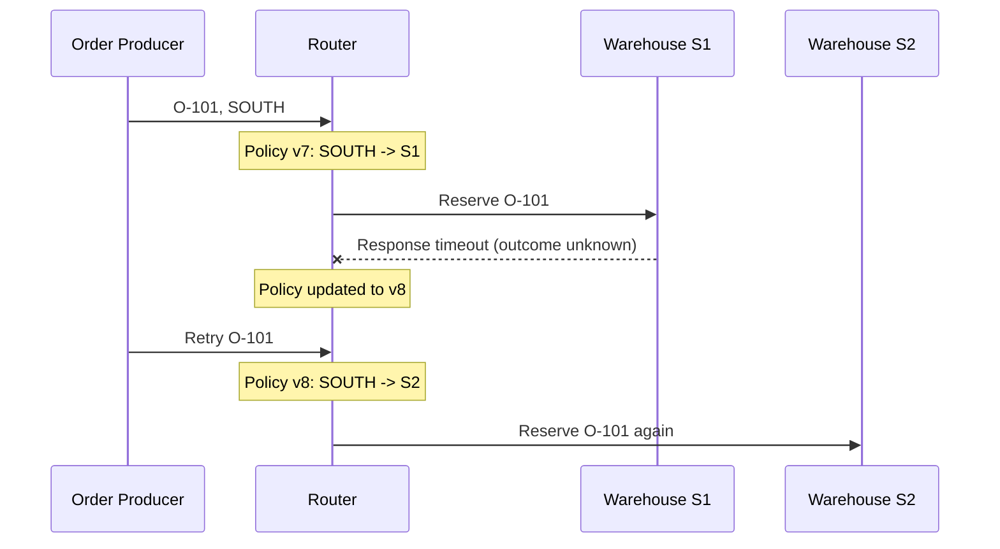
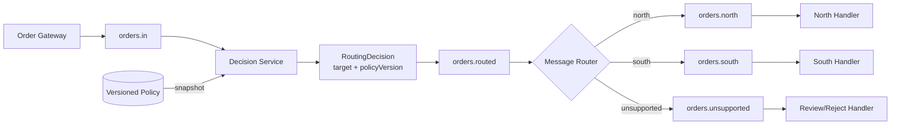
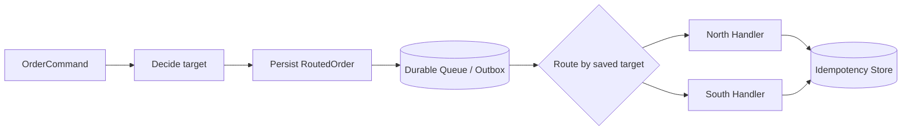
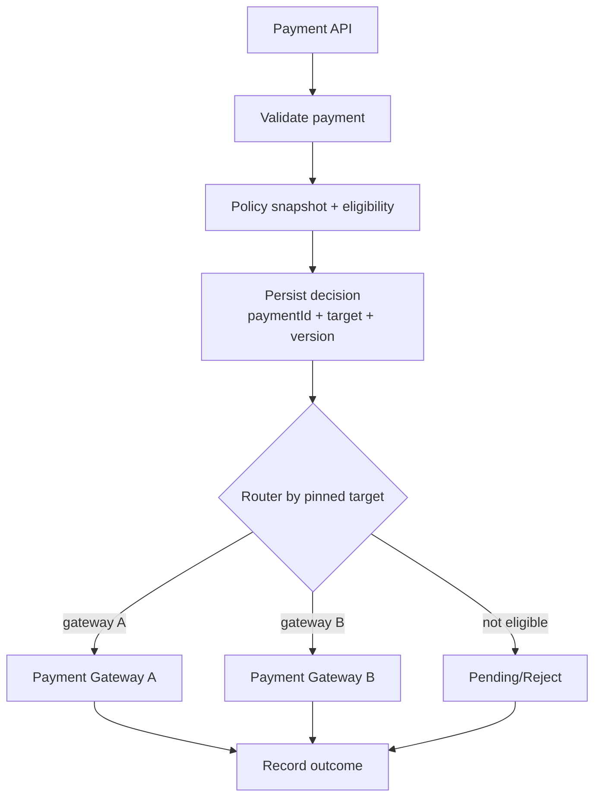

# Stateful Routers and Non-Deterministic Risks

In Enterprise Integration Patterns (EIP), a **Message Router** decides which channel or system a message is forwarded to based on content and context. A simple router might only read `region` or `messageType`. However, when decisions depend on counters, system state, changing configuration, external API results, or prior message history, we enter the realm of **state-dependent routing**.

A stateful router is not inherently wrong. Routing by processing capacity, priority rules, or configuration versions is sometimes a business requirement. Risk arises when **the same message can select different destinations without anyone knowing why**. When that happens, retries, multi-instance deployments, config updates, and incident investigations become unpredictable.

This lesson belongs to the **Message router** chapter of the **SPRING_INTEGRATION_PATTERN** module. The focus is using Spring Integration to implement Enterprise Integration Patterns as loosely coupled, extensible message flows; combining Router with Gateway, Filter, Transformer, Splitter, Aggregator, retry, error channel, correlation, testing, and path tracing. This lesson specifically examines **how state affects routing decisions**, determinism, and reducing risk in real applications.

After this lesson, you will be able to identify sources of state, distinguish snapshot determinism from repeatability over time, design traceable routing decisions, and test retry, concurrency, and mid-flight configuration changes.

## 1. What Does Deterministic Routing Mean?

A router can be described as a function:

\[
destination = route(message,\ context)
\]

With a pure router, `context` contains only **stable, well-defined** values the router needs to decide. Given the same inputs and the same rules, the output is repeatable.

Example:

```java
String routeByRegion(OrderCreated event) {
    return switch (event.region()) {
        case "NORTH" -> "orders.north";
        case "SOUTH" -> "orders.south";
        default -> "orders.unmapped";
    };
}
```

If `event.region()` does not change and the code does not change, the result does not change. With this flow, it is easy to answer "why did order O-101 go to the northern warehouse?".

A state-dependent router may behave like:

\[
destination = route(message,\ rulesVersion,\ load,\ history,\ time)
\]

The same message passing through twice can be sent to two different destinations because the rule version, load level, history, or time has changed.

**Distinguish two concepts:**

- **Snapshot determinism:** given the same message and the same state snapshot, the decision is identical. This can still hold for routers reading dynamic configuration.
- **Stability across retries:** a chosen decision continues to hold when the message is replayed. This does **not come automatically** merely because the routing function is snapshot-deterministic.

A router using well-managed state can be deterministic per snapshot yet still alter its destination at replay time. The design must specify whether such changes are permitted.

## 2. Where Does "State" Come From in a Message Router?

State does not have to live inside a `counter` field of a Java class. Any information **that can vary independently of the message** and influence routing is a source of state worth examining.

| Source of State | Decision Example | Risk When Changing |
| --- | --- | --- |
| **Dynamic configuration** | `region → warehouse` table in a database or config service | A message retried after a policy update may route to another warehouse |
| **Counters / round-robin** | Round-robin cycling across instances A, B, C | Retries switch targets; each node maintains a separate counter |
| **Target load and health** | Picking an unoverloaded, healthy system | Outcome depends on measurement timing and health-check lag |
| **Processing history** | If A was already tried, switch to B | Retry state must be accurate, survive restarts, and work across instances |
| **Time** | Orders received after closing hours go to the night shift | Two replays at different times yield different results |
| **Feature flag / A-B test** | Routing by feature rollout flag | Flag toggles mid-processing; rollout percentages and sticky assignments shift |
| **Workflow state** | Routing by current step of an approval workflow | Inconsistent state reads/writes; late-arriving messages |
| **External service** | Querying an API to choose a warehouse or payment gateway | Timeouts, network errors, unstable external data, ambiguous outcomes |

**A stateful router in the narrow sense** keeps state inside the router object itself, such as an `AtomicInteger`. **A state-dependent router in the broad sense** may store zero internal state yet read databases, feature flags, or load balancers when deciding. For result stability, both must be evaluated.

### Do Not Confuse Stateful Routers with Other Stateful Patterns

- **Aggregator** typically holds message groups and correlation state to assemble results. That is a grouping responsibility, not automatically Router state.
- **Resequencer** (when used) holds state for ordering.
- **Process Manager / Saga** may require durable workflow state to coordinate multiple steps.
- **Router** should focus on *choosing destinations*, rather than absorbing all business state and downstream side effects.

When business logic needs to know "has payment succeeded, has stock been reserved, has email been sent?", a workflow/process manager or durable domain state is usually better than hiding all those conditions inside a singleton router.

## 3. Five Common Risks of Stateful Routers

### 3.1. Same Message Going to Two Destinations After a Retry

Suppose `OrderPlaced("O-101", "SOUTH")` is first routed to `warehouse-s1`. The handler calls the warehouse API; the API succeeds, yet the response is lost, so the system treats it as a timeout error.

Later the policy changes, moving SOUTH to `warehouse-s2`. When retried from **before the router**, the same message is re-routed to S2.



The risk is **reserving inventory in two places**. A timeout does not prove the earlier request went unprocessed. Retries can cause duplicate side effects even when the router picks the same destination; switching destinations makes reconciliation even harder.

Coordinated safeguards:

1. Specify whether a routing decision is allowed to change on retry.
2. If it must stay pinned, **persist the route decision** tied to a business key / event ID before any replay boundary.
3. Make downstream handlers **idempotent** using stable business identifiers or event IDs.
4. On ambiguous timeouts, reconcile actual status instead of assuming failure and sending elsewhere.

### 3.2. Race Conditions in Counters or Shared State

A hand-written round-robin router might do:

```java
class UnsafeRoundRobin {
    private int next = 0; // unsynchronized

    String route() {
        String[] targets = {"orders.a", "orders.b"};
        return targets[(next++) % targets.length];
    }
}
```

When multiple threads call it concurrently, `next++` is non-atomic. Two threads can observe the same value, overwrite updates, or produce uneven distributions. When `next` overflows to negative values, `%` can return a negative index and throw an exception.

Using `AtomicInteger` and `Math.floorMod` mitigates part of the concurrency hazard within **a single JVM**:

```java
import java.util.concurrent.atomic.AtomicInteger;

class LocalRoundRobin {
    private final AtomicInteger next = new AtomicInteger();

    String route() {
        String[] targets = {"orders.a", "orders.b"};
        int index = Math.floorMod(
            next.getAndUpdate(value -> value == Integer.MAX_VALUE ? 0 : value + 1),
            targets.length);
        return targets[index];
    }
}
```

However, this only protects the counter inside one instance. Two running instances maintain **two independent counters**; deployments/restarts reset state; retries can still pick another target. Moreover, even with `AtomicInteger`, decision order depends on thread scheduling. **Thread safety does not mean deterministic routing across time or across nodes**.

### 3.3. Different Instances Running Different Rule Versions

An application has three instances:

```text
Node A: routingPolicy.version = 10 (SOUTH -> Warehouse A)
Node B: routingPolicy.version = 11 (SOUTH -> Warehouse B)
Node C: routingPolicy.version = 11 (SOUTH -> Warehouse B)

Same message O-101 arrives at Node A or B
  -> different destinations
  -> outcome depends on load balancer and update timing
```

If policies are pushed node by node, a version-skew window can occur. That is not necessarily a deployment bug, yet there must be an explicit policy for tolerating or preventing it.

Mitigations: controlled version rollouts; readiness checks during version skew; persisting version and route decision alongside work; or adopting an architecture with one stable decision authority per business key. The exact choice depends on consistency and fault-tolerance needs.

### 3.4. Reading Multiple State Fields Outside One Snapshot

Suppose a router needs:

- `featureEnabled`: is the new processing route enabled?
- `warehouseMapping`: the new destination lookup table.
- `fallbackTarget`: fallback destination.

If these three fields update independently, a thread can read the new feature flag paired with the old mapping. The result is a missing route or an unintended fallback.

A common fix is bundling **all related policy state** into one immutable object and swapping it via **a single atomic update**. When processing a message, the router reads the object once and operates on a consistent version.

### 3.5. Fallback Masking Unknown Conditions

When a destination-selection API times out, a router might unconditionally send to `orders.default`. If the default target lacks equivalent semantics or capacity, the system can silently execute the wrong business behavior.

**Fallback must be a contracted policy**, addressing:

- Which request types are allowed to use the fallback target?
- Could the fallback cause duplicate side effects alongside the timed-out request?
- Should it be delayed, queued for manual inspection, or marked unknown?
- Is every fallback decision recorded with reason and version?

A "default" path is not necessarily a "safe" path. When an authoritative target cannot be determined, an `UNROUTABLE` state or manual review is often preferable to blind routing.

## 4. How Non-Deterministic, Random, and State-Dependent Routers Differ

| Decision Style | Example | Repeatability |
| --- | --- | --- |
| **Pure / deterministic** | `region = NORTH → north` | Same input and code/policy yield the same result |
| **Versioned policy** | `route(order, policy-v12)` | Deterministic while snapshot `policy-v12` is unchanged |
| **Mutable-state-based** | Route to warehouse with remaining capacity | Same input can change target as state changes |
| **Round-robin** | Targets A, B, C in rotation | Depends on message/thread order; not sticky per business key |
| **Random** | Randomly pick an eligible target | Probabilistic; requires a seed or persisted decision for replay |
| **External-dependency-based** | API picks payment gateway by risk | Depends on external response/data; needs timeouts and auditing |

**"Non-deterministic" does not mean random JVM glitches.** Here it is an architectural risk: you cannot deduce a single destination from the input message alone without knowing state, version, and context at decision time.

For stateless load balancing without sticky requirements, round-robin can be completely appropriate. For commands with side effects like charging money or reserving inventory, letting the same business key wander across targets uncontrollably can be a severe bug. Business requirements dictate the required stability level.

## 5. Safe Design: Immutable Policies and Decoupling the Routing Decision

One approach splits the flow into two steps:

1. **Decide:** take a policy snapshot, validate the message, and return a `RoutingDecision` object containing target and version.
2. **Enforce decision:** the Router simply reads `RoutingDecision.target` to choose the channel. It does not re-query state during routing.



In this example, the *decision service* can depend on evolving policies; the *enforcement message router* stays simple, reading only the already-made decision. This reduces scattered non-determinism across endpoints.

### 5.1. Data Model and Policy Snapshot

```java
import java.util.Locale;
import java.util.Map;
import java.util.concurrent.atomic.AtomicReference;

record OrderCommand(String orderId, String region) {}

record RoutingPolicy(long version, Map<String, String> targetsByRegion) {
    RoutingPolicy {
        // Prevent anyone from mutating the Map after publishing a policy.
        targetsByRegion = Map.copyOf(targetsByRegion);
    }
}

record RoutedOrder(
    OrderCommand order,
    String target,
    long policyVersion
) {}

final class RoutingPolicyService {
    private final AtomicReference<RoutingPolicy> current =
        new AtomicReference<>(
            new RoutingPolicy(
                1L,
                Map.of("NORTH", "north", "SOUTH", "south")
            )
        );

    RoutedOrder decide(OrderCommand order) {
        if (order == null || order.orderId() == null
                || order.orderId().isBlank() || order.region() == null) {
            throw new IllegalArgumentException("Invalid order command");
        }

        // Read only one snapshot per message.
        RoutingPolicy policy = current.get();
        String region = order.region().trim().toUpperCase(Locale.ROOT);
        String target = policy.targetsByRegion()
            .getOrDefault(region, "unsupported");

        return new RoutedOrder(order, target, policy.version());
    }

    void replacePolicy(RoutingPolicy nextPolicy) {
        // Version monotonicity and authorization rules must be enforced externally.
        current.set(nextPolicy);
    }
}
```

Understand the exact guarantees of this example:

- `RoutingPolicy` uses `Map.copyOf`, so a published version cannot be partially mutated.
- `AtomicReference` guarantees a thread reads **one complete policy object** rather than mixing fields across concurrent updates inside one JVM.
- `decide` computes `target` once and embeds `policyVersion` in the resulting message.
- This does **not** synchronize state across multiple JVMs, persist decisions across restarts, or stop replays of the **original `OrderCommand`** from recomputing routes after a policy update.

In production, policy updates require input validation, monotonic version enforcement, target allowlists, rollout controls, and version history retention for auditing. Never let channel names come from untrusted data as arbitrary targets.

### 5.2. Separating the Decision Service from the Router in Spring Integration DSL

The example below has **three fixed targets**: north, south, and unsupported. If the policy changes, it may only return one of the three mapped keys. Handlers are business interfaces implemented by application-provided beans.

```java
import org.springframework.context.annotation.Bean;
import org.springframework.context.annotation.Configuration;
import org.springframework.integration.annotation.Gateway;
import org.springframework.integration.annotation.IntegrationComponentScan;
import org.springframework.integration.annotation.MessagingGateway;
import org.springframework.integration.channel.DirectChannel;
import org.springframework.integration.config.EnableIntegration;
import org.springframework.integration.dsl.IntegrationFlow;
import org.springframework.messaging.MessageChannel;

interface DispatchService {
    void dispatchNorth(RoutedOrder routed);
    void dispatchSouth(RoutedOrder routed);
    void reviewUnsupported(RoutedOrder routed);
}

@MessagingGateway
interface OrderGateway {
    @Gateway(requestChannel = "orders.in")
    void submit(OrderCommand order);
}

@Configuration
@EnableIntegration
@IntegrationComponentScan
class OrderRouterConfiguration {

    @Bean
    RoutingPolicyService routingPolicyService() {
        return new RoutingPolicyService();
    }

    @Bean("orders.in")
    MessageChannel ordersIn() {
        return new DirectChannel();
    }

    @Bean("orders.routed")
    MessageChannel ordersRouted() {
        return new DirectChannel();
    }

    @Bean("orders.north")
    MessageChannel northChannel() {
        return new DirectChannel();
    }

    @Bean("orders.south")
    MessageChannel southChannel() {
        return new DirectChannel();
    }

    @Bean("orders.unsupported")
    MessageChannel unsupportedChannel() {
        return new DirectChannel();
    }

    @Bean
    IntegrationFlow selectPolicy(RoutingPolicyService policies) {
        return IntegrationFlow.from("orders.in")
            .transform(OrderCommand.class, policies::decide)
            .channel("orders.routed")
            .get();
    }

    @Bean
    IntegrationFlow routePinnedDecision() {
        return IntegrationFlow.from("orders.routed")
            .route(RoutedOrder.class, RoutedOrder::target,
                mapping -> mapping
                    .channelMapping("north", "orders.north")
                    .channelMapping("south", "orders.south")
                    .channelMapping("unsupported", "orders.unsupported"))
            .get();
    }

    @Bean
    IntegrationFlow handleNorth(DispatchService dispatch) {
        return IntegrationFlow.from("orders.north")
            .handle(RoutedOrder.class, (routed, headers) -> {
                dispatch.dispatchNorth(routed);
                return null;
            })
            .get();
    }

    @Bean
    IntegrationFlow handleSouth(DispatchService dispatch) {
        return IntegrationFlow.from("orders.south")
            .handle(RoutedOrder.class, (routed, headers) -> {
                dispatch.dispatchSouth(routed);
                return null;
            })
            .get();
    }

    @Bean
    IntegrationFlow handleUnsupported(DispatchService dispatch) {
        return IntegrationFlow.from("orders.unsupported")
            .handle(RoutedOrder.class, (routed, headers) -> {
                dispatch.reviewUnsupported(routed);
                return null;
            })
            .get();
    }
}
```

When `OrderGateway.submit(new OrderCommand("O-101", "SOUTH"))` is called:

1. Gateway sends `OrderCommand` to `orders.in`.
2. Transformer calls `policies.decide` and creates `RoutedOrder` containing input, target, and policy version.
3. Router reads `target` from `RoutedOrder`; mapping configuration selects the output channel.
4. The corresponding channel's handler receives `RoutedOrder` so it can log/reconcile `policyVersion`.

All channels here are `DirectChannel`, so execution is **synchronous**, with no broker, persistence, or automatic retries. The example assumes Spring Integration dependencies are present, the gateway is within `@IntegrationComponentScan` scope, and a `DispatchService` bean is provided.

**Note:** the `unsupported` route here represents **forwarding to a review or rejection handler**, not an automatic fallback acting like a valid warehouse. For sensitive systems, keep unroutable states explicit and require an unambiguous decision.

### 5.3. Crucial Rule Once `RoutedOrder` Exists

Once `RoutedOrder` is created and **persisted properly**, you can route/retry **`RoutedOrder`** rather than re-running `policies.decide(OrderCommand)`. Retrying from the beginning through `orders.in` could produce a different `target` under a newer policy.

The persistence point can be a message carrying the route decision in a broker, a processing table keyed by `businessKey + target + version`, or an outbox record committed in the same business transaction. Choosing the mechanism depends on consistency and data-loss requirements; `AtomicReference` is only an in-memory snapshot mechanism, not durable decision storage.

## 6. Load Distribution: When Does Target Stickiness Not Matter?

Not every message needs sticky routing. For **idempotent, stateless** tasks where all workers are equivalent, load balancing can freely pick a different worker on retry.

For example, generating thumbnails from a source image and writing outputs by content hash; if all workers access the same input and writes are duplicate-safe, switching workers is acceptable.

By contrast, for commands with target-bound side effects—reserving stock at a specific warehouse, capturing payment at a specific provider, or updating a specific aggregate—changing targets requires an explicit policy.

| Goal | Option to Consider | Trade-Off |
| --- | --- | --- |
| Equivalent workers, idempotent tasks | Competing-consumer queue or load balancer | No need to persist chosen worker |
| Same order always hits same shard | Stable hash on business key and managed shard list | Changing shard count shifts mappings; requires migration plan |
| Business rules change over time | Versioned policy snapshot and decision persistence when needed | Metadata overhead and rollout strategy needed |
| Primary target fails, failover needed | Controlled failover policy + reconciliation | Timeout may already have caused side effects at primary |
| Routing by workflow progress | Durable process manager / workflow state | Extra state management and consistency complexity |

### Consistent Hashing Also Requires Change Management

Computing `hash(orderId)` to pick a shard looks fully deterministic. Yet if the shard list changes, mappings can shift; with simple modulo, adding one shard typically relocates many keys. Consistent hashing reduces key movement by design, yet **does not** automatically prevent an order from splitting across two shards during migration.

If targets own state by business key, define cutover/migration procedures, effective timestamps, and the ability to honor prior decisions.

## 7. Retries, Transactions, and Idempotency Determine Real Safety

Retries can happen in at least three places:

- **Before Router:** the original message is replayed and may **recompute the destination**.
- **After Router:** a message carrying a route decision is replayed into the same branch, provided the system persisted that decision.
- **At the external target:** adapters/brokers/consumers may redeliver or retry API calls.

They are not equivalent.



The diagram illustrates the principle, not an assumption that both handlers write to one shared database. The **idempotency store** must align with the boundary of real side effects.

### 7.1. Persisting the Decision and Side Effects Are Two Different Steps

Suppose a producer writes an order to a database and then publishes a message containing `target`. If the process crashes between the two operations, the DB may be committed while the broker never received the message.

One approach is **Transactional Outbox**: write the business record and the outbound decision record in the same database transaction, then let a publisher forward the outbox to the broker. This mitigates dual-write event loss, though the publisher may emit duplicates on retry; consumers still require idempotency.

On the handler side, if `RoutedOrder` arrives multiple times, use a business key like `orderId` combined with unique constraints and transactions to ensure an operation does not duplicate side effects within system-owned boundaries. For external side effects like payment APIs, rely on provider idempotency/reconciliation contracts; merely setting a flag in an internal database does not guarantee the external API did not execute.

### 7.2. Intentional Policy Changes to Reroute

Sometimes the business deliberately wants to **reroute** an already-recorded command—for instance, the original warehouse is permanently decommissioned. Rerouting should then be **an audited business event/decision**, not an accidental side effect of retries.

An audit record might contain:

```json
{
  "orderId": "O-101",
  "originalTarget": "warehouse-s1",
  "newTarget": "warehouse-s2",
  "fromPolicyVersion": 7,
  "toPolicyVersion": 8,
  "reason": "WAREHOUSE_DECOMMISSIONED",
  "approvedAt": "2026-11-21T04:00:00Z"
}
```

This illustrates only the audit contract. Production implementations must define who is authorized to reroute, the status of prior work, compensation if needed, and time windows for changes.

### 7.3. Do Not Confuse Exactly-Once with Route Pinning

Even if the router picks the exact same destination on every replay, a message can be redelivered and processed twice by the handler. Conversely, strong idempotency can stop duplicate side effects yet might not catch that the same command was sent to two different destinations.

Protect both layers: **consistency of destination selection** and **safety under repeated execution**. Any "exactly-once" claims must be scoped to specific brokers, transactions, and side effects.

## 8. Handling Routing Errors by Root Cause

Stateful routers fail in ways beyond missing mappings. Classify root causes to avoid wrong retries or wrong fallbacks.

| Error or Scenario | Reasonable Reaction to Consider | Do Not Assume |
| --- | --- | --- |
| Missing `region` or invalid code | Reject / validation result, record reason if needed | Infinitely retrying the same payload |
| No rule for a new region | `unsupported`/manual review or contract rejection | Blindly routing to a default warehouse |
| Policy service times out before deciding | Bounded retry or known snapshot if policy allows | Silently using an unversioned rule |
| Chosen target is unavailable | Temporary queue, retry, or formal reroute procedure | Auto-switching targets when old task may have succeeded |
| Selected channel has no subscriber | Report config/route error, measure and alert | Assuming the message was processed |
| Message carries an out-of-allowlist target | Reject and log contract violation | Dynamically creating targets from external data |
| Consumer succeeded yet ack failed | Redelivery with idempotency/reconciliation | Assuming the previous attempt definitely failed |

In Spring Integration, **synchronous** errors on `DirectChannel` usually propagate back to the caller. With `ExecutorChannel`, pollers, inbound adapters, or brokers, errors may be caught on another thread and routed via an **error channel** if configured. Merely declaring a channel named `errors` does not automatically convert every exception into an `ErrorMessage`.

When retries are needed, decide **which step to retry from**. Retrying before the decision service can alter the destination; retrying after persisting `RoutedOrder` preserves the decision. With external adapters, understand the ack, redelivery, dead-letter, and timeout semantics of the transport used.

## 9. How to Observe a Routing Decision

A stateful router that omits snapshot/version logging makes incident investigation very difficult. Never log just:

```text
Processed order O-101
```

Record enough context to answer **why** and **under what state** the message was routed:

| Field | Purpose |
| --- | --- |
| `messageId` and `businessKey` | Identify the specific message/command and spot retries |
| `correlationId` | Link messages in the same transaction or business flow |
| `routerName` and `routerInstance` | Identify which endpoint/node made the decision |
| `policyVersion` | Identify which rule version applied |
| `routeKey` and `chosenTarget` | Explain the selected branch |
| `reasonCode` | Show which rule matched, fallback, or manual review |
| `attemptNumber` and `isReplay` | Compare retries against the initial decision |
| `decisionTimestamp` | Investigate update timing / race windows |
| `downstreamOutcome` | Track whether work succeeded, failed, or is uncertain |

Structured log example (illustrative values):

```json
{
  "event": "route_decided",
  "businessKey": "O-101",
  "correlationId": "checkout-101",
  "routerInstance": "order-router-02",
  "policyVersion": 8,
  "routeKey": "SOUTH",
  "chosenTarget": "warehouse-s2",
  "reasonCode": "REGION_MAPPING",
  "attemptNumber": 1
}
```

If a command was previously routed under v7, a v8 record for the same business key demands explanation: was this an approved reroute or an unintended recomputation?

For metrics, track: message counts per route, unmapped route counts, fallback counts, policy-version skew across instances, target-changed-on-replay counts, downstream failures, and processing latency. **Avoid using business keys as metric labels** due to high cardinality; keep keys in access-controlled logs/traces and omit sensitive data.

## 10. Testing Determinism and State

A few unit tests on `route` are not enough. Test state changes and message redelivery as well.

### 10.1. Core Test Matrix

| Scenario | Test Action | Expectation |
| --- | --- | --- |
| Same input, same policy | Route the same `OrderCommand` twice with unchanged version | Same target and version |
| Policy changes | Change SOUTH mapping from south to north, then re-route original input | New decision reflects new version; expected change |
| Retry persisted decision | Replay the old `RoutedOrder` after policy changes | Enforcement router still picks the saved target |
| Concurrent threads reading policy | Route concurrently while swapping the entire policy snapshot | Every decision belongs to one valid snapshot, no torn fields |
| Version skew across instances | Give two instances different policy versions | System detects or logs skew per policy |
| Missing mapping | Route an out-of-allowlist region | Goes to unsupported or rejects per config, never drops silently |
| Target down | Simulate timeout after side effect | No duplicates upon retry/reconciliation |
| Duplicate message | Send same business key twice | Idempotency protects side effects within required scope |

### 10.2. Unit Testing Policy Snapshots with JUnit 5

Based on `RoutingPolicyService` from section 5, test single-shot routing and versioned policy swaps:

```java
import static org.junit.jupiter.api.Assertions.*;
import java.util.Map;
import org.junit.jupiter.api.Test;

class RoutingPolicyServiceTest {

    @Test
    void sameSnapshotProducesSameDecision() {
        RoutingPolicyService policies = new RoutingPolicyService();
        OrderCommand order = new OrderCommand("O-101", "SOUTH");

        RoutedOrder first = policies.decide(order);
        RoutedOrder second = policies.decide(order);

        assertEquals("south", first.target());
        assertEquals(first.target(), second.target());
        assertEquals(first.policyVersion(), second.policyVersion());
    }

    @Test
    void policyChangeAffectsNewDecisionNotExistingDecision() {
        RoutingPolicyService policies = new RoutingPolicyService();
        OrderCommand order = new OrderCommand("O-102", "SOUTH");

        RoutedOrder pinned = policies.decide(order);
        policies.replacePolicy(new RoutingPolicy(
            2L,
            Map.of("SOUTH", "north", "NORTH", "north")
        ));
        RoutedOrder later = policies.decide(order);

        assertEquals("south", pinned.target());
        assertEquals(1L, pinned.policyVersion());
        assertEquals("north", later.target());
        assertEquals(2L, later.policyVersion());
    }

    @Test
    void unknownRegionDoesNotAccidentallySelectWarehouse() {
        RoutingPolicyService policies = new RoutingPolicyService();

        RoutedOrder routed =
            policies.decide(new OrderCommand("O-103", "OTHER"));

        assertEquals("unsupported", routed.target());
    }
}
```

These tests prove the in-memory behavior of the decision service. They do **not** prove `RoutedOrder` survives restarts, Kafka offsets commit accurately, or side effects are idempotent. Those guarantees require integration tests with real databases/brokers or transports in a controlled environment.

### 10.3. Integration Tests for Different Retry Boundaries

Create a test covering four paths:

- **Path A:** failure occurs before persisting the route decision; replaying `OrderCommand` after a policy update may change the target. The test must verify whether the system permits or forbids this.
- **Path B:** route decision was persisted, so retry starts from `RoutedOrder`. After a policy update, the message still goes to the original target.
- **Path C:** the target handler times out after completing its side effect. The test simulates redelivery of the same command and proves idempotency or reconciliation prevents duplicate side effects.
- **Path D:** two instances hold different policy versions. Verify skew metrics/logs and synchronization or fail-closed rules as required.

For asynchronous flows, wait using bounded conditional checks rather than assuming a handler ran the moment a message was enqueued. With `DirectChannel`, exceptions can propagate on the sending thread; with queues/brokers, test error/ack/redelivery paths separately.

## 11. Operational Principles Before Scaling Out

To operate a state-dependent Router reliably over time, answer:

1. **What is the source of truth for policies?** Config files, database, rule service, or code? Who is authorized to update it?
2. **Is each version immutable?** Define versioning rules, history storage, and rollbacks that never rewrite history.
3. **How are policies distributed uniformly?** Are skew windows bounded? Are there readiness/skew checks?
4. **Which decisions must stay sticky?** Which business keys may switch targets? What is the formal reroute workflow?
5. **How are unavailable targets handled?** Backoff, queueing, timeouts, manual review, or compensation?
6. **Where do retries start?** Before or after persisting the route decision? Which messages are persisted?
7. **Are targets safe under duplicate messages?** Idempotency keys, unique constraints, transactions, or provider APIs?
8. **How are decision changes observed?** Route audits, policy versions, reason codes, skew alerts, and fallback alerts.

If a system uses round-robin solely to balance stateless tasks, do not turn it into a heavy audit workflow. If it routes money, inventory, or sharded data, persisting decisions and reconciling state may be mandatory.

## 12. Practice Exercise: Multi-Gateway Payment Router

A payment application uses Gateway A for domestic transactions and Gateway B for international transactions. When A is overloaded, the system may shift **some** transactions to B if the customer and payment method qualify. Routing policies are updated via a dashboard, and three application instances run concurrently.

Business requirements:

- Every payment request has a `paymentId` immutable across retries.
- A transaction must never be charged at both gateways merely because of a timeout.
- You must trace who/which rule version decided a gateway switch.
- Some requests cannot switch gateways; they must enter a waiting state or fail in a controlled way.

Design the diagram:



Answer these questions for yourself:

1. If the policy changes after the decision is made yet before calling the gateway, may the transaction switch gateways? Under what conditions and authority?
2. If Gateway A times out yet actually charged the card, how does the application verify status before ever trying Gateway B?
3. How do two instances receiving the same `paymentId` arbitrate who creates the route decision? Are unique constraints/transactions needed?
4. If an event replays from the broker an hour later, does the router use the current policy or the saved decision?
5. Which fields belong in logs/audits for reconciliation? Which sensitive data must be excluded from logs?
6. When no valid mapping exists, should it fail, queue for processing, or use a fallback? Who decides?

A solid solution must pinpoint **where state lives, where state is snapshotted and stored, when routes may be recomputed, and which side effects need deduplication**. Simply drawing a Router box on a diagram does not satisfy those constraints.

## Key Takeaways

**A stateful router** is one whose decisions depend on mutable state inside or outside the application: dynamic policies, counters, load levels, time, history, or external systems. "Non-deterministic" risks typically arise when the same message picks different targets as state shifts, threads race, nodes run different versions, or messages replay.

In Spring Integration, a verifiable design **separates policy evaluation and decision pinning from the Router that dispatches messages**. Use versioned immutable snapshots; persist route decisions durably when sticky routing is required; define clear fallbacks and error paths; and align retries, idempotency, correlation, and observability with execution boundaries. This allows Router flows combined with Filter, Transformer, Splitter, Aggregator, and Gateway to scale while keeping every decision explainable.
