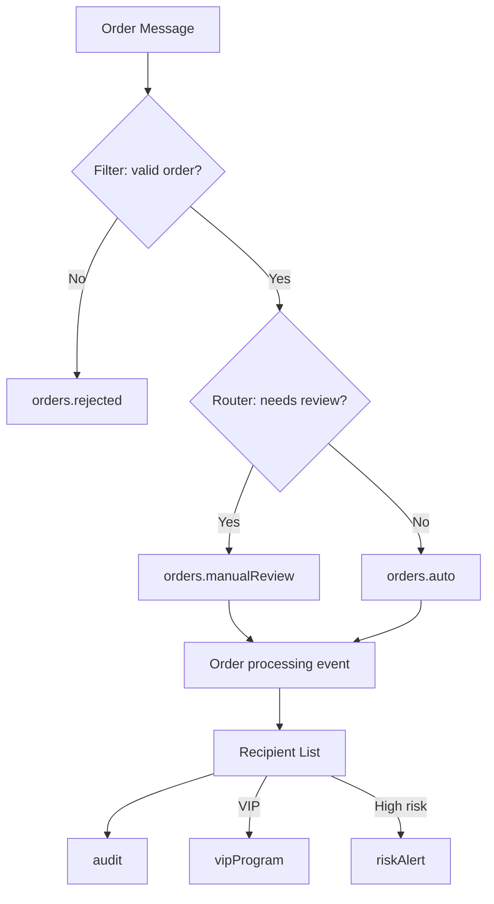
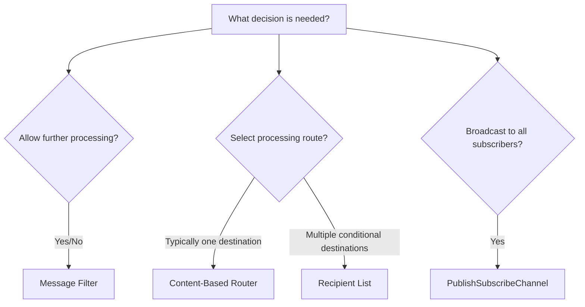

# Distinguishing Router from Filter and Recipient List

## 1. Why Must We Distinguish These Three Patterns?

An order-processing system typically has to answer three different questions:

1. **Should the message continue being processed?** Orders missing an ID or carrying a negative value must be rejected.
2. **Which branch should a valid message go to?** High-value orders need review; standard orders are processed automatically.
3. **Which targets should receive the message?** An order event might need to go to audit, the VIP customer program, and the alerting system simultaneously.

These three questions correspond to three patterns:

- **Message Filter**: evaluates a condition and either lets the message continue or excludes it from the main path.
- **Content-Based Router / Message Router**: selects the processing destination based on message content or headers.
- **Recipient List**: determines a list of recipients, capable of sending the same message to multiple matching destinations.

In the **SPRING_INTEGRATION_PATTERN** module, the **Message router** chapter lets you practice Enterprise Integration Patterns with Spring Integration to build loosely coupled, extensible flows. Properly distinguishing these three patterns also helps coordinate Transformer, Splitter, Aggregator, Gateway, retry, error channel, and correlation; each branch can be tested and observed independently.

After this lesson, you will be able to select the right pattern for business requirements, configure it using Java DSL, define policies for unmatched messages, avoid side effects from multi-recipient dispatch, and write tests proving routing decisions.

## 2. Quick Comparison by Business Decision

| Criterion | Message Filter | Message Router | Recipient List |
| --- | --- | --- | --- |
| Primary question | Should it continue? | Which path should it take? | Who should receive it? |
| Evaluation result | `true` or `false` | One or more destinations per router rules | Set of recipients meeting conditions |
| Common usage | Keep 1 message or remove it from the main path | Choose **one branch** among several branches | Send to **multiple branches** that may hold concurrently |
| No matching choice | Drop message, send to discard channel, or throw error per config | Go to default output, fail resolution, or skip per config | May send to zero recipients; requires explicit policy |
| Can one message go to multiple destinations? | Usually no; discard handles rejected results | **Possible**, if the router returns a list of multiple destinations | **Yes**, that is its primary purpose |
| Example | Accept only orders with positive quantity | Large order → review, small order → auto | Event → audit + VIP + alert |

**Do not assume a router is "strictly one destination" in all configurations.** Several message routers in Spring Integration can return multiple channels or channel keys depending on the router and resolution strategy. Still, *Content-Based Router* is typically used to select a single processing path, while *Recipient List* explicitly expresses sending to multiple enumerated recipients.

### Visualizing on a Single Example



The figure above is a **business diagram**: during implementation, explicitly define which producer emits the event at step F; merely connecting another channel in the diagram does not automatically emit events from both branches.

## 3. Message Filter: Keeping or Excluding Messages

A Message Filter uses a **predicate** (true/false condition) to decide whether a message stays on the main path.

Example validity conditions for an order:

- `orderId` is non-blank;
- `amount` is present and non-negative;
- the order's tenant was authenticated at ingress.

If the condition returns `true`, the message goes to the filter's output channel. If `false`, the filter can **drop the message**, **send it to a discard channel**, or **throw an exception on rejection** per configuration.

Key point: **filtering out a message does not imply a technical error**. Some exclusions are normal business decisions (for example, filtering out events not yet due for processing). For malformed data that the caller needs to know about, provide a rejection branch or explicit error response.

Illustrative Java DSL example:

```java
IntegrationFlow.from("incomingOrders")
    .filter(Order.class,
        order -> order.id() != null
            && !order.id().isBlank()
            && order.amount() != null
            && order.amount().signum() >= 0,
        spec -> spec.discardChannel("orders.rejected"))
    .channel("orders.validated")
    .get();
```

Both outcomes are handled separately:

- **Pass**: the message proceeds to `orders.validated` without changing its payload.
- **Reject**: the message goes to `orders.rejected`, where a consumer can record the rejection reason, return an API error, or trigger data remediation.

The Filter does not decide whether a valid order goes to `manualReview` or `auto`. That is the Router's responsibility.

### Where Does Filter Differ from Transformer and Router?

A Transformer transforms the payload or message representation: `OrderCommand → ValidatedOrder`. A Filter keeps or removes messages. A Router chooses paths. You can chain all three as **Filter → Transformer → Router**, while avoiding writing a Filter that writes to databases, calls APIs, and routes on its own—otherwise the predicate ends up carrying multiple responsibilities.

## 4. Router: Choosing a Path Based on Content or Headers

A Router receives a message, evaluates a routing expression/function, and resolves the destination. With a Content-Based Router, the decision typically inspects the payload:

- `amount >= 1000` → `orders.manualReview`;
- `amount < 1000` → `orders.auto`.

Example:

```java
IntegrationFlow.from("orders.validated")
    .route(Order.class,
        order -> order.amount().compareTo(
            new BigDecimal("1000")) >= 0 ? "review" : "auto",
        spec -> spec
            .channelMapping("review", "orders.manualReview")
            .channelMapping("auto", "orders.auto"))
    .get();
```

Here `"review"` and `"auto"` are **routing keys**, mapped to meaningful channel names. A Router normally does not modify the payload; it sends the message to the destination based on the routing decision.

A Router can also read headers, such as `headers['tenantTier']`, provided you verify who supplied the header. If an HTTP client supplies `X-Tenant-Tier: PREMIUM` and the application blindly trusts it to skip review, that is a **trust-boundary** bug, not a Router bug. Metadata affecting authorization, pricing, or priority must originate from verified sources.

### Router Types You May Encounter

| Router | Decision Basis | Example |
| --- | --- | --- |
| Payload/content-based router | Payload fields or expression | High order value → manual review |
| Header value router | Trusted header value | `region=EU` → EU route |
| Payload type router | Payload Java type | `InvoiceEvent` → invoice flow |
| Custom router | Java logic or routing service | Computing branch from complex business state |
| Recipient List Router | List of recipients and selectors | Send event to audit and interested systems |

In Spring Integration, router names, DSL APIs, and configuration styles can vary across versions. Pick the simplest router that accurately expresses **destination selection**; move complex logic into testable functions or services.

### When the Router Cannot Pick a Channel

No matching branch can happen because:

- the expression returns a key with no `channelMapping`;
- a header value is undeclared;
- a destination was renamed or lacks a subscriber;
- the router resolved a channel name, yet the application created no matching channel/consumer.

You can define a default output channel for unknown cases, or configure the router to throw an error when destination resolution fails. **Never rely on an untested default**: whether to reject, route to fallback, or raise an error must align with the business contract and router configuration in use.

## 5. Recipient List: One Message to Multiple Destinations

The **Recipient List** pattern chooses a **set of recipients** for each message. Each recipient can always receive, or receive only when a selector holds. Selectors are **evaluated independently**: multiple conditions can hold at once.

For example, every order event goes to `events.audit`. In addition:

- If `vip == true`, also send to `events.vip`.
- If `manualReview == true`, also send to `events.risk`.

A message with both headers true is sent to **three recipients**, not "only the first matching recipient."

```java
IntegrationFlow.from("events.in")
    .routeToRecipients(spec -> spec
        .recipient("events.audit")
        .recipient("events.vip", "headers['vip'] == true")
        .recipient("events.risk", "headers['manualReview'] == true"))
    .get();
```

If a message lacks `vip` and `manualReview`, it still goes to audit. You can also design a list with no unconditional recipient; when zero selectors match, choose an explicit policy for "no recipients."

Recipient List fits **delivering the same event to independent purposes**. If you only want to choose one branch responsible for processing, a Content-Based Router is usually clearer and avoids duplicate execution.

### Recipient List vs. Publish-Subscribe Channel

Both options can deliver one message to multiple consumers, yet configuration intent differs:

| Criterion | Recipient List Router | PublishSubscribeChannel |
| --- | --- | --- |
| Who chooses destinations? | Router decides via recipient list and selectors | Subscribers registered on the channel |
| Per-message conditions | Can declare a selector per recipient | Needs filters or subscriber logic for conditional selection |
| How topology is expressed | Explicit destination list on the router | One pub-sub channel with multiple subscribers |
| Purpose | Conditional routing to a set of targets | Broadcast to channel subscribers |

Do not assume all recipients always succeed just because routing was invoked. With synchronous channels, if sending to recipient A succeeds and recipient B throws an exception, A may already have performed side effects. Retrying the entire event may cause A to receive it again. Multi-recipient atomic transactions are not guaranteed automatically.

## 6. Complete Java DSL Example Observing All Three Patterns

The configuration below uses **two independent flows** to cleanly observe each behavior:

- `orders.in` flow: **Filter** validates orders; **Router** chooses auto or manual review.
- `events.in` flow: **Recipient List** dispatches events to audit and header-matched recipients.

Outputs are declared as `QueueChannel` beans for **testing**. In production applications, they are typically replaced with proper consumers/adapters alongside capacity, timeout, retry, and persistence policies.

```java
import java.math.BigDecimal;

import org.springframework.context.annotation.Bean;
import org.springframework.context.annotation.Configuration;
import org.springframework.integration.channel.DirectChannel;
import org.springframework.integration.channel.QueueChannel;
import org.springframework.integration.config.EnableIntegration;
import org.springframework.integration.dsl.IntegrationFlow;
import org.springframework.messaging.MessageChannel;

record Order(String id, BigDecimal amount, boolean vip) {}

@Configuration
@EnableIntegration
public class RoutingPatternsConfiguration {

    @Bean("orders.in")
    public MessageChannel orderInput() {
        return new DirectChannel();
    }

    @Bean("events.in")
    public MessageChannel eventInput() {
        return new DirectChannel();
    }

    @Bean("orders.rejected")
    public QueueChannel rejectedOrders() {
        return new QueueChannel();
    }

    @Bean("orders.auto")
    public QueueChannel automaticOrders() {
        return new QueueChannel();
    }

    @Bean("orders.manualReview")
    public QueueChannel manualReviewOrders() {
        return new QueueChannel();
    }

    @Bean("events.audit")
    public QueueChannel auditEvents() {
        return new QueueChannel();
    }

    @Bean("events.vip")
    public QueueChannel vipEvents() {
        return new QueueChannel();
    }

    @Bean("events.risk")
    public QueueChannel riskEvents() {
        return new QueueChannel();
    }

    @Bean
    public IntegrationFlow validateAndRouteOrders() {
        return IntegrationFlow.from("orders.in")
            .filter(Order.class,
                order -> order.id() != null
                    && !order.id().isBlank()
                    && order.amount() != null
                    && order.amount().signum() >= 0,
                spec -> spec.discardChannel("orders.rejected"))
            .route(Order.class,
                order -> order.amount()
                    .compareTo(new BigDecimal("1000")) >= 0
                        ? "review" : "auto",
                spec -> spec
                    .channelMapping("review", "orders.manualReview")
                    .channelMapping("auto", "orders.auto"))
            .get();
    }

    @Bean
    public IntegrationFlow routeEventRecipients() {
        return IntegrationFlow.from("events.in")
            .routeToRecipients(spec -> spec
                .recipient("events.audit")
                .recipient("events.vip", "headers['vip'] == true")
                .recipient("events.risk",
                    "headers['manualReview'] == true"))
            .get();
    }
}
```

**Reading the flow by scenario:**

| Input Message | Filter | Router / Recipient List | Result |
| --- | --- | --- | --- |
| `Order("A", 300, false)` | Pass | `auto` | 1 message in `orders.auto` |
| `Order("B", 1500, true)` | Pass | `review` | 1 message in `orders.manualReview` |
| `Order("C", -10, false)` | Reject | Router not called | 1 message in `orders.rejected` |
| Event with `vip=true` and `manualReview=false` | No Filter on event flow | Audit and VIP | 2 messages sent to 2 channels |
| Event with `vip=true` and `manualReview=true` | No Filter on event flow | Audit, VIP, and Risk | 3 messages sent to 3 channels |
| Event lacking both headers above | No Filter on event flow | Audit only | 1 message in `events.audit` |

In the example, `vip` and `manualReview` on the event are headers **attached by a trusted producer**. Never use headers from unauthenticated clients to trigger sensitive processing. The two flows are independent, so **an order entering `orders.in` does not automatically emit an event to `events.in`**; the application can produce an event after finishing business processing and submit it to the second flow.

## 7. Testing Filtering, Single-Branch Selection, and Multi-Recipient Selection

You can write Spring Integration tests with JUnit 5 and AssertJ to verify these distinct behaviors right inside the application without needing HTTP APIs or a broker yet.

```java
import static org.assertj.core.api.Assertions.assertThat;

import java.math.BigDecimal;

import org.junit.jupiter.api.Test;
import org.springframework.beans.factory.annotation.Autowired;
import org.springframework.beans.factory.annotation.Qualifier;
import org.springframework.integration.channel.QueueChannel;
import org.springframework.messaging.Message;
import org.springframework.messaging.MessageChannel;
import org.springframework.messaging.support.MessageBuilder;
import org.springframework.test.context.junit.jupiter.SpringJUnitConfig;

@SpringJUnitConfig(RoutingPatternsConfiguration.class)
class RoutingPatternsTest {

    @Autowired
    @Qualifier("orders.in")
    MessageChannel orders;

    @Autowired
    @Qualifier("events.in")
    MessageChannel events;

    @Autowired
    @Qualifier("orders.rejected")
    QueueChannel rejected;

    @Autowired
    @Qualifier("orders.auto")
    QueueChannel automatic;

    @Autowired
    @Qualifier("orders.manualReview")
    QueueChannel manual;

    @Autowired
    @Qualifier("events.audit")
    QueueChannel audit;

    @Autowired
    @Qualifier("events.vip")
    QueueChannel vip;

    @Autowired
    @Qualifier("events.risk")
    QueueChannel risk;

    @Test
    void filterRejectsInvalidOrderBeforeRouter() {
        Order invalid = new Order("C", new BigDecimal("-10"), false);
        boolean sent = orders.send(
            MessageBuilder.withPayload(invalid).build());

        assertThat(sent).isTrue();
        assertThat(rejected.receive(0)).isNotNull();
        assertThat(automatic.receive(0)).isNull();
        assertThat(manual.receive(0)).isNull();
    }

    @Test
    void routerSelectsExactlyOneOrderDestination() {
        Order expensive =
            new Order("B", new BigDecimal("1500"), true);

        assertThat(orders.send(
            MessageBuilder.withPayload(expensive).build())).isTrue();

        Message<?> output = manual.receive(1_000);
        assertThat(output).isNotNull();
        assertThat(output.getPayload()).isEqualTo(expensive);
        assertThat(automatic.receive(0)).isNull();
        assertThat(rejected.receive(0)).isNull();
    }

    @Test
    void recipientListSendsToEveryMatchingRecipient() {
        Message<String> event = MessageBuilder.withPayload("order-B")
            .setHeader("vip", true)
            .setHeader("manualReview", true)
            .setHeader("requestId", "req-B")
            .build();

        assertThat(events.send(event)).isTrue();

        Message<?> auditCopy = audit.receive(1_000);
        Message<?> vipCopy = vip.receive(1_000);
        Message<?> riskCopy = risk.receive(1_000);

        assertThat(auditCopy).isNotNull();
        assertThat(vipCopy).isNotNull();
        assertThat(riskCopy).isNotNull();
        assertThat(auditCopy.getPayload()).isEqualTo("order-B");
        assertThat(vipCopy.getHeaders().get("requestId"))
            .isEqualTo("req-B");
        assertThat(riskCopy.getPayload()).isEqualTo("order-B");
    }
}
```

Note that the `QueueChannel` beans above are solely for the example. If one test sends multiple messages to the same queue, drain all results or use a fresh context/fixture so leftover messages from another test do not break assertions. Operational testing must also measure latency, per-recipient error handling, retries, and idempotency against real side effects.

### Additional Test Cases to Include

| Test Case | What to Assert |
| --- | --- |
| Missing or wrong-type routing header | Router/selector applies fallback or error per contract, never routes arbitrarily. |
| Zero recipients match condition | Explicit log, metric, drop, or fallback; never silently lose critical events. |
| Two selectors both true | Both recipients receive the message; delivery count is exact. |
| One selector false, one selector true | Non-matching recipient receives nothing; matching recipient receives it. |
| Destination has no consumer | Send failure is observed and handled; never mistaken for completed processing. |
| Second recipient fails after first succeeded | Idempotency/recovery exists; never assume whole fan-out rolls back. |
| Retry of the same event | Side effects can replay; deduplicate via `eventId`. |
| Forged client `tenantId` or role header | Never used to route data to another tenant or bypass policy. |

## 8. Error Handling: Differences in Filter, Router, and Recipient List

### Filter Rejects a Message

Returning `false` is an **evaluation outcome**, not an exception by default. Without a `discardChannel` or throw-on-rejection setting, the message is excluded from the main path. When auditing or caller feedback is needed, define a consumer for rejected messages.

To treat invalid data as an exception, enable a Filter option such as `throwExceptionOnRejection(true)`, depending on API/configuration. Choosing exception vs. discard must stay consistent with request/reply and error-flow design.

### Router Cannot Route

A Router may fail to find a target when a key is unmapped or a destination fails resolution. Distinguish:

- **No valid key**: bad data or missing case in routing rules.
- **Valid key, no destination**: configuration or topology error.
- **Valid destination, send failed**: dispatch/channel/subscriber error.

These situations require different remedies. A default output channel fits unrecognized business types; configuration bugs should fail clearly instead of going to an arbitrary branch.

### Recipient List Partially Succeeds

With multiple recipients, each send can trigger independent side effects. For example, audit persisted the event, then the VIP system was unavailable; retrying the whole message may send to audit again.

Never treat **sending to multiple channels** as a distributed transaction. To stay safe:

1. Define a stable `eventId` and idempotency mechanism at each consumer.
2. Configure per-recipient retries or broker-backed recovery when branches must recover independently.
3. Document who owns monitoring delivery to each recipient.
4. Use a transactional outbox or broker when durable delivery across process crashes is required.
5. Bound timeouts and backpressure when one recipient is slow.

Some channels run synchronously on the sender thread, while others use executors or polling. Thus failures and completion order also depend on channel types, not just Recipient List Router properties.

## 9. Impact on Threading, Ordering, and Correlation

**A Router does not define concurrency semantics on its own.** The same router can send to:

- `DirectChannel`: typically runs subscribers on the sender thread and can propagate exceptions synchronously.
- `ExecutorChannel`: dispatches via an executor, shifting thread boundaries and how errors are observed.
- `QueueChannel`: stores messages in a queue for polling consumers, separating send success from processing completion.
- AMQP/JMS/Kafka adapters: introduce transport boundaries with their own acks, retries, header mappings, and delivery semantics.

When sending to multiple recipients, do not assume all recipients process in the same order or finish before the producer continues. Depending on channels and endpoints, each recipient may exhibit different synchronicity.

### Correlation and Tracing

If an event goes to three consumers, a shared `requestId` or `eventId` correlates the three outcomes. However:

- Framework `MessageHeaders.ID` should not automatically serve as a business idempotency key.
- `correlationId` used by Splitter/Aggregator to group messages is not identical to HTTP, JMS, or other broker correlation IDs.
- If the three branches must later be reassembled into one result, design explicit **fan-out/fan-in**: correlation key, expected part count, release strategy, and Aggregator timeout.
- If Recipient List only feeds independent audit/notification tasks, you usually **do not wait for all three replies** before completing the main business step.

### Filter Before Aggregator Can Stall Groups

A Splitter creates three messages with `sequenceSize = 3`. If a Filter drops one message before the Aggregator receives it without a compensating strategy or release adjustment, the Aggregator can wait forever for the missing message. Solutions belong in the contract: emit a valid rejected-part result, handle timeouts, or adjust the release strategy. Never arbitrarily mutate `sequenceSize` on a single branch.

## 10. Choosing a Pattern by Scenario



Quick decision table:

| Requirement | Suitable Pattern | Reason |
| --- | --- | --- |
| Drop events missing required data | Filter | Needs only one predicate and a reject/drop policy. |
| Route high-risk orders to review, others to auto | Router | Selects processing branch by order attributes. |
| Send event to audit and matching systems | Recipient List | Independent selectors; multiple parties can receive together. |
| Deliver message to every subscriber of a channel | Publish-Subscribe Channel | Registers subscribers for broadcast needs. |
| Route order items to branches then combine results | Router/Splitter with Aggregator | Beyond routing, requires correlation and release to fan in. |
| Invalid → error, valid → select one channel | Filter then Router | Two distinct decisions tested independently. |

Patterns can be combined in one pipeline. A clean way to split steps is asking at each stage: **does this step validate a condition, select a destination, or build a recipient list?** A single method doing all three becomes hard to test and hard to manage for side effects.

## 11. Common Design Mistakes

| Symptom | Cause | Fix |
| --- | --- | --- |
| Using a Router for a true/false check with an awkward "drop" branch | Case only needs message filtering | Use Filter with explicit discard/rejection. |
| Using Filter expecting to steer messages to one of multiple targets | Filter does not select among multiple processing routes | Place a Router after the filter step. |
| Using a single-target router for audit + notification | Actual intent is multi-recipient fan-out | Use Recipient List or publish-subscribe properly. |
| Only the first recipient gets the event | `if / else if` logic or single-key routing | Use independent Recipient List selectors and verify outbound topology. |
| Duplicate events after retry | Retrying entire fan-out after one recipient applied side effects | Add event IDs, idempotency, and per-recipient dispatch recovery. |
| Messages "vanish" when no branch matches | Missing fallback, discard, or no-match observability | Configure unmatched policy, metrics, and tests. |
| Router routes by client-claimed user roles | Unverified headers | Establish trusted metadata at ingress and enforce tenant/authorization checks. |
| Aggregator stalls forever after Filter | Part of the sequence was filtered out | Design release/partial/timeout handling whenever a Filter sits in between. |
| Send succeeds yet downstream handler fails | Async channel/endpoint or deferred consumer execution | Observe send, processing, error flows, and retries separately. |

## 12. Practice Exercises

### Exercise 1 — Choose the Pattern

For each requirement below, determine whether to use Filter, Router, Recipient List, or a combination:

1. Process only verified invoices.
2. Foreign-currency invoices go to a conversion service; domestic-currency invoices go directly.
3. After creating an order, send an event to audit; if the customer is VIP, also send to CRM.
4. Every subscriber registered on `systemEvents` receives the event.
5. Rejected invoices must go to a dedicated channel for staff inspection.

Justify your pattern choice by **the question the endpoint answers**, not merely lines of Java code.

### Exercise 2 — Test Mutually Exclusive Branches

Extend the section 6 example: add `riskScore` and two branches `orders.manualReview` / `orders.auto`. For each message, test:

- A small valid order enters **only** the auto branch.
- A high-risk valid order enters **only** the review branch.
- An order missing an ID never reaches the Router.
- The `requestId` header is preserved on the output.

### Exercise 3 — Recipient List with Multiple True Selectors

Add recipient `events.marketing` when header `campaignEligible == true`. Send an event matching VIP, marketing, and manual review simultaneously. Write a test confirming audit, VIP, marketing, and risk all receive it. Then send an event matching none of the conditions and verify only audit receives it.

### Exercise 4 — Partial Failure and Retry

Suppose audit persisted successfully yet CRM failed after receiving the same event. Design a way to retry only the failed CRM branch, or make full retries safe via `eventId`. Explain why a single Recipient List invocation does not give transactional atomicity across all recipients.

### Exercise 5 — Fan-Out and Fan-In

A request needs results from three verification services: FRAUD, CREDIT, and SHIPPING. Distinguish the problem of **sending to three places** from **waiting for all three results**. Draw a diagram using Recipient List/Router on the outbound side and Aggregator on the inbound side, specifying correlation key, release strategy, reply timeout, and missing-service policy.

## 13. Key Takeaways

- **Filter** decides pass/reject via a predicate; discard branches or exceptions are configuration choices.
- **Router** decides where a message is processed next; picking one branch is the common case, though multi-destination routing exists in some routers.
- **Recipient List** clearly expresses multi-recipient delivery, where each recipient can have its own selector and multiple selectors can match at once.
- **Publish-Subscribe Channel** is an alternative for broadcasting to subscribers, with a different configuration contract from Recipient List.
- Zero matching recipients, unresolvable destinations, send failures on one recipient, and post-receipt business errors are **distinct situations**; handle and test each separately.
- When fan-out involves side effects, use `eventId`, idempotency, timeouts, and per-recipient observability.
- When results from multiple branches must be reassembled, design an Aggregator, correlation, and release strategy.

## References

- [Spring Integration Reference — Message Routing](https://docs.spring.io/spring-integration/reference/router.html)
- [Spring Integration Reference — Message Filtering](https://docs.spring.io/spring-integration/reference/filter.html)
- [Spring Integration Reference — Recipient List Router](https://docs.spring.io/spring-integration/reference/router/implementations.html)
- [Spring Integration Reference — Java DSL](https://docs.spring.io/spring-integration/reference/dsl.html)
- [Spring Integration Reference — Message Channels](https://docs.spring.io/spring-integration/reference/channel.html)
- [Spring Integration Reference — Error Handling](https://docs.spring.io/spring-integration/reference/error-handling.html)
- [Enterprise Integration Patterns — Content-Based Router](https://www.enterpriseintegrationpatterns.com/patterns/messaging/ContentBasedRouter.html)
- [Enterprise Integration Patterns — Message Filter](https://www.enterpriseintegrationpatterns.com/patterns/messaging/Filter.html)
- [Enterprise Integration Patterns — Recipient List](https://www.enterpriseintegrationpatterns.com/patterns/messaging/RecipientList.html)

These examples illustrate Java DSL in modern Spring Integration releases; when applying to a project, verify the exact APIs, router/selector configurations, and behaviors of the channel types used.
