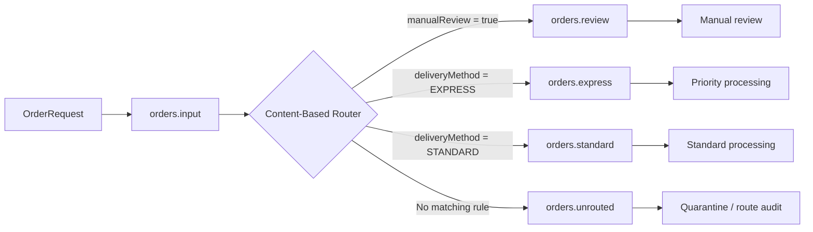
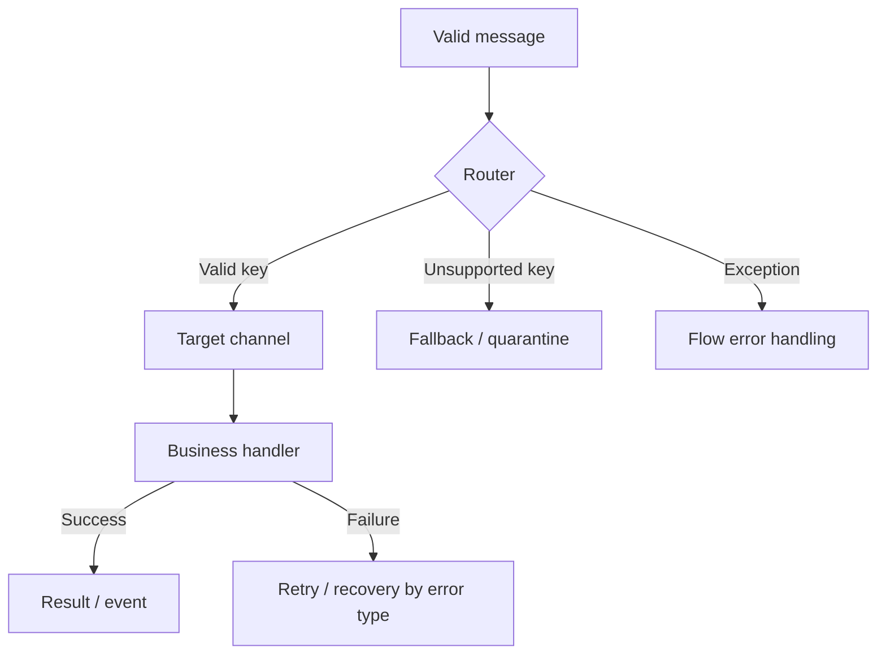
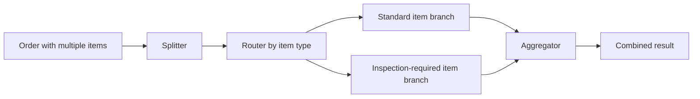

# Content-Based Router: Routing Based on Message Content

## 1. The problem: same message type, different processing branches

An order management system receives `OrderRequest` messages from multiple stores. Express orders must go to the priority processing team; standard orders enter the standard workflow; orders requiring verification are routed to the manual review team. If every endpoint checks conditions on its own and decides whether to handle a message, routing logic becomes scattered and difficult to change.

A **Content-Based Router** is an *Enterprise Integration Pattern* (EIP) that receives a message, **evaluates the message content** according to a set of rules, and sends the message to the **appropriate channel or endpoint**. In Spring Integration, a Router is a specialized *message endpoint* responsible for deciding the route; downstream business steps do not need to know the full branching rules.

This lesson belongs to the **Content-based router** chapter of the **SPRING_INTEGRATION_PATTERN** module. The module focuses on implementing Enterprise Integration Patterns with Spring Integration to build loosely coupled, extensible messaging flows with Router, Filter, Transformer, Splitter, Aggregator, Gateway, retry, error channels, and correlation, along with techniques for testing and monitoring processing branches. We start with a deterministic, easily testable Content-Based Router and then see how it works with the remaining patterns.



**Two responsibilities are separated:** the Router chooses where to process; the handler on the selected branch performs the work. Therefore, changing the rule for routing express orders does not necessarily require modifying `ExpressOrderService`, and changing how orders are persisted does not require changing the Router.

### 1.1. When do you need a Content-Based Router?

| Scenario | Content inspected | Resulting branch |
| --- | --- | --- |
| Order classification | Delivery method, review flag, order value | Express, standard, review |
| Payment processing | Transaction type, currency, country | Corresponding payment gateway |
| Document dispatch | Document type, schema version | Appropriate parser/validator |
| Event processing | Event type and status in payload | Inventory update, invoicing, notification |
| Customer support flow | Request topic and priority level | Specialized support team |

A Content-Based Router is most useful when each message can be classified using clear rules before running business logic in the target branch.

## 2. How does a Router decide the route?

A message consists of a **payload** (primary data) and **headers** (metadata). A Content-Based Router typically reads the payload directly or uses values derived from the payload, such as `deliveryMethod` in `OrderRequest`. After computing the **routing key**, the Router selects the recipient configured for that key.

```text
Input: Message<OrderRequest>
   payload: OrderRequest("ORD-001", 450000, "EXPRESS", false)
   headers: { tenantId: "store-hcm", eventId: "evt-001" }

Decision: deliveryMethod = EXPRESS
Route key: "EXPRESS"
Mapping:   "EXPRESS" -> orders.express
Result:    send message to orders.express
```

Illustrative rule set:

| Priority | Condition | Routing key | Output channel |
| --- | --- | --- | --- |
| 1 | `manualReview == true` | `REVIEW` | `orders.review` |
| 2 | `deliveryMethod == "EXPRESS"` | `EXPRESS` | `orders.express` |
| 3 | `deliveryMethod == "STANDARD"` | `STANDARD` | `orders.standard` |
| Last | None of the above match | `UNSUPPORTED` | `orders.unrouted` |

If an order has both `manualReview=true` and `deliveryMethod="EXPRESS"`, the **REVIEW rule takes precedence**. Defining the evaluation order is critical when conditions can be true simultaneously. Document the order explicitly in the decision function itself and test overlapping cases.

### 2.1. One branch or multiple branches per message?

In the basic model, a Content-Based Router selects **one primary processing path** per message. If you want to send one message to **multiple independent branches**, consider a **Recipient List Router** or Publish-Subscribe, because the semantics differ from selecting a single mutually exclusive branch.

For example, an order that needs both **fraud checking** and **analytics updates** does not have to choose one over the other. Analytics can be placed in a separate observation flow, while the Content-Based Router selects the main order-processing branch.

### 2.2. Content, headers, and routing key are distinct

The **payload** holds business facts, such as `deliveryMethod`, amount, or order status. The **routing key** is the classification result of a function, for example `"EXPRESS"`. The **channel name** is the concrete destination in the system, for example `"orders.express"`.

We can separate them:

```text
OrderRequest -> RoutingPolicy -> routing key -> channel mapping -> MessageChannel
```

Decoupling the key from the channel name allows changing topology with minimal impact on classification logic. In Spring Integration, a **Header Value Router** is particularly suitable when the key is already in a header, whereas a Content-Based Router usually evaluates the payload or an expression against the message. If a `routeKey` header was generated from the payload by an earlier step, verify that it does not become stale when the payload changes.

## 3. Writing the routing policy as a pure function

Routing should be **deterministic, have clear inputs/outputs, and have minimal side effects**. Given the same message and the same rule set, the function should return the same routing key. Separating this function from Spring Integration enables fast testing without spinning up all the channels.

Define the order data:

```java
record OrderRequest(
        String orderId,
        long amountVnd,
        String deliveryMethod,
        boolean manualReview) {
}
```

Create the decision function:

```java
final class OrderRoutingPolicy {
    private OrderRoutingPolicy() {}

    static String decide(OrderRequest order) {
        // When the review flag is set, REVIEW takes precedence over delivery conditions.
        if (order.manualReview()) {
            return "REVIEW";
        }

        if ("EXPRESS".equals(order.deliveryMethod())) {
            return "EXPRESS";
        }

        if ("STANDARD".equals(order.deliveryMethod())) {
            return "STANDARD";
        }

        return "UNSUPPORTED";
    }
}
```

The values `EXPRESS`, `STANDARD`, and `REVIEW` are application-defined **classification keys**. `UNSUPPORTED` catches new or not-yet-supported types. When data arrives from a public API, you can use enum/schema validation to restrict valid types up front; this example intentionally uses strings to illustrate how an integrator might send an unknown value.

**Do not blur validation and classification.** An empty `orderId` or `amountVnd <= 0` is **invalid data** and should be rejected explicitly before routing. By contrast, `deliveryMethod="SAME_DAY"` may be a valid new method for a partner that the system does not yet support; routing it to `orders.unrouted` helps surface the need to update the rules.

### 3.1. Should the routing algorithm query a database?

A Router should rely on information already present in the message whenever possible. If every message has to make an HTTP call or query a database to determine its branch, routing becomes a bottleneck and difficult to retry. When additional data is needed, consider using a **Content Enricher/Service Activator** to fetch the data beforehand, then let the Router run on the enriched payload or headers.

For example:

```text
OrderRequest -> Enricher (add risk level) -> Content-Based Router
```

When routing criteria change frequently according to operational configuration, consider a versioned and tested rule management mechanism to avoid unrecorded dynamic condition changes.

## 4. Configuring Content-Based Router with Spring Integration Java DSL

We combine an **input validation Filter → Router selecting a channel → Service Activator per branch**. This example is for a Java application supporting `record` with Spring Integration configured. The `OrderRequest` and `OrderRoutingPolicy` classes from section 3 are reused.

Business processing contract for the branches:

```java
interface OrderBranchService {
    void processExpress(OrderRequest order);
    void processStandard(OrderRequest order);
    void queueForManualReview(OrderRequest order);
    void quarantineUnsupported(OrderRequest order);
}
```

Declare channels and flows:

```java
import org.springframework.context.annotation.Bean;
import org.springframework.context.annotation.Configuration;
import org.springframework.integration.channel.DirectChannel;
import org.springframework.integration.config.EnableIntegration;
import org.springframework.integration.dsl.IntegrationFlow;
import org.springframework.messaging.MessageChannel;

@Configuration
@EnableIntegration
class OrderRouterConfiguration {

    @Bean("orders.input")
    MessageChannel inputChannel() {
        return new DirectChannel();
    }

    @Bean("orders.express")
    MessageChannel expressChannel() {
        return new DirectChannel();
    }

    @Bean("orders.standard")
    MessageChannel standardChannel() {
        return new DirectChannel();
    }

    @Bean("orders.review")
    MessageChannel reviewChannel() {
        return new DirectChannel();
    }

    @Bean("orders.unrouted")
    MessageChannel unroutedChannel() {
        return new DirectChannel();
    }

    @Bean
    IntegrationFlow routeOrders() {
        return IntegrationFlow.from("orders.input")
                .filter(OrderRequest.class,
                        order -> order.orderId() != null
                                && !order.orderId().isBlank()
                                && order.amountVnd() > 0,
                        spec -> spec.throwExceptionOnRejection(true))
                .route(OrderRequest.class,
                        OrderRoutingPolicy::decide,
                        spec -> spec
                                .channelMapping("REVIEW", "orders.review")
                                .channelMapping("EXPRESS", "orders.express")
                                .channelMapping("STANDARD", "orders.standard")
                                .defaultOutputChannel("orders.unrouted"))
                .get();
    }

    @Bean
    IntegrationFlow expressOrders(OrderBranchService service) {
        return IntegrationFlow.from("orders.express")
                .handle(OrderRequest.class, (order, headers) -> {
                    service.processExpress(order);
                    return null;
                })
                .get();
    }

    @Bean
    IntegrationFlow standardOrders(OrderBranchService service) {
        return IntegrationFlow.from("orders.standard")
                .handle(OrderRequest.class, (order, headers) -> {
                    service.processStandard(order);
                    return null;
                })
                .get();
    }

    @Bean
    IntegrationFlow reviewOrders(OrderBranchService service) {
        return IntegrationFlow.from("orders.review")
                .handle(OrderRequest.class, (order, headers) -> {
                    service.queueForManualReview(order);
                    return null;
                })
                .get();
    }

    @Bean
    IntegrationFlow unroutedOrders(OrderBranchService service) {
        return IntegrationFlow.from("orders.unrouted")
                .handle(OrderRequest.class, (order, headers) -> {
                    service.quarantineUnsupported(order);
                    return null;
                })
                .get();
    }
}
```

Explanation:

1. `orders.input` receives `Message<OrderRequest>`; payloads may be sent from a Gateway, channel adapter, or internal producer.
2. `filter` rejects orders without a valid `orderId` or with a non-positive amount. `throwExceptionOnRejection(true)` surfaces the error explicitly instead of silently dropping the message.
3. `route(OrderRequest.class, ...)` computes a **key from the payload** and maps the key to a specific channel.
4. `defaultOutputChannel("orders.unrouted")` receives unmapped keys rather than letting them fall through unpredictably.
5. Each downstream flow only handles a single branch and **does not need to re-decide which branch the order belongs to**.

**Limitations of the example:** `DirectChannel` processes in-memory and typically synchronously on the sending thread; it does not create a durable queue. The `queueForManualReview` and `quarantineUnsupported` methods only persist safely if the `OrderBranchService` **implementation** writes to a durable database/queue. Returning `null` from `.handle(...)` ends one-way processing and does not automatically produce a reply for a waiting Gateway.

### 4.1. Sending messages to observe the Router

Example of a producer injected with the `orders.input` channel:

```java
import org.springframework.beans.factory.annotation.Qualifier;
import org.springframework.messaging.MessageChannel;
import org.springframework.messaging.support.MessageBuilder;
import org.springframework.stereotype.Component;

@Component
class OrderProducer {
    private final MessageChannel ordersInput;

    OrderProducer(@Qualifier("orders.input") MessageChannel ordersInput) {
        this.ordersInput = ordersInput;
    }

    void sendExamples() {
        var express = new OrderRequest(
                "ORD-001", 450_000L, "EXPRESS", false);
        var review = new OrderRequest(
                "ORD-002", 8_000_000L, "EXPRESS", true);

        ordersInput.send(MessageBuilder.withPayload(express)
                .setHeader("tenantId", "store-hcm")
                .setHeader("eventId", "evt-001")
                .setHeader("traceId", "trace-001")
                .build());

        ordersInput.send(MessageBuilder.withPayload(review)
                .setHeader("tenantId", "store-hcm")
                .setHeader("eventId", "evt-002")
                .setHeader("traceId", "trace-002")
                .build());
    }
}
```

Expected results:

| Order | Relevant payload | Branch |
| --- | --- | --- |
| `ORD-001` | `EXPRESS`, `manualReview=false` | `orders.express` |
| `ORD-002` | `EXPRESS`, `manualReview=true` | `orders.review` |

Message IDs and headers can assist with tracing, but **the rule in this example only reads the payload**. If tenant affects routing, clearly define whether tenant belongs in the business payload or a required header; control its origin and test consistency.

## 5. Alternative: declaring a Router with `@Router`

Spring Integration also allows annotating a Java method with `@Router`. The method returns the **output channel name** or a result compatible with the configured mapping mechanism.

```java
import org.springframework.integration.annotation.Router;
import org.springframework.stereotype.Component;

@Component
class AnnotationOrderRouter {

    @Router(inputChannel = "orders.annotation-input")
    public String selectChannel(OrderRequest order) {
        return switch (OrderRoutingPolicy.decide(order)) {
            case "REVIEW" -> "orders.review";
            case "EXPRESS" -> "orders.express";
            case "STANDARD" -> "orders.standard";
            default -> "orders.unrouted";
        };
    }
}
```

The annotation example is **an alternative** to the DSL Router. The application must have the `orders.annotation-input` input channel and actual existing output channels. Do not register both Routers to consume `orders.input` unless you intentionally design a distribution strategy: multiple subscribers on a `DirectChannel` does not mean each message will be broadcast to both.

When routing depends on multiple conditions or policy versions, a dedicated method like `OrderRoutingPolicy.decide` ensures **there is a single source of truth for the business decision**; registering via annotation or DSL does not change the semantics of the rule.

## 6. Unmatched routes, error channels, and fallback policies

An often-overlooked scenario is a message whose content is new and has no target branch yet. For example, a partner adds `deliveryMethod="SAME_DAY"`, while the Router only knows `EXPRESS` and `STANDARD`. Without a configured fallback path, the behavior may be an exception or no matching recipient depending on router configuration; never assume a message is always processed successfully.

There are three practical policies:

| Policy | Usage | Risks to control |
| --- | --- | --- |
| **Default output channel** | Send unknown keys to `orders.unrouted` for storage/investigation | Must ensure a fallback consumer and durable persistence |
| **Fail routing** | Reject the request and return a clear reason | Needs exception-handling paths for sync/async |
| **Intentional discard** | Only suitable for messages that do not require processing by contract | Easy to lose data if misunderstood; requires metrics/auditing |

Do not use `nullChannel` or an ignore-missing-recipients configuration as a quick fix for real orders if the business contract requires zero order loss. `nullChannel` intentionally discards messages it receives; it is not a dead-letter queue.

### 6.1. Distinguishing route-decision errors from in-branch errors

**Errors at the Router** can arise from an invalid payload, an expression/logic throwing an exception, an unmapped key, or a target channel failing to accept the message. **Errors after routing** can be database timeouts, business errors, or external API outages.



In a flow using `DirectChannel`, an exception in a downstream handler can propagate back through the Router to the sender. When running across an executor/poller/broker, errors can occur on a different thread and require an appropriate **error handler/error channel**. `defaultOutputChannel` only handles the case where **no matching route exists**, and does not automatically catch exceptions from downstream handlers.

Retry should be applied based on error type: transient timeouts can be retried with bounds; invalid schemas or unsupported routes will not resolve themselves through retries. For messages that may be redelivered, business branches should use a **business event ID or idempotency key** to avoid duplicate side effects.

## 7. Comparing Router with related patterns

| Pattern | Primary decision | Key difference |
| --- | --- | --- |
| **Content-Based Router** | Chooses a channel based on message content | Typically selects one mutually exclusive branch by rules |
| **Header Value Router** | Chooses a channel from a header value | Suitable when the routing key is already in metadata |
| **Recipient List Router** | Determines multiple recipients for the same message | Can fan out to multiple branches |
| **Filter** | Passes or drops a message | Does not necessarily choose one among multiple branches |
| **Transformer** | Changes payload shape/type | Does not usually decide an alternative topology |
| **Dynamic Router** | Rules/targets can be adjusted at runtime | Requires rule-change governance and consistency |
| **Routing Slip** | Sequential list of processing steps | Message traverses multiple steps along an itinerary |
| **Publish-Subscribe Channel** | Distributes to subscribers | Not a content-based single-branch selection |

When the requirement is "**express orders go to A, standard orders go to B**", a Content-Based Router is typically appropriate. When the requirement is "**all orders go through fraud check, then logging and analytics**", evaluate Splitter, Publish-Subscribe, Wire Tap, or an endpoint chain instead of forcing one Router to do everything.

### 7.1. Combining with Transformer

A Router works accurately when it has sufficiently clear content to decide. If an adapter receives JSON as `byte[]`, place a **deserializing Transformer** before the Router so the routing policy operates on a typed `OrderRequest`:

```text
Inbound Adapter -> Transformer<byte[], OrderRequest> -> Filter -> Content-Based Router
```

The Router should not parse JSON repeatedly across condition branches, as that duplicates logic and makes data errors harder to spot. Similarly, when routing by a risk level calculated from multiple fields, you can run a classification step with a clear contract before the Router.

### 7.2. Combining with Splitter, Aggregator, and correlation

An order with multiple line items can be split by a Splitter into child messages. A Content-Based Router will decide **the path of each child message** based on its attributes; an Aggregator then combines results by **correlation ID** and release strategy.



If branches modify or drop `correlationId`, `sequenceNumber`, or `sequenceSize`, the Aggregator may group incorrectly or wait indefinitely. The `traceId` header aids observability, while `eventId` prevents duplicate processing on replay; these identifiers serve different purposes and are not interchangeable.

## 8. Testing rules and testing integration flows

### 8.1. Unit testing the route function

Because `OrderRoutingPolicy.decide` is independent of the framework, all critical cases can be tested with JUnit 5:

```java
import org.junit.jupiter.api.Test;
import static org.junit.jupiter.api.Assertions.assertEquals;

class OrderRoutingPolicyTest {

    @Test
    void routesExpressOrder() {
        var order = new OrderRequest(
                "ORD-001", 450_000L, "EXPRESS", false);
        assertEquals("EXPRESS", OrderRoutingPolicy.decide(order));
    }

    @Test
    void reviewHasPriorityOverExpress() {
        var order = new OrderRequest(
                "ORD-002", 8_000_000L, "EXPRESS", true);
        assertEquals("REVIEW", OrderRoutingPolicy.decide(order));
    }

    @Test
    void unknownDeliveryMethodUsesFallbackKey() {
        var order = new OrderRequest(
                "ORD-003", 100_000L, "SAME_DAY", false);
        assertEquals("UNSUPPORTED", OrderRoutingPolicy.decide(order));
    }

    @Test
    void normalOrderUsesStandardRoute() {
        var order = new OrderRequest(
                "ORD-004", 100_000L, "STANDARD", false);
        assertEquals("STANDARD", OrderRoutingPolicy.decide(order));
    }
}
```

These tests verify **decision logic**, but do not verify the mapping from routing key to channel or whether the target endpoint is actually invoked.

### 8.2. Integration testing with Spring context

When testing the real flow, start a context with `OrderRouterConfiguration` and a mock `OrderBranchService`. Send messages to `orders.input`; verify the exact handler method is called **once** and the other branches are not called. Also test Filter rejections and the default branch.

| Case | Expectation |
| --- | --- |
| `EXPRESS`, no review needed | Only `processExpress` is called |
| `STANDARD`, no review needed | Only `processStandard` is called |
| Both `EXPRESS` and `manualReview=true` | Only `queueForManualReview` is called |
| Unknown `SAME_DAY` value | Only `quarantineUnsupported` is called |
| Empty `orderId` or `amountVnd<=0` | Flow rejects, no business handler is called |
| Target branch handler throws exception | Error is observed/returned per sync or async config |
| Two messages with same `eventId` redelivered | Consumer idempotency is guaranteed by dedicated business logic |
| Message passes through Transformer before Router | Payload is classified correctly after conversion; key headers remain intact |

If adding an async flow, verify using a bounded wait condition or an observable result rather than assuming `MessageChannel.send(...)` returning means business processing has finished. If using a broker, also verify ACK/NACK, retries, and processing order according to broker configuration.

### 8.3. Observing each Router branch

Useful metrics in operations:

- **Per-route rate**: message count through `orders.express`, `orders.standard`, `orders.review`.
- **Unmapped rate**: total messages going to `orders.unrouted`; a sudden spike may indicate a new payload/schema.
- **Router errors**: exceptions during decision evaluation or sending to a channel.
- **Downstream endpoint errors**: failures after the route has been selected.
- **Latency, backlog, retries**: measured per branch when using queues or consumers with different loads.

Attach `eventId`, `traceId`, and `correlationId` in the right context to trace a message. You can log the computed routing key or record it as a metric with controlled cardinality. Avoid using individual `orderId` values as metric labels as that creates huge series cardinality; avoid logging sensitive payloads.

## 9. Common design mistakes

1. **Overlapping conditions without defined order.** Orders needing review get routed straight to express delivery.
2. **No fallback policy.** Messages carrying new values reach no recipient or get dropped without a trace.
3. **Using Filter instead of a multi-branch Router.** Steps repeatedly check the same condition in multiple places, making maintenance hard.
4. **Treating Header Value Router and Content-Based Router as identical.** A header may hold previously derived data that no longer matches the payload after a Transformer.
5. **Putting expensive I/O in the decision function.** The Router becomes a bottleneck and error handling gets complicated.
6. **Ignoring durability.** Routing a message to `DirectChannel` or `nullChannel` is not equivalent to persisting to dead-letter storage.
7. **Relying on message ID for deduplication.** A redelivered business event may receive a new message ID.
8. **Testing only the route function, not the mapping.** The function returns `EXPRESS` correctly, yet a misconfigured channel mapping can still send the message to the wrong branch.
9. **Forgetting header propagation in multi-branch flows.** Missing `tenantId` or correlation causes downstream misprocessing.
10. **Not monitoring the fallback branch.** The unknown route rate climbs without anyone noticing.

## 10. Practice exercise

Design a flow to process `PaymentRequested` with a payload containing `paymentId`, `currency`, `amount`, and `riskLevel`, along with headers `tenantId`, `eventId`, and `traceId`.

Requirements:

1. Define the routing condition table: high-risk transactions go to `manualReview`; `VND` goes to `localPayments`; `USD` goes to `internationalPayments`; other currencies go to `unsupportedCurrency`.
2. Explain rule evaluation order when a transaction is both USD and high risk.
3. Write a **pure** Java function returning a routing key, without calling a database or external API.
4. Configure the Content-Based Router using Java DSL with `channelMapping` and `defaultOutputChannel`.
5. Separate validation for positive amount and transaction identifier from routing logic.
6. Write unit tests for each key and integration tests verifying handlers are called on the right branch.
7. Simulate a payment handler failure, and propose an appropriate retry/recovery policy and idempotency key.
8. Propose metrics to detect unusual increases in transactions needing review or carrying new currencies.

Self-check: **Where do classification conditions live? Does a routing key differ from a channel name? What does the system do when no branch matches? How do Router errors differ from downstream errors? Does a message need to go to one branch or multiple branches?**

A well-designed **Content-Based Router** has clear conditions, transparent priority order, testable mappings, and observable fallbacks. When the Router focuses solely on choosing the path while endpoints execute business behavior, the Spring Integration flow becomes easier to extend, test, and recover from new data or failures within any branch.
