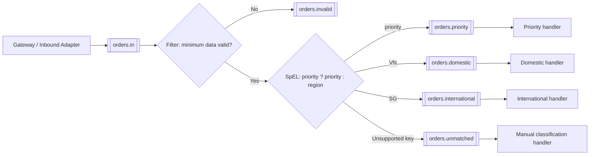
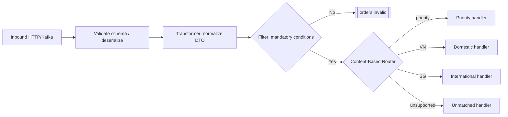
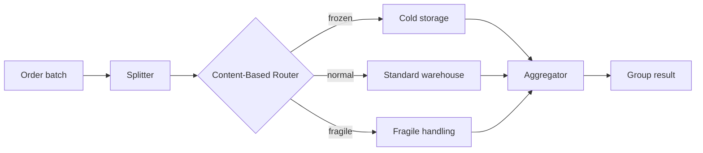

# Payload Objects and Data Access Expressions

When an integration flow receives an order, choosing the processing branch often depends on **data inside the message**: delivery region, priority level, business type, or verification status. Those values do not necessarily sit in headers or get represented by distinct Java classes. They are often **properties of the payload object**. A **Content-Based Router** reads that data and decides which **Message Channel** the message should be sent to.

In **Spring Integration**, you can express branching conditions with a strongly typed Java function or with **Spring Expression Language (SpEL)**, such as `payload.customer.region` or `payload.priority ? 'priority' : 'standard'`. What matters most is not writing the shortest expression, but knowing **where the expression reads from, what it returns, how the result maps to a channel, and what happens if data is missing or mistyped**.

This lesson belongs to the **Content-based router** chapter of the `SPRING_INTEGRATION_PATTERN` module. It forms the foundation for combining Router with Filter, Transformer, Gateway, Splitter, Aggregator, retry, error channels, correlation, testing, and observing processing branches.

> **Key takeaway:** A Content-Based Router selects destinations based on **normalized message content**. In Spring Integration, SpEL such as `payload.customer.region` accesses properties of the **runtime payload object**, not an automatic path into a JSON string.

## 1. What does a Content-Based Router need to know?

Suppose a system receives `OrderCommand` and routes according to this policy:

1. If the order has `priority = true`, take the priority route.
2. If not priority and `customer.region = "VN"`, take the domestic route.
3. If not priority and `customer.region = "SG"`, take the international route.
4. If the region is unsupported, take the route for additional handling.
5. If `orderId` or required customer data is missing, **reject the input** instead of letting an expression dereference a `null` object.

| Data in payload | Routing key | Channel |
| --- | --- | --- |
| `priority=true`, `region="VN"` | `priority` | `orders.priority` |
| `priority=false`, `region="VN"` | `VN` | `orders.domestic` |
| `priority=false`, `region="SG"` | `SG` | `orders.international` |
| `priority=false`, `region="TH"` | `TH` (unmapped) | `orders.unmatched` per fallback policy |
| `customer=null` | Do not attempt key evaluation | `orders.invalid` via input Filter |

The priority condition is an **ordered decision**: for priority orders, the `priority` branch is selected before even checking the region. However, if the contract requires `customer.region` to always be present, the input validation step should still run before the Router.



The diagram only illustrates **logical topology**. An internal channel does not imply a broker, asynchronous processing, or durable persistence. Destination channels must have appropriate consumers/handlers and error policies in a real deployment.

## 2. The object that expressions see

A Spring Messaging message consists of `payload` and `headers`:

```java
import org.springframework.messaging.Message;
import org.springframework.messaging.support.MessageBuilder;

Message<String> message = MessageBuilder
    .withPayload("ORDER_CREATED")
    .setHeader("source", "web")
    .build();

String payload = message.getPayload(); // "ORDER_CREATED"
Object source = message.getHeaders().get("source"); // "web"
```

For common Spring Integration router expressions, the **root object** in the SpEL context is the message. You can access:

- `payload`: the message payload value;
- `payload.customer`: the `customer` property on a payload with an appropriate Java type;
- `payload.customer.region`: the `region` property of the `customer` object;
- `headers['source']`: the value of a message header by name;
- `payload.priority ? 'priority' : 'standard'`: returns a **routing key** conditionally.

When writing Router expressions in Java DSL, you usually pass the **SpEL string directly**, e.g., `"payload.customer.region"`. Do not confuse this with the `#{...}` syntax used in some Spring bean/property expression declarations.

### 2.1. SpEL does not automatically parse JSON strings

This is a critical distinction:

| Actual payload | Runtime type | How to read data |
| --- | --- | --- |
| JavaBean `OrderCommand` | `OrderCommand` | `payload.customer.region` if appropriate getters and child objects exist |
| Java `Map` containing key `region` | `Map`, e.g., `LinkedHashMap` | `payload['region']` or corresponding indexer path |
| String containing JSON `{"region":"VN"}` | `String` | Requires a deserializer/Transformer first; do not use `payload.region` as with a bean |
| `byte[]` from broker | `byte[]` | Must decode/deserialize with schema and allowlist |
| DTO with `getTotalAmount()` | Concrete DTO type | `payload.totalAmount` reads property via JavaBean convention |

**Key point:** SpEL follows the **JVM object structure**, not the format the data had over the wire. If the inbound adapter has not deserialized it yet, JSON keys do not automatically become Java properties.

### 2.2. JavaBean getters and property access

Example DTOs to illustrate SpEL access:

```java
public final class Customer {
    private final String region;

    public Customer(String region) {
        this.region = region;
    }

    public String getRegion() {
        return region;
    }
}

public final class OrderCommand {
    private final String orderId;
    private final Customer customer;
    private final boolean priority;

    public OrderCommand(String orderId, Customer customer, boolean priority) {
        this.orderId = orderId;
        this.customer = customer;
        this.priority = priority;
    }

    public String getOrderId() {
        return orderId;
    }

    public Customer getCustomer() {
        return customer;
    }

    public boolean isPriority() {
        return priority;
    }
}
```

With this object:

- `payload.orderId` reads `getOrderId()`.
- `payload.customer` reads `getCustomer()`.
- `payload.customer.region` reads `getRegion()` next.
- `payload.priority` reads `isPriority()`.

SpEL property access can support other types such as records, Maps, or custom property accessors depending on configuration/version. Using plain JavaBeans makes the semantics clear in the example, avoiding coupling to a specific JSON library or reflection mechanism.

**Note:** If `customer` is `null`, the plain expression `payload.customer.region` can fail when attempting to access `region`. If a property does not exist or a getter throws an exception, that is also an **expression evaluation error**, not automatically an "unknown" key.

## 3. From expression value to destination channel

In a Content-Based Router there are two separate questions:

1. **What does the expression return?** For example `"priority"` or `"VN"`.
2. **Where is that key sent?** For example, key `"VN"` maps to channel `"orders.domestic"`.

```text
Message<OrderCommand>
      |
      v
SpEL: payload.priority ? 'priority' : payload.customer.region
      |
      +--> "priority" ---mapping---> orders.priority
      +--> "VN" --------mapping---> orders.domestic
      +--> "SG" --------mapping---> orders.international
      +--> "TH" --------unmatched--> orders.unmatched
```

The property name `customer.region` and the channel name `orders.domestic` have different responsibilities. Changing a channel should not force customer data to change its `region` value; the mapping layer is the boundary separating the **data contract** from the **integration topology**.

### 3.1. Ways to express a routing key

| Illustrative SpEL expression | Expected result | Condition to work properly |
| --- | --- | --- |
| `payload.customer.region` | `"VN"` | Payload is an object with valid customer/region |
| `payload.priority ? 'priority' : 'standard'` | `"priority"` or `"standard"` | Has boolean property `priority` |
| `payload['eventType']` | Value of key `eventType` | Actual payload is a Map supporting key indexing |
| `headers['eventCategory']` | Value of header `eventCategory` | Header has been verified/normalized |
| `payload.customer?.region ?: 'unknown'` | Region or `"unknown"` | SpEL version supports safe-navigation/Elvis; still needs input control |

In SpEL, the conditional operator `condition ? a : b` can be used to pick a well-defined key. Safe-navigation `?.` helps handle some `null` child-object cases; the Elvis operator `?:` can supply a fallback value. However, **do not substitute null-handling for validation** when a field is business-required.

### 3.2. Return values must match the mapping policy

If the expression produces `"vn"` while the mapping declares `"VN"`, the two keys **do not match**. If the expression returns an enum or number instead of a string, how the router converts the result into a channel key depends on the implementation mechanism.

To avoid ambiguity, you should:

- Normalize inputs (such as upper-casing region by convention) **before the Router**.
- Use a finite, well-defined set of routing keys: `priority`, `VN`, `SG`, `unknown`.
- Test differing casing, whitespace, `null`, and out-of-list values.
- Never assemble a user-supplied string directly into a **privileged channel name**.

### 3.3. Fallback is not the same as a SpEL error

| Scenario | Interpretation | Recommended policy |
| --- | --- | --- |
| Expression returns mapped key `"VN"` | Routing succeeds. | Send to configured channel. |
| Expression returns unsupported key `"TH"` | Value is validly computed, but has no desired business route. | Configured fallback or appropriate error reporting. |
| `payload.customer == null` while expression accesses `.region` | May throw an evaluation exception. | Validation before Router or tested guard/safe navigation. |
| Payload is `String` while expression expects `customer` | Wrong data shape. | Deserialize/Transformer and schema check before Router. |
| Destination channel has no consumer or is full | Post-routing send failure/limit. | Configure downstream, backpressure, timeout, and error policy. |

**Do not treat `defaultOutputChannel` as a catch-all for exceptions.** It serves routing decisions when a key does not lead to a channel by policy, whereas property access errors, deserialization failures, or channel send errors must be handled at their respective boundaries. With mapping routers, verify the *channel-key fallback* behavior of your version if routing keys can be influenced by untrusted sources.

## 4. Spring Integration Java DSL example: reading objects with SpEL

We use `OrderCommand` and `Customer` from section 2. The goal is to build **a flow that receives messages**, checks required fields, reads `priority`/`customer.region`, and routes to defined channels. Destination channels are `QueueChannel` instances for testing; in real deployments, they need appropriate consumers/flows.

### 4.1. Flow configuration

```java
import org.springframework.context.annotation.Bean;
import org.springframework.context.annotation.Configuration;
import org.springframework.integration.channel.QueueChannel;
import org.springframework.integration.config.EnableIntegration;
import org.springframework.integration.dsl.IntegrationFlow;

@Configuration
@EnableIntegration
public class OrderRoutingConfiguration {

    @Bean("orders.priority")
    QueueChannel priorityOrders() {
        return new QueueChannel(16);
    }

    @Bean("orders.domestic")
    QueueChannel domesticOrders() {
        return new QueueChannel(16);
    }

    @Bean("orders.international")
    QueueChannel internationalOrders() {
        return new QueueChannel(16);
    }

    @Bean("orders.unmatched")
    QueueChannel unmatchedOrders() {
        return new QueueChannel(16);
    }

    @Bean("orders.invalid")
    QueueChannel invalidOrders() {
        return new QueueChannel(16);
    }

    @Bean
    IntegrationFlow routeOrdersByContent() {
        return IntegrationFlow.from("orders.in")
            .filter(OrderCommand.class,
                command -> command.getOrderId() != null
                    && !command.getOrderId().isBlank()
                    && command.getCustomer() != null
                    && command.getCustomer().getRegion() != null
                    && !command.getCustomer().getRegion().isBlank(),
                spec -> spec.discardChannel("orders.invalid"))
            .route(
                "payload.priority ? 'priority' : payload.customer.region",
                spec -> spec
                    .channelMapping("priority", "orders.priority")
                    .channelMapping("VN", "orders.domestic")
                    .channelMapping("SG", "orders.international")
                    .defaultOutputChannel("orders.unmatched"))
            .get();
    }
}
```

Step-by-step explanation:

1. `orders.in` is the input to the `IntegrationFlow`. Producers can send `Message<OrderCommand>` here.
2. `.filter(...)` verifies required fields before the Router evaluates nested expressions. Invalid messages are sent to `orders.invalid`.
3. `.route("...")` uses **SpEL**; here `payload.priority` is equivalent to checking `OrderCommand.isPriority()`.
4. If priority is true, the expression returns `"priority"` without evaluating the second branch of the ternary operator.
5. If not priority, the expression reads `payload.customer.region` and returns a key such as `"VN"`.
6. `channelMapping` turns the key into the corresponding **internal channel name**.
7. `defaultOutputChannel` handles keys not routed by the configured mapping/fallback.

**A detail to verify on your specific Spring Integration version:** the Router maps keys to channel names and may support resolving channel names directly from keys (*channel-key fallback*). Therefore, do not assume every unmapped key always goes to default in all configurations. When routing keys are influenced by external sources, restrict the allowed key set, verify fallback options, and write tests for invalid keys.

### 4.2. Why does Filter sit before Router?

The expression `payload.customer.region` assumes `customer` exists. The Filter step acts as an **input structure guard**: messages missing `customer` are not forwarded to an expression that could throw an error.

If a message has a type other than `OrderCommand`, typed endpoints may encounter conversion/type-check issues depending on the flow. At HTTP/Kafka boundaries, **deserialize and validate schema** before placing the DTO onto this channel; relying solely on a typed Filter inside the flow does not replace adapter-level input validation.

### 4.3. When region is unsupported

If `priority=false` and `region="TH"`, the expression returns key `"TH"`. Without a channel mapping/contract for TH, the `orders.unmatched` branch handles **unsupported values** by policy.

In this example, `QueueChannel` only buffers messages in memory for tests. It **does not automatically invoke a handler**, does not persist durably, and does not self-protect if the queue fills indefinitely. In production, design a consumer, alerting, quarantine, or meaningful error response. Never use a fallback as a silent trash bin.

## 5. Testing routing paths with JUnit 5

The example uses Spring Test to initialize `OrderRoutingConfiguration`. Tests send messages into the input channel and receive results from destination queues. Place the test in the same package as the example classes above.

```java
import static org.junit.jupiter.api.Assertions.*;

import org.junit.jupiter.api.Test;
import org.springframework.beans.factory.annotation.Autowired;
import org.springframework.context.ApplicationContext;
import org.springframework.integration.channel.QueueChannel;
import org.springframework.messaging.Message;
import org.springframework.messaging.MessageChannel;
import org.springframework.messaging.support.MessageBuilder;
import org.springframework.test.context.junit.jupiter.SpringJUnitConfig;

@SpringJUnitConfig(OrderRoutingConfiguration.class)
class OrderContentRouterTest {

    @Autowired
    ApplicationContext context;

    private MessageChannel input() {
        return context.getBean("orders.in", MessageChannel.class);
    }

    private QueueChannel output(String name) {
        return context.getBean(name, QueueChannel.class);
    }

    private void send(OrderCommand command) {
        assertTrue(input().send(
            MessageBuilder.withPayload(command).build()));
    }

    @Test
    void routesByPriorityAndNestedRegion() {
        var priority = new OrderCommand(
            "ORD-1", new Customer("VN"), true);
        var domestic = new OrderCommand(
            "ORD-2", new Customer("VN"), false);
        var international = new OrderCommand(
            "ORD-3", new Customer("SG"), false);
        var unmatched = new OrderCommand(
            "ORD-4", new Customer("TH"), false);
        var invalid = new OrderCommand("ORD-5", null, false);

        send(priority);
        send(domestic);
        send(international);
        send(unmatched);
        send(invalid);

        Message<?> resultPriority = output("orders.priority").receive(0);
        Message<?> resultDomestic = output("orders.domestic").receive(0);
        Message<?> resultInternational =
            output("orders.international").receive(0);
        Message<?> resultUnmatched = output("orders.unmatched").receive(0);
        Message<?> resultInvalid = output("orders.invalid").receive(0);

        assertNotNull(resultPriority);
        assertNotNull(resultDomestic);
        assertNotNull(resultInternational);
        assertNotNull(resultUnmatched);
        assertNotNull(resultInvalid);

        assertSame(priority, resultPriority.getPayload());
        assertSame(domestic, resultDomestic.getPayload());
        assertSame(international, resultInternational.getPayload());
        assertSame(unmatched, resultUnmatched.getPayload());
        assertSame(invalid, resultInvalid.getPayload());

        assertNull(output("orders.priority").receive(0));
        assertNull(output("orders.domestic").receive(0));
        assertNull(output("orders.international").receive(0));
        assertNull(output("orders.unmatched").receive(0));
        assertNull(output("orders.invalid").receive(0));
    }
}
```

This test proves that **a single flow** can read a boolean property and a nested property, routing accurately according to runtime values. It also verifies **negatives**: after reading each result, no stray messages remain in any destination queue.

**Limitations:** This example uses synchronous in-memory channels and queues; it does not test HTTP, Kafka, persistence, retries, transactions, or throughput. If `ExecutorChannel` or async adapters are introduced into the flow, tests must wait using bounded timeout conditions rather than calling `receive(0)` immediately.

### 5.1. Additional tests to add

| Scenario | Result to verify |
| --- | --- |
| `priority=true` and `region="SG"` | Still goes to priority because the conditional operator picks the first branch. |
| `priority=false` and `region="VN"` | Goes domestic, not to priority/international. |
| `region="vn"` | Normalization or fallback behavior per contract, not silently matching `"VN"`. |
| `customer=null` | Blocked by Filter; no `SpelEvaluationException` from deep access. |
| `region=""` | Rejected because a required value is missing. |
| `region="TH"` | Deterministic fallback or error policy; never sent to an arbitrary channel. |
| Initial payload is JSON String | Transformer/mapper runs beforehand; does not mistakenly read `payload.customer` on a String. |
| Slow outbound handler, full queue | Backpressure/send timeout behaves according to channel type. |
| Gateway requires reply | Both success and rejection branches have valid reply paths. |

## 6. Accessing data on Maps, nested objects, and lists

Not every producer sends a JavaBean. A webhook or schema-less source might be deserialized into a `Map<String, Object>`. In that case, choose expression syntax matching the runtime type.

### 6.1. Payload is a Map

```java
import java.util.Map;
import org.springframework.messaging.Message;
import org.springframework.messaging.support.MessageBuilder;

Map<String, Object> order = Map.of(
    "priority", false,
    "customer", Map.of("region", "VN")
);

Message<Map<String, Object>> message =
    MessageBuilder.withPayload(order).build();
```

With this Map, usable SpEL-style expressions include:

```text
payload['priority']
payload['customer']['region']
payload['priority'] ? 'priority' : payload['customer']['region']
```

**Key difference:** `payload.customer.region` uses object property access; `payload['customer']['region']` accesses Map keys via indexer. Test against the **exact Map structure produced by the deserializer**. If `customer` is missing or not a Map, subsequent accesses can fail.

### 6.2. Nested fields that may be null

Suppose:

```text
OrderCommand
  orderId = "ORD-100"
  customer = null
  priority = false
```

The expression `payload.customer.region` no longer has a valid access path. There are two options:

1. **Pre-check with Filter/validator** to reject contract-violating messages; appropriate when `customer.region` is mandatory.
2. **Use safe-navigation/fallback value** when `customer` is genuinely optional, such as `payload.customer?.region ?: 'unknown'` in SpEL versions supporting that syntax.

Do not use the Elvis operator to silently send bad data down an "unknown" route when the business must detect and report input errors.

### 6.3. Collections and arrays

A payload may be a `List<OrderLine>`, in which case the payload is **a collection**, not a single `OrderLine`. If you want the Router to route each line by `line.type`, the clearer approach is:

```text
Message<List<OrderLine>>
    -> Splitter
    -> Message<OrderLine> (each part)
    -> Content-Based Router by payload.type
    -> branch handler for each line type
```

When using a **Splitter**, remember to preserve correlation/sequence metadata or group-linking strategies if an **Aggregator** later reassembles results. If a branch is dropped by a Filter, the Aggregator may miss parts and require its own release/expiry policy.

### 6.4. Accessible property does not mean "automatically safe value"

Even when the payload is a JavaBean, `customer.email` may still hold personal data. Do not use email addresses, access tokens, or card numbers as **routing keys** or metric labels simply because SpEL can reach them. Prefer normalized classification codes such as `region` or `priorityTier`, and set policies for propagating headers/tracing externally.

## 7. SpEL or Java lambda: choose by complexity

Spring Integration can route using a typed Java function instead of a SpEL string. Example of the same policy:

```java
// Alternative configuration for .route("payload....", ...).
IntegrationFlow typedFlow = IntegrationFlow.from("orders.typed.in")
    .route(OrderCommand.class,
        command -> command.isPriority()
            ? "priority"
            : command.getCustomer().getRegion(),
        spec -> spec
            .channelMapping("priority", "orders.priority")
            .channelMapping("VN", "orders.domestic")
            .channelMapping("SG", "orders.international")
            .defaultOutputChannel("orders.unmatched"))
    .get();
```

This snippet **only illustrates an alternative**, and should not reuse the same bean/input flow names as the SpEL version in section 4. It also assumes valid input, because `getCustomer()` can still return `null`.

| Criterion | SpEL expression | Java lambda/strategy |
| --- | --- | --- |
| Simple condition config | Concise, readable when reading a few properties. | Strongly typed, slightly more verbose. |
| Compile-time error detection | Property strings are typically checked at runtime. | IDE/compiler checks methods and property types better. |
| Field refactoring | Risk of forgetting to update string expressions. | Standard Java refactoring tracks usages cleanly. |
| Complex business rules | Easily turns into long expressions hard to unit test alone. | Better extracted into unit-tested policy methods/services. |
| Extensibility | Good for short expressions and stable configs. | Good for multi-branch logic needing typed APIs and tests. |
| Security risk | Never evaluate dynamic expressions from untrusted sources. | Still requires input validation and side-effect authorization. |

**Practical recommendation:** Use SpEL for **short, deterministic routing rules controlled in source/config**. When conditions need multiple service calls, fee calculations, sensitive data reads, or side effects, move that policy into an **application/domain service** or a tested typed Java function, leaving the Router to consume a clear classification key.

## 8. Separating responsibilities cleanly: Filter, Transformer, and Router

A common mistake is cramming a long `.route(...)` expression to **deserialize, fix data, validate, and pick a channel all at once**. When an error occurs, it becomes hard to tell which step failed and whether a retry is safe.

A well-bounded flow looks like this:



| Component | Should do | Should not do by default |
| --- | --- | --- |
| Inbound Adapter/Deserializer | Read transport, validate payload against schema, produce safe DTO. | Let external input choose Java classes or SpEL expressions to evaluate. |
| Transformer | Normalize region codes, formats, payload shape. | Cause unintended business side effects. |
| Filter | Block invalid or unauthorized input. | Replace Router when choosing among multiple distinct destinations. |
| Content-Based Router | Compute key on normalized content and select channel. | Create orders, charge money, or call ERP inside expressions. |
| Service Activator/Handler | Execute real business logic, return reply when needed. | Treat Router dispatch as proof that business processing finished. |

### 8.1. Expressions with method calls: beware of side effects

SpEL can invoke methods depending on context. **Do not place database writes, email sending, or payment charges inside routing condition expressions**. A message may be retried/replayed, running side effects again while readers assume the Router is purely computational.

If VIP status depends on customer contracts, have a dedicated service compute a `RoutingDecision` or normalized attribute first, then let the Router read the result. Deciding **who qualifies for priority** belongs to the domain; deciding **which channel carries priority traffic** belongs to the integration flow.

## 9. Safe mapping and boundaries with external data

A router reading `payload.destination` and forwarding directly to a channel of that exact name can become an **external data-driven topology control path** if allowed values are not constrained.

Best practices:

1. **Never build SpEL by concatenating request data**, e.g., do not accept an `expression` from HTTP and evaluate it.
2. **Allowlist routing keys** and use fixed mappings to designed channels. Check how your version handles unmapped channel keys and direct fallback.
3. Distinguish `unknown` (unsupported business value) from `invalid` (schema violation or missing fields).
4. **Never put tokens/PII in route keys** or channel names.
5. Enforce authorization **before entering branches** that access sensitive data or perform privileged actions.
6. If the router must read external headers, authenticate/verify them; never blindly trust `X-Role: admin` sent by a client.

In logs, record a **bounded route code** and component name instead of printing entire payloads; for correlation, use opaque IDs and enforce log access controls.

## 10. Request–reply Gateway, errors, and timeouts

If a caller invokes a `@MessagingGateway` with a return value, the Router must lead the request to a handler capable of producing a **reply**. In the section 4 example, queues only verify routing paths and **do not automatically produce return values**.

### 10.1. Which branch does the Gateway wait on for a reply?

Suppose we have this interface:

```java
import org.springframework.integration.annotation.MessagingGateway;

@MessagingGateway(defaultRequestChannel = "orders.in")
interface OrderGateway {
    OrderReceipt submit(OrderCommand command);
}

// OrderReceipt is defined by the application;
// a flow/handler is needed to produce the corresponding reply.
```

If the Router sends the message to `orders.domestic` with no handler returning an `OrderReceipt` along the reply path, the caller **never receives a business result**. Attach a service handler or reply-producing flow, and clearly define behavior on the `orders.invalid` and `orders.unmatched` branches.

A **Filter drop** can leave the caller without a reply; a Router fallback that only parks messages in a queue does the same. **Do not use reply timeouts as a substitute for explicit rejection responses.**

### 10.2. Where are timeouts located?

| Timeout | Waiting boundary | Does NOT mean |
| --- | --- | --- |
| `MessageChannel.send(timeout)` | Waits for channel acceptance when implementation supports blocking. | Handler definitely completed within that time. |
| `PollableChannel.receive(timeout)` | Waits for a message to become available to consumer. | Business order processing is finished. |
| Gateway reply timeout | Waits for reply along a wait-supporting request–reply path. | Downstream work was cancelled or rolled back. |
| HTTP/broker client timeout | Waits for connection/response from external system. | Partner definitely caused no side effect. |
| Aggregator group timeout | Waits for parts of a message group. | Equivalent to single-message queue receive timeout. |

With synchronous `DirectChannel`, a slow handler can block the caller thread; the Gateway's reply timeout **is not a hard timer preempting running handlers**. Across async boundaries, replies can arrive after the caller's deadline. Clear late-reply and idempotency policies are required.

### 10.3. Error channels and expression failures

A SpEL error due to a missing property is different from an unmapped `"TH"` key. When expression evaluation throws an exception, synchronous flows can propagate the error to the caller; async flows/adapters can send an `ErrorMessage` to an error channel depending on configuration.

| Failure type | Detection point | Typical appropriate handling |
| --- | --- | --- |
| `customer=null` | Input Validator/Filter | Reject data, return clear reason. |
| Unsupported `region=TH` | Router mapping | Fallback/quarantine or request policy update. |
| Misspelled SpEL property after refactor | Router evaluation | Code/config bug; fix and test; blind retry will not help. |
| Destination channel lacks consumer | Channel/flow wiring | Fix wiring and check startup/integration tests. |
| ERP returns timeout | Outbound Gateway/adapter | Bounded retries, status reconciliation, idempotency. |

Error flows must distinguish **deterministic business errors** from **recoverable technical errors**, never turning arbitrary exceptions into `accepted`.

## 11. Splitter, Aggregator, and correlation when Router selects branches

A request may contain a list of multiple `OrderLine` items. After a Splitter, each part is routed by `payload.category` or `payload.destinationRegion`. Processing branches do not necessarily finish at the same time.



For the Aggregator to group accurately, define:

- **Correlation key:** which child messages belong to the same batch/order?
- **Sequence/completion:** how many parts or what condition triggers release?
- **Rejected parts:** do Filter rejections or unmatched Router items produce a substitute rejection result or get dropped?
- **Timeout/expiry:** when one branch is slow, return partial results, fail, or keep waiting?
- **Late results:** how are messages arriving after group release handled?

A Content-Based Router only selects destination channels based on data; it **does not track Aggregator state or guarantee completion order**. If a branch never replies, an appropriate release/expiry policy is needed, or groups may remain stuck.

## 12. Specific testing for SpEL expressions

Beyond testing right/wrong branch routing, focus on cases where expressions commonly fail:

| Test case | Risk uncovered |
| --- | --- |
| Renamed getter (`getRegion` → `getMarket`) | `payload.customer.region` string breaks even while the rest compiles. |
| `customer=null` or `region=null` | Nested access error or unexpected `null` route key. |
| Un-deserialized JSON payload | Router sees `String`/`byte[]` instead of a bean. |
| Payload is `Map`, but expression uses bean property | Mismatched data structure or property accessor. |
| `region="vn"`, `" VN "` | Fails to match mapping if unnormalized. |
| `priority=true` with unmapped `region` | Verifies ternary operator prioritizes policy as intended. |
| Expression returns bool/number/object instead of String | Conversion to channel key differs from expected mapping. |
| Header from external request | Cannot select privileged branch using unverified metadata alone. |
| Router falls back to a full queue channel | Send fails; requires backpressure/error handling. |
| Concurrent requests | No mutable state inside expressions; measure load and ordering with async. |

**Good testing practice:** Assert against **actual output channels** and verify no messages appear in wrong branches. When using SpEL, also test mistyped/null scenarios to catch runtime-only errors. Never unit test only a route-key helper and assume channel wiring is correct.

## 13. Observability: tracking enough data without leaking secrets

Metrics to collect:

- Messages received at input and count passing the Filter.
- Distribution across finite routing keys: `priority`, `VN`, `SG`, `unmatched`.
- Rate of **expression evaluation** errors vs. **unmatched keys**.
- Latency per Handler/Outbound Gateway branch.
- Queue depth and send timeouts on heavily loaded branches.
- Retry/exception rate and business outcomes by final status.
- Trace/correlation across branches and through Splitter/Aggregator when present.

Example safe log format:

```text
event=content_router_decision
flow=orderIntake
router=orderContentRouter
route_key=VN
destination=orders.domestic
outcome=routed
trace_id=<opaque-trace-id>
```

This is an **illustrative format**, not Spring Integration's default log output. Do not print `Message.toString()`, full payloads, tokens, cookies, addresses/emails, or payment details. Opaque correlation/trace IDs belong in access-controlled logs; **do not use per-request IDs as metric labels**, which causes high cardinality.

### 13.1. Observability is incomplete without knowing the denominator

Suppose 1,000 orders enter the Filter and 100 are rejected; out of 900 valid orders, 200 are priority, 500 domestic, 150 international, and 50 unmatched. Dashboards should show:

- `invalid = 100/1000 = 10%` of total input;
- `priority = 200/900 ≈ 22.2%` of valid Router input;
- `unmatched = 50/900 ≈ 5.6%` of valid Router input.

Do not divide 50 unmatched by 1,000 and mistake it for the **Router's** error rate; using the proper denominator separates input errors from missing mappings.

## 14. Common misconceptions

### 14.1. "`payload.region` works for any JSON"

**False.** The payload might still be a String or byte array. Deserialize into a controlled DTO/Map first, then use an expression matching the runtime type.

### 14.2. "Unknown keys and SpEL exceptions both go to the default channel"

**False.** An unmapped value and an expression throwing an exception are two distinct situations. Separate validation, fallback, and error flows are needed.

### 14.3. "Expressions only call getters so they never cause side effects"

**False.** A getter or invoked method can contain expensive logic or side effects. Keep route key computation simple, deterministic, and tested.

### 14.4. "Put all business rules inside the Router"

**Not recommended.** Rules for VIP eligibility, promotions, or payments belong to domain business logic; the Router should decide the **processing channel** from a validly determined value.

### 14.5. "Once a default channel exists, no consumer is needed"

**False.** A channel name does not automatically create a consumer, DLQ, or durable storage. Processing, capacity, error policies, and operations must be designed for that branch.

### 14.6. "Compiler catches string SpEL errors when renaming properties"

**False.** Most property name errors only surface during runtime evaluation. Integration tests with real DTOs are essential.

### 14.7. "A callback timeout means business logic hasn't run"

**False.** The handler or external service may have completed while the reply was lost. Retries must account for idempotency and committed state.

## 15. Practice exercises

**Exercise 1 — Add a region.** Add route `JP → orders.international` without modifying the DTO. Add a test for `region=JP` and verify the message does not land in unmatched.

**Exercise 2 — Data normalization.** Input has region `" vn "`. Design a Transformer that cleans/normalizes per contract before the Router, and write tests for `VN`, `vn`, `" VN "`, and empty region.

**Exercise 3 — Null and nested objects.** Compare two policies: Filter rejecting `customer=null`, vs. SpEL safe-navigation + `unknown`. Explain when each policy makes sense in business terms.

**Exercise 4 — Map structure.** Replace `OrderCommand` with `Map<String,Object>` containing keys `priority` and `customer`. Write an expression suited for Maps and add a test when the `customer` key is absent.

**Exercise 5 — Request–reply Gateway.** Replace destination queues with Service Activators returning `OrderReceipt`. Design replies with codes `ACCEPTED`, `INVALID`, and `UNSUPPORTED_REGION` across branches; do not use reply timeouts as validation errors.

**Exercise 6 — Splitter/Aggregator.** A batch has 5 line items; one item has an unsupported `category`, three process quickly, and one is slow. Define correlation, release/expiry, partial results, and late-reply policy.

**Exercise 7 — Comparing SpEL and Java.** Implement the same routing policy with both an expression and a typed lambda; create a shared test suite ensuring identical results on valid and invalid datasets.

## 16. Pre-production checklist for Content-Based Router

| Question | Completion criterion |
| --- | --- |
| Is the actual payload a DTO, Map, or raw text? | Access expression matches runtime structure after deserialization. |
| Are nested properties optional or required? | Appropriate Filter/validation or safe-navigation is present and null-tested. |
| What type of key does the expression return? | Clear, normalized key from a finite value set. |
| Is key-to-channel mapping complete? | Standard keys have channels and consumers; unmapped errors are handled. |
| Are there dynamic channel resolution risks? | Checked channel-key fallback and prevented external data from selecting privileged channels. |
| Are invalid and unmatched distinguished? | Separate routes/policies exist instead of merging them into an ambiguous error. |
| Does the Router perform business side effects? | No; only decides routes, while services own business actions. |
| Does a Gateway require a reply? | Both valid and rejected branches have clear response contracts. |
| Are Splitter/Aggregator used? | Correlation, completion, timeout, and late results are defined. |
| Are retry/error channels configured? | Evaluation errors, send failures, and downstream timeouts are classified. |
| Are unit/integration tests sufficient? | Tested properties, nulls, Maps, mappings, defaults, negative branches, and concurrency if needed. |
| Are logging/tracing safe? | No secrets/PII or raw messages in logs; bounded metric labels. |

## Conclusion

**Payload objects and data access expressions** sit at the heart of a **Content-Based Router**: Spring Integration can use SpEL to read properties directly from Java payloads, Maps, or message headers, then turn a **routing key** into a **destination Message Channel**. An expression like `payload.priority ? 'priority' : payload.customer.region` is concise, yet only works reliably when payloads are deserialized, validated, and normalized by contract.

A trustworthy flow does not stop at an expression that runs. It requires **null/type-mismatch handling, safe key mapping, explicit fallbacks, consumers on destination channels, separation of Filter rejections from exceptions, idempotent retries, correlation, and per-branch observability**. Establishing these boundaries lets Router work smoothly with Transformer, Gateway, Splitter, and Aggregator to build messaging flows that are **loosely coupled, easily testable, and resilient when external systems fail**.
