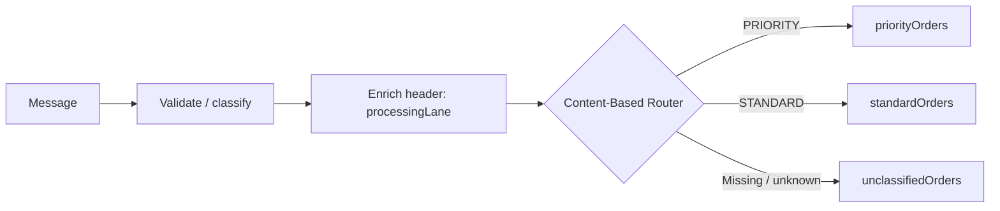
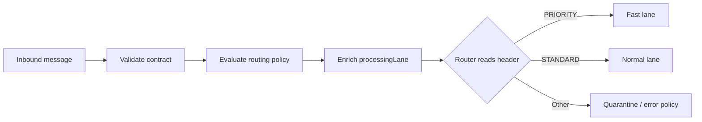
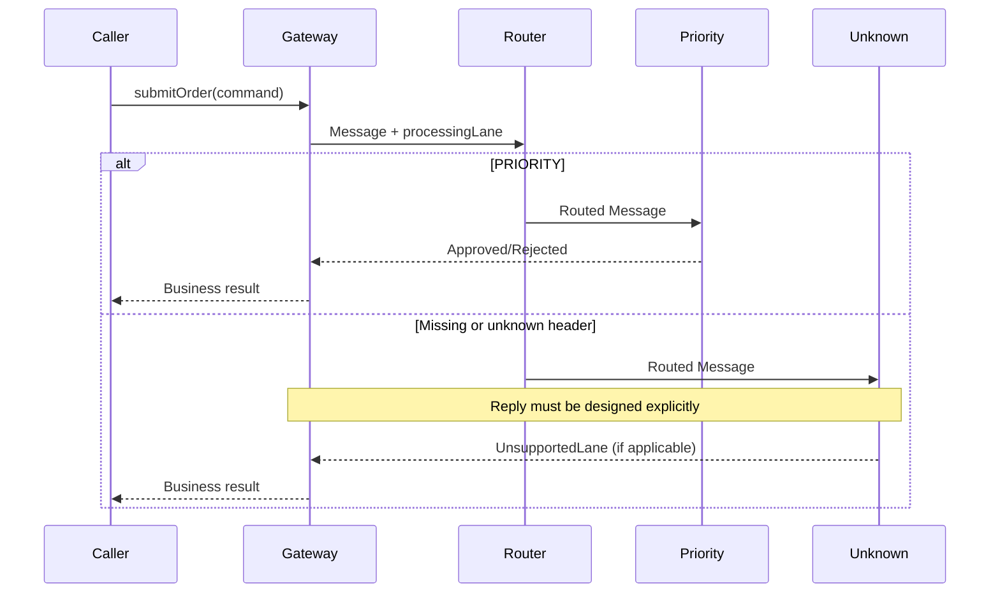
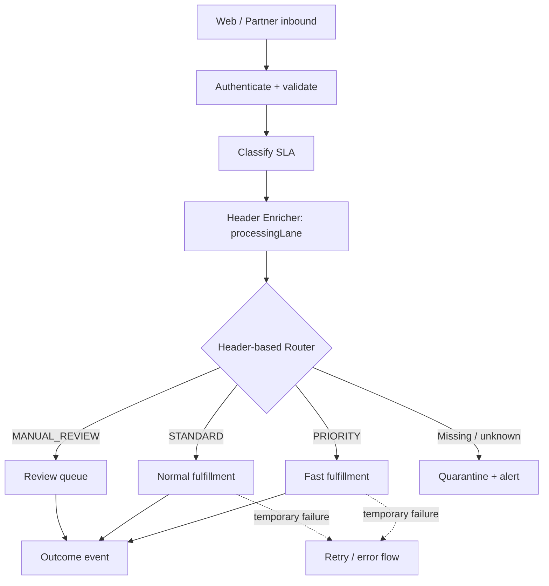

# Headers as the Routing Decision Source

In the **Content-Based Router** pattern of Enterprise Integration Patterns (EIP), a message is forwarded to one of several processing branches based on the information within that message itself. The information used for the decision **does not have to reside in the payload**: it can be a classified value placed in **message headers**. This is a useful way to separate business logic from orchestration logic, such as selecting a priority processing lane, choosing a shipping region, or routing by event source.

With **Spring Integration**, a Router can read a header directly, evaluate an expression based on headers, or call a Java method to compute the destination channel. This lesson belongs to the **Content-based router** chapter of the `SPRING_INTEGRATION_PATTERN` module, where we learn to implement Router, Filter, Transformer, Splitter, Aggregator, Gateway, retry, error channels, and correlation to build loosely coupled, extensible, testable, and observable message flows.

After this lesson, you can:

- Distinguish **routing decision data** from **routing decision outcomes**; know when to read headers instead of the payload.
- Produce and normalize routing headers at a trusted boundary.
- Configure a header-based Content-Based Router using Spring Integration Java DSL and `@Router` methods.
- Design fallback branches when headers are missing, mistyped, unauthorized, or unmapped.
- Preserve correlation, reply/error handling, and delivery semantics as messages traverse multiple branches.
- Test all paths, including unknown values, untrusted data, and downstream failures.

## 1. Headers can be part of the "content" used for routing

A Spring message carries two groups of information:

```text
Message<OrderSubmitted>
├── payload
│   ├── orderId       = "ORD-1001"
│   ├── customerId    = "CUS-18"
│   ├── amountCents   = 850000
│   └── destination   = "VN"
└── headers
    ├── processingLane = "PRIORITY"
    ├── traceId        = "trace-77"
    ├── correlationId  = "batch-3"
    └── sourceSystem   = "web-checkout"
```

The **payload** describes the business facts of the order; the `processingLane` header is the orchestration decision attached to the message so the Router selects a branch. For example, a classification service—after checking limits, customer tier, or SLA commitments—can assign `PRIORITY` or `STANDARD`.



When the decision value is already present in a header, the Router **does not need to know how to compute limits or classify customers**. Instead, it only reads a stable orchestration value at the boundary between two steps. This division of responsibility lets you add new branches without duplicating conditions across multiple handlers.

### Is header-based routing still a Content-Based Router?

Yes. In EIP architectural terms, *content-based* means deciding based on **information in the message**, as opposed to statically sending every message to a fixed destination. That information may come from the payload, headers, or an explicitly designed combination. In Spring Integration, **`HeaderValueRouter`** is a specialized mechanism for routing by a single header; an **expression-based router** or `@Router` method can compute the path from multiple fields.

What matters is not the class name, but **a deterministic routing rule that can be explained, tested, and preserved across steps**.

## 2. Should you choose headers or payload as the decision source?

| Criterion | Route directly from payload | Route from header |
| --- | --- | --- |
| Information source | Business fields: `eventType`, `orderStatus`, `country`. | Orchestration metadata: `processingLane`, `targetRegion`, `sourceSystem`. |
| Coupling | Router may depend on payload schema/type. | Router mainly depends on the header contract. |
| Adding classification rules | Edit expression or Router logic. | Can swap a separate classification/enrichment step. |
| Replay or transport change | Business fields usually stay in serialized payloads. | Headers may be lost if adapters don't map them; needs a reconstruction strategy. |
| Security | Must still validate input fields. | Must especially verify header origin and trustworthiness. |
| Testing | Test mapping from business data. | Test both **header creation** and **header consumption**. |

Neither option is universally better. If `eventType` is a mandatory business fact stored durably, moving it solely into an internal header risks losing semantics on replay. Conversely, `processingLane` is an implementation choice that can change with SLA policies without altering order data—making it well suited for a header.

**Practical rule:** When changing a header while keeping the payload identical, ask yourself: *am I changing the processing path or distorting the business event?* If altering a header changes the event's meaning with no data left to trace back the decision, reconsider the design contract.

### Three places where a routing header can originate

1. **Inbound adapter:** maps verified transport metadata, such as source type or event group, into a unified header.
2. **Header Enricher:** computes the header from a validated payload, business configuration, and trusted context.
3. **Classification service:** invokes a policy decision service and attaches the result to the message. If the service depends on network/DB, account for timeouts and classification errors before the router runs.

Never blindly copy an HTTP/Kafka header controlled by a client and let it govern privileged access. A Router handles **routing**, not authentication/authorization.

## 3. Reading headers with expressions in Spring Integration Java DSL

A direct way to route by header is using a **SpEL expression** in Spring Integration DSL. The expression `headers['processingLane']` reads the header named `processingLane`; subsequent configuration maps the returned value to a channel name.

The following example uses `QueueChannel` as targets so we can receive and inspect messages without calling external systems. Uses Spring Integration with Java 17+:

```java
import org.springframework.context.annotation.Bean;
import org.springframework.context.annotation.Configuration;
import org.springframework.integration.channel.DirectChannel;
import org.springframework.integration.channel.QueueChannel;
import org.springframework.integration.dsl.IntegrationFlow;

@Configuration
class HeaderRoutingConfiguration {

    @Bean
    DirectChannel ordersToRoute() {
        return new DirectChannel();
    }

    @Bean
    QueueChannel priorityOrders() {
        return new QueueChannel();
    }

    @Bean
    QueueChannel standardOrders() {
        return new QueueChannel();
    }

    @Bean
    QueueChannel unclassifiedOrders() {
        return new QueueChannel();
    }

    @Bean
    IntegrationFlow routeOrders() {
        return IntegrationFlow.from(ordersToRoute())
                .route("headers['processingLane']", spec -> spec
                        .channelMapping("PRIORITY", "priorityOrders")
                        .channelMapping("STANDARD", "standardOrders")
                        .defaultOutputChannel("unclassifiedOrders"))
                .get();
    }
}
```

With this illustrative configuration:

- Messages with `processingLane=PRIORITY` go to `priorityOrders`.
- Messages with `processingLane=STANDARD` go to `standardOrders`.
- Messages with unmapped keys go to `unclassifiedOrders` **per the declared fallback policy**.
- Destination channels do not execute business logic automatically: `QueueChannel` must have a polling consumer or be replaced by an appropriate channel/handler in a real system.

`channelMapping` describes **routing value → channel name**, not a payload transformation. For example, `processingLane=PRIORITY` does not turn the payload into the string `"PRIORITY"`; the Router merely uses the header value to select a channel.

### Sending two messages with the same payload type but different branches

```java
import org.springframework.messaging.Message;
import org.springframework.messaging.MessageChannel;
import org.springframework.messaging.support.MessageBuilder;

record OrderSubmitted(String orderId, long amountCents) {}

class OrdersPublisher {
    void publish(MessageChannel ordersToRoute) {
        Message<OrderSubmitted> priority = MessageBuilder
                .withPayload(new OrderSubmitted("ORD-1", 100_000))
                .setHeader("processingLane", "PRIORITY")
                .setHeader("traceId", "trace-1")
                .build();

        Message<OrderSubmitted> standard = MessageBuilder
                .withPayload(new OrderSubmitted("ORD-2", 80_000))
                .setHeader("processingLane", "STANDARD")
                .setHeader("traceId", "trace-2")
                .build();

        ordersToRoute.send(priority);
        ordersToRoute.send(standard);
    }
}
```

Both payloads are `OrderSubmitted`, yet they carry **different orchestration decisions**. An order amount of `100_000` does not automatically qualify for priority: in this example, the policy that set `processingLane` decided beforehand. If every order above a certain amount must automatically take the priority branch, express that condition in the **classification step** or use a Router that computes directly from business data.

> The example uses explicit channel names to teach mapping. In real deployments, configure Spring Integration and its dependencies, attach consumers to each channel, and verify API compatibility with your project's managed version.

## 4. Computing a routing header with a Header Enricher

In a clean design, the step responsible for **classification** sits before the step responsible for **forwarding**. Spring Integration provides a Header Enricher to add or compute a header from the current message.

Example: `OrderSubmitted` gains a business-defined `serviceTier` field. After validating that this field is valid, we compute `processingLane`:

```java
record OrderSubmitted(
        String orderId,
        long amountCents,
        String serviceTier
) {}

IntegrationFlow.from("validatedOrders")
        .enrichHeaders(headers -> headers
                .headerFunction("processingLane", message -> {
                    OrderSubmitted order = (OrderSubmitted) message.getPayload();
                    return "GOLD".equals(order.serviceTier())
                            ? "PRIORITY"
                            : "STANDARD";
                }))
        .channel("ordersToRoute")
        .get();
```

This is an **illustrative configuration snippet** connecting to the DSL in section 3, not a complete class: in a project, place the flow inside a `@Bean IntegrationFlow` and ensure the `validatedOrders` channel and payload types are declared consistently. More importantly, the example assumes `serviceTier` **has already been validated**; if `serviceTier=null` or an unknown value carries a distinct meaning, do not silently interpret it as `STANDARD` unless the contract permits it.

Alternatively, have the classification step return a strongly typed result and use `headerFunction` solely to map that result. This is especially helpful when a complex rule must explain why a message was sent to the priority branch.



### "Enriching a header" does not mean the data is durably persisted

Spring headers can change or fail to map across HTTP/Kafka/AMQP adapters. If the classification outcome **must survive replay** so that the same event is always processed under the policy active when it occurred, persist the decision result in a **durable event contract** or a separate decision record. If you want to apply a **new policy on replay**, actively recompute the header, record the policy version, and track discrepancies. Never assume an internal header automatically travels across every boundary.

## 5. `@Router` method when the decision goes beyond mapping one header

Sometimes the target channel depends on **multiple headers at once**, such as `processingLane` and `sourceSystem`, or needs value normalization, allowlist checking, and redirecting invalid cases to another branch. In that case, use a Java method annotated with `@Router`:

```java
import org.springframework.integration.annotation.Router;
import org.springframework.messaging.Message;
import org.springframework.stereotype.Component;

@Component
class LaneRouter {

    @Router(inputChannel = "ordersToRoute")
    public String chooseChannel(Message<?> message) {
        Object raw = message.getHeaders().get("processingLane");
        Object source = message.getHeaders().get("sourceSystem");

        // An example policy: every route must originate from a known source.
        if (!(source instanceof String system)
                || !(system.equals("checkout") || system.equals("partner-gateway"))) {
            return "unclassifiedOrders";
        }

        if (!(raw instanceof String lane)) {
            return "unclassifiedOrders";
        }

        return switch (lane.trim().toUpperCase(java.util.Locale.ROOT)) {
            case "PRIORITY" -> "priorityOrders";
            case "STANDARD" -> "standardOrders";
            default -> "unclassifiedOrders";
        };
    }
}
```

In this approach, the method returns the **destination channel name**, not a new payload. The channels must exist and have appropriate consumers. If using `@Router`, enable Spring Integration's annotation infrastructure (e.g., via your application's integration configuration); do not register both this method router and the DSL router from section 3 on the same input channel in a live demo configuration. **The two snippets are alternatives**, not two Routers competing to consume the same message.

Note: the `sourceSystem` check is merely an **illustrative classification policy**. Any external client could set `sourceSystem=checkout` unless that header is created or overwritten at an authenticated boundary. Therefore **do not treat string source checks as security controls**; use real authentication/authorization before routing into privileged flows.

### Choosing among the three mechanisms

| Mechanism | When appropriate | Things to watch |
| --- | --- | --- |
| **`HeaderValueRouter`** | Single header, multiple statically mapped values. | Header type contract, channel mapping, default channel. |
| **Expression-based Router** | Rules from headers/payload expressible concisely in SpEL. | Avoid overly complex expressions that are hard to test and debug. |
| **Method-invoking `@Router`** | Multiple constraints, normalization, policies, or logic needing dedicated unit tests. | Responsibility should remain choosing the route; keep heavy I/O and full business logic out of the Router. |

## 6. Handling missing, mistyped, or unmapped headers

Designing a router with only two "happy" branches is rarely enough. A producer might emit a message violating the contract, an adapter might drop a header, or a new version might emit a routing key unknown to an older consumer.

| Scenario | Example | Potential impact | Recommended policy |
| --- | --- | --- | --- |
| **Missing header** | No `processingLane` | Router has no valid key. | Fallback/quarantine or validation error. |
| **New value** | `processingLane=EXPRESS` | No mapping yet. | Monitor and process in unknown branch; upgrade contract. |
| **Wrong type** | `processingLane=123` | String mapping may fail to match. | Normalize/validate type before routing. |
| **Wrong format** | `priority`, ` PRIORITY ` | Fails canonical key match. | Normalize in one explicit place. |
| **Undeclared destination** | Mapped to `missingChannel` | Resolution/send error likely. | Verify topology and bean registration at startup/test. |
| **Destination lacks consumer** | `DirectChannel` target has no handler | Forwarding fails or lacks processing. | Verify subscriptions/endpoint lifecycle. |
| **Untrusted header** | Client sets `processingLane=PRIORITY` | Bypasses priority policy, potential abuse. | Do not trust external routing headers; recompute after auth. |

**A fallback must be a useful policy**, not just a channel name. If `unclassifiedOrders` is a `QueueChannel` with no consumer, messages sit idle with no resolution. In production, it can lead to a *quarantine workflow*, controlled audit storage, or an explicit business rejection response.

### Drop, fallback, or exception?

- **Fallback route:** skip main branches and forward to monitoring/review. Suitable for potentially important messages or sources that may emit new schema values.
- **Business rejection result:** if the caller needs `UNSUPPORTED_LANE` or `INVALID_INPUT`, define an explicit result type and reply branch.
- **Exception/error flow:** when a mandatory contract is violated or routing fails; define whether exceptions propagate to the caller or go to an error channel per endpoint behavior.
- **`nullChannel`:** intentional discard; use only when message loss is explicitly permitted and metered. This is not a dead-letter queue.

Do not retry a message with a missing header indefinitely: without changing data or contract, retries repeat the exact same outcome. Conversely, a network error in a handler after routing may be transient and warrant bounded retries.

## 7. Routing headers, correlation headers, and reply headers are distinct concepts

A single message can simultaneously carry several headers serving independent purposes:

| Header/identifier | Purpose | Should NOT be used instead of |
| --- | --- | --- |
| `processingLane` | Select `PRIORITY`/`STANDARD` branch. | `orderId`, `correlationId`, security role. |
| `correlationId` | Link messages in the same processing group. | Routing key or unique event identifier. |
| `sequenceNumber`/`sequenceSize` | Supports Splitter/Aggregator when set. | Retry count or global delivery ordering. |
| `replyChannel` | Where the flow sends a reply to a request. | Destination channel chosen by Router. |
| `errorChannel` | Suggests error-handling path in supporting mechanisms. | `unclassified` branch for invalid events. |
| `traceId` | Observe journey across services/channels. | Authentication proof or idempotency key. |
| `eventId` in durable contract | Identify events for replay/deduplication. | Spring message instance creation ID. |

### Gateway expects a reply; Router only picks a branch

Suppose Gateway `submitOrder()` awaits a result, yet `processingLane` is missing and the Router sends the message somewhere that only logs. In that case, the caller **does not automatically receive a `Rejected`**. The Gateway may wait until timeout or react per its no-reply policy. Ensure every branch where the API expects a result has an endpoint producing an appropriate reply.



The `processingLane` header neither needs to nor should replace request–reply correlation. Multiple concurrent calls may enter the `PRIORITY` branch together, yet each caller still needs its own exact reply.

### Splitter and Aggregator when items take multiple branches

An order can be split by a Splitter into multiple shipments. Each shipment gets a `processingLane` matching speed or region, while all messages from the same split must retain a **shared correlation key** so the Aggregator reassembles properly.

```text
Batch B-17
    |
 Splitter (3 item messages, correlationId=B-17)
    |-- Item 1, lane=PRIORITY ---> Priority flow ---> Result 1 --|
    |-- Item 2, lane=STANDARD ---> Normal flow ----> Result 2 --|--> Aggregator
    |-- Item 3, lane=PRIORITY ---> Priority flow ---> Result 3 --|
```

If the Router sends Item 2 to `nullChannel` due to a missing mapping, the Aggregator may receive **2/3** results and wait forever if its release strategy relies on the original item count. Safe options include: validating routes before splitting, generating an `UnsupportedRoute` result carrying correlation/sequence for rejected parts, or configuring timeout/release strategies for incomplete groups. **Routing headers and correlation headers do not replace each other.**

## 8. Transport boundaries: which headers survive adapters?

In Spring Integration, `MessageHeaders` is Spring message metadata. Kafka, RabbitMQ/AMQP, and HTTP each have their own **transport metadata**; adapters may map certain headers, yet **do not guarantee every header is preserved**.

For instance, a producer writes an event to Kafka with `eventType=OrderSubmitted` in the JSON payload while `processingLane` only sits in Spring headers before sending. If the outbound adapter does not map that header onto the Kafka record, the consumer building messages from the broker may **not see `processingLane`**. A solid design should:

1. Specify required fields explicitly in the **event schema** or transport headers.
2. Test how outbound/inbound adapters map those fields.
3. Decide whether to recompute `processingLane` on the consumer side from durable data and policy version.
4. Handle absent values via fallback/validation rather than silently routing to sensitive branches.

**Do not use Spring `MessageHeaders.id` as an event ID** when deduplicating across replays: a reconstructed message can receive a new ID even when representing the same event. Likewise, using client-supplied `sourceSystem` or `tenantId` to choose a privileged channel is unsafe without verification.

## 9. Security of routing headers and multi-tenant concerns

When messages arrive from external sources, a routing header can become a **privilege escalation point** if a value is allowed to select a branch performing sensitive actions (such as priority payouts, refunds, or accessing another tenant's data store). Rules to maintain:

- **Authenticate and authorize before routing:** a header used to select branches is not an authentication credential. Client-attached `sourceSystem=trusted` does not make a source trustworthy.
- **Allowlist keys and channels:** accept only known values like `PRIORITY`, `STANDARD`, etc.; never use raw header values directly as arbitrary channel bean names.
- **Trusted source of truth:** derive `processingLane` from verified data during enrichment. For multi-tenancy, match the tenant in the message against authenticated identity/claims.
- **Never put secrets in headers or metrics:** headers can be logged/traced or mapped across transports; mask sensitive data and use bounded route labels.
- **Monitor anomalies:** missing header counts, unknown values, priority-branch entries mismatched with policy, and channel resolution failures are signals worth alerting on.

Routing rules are **orchestration policies**. Sensitive operations must still enforce authorization at business endpoints; never treat a message arriving on a channel as proof of permission to execute.

## 10. Errors, retries, and delivery status

A successful routing decision does not equate to a successful transaction. Distinguish:

| Point of failure | Example | Handling direction |
| --- | --- | --- |
| **Pre-Router validation** | Missing `eventType` or unauthorized source. | Return rejection, quarantine, or report contract error. |
| **Routing** | `processingLane=EXPRESS` has no mapping. | Fallback or fail-fast per policy. |
| **Sending to channel** | Target channel has no consumer or delivery fails. | Check topology, lifecycle, and error-handling setup. |
| **Downstream business handler** | Inventory system times out. | Bounded retries, timeouts, circuit breaker/idempotency as needed. |
| **Outbound adapter** | Broker rejects publish or API errors out. | Design ack/commit, replay, and transport-boundary error reporting. |

`errorChannel` and `ErrorMessage` handle **exceptions** in supporting Spring Integration mechanisms; an unsupported routing key **does not automatically** become an `ErrorMessage` if a normal fallback is configured. In synchronous flows, exceptions may propagate back to the caller; in async endpoints or pollers, a different error-handling path may apply. Never assume a single channel name suffices to catch every exception.

**Retries should sit where recovery is possible.** For example, a transient network error after the Router picks `priorityOrders` can retry the downstream call. Retrying the same message forever will not invent a missing mapping for `EXPRESS`. For side effects like creating orders or deducting inventory, preserve a **durable idempotency key** across retries to prevent duplicate effects.

### Tracing across branches

To answer "where did the message go and why?", emit structured diagnostic events:

```text
eventId=evt-9  policyVersion=v3  processingLane=PRIORITY
selectedChannel=priorityOrders  routingOutcome=ROUTED
traceId=trace-21  correlationId=batch-31
```

This is an **illustrative application log format**, not Spring's automatic logging. Collect metrics such as `router_received_total`, `router_routed_total{lane}`, `router_unmatched_total`, and `router_delivery_failed_total`. Never put `orderId` or `eventId` in metric labels, as that causes **high cardinality**; use bounded lane values and standardized error reasons. Across async/reactive channels, ensure tracing context propagates properly rather than relying solely on MDC/`ThreadLocal`.

## 11. Testing Header-based Content Routers

Unit testing classification rules is not enough to prove messages actually reach the right channel. Test **where messages arrive, that non-target branches stay empty, that payload/headers are preserved, and fallback behavior**.

### Integration test using QueueChannel

The following example uses `HeaderRoutingConfiguration` from section 3 with JUnit 5/Spring Test. No broker connection is needed because all branches use internal `QueueChannel` instances:

```java
import static org.junit.jupiter.api.Assertions.assertEquals;
import static org.junit.jupiter.api.Assertions.assertNotNull;
import static org.junit.jupiter.api.Assertions.assertNull;
import static org.junit.jupiter.api.Assertions.assertTrue;

import org.junit.jupiter.api.Test;
import org.springframework.beans.factory.annotation.Autowired;
import org.springframework.beans.factory.annotation.Qualifier;
import org.springframework.integration.channel.QueueChannel;
import org.springframework.messaging.Message;
import org.springframework.messaging.MessageChannel;
import org.springframework.messaging.support.MessageBuilder;
import org.springframework.test.context.junit.jupiter.SpringJUnitConfig;

@SpringJUnitConfig(HeaderRoutingConfiguration.class)
class HeaderRoutingFlowTest {

    @Autowired @Qualifier("ordersToRoute")
    MessageChannel input;

    @Autowired @Qualifier("priorityOrders")
    QueueChannel priority;

    @Autowired @Qualifier("standardOrders")
    QueueChannel standard;

    @Autowired @Qualifier("unclassifiedOrders")
    QueueChannel unmatched;

    @Test
    void routesPriorityWithoutChangingBusinessPayload() {
        OrderSubmitted order = new OrderSubmitted("ORD-1", 100_000);
        assertTrue(input.send(MessageBuilder.withPayload(order)
                .setHeader("processingLane", "PRIORITY")
                .setHeader("traceId", "trace-101")
                .build()));

        Message<?> actual = priority.receive(1_000);
        assertNotNull(actual);
        assertEquals(order, actual.getPayload());
        assertEquals("trace-101", actual.getHeaders().get("traceId"));
        assertNull(standard.receive(0));
        assertNull(unmatched.receive(0));
    }

    @Test
    void routesUnknownHeaderToFallback() {
        OrderSubmitted order = new OrderSubmitted("ORD-2", 80_000);
        assertTrue(input.send(MessageBuilder.withPayload(order)
                .setHeader("processingLane", "EXPRESS")
                .build()));

        Message<?> actual = unmatched.receive(1_000);
        assertNotNull(actual);
        assertEquals(order, actual.getPayload());
        assertNull(priority.receive(0));
        assertNull(standard.receive(0));
    }
}
```

This test illustrates the **priority branch** and an **unknown value**. Beans and data types are reused from the Java DSL configuration above, so place these snippets in corresponding project sources when running them. `receive(0)` checks whether the queue holds a message immediately; since the demo flow is synchronous, this observation is reasonable, whereas async channels require conditional waits and appropriate timeouts.

### Minimum test matrix

| Case | Expected result |
| --- | --- |
| `processingLane=PRIORITY` | Only `priorityOrders` receives the message. |
| `processingLane=STANDARD` | Only `standardOrders` receives the message. |
| Unsupported header `EXPRESS` | Goes to fallback or reports error per chosen contract. |
| Missing `processingLane` | Never silently sent to a critical branch. |
| Unexpected header type | Validation/canonicalization handles according to policy. |
| Same payload type with different lane | Different target; business data remains unaltered. |
| Header from untrusted source | Cannot claim a privileged lane solely by header value. |
| Selected branch fails | Error/retry policy activates, distinct from routing failure. |
| Splitter fans one order across lanes | Aggregator preserves correlation, handles completion or timeout/partial-result policy. |
| Replay via broker/adapter | Header mapping or recomputation ensures routing matches the contract version. |

## 12. Common mistakes

**1. Trusting client-supplied headers without verification.** Clients can select priority or sensitive branches without authorization. Recompute or verify headers at ingress and enforce permissions at handlers.

**2. Assuming headers always follow payloads across every adapter.** Mapping varies by protocol and configuration; replays may lack values. Define contracts and test serialization/header mappers.

**3. Setting `nullChannel` as the fallback for all cases.** New message types disappear without a trace. For important data, use quarantine/audit/alerting.

**4. Using a routing key as `correlationId`.** Multiple transactions in the same lane would be grouped together erroneously. Use a dedicated processing-group ID.

**5. Letting the Router call heavy business APIs directly.** Hard to test, hard to control timeouts, and muddies orchestration responsibilities. Separate the classifier from downstream handlers.

**6. Failing to normalize case or header types.** `priority`, `PRIORITY`, enums, and numbers may resolve differently; use canonical values and tests.

**7. Treating `send()` success as task completion.** The message may have just entered a channel or be running asynchronously downstream. Track delivery status and explicit business replies.

**8. Retrying indefinitely on a missing mapping.** Contract mismatches usually require config/code updates, not backoff. Only retry recoverable error classes.

**9. Testing only routing expressions without testing topology.** A channel may be misnamed, lack a consumer, or fail to reply to a Gateway. Write integration tests observing real destinations.

## 13. Practice scenario: SLA-based order processing

**Context:** An e-commerce system receives `OrderSubmitted` from web and partners. A classification service decides whether each order belongs to `PRIORITY`, `STANDARD`, or `MANUAL_REVIEW`. Orders must be processed through dedicated queues, yet every final outcome must remain traceable by `orderId` and `eventId`. When classification fails or a source sends an invalid lane, orders must not be lost.



**Design requirements:**

1. Define a durable payload/event contract with `eventId`, `orderId`, business status, and timestamp; the `processingLane` header does not replace these fields.
2. Authenticate sources and **do not trust lanes set by web clients**; the classification service decides using verified data and SLA policies.
3. Normalize the three lane values; add a fallback channel with a consumer to handle new or missing values.
4. If `PRIORITY` requires real resource prioritization, size executors/queues/brokers and capacity to match the SLA: **the Router only selects the path**, it does not guarantee latency on its own.
5. Design idempotency when messages may be replayed; store policy version if SLA decisions must be audited.
6. For a request–reply Gateway, ensure every path needing a response produces a reply or defined error/timeout.
7. Test missing headers, bad values, adapters dropping headers, handler errors, concurrent processing, and per-branch metrics.

**Self-assessment question:** If the Router sees `processingLane=PRIORITY` and forwards the message to `priorityOrders`, does that guarantee the system processed the priority order within the SLA deadline? **No.** The Router only determines the destination. Completion time still depends on workers, queues, brokers, downstream capacity, retries, and business conditions. Measure end-to-end latency and provision dedicated resources when SLAs demand it.

## Summary

- **Headers can serve as the routing decision source** in a Content-Based Router, separating classification from message forwarding.
- **Header-value routing** fits when an orchestration key already exists; SpEL Routers or `@Router` methods fit when additional rules are needed. Choose based on complexity and testability.
- **Header Enrichers** should derive routing headers from verified data; never treat untrusted headers as authorization mechanisms.
- Always define policies for **missing headers, mistyped values, unknown values, missing destination channels, and downstream errors**; fallbacks need real consumers.
- **Routing keys differ from correlation, event IDs, and reply/error channels**. Preserve necessary metadata across Splitter/Aggregator, Gateways, and adapters, and design retry/idempotency at the right boundaries.
- Test **the entire path**, not just header values or expressions; use metrics and tracing to verify which branch a message took and how far processing actually progressed.
