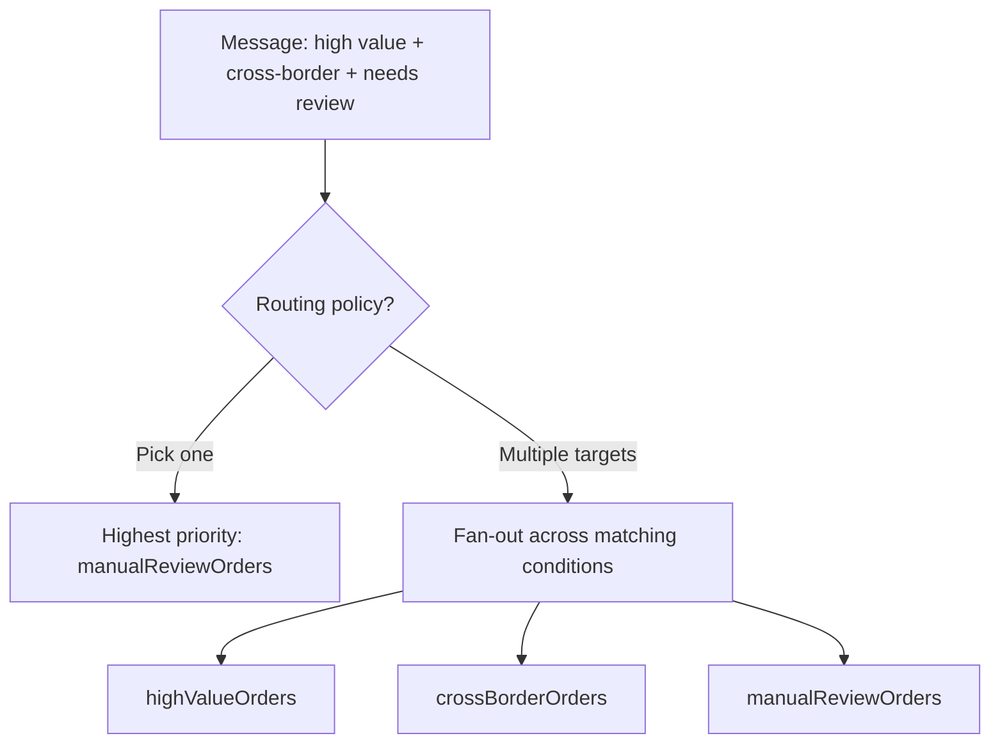
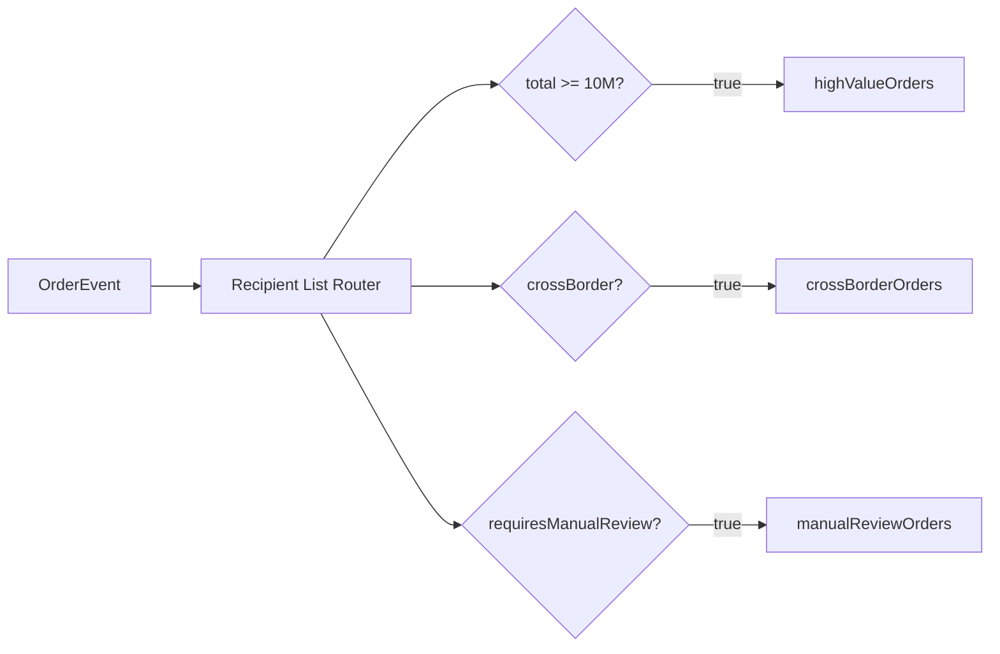
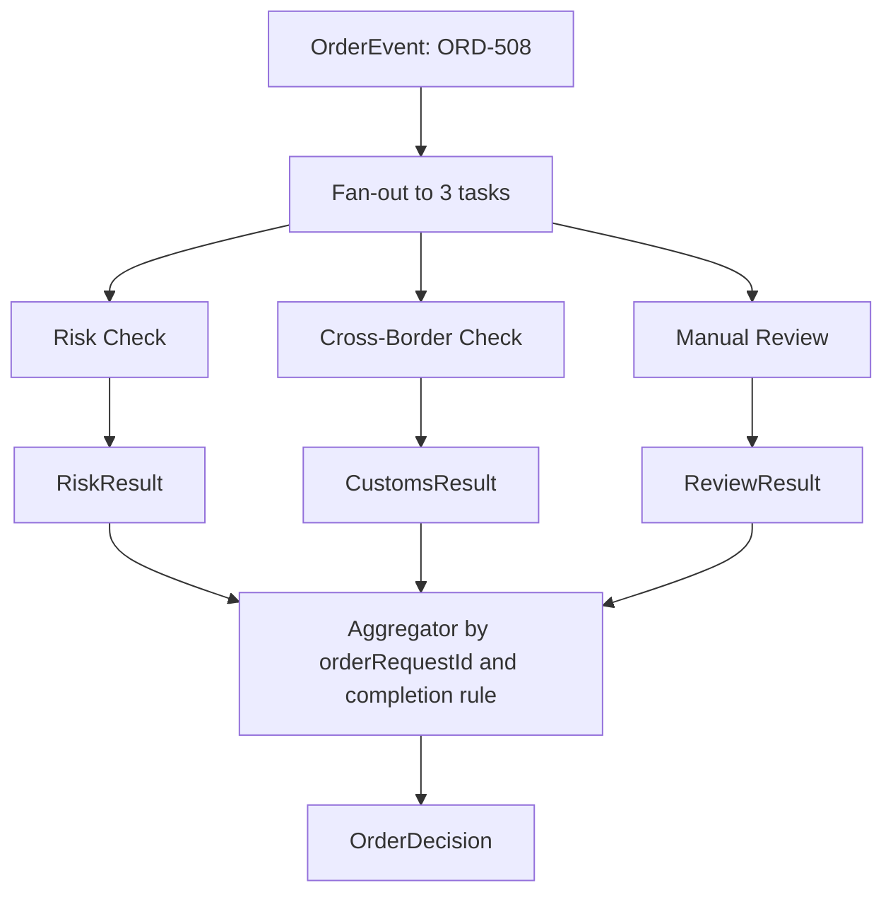

# Multiple Conditions Matching Simultaneously in a Content-Based Router

In the **Content-Based Router** pattern, a Message is sent to a processing branch based on its payload or metadata. An order can simultaneously have a high value, be cross-border, and require manual review. When **multiple conditions match at once**, the system must answer a critical question: **select exactly one route by priority, or send the Message to all matching routes?**

This is a flow-design decision, not merely an `if` statement. Choosing one branch may skip work needed in the remaining branches. Sending to multiple branches requires managing fan-out, deduplication, partial failures, timeouts, and correlation when aggregating results.

This lesson belongs to the **Content-based router** chapter in the `SPRING_INTEGRATION_PATTERN` module. The module aims to implement Enterprise Integration Patterns with Spring Integration to build loosely coupled, extensible message flows—practicing Router, Filter, Transformer, Splitter, Aggregator, Gateway, retry, error channels, correlation, testing, and observing processing branches. Here we focus on **the semantics when multiple routing conditions match simultaneously**.

## 1. The problem: one Message satisfies multiple rules

Suppose the system receives this event:

```json
{
  "orderId": "ORD-508",
  "total": 15000000,
  "crossBorder": true,
  "requiresManualReview": true
}
```

There are three rules:

| Rule | Condition | Target channel |
| --- | --- | --- |
| High-value order | `total >= 10_000_000` | `highValueOrders` |
| Cross-border order | `crossBorder == true` | `crossBorderOrders` |
| Needs review | `requiresManualReview == true` | `manualReviewOrders` |

All three conditions are true for `ORD-508`. This creates two valid models that differ in business semantics.

**Model A — select a single route:** prioritize manual review, then cross-border, and finally high-value. The Message goes only to `manualReviewOrders`.

**Model B — send to all matching routes:** the Message goes to `highValueOrders`, `crossBorderOrders`, and `manualReviewOrders`. Each branch performs an independent responsibility.



There is no "always pick all" or "always pick first" rule. **The business contract must decide** which conditions are mutually exclusive and which represent concurrent tasks that must all run.

## 2. Distinguishing "matching conditions" from "selected destinations"

A predicate is a boolean function applied to a Message. It can return `true` or `false` independently of other predicates:

```java
boolean highValue = total.compareTo(THRESHOLD) >= 0;
boolean crossBorder = order.crossBorder();
boolean needsReview = order.requiresManualReview();
```

The **matching condition set** is the set of predicates returning `true`. The **selected destination set** depends on the routing policy:

- With **exclusive routing**, the destination set has at most one channel after applying precedence.
- With **multicast/recipient routing**, the destination set may contain multiple channels.
- With **fail-on-ambiguous**, if more than one condition is true, the Message is treated as invalid data or configuration.

Example decision table:

| `highValue` | `crossBorder` | `needsReview` | Priority: review > cross-border > high-value | Send to all matching branches |
| --- | --- | --- | --- | --- |
| false | false | false | `standardOrders` | `standardOrders` (fallback) |
| true | false | false | `highValueOrders` | `highValueOrders` |
| true | true | false | `crossBorderOrders` | `highValueOrders`, `crossBorderOrders` |
| false | true | true | `manualReviewOrders` | `crossBorderOrders`, `manualReviewOrders` |
| true | true | true | `manualReviewOrders` | All three channels |

A small change in `if/else if` order alters exclusive routing results. By contrast, multiple independent `if` statements can build multiple recipients. That choice must be made explicit in method names, documentation, and tests.

## 3. How do Content-Based Router, Filter, and Recipient List differ?

Spring Integration offers mechanisms suited to different intents:

| Mechanism | Intent | When multiple rules match |
| --- | --- | --- |
| **Content-Based Router** picking one channel | Split flow into mutually exclusive branches | Needs priority policy or exclusive conditions |
| **Router returning a collection of channels** | Send one Message to multiple channels | Can select multiple channels if collection has several targets |
| **Recipient List Router** | Evaluate independent recipients/selectors | All qualifying recipients are selected |
| **PublishSubscribeChannel** | Broadcast to subscribers of one channel | All eligible subscribers may receive; does not select per-recipient by business predicate like Recipient List Router |
| **Filter** | Pass or drop a Message on a single branch | Decides only `true/false` at that branch; placing Filters across different branches is a different pattern |

A **classic Content-Based Router** is typically described as routing a Message to one of several destination channels. When the real requirement is **sending to multiple conditional recipients**, the clearest expression is a *Recipient List Router* or a router method returning a collection of channels. Do not assume a single-valued router expression runs all rules when multiple conditions hold.

Do not confuse **fan-out** with **Splitter**. A fan-out router can send the same Message to multiple branches, whereas a Splitter typically breaks a payload into child Messages. A Splitter can add sequence/correlation headers for an Aggregator; routing to multiple destinations **does not automatically generate that sequence metadata**.

## 4. Approach 1: selecting one route by priority order

When each Message must enter **only one primary processing workflow**, make precedence explicit inside a routing function.

```java
public String chooseExactlyOneRoute(OrderEvent order) {
    if (order.requiresManualReview()) {
        return "manualReviewOrders";
    }
    if (order.crossBorder()) {
        return "crossBorderOrders";
    }
    if (order.total().compareTo(HIGH_VALUE_THRESHOLD) >= 0) {
        return "highValueOrders";
    }
    return "standardOrders";
}
```

Assuming `order.total()` has been validated and is non-null, the order above intentionally prioritizes `manualReviewOrders`. Swapping the first two branches would change routing for cross-border orders requiring review.

**Points to specify in the design:**

1. Priority order is a **business rule** requiring tests, not an accidental code detail.
2. When multiple conditions hold simultaneously, only one workflow launches on the primary route. Any remaining responsibilities must happen inside the chosen route or via another workflow if still needed.
3. If the route result matches no channel, a default route or error-reporting mechanism per contract is needed.
4. If multiple conditions **should never be true simultaneously**, check the invariant and fail rather than picking one silently.

Exclusive routing usually fits when choosing *one payment method*, *one owning team*, or *one execution environment*.

## 5. Approach 2: sending to multiple matching routes

When each condition represents an independent task, build a channel set from predicates. In Spring Integration, a `@Router` method can return a collection of channel names to route a Message to multiple destinations.

For example: high-value orders need risk assessment; cross-border orders need customs paperwork; orders flagged for review enter a moderation queue. All three tasks may need to run for the same order.

### 5.1. Sample application configuration

The Java 17+ example below uses an annotation-based router and `QueueChannel` instances to clearly observe Messages reaching each branch. Classes use the illustrative package `example.integration`.

```java
package example.integration;

import java.math.BigDecimal;
import java.util.LinkedHashSet;
import java.util.List;
import java.util.Set;

import org.springframework.context.annotation.Bean;
import org.springframework.context.annotation.Configuration;
import org.springframework.integration.annotation.Router;
import org.springframework.integration.channel.DirectChannel;
import org.springframework.integration.channel.QueueChannel;
import org.springframework.integration.config.EnableIntegration;
import org.springframework.messaging.MessageChannel;
import org.springframework.messaging.PollableChannel;

@Configuration
@EnableIntegration
public class MultiMatchRoutingConfiguration {

    private static final BigDecimal HIGH_VALUE_THRESHOLD =
            new BigDecimal("10000000");

    public record OrderEvent(
            String orderId,
            BigDecimal total,
            boolean crossBorder,
            boolean requiresManualReview) {
    }

    @Bean
    public MessageChannel ordersInput() {
        return new DirectChannel();
    }

    @Bean
    public PollableChannel highValueOrders() {
        return new QueueChannel(10);
    }

    @Bean
    public PollableChannel crossBorderOrders() {
        return new QueueChannel(10);
    }

    @Bean
    public PollableChannel manualReviewOrders() {
        return new QueueChannel(10);
    }

    @Bean
    public PollableChannel standardOrders() {
        return new QueueChannel(10);
    }

    @Bean
    public PollableChannel invalidOrders() {
        return new QueueChannel(10);
    }

    @Router(inputChannel = "ordersInput")
    public List<String> routeOrder(OrderEvent order) {
        if (order.total() == null || order.total().signum() < 0) {
            return List.of("invalidOrders");
        }

        Set<String> recipients = new LinkedHashSet<>();

        if (order.total().compareTo(HIGH_VALUE_THRESHOLD) >= 0) {
            recipients.add("highValueOrders");
        }
        if (order.crossBorder()) {
            recipients.add("crossBorderOrders");
        }
        if (order.requiresManualReview()) {
            recipients.add("manualReviewOrders");
        }

        if (recipients.isEmpty()) {
            recipients.add("standardOrders");
        }
        return List.copyOf(recipients);
    }
}
```

Note several intentional choices:

- The `if` statements are **independent**, so one Message can match multiple conditions. Using `else if` would pick at most one branch in the chain.
- `LinkedHashSet` avoids adding duplicate channel names and preserves declaration order when building recipients. **Declaration order does not guarantee processing completion order** when branches run asynchronously.
- `@Router` returns a list of **MessageChannel bean names**; Spring Integration resolves those names and sends the Message to the selected channels.
- If data fails the preliminary check (missing or negative `total`), only `invalidOrders` is selected. That branch can validate further and emit an appropriate response.
- If no specialized rule matches, the Message goes to `standardOrders`. This is an **explicit fallback**, so no Message disappears silently for failing to match.
- `QueueChannel(10)` is merely an in-memory buffer for demo purposes; production systems must evaluate capacity, overflow, durability, and consumers.

### 5.2. Sending a Message matching three branches

```java
package example.integration;

import java.math.BigDecimal;

import org.springframework.context.annotation.AnnotationConfigApplicationContext;
import org.springframework.messaging.Message;
import org.springframework.messaging.MessageChannel;
import org.springframework.messaging.PollableChannel;
import org.springframework.messaging.support.MessageBuilder;

import example.integration.MultiMatchRoutingConfiguration.OrderEvent;

public class MultiMatchRoutingDemo {

    public static void main(String[] args) {
        try (var context = new AnnotationConfigApplicationContext(
                MultiMatchRoutingConfiguration.class)) {

            MessageChannel input =
                    context.getBean("ordersInput", MessageChannel.class);
            PollableChannel highValue =
                    context.getBean("highValueOrders", PollableChannel.class);
            PollableChannel crossBorder =
                    context.getBean("crossBorderOrders", PollableChannel.class);
            PollableChannel manualReview =
                    context.getBean("manualReviewOrders", PollableChannel.class);
            PollableChannel standard =
                    context.getBean("standardOrders", PollableChannel.class);

            OrderEvent event = new OrderEvent(
                    "ORD-508",
                    new BigDecimal("15000000"),
                    true,
                    true);

            Message<OrderEvent> inputMessage =
                    MessageBuilder.withPayload(event)
                            .setHeader("businessOrderId", event.orderId())
                            .setHeader("eventId", "evt-508")
                            .build();

            boolean acceptedByInput = input.send(inputMessage);
            System.out.println("Accepted by input: " + acceptedByInput);

            Message<?> a = highValue.receive(0);
            Message<?> b = crossBorder.receive(0);
            Message<?> c = manualReview.receive(0);

            System.out.println(a == null ? "none" : a.getPayload());
            System.out.println(b == null ? "none" : b.getPayload());
            System.out.println(c == null ? "none" : c.getPayload());
            System.out.println("Default empty: " + (standard.receive(0) == null));
        }
    }
}
```

When input uses `DirectChannel` and the queues have capacity, all three specialized channels receive the same business data for `ORD-508`, while `standardOrders` receives nothing. All three `receive(0)` calls observe immediately after a synchronous `send`. In an async flow, wait for a bounded timeout condition rather than checking immediately.

**Successfully sending to three channels does not mean all three business branches finished processing.** In the example, Messages still sit in queues waiting for consumers; real applications must wire polling endpoints or active consumers.

## 6. Recipient List Router: one predicate per recipient

When the set of recipients is relatively fixed and each branch has a **separately declared condition**, Spring Integration offers **Recipient List Router**. Instead of writing a function returning a channel list, you define recipients alongside their individual selection predicates.

Flow diagram:



Predicates are evaluated independently; when two or three match, all corresponding recipients are selected. In Java DSL, the hook for this pattern is `.routeToRecipients(...)`. A DSL configuration can look like this:

```java
// Alternative DSL snippet for the @Router method in section 5.
// Register only one of the two mechanisms on the same input channel.
@Bean
public IntegrationFlow recipientRoutingFlow() {
    return IntegrationFlow.from("ordersInput")
            .routeToRecipients(spec -> spec
                    .recipient("highValueOrders",
                            "payload.total >= 10000000")
                    .recipient("crossBorderOrders",
                            "payload.crossBorder == true")
                    .recipient("manualReviewOrders",
                            "payload.requiresManualReview == true"))
            .get();
}
```

This snippet illustrates configuration using **SpEL expressions**; record/DTO property access and exact syntax should be verified against your Spring Integration/Spring Framework version. The flow in section 5 is a self-contained example ready to run and test directly.

With Recipient List Router, explicitly design **what happens when no recipient matches** (such as a fallback branch, an always-true recipient condition, or an error policy). Never assume the router automatically sends to `standardOrders` when only the three recipients above are configured.

### When to use each approach?

| Requirement | Usually appropriate choice |
| --- | --- |
| A Message must go to only one branch | Method router returning one channel or expression returning one key with priority rules |
| A Message must go to all branches whose conditions match | Recipient List Router or method router returning multiple channels |
| Broadcast the same event to all subscribers | PublishSubscribeChannel |
| Split a list of items into separate Messages | Splitter |
| Filter out invalid Messages entirely before routing | Filter |

No single API solves every scenario. Choose based on **how many branches must receive the Message**, **how conditions are expressed**, and **the result contract**.

## 7. Execution order, duplicate recipients, and non-atomic fan-out

When a Message is sent to multiple channels, distinguish three concepts:

**Recipient selection order** is the order of the generated or configured channel list. **Dispatch order** is the order the router invokes send operations. **Business completion order** is when downstream handlers finish on each channel. These three orders need not match, especially with `ExecutorChannel`, polling consumers, brokers, or multiple instances.

Suppose you send to A, then B, then C, yet B finishes in 10 ms, A takes 5 s, and C fails. Logs will show B completing before A. Never infer completion order from routing order.

### 7.1. A failure can happen after another branch already received the Message

Fan-out is **not atomic across all channels by default**. A router may succeed sending to the first channel and fail sending to the second. When that happens:

1. The branch that already received the Message may be processing or may have committed side effects.
2. The failing branch needs proper error recording and retry mechanisms.
3. Retrying the entire Message may cause the already-succeeded branch to receive the event again.

Therefore, multi-recipient flows need a stable **idempotency key**, such as `eventId` combined with branch task type, plus clear recovery rules when one branch fails. Never infer "exactly once" simply because the Router received one Message.

### 7.2. A channel appearing multiple times in the list

If two conditions lead to `highValueOrders` and code appends the channel name twice, a collection-based router may treat it as two recipients and deliver twice. The example in section 5 uses `LinkedHashSet` to guarantee each channel name appears at most once.

If the business genuinely needs to create **two distinct tasks**, represent them as two explicit Messages or work commands with clear identifiers and responsibilities rather than duplicating channel names ad hoc.

## 8. No match, multiple matches, and invalid data

Design policies for three independent cases:

| Predicate outcome | Decision needed | Example |
| --- | --- | --- |
| **No condition matches** | Fallback, ignore, or return error? | Regular order → `standardOrders` |
| **One condition matches** | Send to the selected recipient | Cross-border order → `crossBorderOrders` |
| **Multiple conditions match** | Pick by priority, send to all, or fail? | High-value cross-border order needing review |
| **Cannot evaluate** | Validation, retry, or error flow? | Missing `total`, policy service timeout |

Do not use a **default route** to mask data errors. For example, `total = null` is not a "standard" order; in our sample code it routes to `invalidOrders`. With a schema requiring a valid total, you may also want to block it upfront via Filter/validator and return an error upstream.

If routing relies on headers set by external clients, verify trustworthiness at the boundary. Never let untrusted sources directly specify internal channel names if doing so bypasses controls.

## 9. Relationship to Splitter, Aggregator, and correlation

**A multi-destination Router is not a Splitter.** Sending a Message to three branches lets all three see the same business payload, but it does not automatically assign `sequenceNumber` 1, 2, 3 across three dispatches the way a Splitter does.

If the goal is **sending three requests, waiting for three results, and returning one combined reply**, choose an aggregation pattern like Scatter-Gather or design explicit correlation and release strategies for an Aggregator:



To aggregate results properly, explicitly design:

- **Correlation key:** every result from one order-evaluation run carries the same `orderRequestId` (not necessarily just `orderId`, since the same order may be re-evaluated multiple times).
- **Branch identity:** each result identifies which branch produced it, e.g., `RISK`, `CUSTOMS`, `REVIEW`.
- **Completion rule:** which result types constitute completeness; are all three always required?
- **Timeout:** if one branch is slow or unresponsive, fail, keep waiting, or return partial results?
- **Duplicate handling:** the same branch replying twice must be recognized by `eventId`, request ID, and branch ID.

With this design, if only two of the three conditions matched, the Aggregator must know the **actual expected branch set**. Never hardcode waiting for three results on every order. In some cases, use Spring Integration's built-in Scatter-Gather support instead of manually wiring routers and aggregators.

### When a Filter sits after the Router

Suppose the `manualReviewOrders` branch has a Filter that drops a Message while the Aggregator still expects a result from that branch. The group could wait forever unless there is a timeout or a "rejected" result message is emitted. One clean pattern is returning `ReviewResult(REJECTED)` rather than letting the branch vanish silently.

## 10. Gateway, retry, and error channels

With a request–reply Gateway, a Router sending the same Message to multiple channels does not automatically ensure **a single reply** returns to the Java caller. If multiple branches return replies, specify how results are aggregated or selected before returning to the Gateway.

When one branch throws an exception:

- On synchronous channels like `DirectChannel`, exceptions can propagate to the router and sender.
- With queues, executors, or brokers, errors typically surface in consumers at another time; `ErrorMessage` routing depends on error-handling configuration.
- Retries must be scoped properly. Retrying the whole routing step can re-run branches that already succeeded.
- Do not assume an error in one branch automatically goes to a global `errorChannel` or rolls back work already executed in other branches.

To prevent duplicate execution, a useful idempotency key has the form:

```text
idempotencyKey = eventId + ":" + branchType
```

For example, `evt-508:RISK` and `evt-508:CUSTOMS` are two distinct tasks even though they came from the same event. Key storage, transaction scope, and retention duration must fit business needs; a key string alone is not enough to guarantee safety under concurrent execution.

## 11. Testing multi-match routing

Unit testing three predicates individually is not enough. Verify **the Message reaches all selected channels and none of the unselected channels**.

JUnit 5 example using the configuration from section 5:

```java
package example.integration;

import static org.junit.jupiter.api.Assertions.*;

import java.math.BigDecimal;

import org.junit.jupiter.api.Test;
import org.springframework.context.annotation.AnnotationConfigApplicationContext;
import org.springframework.messaging.Message;
import org.springframework.messaging.MessageChannel;
import org.springframework.messaging.PollableChannel;
import org.springframework.messaging.support.MessageBuilder;

import example.integration.MultiMatchRoutingConfiguration.OrderEvent;

class MultiMatchRoutingIntegrationTest {

    @Test
    void oneMessageCanReachThreeMatchingRecipients() {
        try (var context = new AnnotationConfigApplicationContext(
                MultiMatchRoutingConfiguration.class)) {

            MessageChannel input =
                    context.getBean("ordersInput", MessageChannel.class);
            PollableChannel highValue =
                    context.getBean("highValueOrders", PollableChannel.class);
            PollableChannel crossBorder =
                    context.getBean("crossBorderOrders", PollableChannel.class);
            PollableChannel manualReview =
                    context.getBean("manualReviewOrders", PollableChannel.class);
            PollableChannel standard =
                    context.getBean("standardOrders", PollableChannel.class);
            PollableChannel invalid =
                    context.getBean("invalidOrders", PollableChannel.class);

            OrderEvent event = new OrderEvent(
                    "ORD-508", new BigDecimal("15000000"), true, true);
            assertTrue(input.send(MessageBuilder.withPayload(event)
                    .setHeader("eventId", "evt-508")
                    .build()));

            Message<?> a = highValue.receive(0);
            Message<?> b = crossBorder.receive(0);
            Message<?> c = manualReview.receive(0);

            assertNotNull(a);
            assertNotNull(b);
            assertNotNull(c);
            assertEquals(event, a.getPayload());
            assertEquals(event, b.getPayload());
            assertEquals(event, c.getPayload());
            assertEquals("evt-508", a.getHeaders().get("eventId"));
            assertNull(standard.receive(0));
            assertNull(invalid.receive(0));
            assertNull(highValue.receive(0));
            assertNull(crossBorder.receive(0));
            assertNull(manualReview.receive(0));
        }
    }

    @Test
    void noSpecialConditionUsesStandardBranch() {
        try (var context = new AnnotationConfigApplicationContext(
                MultiMatchRoutingConfiguration.class)) {

            MessageChannel input =
                    context.getBean("ordersInput", MessageChannel.class);
            PollableChannel standard =
                    context.getBean("standardOrders", PollableChannel.class);
            PollableChannel highValue =
                    context.getBean("highValueOrders", PollableChannel.class);

            OrderEvent event = new OrderEvent(
                    "ORD-509", new BigDecimal("50000"), false, false);
            assertTrue(input.send(MessageBuilder.withPayload(event).build()));

            Message<?> result = standard.receive(0);
            assertNotNull(result);
            assertEquals(event, result.getPayload());
            assertNull(highValue.receive(0));
        }
    }
}
```

Both tests use `DirectChannel` as input and `QueueChannel` instances without consumers, so immediately after synchronous `send()` completes, `receive(0)` can observe results. If branches have real executors/pollers, wait on bounded-timeout conditions and avoid asserting fixed completion order.

Scenarios to add:

1. **Boundary thresholds:** exact `10_000_000`, just below, and just above.
2. **Two conditions matching:** verify exactly two channels receive and all others stay empty.
3. **No condition matching:** falls back to `standardOrders` without losing the Message.
4. **Invalid data:** `total = null` and `total < 0` route to `invalidOrders`.
5. **Exclusive routing:** when prioritizing, a Message satisfying all three conditions still reaches only one channel.
6. **Failure when one channel is full or a handler throws:** verify partial-send recording and safe recovery.
7. **Retry/idempotency:** the same event redelivered does not duplicate business side effects in branches that already succeeded.
8. **Result aggregation:** Aggregator waits only for branches actually selected by routing, with timeout/duplicate policies.

## 12. Observing branches at runtime

To diagnose "one branch didn't receive the event", log the **matched condition set** and the **final recipient set**, alongside Message IDs and business keys.

```json
{
  "stage": "multi-match-router",
  "eventId": "evt-508",
  "businessOrderId": "ORD-508",
  "matchedRules": ["HIGH_VALUE", "CROSS_BORDER", "MANUAL_REVIEW"],
  "targetChannels": [
    "highValueOrders",
    "crossBorderOrders",
    "manualReviewOrders"
  ],
  "routingPolicy": "ALL_MATCH",
  "result": "DISPATCHED"
}
```

These fields are a **suggested log schema**, not automatically emitted by Spring Integration. When logging `DISPATCHED`, clarify whether it means the router finished sending to channels or consumers finished business work; those are two different states.

| Suggested metric | Purpose |
| --- | --- |
| `router.evaluated.count` | Count Messages entering the router |
| `router.matched_rules.count` | Track commonly matching conditions |
| `router.recipient_count` | Detect unusual recipient counts per Message |
| `router.fallback.count` | Track Messages matching no specialized condition |
| `router.dispatch.failure` | Track channel dispatch failures |
| `branch.consumer.failure` | Separate branch processing errors from routing errors |
| `branch.processing.duration` | Identify which branch slows down the overall workflow |
| `aggregator.incomplete_groups` | Spot groups still waiting on selected branches |

These are **illustrative metric names**; implement them with Micrometer, Spring Boot Actuator, logging, and tracing per design. Never use dynamic, likely-unique values (`orderId`, `eventId`) as metric tags to avoid cardinality explosions; keep those identifiers in logs/traces.

When investigating incidents, a helpful sequence is: **inbound Message → actual predicates → single/multi policy → selected channel list → per-channel dispatch outcome → consumers → error/reply/aggregation**.

## 13. Common design mistakes

| Symptom | Cause | Resolution |
| --- | --- | --- |
| Only one branch runs even when multiple conditions hold | Used `else if` or a single-channel router | Choose multi-recipient model when responsibilities are independent |
| Multiple branches run unexpectedly | Used multiple `if`s when only one route was required | Define priority order and test condition combinations |
| Same branch receives Message twice | Recipient list contains duplicates or fan-out retries | Deduplicate channel names; enforce per-branch idempotency |
| Unmatched Message vanishes | Missing fallback or router drops unmatched | Define default route / rejection policy |
| Gateway waits forever for reply | Multiple branches lack aggregation or reply creation | Design Scatter-Gather, timeouts, and combined replies |
| Aggregator never completes | Expected branch count differs from selected count or a branch was filtered out | Track expected recipients, correlation, and expiry |
| Retries duplicate side effects | One branch fails after another already succeeded | Scope retries per branch, stable idempotency keys, persist state |
| Logs lack root cause | Logged only Router name without rules or recipients | Log structured matched rules and target channels |

## 14. Guiding principles

- **Clarify the contract before writing the router:** should a Message go to one branch or multiple branches?
- **Publish priority rules when picking one branch.** Never let implicit condition ordering silently dictate outcomes.
- **Use recipient routing when multiple independent tasks need the Message.** Do not confuse it with Splitter.
- **Specify fallbacks and validation.** Never treat invalid data as a normal Message merely because it matched no predicate.
- **Control duplicates and per-branch failures.** Fan-out is not atomic or exactly-once by default.
- **Design replies and correlation when aggregating results.** A multi-target router does not automatically produce a single reply for a Gateway.
- **Test actual recipient sets.** Cover multiple matches, single match, zero matches, and failures.
- **Keep every decision observable.** Log matched rules, target channels, eventId, and per-branch processing status.

When multiple conditions match simultaneously, the most important thing is **separating a single-route decision from a multi-route dispatch decision**. Spring Integration supports both models, while correctness comes from clear business policies, proper channel configuration, error paths, correlation, and testing every condition combination.
