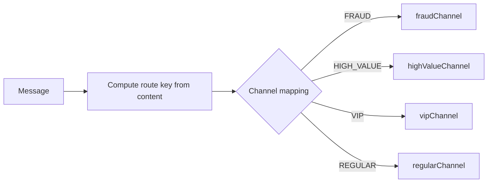
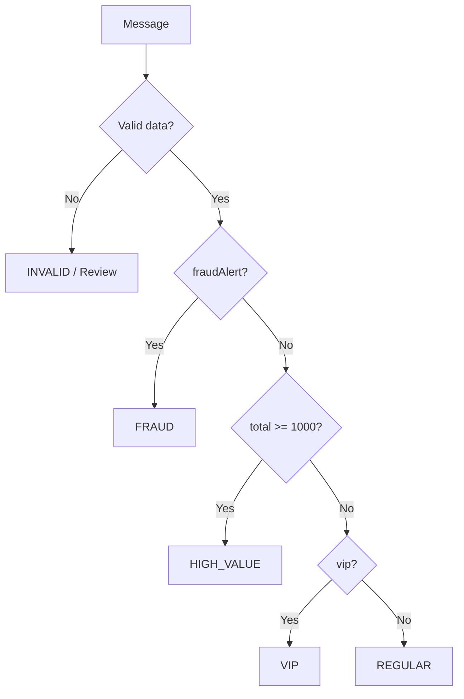
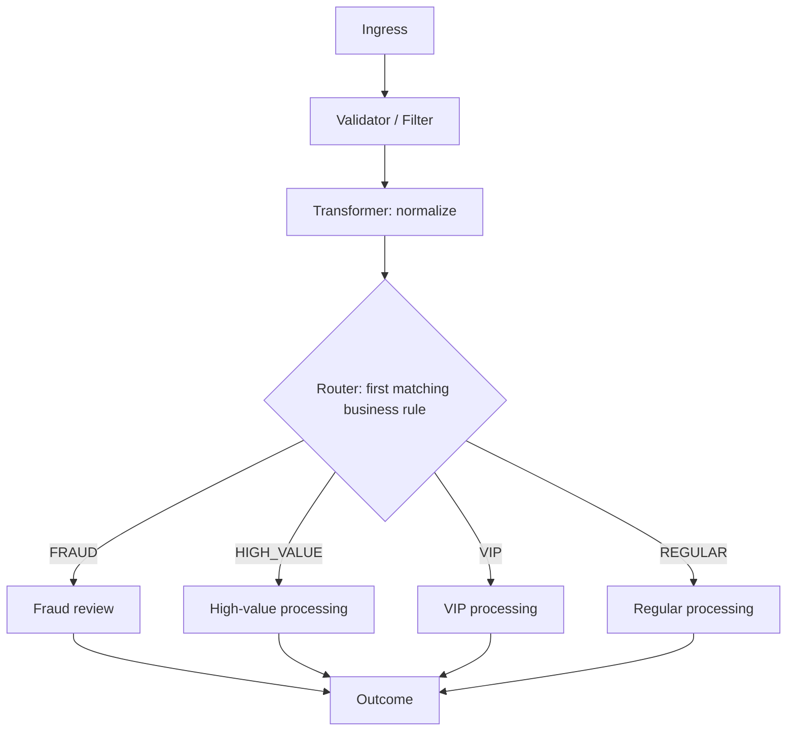

# Route Evaluation Order in Spring Integration Content-Based Router

## Learning objectives

When a message satisfies **multiple routing conditions**, which branch does the system choose? Should an order that simultaneously triggers a fraud alert, has a high value, and belongs to a VIP customer be sent to fraud review, priority handling, or VIP processing? This is the problem of **route evaluation order**.

In the **Content-based router** chapter of the **SPRING_INTEGRATION_PATTERN** module, we use Enterprise Integration Patterns (EIP) with Spring Integration to build loosely coupled, extensible message flows. This lesson connects Router with Filter, Transformer, Splitter, Aggregator, Gateway, retry, error channels, and correlation, while emphasizing how to test each processing branch.

By the end of this lesson, you can:

1. Distinguish **condition evaluation order**, **channel mapping declaration order**, **message delivery order**, and **task completion order**.
2. Design a **first-match-wins** policy using Java `if / else if` or a rule list with explicit priorities.
3. Configure a Content-Based Router with Spring Integration Java DSL to compute a route key from message content and map the key to a channel.
4. Explain when a message may reach multiple branches using `RecipientListRouter`, and why "first matching rule wins" thinking must not be assumed for fan-out.
5. Write tests for overlapping conditions, boundary cases, invalid inputs, and header preservation.
6. Predict the effects of async processing, retries, Filters, and Aggregators on a routing design's behavior.

## 1. What does a Content-Based Router actually decide?

A **Content-Based Router** chooses a path based on message content, usually `payload`, sometimes combined with normalized `headers`. Each message enters a Router endpoint, the endpoint determines one or more destinations, and forwards the message through channels.



A common implementation has **two stages**:

1. **Content evaluation**: the Router's function/expression computes a result such as `"FRAUD"` or `"VIP"`.
2. **Destination resolution**: the Router uses `channelMapping` to turn the route key into the corresponding channel, or applies fallback configuration if no destination exists.

Key point to remember:

> **Declaring `channelMapping("VIP", ...)` before `channelMapping("FRAUD", ...)` does not mean the VIP condition is checked before Fraud.** For a Router with a single key-computing function, the rule deciding the key lives inside that function or expression.

Spring Integration does not infer business priority from mappings. To enforce "check fraud before applying VIP perks", the application must express that precedence in routing logic and verify it in tests.

## 2. Four types of "order" commonly confused

| Type of order | Question answered | Governing mechanism |
| --- | --- | --- |
| **Rule evaluation order** | Which condition is evaluated first before deciding? | Java code, decision tree, priority-sorted rule table, or routing expression |
| **Channel mapping order** | In what order are key → channel entries declared? | Mapping table; once a key is computed, declaration order is generally not priority order |
| **Delivery / dequeue order** | On which channels and in what order are messages received? | `DirectChannel`, `QueueChannel`, `PriorityChannel`, executor, broker, poller |
| **Completion order** | Which message finishes business processing first? | Work duration, concurrency, I/O, retries, timeouts |

Example with two messages A and B:

```text
A (VIP, amount=100, fraud=false)  sent at 10:00:00
B (VIP, amount=9000, fraud=true) sent at 10:00:01

Rule selects:
    A -> VIP
    B -> FRAUD

Completion order may be:
    B completes before A  (if branches run in parallel)
```

Placing B on the FRAUD branch says nothing about whether it finishes earlier or later than A. **Routing priority** does not mean **processing priority**.

### Is the `order` property on an endpoint a rule priority?

No. In certain Spring Integration setups, the `order` attribute adjusts the **subscriber invocation order** of endpoints registered on the same channel. It does not rank predicates inside a Content-Based Router function. For polling consumers, it likewise does not turn mapping order into business priority.

## 3. Priority rules with overlapping conditions

Suppose an order has four fields:

- `fraudAlert`: the system detected fraud indicators.
- `total`: total order amount.
- `vip`: the customer belongs to the VIP tier.
- `orderId`: order identifier.

Business requirements:

1. Invalid data → send to review channel.
2. Fraud alert active → `FRAUD`.
3. Total of 1,000 or more → `HIGH_VALUE`.
4. VIP customer → `VIP`.
5. Otherwise → `REGULAR`.

### Decision table

| Evaluation order | Condition | Route key | Meaning |
| ---: | --- | --- | --- |
| 0 | Empty `orderId`, negative or missing `total` | `INVALID` | Do not run business logic on incomplete data |
| 1 | `fraudAlert == true` | `FRAUD` | Prioritize risk assessment |
| 2 | `total >= 1000` | `HIGH_VALUE` | High-value orders require a dedicated workflow |
| 3 | `vip == true` | `VIP` | VIP treatment when none of the above apply |
| 4 | None of the conditions match | `REGULAR` | Standard workflow |

A message with `fraudAlert=true`, `total=5000`, `vip=true` satisfies **three business conditions**. With **first-match-wins**, the result must be **FRAUD** because it is the first valid match. Moving VIP ahead of Fraud would change the outcome to VIP. Evaluation order is part of the **business contract**, not merely a code formatting choice.



### Why use an `if / else if` chain?

```java
static String chooseRoute(Order order) {
    if (order.fraudAlert()) {
        return "FRAUD";
    } else if (order.total().compareTo(new BigDecimal("1000")) >= 0) {
        return "HIGH_VALUE";
    } else if (order.vip()) {
        return "VIP";
    }
    return "REGULAR";
}
```

Each `return` terminates the decision, so later conditions are **not evaluated** once an earlier condition matches. This is an explicit, easily testable **short-circuit** rule.

One could write independent `if` statements repeatedly reassigning a route variable:

```java
String key = "REGULAR";
if (order.fraudAlert()) key = "FRAUD";
if (order.total().compareTo(new BigDecimal("1000")) >= 0) key = "HIGH_VALUE";
if (order.vip()) key = "VIP";
```

However, this is **last-write-wins**: the VIP condition at the end overwrites FRAUD, violating the contract above. When intentional precedence is required, use early returns or a sorted rule list that stops on the first match.

## 4. Java DSL: compute the key once, then map to a channel

The following example builds a small application with five targets: `fraud`, `highValue`, `vip`, `regular`, and `review`. We use `QueueChannel` targets so tests can explicitly pull results.

**Example contract:** valid messages route to **exactly one** branch; messages missing an order ID or having an invalid total go to the review channel.

```java
import java.math.BigDecimal;

import org.springframework.context.annotation.Bean;
import org.springframework.context.annotation.Configuration;
import org.springframework.integration.channel.DirectChannel;
import org.springframework.integration.channel.QueueChannel;
import org.springframework.integration.config.EnableIntegration;
import org.springframework.integration.dsl.IntegrationFlow;
import org.springframework.messaging.MessageChannel;
import org.springframework.messaging.PollableChannel;

@Configuration
@EnableIntegration
public class OrderedRoutingConfig {

    public record Order(
        String orderId,
        BigDecimal total,
        boolean fraudAlert,
        boolean vip
    ) {}

    @Bean("orders.in")
    MessageChannel ordersIn() {
        return new DirectChannel();
    }

    @Bean("orders.fraud")
    PollableChannel fraudQueue() {
        return new QueueChannel();
    }

    @Bean("orders.highValue")
    PollableChannel highValueQueue() {
        return new QueueChannel();
    }

    @Bean("orders.vip")
    PollableChannel vipQueue() {
        return new QueueChannel();
    }

    @Bean("orders.regular")
    PollableChannel regularQueue() {
        return new QueueChannel();
    }

    @Bean("orders.review")
    PollableChannel reviewQueue() {
        return new QueueChannel();
    }

    @Bean
    IntegrationFlow orderRoutingFlow() {
        return IntegrationFlow.from("orders.in")
            .route(Order.class, OrderedRoutingConfig::chooseRoute,
                spec -> spec
                    .channelMapping("FRAUD", "orders.fraud")
                    .channelMapping("HIGH_VALUE", "orders.highValue")
                    .channelMapping("VIP", "orders.vip")
                    .channelMapping("REGULAR", "orders.regular")
                    .channelKeyFallback(false)
                    .defaultOutputChannel("orders.review"))
            .get();
    }

    // Pure function: same input data -> same route key.
    static String chooseRoute(Order order) {
        if (order.orderId() == null || order.orderId().isBlank()
            || order.total() == null || order.total().signum() < 0) {
            return "INVALID";
        }

        if (order.fraudAlert()) {
            return "FRAUD";
        }

        if (order.total().compareTo(new BigDecimal("1000")) >= 0) {
            return "HIGH_VALUE";
        }

        if (order.vip()) {
            return "VIP";
        }

        return "REGULAR";
    }
}
```

Configuration explanation:

1. `.route(Order.class, OrderedRoutingConfig::chooseRoute, ...)` calls the decision function on the message payload.
2. `chooseRoute` evaluates conditions in the written order and returns **a single key**.
3. `.channelMapping(...)` looks up the channel for that key; the order of mapping calls does not alter the `if` order.
4. `.channelKeyFallback(false)` prevents an unknown key from accidentally matching an existing channel bean name.
5. `.defaultOutputChannel("orders.review")` routes unmapped keys, such as `INVALID`, to the review channel.
6. All outputs are `PollableChannel` instances; we have **not attached background consumers**, because our tests will call `receive()`.

This illustrative config uses Java 17+ (for `record`) and Spring Integration Java DSL. In a real application, a validation step before the Router can handle missing data, leaving the default channel for unmapped message types. Routing them to review here keeps the outcome easy to verify.

### Signs of a properly ordered Router

Try sending:

```java
import java.math.BigDecimal;

import org.springframework.messaging.Message;
import org.springframework.messaging.support.MessageBuilder;

OrderedRoutingConfig.Order order = new OrderedRoutingConfig.Order(
    "ORD-42", new BigDecimal("2500"), true, true);

Message<OrderedRoutingConfig.Order> message =
    MessageBuilder.withPayload(order)
        .setHeader("traceId", "trace-42")
        .setHeader("tenantId", "tenant-a")
        .build();

ordersIn.send(message);
```

`ordersIn` is the `MessageChannel` bean named `orders.in` retrieved from the Spring context. The resulting route key is `FRAUD`, because `fraudAlert` evaluates before total and VIP. The message enters `orders.fraud`, not `orders.highValue` or `orders.vip`.

The Router does not need to modify the payload to pick a branch. Headers such as `traceId` and `tenantId` stay on the message for downstream tracing and context enforcement.

## 5. Testing order: overlapping conditions are what matter

Testing only a single VIP order does not prove the Fraud > High Value > VIP precedence rule. You must create inputs that **simultaneously satisfy multiple conditions**.

### Test case matrix

| Input | Fraud | Total | VIP | Expected |
| --- | --- | ---: | --- | --- |
| `ORD-A` | true | 5,000 | true | **FRAUD** |
| `ORD-B` | false | 2,000 | true | **HIGH_VALUE** |
| `ORD-C` | false | 999.99 | true | **VIP** |
| `ORD-D` | false | 1,000 | false | **HIGH_VALUE** |
| `ORD-E` | false | 200 | false | **REGULAR** |
| `""` | false | 200 | false | **REVIEW** |
| `ORD-F` | true | -1 | true | **REVIEW** |

The first two rows test **precedence among simultaneously true conditions**. The row with exact total 1,000 tests the `>=` boundary. The last row confirms validation runs **before** business rules, even when Fraud is true.

### JUnit 5 and Spring Test

```java
import static org.assertj.core.api.Assertions.assertThat;

import java.math.BigDecimal;

import org.junit.jupiter.api.Test;
import org.springframework.beans.factory.annotation.Autowired;
import org.springframework.beans.factory.annotation.Qualifier;
import org.springframework.messaging.Message;
import org.springframework.messaging.MessageChannel;
import org.springframework.messaging.PollableChannel;
import org.springframework.messaging.support.MessageBuilder;
import org.springframework.test.context.junit.jupiter.SpringJUnitConfig;

@SpringJUnitConfig(OrderedRoutingConfig.class)
class OrderedRoutingTest {

    @Autowired
    @Qualifier("orders.in")
    MessageChannel input;

    @Autowired
    @Qualifier("orders.fraud")
    PollableChannel fraud;

    @Autowired
    @Qualifier("orders.highValue")
    PollableChannel highValue;

    @Autowired
    @Qualifier("orders.vip")
    PollableChannel vip;

    @Autowired
    @Qualifier("orders.regular")
    PollableChannel regular;

    @Autowired
    @Qualifier("orders.review")
    PollableChannel review;

    private void send(String id, String total, boolean fraudAlert, boolean isVip) {
        var order = new OrderedRoutingConfig.Order(
            id, new BigDecimal(total), fraudAlert, isVip);

        assertThat(input.send(
            MessageBuilder.withPayload(order)
                .setHeader("traceId", "trace-" + id)
                .build()
        )).isTrue();
    }

    @Test
    void fraudWinsWhenFraudHighValueAndVipOverlap() {
        send("ORD-A", "5000", true, true);

        Message<?> routed = fraud.receive(2_000);
        assertThat(routed).isNotNull();
        assertThat(routed.getHeaders().get("traceId"))
            .isEqualTo("trace-ORD-A");
        assertThat(highValue.receive(0)).isNull();
        assertThat(vip.receive(0)).isNull();
        assertThat(regular.receive(0)).isNull();
        assertThat(review.receive(0)).isNull();
    }

    @Test
    void highValueWinsOverVip() {
        send("ORD-B", "2000", false, true);

        assertThat(highValue.receive(2_000)).isNotNull();
        assertThat(vip.receive(0)).isNull();
        assertThat(fraud.receive(0)).isNull();
    }

    @Test
    void vipAppliesOnlyAfterHigherRulesFail() {
        send("ORD-C", "999.99", false, true);

        assertThat(vip.receive(2_000)).isNotNull();
        assertThat(highValue.receive(0)).isNull();
        assertThat(fraud.receive(0)).isNull();
    }

    @Test
    void invalidInputGoesToReviewBeforeBusinessRules() {
        send("", "-1", true, true);

        Message<?> routed = review.receive(2_000);
        assertThat(routed).isNotNull();
        assertThat(fraud.receive(0)).isNull();
    }

    @Test
    void thresholdAndRegularCasesAreDeterministic() {
        assertThat(OrderedRoutingConfig.chooseRoute(
            new OrderedRoutingConfig.Order(
                "ORD-D", new BigDecimal("1000"), false, false)))
            .isEqualTo("HIGH_VALUE");

        assertThat(OrderedRoutingConfig.chooseRoute(
            new OrderedRoutingConfig.Order(
                "ORD-E", new BigDecimal("200"), false, false)))
            .isEqualTo("REGULAR");
    }
}
```

Because `orders.in` is a `DirectChannel` and destinations are queues with no competing consumers, checking channels immediately after `send()` is deterministic in this example. If a real system switches to `ExecutorChannel` or a broker, wait on completion events/acks with appropriate timeouts rather than assuming instant `receive(0)`.

This is an illustrative test; your project needs JUnit 5, AssertJ, Spring Test, and Spring Integration. This example does not claim tests were executed on this repository.

## 6. Rule table with explicit priority

For three or four rules, `if / else if` is easy to read. When multiple business teams maintain a condition list, represent it as a **rule table** sorted by `priority`.

```java
import java.math.BigDecimal;
import java.util.Comparator;
import java.util.List;
import java.util.function.Predicate;

record RoutingRule(
    int priority,
    int tieOrder,
    Predicate<OrderedRoutingConfig.Order> matches,
    String key
) {}

final class RuleTable {

    private static final List<RoutingRule> RULES = List.of(
        new RoutingRule(10, 0, o -> o.fraudAlert(), "FRAUD"),
        new RoutingRule(20, 0,
            o -> o.total().compareTo(new BigDecimal("1000")) >= 0,
            "HIGH_VALUE"),
        new RoutingRule(30, 0, o -> o.vip(), "VIP")
    ).stream()
        .sorted(Comparator
            .comparingInt(RoutingRule::priority)
            .thenComparingInt(RoutingRule::tieOrder))
        .toList();

    static String select(OrderedRoutingConfig.Order order) {
        // Assumes message has already passed validation.
        return RULES.stream()
            .filter(rule -> rule.matches().test(order))
            .map(RoutingRule::key)
            .findFirst()
            .orElse("REGULAR");
    }
}
```

In this example, **smaller priority numbers win**: 10 → Fraud, 20 → High Value, 30 → VIP. This is an **application-defined convention**, not a default Spring Integration priority numbering scheme. `tieOrder` acts as a secondary criterion to avoid undefined ordering when two rules share the same priority.

Design requirements for a rule table:

- **Sort once into an immutable list** or maintain a consistent snapshot so a message never sees rules mutating mid-evaluation.
- **Validate before predicates**: avoid unexpected errors from `null` or mistyped fields.
- **No side effects inside predicates**: never write to databases, update balances, make HTTP calls, or mutate payloads just to test a route.
- **Explicit tie-breaker** whenever rules share a priority.
- **Overlap tests** so adding a new rule does not accidentally hijack an existing branch.
- **Policy versioning** if rules change dynamically and operators must reproduce historical decisions.

Never allow users to enter arbitrary SpEL expressions and execute them directly with application privileges. Dynamic rules require authorization, validation, and deployment under project security controls.

### Rule evaluation must be stable

A condition reading the wall clock, live exchange rates, or a database can yield different results across retries of the same message. When business logic requires stable decisions, snapshot decision inputs in a verified payload/header, or record `routePolicyVersion` and the chosen route key for traceability.

```text
business messageId = ORD-42
routePolicyVersion = 2026-11
chosenRoute = FRAUD
```

`chosenRoute` is application metadata you may record, **not a mandatory header auto-generated by Spring Integration**.

## 7. One key or multiple recipients? Choose the right semantics

In Spring Integration, a **Content-Based Router using a single-key function** normally selects one destination. With a **RecipientListRouter** (or a Router returning multiple targets), however, the same message can be sent to multiple channels.

### Router selecting one branch

```text
if fraud        -> FRAUD (stop)
else if vip     -> VIP
else            -> REGULAR
```

Conditions may overlap, yet only one branch is selected by priority order.

### Recipient-list router dispatching to multiple branches

```text
if auditEnabled -> AUDIT
if fraud        -> FRAUD
if vip          -> VIP

Result can be [AUDIT, FRAUD, VIP].
```

With a Recipient List, each recipient's selector determines **which targets receive the message**. Never assume the first matching rule stops subsequent rules like `if / else if`. If you want only one business branch while still emitting an audit copy, use **one Router selecting the main branch** and a separate audit mechanism (such as wire tap or publish-subscribe) with an explicit contract.

An XML sample illustrating per-recipient selection:

```xml
<int:recipient-list-router input-channel="orders.events">
    <int:recipient channel="orders.audit"/>
    <int:recipient
        channel="orders.fraud"
        selector-expression="payload.fraudAlert()"/>
    <int:recipient
        channel="orders.vipNotification"
        selector-expression="payload.vip()"/>
</int:recipient-list-router>
```

The XML snippet assumes the `int` namespace is declared and the channels exist. A message that is both Fraud and VIP can reach **both** conditional channels, plus audit. Expressions are evaluated against the message; do not treat the XML line order as a business contract saying "prefer Fraud, skip VIP".

### Is dispatch order to multiple recipients guaranteed?

Never use the dispatch order of a multi-target Router as proof that task A completed before task B. Channel types, executors, send failures, and downstream handlers determine real execution behavior. If business logic requires A to succeed **before** B may start, model an **ordered pipeline** or dependency-aware orchestration rather than relying on recipient list order.

## 8. Overlapping rules and decision-table testing

Overlapping rules come in two forms:

- **Intended overlap**: multiple conditions hold at once with a defined business priority, such as Fraud and VIP.
- **Unintended overlap**: two new rules both claim a case where product owners never defined expected behavior.

How to handle them:

1. List conditions that **can be true simultaneously**.
2. Write out the expected route for every meaningful combination.
3. Add direct tests for multi-condition overlaps.
4. Document the rationale for priority, especially for risk and access-control rules.
5. Whenever adding a rule, add overlap tests against existing rules.

Extended table example:

| Fraud | Total ≥ 1000 | VIP | Outcome by policy |
| --- | --- | --- | --- |
| false | false | false | REGULAR |
| false | false | true | VIP |
| false | true | false | HIGH_VALUE |
| false | true | true | HIGH_VALUE |
| true | false | false | FRAUD |
| true | false | true | FRAUD |
| true | true | false | FRAUD |
| true | true | true | FRAUD |

This table can be turned into a **parameterized test** so no combination is missed. Never test only individual rules in isolation: reordering bugs will slip past unnoticed.

### Monetary boundaries and input data

For monetary amounts in Java, prefer `BigDecimal.compareTo` over `equals` when checking thresholds: `1000.0` and `1000.00` have different scales yet identical numerical values. Real thresholds should also pair with currency units and conversion rules rather than comparing raw numbers across currencies.

Missing or spoofed data must be validated. If routing conditions affect permissions or fraud controls, never blindly trust headers or a `vip` flag supplied directly by the client.

## 9. Default route, expression errors, and downstream errors

Keep three cases distinct:

| Scenario | What happened | Appropriate behavior |
| --- | --- | --- |
| **No matching key** | Router function returned a key that resolves to no channel | `defaultOutputChannel`, fail-fast, or intentional rejection |
| **Condition evaluation throws** | E.g., `NullPointerException`, service timeout inside rule | Handle error at ingress/router; retry only when actually useful |
| **Routed successfully, handler fails** | Message reached the target channel/endpoint | Branch retry/error flow; idempotency if side effects exist |

**Default output channel is not a catch-all for exceptions.** If a predicate throws an exception, the Router may not even finish selecting a key; handle exceptions according to the flow's error-handling policy.

For instance, if `chooseRoute` always returns `FRAUD`, `HIGH_VALUE`, `VIP`, `REGULAR`, or `INVALID`, the default channel in `OrderedRoutingConfig` only receives `INVALID` because the other four keys are mapped. It does not automatically receive failures from the FRAUD handler.

### `channelKeyFallback` and `resolutionRequired`

For routers mapping keys to channels:

- `channelKeyFallback` controls whether the key itself is tried as a channel name if no mapping exists.
- `defaultOutputChannel` specifies the fallback channel when no target channel resolves.
- `resolutionRequired` controls whether resolving the channel name to a destination is mandatory; parameter interactions vary across versions.

Starting in Spring Integration 6.0, setting a default output channel on a mapping router disables channel-key fallback by default unless explicitly overridden. Our example still writes `channelKeyFallback(false)` to state the allowlist policy explicitly. When upgrading versions, test an unmapped key whose name matches an existing channel bean to guard against unintended routing.

## 10. Combining Router with Transformer, Filter, Splitter, and Aggregator

The order of **endpoints in the flow** must also be distinguished from rule order inside the Router.



- **Filter before Router**: drop invalid inputs before evaluating rules, avoiding misrouting from unvalidated data.
- **Transformer before Router**: normalize payload or decision inputs.
- **Router before business branches**: pick the right channel, then let branch handlers perform side effects.
- **Per-branch error handling**: handle failures where they occur; do not treat a high-priority route as automatically having better retry semantics.

If a payload holds a list and a Splitter emits multiple child messages, **each item** can be evaluated by the Router under the same policy. If an Aggregator must later recombine them, ensure:

1. Each part retains `correlationId` and required sequence headers.
2. "Unrouted" branches also emit a substitute result or trigger a group error state if the Aggregator still expects the full count.
3. Each part uses a `partId`/idempotency key to prevent duplicate processing on retries.
4. Never treat **completion order** across branches as original data order; rely on `sequenceNumber` or an appropriate business key.

### Route priority and Gateway

A synchronous Gateway expects a reply or a contract exception. If the Router sends a message to a queue with no consumer, or a branch performs only side effects and returns nothing, the caller may block until `replyTimeout`. Putting a rule at the top of the priority list **does not make a Gateway respond faster** if that branch's handler is slow or produces no reply.

## 11. Async flows: winning the route does not mean finishing first

Suppose the Router picks Fraud for a risky order and VIP for another order. If both branches use `ExecutorChannel` or polled queues:

```text
Message A -> FRAUD -> Handler takes 5 seconds
Message B -> VIP   -> Handler takes 0.1 seconds

B finishes before A even though A entered a branch with higher
business priority.
```

To **prioritize processing resources**, design dedicated scheduling/queue/consumer policies such as `PriorityChannel`, separate worker pools, or admission control. Rule-based channel selection only decides **the path**.

### Orders that easily invert

- **Multiple messages:** a later message can finish earlier.
- **One message, multiple branches:** Recipient-list router fan-out lets branches finish in arbitrary order.
- **A split batch:** parts can finish out of sequence order.
- **Retries:** a failed message retried later can finish after newer messages.
- **Brokers:** redelivery and consumer concurrency need explicit contract-level ordering/idempotency mechanisms.

## 12. Common bugs and diagnostics

| Symptom | Causes to check | Fix |
| --- | --- | --- |
| VIP "beats" Fraud | VIP rule checked earlier or multiple `if`s overwrite the key | Use explicit first-match-wins; test overlaps |
| Reordering `channelMapping` changes nothing | Route key is computed before mapping | Fix key-decision logic, not mapping order |
| Unknown key enters an unintended channel | Channel-key fallback matched a bean of the same name | Enforce explicit allowlist; disable fallback per policy |
| Nothing arrives on default channel | Router resolved another channel or errored before routing | Log computed key; inspect mappings/exceptions |
| Message goes to multiple places | Used Recipient-list router or returned multiple targets | Clarify fan-out vs. exclusive routing |
| Branch fails yet default receives nothing | Handler failed after routing succeeded | Configure retry/error flow on the failing branch |
| Gateway times out | Branch returned no reply or Aggregator waits on missing parts | Define reply/error contract for every route |
| Processing order ignores priority rules | Executor, queue, or broker runs concurrently | Separate rule order from scheduling/completion order |
| Routing outcome changes on retry | Rule reads dynamic data or policy changed | Snapshot required inputs; manage policy versions |
| Aggregator never releases | A part was filtered/routed away without returning a result | Emit status result or configure appropriate release strategy |

### Logging routing decisions

For diagnostics, log selective fields such as:

```text
traceId=trace-42 orderId=ORD-42
event=route_selected
routeKey=FRAUD policyVersion=2026-11
matchedRule=fraud-alert
```

`policyVersion` and `matchedRule` are application-designed fields; Spring Integration does not emit them automatically. Avoid logging full payloads/headers as they may contain sensitive data. When explaining "why was this route chosen?", recording the winning rule or a safe reason code is far better than dumping personal attributes.

## 13. Practice exercises

**Exercise 1 — Reverse rule order.** Using `OrderedRoutingConfig` and a message with `fraudAlert=true`, `vip=true`, `total=2500`, swap the Fraud and VIP checks and re-run the test. Explain why the result changes while reordering `channelMapping` has no such effect.

**Exercise 2 — Decision table.** Write a parameterized test covering all eight combinations of Fraud (true/false), total ≥ 1000 (true/false), and VIP (true/false). Compare outcomes against the table in section 8.

**Exercise 3 — Rule table.** Add a "Strategic partner order" rule with priority between HIGH_VALUE and VIP. Test a message matching two rules simultaneously, add a tie-breaker, and write regression tests.

**Exercise 4 — Default channel.** Send a message with negative total or blank order ID. Confirm it enters review, keeps `traceId`, and skips Fraud/VIP. Then create an unmapped route key matching an existing channel bean name to test `channelKeyFallback`.

**Exercise 5 — Router and fan-out.** Implement "always audit, plus send to Fraud if flagged, and VIP notification if VIP." Try `RecipientListRouter` and verify one message reaches multiple recipients. Compare with the first-match-wins Router in this lesson.

**Exercise 6 — Retries and policy version.** Simulate a rule depending on changing exchange rates. Retry the same message after the rate updates; propose how to persist a snapshot or policy version so routing decisions remain explainable.

**Exercise 7 — Splitter/Aggregator.** Split a batch of three order lines, each routed to a business branch. One line is rejected. Design how to emit `PartResult(REJECTED)` or fail the group so the Aggregator does not wait indefinitely.

## 14. Pre-deployment checklist

1. Is **exclusive routing** vs. **multi-recipient fan-out** clearly defined?
2. Is the priority of overlapping conditions captured in a **decision table**?
3. Does key-selection logic **stop on the first matching rule** per policy?
4. Does `channelMapping` cover all valid keys, and is `channelKeyFallback` controlled?
5. Are routing decision inputs validated/normalized at ingress?
6. Are predicates **pure/deterministic**, or do they rely on I/O and external state?
7. Are there tests for **one message matching multiple rules** and boundary thresholds?
8. Does every branch have a reply or error contract compatible with the Gateway?
9. If downstream runs concurrently, have you avoided confusing rule order with completion order?
10. If using Splitter/Aggregator, are correlation, release, timeout, and idempotency clear?
11. Do metrics/logs cover route keys, selection reasons, unmatched items, errors, and policy versions?
12. When adding new rules, are regression tests run against existing rules?

### Key takeaway

**Route evaluation order lives in the route-key selection logic and the policy for overlapping conditions.** For a Content-Based Router using a single-key function, Spring Integration maps the result to a channel; `channelMapping` declaration order does not automatically become rule priority. Express **first-match-wins** explicitly, validate inputs, test combinations where multiple rules hold simultaneously, and separate routing from fan-out and task completion order. Doing so lets integration systems expand processing branches while keeping business decisions consistent.

### References

- [Spring Integration Reference — Router Implementations](https://docs.spring.io/spring-integration/reference/router/implementations.html)
- [Spring Integration Reference — Common Router Parameters](https://docs.spring.io/spring-integration/reference/router/common-parameters.html)
- [Spring Integration Reference — Configuring a Generic Router](https://docs.spring.io/spring-integration/reference/router/namespace.html)
