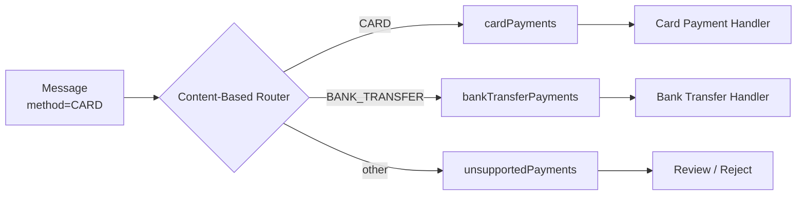
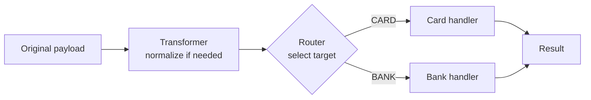
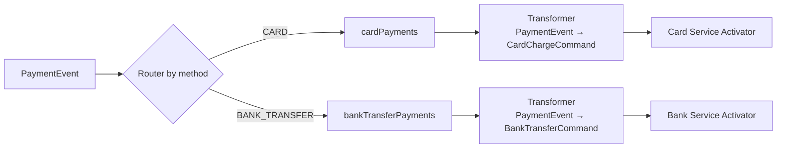
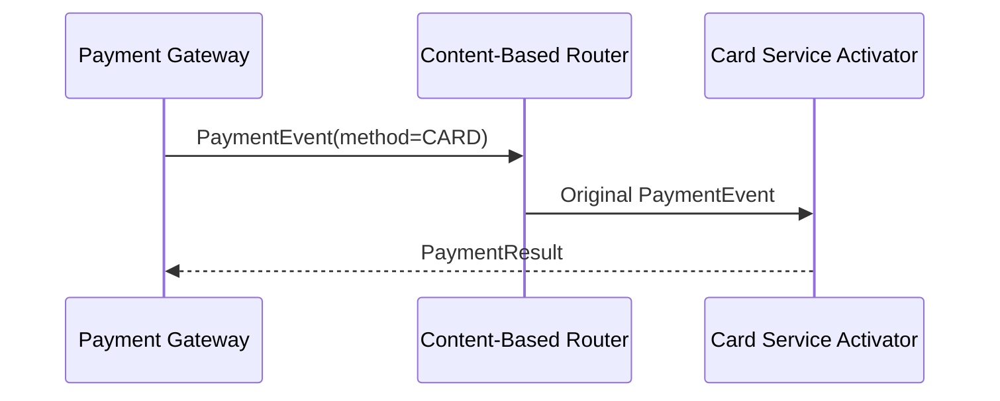
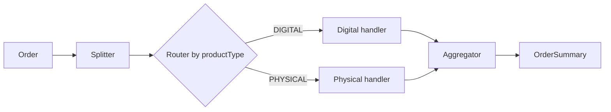

# Keeping Payloads Unchanged in a Spring Integration Content-Based Router

> **Chapter:** Content-based router  
> **Lesson:** Not modifying payloads inside the router  
> **Scope:** Enterprise Integration Patterns (EIP) with Spring Integration; building loosely coupled message flows combining Router, Filter, Transformer, Splitter, Aggregator, Gateway, retry, error channels, correlation, and observability.

## 1. The problem: choosing the right processing path without altering data

A payment system receives the same message type from multiple channels. When a request arrives, the system must route it to the card processing branch, bank transfer branch, or manual review branch. Each branch has different business logic, yet **the original request data must be preserved across the routing point**.

Example payload:

```json
{
  "paymentId": "PAY-2048",
  "method": "CARD",
  "amount": 1250000,
  "currency": "VND"
}
```

When the Router receives this message, it only needs to read `method = CARD` and choose the `cardPayments` channel. The Router does not need to adjust `amount`, prepend prefixes to `paymentId`, or convert `PaymentEvent` into `CardChargeCommand`. Any such changes belong to a Transformer or a payment branch handler, if required by the business.



**Core principle:** A Content-Based Router reads content (payload or headers) to decide where a message should go. In a clean design, the Router **leaves the inbound message payload unchanged**, placing data modifications in a separate processing component.

After this lesson, you can:

1. Explain the difference between routing and payload transformation.
2. Write a Content-Based Router using Spring Integration Java DSL.
3. Test payload, headers, and routing decisions across every branch.
4. Spot patterns in routing functions that accidentally mutate state.
5. Maintain correctness when combining Router with Splitter/Aggregator, Gateway, async channels, retries, and error channels.

## 2. What are Message, payload, and headers?

In Spring Integration, a message is typically represented by `org.springframework.messaging.Message<T>` with two parts:

| Component | Role | Example |
| --- | --- | --- |
| **Payload** | Business data to process | `PaymentEvent(paymentId, method, amount, currency)` |
| **Headers** | Metadata for transport, correlation, and orchestration | `id`, `timestamp`, `replyChannel`, `errorChannel`, `traceId` |
| **MessageChannel** | Message exchange boundary | `paymentInput`, `cardPayments` |
| **Router** | Determines the appropriate output channel | `CARD → cardPayments` |

When saying "the Router does not modify the payload", be precise about what that means:

- **No type conversion:** if the incoming message carries `PaymentEvent`, after the Router step it still carries `PaymentEvent` unless another component transforms it.
- **No editing business fields:** the Router does not tweak `amount`, `method`, or `paymentId` to pick a destination.
- **No creating a different payload just from branching:** the routing key may be `CARD`, yet the output payload does not become the string `"CARD"`.
- **No automatic deep immutability guarantee for arbitrary Java objects:** if the payload is an object with setters or mutable collections, code you write can still mutate it. Spring Integration does not automatically make every payload immutable.
- **Not necessarily preserving the entire message envelope:** other components, fan-out/sequence mechanisms, header enrichment, or adapters may add or alter metadata. This lesson focuses on **payload content at the routing point**.

### Data observation example

```text
Before Router
payload = PaymentEvent("PAY-2048", "CARD", 1250000, "VND")
headers = {traceId: "trace-42", businessKey: "PAY-2048"}

Router reads payment.method() -> "CARD"
Router decides "cardPayments"

After Router, at cardPayments
payload = PaymentEvent("PAY-2048", "CARD", 1250000, "VND")
headers still contain traceId and businessKey
```

This assumes the inspected segment contains only the Router and channels. If a downstream Transformer later converts the payload to `CardChargeCommand`, that is an **intentional Transformer change**, not the Router's doing.

## 3. What does a Content-Based Router do in Enterprise Integration Patterns?

An EIP **Content-Based Router** routes messages based on criteria derived from content, such as order type, payment method, or processing region.

Logical model:

```text
message
  |
  v
extract routing key
  |
  v
resolve target channel
  |
  v
send original message to target
```

For example, a routing function can return a key:

```java
String routeKey(PaymentEvent payment) {
    return payment.method();
}
```

The function returns `"CARD"` so the Router picks a channel. This return value is a **routing key**, not a new payload and not the business outcome of the payment.

### Distinguishing Router from related patterns

| Pattern | Primary question | Can it change the payload? |
| --- | --- | --- |
| **Content-Based Router** | Which branch should the message go to? | Normally no; its job is destination selection |
| **Transformer** | What shape should the payload become? | Yes; that is its core job |
| **Filter** | May the message continue? | Usually no; only decides pass/drop |
| **Header Enricher** | Which metadata needs adding? | Keeps payload, adds headers |
| **Service Activator** | Which business action to invoke? | Can return a result payload or run one-way |
| **Splitter** | Which parts to split a message into? | Yes; produces per-part payloads |
| **Aggregator** | How to combine results in a group? | Can produce a combined payload |

A clear design looks like this:



The Transformer owns changing data shape; the Router owns choosing the path. If a Router both transforms and routes, logic becomes harder to test, harder to reuse, and prone to hidden side effects.

## 4. Java DSL example: selecting a channel based on payload

We build a Router receiving `PaymentEvent`. Input states are normalized beforehand and include only contract-published values. The Router picks one of three channels:

- `CARD` → `cardPayments`
- `BANK_TRANSFER` → `bankTransferPayments`
- Other values → `unsupportedPayments` for inspection or rejection.

In this example, targets are `QueueChannel` instances so tests can pull messages directly. A real application connects channels to Service Activators or adapters.

### 4.1. Configuring IntegrationFlow

```java
package example.integration;

import java.math.BigDecimal;

import org.springframework.context.annotation.Bean;
import org.springframework.context.annotation.Configuration;
import org.springframework.integration.channel.DirectChannel;
import org.springframework.integration.channel.QueueChannel;
import org.springframework.integration.config.EnableIntegration;
import org.springframework.integration.dsl.IntegrationFlow;
import org.springframework.messaging.MessageChannel;

@Configuration
@EnableIntegration
public class ContentBasedRouterConfiguration {

    public record PaymentEvent(
        String paymentId,
        String method,
        BigDecimal amount,
        String currency
    ) {}

    @Bean
    public MessageChannel paymentInput() {
        return new DirectChannel();
    }

    @Bean
    public QueueChannel cardPayments() {
        return new QueueChannel();
    }

    @Bean
    public QueueChannel bankTransferPayments() {
        return new QueueChannel();
    }

    @Bean
    public QueueChannel unsupportedPayments() {
        return new QueueChannel();
    }

    @Bean
    public IntegrationFlow paymentRoutingFlow() {
        return IntegrationFlow.from("paymentInput")
            .route(
                PaymentEvent.class,
                PaymentEvent::method,
                spec -> spec
                    .channelMapping("CARD", "cardPayments")
                    .channelMapping(
                        "BANK_TRANSFER", "bankTransferPayments")
                    .channelKeyFallback(false)
                    .defaultOutputChannel("unsupportedPayments")
                    .resolutionRequired(true)
            )
            .get();
    }
}
```

**Component breakdown:**

- `IntegrationFlow.from("paymentInput")` starts at the input channel.
- `.route(PaymentEvent.class, PaymentEvent::method, ...)` reads `method` from the payload to compute the routing key.
- `channelMapping(...)` maps known keys to channels.
- `channelKeyFallback(false)` prevents an unknown key from being treated as an internal channel name outside published mappings.
- `defaultOutputChannel(...)` routes messages with unsupported methods to the fallback branch.
- `resolutionRequired(true)` requires destination resolution; since a valid default channel exists, unknown keys go to the fallback branch rather than immediately failing.

No step in the Router configuration reassigns `amount`, `paymentId`, or `currency`, nor constructs another `PaymentEvent`. `PaymentEvent::method` only **reads** a property.

### 4.2. Sending messages to the Router

Example from a controller or integration test injected with `paymentInput`:

```java
import java.math.BigDecimal;

import org.springframework.messaging.Message;
import org.springframework.messaging.support.MessageBuilder;

ContentBasedRouterConfiguration.PaymentEvent payment =
    new ContentBasedRouterConfiguration.PaymentEvent(
        "PAY-2048", "CARD", new BigDecimal("1250000"), "VND");

Message<?> message = MessageBuilder.withPayload(payment)
    .setHeader("businessKey", "PAY-2048")
    .setHeader("traceId", "trace-42")
    .build();

boolean accepted = paymentInput.send(message);
```

When `paymentInput` is a `DirectChannel`, the Router normally dispatches on the calling thread. `accepted` only indicates message-flow send acceptance; it **does not prove the payment finished**.

After the Router, the message sits in `cardPayments` awaiting a consumer. Its payload is still the `PaymentEvent` holding the four original values.

### 4.3. Why use QueueChannel in the example?

`QueueChannel` lets tests verify a message reached the right target via `receive(...)` without spinning up real payment services. It is a clean illustration and testing tool for single-message channel routing.

However, in-memory `QueueChannel` does not guarantee messages survive abrupt shutdowns. In a payment system requiring durability, add an appropriate broker or persistent store along with ack, retry, and idempotency policies.

## 5. Proving the payload stays intact: JUnit 5 tests

Unit testing `PaymentEvent::method` alone is insufficient. Test the **entire message passing through the router** to verify target channel, payload, and metadata.

The tests below use the configuration from section 4.

```java
package example.integration;

import static org.junit.jupiter.api.Assertions.*;

import java.math.BigDecimal;

import org.junit.jupiter.api.Test;
import org.springframework.beans.factory.annotation.Autowired;
import org.springframework.beans.factory.annotation.Qualifier;
import org.springframework.integration.channel.QueueChannel;
import org.springframework.messaging.Message;
import org.springframework.messaging.MessageChannel;
import org.springframework.messaging.support.MessageBuilder;
import org.springframework.test.context.junit.jupiter.SpringJUnitConfig;

@SpringJUnitConfig(ContentBasedRouterConfiguration.class)
class ContentBasedRouterTest {

    @Autowired
    @Qualifier("paymentInput")
    private MessageChannel paymentInput;

    @Autowired
    @Qualifier("cardPayments")
    private QueueChannel cardPayments;

    @Autowired
    @Qualifier("bankTransferPayments")
    private QueueChannel bankTransferPayments;

    @Autowired
    @Qualifier("unsupportedPayments")
    private QueueChannel unsupportedPayments;

    @Test
    void cardPaymentKeepsOriginalPayloadAndHeaders() {
        var event = new ContentBasedRouterConfiguration.PaymentEvent(
            "PAY-2048", "CARD", new BigDecimal("1250000"), "VND");

        Message<?> input = MessageBuilder.withPayload(event)
            .setHeader("businessKey", "PAY-2048")
            .setHeader("traceId", "trace-42")
            .build();

        assertTrue(paymentInput.send(input));

        Message<?> output = cardPayments.receive(1_000);
        assertNotNull(output);

        // In a minimal flow with only Router and QueueChannel,
        // the payload is still the exact object that was sent.
        assertSame(event, output.getPayload());

        assertEquals("PAY-2048",
            output.getHeaders().get("businessKey"));
        assertEquals("trace-42",
            output.getHeaders().get("traceId"));

        assertEquals("CARD",
            ((ContentBasedRouterConfiguration.PaymentEvent)
                output.getPayload()).method());
        assertNull(bankTransferPayments.receive(0));
        assertNull(unsupportedPayments.receive(0));
    }

    @Test
    void bankTransferReachesOtherChannelWithSamePayload() {
        var event = new ContentBasedRouterConfiguration.PaymentEvent(
            "PAY-2049",
            "BANK_TRANSFER",
            new BigDecimal("750000"),
            "VND");

        assertTrue(paymentInput.send(
            MessageBuilder.withPayload(event).build()));

        Message<?> output = bankTransferPayments.receive(1_000);
        assertNotNull(output);
        assertSame(event, output.getPayload());
        assertEquals(new BigDecimal("750000"),
            ((ContentBasedRouterConfiguration.PaymentEvent)
                output.getPayload()).amount());

        assertNull(cardPayments.receive(0));
        assertNull(unsupportedPayments.receive(0));
    }

    @Test
    void unknownMethodGoesToDefaultWithoutRewritingPayload() {
        var event = new ContentBasedRouterConfiguration.PaymentEvent(
            "PAY-2050",
            "CRYPTO",
            new BigDecimal("100000"),
            "VND");

        assertTrue(paymentInput.send(
            MessageBuilder.withPayload(event).build()));

        Message<?> output = unsupportedPayments.receive(1_000);
        assertNotNull(output);
        assertSame(event, output.getPayload());
        assertEquals("CRYPTO",
            ((ContentBasedRouterConfiguration.PaymentEvent)
                output.getPayload()).method());

        assertNull(cardPayments.receive(0));
        assertNull(bankTransferPayments.receive(0));
    }
}
```

Meaning of assertions:

| Assertion | What does it verify? |
| --- | --- |
| `assertSame(event, output.getPayload())` | In the sample flow, the exact same payload object passes through the Router |
| `assertEquals(... amount())` | Business values remain unmodified |
| `assertEquals(... traceId)` | Tracing metadata is preserved |
| `assertNull(channel.receive(0))` | No messages land in unselected channels |
| Unknown method case | Router sends to default without rewriting method to a fake valid value |

**Note on `assertSame` scope:** this check fits a minimal internal flow with no copying or serialization. When messages cross HTTP/Kafka adapters, copying Transformers, or serializers, Java object identity is no longer the right contract. In those cases, assert **output payload values and schema** rather than insisting both sides share the same object reference.

## 6. Why write the routing function as a pure function?

A good routing function simply computes a key from its input:

```java
public String routeByMethod(PaymentEvent event) {
    return event.method();
}
```

Given the same message and rule set, it produces the same decision without side effects. This keeps routing easy to test and safe to re-evaluate on retries.

### Anti-pattern example: mutating the payload inside the Router

Suppose an application uses a mutable class:

```java
public final class MutablePayment {
    private String method;

    public String getMethod() {
        return method;
    }

    public void setMethod(String method) {
        this.method = method;
    }
}
```

This implementation is problematic:

```java
public String chooseChannel(MutablePayment payment) {
    if (payment.getMethod() == null) {
        payment.setMethod("CARD"); // Side effect on payload
    }
    return payment.getMethod();
}
```

This method does not merely pick a route; it alters original data. If a client sends a message missing a payment method, silently overwriting it to `CARD` hides an input bug and can trigger wrong business processing.

Instead, enforce validity rules in an earlier step:

```text
Adapter / Gateway
    |
    v
Validate / Transformer
    |
    v
Content-Based Router (read-only)
    |
    v
Per-branch handler
```

Pure example:

```java
public String chooseChannel(MutablePayment payment) {
    String method = payment.getMethod();
    return method == null ? "UNSUPPORTED" : method;
}
```

The method only returns `"UNSUPPORTED"` without touching the object. Router config can map `"UNSUPPORTED"` to a review or reject channel per policy.

### Drawbacks of mutable payloads

Even if the Router leaves payloads untouched, a downstream handler can still call setters on the shared object. When messages fan out to multiple branches or run concurrently, this causes race conditions.

Prefer:

- Java records or immutable DTOs.
- Immutable field types such as `String`, `BigDecimal`, and `Instant`.
- Avoiding unprotected shared mutable collections.
- When data must change, creating a new object inside a Transformer with a clear contract.

A Java record is only immutable at the **field-reference** level; if a field holds a mutable `List`, other code can still mutate list contents. Use defensive copies or unmodifiable collections when needed.

## 7. Router picks the path; Transformer changes the payload

This is a critical responsibility boundary.

Suppose the card branch requires `CardChargeCommand`, while the bank transfer branch requires `BankTransferCommand`. Both start from the same `PaymentEvent` input.

Clean design:



When the Router selects `CARD`:

1. The payload leaving the Router is still `PaymentEvent`.
2. The card branch's Transformer receives `PaymentEvent`.
3. The Transformer constructs a new `CardChargeCommand`.
4. The Service Activator executes the specialized command.

Example Transformer on the card branch:

```java
public record CardChargeCommand(
    String paymentId,
    BigDecimal amount,
    String currency
) {}

public CardChargeCommand toCardCommand(PaymentEvent event) {
    return new CardChargeCommand(
        event.paymentId(),
        event.amount(),
        event.currency()
    );
}
```

In this snippet, `BigDecimal` comes from `java.math.BigDecimal` and `PaymentEvent` is the record declared in section 4 (or an equivalent type). `toCardCommand` belongs to the card branch Transformer, **never inside the routing function**.

### Why is this easier to maintain?

- Adding a new payment method means updating mappings and adding a new handler branch.
- Changing card data formats means editing only the card Transformer.
- Updating shared input validation means editing the validator or pre-Router Transformer.
- Verifying routing decisions means testing keys and destinations without instantiating real payment services.

## 8. Can you route based on headers?

Yes. Content-Based Router broadly means deciding from information carried by the message; in Spring Integration, a Router can inspect either payload or headers.

For example, a logistics system selects a regional handler using a `region` header:

```text
payload = ShipmentEvent("SHIP-101", ...)
headers = {region: "VN", traceId: "trace-101"}

Header-based routing:
VN -> vietnamShipments
SG -> singaporeShipments
```

Even though the routing key comes from a header, the business payload still remains unchanged.

However, distinguish carefully:

- A `region` received and verified by an adapter can be used for operational routing.
- A `tenantId` or access role supplied arbitrarily by a client **must not be trusted automatically**.
- When metadata must be added or normalized, use a Header Enricher, Gateway/adapter, or dedicated verification step.
- Never alter the payload just to smuggle in a temporary routing attribute.

**Header-based routing does not mean all headers survive every transport**. HTTP/Kafka/AMQP have distinct header mapping rules; test boundary adapters.

## 9. Using `@Router`: method returns channel key, not modified payload

Besides DSL, Spring Integration supports `@Router` to bind a method to an input channel.

This example is an **alternative** to the DSL Router in section 4. Do not register both Routers on the same `paymentInput` channel if you want a single processing path.

```java
package example.integration;

import org.springframework.integration.annotation.Router;
import org.springframework.messaging.handler.annotation.Payload;
import org.springframework.stereotype.Component;

@Component
public class PaymentRoutingEndpoint {

    @Router(inputChannel = "paymentInput")
    public String chooseChannel(
            @Payload ContentBasedRouterConfiguration.PaymentEvent event) {

        return switch (event.method()) {
            case "CARD" -> "cardPayments";
            case "BANK_TRANSFER" -> "bankTransferPayments";
            default -> "unsupportedPayments";
        };
    }
}
```

Unlike the DSL example using `channelMapping`, this method returns the names of defined channels directly. These are **internal values selected from a fixed set**, never arbitrary client strings treated as valid bean names.

In practice, ensure payload and `method` are non-null; `null` can throw in `switch`. Validate upstream or add an explicit null check. A validation failure should never default to card payment.

When using `@Router`, enable Spring Integration and appropriate component scanning/annotation infrastructure. Router configurations support default output and resolution settings depending on Router type; match the API of your version.

## 10. What happens to the Message and headers after the Router?

A common misconception is that **unchanged payload** means everything around the message must be identical.

### 10.1. In a simple flow

With `DirectChannel → Content-Based Router → QueueChannel` and no transformation step, the payload arriving at the chosen channel is the same object instance as in our example input.

Standard headers such as `businessKey` and `traceId` also travel with the message, as verified in section 5's tests.

### 10.2. With recipient-list or multicast

A **Recipient List Router** can forward a message to multiple channels. When sequence metadata applies, the framework may add/adjust headers such as `correlationId`, `sequenceNumber`, and `sequenceSize` for downstream steps. This does not convert the payload into a new business type.

If branches receive the same mutable payload object and mutate fields concurrently, race conditions arise. The safe policy is using immutable payloads or making deliberate copies in an appropriate component.

### 10.3. Across a broker/HTTP

An outbound adapter may serialize the payload while the receiver deserializes it into a new object. The payload is equivalent *by value*, yet Java object identity differs.

Therefore, separate two kinds of checks:

| Scope | What to assert |
| --- | --- |
| Internal Router, no Transformer | Payload object identity (`assertSame`) and values remain intact |
| Flow with Mapper/Transformer | Output values satisfy transformation schema/contract |
| Across broker or HTTP | Deserialized payload has expected values; headers map per config |
| Multicast flow with mutable payload | No branch mutates shared data unexpectedly |

**Do not rely on `MessageHeaders.id` or `timestamp` as proof that the payload stayed unchanged:** envelope IDs can change whenever a component builds a new message, even when business data is identical.

## 11. Should a routing function query a DB or call an API?

Technically, a routing function is Java code and can call dependencies. Yet for merely picking a route, waiting on a database or external API increases latency and adds failure points.

Anti-pattern example:

```java
public String route(PaymentEvent event) {
    String merchantTier = remoteService.lookupTier(event.paymentId());
    return merchantTier.equals("VIP") ? "priority" : "standard";
}
```

This snippet does not mutate the payload, yet embeds I/O directly inside the routing decision. If the API slows down or times out, the entire Router stalls. Worse, the same message may route differently on retry if external service data changes.

Consider two alternatives:

1. **Enrich before the Router:** fetch supplementary data in a dedicated step, store it in headers or a normalized payload, and manage timeouts/retries there.
2. **Policy-controlled routing service:** if dynamic lookup is unavoidable, encapsulate it in a tested service with caching/fallbacks, latency monitoring, and explicit behavior when data is missing.

A pure, side-effect-free routing function is much easier to observe, reproduce, and test.

## 12. Router vs. Filter: keeping payloads intact with different duties

Both Router and Filter typically leave payloads unchanged. However:

- **Filter** decides whether a message may continue in the flow.
- **Router** decides which channel among possible targets receives the message.

Example:

```text
PaymentEvent
   |
   v
Filter: amount > 0?
   |  no -> reject/error policy
   v
Router: payment.method
   | CARD                 | BANK_TRANSFER
   v                      v
cardPayments        bankTransferPayments
```

If a Filter drops a message while a Gateway waits for a reply, the caller can time out without an error path or explicit rejection response. Likewise, if a Router finds no destination, it must follow an explicit `resolutionRequired`, `defaultOutputChannel`, or intentional-drop policy.

Never use a Router to silently rewrite `method` into a valid value when input is invalid. For invalid methods, report a validation error or route to a fallback branch.

## 13. When the Router cannot find a target channel

Keeping payloads intact **does not solve** unsupported keys. The Router still needs a clear policy.

In Spring Integration, four related settings apply:

| Setting | Role | Impact on payload |
| --- | --- | --- |
| `channelMapping` | Maps routing key to channel | No payload change needed |
| `defaultOutputChannel` | Destination when no rule resolves a channel | Message goes to default; payload stays identical |
| `resolutionRequired` | Whether to fail if destination cannot resolve | Controls error/drop behavior, does not transform data |
| `channelKeyFallback` | Whether to treat unmapped keys as channel names | Does not alter payload, though it may pick an unmapped target |

Example:

```text
event.method = "MOBILE_WALLET"

Mappings:
  CARD          -> cardPayments
  BANK_TRANSFER -> bankTransferPayments

Fallback by key = false
Default channel = unsupportedPayments

Result:
  original PaymentEvent("PAY-2050", "MOBILE_WALLET", ...)
  -> unsupportedPayments
```

The `unsupportedPayments` branch should return an error/pending status or record the message per contract—never silently treat it as paid.

Some critical systems set `resolutionRequired(true)` with no default channel to **fail fast** on unknown keys. In that case, an exception is thrown at the Router, while the payload is never altered to "fix" the error.

## 14. Request-reply Gateway: Router does not generate business replies

A `@MessagingGateway` can invoke a flow and wait for a result:

```java
@MessagingGateway(defaultRequestChannel = "paymentInput")
public interface PaymentGateway {
    PaymentResult submit(PaymentEvent payment);
}
```

This snippet illustrates the contract; running it requires defining `PaymentResult`, configuring the Gateway, and having downstream handlers actually return replies. **The Router only forwards the message.** It neither constructs `PaymentResult` nor processes payments.



If a branch merely drops a message into a queue with no replying handler, a request-reply Gateway can block until timeout. Therefore establish:

- Which branches return replies?
- What is the reply type?
- What is the reply timeout?
- Does an unsupported-method branch return a business error or throw an exception?
- For async calls, does the caller wait or just receive an "accepted" acknowledgment?

Keeping the payload intact across the Router ensures the Gateway and downstream branches share a single input contract, though it does not replace explicit reply design.

## 15. Splitter, Router, and Aggregator: why preserve correlation?

An order contains multiple line items. A Splitter breaks the order into child messages, a Router picks a processing branch by product type, and an Aggregator recombines results.



At the **Router**, each child message's payload typically stays intact. For example, a child message carrying `OrderLine` is forwarded as that exact `OrderLine` to the digital or physical branch.

With Splitter/Aggregator, beyond payloads, pay attention to:

- `correlationId`: links child messages belonging to the same group.
- `sequenceNumber`: indicates the child message's position.
- `sequenceSize`: helps determine group size when applicable.
- Aggregator release/timeout policies when results are missing or late.

If the Router silently drops an unroutable child message, the Aggregator may wait until timeout because expected items never arrive. If a Router or handler builds a new message and loses correlation headers, results fail to group properly.

For unsupported branches, instead of letting items vanish, emit a `LineFailed` result so the Aggregator knows the item failed and can still reach a final decision.

**Never alter `correlationId`, `sequenceNumber`, or `sequenceSize` arbitrarily inside a routing function.** If business rules require different grouping, define correlation/release strategies on the appropriate component.

## 16. Async execution, ordering, and mutable payloads

After an `ExecutorChannel`, messages can run concurrently across multiple threads. The Router still picks channels, yet downstream branches may finish out of send order.

```text
ExecutorChannel
   |
   +--> Worker A -> Router -> cardPayments -> Card handler
   |
   +--> Worker B -> Router -> bankTransferPayments -> Bank handler
```

Risks to account for:

1. **Ordering:** two messages with the same `paymentId` may finish out of arrival order.
2. **Transactions:** the sender thread's transaction does not automatically carry over to worker threads.
3. **ThreadLocals:** MDC/security context/tracing require proper propagation.
4. **Mutable payloads:** multiple threads mutating the same object cause race conditions.
5. **Overload:** executors or target channels may reject tasks even after the Router chose a valid target.

Payload immutability prevents one class of concurrency bugs, yet **does not guarantee business ordering or transactional integrity**. If ordering is required, design partitioned channels, keyed routing, or version checks at persistence time.

### One message sent to multiple branches

When an event must go to multiple destinations (e.g., audit logging and dashboard updates), consider `PublishSubscribeChannel` or Recipient List Router. Never let multiple subscribers mutate a shared payload. Use immutable DTOs or create deliberate copies per branch when independent changes are truly needed.

Do not equate a unicast Content-Based Router picking one route with a broadcast sending to all routes; downstream correctness depends on the chosen channel/router semantics.

## 17. Error channels, retries, and observability

A Content-Based Router can encounter several failure classes:

| Failure | Example | Handling approach |
| --- | --- | --- |
| Wrong payload type | Method reference expects `PaymentEvent`, receives `String` | Validate/Transform before Router |
| Missing or unsupported routing key | `method = null` or `UNKNOWN` | Default, reject, or fail fast |
| Channel fails to resolve | Mapping points to nonexistent channel name | Fix configuration and test cleanly |
| Channel selected but dispatch fails | No subscriber, executor rejects | Check channel/handler/backpressure |
| Downstream service timeout | Payment provider unresponsive | Bounded retries, idempotency |
| Child message lost | Router drops a group member | Error result; release/expiry policy for Aggregator |

**Distinguish routing errors from business processing failures.** If a key is unmapped, retrying the exact same message under the same config will keep failing. If a target was found yet the payment API timed out, handler-level retries with an idempotency key and attempt cap make sense.

In synchronous `DirectChannel` flows, exceptions can propagate back to the caller. If the Router/handler runs after an `ExecutorChannel`, errors happen on worker threads after the sender already moved on; configure error handlers, error channels, or failure capture aligned with the endpoint/adapter.

### What logs and metrics are needed?

A helpful log entry:

```text
payment-router
  businessKey=PAY-2048
  routeKey=CARD
  destination=cardPayments
  traceId=trace-42
```

Measure:

- Messages entering the Router and messages dispatched to each destination.
- Unsupported routing key counts.
- Default channel message counts.
- Dispatch/delivery failures after channel resolution.
- Downstream branch latency and retry counts.
- Business completion rates by business key where reconciliation is needed.

Never log auth tokens, card numbers, or full sensitive payloads. Tracing/observation should leverage project-standard mechanisms (such as Micrometer Observation/OpenTelemetry) rather than inventing uncorrelatable identifiers.

## 18. Common design mistakes

### 18.1. Using the Router to "quick-fix" input values

For example, seeing `method = "card"` and rewriting the payload to `"CARD"` inside the routing function. This hides where normalization happens. Place a Transformer or validation before the Router, then keep the routing function read-only on normalized data.

### 18.2. Returning a payload from a routing method by mistake

A `@Router` method is meant to return a key/channel or routing target, not a new business payload. Returning a `PaymentEvent` expecting the framework to treat it as a transformed payload mixes responsibilities. To change payloads, use a Transformer.

### 18.3. Assuming every Message object is always identical

Some components construct new messages, attach sequence headers, or serialize/deserialize. The accurate invariant is **the Router is not responsible for transforming payloads**, not that every layer across an entire distributed system shares the same Java object instance.

### 18.4. Sharing mutable payloads across branches

The same mutable `PaymentEvent` may be mutated by multiple handlers, yielding execution-order-dependent outcomes. Use immutable payloads or construct new objects in Transformers/handlers.

### 18.5. Using arbitrary client keys as channel names

When `channelKeyFallback` lets unmapped keys resolve channel names, a client key could collide with an internal bean name. Use explicit mappings and disable fallback when routing keys come from untrusted data.

### 18.6. Ignoring unknown keys

Silently dropping messages breaks reconciliation, especially in payments and orders. Configure an explicit default channel or fail fast, emit metrics, and write tests for unsupported keys.

### 18.7. Forgetting Gateway replies

The Router delivers messages to the right branch, yet the branch returns no reply; the Gateway waits until timeout. Define reply and error contracts for every branch.

## 19. Practice exercise: shipping system Router

**Context:** a system receives `ShipmentRequest(shipmentId, serviceLevel, destination)`. There are three service levels:

- `EXPRESS` → `expressShipments`
- `STANDARD` → `standardShipments`
- Unsupported type → `unsupportedShipments`

**Requirements:**

1. Define `ShipmentRequest` as a Java record or immutable DTO.
2. Create an `IntegrationFlow` with a Content-Based Router reading `serviceLevel` without modifying the payload.
3. Configure explicit channel mappings, disable `channelKeyFallback`, and set a default output.
4. Use `QueueChannel` instances to test each destination.
5. Create messages with `businessKey` and `traceId` headers; verify required headers arrive at destinations.
6. Assert the exact same payload object when the flow contains only Router and QueueChannels.
7. Add a Transformer **after the Router** on the express branch to produce `ExpressShipmentCommand`; verify payload type changes only from that step onward.
8. Add a test for `serviceLevel = "UNKNOWN"`; verify it goes to unsupported and is not rewritten to `STANDARD`.
9. Discuss impacts when adding an `ExecutorChannel` after the Router or crossing Kafka.
10. Propose how to preserve correlation if a Splitter breaks a request into multiple parcels.

### Expected test table

| Input | Destination | Payload after Router |
| --- | --- | --- |
| `ShipmentRequest("S-1", "EXPRESS", "HN")` | `expressShipments` | Still `ShipmentRequest("S-1", "EXPRESS", "HN")` |
| `ShipmentRequest("S-2", "STANDARD", "HCM")` | `standardShipments` | `shipmentId`, `serviceLevel`, `destination` unchanged |
| `ShipmentRequest("S-3", "UNKNOWN", "DN")` | `unsupportedShipments` | Still holds `"UNKNOWN"` for investigation |
| Input with `traceId` | Matching channel | `traceId` header preserved in internal flow |
| Express passes branch Transformer | Express handler | Payload becomes `ExpressShipmentCommand` per branch contract |

### Self-assessment questions

**Question 1.** When `PaymentEvent::method` returns `"CARD"`, does the Router's output payload become the string `"CARD"`?

*No. `"CARD"` is the routing key used to resolve the destination; the payload remains `PaymentEvent`.*

**Question 2.** If the Router does not transform the payload itself, does that guarantee the object is immutable?

*No. Immutability is a property of the data type and coding style; a mutable payload can still be modified by your own code.*

**Question 3.** Why place a Transformer after the Router when each branch requires a different command type?

*Because the Router is responsible for choosing the branch, whereas the Transformer is responsible for reshaping the payload to match that branch's contract.*

**Question 4.** Is `assertSame(payload, output.getPayload())` always true when messages cross HTTP or Kafka?

*No. Serialization can instantiate new objects. Assert values and data contracts at transport boundaries.*

**Question 5.** If a Router drops a child message before an Aggregator, what happens?

*The group may be missing items and never satisfy its release condition. Preserve correlation and design appropriate error/timeout branches.*

## 20. Production checklist for deploying a Router

- **Single responsibility:** the routing function only reads the message and chooses a destination.
- **Payload contract:** input/output payload types and semantics across the Router are never altered arbitrarily.
- **Transformation contract:** all payload changes live in dedicated Transformers/handlers.
- **Routing keys:** supported values, mappings, defaults, and unknown-key policies are documented.
- **Security:** keys driving tenant selection or access privileges come from verified, trusted sources.
- **Message metadata:** preserve required `businessKey`, trace, and correlation headers.
- **Concurrency:** avoid mutable shared state; consider ordering and transactions under async execution.
- **Error handling:** separate unresolvable routes, send failures, and business failures.
- **Request-reply:** every branch reachable by a Gateway returns a reply or contract error.
- **Testing:** verify destinations, unchanged payloads, preserved headers, unknown keys, and error branches.
- **Observability:** track metrics per route, errors, default channel usage, and business outcomes.

**Key takeaway:** A Content-Based Router chooses **the message's path** from information inside the message. Making that choice does not require mutating the payload. Separating routing from data transformation makes Spring Integration flows easier to test, easier to extend with new branches, and free from unpredictable side effects inside the Router.
