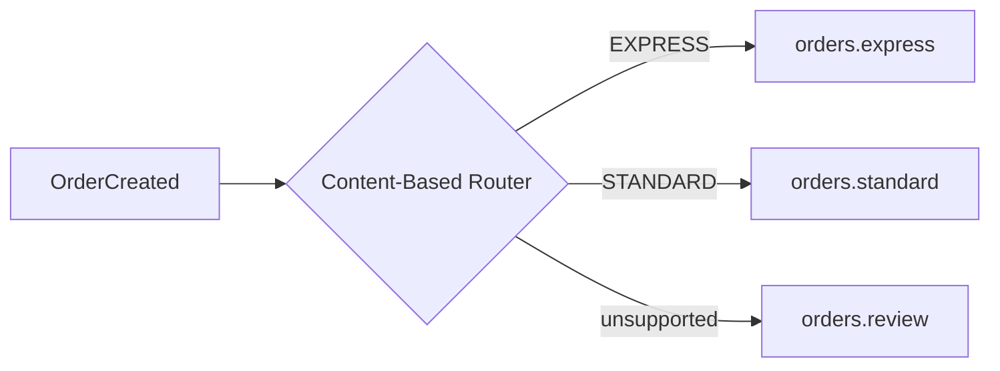
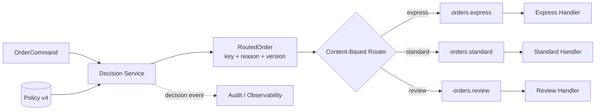
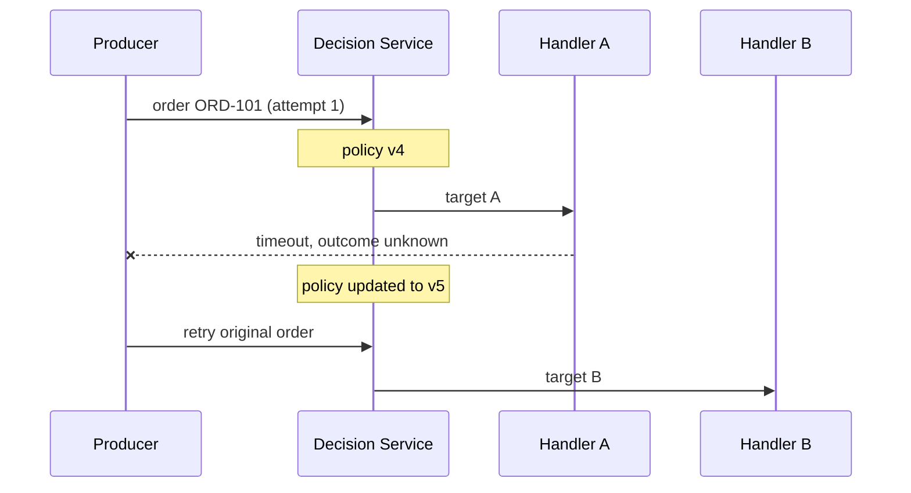
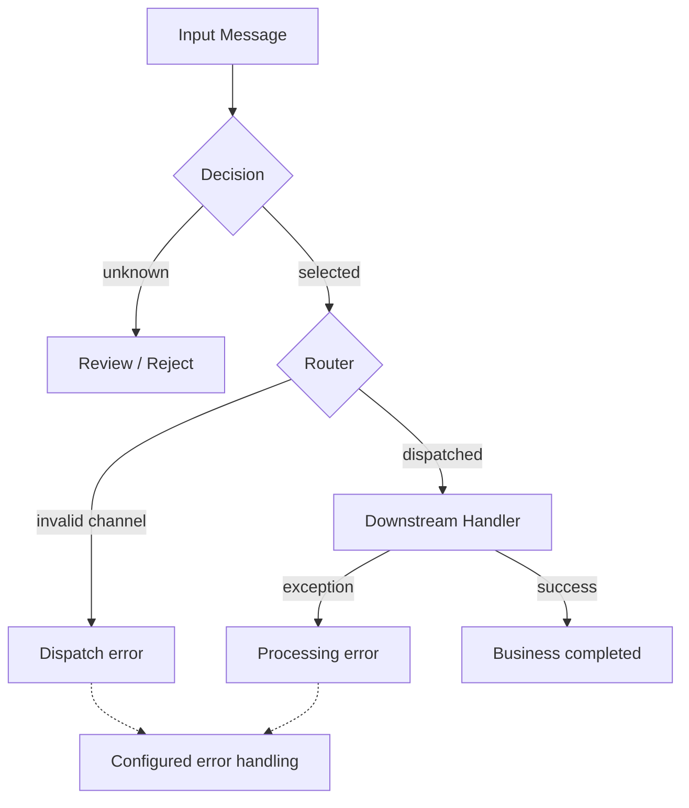
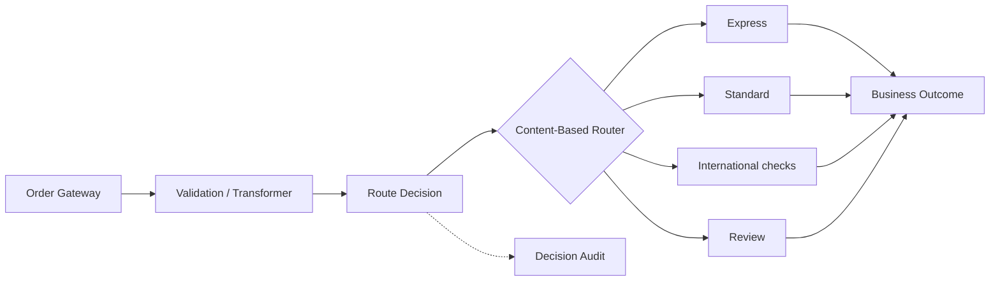

# Keeping Routing Decisions Observable

In Enterprise Integration Patterns (EIP), a **Content-Based Router** chooses an output channel based on message content, such as order type, shipping region, or priority level. A good router does not merely forward a message to the right place—it helps development and operations teams **answer why the message entered that branch**.

For example, order `ORD-101` gets sent to the express lane instead of the standard lane. If a customer asks a few minutes later where their order is, a log entry saying only `"Received order ORD-101"` is insufficient. You need to know **which rule matched, what data was used, which channel was picked, which policy version applied, whether forwarding succeeded, and how far downstream handlers progressed**.

This lesson belongs to the **Content-based router** chapter in the **SPRING_INTEGRATION_PATTERN** module: learning to build Enterprise Integration Patterns with Spring Integration to create loosely coupled, extensible, testable, and observable message flows. The techniques here connect Router with **Gateway, Filter, Transformer, Splitter, Aggregator**, as well as retry, error channels, and correlation.

After this lesson, you can design a traceable route decision, distinguish logs/metrics/traces/audits, implement a Spring Integration Java DSL example, and thoroughly test branch selection, message delivery, error handling, and replay.

## 1. What does keeping routing decisions observable mean?

A Content-Based Router is often shown with a very simple diagram:



The diagram shows **possible branches**, yet does not explain why a specific message entered a given branch. To observe a single execution, produce an informational chain:

```text
Input received
  -> Relevant content read
  -> Rule / policy version applied
  -> Route key computed
  -> Destination/channel resolved
  -> Dispatch performed
  -> Downstream handler receives and processes
  -> Outcome / error / retry recorded
```

In particular, separate three milestones:

| Milestone | What happened | What cannot yet be inferred |
| --- | --- | --- |
| **Decision made** | Router or decision service determined route key/target | Message was sent or consumer ran |
| **Dispatch attempted/accepted** | Sender tried forwarding or channel/transport accepted message per its semantics | Downstream business work completed |
| **Business outcome recorded** | Handler recorded business success/failure | Other systems received the same result without separate confirmation |

With `DirectChannel` and synchronous handlers, sending a message can execute the handler before the sender returns; exceptions can usually propagate back. With `ExecutorChannel`, `QueueChannel`, or a broker, the producer may continue before the consumer processes the message. Therefore **a `"routed successfully"` log line cannot prove business completion**.

## 2. Fields to record with a routing decision

A **route decision** record should be enough to explain the choice, correlate with the message, and compare across retries. Typical fields include:

| Field | Meaning | Example |
| --- | --- | --- |
| `businessKey` or `eventId` | Identifies work/event across deliveries | `ORD-101` |
| `decisionId` | Identifies this specific decision run | `dec-742` |
| `correlationId` | Groups messages belonging to one request/flow | `checkout-101` |
| `routeKey` | Logical result the router uses for mapping lookup | `express` |
| `targetChannel` or target ID | Actual selected destination | `orders.express` |
| `ruleId`/`reasonCode` | Explains **why** the branch was chosen | `EXPRESS_REQUEST` |
| `policyVersion` | Which rule set was in effect | `routing-v4` |
| `decisionTimestamp` | When the decision occurred | UTC timestamp |
| `routerInstance` | Which node/endpoint computed the decision | `order-router-02` |
| `attemptNumber`/`isReplay` | Distinguishes recomputing route vs. replaying stored decision | `2`/`true` |
| `dispatchStatus` | Attempted, accepted, or failed | `ATTEMPTED` |
| `downstreamOutcome` | Processing outcome, once received | `COMPLETED` |

This is a **suggested observability contract**, not a list of headers Spring Integration supplies automatically. Systems may need only a subset depending on requirements, yet at minimum you should know which message was routed, what the route key/target was, and why.

Also distinguish three kinds of IDs:

- **Spring Message ID** typically identifies one Spring message object; across Transformers, adapters, or brokers, messages may be recreated with new IDs.
- **Business key/event ID** must remain stable at the business-contract level for reconciliation and deduplication.
- **Correlation ID** links messages in the same workflow, such as parts emitted by a Splitter and combined by an Aggregator.

Never assume one ID type replaces the others. When an ID must survive across applications, place it in the payload/headers per contract and verify header mappers/serializers at boundaries.

### How detailed should reasons be?

Reason codes should come from a controlled vocabulary such as `EXPRESS_REQUEST`, `STANDARD_REQUEST`, `UNSUPPORTED_DELIVERY_TYPE`, or `POLICY_FALLBACK`. A string like `"chose express"` does not explain the **rule**; conversely, logging entire predicates, sensitive customer content, or excessive internal detail is unnecessary.

You can record a **curated set of attributes** to aid explanation, such as `deliveryType=EXPRESS`, while avoiding logging full addresses, payment details, tokens, sensitive payloads, or unnecessary personal data.

## 3. Keep logical decisions, channel mapping, and outcomes separate

A Content-Based Router often conflates two distinct operations:

1. **Content evaluation:** `OrderCommand.deliveryType` is `EXPRESS`, so `routeKey = express`.
2. **Destination mapping:** `express` maps to channel `orders.express`.

Separating these operations lets you change channel implementations or downstream adapters while keeping `routeKey` semantics intact. More importantly, observability can tell apart **rule evaluation errors** from **missing mappings or subscribers**.



In this diagram, the **decision audit** is emitted before the router dispatches. If forwarding or the handler fails, the decision record may still exist; hence **outcome** must be recorded separately. Conversely, if the audit is just a synchronous log and the process crashes, the record might not be durably saved. "Having an audit" is only true when recording and storage meet durability requirements.

### Distinguishing route keys from channel names

Example mapping configuration:

| Route key | Channel | Meaning |
| --- | --- | --- |
| `express` | `orders.express` | Orders requiring fast processing |
| `standard` | `orders.standard` | Standard orders |
| `review` | `orders.review` | Unknown/unsupported, awaiting separate handling |

Never allow an arbitrary client-supplied string to become a channel name directly. An allowlist mapping like the table above is easier to control, test, and authorize. If a policy lacks a mapping, route to an appropriate handling branch or throw an observable error per system contract.

## 4. Four observability layers: logs, metrics, traces, and audits

Observability tools complement one another while serving distinct purposes:

| Layer | Purpose | What to store/measure | Limitations |
| --- | --- | --- | --- |
| **Structured log** | Investigate a specific route or error | Event name, business key, reason, route key, policy version, error | Can be lost if not centralized/stored; search depends on retention |
| **Metrics** | Observe whole-system trends over time | Routes per branch, review/error rates, decision latency | Aggregated; cannot explain one specific message |
| **Distributed tracing** | Follow execution across endpoints, threads, adapters, services | Trace/span ID, causal links, per-hop latency | Depends on instrumentation and sampling; traces may drop |
| **Audit record** | Proof that a decision was established per business rules | Immutable decision ID, version, route key, timestamp, owner/reason | Needs durable storage, access control, retention, and separate reconciliation |

**Do not call an ordinary logger line a durable audit.** When regulatory accountability or proof that an order's route was locked before retries is required, use a decision store meeting durability and append-only policies.

### Metrics: use only low-cardinality labels

Example metric group:

```text
routing_decisions_total{route="express",result="selected"}  ...
routing_decisions_total{route="review",result="selected"}   ...
routing_dispatch_failures_total{route="standard"}         ...
routing_decision_duration_seconds{route="express"}       ...
```

These names are **design suggestions**, not claims that Spring Integration emits them out of the box. Instrument using Micrometer or your existing monitoring stack.

Never put `orderId`, `eventId`, or `correlationId` into metric tags: they explode time-series cardinality. Keep IDs in access-controlled logs/traces/audits; put bounded route keys, results, rule families, or versions in metrics.

### Traces: preserve context across threads and external systems

In a `DirectChannel` flow, messages normally run on the same thread; once crossing executors, queues, Kafka, or HTTP, trace context must be propagated explicitly. Spring message headers are not guaranteed to survive every transport untouched.

For accurate tracing, configure trace propagation on adapters, verify span/log correlation, and remember that sampling can omit traces for individual events. When complete proof per order is needed, persist audit records rather than relying on sampled traces.

## 5. Java example: separating Content-Based Router from decision records

We build an order routing workflow:

- `EXPRESS` → express processing.
- `STANDARD` → standard processing.
- Other values → send to `review` for controlled handling.
- Messages missing order ID or required fields → throw validation error before creating a decision.

The object returned by the decision service contains **the original payload and the selection metadata**. The Router reads only the computed `routeKey`, allowing logic and mapping to be tested separately.

### 5.1. Defining the contract and decision service

```java
import java.time.Instant;
import java.util.Locale;
import java.util.UUID;

record OrderCommand(String orderId, String deliveryType) {}

record RouteDecision(
    String decisionId,
    String routeKey,
    String targetChannel,
    String reasonCode,
    String policyVersion,
    Instant decidedAt
) {}

record RoutedOrder(OrderCommand order, RouteDecision decision) {}

final class RoutingDecisionService {
    private static final String POLICY_VERSION = "delivery-v4";

    RoutedOrder decide(OrderCommand order) {
        if (order == null
                || order.orderId() == null
                || order.orderId().isBlank()
                || order.deliveryType() == null) {
            throw new IllegalArgumentException("Invalid order command");
        }

        String deliveryType =
            order.deliveryType().trim().toUpperCase(Locale.ROOT);

        String key;
        String reason;

        switch (deliveryType) {
            case "EXPRESS" -> {
                key = "express";
                reason = "EXPRESS_REQUEST";
            }
            case "STANDARD" -> {
                key = "standard";
                reason = "STANDARD_REQUEST";
            }
            default -> {
                key = "review";
                reason = "UNSUPPORTED_DELIVERY_TYPE";
            }
        }

        String channel = switch (key) {
            case "express" -> "orders.express";
            case "standard" -> "orders.standard";
            default -> "orders.review";
        };

        RouteDecision decision = new RouteDecision(
            UUID.randomUUID().toString(),
            key,
            channel,
            reason,
            POLICY_VERSION,
            Instant.now()
        );

        return new RoutedOrder(order, decision);
    }
}
```

This example uses Java 17+ and immutable `record` types. No field takes a channel name directly from client data. Policy version is an illustrative constant; with dynamic configuration, read **one immutable policy snapshot** per decision so rules from two versions never mix.

**Important:** `UUID` and `Instant.now()` generate metadata for **a fresh decision**. Calling `decide` again on the same `OrderCommand` produces a new decision ID and timestamp. When requirements demand preserving decisions across replays, **persist and reuse the finalized `RoutedOrder` or decision record** rather than recomputing from the raw message.

### 5.2. Wiring router, channels, and wire tap with Spring Integration Java DSL

```java
import org.slf4j.Logger;
import org.slf4j.LoggerFactory;
import org.springframework.context.annotation.Bean;
import org.springframework.context.annotation.Configuration;
import org.springframework.integration.annotation.Gateway;
import org.springframework.integration.annotation.IntegrationComponentScan;
import org.springframework.integration.annotation.MessagingGateway;
import org.springframework.integration.channel.DirectChannel;
import org.springframework.integration.config.EnableIntegration;
import org.springframework.integration.dsl.IntegrationFlow;
import org.springframework.messaging.MessageChannel;

interface DispatchService {
    void handleExpress(RoutedOrder order);
    void handleStandard(RoutedOrder order);
    void handleReview(RoutedOrder order);
}

@MessagingGateway
interface OrderGateway {
    @Gateway(requestChannel = "orders.in")
    void submit(OrderCommand order);
}

@Configuration
@EnableIntegration
@IntegrationComponentScan
class OrderRoutingConfiguration {
    private static final Logger LOG =
        LoggerFactory.getLogger(OrderRoutingConfiguration.class);

    @Bean
    RoutingDecisionService routingDecisionService() {
        return new RoutingDecisionService();
    }

    @Bean("orders.in")
    MessageChannel ordersIn() {
        return new DirectChannel();
    }

    @Bean("orders.decided")
    MessageChannel ordersDecided() {
        return new DirectChannel();
    }

    @Bean("orders.audit")
    MessageChannel ordersAudit() {
        return new DirectChannel();
    }

    @Bean("orders.express")
    MessageChannel ordersExpress() {
        return new DirectChannel();
    }

    @Bean("orders.standard")
    MessageChannel ordersStandard() {
        return new DirectChannel();
    }

    @Bean("orders.review")
    MessageChannel ordersReview() {
        return new DirectChannel();
    }

    @Bean
    IntegrationFlow decideRoute(RoutingDecisionService decisions) {
        return IntegrationFlow.from("orders.in")
            .transform(OrderCommand.class, decisions::decide)
            .wireTap("orders.audit")
            .channel("orders.decided")
            .get();
    }

    @Bean
    IntegrationFlow applyRoute() {
        return IntegrationFlow.from("orders.decided")
            .route(RoutedOrder.class,
                routed -> routed.decision().routeKey(),
                spec -> spec
                    .channelMapping("express", "orders.express")
                    .channelMapping("standard", "orders.standard")
                    .channelMapping("review", "orders.review"))
            .get();
    }

    @Bean
    IntegrationFlow observeDecisions() {
        return IntegrationFlow.from("orders.audit")
            .handle(RoutedOrder.class, (routed, headers) -> {
                RouteDecision d = routed.decision();
                LOG.info(
                    "event=route_decided orderId={} decisionId={} " +
                    "routeKey={} destination={} reason={} policy={}",
                    routed.order().orderId(), d.decisionId(),
                    d.routeKey(), d.targetChannel(),
                    d.reasonCode(), d.policyVersion());
                return null;
            })
            .get();
    }

    @Bean
    IntegrationFlow express(DispatchService dispatch) {
        return IntegrationFlow.from("orders.express")
            .handle(RoutedOrder.class, (routed, headers) -> {
                dispatch.handleExpress(routed);
                return null;
            })
            .get();
    }

    @Bean
    IntegrationFlow standard(DispatchService dispatch) {
        return IntegrationFlow.from("orders.standard")
            .handle(RoutedOrder.class, (routed, headers) -> {
                dispatch.handleStandard(routed);
                return null;
            })
            .get();
    }

    @Bean
    IntegrationFlow review(DispatchService dispatch) {
        return IntegrationFlow.from("orders.review")
            .handle(RoutedOrder.class, (routed, headers) -> {
                dispatch.handleReview(routed);
                return null;
            })
            .get();
    }
}
```

This is an illustrative configuration for Spring Integration Java DSL. The application needs the corresponding Spring Integration dependencies, `OrderGateway` covered by `@IntegrationComponentScan` (or registered equivalently), and a bean implementing `DispatchService`.

**Journey of `OrderCommand("ORD-101", "EXPRESS")`:**

1. `OrderGateway` sends the message into `orders.in`.
2. Transformer invokes `RoutingDecisionService.decide`, creating a `RoutedOrder` containing the decision ID, key `express`, reason code, and policy version.
3. `wireTap("orders.audit")` sends a copy to the observation branch; the primary message continues via `orders.decided`.
4. Content-Based Router uses `routeKey` to choose `orders.express`.
5. The express handler receives `RoutedOrder` and performs business logic.

The log is emitted **after decision and before dispatch**. Thus the `route_decided` log does not prove the express handler completed. The handler or adapter must record its own outcome.

### 5.3. Caution with synchronous wire taps

In this example, `orders.audit` is a `DirectChannel`. The wire-tap branch can run on the sending thread, adding latency; a failing audit handler can impact the main processing path depending on channel and error-handling setup. This is easy to demonstrate, **not a durable audit mechanism**.

When observability must not slow down the main flow, offload recording to an executor, queue, or separate pipeline with bounded resources and error policies. Switching to an in-memory `ExecutorChannel`/queue alone still does not make logs or audits survive a crash. For business-critical decisions, persist the decision in a database/outbox within the appropriate transaction before feeding audit systems.

A critical causal distinction: **recording that a decision occurred** and **recording dispatch/consumer completion** should be separate events linked by `decisionId` and business key.

## 6. Adding outcomes without conflating them with decisions

An observability model can separate events:

```text
route_decided
    decisionId=dec-742 routeKey=express policy=v4
route_dispatch_attempted
    decisionId=dec-742 destination=orders.express
route_dispatch_accepted
    decisionId=dec-742 destination=orders.express
business_processing_started
    decisionId=dec-742 handler=ExpressHandler
business_processing_completed
    decisionId=dec-742 outcome=SUCCESS
```

If a handler throws or a broker redelivers the message, the final events may look different:

```text
business_processing_failed
    decisionId=dec-742 errorClass=InventoryTimeout
retry_scheduled
    decisionId=dec-742 attempt=2
business_processing_completed
    decisionId=dec-742 attempt=2 outcome=SUCCESS
```

These events are a **proposed telemetry model**, not events auto-emitted with exact names by Spring Integration. Decide where and how to emit them: channel interceptors, handler advice, gateways/adapters, error publishers, broker listeners, or domain services.

Do not turn a pre-send log into `route_dispatch_accepted`. For synchronous dispatch, acceptance can only be determined from the actual send outcome; for queues/brokers, acknowledgments have their own semantics and do **not** mean downstream succeeded. If a listener acknowledges a message while a database update rolls back, reflect the true outcome state.

### Full state tracking

| Observed state | Meaning | Evidence to capture |
| --- | --- | --- |
| `DECIDED` | Route key chosen | Decision record, rule/version |
| `DISPATCHING` | Forwarding attempt started | Attempt ID, target |
| `ACCEPTED` | Transport/target accepted per policy | Send result/publish ack |
| `PROCESSING` | Consumer began work | Handler start/span |
| `COMPLETED` | Business side effects finished | Domain result/transaction outcome |
| `FAILED` | Did not finish for recorded reason | Error class, retryability |
| `UNKNOWN` | Unclear whether receiver finished | Timeout/no response; needs reconciliation |

Timeouts when calling external systems are especially tricky: the receiver may have finished while the response was lost. Never mark `FAILED` with certainty or switch to another target unless the contract permits it.

## 7. Retry, replay, and keeping routing decisions stable

A content-based routing function may be pure. Still, results can change between two runs when **routing rules changed** or when content was normalized/transformed differently.

Suppose the old policy routed `EXPRESS` to `orders.express`, and a new policy routes that order type to a different service. If a message is re-sent from before the decision service, one order could go to two places.



Define which kind of replay the business requires:

- **Replay original decision:** resend the stored `RoutedOrder` or record containing `routeKey`, `targetChannel`, `policyVersion`, and `decisionId`. Typically required when an order must go only to its locked destination.
- **Intentional reroute:** compute a new decision under the new policy when the business permits changing destinations. Emit a `reroute_decided` event/record stating the old decision, new decision, reason, and authority.
- **Dispatch to equivalent workers:** sometimes pinning to a specific instance is unnecessary if all workers honor the same contract and side effects are idempotent. Still persist message keys and outcomes to detect duplicate processing.

When decisions must survive restarts, use proper persistence such as a **database with a unique constraint on business key, a durable queue holding locked decisions, or a transactional outbox**. An in-memory `RoutedOrder` is not durable proof.

**Idempotency is still required.** Keeping the same route does not prevent a consumer from receiving a redelivered message and writing to the database twice. A decision record only stabilizes the destination; consumers must guard side effects by business key/event ID at execution boundaries.

## 8. Route not found, fallback, and error channels

An easily overlooked observability case is when the router **cannot pick a valid destination**. For example, `deliveryType = "DRONE"` is not yet supported.

There are several options, each with different semantics:

| Handling option | When appropriate | What to observe |
| --- | --- | --- |
| `review` or quarantine route | Input has a valid value not yet supported in business | Reason `UNSUPPORTED_DELIVERY_TYPE`, backlog size, processing SLA |
| Reject/exception | Contract requires immediate rejection when no route exists | Error message and caller/producer status |
| Valid default route | A fallback destination genuinely supports the same business | Reason `FALLBACK_USED` and trigger conditions |
| Retry route resolution | Mapping/service temporarily unavailable, recoverable | Attempts, timeouts, backoff, policy version |
| Manual intervention | Routing carries high-risk side effects or unclear data | Who approved reroute, decision history |

Never silently route all unknown values into the standard lane and log `"success"`. If the standard lane does not support special delivery types, that hides a business data bug.

### Default channel is not an error channel

**Default output channel** is a processing destination when the router finds no matching branch (per configuration). **Error channel** is where an error-capturing/publishing mechanism sends `ErrorMessage` instances. **Discard channel** in a Filter receives filtered-out messages. These three concepts serve different purposes.

An unsupported value may be a **`review` business decision**, not an exception. Conversely, missing subscribers, invalid mappings, or handler exceptions are technical failures. With `DirectChannel`, exceptions usually return to the caller; with executors/pollers/adapters, check error handlers, error channels, and transport-specific retry/redelivery. Simply creating a bean named `orders.errors` does not automatically route all exceptions there.

### Know where the failure occurred



Observability must distinguish **decision errors**, **dispatch errors**, and **processing errors**. If everything logs generically as `"router failed"`, on-call engineers will not know whether to fix policy, channel mappings, capacity, or handler logic.

## 9. Combining Router with Filter, Transformer, Splitter, Aggregator, and Gateway

A Content-Based Router never operates in isolation from the rest of the integration flow.

### 9.1. Gateway and Filter before Router

**Gateway** provides a business interface, e.g., `submitOrder`, hiding message sending. **Filter** can reject malformed messages before selecting a route. When Filter drops invalid messages, record rejections per contract; a message that never reaches the Router also **has no route decision**.

Therefore, `routing_decisions_total` does not represent all system inputs. To compute ratios, also measure total inputs, rejections, and parse/schema errors, keeping track of the denominator.

### 9.2. Which version does the Router evaluate if a Transformer alters content?

A Transformer may normalize `deliveryType = " express "` to `EXPRESS` before the Router. If routing reads normalized data, logs should record **the normalized field used for the decision** along with the reason code, rather than only logging the raw initial payload.

When a Transformer changes payload types, verify important message headers survive or map correctly. For exact replay, persist **the actual input to the routing step** or a checksum/version of the decided representation, not just an isolated field that cannot be reconstructed.

### 9.3. Splitter creates multiple route decisions

If an order has multiple line items and a Splitter emits one message per item, each part may route to a different warehouse. You must specify:

- **Parent order business key** and **per-part key** to tell decisions apart.
- `correlationId`/sequence metadata to link parts.
- One order may emit **N route decisions**, so decision counts do not equal order counts.
- Does retrying one part reuse that part's locked decision or recompute?
- How are multi-target outcomes combined if one part fails?

### 9.4. Aggregator and group outcomes

**Aggregator** receives related messages and emits a combined result according to correlation/release strategy, timeout, and group state. Knowing which branch each message was routed to does not prove the Aggregator finished.

For end-to-end observability, link each part's route decision IDs to the group's correlation ID; track messages sent, parts succeeded, parts failed, and when the group released. For incomplete groups, explicitly record partial result or timeout rather than logging `"all routed"` as if business work were done.

## 10. Testing decisions, paths, and observability

A test asserting only that `decide` returns `"express"` proves one slice of logic, without proving the router dispatches to the right channel or that logs/audits receive messages.

### 10.1. Minimum test matrix

| Scenario | Expected decision | Downstream verification |
| --- | --- | --- |
| `deliveryType=EXPRESS` | `express`, reason `EXPRESS_REQUEST` | Only express handler is called |
| `deliveryType=STANDARD` | `standard`, reason `STANDARD_REQUEST` | Only standard handler is called |
| `deliveryType=UNKNOWN` | `review`, reason `UNSUPPORTED_DELIVERY_TYPE` | Never accidentally calls express/standard handlers |
| Missing `orderId` | No decision; validation exception | No handler called; error recorded per contract |
| Mapped channel lacks subscriber | Decision may still exist | Separate dispatch failure; no business success reported |
| Handler throws exception | Decision does not disappear | Processing failure recorded; sync/async handling works properly |
| Replay `RoutedOrder` | Preserves route/decision ID when business requires | Does not recompute route with current policy |
| Retry same message to handler | Route may remain valid | Idempotency prevents duplicate side effects |
| Observability branch unavailable | Follows configured impact policy for main flow | Critical audits not lost if durability required |

### 10.2. Unit testing decision logic with JUnit 5

```java
import static org.junit.jupiter.api.Assertions.*;
import org.junit.jupiter.api.Test;

class RoutingDecisionServiceTest {
    private final RoutingDecisionService decisions =
        new RoutingDecisionService();

    @Test
    void expressOrderHasExplainableDecision() {
        RoutedOrder result = decisions.decide(
            new OrderCommand("ORD-101", " express "));

        assertEquals("express", result.decision().routeKey());
        assertEquals("orders.express",
            result.decision().targetChannel());
        assertEquals("EXPRESS_REQUEST",
            result.decision().reasonCode());
        assertEquals("delivery-v4",
            result.decision().policyVersion());
        assertNotNull(result.decision().decisionId());
    }

    @Test
    void unsupportedTypeGoesToReview() {
        RoutedOrder result = decisions.decide(
            new OrderCommand("ORD-102", "DRONE"));

        assertEquals("review", result.decision().routeKey());
        assertEquals("UNSUPPORTED_DELIVERY_TYPE",
            result.decision().reasonCode());
    }

    @Test
    void blankOrderIdMustNotCreateDecision() {
        assertThrows(IllegalArgumentException.class,
            () -> decisions.decide(
                new OrderCommand(" ", "EXPRESS")));
    }
}
```

These tests verify the **decision contract**; they do not prove messages reach channels or logs get written. They also must not assert that two fresh evaluations share the same `decisionId` or timestamp: those are two distinct decisions.

### 10.3. Integration testing at the router

In a Spring Integration test, replace `DispatchService` with a mock/spy and send via `OrderGateway`:

1. Send `EXPRESS`; verify `handleExpress` is called exactly once and the other two handlers are not called.
2. Send `UNKNOWN`; verify only `handleReview` is called.
3. Attach a consumer/test sink on `orders.audit` (or test interceptor per design) to verify the same `decisionId`, `routeKey`, `reasonCode`, and `policyVersion` appear in the observed decision.
4. Make the express handler throw; verify the decision remains accurate and the exception/outcome follows `DirectChannel` semantics.
5. With executors, queues, or brokers, wait on bounded-timeout conditions and separately verify message acceptance, downstream execution, and retries/redeliveries.

If the system requires durable audits, write integration tests against a real store: the decision commits before dispatch, survives restarts, and does not create uncontrolled competing records for the same business key.

### 10.4. Testing policy changes across runs

With dynamic policies, create a scenario:

```text
T0: Decide ORD-101 with policy v4 -> target A
T1: Persist decision ORD-101 / target A / v4
T2: Policy updates to v5 -> target B
T3: Retry same task
Expected: Reuse target A if sticky route is required
```

A unit test on an immutable policy service proves each snapshot yields stable outcomes for the same inputs. An end-to-end test must prove **the retry point sits after decision persistence**, and consumers enforce idempotency or proper reconciliation.

## 11. Operational practices for meaningful observability

Real questions dashboards and logs must answer:

1. Over the last 15 minutes, did the `review` rate rise because of a new rule or shifting input data?
2. For a specific order, which policy version applied, what route key was chosen, and what triggered fallback?
3. Where are messages that emitted `route_decided` without a dispatch attempt/acceptance within a reasonable window?
4. How many messages were accepted by transport yet remain unfinished by handlers?
5. Do retries change route keys or targets outside policy?
6. Are Router branches experiencing load imbalance or sudden downstream error spikes?
7. Are any Splitter/Aggregator groups missing parts and failing release strategies before timeout?
8. As instance counts scale up, do traces, correlation, and audits stay connected across all hops?

Configure alerts on **error rates, backlog counts, latency, and route-mix shifts**, not solely exception logs. If `review` volume spikes while still returning HTTP 200, that can still be a business incident worth alerting on.

### Naming and metadata governance practices

- Name channels/route keys clearly by responsibility, consistently across dashboards, logs, and source code.
- Use controlled sets of reason codes and policy versions.
- Include `businessKey`, `decisionId`, and `correlationId` in appropriate observability records while keeping them out of metric tags.
- Define retention and access controls for audits/logs; redact or omit sensitive payloads.
- Emit distinct events for `route_decided`, `dispatch_failed`, and `business_completed` to avoid conflating meanings.
- When changing policies, record effective versions and support explaining historical decisions.

## 12. Common mistakes

**"Routing right is enough; no need to log reasons."** As policies grow, lacking reason codes and versions makes it hard to separate data bugs, rule bugs, and channel-mapping bugs.

**"Logging `route_decided` means processing succeeded."** It only shows the decision was created and the log point ran. Dispatch and business completion have separate states.

**"Spring's Message ID is the business ID."** Message object IDs can change after transformations or adapters; business keys and correlation need cross-hop contracts.

**"Enabling tracing gives us full auditing."** Traces can be sampled, context can break, and retention can be short. Decisions needing durable proof must be persisted deliberately.

**"Putting `orderId` in a metric tag makes searching easy."** High-cardinality IDs blow up monitoring costs; keep them in logs/audits.

**"Wire tap never affects the main flow."** Depending on channel and handler behavior, synchronous tap branches add latency or errors. Define policies when the observation branch is unavailable.

**"Once the Router picks a route, we can retry freely."** Retrying before the decision service can recompute the target; retrying to a consumer can duplicate side effects. Keep routes sticky when business requires and enforce idempotency.

**"Default branch is always safe."** Default is safe only if its destination satisfies the contract for unmatched cases. Otherwise use `review` or explicit rejection.

**"One `ErrorMessage` event is enough to know what happened."** Not every exception automatically flows to an error channel; understand where errors are caught, how `ErrorMessage`s are emitted, and how they link back to decisions.

**"A decision can be explained without input context."** When routes depend on normalized fields or rule versions, capture enough metadata to reconstruct why the branch was chosen—while still protecting sensitive data.

## 13. Exercise: investigating a routing incident

An order system handles `EXPRESS`, `STANDARD`, and `INTERNATIONAL` orders. The Router uses an updatable rule version in which certain international orders must go to an extra verification service before inventory reservation.

After a deployment, dashboards show `review` orders climbing from low to high, yet API 5xx errors stay flat. A customer reports order `ORD-789` has not shipped, while logs only show `"order accepted"`.

Redesign observability for the flow:



Requirements:

1. Define the minimum fields needed to explain why `ORD-789` entered `review` and under which rule version.
2. Propose two low-cardinality metrics to detect route-mix shifts while still allowing lookup of a specific order via logs/audits.
3. If the message was forwarded to `international.checks` yet the consumer has not finished, which state should you report? Why not record `COMPLETED` immediately?
4. If a retry after a policy update moves `ORD-789` from `review` to `international.checks`, when is this a valid reroute and what must be recorded?
5. For a group of items created by a Splitter, how would you use correlation/decision IDs to prove all items processed before the Aggregator marks completion?
6. Write an integration test proving an `INTERNATIONAL` message reaches the right branch and produces the proper audit reason code; then have the handler throw an exception to verify the error path.

A good design connects **input → decision rationale → chosen destination → execution outcome**, recognizes each observability tool's limits, and handles unknown-status messages cleanly.

## Key takeaways

**Keeping routing decisions observable** means a Content-Based Router does not just pick the right channel, but produces evidence of **which message was evaluated, which route key/destination was chosen, which rule and version applied, and why**. Separate decision events from dispatch acceptance and business completion.

In Spring Integration, separate the **decision service** from the Router, carry metadata in immutable messages, use wire taps/interceptors for telemetry, and persist decisions durably when stable replays are required. Combine structured logging, low-cardinality metrics, correlated traces, appropriately durable audits, plus retry, error channels, and idempotency. Combined with Gateway, Filter, Transformer, Splitter, and Aggregator, your Router becomes both extensible and explainable down to every single message path.
