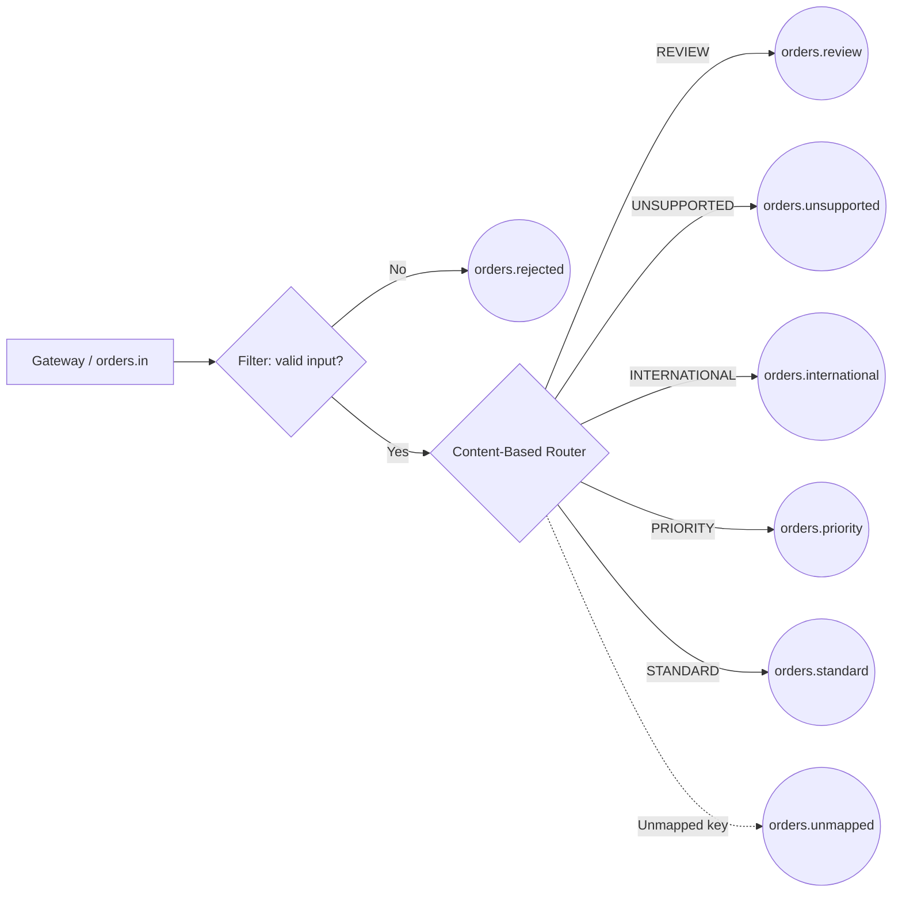
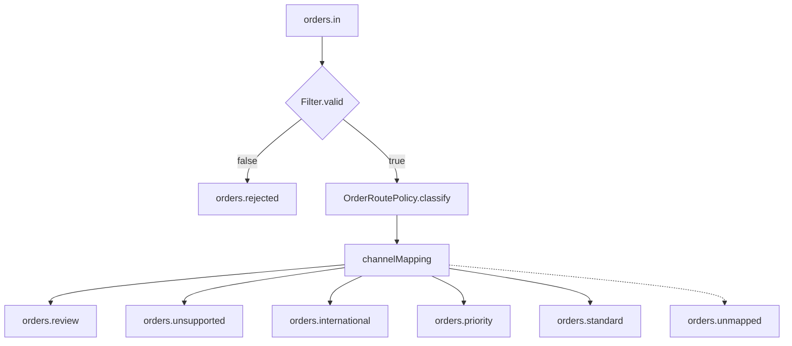
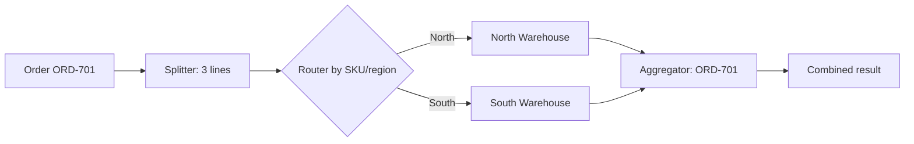

# Testing Each Content Group and Its Corresponding Route

> **Chapter:** Content-based router  
> **Module:** `SPRING_INTEGRATION_PATTERN` — practicing Enterprise Integration Patterns with Spring Integration to create loosely coupled, extensible message flows; coordinating Router, Filter, Transformer, Splitter, Aggregator, Gateway, retry, error channels, and correlation alongside testing and per-branch observability. This lesson focuses on **verifying Content-Based Router decisions for every content group**, not just checking a single happy-path case.

## 1. Learning objectives

After this lesson, you can:

1. Translate business routing rules into independent **test data groups** with clear input conditions and expected channels.
2. Assert **right branch, no wrong branches, dispatch count, payload, and headers**, rather than relying on a single log line.
3. Write **unit tests for the routing policy** and **integration tests for the Router endpoint/channel mapping** using JUnit 5 and Spring Integration.
4. Catch bugs in **overlapping conditions**, boundary values, missing data, untrusted metadata, and unmapped fallbacks.
5. Design tests for **sync/async execution, handler failures, retries, correlation, Splitter/Aggregator**, and observing selected branches.

## 2. The problem: routing one example right does not prove routing works

Suppose an application receives orders from a Gateway. The Router reads country, customer tier, risk, order total, and express request flag. If you only test one `GOLD` order entering the priority lane, you **still do not know**:

- Do regular orders accidentally get sent to priority?
- For a high-risk order that **also** requests express delivery, which rule takes precedence?
- Is an unsupported country rejected or silently routed to a default branch?
- Does a value equal to the monetary threshold take the same branch as a value just above it?
- Can a client-supplied risk header let a message bypass moderation?
- Does a message arrive at **two channels** simultaneously when business rules permit **only one** receiver?
- What if Java rules pick the right key, yet `channelMapping` maps it to the wrong channel name?

**Content-Based Router (CBR)** is an EIP pattern that picks a message's destination based on content or business metadata. It handles only the **routing decision**; Filter rejects invalid inputs, Transformer/Enricher normalizes and adds data, and handlers execute target work.



A proper test suite must verify the **actual path taken**, including paths **that must not be taken**. Asserting only `RoutePolicy.classify(order) == PRIORITY` tests the rule; it **does not** prove Spring Integration actually delivered the message to `orders.priority`.

## 3. Define the business contract before writing tests

Let us set an **illustrative order policy for learning purposes** (not a real SLA, shipping policy, or legal rule):

1. An order must have `orderId`, a two-letter `country`, `total > 0`, and valid risk level and customer tier. Bad data goes to **`orders.rejected`** via Filter.
2. `risk = HIGH` or `UNKNOWN` goes to **`orders.review`**. Never default `UNKNOWN` to `LOW`.
3. Only `VN`, `SG`, and `TH` are supported. Other well-formed countries go to **`orders.unsupported`**.
4. International orders (`SG` or `TH`) with total **greater than 5,000,000** go to review; equal to the threshold still goes to **`orders.international`**.
5. Domestic `VN` orders requesting express without `GOLD` tier go to review.
6. Domestic `GOLD` orders requesting express go to **`orders.priority`**.
7. Remaining valid domestic orders go to **`orders.standard`**.

Here we assume all `total` amounts are already normalized to **a single currency**. Risk level and customer tier must come from trusted system sources; this example separates source authentication from the policy itself.

### 3.1. Decision table and priority order

| Priority | Condition (after Filter) | Routing key | Channel |
| --- | --- | --- | --- |
| 1 | `risk = HIGH` or `UNKNOWN` | `REVIEW` | `orders.review` |
| 2 | `country` outside `VN`, `SG`, `TH` | `UNSUPPORTED` | `orders.unsupported` |
| 3 | International, `total > 5_000_000` | `REVIEW` | `orders.review` |
| 4 | International, within threshold | `INTERNATIONAL` | `orders.international` |
| 5 | Domestic, express requested, not `GOLD` | `REVIEW` | `orders.review` |
| 6 | Domestic, `GOLD`, express requested | `PRIORITY` | `orders.priority` |
| 7 | Domestic, express not requested | `STANDARD` | `orders.standard` |

Rules read top-to-bottom on a **first-match** basis: when `risk=HIGH` and `country=FR` are both true, **REVIEW beats UNSUPPORTED**. Changing the order changes business behavior; therefore tests for **overlapping conditions** are mandatory.

### 3.2. Separate states—do not conflate them

| State | Example | What to test |
| --- | --- | --- |
| **Invalid input** | Empty `orderId`, `total = 0`, `country = VNM` | Filter sends to `orders.rejected`; Router never runs |
| **Business review** | High risk, unknown risk, ineligible for express | `orders.review`; never sent to auto-processing branches |
| **Unsupported** | `country = FR`, valid two-letter format | `orders.unsupported`; not conflated with malformed structure |
| **Unmapped route** | Policy returns a new key missing from mapping config | Goes to `orders.unmapped` or explicit configuration failure |
| **Downstream failure** | Chosen handler throws an exception | Error/timeout/retry handling; never auto-switched to another route |

`defaultOutputChannel` only applies when the Router **cannot resolve an output channel from configuration**; it is **not** a default failover when a selected channel's handler crashes.

## 4. Partition test data into purposeful groups

Do not write dozens of random tests and call it coverage. Each group below targets **a specific class of potential defects**.

| Group | Representative input | Expected branch | Typical bug caught |
| --- | --- | --- | --- |
| G1 — priority | `VN`, `LOW`, `GOLD`, `express=true` | `orders.priority` | Router misreads express/tier flags |
| G2 — standard | `VN`, `LOW`, `GOLD`, `express=false` | `orders.standard` | Defaults every GOLD order to priority |
| G3 — regular customer | `VN`, `LOW`, `REGULAR`, `express=false` | `orders.standard` | Incorrect tier check |
| G4 — ineligible express | `VN`, `LOW`, `REGULAR`, `express=true` | `orders.review` | Silently downgrades express without notice |
| G5 — valid international | `SG`, `LOW`, `total=4_999_999` | `orders.international` | Routes by amount instead of country |
| G6 — exact threshold | `SG`, `LOW`, `total=5_000_000` | `orders.international` | Confuses `>` with `>=` |
| G7 — over threshold | `SG`, `LOW`, `total=5_000_001` | `orders.review` | Skips high-value review |
| G8 — unsupported | `FR`, `LOW` | `orders.unsupported` | Mistakenly falls back to standard |
| G9 — overlapping conditions | `FR`, `HIGH` | `orders.review` | Wrong priority order |
| G10 — unknown risk | `VN`, `UNKNOWN`, `GOLD`, express | `orders.review` | Treats UNKNOWN as LOW |
| G11 — case/whitespace | `" vn "`, `LOW`, `GOLD`, express | `orders.priority` | Missing country normalization |
| G12 — invalid input | `total=0` or `orderId=" "` | `orders.rejected` | Filter fails to block bad input |
| G13 — missing metadata | `risk=null` or `tier=null` | `orders.rejected` | Unsafe defaulting |

A **content group** is not just *one message*. You can include multiple variants in a group (e.g., both `SG` and `TH` are international). Each case must have an **independently authored expected outcome** written up front, rather than copying observed runtime output as the "answer".

## 5. Step one: test rules in pure Java

We define the model, enums, and a **pure** classification function. It sends no messages, writes no database, and calls no external APIs—making unit tests fast and deterministic.

```java
import java.math.BigDecimal;
import java.util.Locale;
import java.util.Set;

enum Risk { LOW, HIGH, UNKNOWN }

record Order(
    String id,
    String country,
    BigDecimal total,
    Risk risk,
    String tier,
    boolean express
) {}

enum Lane { REVIEW, UNSUPPORTED, INTERNATIONAL, PRIORITY, STANDARD }

final class OrderRoutePolicy {
    private static final Set<String> COUNTRIES = Set.of("VN", "SG", "TH");
    private static final Set<String> TIERS = Set.of("GOLD", "REGULAR");
    private static final BigDecimal REVIEW_THRESHOLD =
        new BigDecimal("5000000");

    private OrderRoutePolicy() {}

    static boolean valid(Order order) {
        return order != null
            && order.id() != null
            && !order.id().isBlank()
            && order.country() != null
            && order.country().trim().matches("[A-Za-z]{2}")
            && order.total() != null
            && order.total().signum() > 0
            && order.risk() != null
            && TIERS.contains(order.tier());
    }

    static Lane classify(Order order) {
        if (!valid(order)) {
            throw new IllegalArgumentException("Order must pass validation");
        }

        String country = order.country().trim()
            .toUpperCase(Locale.ROOT);

        // Priority rules are expressed by statement order.
        if (order.risk() != Risk.LOW) {
            return Lane.REVIEW;
        }
        if (!COUNTRIES.contains(country)) {
            return Lane.UNSUPPORTED;
        }
        if (!"VN".equals(country)) {
            return order.total().compareTo(REVIEW_THRESHOLD) > 0
                ? Lane.REVIEW : Lane.INTERNATIONAL;
        }
        if (order.express() && !"GOLD".equals(order.tier())) {
            return Lane.REVIEW;
        }
        return order.express() ? Lane.PRIORITY : Lane.STANDARD;
    }
}
```

### 5.1. Testing groups with `@ParameterizedTest`

JUnit 5 lets a single test method run across multiple input groups and expected lanes. Each row appears as an independent case in the test report:

```java
import static org.junit.jupiter.api.Assertions.assertEquals;
import static org.junit.jupiter.api.Assertions.assertFalse;
import static org.junit.jupiter.api.Assertions.assertThrows;

import java.math.BigDecimal;
import java.util.stream.Stream;

import org.junit.jupiter.api.Test;
import org.junit.jupiter.params.ParameterizedTest;
import org.junit.jupiter.params.provider.Arguments;
import org.junit.jupiter.params.provider.MethodSource;

class OrderRoutePolicyTest {
    private static Order order(String id, String country, String total,
                               Risk risk, String tier, boolean express) {
        return new Order(id, country, new BigDecimal(total),
            risk, tier, express);
    }

    static Stream<Arguments> validCases() {
        return Stream.of(
            Arguments.of("G1 priority", order("A", "VN", "100", Risk.LOW, "GOLD", true), Lane.PRIORITY),
            Arguments.of("G2 standard", order("B", "VN", "100", Risk.LOW, "GOLD", false), Lane.STANDARD),
            Arguments.of("G3 regular", order("C", "VN", "100", Risk.LOW, "REGULAR", false), Lane.STANDARD),
            Arguments.of("G4 express review", order("D", "VN", "100", Risk.LOW, "REGULAR", true), Lane.REVIEW),
            Arguments.of("G5 international", order("E", "SG", "4999999", Risk.LOW, "GOLD", false), Lane.INTERNATIONAL),
            Arguments.of("G6 threshold", order("F", "SG", "5000000", Risk.LOW, "GOLD", false), Lane.INTERNATIONAL),
            Arguments.of("G7 over threshold", order("G", "SG", "5000001", Risk.LOW, "GOLD", false), Lane.REVIEW),
            Arguments.of("G8 unsupported", order("H", "FR", "100", Risk.LOW, "GOLD", false), Lane.UNSUPPORTED),
            Arguments.of("G9 precedence", order("I", "FR", "100", Risk.HIGH, "GOLD", true), Lane.REVIEW),
            Arguments.of("G10 risk unknown", order("J", "VN", "100", Risk.UNKNOWN, "GOLD", true), Lane.REVIEW),
            Arguments.of("G11 normalization", order("K", " vn ", "100", Risk.LOW, "GOLD", true), Lane.PRIORITY)
        );
    }

    @ParameterizedTest(name = "{0}")
    @MethodSource("validCases")
    void choosesExpectedLane(String groupName, Order order, Lane expected) {
        assertEquals(expected, OrderRoutePolicy.classify(order), groupName);
    }

    @Test
    void invalidOrderIsRejectedBeforeRouting() {
        Order invalid = order("L", "VN", "0", Risk.LOW, "GOLD", true);
        assertFalse(OrderRoutePolicy.valid(invalid));
        assertThrows(IllegalArgumentException.class,
            () -> OrderRoutePolicy.classify(invalid));
    }
}
```

In a real project, reduce repetitive fixture code and name cases clearly so when CI fails, you immediately know **which rule group** broke. These checks **do not yet verify** that Spring routes to the right channels; they lock down the classification policy semantics.

### 5.2. Why test `5_000_000 - 1`, `5_000_000`, and `5_000_000 + 1`?

Boundary values catch off-by-one bugs that never appear with random samples like `1_000_000` and `10_000_000`:

```text
4,999,999 -> INTERNATIONAL
5,000,000 -> INTERNATIONAL
5,000,001 -> REVIEW
```

If business requirements change from "**greater than** threshold" to "**at or above** threshold", update the decision table and tests before editing code. Use `BigDecimal` consistently with currency units; never rely on `double` for financial thresholds.

## 6. Step two: wiring the Content-Based Router into Spring Integration

To test real channels, build an `IntegrationFlow` with **Filter + Router**, fixed mappings, and destination channels. The example uses **Java 17+** and Spring Integration Java DSL; library versions must be compatible in your real application.

```java
import org.springframework.context.annotation.Bean;
import org.springframework.context.annotation.Configuration;
import org.springframework.integration.channel.DirectChannel;
import org.springframework.integration.config.EnableIntegration;
import org.springframework.integration.dsl.IntegrationFlow;

@Configuration
@EnableIntegration
class ContentRoutingConfiguration {

    @Bean("orders.in")
    DirectChannel inputChannel() { return new DirectChannel(); }

    @Bean("orders.rejected")
    DirectChannel rejectedChannel() { return new DirectChannel(); }

    @Bean("orders.review")
    DirectChannel reviewChannel() { return new DirectChannel(); }

    @Bean("orders.unsupported")
    DirectChannel unsupportedChannel() { return new DirectChannel(); }

    @Bean("orders.international")
    DirectChannel internationalChannel() { return new DirectChannel(); }

    @Bean("orders.priority")
    DirectChannel priorityChannel() { return new DirectChannel(); }

    @Bean("orders.standard")
    DirectChannel standardChannel() { return new DirectChannel(); }

    @Bean("orders.unmapped")
    DirectChannel unmappedChannel() { return new DirectChannel(); }

    @Bean
    IntegrationFlow orderContentRouting() {
        return IntegrationFlow.from("orders.in")
            // Invalid messages do not enter the routing decision.
            .filter(Order.class, OrderRoutePolicy::valid,
                f -> f.discardChannel("orders.rejected"))
            // The result is a routing key, not a client-chosen destination name.
            .route(Order.class,
                o -> OrderRoutePolicy.classify(o).name(),
                r -> r
                    .channelMapping("REVIEW", "orders.review")
                    .channelMapping("UNSUPPORTED", "orders.unsupported")
                    .channelMapping("INTERNATIONAL", "orders.international")
                    .channelMapping("PRIORITY", "orders.priority")
                    .channelMapping("STANDARD", "orders.standard")
                    .defaultOutputChannel("orders.unmapped"))
            .get();
    }
}
```

The example declares no production handlers; **tests will register subscribers** on target `DirectChannel` beans. In a real application, each channel needs an active consumer (Service Activator, outbound adapter, Gateway, etc.) with appropriate error and reliability policies.



**Test responsibility boundary:** `OrderRoutePolicyTest` catches rule-table bugs; the integration test next catches wiring bugs, channel names, mappings, message forwarding, and unintended deliveries to wrong branches.

## 7. Step three: assert exact destination channels with integration tests

To avoid relying on console logs, the test attaches a `MessageHandler` to **every** output channel, collects received messages, and verifies one input goes to **exactly one branch** per our policy.

This example uses `@SpringJUnitConfig` (Spring Test + JUnit 5) and `@ParameterizedTest` (JUnit Jupiter Params). `Order`, `Risk`, `Lane`, `OrderRoutePolicy`, and `ContentRoutingConfiguration` are assumed to be accessible in the same test package.

```java
import static org.junit.jupiter.api.Assertions.assertEquals;
import static org.junit.jupiter.api.Assertions.assertSame;
import static org.junit.jupiter.api.Assertions.assertTrue;

import java.math.BigDecimal;
import java.util.HashMap;
import java.util.LinkedHashMap;
import java.util.List;
import java.util.Map;
import java.util.concurrent.CopyOnWriteArrayList;
import java.util.stream.Stream;

import org.junit.jupiter.api.AfterEach;
import org.junit.jupiter.api.BeforeEach;
import org.junit.jupiter.params.ParameterizedTest;
import org.junit.jupiter.params.provider.Arguments;
import org.junit.jupiter.params.provider.MethodSource;
import org.springframework.beans.factory.annotation.Autowired;
import org.springframework.beans.factory.annotation.Qualifier;
import org.springframework.context.ApplicationContext;
import org.springframework.messaging.Message;
import org.springframework.messaging.MessageChannel;
import org.springframework.messaging.MessageHandler;
import org.springframework.messaging.SubscribableChannel;
import org.springframework.messaging.support.MessageBuilder;
import org.springframework.test.context.junit.jupiter.SpringJUnitConfig;

@SpringJUnitConfig(ContentRoutingConfiguration.class)
class ContentRoutingIntegrationTest {
    private static final List<String> OUTPUTS = List.of(
        "orders.rejected", "orders.review", "orders.unsupported",
        "orders.international", "orders.priority",
        "orders.standard", "orders.unmapped");

    @Autowired ApplicationContext context;

    @Autowired
    @Qualifier("orders.in")
    MessageChannel input;

    private final Map<String, List<Message<?>>> received =
        new LinkedHashMap<>();
    private final Map<String, MessageHandler> subscribers = new HashMap<>();

    @BeforeEach
    void subscribeToEveryOutcome() {
        for (String name : OUTPUTS) {
            List<Message<?>> messages = new CopyOnWriteArrayList<>();
            MessageHandler observer = messages::add;
            SubscribableChannel channel =
                context.getBean(name, SubscribableChannel.class);
            assertTrue(channel.subscribe(observer));
            received.put(name, messages);
            subscribers.put(name, observer);
        }
    }

    @AfterEach
    void removeTestSubscribers() {
        for (String name : subscribers.keySet()) {
            context.getBean(name, SubscribableChannel.class)
                .unsubscribe(subscribers.get(name));
        }
    }

    private static Order order(String country, String amount,
                               Risk risk, String tier, boolean express) {
        return new Order("ORD-701", country,
            new BigDecimal(amount), risk, tier, express);
    }

    static Stream<Arguments> routingCases() {
        return Stream.of(
            Arguments.of(order("VN", "100", Risk.LOW, "GOLD", true), "orders.priority"),
            Arguments.of(order("VN", "100", Risk.LOW, "GOLD", false), "orders.standard"),
            Arguments.of(order("VN", "100", Risk.LOW, "REGULAR", true), "orders.review"),
            Arguments.of(order("SG", "5000000", Risk.LOW, "REGULAR", false), "orders.international"),
            Arguments.of(order("SG", "5000001", Risk.LOW, "REGULAR", false), "orders.review"),
            Arguments.of(order("FR", "100", Risk.LOW, "GOLD", false), "orders.unsupported"),
            Arguments.of(order("FR", "100", Risk.HIGH, "GOLD", false), "orders.review"),
            Arguments.of(order("VN", "100", Risk.UNKNOWN, "GOLD", true), "orders.review"),
            Arguments.of(order("VN", "0", Risk.LOW, "GOLD", true), "orders.rejected")
        );
    }

    @ParameterizedTest
    @MethodSource("routingCases")
    void sendsExactlyOneMessageToExactlyOneExpectedChannel(
        Order order, String expectedChannel) {

        Message<Order> inbound = MessageBuilder.withPayload(order)
            .setHeader("businessCorrelationId", "ORD-701")
            .build();

        assertTrue(input.send(inbound));

        int delivered = received.values().stream()
            .mapToInt(List::size).sum();
        assertEquals(1, delivered, "One input, one chosen output");

        for (String channel : OUTPUTS) {
            int expectedCount = channel.equals(expectedChannel) ? 1 : 0;
            assertEquals(expectedCount, received.get(channel).size(), channel);
        }

        Message<?> actual = received.get(expectedChannel).get(0);
        assertSame(order, actual.getPayload());
        assertEquals("ORD-701",
            actual.getHeaders().get("businessCorrelationId"));
    }
}
```

### 7.1. What does this test verify?

1. **Right route:** the expected channel receives one message.
2. **No wrong routes:** *every* other channel has 0 messages.
3. **No accidental duplication:** total collected messages equal 1, matching the mutually exclusive policy.
4. **Message contract preserved:** payload and business correlation header arrive at the output channel through Router/Filter in the sample topology.
5. **Filter separated from Router:** `total=0` goes to `orders.rejected`, never falling through into `orders.standard`.

`assertSame` makes sense in this example's **synchronous internal flow without payload transformation**. When Transformers, serialization, or external adapters are present, assert with `assertEquals`/contract field comparisons instead of insisting on identical object references across those boundaries.

### 7.2. What assumptions does the test collection mechanism make?

- Outputs are `DirectChannel`s, subscribers register **before sending**, and unsubscribe after each test case.
- Each output has **only the test subscriber** in this context. If a production handler shares the same channel, point-to-point dispatch semantics may prevent the test subscriber from seeing every message; use a **dedicated test channel/wire tap** or replace target endpoints with test doubles within test scope.
- The test is synchronous; assertions run right after `send()`. With `ExecutorChannel`, `QueueChannel`, brokers, or async Gateways, use bounded-timeout conditions and handle concurrency rather than copying this test and assuming instant results.
- The test does not verify external systems committed business work. It is an **integration test at internal channel boundaries**, not an end-to-end test through real ERPs/warehouses.

## 8. How do you test the `unmapped` fallback group?

In our sample code, `Lane` has only **five** values and all five have `channelMapping` entries. Therefore, `orders.unmapped` **cannot currently be triggered by any valid `Order`**. Writing a test asserting `country=FR -> orders.unmapped` would be wrong, because `FR` is **UNSUPPORTED with an explicit mapping**.

To meaningfully test fallback behavior, use an **isolated test configuration** where a router can return an unmapped routing key, such as `EXPERIMENTAL_LANE`, and assert the message lands on the fallback channel. A concise standalone Router works well:

```java
// Configuration fragment for ISOLATED TEST only; does not replace production policy.
@Bean
IntegrationFlow unmappedKeyFixture() {
    return IntegrationFlow.from("test.routing.input")
        .route(String.class, payload -> payload,
            r -> r.channelMapping("KNOWN", "test.routing.known")
                .defaultOutputChannel("test.routing.unmapped"))
        .get();
}
```

The fixture must declare the target test channels/handlers before sending `EXPERIMENTAL_LANE`. In production, an unmapped key often signals **configuration drift**; fallback routes need monitoring rather than silently treating anomalies as normal.

## 9. Configuration-error tests differ from business-rule tests

`classify()` returning `PRIORITY` while `channelMapping("PRIORITY", "orders.standard")` is misconfigured can still happen. **Policy unit tests will PASS while integration tests will FAIL.** Hence you need two independent test groups:

| Test group | Scope | Example defects caught |
| --- | --- | --- |
| **Policy unit tests** | Conditions/precedence/boundaries | HIGH ranked below GOLD; `>` written as `>=` |
| **Router/channel integration tests** | Mappings, subscribers, forwarded data | `PRIORITY` mapped to standard; missing channel; lost headers |
| **Handler contract tests** | Consumer behavior upon receiving valid messages | Handler mishandles payload type or ignores correlation |
| **End-to-end tests** | Channels/adapters/external systems in realistic environment | Publish succeeds while consumer fails to persist |

### 9.1. What if there is no subscriber?

`DirectChannel` requires a consumer. If an output is selected yet has no subscriber, dispatch can fail; never silently treat that as `UNSUPPORTED` or `UNMAPPED`. Testing this configuration failure **differs** from a Router failing to find a valid key.

### 9.2. What if the target handler throws an exception?

With `DirectChannel`, synchronous handler execution typically lets exceptions propagate back to the caller. Tests should assert the failure and never assume the message automatically reroutes to another business channel. To route to a **compensation/error** branch, configure error handling explicitly.

### 9.3. What if mappings change while the policy stays identical?

This is why integration tests per **content group** matter. Whenever renaming a channel, adding a route, editing DSL, or swapping `DirectChannel` for `ExecutorChannel`, rerun both branch-selection tests and new execution-characteristic tests.

## 10. Testing multi-condition interactions, boundaries, and invariants

After covering representative groups, boost confidence with the following techniques.

### 10.1. Boundary-value analysis

For numeric thresholds, test **just below, equal to, and just above** the threshold. For country strings, test `VN`, `vn`, `" VN "`, unsupported code `FR`, malformed code `VNM`, blank string, and `null`. For `tier`, test `GOLD`, `REGULAR`, `null`, and an out-of-allowlist string.

### 10.2. Pairwise and high-risk combinations

The fields `risk`, `country`, `total`, `tier`, and `express` create many combinations. Without special constraints you need not test every permutation, yet **colliding pairs** must be tested:

- `HIGH` + `GOLD express` → REVIEW, not PRIORITY.
- `HIGH` + unsupported country → REVIEW per sample policy order.
- `LOW` + international + over threshold → REVIEW.
- `UNKNOWN` + low-value order → REVIEW, not STANDARD.
- `REGULAR` + domestic express → REVIEW, never silently downgraded.

### 10.3. Property-based / metamorphic testing

Beyond specific input tables, verify **invariants**:

1. For every **valid** input, the policy returns **exactly one** defined `Lane`.
2. If `risk = HIGH`, changing `tier`, `express`, or `country` never loses REVIEW priority (after validation).
3. Changing `orderId` from one valid value to another never changes the lane, since current rules do not depend on ID.
4. Trimming/uppercasing country code never changes the resulting lane: `"vn"`, `" VN "`, and `"VN"` are equivalent per contract.
5. With `SG` and `risk=LOW`, increasing `total` from below to above threshold can never route the message to domestic PRIORITY.

Invariants can be implemented with a property-based framework or fixed-seed data generators. Test runs must be reproducible: save seeds/fixtures for failures, and never generate precondition-violating data while expecting the Router to treat it as valid.

### 10.4. Mutation testing to verify test sensitivity

A test asserting only logs or "a message arrived somewhere" can still PASS if a mapping is accidentally swapped. Try small manual mutations (without committing them to production code): change `>` to `>=`, swap HIGH/unsupported order, point PRIORITY mapping to STANDARD. If the suite stays green, gaps remain in your unit or integration tests.

## 11. Async, retries, and error channels: redefine what tests prove

A business routing diagram says nothing about threads, queues, or brokers. Once the Router picks a channel, completion guarantees depend on how that channel delivers messages.

| Target | What `send()` success usually proves | What it does NOT prove |
| --- | --- | --- |
| `DirectChannel` | Synchronous dispatch along the channel and its internal handler | Remote system completed after API call without business confirmation |
| `ExecutorChannel` | Work handed off/scheduled on executor | Whether handler finished or threw an exception |
| `QueueChannel` | Message enqueued per channel semantics | Consumer polled and processed it; queue survives restarts |
| External broker via adapter | Possibly accepted at transport layer per ack mode | Consumer completed business processing |

### 11.1. Test async flows by signals, not arbitrary sleeps

If `orders.priority` uses an executor, checking `received.size()` right after `input.send(...)` creates **flaky tests**. Use a bounded-timeout wait mechanism (`CountDownLatch`, `BlockingQueue.poll(timeout)`, or a condition-awaiting library) before asserting output. To prove **unselected** branches did not process, establish an observation point and reasonable window; absence of a message at millisecond zero is weak evidence.

### 11.2. Error channels do not replace business routes

`orders.review` is a **business decision**, not necessarily a technical error channel. When downstream throws, Spring Integration may propagate errors synchronously or publish an `ErrorMessage` through `errorChannel` mechanisms at async/poller boundaries. Tests must distinguish:

- **Filter rejected:** input violated rules.
- **Router chose REVIEW:** valid message needing moderation.
- **Router could not resolve key:** configuration/fallback error.
- **Downstream failed after routing:** execution failure needing retry/compensation/error flow.

Never invoke `orders.standard` as an automatic rescue path for a command routed to `orders.review` just because the review handler failed. That violates business policy and risks unauthorized side effects.

### 11.3. Retries and redelivered messages

If a broker redelivers the same command, the Router may classify and dispatch it again. Testing "one input yields one output" **does not** prove "one business request executes only once across redeliveries". Separately test an **idempotent consumer** on the business handler using a stable key such as `orderId + operation` or `commandId`, never `MessageHeaders.id` which can change across deliveries.

When retrying the whole flow from the start, enriched metadata or policy versions may have changed between attempts; decide whether to preserve a **decision snapshot** or re-evaluate under the new policy. For auditability, record `policyVersion`, `routingKey`, `reasonCode`, and decision timestamp.

## 12. Correlation, Splitter/Aggregator, and multi-message testing

An order with three line items is split by a Splitter into three messages. A Router by SKU/warehouse region sends each line to different branches, then an Aggregator combines results by `orderId`.



Here, the Router test invariant **one input → one output** **no longer holds for the full flow**: one order splits into three child messages, and each child gets exactly one branch if per-item policies are mutually exclusive. Tests must distinguish **parent order**, **child item**, and **group result**.

| Test target | What to verify |
| --- | --- |
| Splitter | Three lines produce three child messages with proper payloads and sequences if required by contract |
| Per-item Router | Each item goes only to the right warehouse channel; no unintended item duplication |
| Correlation | Every item/result for the same order retains `orderId` or valid group correlation key |
| Aggregator | Releases accurately once all parts arrive per strategy; never mixes ORD-701 with ORD-702 |
| Missing item | Timeout/expiry or incomplete-group policy is defined |
| Duplicate/out-of-order | No double-counting or premature release if an item is redelivered |

Never rely solely on `messageId` to group child messages: each message can carry a distinct ID. `correlationId` links parts together, while an **idempotency key** prevents duplicate business execution. Across adapters/brokers, verify correlation/sequence headers are mapped and preserved per contract.

## 13. Observing per-branch coverage and avoiding misleading logs

To know **which groups are tested** and which branches production traffic actually takes, separate **test reports** from **operational telemetry**:

| Signal | Purpose | Notes |
| --- | --- | --- |
| JUnit parameterized test report | Identifies input groups, expected lanes, pass/fail | Name cases by rule, not just numbers |
| Routing decision log | Explains why a message chose a lane | Include `reasonCode`, `policyVersion`, `correlationId` where needed |
| Channel metrics | Tracks throughput/latency/error rate per branch | Keep `lane`, `channel`, `outcome` tags low-cardinality |
| ChannelInterceptor/Wire Tap | Observes pre/post-channel and audit branch | Never block hot paths; never expose sensitive payloads |
| Distributed tracing | Follows flow across Gateway, Router, handlers, external services | Propagate context explicitly across async/brokers |

A log saying `route=PRIORITY` is **not enough** to confirm the message actually reached `orders.priority`; a channel `postSend(sent=true)` is **not enough** to confirm the ERP or warehouse committed. Record distinct milestones: *policy decision*, *channel dispatch*, *handler result*, *business completion*.

### Suggested observation and alerting matrix

- Count messages by **routing key** and **actual channel** to spot unexpected mapping shifts.
- Alert whenever `UNMAPPED` appears, as that usually signals configuration/policy drift needing attention.
- Track sudden spikes in `REVIEW`, `REJECTED`, and `UNSUPPORTED` rates; never automatically assume spikes mean infrastructure failure.
- Measure retry counts and error counts at **handlers/adapters**, without treating every review message as an exception.
- Avoid using `orderId` or `messageId` as routine metric tags due to high cardinality; keep them in access-controlled logs/traces.

## 14. Anti-patterns in Content-Based Router testing

| Anti-pattern | Why it's dangerous | Fix |
| --- | --- | --- |
| Testing only `classify()` | Misses wrong mappings or destination channels | Add integration tests across real channels |
| Asserting only "right branch has message" | Misses messages also sent to another branch | Assert all unselected branches have 0 messages |
| Using a single happy-path input | Misses invalid, overlap, boundary, and fallback cases | Build G1–G13 group matrix per policy |
| Using observed output as expected | Tests can permanently rubber-stamp a bug | Author expected decisions from business rules first |
| Treating `UNSUPPORTED` as `UNMAPPED` | Mixes business rules with config errors | Separate branches and test both contracts independently |
| Waiting with fixed `Thread.sleep()` | Async tests become flaky or slow | Use latches/queue polls with timeouts |
| Sharing channels with competing subscribers | `DirectChannel` may dispatch to only one subscriber | Isolate test handlers or use explicit tap/test topology |
| Treating `send=true` as business completion | Wrong with executors, queues, brokers, or external APIs | Assert outcomes at business confirmation points |
| Changing route when handler fails | Can bypass business rules or duplicate work | Handle retries/errors/compensation inside chosen branch |
| Ignoring headers/correlation | Splitter/Aggregator misgroups or traces break | Assert metadata across every required hop |
| Measuring line coverage only | Hides missing rule priority/boundary verification | Track decision coverage + branch/condition coverage |

## 15. Test suite review checklist

- [ ] A versioned decision table exists with representative cases for every rule.
- [ ] Dedicated tests exist for invalid input, unsupported values, and missing metadata.
- [ ] Overlapping conditions and expected priority are explicitly tested.
- [ ] Numeric thresholds cover below/at/above boundary cases.
- [ ] Policy unit tests and Router/channel integration tests are clearly separated.
- [ ] Each integration test asserts **exactly one branch** when the contract specifies exclusive routing.
- [ ] Payloads and key headers are verified at the output channel.
- [ ] Fallback paths are tested with a **truly unmapped key**, not an already-mapped business value.
- [ ] Tests cover handler failures and missing consumers without confusing them with unmapped routes.
- [ ] Async tests use bounded-timeout waits and never claim success prematurely.
- [ ] With Splitter/Aggregator, tests cover child messages, correlation, release, timeouts, and duplicates.
- [ ] Sensitive payloads never leak into test reports/CI; fixtures hold no real personal data.
- [ ] Whenever policies or mappings change, tests and business documentation update together.

## 16. Practice exercise

A company uses `ContentBasedRouter` to distribute refund requests (`RefundRequest`). Fields include `paymentId`, `amount`, `currency`, `riskLevel`, `merchantTier`, and `reason`. Example rules:

- Missing transaction ID, non-positive amount, or malformed currency → **invalid**.
- Risk HIGH or UNKNOWN → **manual review**.
- Reason `DUPLICATE_CHARGE` with valid proof → **fast refund** if merchant qualifies.
- Unsupported currency → **unsupported**.
- Remaining requests → **standard refund**.

**Requirements:**

1. Write a decision table and clarify precedence between **risk review** and **unsupported currency**, especially when both hold simultaneously.
2. Build test groups by path: invalid, review, fast, unsupported, standard, boundary, missing metadata, and overlap.
3. Create `enum RefundLane` and a pure `classify` function, then configure Java DSL `.route(...)` mapping to the corresponding channels.
4. Write parameterized unit tests for the policy, plus integration tests verifying each refund enters **only one side-effecting channel**.
5. Add tests for refund adapter errors, timeouts, and redelivery; explain why Router output alone does not prove money was refunded.
6. Specify where `idempotencyKey` and `correlationId` should be attached; propose metrics/tracing without exposing payment details.

**Evaluation hint:** A strong test suite catches **inverted precedence**, **misconfigured channel mappings**, **duplicated commands**, **confusing unsupported data with fallbacks**, and **lost correlation across async boundaries**.

## 17. Summary

**Testing a Content-Based Router by content group** goes well beyond checking an `if/else` expression. Start from the **business contract**, partition inputs into groups with independent expected routes, assert **right branch + no wrong branches**, verify boundaries and overlapping conditions, and validate **actual channel mappings** in Spring Integration.

When flows expand to include Gateway, Filter, Transformer/Enricher, Splitter, Aggregator, and external systems, separate **correct routing decisions** from **handler execution success**. Add tests for timeouts, retries, error channels, correlation, idempotency, and observability so every message follows the **right path, under the right responsibility, with clear explanations why**.

**Further reading:** Gregor Hohpe & Bobby Woolf, *Enterprise Integration Patterns* (Content-Based Router, Message Router, Pipes and Filters); Spring Integration documentation on Routers, Java DSL, Message Channels, Testing, and Error Handling; JUnit 5 User Guide on Parameterized Tests.
