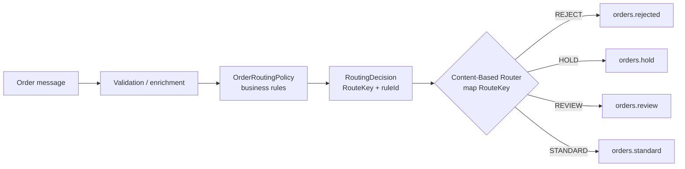
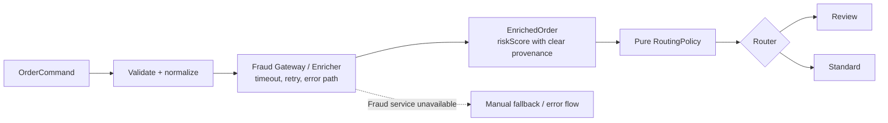

# Avoiding Large Business Logic Inside Expressions

## 1. Why can a Content-Based Router become hard to maintain?

In **Enterprise Integration Patterns**, a *Content-Based Router* reads message content to decide whether to send the message to one or more processing branches. For example, an order system receives orders and routes them to:

- `orders.standard`: normal orders, processed automatically.
- `orders.review`: high-risk or high-value orders requiring review.
- `orders.hold`: cross-border orders missing required identity verification.
- `orders.rejected`: invalid input data.

Initially, the routing condition might be simple: `amount >= 5000` goes to review. After a few months, product adds regional limits, identity checks, time windows, customer tiers, restriction lists, and exceptions. If everything is written directly inside a **SpEL expression** or a long lambda right inside `IntegrationFlow`, one tiny edit can skew decisions across multiple branches.

In the **SPRING_INTEGRATION_PATTERN** module, the **Content-based router** chapter aims to build loosely coupled, extensible message flows with Spring Integration. Placing business rules in the right place helps coordinate Router, Filter, Transformer, Splitter, Aggregator, Gateway, retry, error channels, and correlation—while making routing decisions easier to test and monitor.

**Core principle:** the Router configuration should express **the decision point and mapping of outcomes to channels**. Complex business rules belong inside a **strongly typed policy/service/strategy that can be tested independently**.

After this lesson, you can:

1. Spot when an expression is taking on too many responsibilities.
2. Separate business rules from channel details and Spring Integration DSL.
3. Define rule precedence, fallback rules, and handling for invalid data.
4. Implement a typed policy, map `RouteKey` to channels, and observe routing rationale.
5. Test the policy with case tables, then test flow wiring.
6. Stay safe when routing on data from HTTP, brokers, or untrusted sources.

## 2. The proper role of expressions inside a Router

Spring Integration supports routing in several ways, including SpEL expressions, headers, payload types, methods, and Java DSL. Expressions work great when a decision is simply a property access or short condition, such as:

```text
headers['region']
```

Or when selecting a channel from a field already normalized in an earlier step:

```text
payload.routingKey
```

In those situations, readers immediately see **which input is read** and **what value is returned**. An expression fits as a thin glue layer between message and Router.

Conversely, a long expression often mixes these concerns:

| Responsibility | Where should it live? | Why? |
| --- | --- | --- |
| Extracting a normalized field | Short expression or short lambda | It is a simple mapping operation. |
| Deciding precedence among risk rules | Domain policy/service | Needs matrix testing and independent evolution. |
| Querying a database or calling HTTP for scores | Separate enrichment/gateway step | Involves timeouts, retries, I/O errors, and latency tracking. |
| Mapping `REVIEW` to `orders.review` | Router configuration | Topology concern, not business rule. |
| Normalizing payloads and headers | Transformer/Header Enricher | Single responsibility; gives the Router trustworthy data. |
| Handling rejected or unmatched messages | Filter or fallback/error branch | Requires explicit policies for errors, retries, and message retention. |

A complex expression is **not wrong merely because it uses SpEL**. Problems arise when it hides business rules and side effects behind a compact yet hard-to-verify configuration. Complexity and scope of responsibility are the primary criteria; line count is merely a symptom.

## 3. Anti-pattern example: business rules buried in an expression

Suppose the business rules are:

1. Missing order ID, negative amount, or out-of-range risk score → reject.
2. Unverified cross-border order → hold.
3. Risk score 80+ or total 5,000+ → review.
4. Remaining cases → standard processing.

An illustrative expression (SpEL-style pseudocode demonstrating complexity rather than copy-paste runnable config):

```text
payload.orderId == null || payload.orderId.isBlank()
    || payload.amount == null || payload.amount < 0
    || payload.riskScore < 0 || payload.riskScore > 100
        ? 'REJECT'
        : (payload.crossBorder && !payload.identityVerified
            ? 'HOLD'
            : (payload.riskScore >= 80 || payload.amount >= 5000
                ? 'REVIEW'
                : 'STANDARD'))
```

If someone later adds "GOLD enterprise customers get priority review in case A, except in region B", the expression quickly turns into nested `?:`, `and/or`, and deep property chains.

Common problems emerge:

- **Hidden rule order.** Should an unverified order that is also high-risk go to `HOLD` or `REVIEW`? Readers must parse operator nesting to answer.
- **Fragile `null` branches.** A new payload shape or field can cause evaluation errors instead of returning an intentional decision.
- **Weak typing.** Property names can drift or amounts can be compared inconsistently with the real schema.
- **Hard to unit test individual rules fast.** Checking a single threshold may require booting an entire `IntegrationFlow` or SpEL evaluation context.
- **Routing rationale disappears.** Output is just `"REVIEW"`, hiding whether risk score or amount limit triggered it.
- **Risk of sneaking in I/O.** Expressions start calling other beans to fetch data, while retries, timeouts, and transactions become invisible in the flow.

SpEL can access beans and invoke methods. While useful for calling simple read-only helpers, never use it to hide network calls, writes, or side effects inside a routing decision.

### Signs you need to refactor

When anyone editing a rule has to ask *"where is this threshold, which case takes priority, does it call an external service, and how do we tell why a message entered that branch?"*, it is time to extract business logic out of the expression.

## 4. Design the routing contract before writing DSL

Before coding, define a **priority-ordered decision table**. This is the contract between product, domain logic, and topology.

Example order with `BigDecimal` `amount`, `riskScore` in 0–100, and an identity-verified flag:

| Priority | Condition | `RouteKey` | Recorded reason |
| --- | --- | --- | --- |
| 1 | Blank ID, missing/negative amount, riskScore outside 0–100 | `REJECT` | `INVALID_INPUT` |
| 2 | Cross-border **and** unverified | `HOLD` | `IDENTITY_REQUIRED` |
| 3 | Risk score ≥ 80 | `REVIEW` | `HIGH_RISK` |
| 4 | Amount ≥ 5,000 | `REVIEW` | `LARGE_AMOUNT` |
| 5 | Matches none of the above | `STANDARD` | `NORMAL_ORDER` |

**Priority order is part of the business.** An unverified cross-border order that also has `riskScore = 95` goes to `HOLD` due to priority rule 2. If requirements change to "high risk always goes to review first", update the decision table and tests—never hurriedly move an operator inside an expression.

A typed result structure carries both the **route key** and **decision rationale**:

```java
enum RouteKey {
    REJECT, HOLD, REVIEW, STANDARD
}

record RoutingDecision(RouteKey route, String ruleId) {}
```

With this:

- The Router only reads `decision.route()`.
- Logs, metrics, or audits can record `decision.ruleId()`.
- The policy is independent of channel names like `orders.review`.
- When topology changes, the domain policy does not need to know new channel names.

**Restrict what goes into `ruleId`:** reason codes should come from a managed vocabulary (e.g., `HIGH_RISK`); avoid putting raw sensitive data into reasons, logs, or metric labels.

## 5. Recommended architecture: policy produces decision, Router maps channel



Split the architecture into **three questions**:

1. **Is data complete and trustworthy?** Ingress or enrichment normalizes fields, verifies tenant, and fetches needed context. This is where I/O and data-source failures are handled.
2. **Which rule applies?** A pure Java policy returns a decision. The policy should produce repeatable outcomes for identical inputs.
3. **Which channel does this outcome go to?** The Router maps the policy's `RouteKey` to a channel declared in the flow.

This separation lets you change risk rules without touching topology, or swap downstream systems without rewriting business rules.

### Using a decision DTO when traceability is needed

There are two ways to pass policy results to the Router:

- **Compact way:** Router calls `policy.decide(message)` directly and returns `RouteKey`. Fits when extra rationale isn't persisted and the policy is pure and fast.
- **Explicit-context way:** A Transformer produces a `RoutedOrder` wrapping the original order plus `RoutingDecision`; the Router just reads the key. Fits when auditing, inspecting reasons, or reusing the decision in downstream endpoints.

This lesson chooses the second approach to keep responsibility boundaries crystal clear. Constructing `RoutedOrder` means the payload after classification **changes type**; downstream consumers must understand the new type or include a Transformer to restore the original payload.

## 6. Java DSL example: extracting policy from Router

The example below illustrates a complete flow at the Spring Integration wiring level. Records and classes are package-private so they can sit in one package while learning; real applications should organize them into well-named files.

```java
import java.math.BigDecimal;

import org.springframework.context.annotation.Bean;
import org.springframework.context.annotation.Configuration;
import org.springframework.integration.channel.DirectChannel;
import org.springframework.integration.channel.QueueChannel;
import org.springframework.integration.config.EnableIntegration;
import org.springframework.integration.dsl.IntegrationFlow;

// Inbound message from a contract-defined source.
record OrderCommand(
        String orderId,
        BigDecimal amount,
        int riskScore,
        boolean crossBorder,
        boolean identityVerified) {}

enum RouteKey {
    REJECT, HOLD, REVIEW, STANDARD
}

record RoutingDecision(RouteKey route, String ruleId) {}

record RoutedOrder(OrderCommand original, RoutingDecision decision) {}

// Domain policy: independent of channels, brokers, or Spring Integration.
final class OrderRoutingPolicy {

    private static final BigDecimal REVIEW_AMOUNT =
            new BigDecimal("5000");

    RoutedOrder classify(OrderCommand order) {
        if (order == null
                || order.orderId() == null
                || order.orderId().isBlank()
                || order.amount() == null
                || order.amount().signum() < 0
                || order.riskScore() < 0
                || order.riskScore() > 100) {
            return new RoutedOrder(
                    order,
                    new RoutingDecision(
                            RouteKey.REJECT, "INVALID_INPUT"));
        }

        if (order.crossBorder() && !order.identityVerified()) {
            return new RoutedOrder(
                    order,
                    new RoutingDecision(
                            RouteKey.HOLD, "IDENTITY_REQUIRED"));
        }

        if (order.riskScore() >= 80) {
            return new RoutedOrder(
                    order,
                    new RoutingDecision(
                            RouteKey.REVIEW, "HIGH_RISK"));
        }

        if (order.amount().compareTo(REVIEW_AMOUNT) >= 0) {
            return new RoutedOrder(
                    order,
                    new RoutingDecision(
                            RouteKey.REVIEW, "LARGE_AMOUNT"));
        }

        return new RoutedOrder(
                order,
                new RoutingDecision(
                        RouteKey.STANDARD, "NORMAL_ORDER"));
    }
}

@Configuration
@EnableIntegration
class OrderRoutingConfiguration {

    @Bean
    OrderRoutingPolicy orderRoutingPolicy() {
        return new OrderRoutingPolicy();
    }

    @Bean("orders.input")
    DirectChannel ordersInput() {
        return new DirectChannel();
    }

    @Bean("orders.rejected")
    QueueChannel rejectedOrders() {
        return new QueueChannel();
    }

    @Bean("orders.hold")
    QueueChannel heldOrders() {
        return new QueueChannel();
    }

    @Bean("orders.review")
    QueueChannel reviewOrders() {
        return new QueueChannel();
    }

    @Bean("orders.standard")
    QueueChannel standardOrders() {
        return new QueueChannel();
    }

    @Bean
    IntegrationFlow routeOrders(OrderRoutingPolicy policy) {
        return IntegrationFlow.from("orders.input")
            .transform(OrderCommand.class, policy::classify)
            .route(RoutedOrder.class,
                routed -> routed.decision().route().name(),
                spec -> spec
                    .channelMapping("REJECT", "orders.rejected")
                    .channelMapping("HOLD", "orders.hold")
                    .channelMapping("REVIEW", "orders.review")
                    .channelMapping("STANDARD", "orders.standard"))
            .get();
    }
}
```

**Reading the code along the flow:**

1. Messages enter `orders.input` with an `OrderCommand` payload.
2. The Transformer calls `policy.classify(...)`. The policy returns `RoutedOrder` containing the original data and reasoned decision.
3. The Router reads `routed.decision().route().name()`—a tiny operation carrying zero business logic.
4. `channelMapping` explicitly sends the four keys to four targets. This is a topology detail editable without touching `OrderRoutingPolicy`.
5. Outputs are `QueueChannel` instances so tests can call `receive(timeout)`. In production, replace them with channels/handlers/adapters matching SLA, retry, and durability needs.

**What the example guarantees:** every valid `OrderCommand` input is classified into a clear branch. **What it does not guarantee:** that output consumers finished processing, data was durably persisted, or side effects executed exactly-once. Successfully sending to a `QueueChannel` only confirms the message entered the queue.

### Why are constant route keys useful?

If a Router returns a dynamic string like `"orders." + payload.destination`, input could accidentally select a channel outside the contract. By contrast, `RouteKey` constrains the policy's output domain, and `channelMapping` forms a **destination allowlist**.

Calling `name()` at the Router boundary is just converting an enum to a routing key. Never use unchecked user strings as channel names, bean names, or dynamic expressions.

### What if downstream only needs `OrderCommand`?

In the example, the payload after `transform()` is `RoutedOrder`. Consumers can read `routed.original()` and `routed.decision()`. If an outbound adapter accepts only `OrderCommand`, place a Transformer on that branch to unwrap the original payload, or use the **Header Enricher** pattern:

```java
// Alternative approach: keep OrderCommand payload, add header from policy.
.enrichHeaders(spec -> spec
    .headerFunction("routeKey",
        message -> policy.classify(
            (OrderCommand) message.getPayload())
            .decision().route().name()))
.route("headers['routeKey']", spec -> spec
    .channelMapping("REJECT", "orders.rejected")
    .channelMapping("HOLD", "orders.hold")
    .channelMapping("REVIEW", "orders.review")
    .channelMapping("STANDARD", "orders.standard"))
```

This snippet is an **alternative DSL fragment** replacing `transform + route`, not appended after the previous flow. It preserves the `OrderCommand` payload while storing only `routeKey`, not `ruleId`. If both are needed, compute `RoutingDecision` once in an earlier stage and place it in a typed header or DTO to avoid calling the policy repeatedly per header.

When messages cross HTTP, AMQP, or JMS, explicitly define which application headers may cross the transport. A Java object like `RoutingDecision` does not automatically have a safe representation in every header mapper.

## 7. When a small expression is still a good choice

Not every Router needs a policy class.

For example, once a validation step normalizes a `region` header into an enum or string from a controlled set, a Router reading `headers['region']` is easy to understand. Similarly, routing by payload type can remain pure wiring.

A pragmatic rule of thumb:

| Scenario | Suitable approach |
| --- | --- |
| Reading a trusted header, enum, or precomputed field | Short expression or short lambda. |
| Two simple, stable conditions with no side effects | Short, clearly named lambda; test at flow boundary. |
| Multiple conditions with priorities, thresholds, exceptions, or product variants | Typed policy/service + unit tests. |
| Rules maintained by multiple teams or versioned | Managed policy/decision table; Router consumes the decision. |
| Must call network services to decide | Extract enrichment/Gateway with retries/timeouts; Router uses pre-fetched results. |
| One message must go to multiple independent destinations | Consider Recipient List or Publish-Subscribe instead of a side-effect-heavy router expression. |

Prioritize **readability of the decision** over creating extra classes out of dogma. If a policy just returns a field already sitting on the message, an extra wrapper class may make the flow harder to read.

## 8. When rules need data from an API or database

A frequent requirement is: "To route orders, we must call the fraud service for a risk score." Do not hide that call inside a routing expression as a plain condition:

```text
// Do not let a routing expression hide a network call:
@fraudClient.checkRisk(payload.customerId) > 80
    ? 'REVIEW'
    : 'STANDARD'
```

Because once the fraud service slows down or fails, the Router decision inherits:

- Timeouts and risk of blocking the sending thread.
- Retries and risk of calling the same API repeatedly.
- Authentication and circuit-breaker concerns.
- Fallback behavior when risk scores are unavailable.
- Side effects (if the check API also logs or bills queries).
- Hidden latency absent from the flow diagram.

Instead, design explicit stages:



The fraud enrichment step is configured explicitly as a Gateway, Transformer/service handler, or appropriate integration endpoint. Once data is fetched, the policy evaluates **synchronously on available inputs**. If the service slows down, enrichment metrics and error flows pinpoint the bottleneck; meanwhile the policy stays testable with zero network calls.

**Never assume an API failure equals zero risk.** If the fraud service is unavailable, the business may require `HOLD` or `REVIEW` with reason `RISK_UNAVAILABLE`, or temporary rejection. Make this an intentional choice reflected in the rule table and tests.

### For policies varying by tenant or time

If each tenant has custom thresholds, load verified/versioned configuration **before** evaluation. Pass a `PolicyContext` containing thresholds and rule version into the service; outputs record `policyVersion` for auditing. Avoid executing arbitrary user-supplied expressions inside an evaluation context with unrestricted access to beans/methods.

Example of decision reproducibility:

```text
orderId:          O-204
policyVersion:    risk-v3
evaluatedAt:      2026-11-21T09:00:00Z
routeKey:         REVIEW
ruleId:           LARGE_AMOUNT
```

These values are illustrative. For time-varying rules, persist normalized inputs or sufficient data references to explain decisions during investigations, while complying with data retention policies.

## 9. Routing is topology; business logic is policy

When separating the two layers, avoid inverting responsibilities:

**Do not put topology into domain policy:**

```java
// Avoid returning channel names directly from business logic:
String chooseDestination(OrderCommand order) {
    return order.amount().compareTo(new BigDecimal("5000")) >= 0
            ? "springIntegrationReviewChannel"
            : "springIntegrationStandardChannel";
}
```

Renaming a channel or moving the review branch onto a broker forces business logic to change.

**Let the policy return business-meaningful values:**

```java
RouteKey chooseRoute(OrderCommand order) {
    return order.amount().compareTo(new BigDecimal("5000")) >= 0
            ? RouteKey.REVIEW
            : RouteKey.STANDARD;
}
```

This is a trimmed snippet highlighting the interface difference; real applications use full precedence and validation like `OrderRoutingPolicy` in section 6.

`RouteKey` represents a decision state. `channelMapping` represents that state's execution address. When domain and infrastructure evolve at different speeds, this separation reduces code churn and keeps policy tests stable.

## 10. No matching branch: have an explicit policy

If you add `RouteKey.ESCALATED` to the policy and forget to map it to a channel, the Router may fail destination resolution or fall back per the router type's default behavior. Never let an important message vanish over a missing mapping.

Three common approaches:

1. **Detect missing config:** policies only return keys from a fixed enum; tests verify every key has a mapping. Unmapped keys are treated as configuration bugs and alerted on.
2. **Monitored default output channel:** route to `orders.unrouted`, record diagnostic details, and handle or reject explicitly there.
3. **Business fallback:** the policy returns `HOLD` or `REJECT` when inputs lack evaluation prerequisites; never treat technical fallback as a valid business decision.

Spring Integration provides router options such as default output channel and destination resolution requirements (depending on router/API version). At deployment time, explicitly verify `defaultOutputChannel`, `resolutionRequired`, and `channelMapping` behavior.

**Never use a default channel to mask key typos.** A misspelled `REVEIW` can slip into a fallback branch unnoticed. Rule tests plus wiring tests exist specifically to catch this mistake.

### What if a message is invalid altogether?

A Router picking a processing path **differs from** a Message Filter deciding whether to keep or drop a message. If invalid data must be reported back to the sender, have the policy return `REJECT` and route to a rejection branch, or use a Filter with an appropriate discard/error channel. Never silently dump invalid messages into a black-hole channel.

## 11. Testing the policy independently of Spring

The biggest payoff of separating the policy is testing **rule precedence and boundaries** in JUnit 5 without starting an `ApplicationContext`.

The following example uses types defined in section 6:

```java
import static org.assertj.core.api.Assertions.assertThat;

import java.math.BigDecimal;

import org.junit.jupiter.api.Test;

class OrderRoutingPolicyTest {

    private final OrderRoutingPolicy policy =
            new OrderRoutingPolicy();

    @Test
    void rejectsInvalidInputBeforeAllOtherRules() {
        OrderCommand invalid = new OrderCommand(
            "", new BigDecimal("-1"), 95, true, false);

        RoutingDecision decision =
            policy.classify(invalid).decision();

        assertThat(decision.route()).isEqualTo(RouteKey.REJECT);
        assertThat(decision.ruleId()).isEqualTo("INVALID_INPUT");
    }

    @Test
    void holdHasPrecedenceOverHighRisk() {
        OrderCommand order = new OrderCommand(
            "O-100", new BigDecimal("9000"), 95, true, false);

        RoutingDecision decision =
            policy.classify(order).decision();

        assertThat(decision.route()).isEqualTo(RouteKey.HOLD);
        assertThat(decision.ruleId())
            .isEqualTo("IDENTITY_REQUIRED");
    }

    @Test
    void highRiskWinsWhenIdentityIsVerified() {
        OrderCommand order = new OrderCommand(
            "O-101", new BigDecimal("100"), 80, true, true);

        RoutingDecision decision =
            policy.classify(order).decision();

        assertThat(decision.route()).isEqualTo(RouteKey.REVIEW);
        assertThat(decision.ruleId()).isEqualTo("HIGH_RISK");
    }

    @Test
    void amountThresholdIsInclusive() {
        OrderCommand order = new OrderCommand(
            "O-102", new BigDecimal("5000"), 20, false, true);

        RoutingDecision decision =
            policy.classify(order).decision();

        assertThat(decision.route()).isEqualTo(RouteKey.REVIEW);
        assertThat(decision.ruleId()).isEqualTo("LARGE_AMOUNT");
    }

    @Test
    void normalOrderRemainsStandard() {
        OrderCommand order = new OrderCommand(
            "O-103", new BigDecimal("4999.99"), 20, false, true);

        assertThat(policy.classify(order).decision().route())
            .isEqualTo(RouteKey.STANDARD);
    }
}
```

These tests protect **the policy's semantics**. If someone alters rule order, `holdHasPrecedenceOverHighRisk` forces them to acknowledge they changed a business-impacting decision.

### Recommended test case matrix

| Input | Expected route | Why test it? |
| --- | --- | --- |
| `amount == null` | `REJECT` | Avoid null errors when comparing thresholds. |
| `amount < 0` | `REJECT` | Never classify invalid data as normal orders. |
| `riskScore = -1` or `101` | `REJECT` | Protect data domain bounds. |
| `crossBorder=true`, unverified, risk=95 | `HOLD` | Verify priority order. |
| Risk = 79, amount = 4,999 | `STANDARD` | Boundary just below thresholds. |
| Risk = 80, low amount | `REVIEW` | Risk threshold boundary. |
| Low risk, amount = 5,000 | `REVIEW` | Amount threshold boundary. |
| High risk, high amount | `REVIEW` with the right prioritized reason | Multiple matching conditions. |

For larger policies, use parameterized tests or table-driven test data for easy expansion. Every rule change needs positive, negative, and boundary cases. Never test only a single happy-path order.

## 12. Testing wiring: RouteKey reaches the right channel

Policy unit tests do not catch configuration mistakes like mapping `REVIEW` to `orders.standard`. Add at least one internal flow integration test using inspectable channels.

Example using Spring Test, JUnit 5, and AssertJ:

```java
import static org.assertj.core.api.Assertions.assertThat;

import java.math.BigDecimal;

import org.junit.jupiter.api.Test;
import org.springframework.beans.factory.annotation.Autowired;
import org.springframework.beans.factory.annotation.Qualifier;
import org.springframework.integration.channel.QueueChannel;
import org.springframework.messaging.Message;
import org.springframework.messaging.MessageChannel;
import org.springframework.messaging.support.MessageBuilder;
import org.springframework.test.context.junit.jupiter.SpringJUnitConfig;

@SpringJUnitConfig(OrderRoutingConfiguration.class)
class OrderRoutingFlowTest {

    @Autowired
    @Qualifier("orders.input")
    MessageChannel input;

    @Autowired
    @Qualifier("orders.rejected")
    QueueChannel rejected;

    @Autowired
    @Qualifier("orders.hold")
    QueueChannel hold;

    @Autowired
    @Qualifier("orders.review")
    QueueChannel review;

    @Autowired
    @Qualifier("orders.standard")
    QueueChannel standard;

    private void assertRouted(OrderCommand order,
                              QueueChannel expected,
                              RouteKey route,
                              String ruleId) {
        Message<OrderCommand> request = MessageBuilder
            .withPayload(order)
            .setHeader("requestId", "req-" + order.orderId())
            .build();

        assertThat(input.send(request)).isTrue();

        Message<?> output = expected.receive(0);
        assertThat(output).isNotNull();

        RoutedOrder routed = (RoutedOrder) output.getPayload();
        assertThat(routed.original()).isEqualTo(order);
        assertThat(routed.decision().route()).isEqualTo(route);
        assertThat(routed.decision().ruleId()).isEqualTo(ruleId);
        assertThat(output.getHeaders().get("requestId"))
            .isEqualTo("req-" + order.orderId());
    }

    @Test
    void everyDecisionUsesItsMappedChannel() {
        assertRouted(
            new OrderCommand("bad", new BigDecimal("-1"),
                             20, false, true),
            rejected, RouteKey.REJECT, "INVALID_INPUT");

        assertRouted(
            new OrderCommand("held", new BigDecimal("9000"),
                             95, true, false),
            hold, RouteKey.HOLD, "IDENTITY_REQUIRED");

        assertRouted(
            new OrderCommand("review", new BigDecimal("100"),
                             80, false, true),
            review, RouteKey.REVIEW, "HIGH_RISK");

        assertRouted(
            new OrderCommand("normal", new BigDecimal("100"),
                             20, false, true),
            standard, RouteKey.STANDARD, "NORMAL_ORDER");

        // No messages remain at any target after reading the 4 results.
        assertThat(rejected.receive(0)).isNull();
        assertThat(hold.receive(0)).isNull();
        assertThat(review.receive(0)).isNull();
        assertThat(standard.receive(0)).isNull();
    }
}
```

This test proves channel mappings and the `requestId` header survive Transformer/Router in the sample config. QueueChannels are used purely to observe outputs. The test does not prove downstream persisted data, transports acknowledged delivery, or multi-service transactions rolled back.

If the Router sits behind async channels, adapters, or Gateways, add tests for timeouts, dispatch errors, late messages, retries, idempotency, and unresolvable route keys.

## 13. Logging and observability: know which branch *and why*

An expression returning only `"REVIEW"` leaves operations asking: "Did this message enter review due to amount, risk score, or configuration?"

The `RoutingDecision(route, ruleId)` model makes the answer structured. At an appropriate boundary, log:

```text
event=order_routed
requestId=req-102
route=REVIEW
ruleId=LARGE_AMOUNT
policyVersion=risk-v3
durationMs=2
```

This is an **illustrative log format**; `policyVersion` and `durationMs` must be generated and measured by the application. Never put `orderId`, emails, tokens, PII, or overly granular values into high-cardinality metric labels.

Suggested metric set:

- `router.decisions.total{route,ruleId}`: decision counts by branch and rule code.
- `router.decisions.error.total{reason}`: classification failure counts.
- `router.decision.duration`: policy execution time, catching when a pure policy gets weighed down by costly operations.
- `router.unrouted.total`: missing channel mappings or fallback hits.
- `router.downstream.failures.total{destination}`: errors per target handler.

These metric names are **application design suggestions**, not assertions that Spring Integration emits those exact names out of the box.

Preserve `requestId` or trace context across stages needing observation. When messages cross multiple systems, define header mapping, data protection, and retention policies. Distinguish framework `MessageHeaders.ID`, Splitter/Aggregator `correlationId`, and business `requestId`; they are not always interchangeable.

## 14. Impact on other Enterprise Integration Patterns

Separating policies from expressions sharpens boundaries with neighboring patterns:

| Pattern | Relationship with Content-Based Router | What to preserve during refactoring |
| --- | --- | --- |
| **Filter** | Decides pass/reject before routing, or routes invalid inputs to reject branch | Never silently drop important messages if error replies are required. |
| **Transformer** | Normalizes payloads or constructs typed `RoutingDecision` | Preserve key headers; document post-transform payload types. |
| **Header Enricher** | Adds verified routing data | Never trust unverified client headers to bypass policies. |
| **Splitter** | Splits messages into parts that may take different branches | Preserve correlation/sequence; each part can have its own route. |
| **Aggregator** | Combines results after routing/fan-out | Define group keys, release, and timeout; Filter/routing may leave parts missing. |
| **Gateway** | Fetches external data before policy or awaits replies after router | Separate request timeout, reply timeout, and retries. |
| **Retry/Error Channel** | Handles enrichment, classification, or downstream errors | Avoid retries duplicating side effects; record exact error origin. |

One special case: when wanting to **send the same event to multiple places** (e.g., audit + email + CRM), distinguish clearly:

- **Content-Based Router** normally selects one primary processing lane by order type; some routers still support multiple targets.
- **Recipient List** or **Publish-Subscribe Channel** expresses fan-out to multiple independent recipients.
- **Aggregator** waits for multiple results and merges them back into one message when fan-in is needed.

Never embed multiple `send()` calls inside a policy to simulate fan-out: that puts side effects in the wrong place, breaks retries, and complicates partial-success handling.

## 15. Common mistakes when extracting expressions

| Symptom | Cause | Fix |
| --- | --- | --- |
| Policy returns `null` and Router fails | No fallback defined for invalid inputs | Return `REJECT`/`HOLD` with reason or throw controlled error before Router. |
| New decision never reaches right channel | Added enum key, forgot `channelMapping` | Test every key and check topology; monitor unrouted messages. |
| Message routes right yet loses `requestId` | Transformer built a new message dropping headers | Check header contract and transformer; assert at output. |
| Rule passes unit tests yet fails in live system | Pre-policy data unnormalized or untrusted | Test ingress/enrichment and routing flows with real schemas, tenants, headers. |
| Policy suddenly becomes slow | Hidden DB/HTTP query added inside method | Move I/O to enrichment stage with explicit timeouts, metrics, retries. |
| One input produces two different decisions | Policy reads unstable time/external state per call | Pass explicit context/policy version; avoid repeated evaluations. |
| Logs don't explain why review happened | Decision is just a channel string | Use `RoutingDecision` with managed `ruleId`. |
| Fails only under multiple threads | Shared mutable state in policy or unsafe rule cache | Keep policies stateless/immutable; check cache consistency. |
| Tenant A's message routes to Tenant B | Used client-supplied header or channel name directly | Normalize identity at ingress; enforce permissions and target allowlists. |
| Threshold update alters old decisions on replay | Policy version unrecorded and no replay contract | Define replay policy under old vs. new version; persist decision rationale. |

### Note on performance

Do not jump to "SpEL is always slower than Java" and refactor every expression blindly. For a simple header lookup, routing cost is negligible compared to I/O. The primary concerns are **readability, testability, safety, and change management**. If latency is a genuine concern, profile and measure under real traffic and environment.

## 16. Process for refactoring an existing Router with a long expression

Follow this sequence to preserve behavior:

1. **Snapshot the current contract.** List every route key, channel mapping, fallback, and behavior on missing/bad inputs. Document how error flows work.
2. **Extract a decision table.** Translate each expression branch into a row, making priority order and multi-rule overlaps explicit.
3. **Write characterization tests.** Create inputs representing current behavior; capture outputs and preserved headers, including unwanted legacy quirks that already exist.
4. **Create an isolated policy.** Accept a normalized DTO/context; return an enum or reasoned decision record; keep side effects out.
5. **Keep channel mappings unchanged.** Swap only route-key computation initially without simultaneously renaming or changing channel types.
6. **Test both policy and flow layers.** Unit test the rule matrix, and integration test the Router and error branches.
7. **Add observability in the right spots.** Log route, ruleId, policyVersion, correlation, and latency without exposing sensitive data.
8. **Compare before/after behavior.** Verify routing, exceptions, timeouts, threading, retries, and side effects; only then modify topology if truly needed.

There is no single expression-length threshold that fits every project. What matters is that when business rules change, the team can **see which rule changed, prove unaffected rules stayed intact, and trace decisions in production**.

## 17. Practice exercises

### Exercise 1 — Extract policy from an expression

Given hypothetical logic:

```text
riskScore >= 80 ? REVIEW :
    (amount >= 5000 ? REVIEW :
        (crossBorder && !identityVerified ? HOLD : STANDARD))
```

Requirements:

- Write a priority table; point out differences from the policy in section 4.
- Add a `REJECT` rule when data is invalid.
- Implement as a Java policy returning `RoutingDecision(route, ruleId)`.
- Write tests for an order that is both high-risk and unverified.

### Exercise 2 — Change topology while keeping domain policy

In section 6's example, point `orders.review` to a new channel/adapter serving a manual review workflow. Keep `OrderRoutingPolicy` unchanged. Write tests confirming every input yields the same `RouteKey` before and after changing topology.

### Exercise 3 — Fraud service unavailable

Design a flow receiving orders without `riskScore`, requiring a call to the fraud service. Requirements:

- Extract the fraud service call into a Gateway/enrichment stage.
- Configure an explicit deadline and dedicated error path.
- Define the business decision when scores cannot be fetched.
- Ensure the final Router still only maps `RouteKey` to channels.

### Exercise 4 — Per-tenant and versioned rules

Suppose tenant A reviews from 5,000, while tenant B reviews from 2,000. Design a `PolicyContext` holding the verified tenant and `policyVersion`. Write tests protecting tenant A/B classification and the rule against trusting self-declared client `tenantId`s.

### Exercise 5 — Catching wiring mistakes

Intentionally change the `"HOLD" → "orders.standard"` mapping and run integration tests. Explain why policy unit tests still pass while integration tests catch the bug. Then add a test verifying every `RouteKey` enum value maps to a valid channel.

**Completion criteria:** articulate why a rule belongs to policy, a mapping belongs to Router, and a network call belongs to Gateway/enrichment; provide clean code and tests proving both decisions and message paths.

## 18. Practical conclusion

Expressions in a Content-Based Router work best when **short and focused on extracting an already-established decision**. When rules involve multiple priority levels, thresholds, exceptions, external data sources, or audit requirements, extract them into a typed, independently testable policy.

A clean design typically follows:

**Ingress/Enrichment → RoutingPolicy → RoutingDecision → Router/ChannelMapping → Handler**.

This lets Spring Integration keep its role connecting EIPs while business logic lives where it can be tested and evolved separately. Good structure not only makes flows easier to read, but also makes timeouts, error channels, retries, and correlation far more transparent.

## References

- [Spring Integration Reference — Message Routing](https://docs.spring.io/spring-integration/reference/router.html)
- [Spring Integration Reference — Router Implementations](https://docs.spring.io/spring-integration/reference/router/implementations.html)
- [Spring Integration Reference — Java DSL](https://docs.spring.io/spring-integration/reference/dsl.html)
- [Spring Integration Reference — Message Transformation](https://docs.spring.io/spring-integration/reference/transformer.html)
- [Spring Integration Reference — Content Enrichment](https://docs.spring.io/spring-integration/reference/content-enrichment.html)
- [Spring Integration Reference — Error Handling](https://docs.spring.io/spring-integration/reference/error-handling.html)
- [Spring Integration Reference — Message Headers](https://docs.spring.io/spring-integration/reference/message.html)
- [Enterprise Integration Patterns — Content-Based Router](https://www.enterpriseintegrationpatterns.com/patterns/messaging/ContentBasedRouter.html)

Examples use Java records (Java 17+) and Spring Integration Java DSL. When applying to a specific project, cross-check APIs, Spring Framework/Spring Integration versions, router channel resolution behavior, and your application's error-handling configuration.
