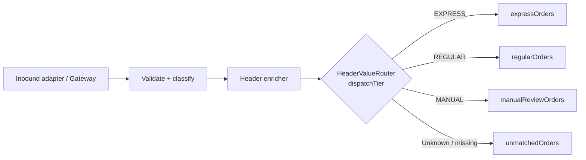
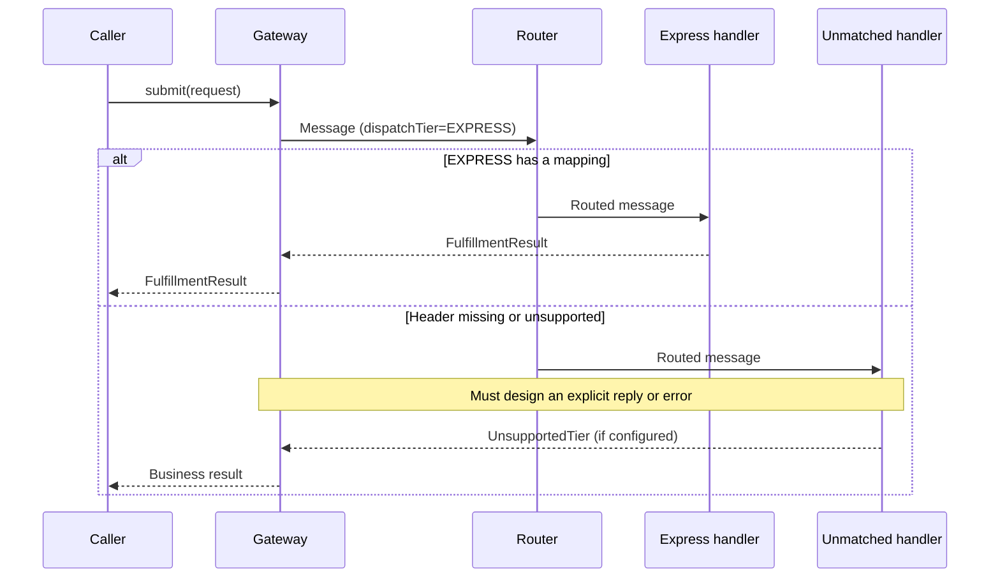
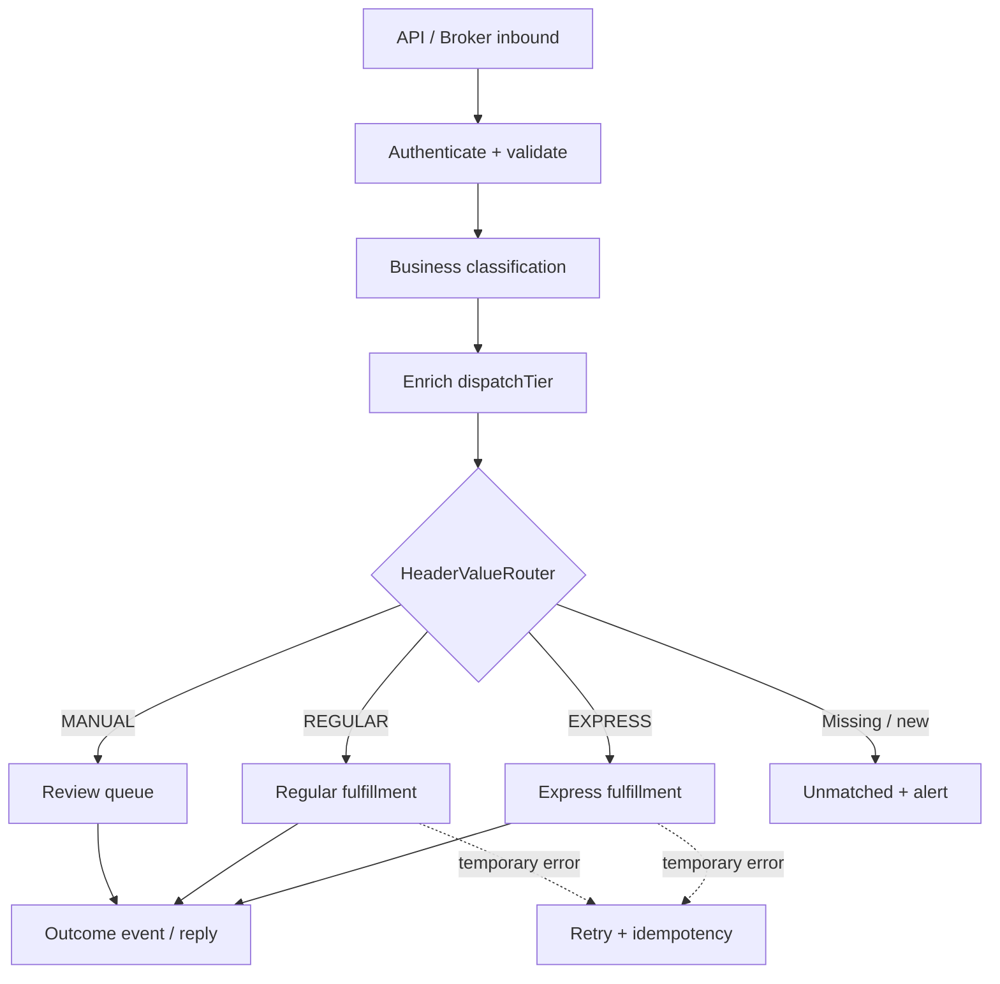

# Header Value Router and Routing Values

In **Spring Integration**, a `Message<?>` contains a **payload** and **headers**. There are times when the system has already determined the type of processing required before the message reaches the routing step: for example, whether an order belongs to the express delivery flow (`EXPRESS`), regular delivery (`REGULAR`), or requires manual review (`MANUAL`). Instead of re-reading the payload and repeating classification rules at every branch, we can attach the classification result to a **routing header** and then use **`HeaderValueRouter`** to select the target channel.

This lesson belongs to the **Header-based router** chapter of the `SPRING_INTEGRATION_PATTERN` module, aiming to teach how to implement **Enterprise Integration Patterns** with Spring Integration: separating the responsibilities of Router, Filter, Transformer, Splitter, Aggregator, and Gateway, while addressing retries, error channels, correlation, testing, and observability of processing branches. The focus here is **how routing values are retrieved, normalized, mapped, and resolved**, along with cases that easily cause messages to go to the wrong branch or lose track.

After this lesson, you will be able to:

- Explain the role of **`HeaderValueRouter`** and distinguish between **header name**, **routing key**, **channel mapping**, and **target channel**.
- Configure a Router using Java DSL, using `channelMapping`, a default output channel, and a **channel-key fallback** policy.
- Specify how to handle missing, wrong-type, malformed, or newly introduced unsupported header values.
- Identify the risks of using headers supplied by external sources to select channels, especially on sensitive branches.
- Coordinate a Router with Gateway, Filter, Splitter/Aggregator, error flow, and idempotency without confusing different types of IDs.
- Write integration tests that observe **which channel the message actually arrives at** and verify that necessary data is preserved.

## 1. Where does Header Value Router fit in an IntegrationFlow?

A **Message Router** decides which channel will receive a message. `HeaderValueRouter` is a specialized router: instead of evaluating a chain of conditions across multiple payload properties, it **reads the value of a specified header** and uses that value as the key to determine the destination.



Example of a message sent to the Router:

```text
Message<FulfillmentRequest>
├── payload
│   ├── eventId     = "evt-1001"
│   ├── orderId     = "ORD-1001"
│   └── destination = "HCM"
└── headers
    ├── dispatchTier  = "EXPRESS"
    ├── traceId       = "trace-a91"
    ├── correlationId = "batch-42"
    └── id            = message UUID
```

The Router reads `dispatchTier = "EXPRESS"` and selects `expressOrders`. **The payload does not need to change its type** just to support branching. The downstream steps at the target channel are responsible for executing the business logic and producing a result if required by the contract.

### Four names you must distinguish

| Term | Example | Meaning |
| --- | --- | --- |
| **Header name** | `dispatchTier` | The key name that the Router will read from `MessageHeaders`. |
| **Routing value / routing key** | `EXPRESS` | The header value of a specific message, used to determine the destination. |
| **Channel mapping** | `EXPRESS` → `expressOrders` | The lookup table mapping routing keys to channel names. |
| **Target channel** | Bean `expressOrders` | The channel to which the message will be forwarded. |

`dispatchTier` **is not a channel name**, and `EXPRESS` is **not required** to match a bean name either. Explicit mapping allows changing the internal topology without forcing producers to modify all routing values.

## 2. Routing values must have a clear contract

Spring headers are a key-based metadata collection in which values can belong to various Java types. However, for a **router with a static mapping table**, using **normalized, finite, and documented string** values is usually the easiest to operate.

Proposed contract for the fulfillment example:

| `dispatchTier` value | Semantics | Configured target |
| --- | --- | --- |
| `EXPRESS` | Priority fulfillment after eligibility checks. | `expressOrders` |
| `REGULAR` | Standard fulfillment. | `regularOrders` |
| `MANUAL` | Requires staff review before fulfillment. | `manualReviewOrders` |
| Values outside the above set | Cannot be classified under the current contract. | `unmatchedOrders` or controlled error |

Some values **look similar but should not be treated as equivalent by default**:

```text
"EXPRESS"            ← canonical string
"express"            ← different letter case
" EXPRESS "          ← extra whitespace
DispatchTier.EXPRESS ← Java enum, not a String
1                    ← integer, has no meaning in the contract
null / missing       ← no valid routing value
```

Do not rely on an assumption that the framework will automatically coerce every type or trim all whitespace identically across all versions and adapters. **Normalize right at the header creation boundary**, validate against the allowed value set, and test the actual behavior. Do not use a list/collection as a routing key and implicitly expect the Router to fan out; requirements to send to multiple branches must be designed explicitly using the corresponding EIP.

### Routing key vs. business keys

Suppose `eventId=evt-1001` represents an event that may need exact replay, `orderId=ORD-1001` represents the order, and `dispatchTier=EXPRESS` is the routing decision. Even though they all appear in the same message, do not use `dispatchTier` as a deduplication key, an Aggregator correlation key, or an identifier to confirm business completion.

During a replay, headers may be regenerated using a new policy. If the business contract requires the routing decision **not to change over time**, store the decision or policy version in persistent data rather than relying solely on a single transmission's header.

## 3. Creating HeaderValueRouter with Java DSL

The following example uses **Java 17+**, Spring Integration, and `QueueChannel` as target channels for easy observation. A real application typically attaches consuming flows or endpoints behind these channels.

```java
import org.springframework.context.annotation.Bean;
import org.springframework.context.annotation.Configuration;
import org.springframework.integration.channel.DirectChannel;
import org.springframework.integration.channel.QueueChannel;
import org.springframework.integration.dsl.IntegrationFlow;
import org.springframework.integration.router.HeaderValueRouter;

@Configuration
class FulfillmentRouterConfiguration {

    @Bean
    DirectChannel dispatchInput() {
        return new DirectChannel();
    }

    @Bean
    QueueChannel expressOrders() {
        return new QueueChannel();
    }

    @Bean
    QueueChannel regularOrders() {
        return new QueueChannel();
    }

    @Bean
    QueueChannel manualReviewOrders() {
        return new QueueChannel();
    }

    @Bean
    QueueChannel unmatchedOrders() {
        return new QueueChannel();
    }

    @Bean
    HeaderValueRouter dispatchRouter() {
        HeaderValueRouter router = new HeaderValueRouter("dispatchTier");
        router.setChannelMapping("EXPRESS", "expressOrders");
        router.setChannelMapping("REGULAR", "regularOrders");
        router.setChannelMapping("MANUAL", "manualReviewOrders");

        // Do not attempt to resolve unknown values directly as channel names.
        router.setChannelKeyFallback(false);

        // Target for handling unmatched or unroutable keys.
        router.setDefaultOutputChannelName("unmatchedOrders");
        return router;
    }

    @Bean
    IntegrationFlow dispatchFlow(HeaderValueRouter dispatchRouter) {
        return IntegrationFlow.from("dispatchInput")
                .route(dispatchRouter)
                .get();
    }
}
```

Meaning of each step:

1. `HeaderValueRouter("dispatchTier")` specifies that **only the header with this name** is used as the routing key.
2. `setChannelMapping(...)` binds each canonical value to **a target channel name** in the application context.
3. `setChannelKeyFallback(false)` prevents unmapped keys from being used directly as **channel names**. This narrows the set of destinations to the allowlisted mappings.
4. `setDefaultOutputChannelName("unmatchedOrders")` sets where messages go when no matching destination is found under the illustrated policy.
5. `dispatchFlow` attaches the Router to the `dispatchInput` channel, while the downstream `QueueChannel`s serve as observation/consumption points.

### Why should you care about channel-key fallback?

Mapping-based routers in Spring Integration have a **channel-key fallback** mechanism: when no mapping exists, a key may be tried as a **channel name** for resolution, depending on configuration. This is convenient when producers emit channel names directly, but it can easily open unintended paths if the routing header can be controlled by an untrusted source.

For example, the application has a bean named `internalSettlementChannel` without adding a mapping for the key `internalSettlementChannel`. If the system allows falling back from a key to a bean name without checks, an untrusted upstream could try to select that branch. **Disabling channel-key fallback** and using an allowlist mapping helps reduce this risk; authentication/authorization at endpoints remains mandatory.

**Note:** The exact API/resolution behavior may vary depending on the Spring Integration version used by the project. For security rules, verify with integration tests on the actual version; never replace authorization checks with only a Router configuration.

## 4. Sending messages and reading results from target channels

Example of a producer calling `dispatchInput.send(...)`. Which destination the message is routed to depends on `dispatchTier` on each message, not on the payload type.

```java
import org.springframework.messaging.Message;
import org.springframework.messaging.MessageChannel;
import org.springframework.messaging.support.MessageBuilder;

record FulfillmentRequest(String eventId, String orderId, String destination) {}

class FulfillmentPublisher {

    void publish(MessageChannel dispatchInput) {
        FulfillmentRequest request =
                new FulfillmentRequest("evt-1001", "ORD-1001", "HCM");

        Message<FulfillmentRequest> message = MessageBuilder
                .withPayload(request)
                .setHeader("dispatchTier", "EXPRESS")
                .setHeader("traceId", "trace-a91")
                .setHeader("correlationId", "batch-42")
                .build();

        boolean sent = dispatchInput.send(message);
        // sent = true only indicates the send result at the channel boundary;
        // it does not confirm that the order has been delivered.
    }
}
```

The message entering `expressOrders` has the same business payload `FulfillmentRequest`. Headers such as `traceId` and `correlationId` can still be used downstream for observability and grouping. If the message is rebuilt by a transformer or adapter or forwarded to a broker, inspect the **header mapping** rather than assuming every header is preserved across every boundary.

### A header value is not a business command

Routing `EXPRESS` only selects the **priority path**. It does not grant SLA entitlement, confirm payment, or make an order valid. Tier selection rules must be enforced in a trusted classification step; the target business handler must still verify required preconditions.

## 5. Where should routing headers be created and normalized?

Three common places:

| Where the header is created | When it makes sense | Things to watch out for |
| --- | --- | --- |
| **Inbound adapter** | Source/transport info has been verified and suffices to determine the processing group. | Header mappers may rename, drop fields, or change data types. |
| **Header Enricher** | You want to compute the routing key from the payload or an already validated policy. | Do not put heavy logic, blocking calls, or arbitrary permission checks into a short expression. |
| **Classification service** | The decision depends on multiple business rules or reference data. | Must handle timeouts, errors, and auditing of the classification decision. |

Example using a **Header Enricher** in a separate flow: a `FulfillmentRequest` has its source tier supplied by an internal system after validation. The method returns a canonical string so the Router does not have to trim whitespace or compare enums arbitrarily.

```java
import org.springframework.context.annotation.Bean;
import org.springframework.integration.dsl.IntegrationFlow;

@Bean
IntegrationFlow enrichDispatchTier() {
    return IntegrationFlow.from("validatedFulfillment")
            .enrichHeaders(headers -> headers
                    .headerFunction("dispatchTier", message -> {
                        FulfillmentRequest request =
                                (FulfillmentRequest) message.getPayload();
                        return classify(request); // EXPRESS / REGULAR / MANUAL
                    }))
            .channel("dispatchInput")
            .get();
}

// classify(...) is implemented by the application, returning a normalized value
// or reporting a handleable classification error; do not return arbitrary values.
```

The snippet above is an **illustrative configuration fragment** placed in a `@Configuration` class with `@Bean`; `classify` is an application method, not a built-in Spring Integration API. In real running code, you need to define `classify`, the payload type, the `validatedFulfillment` channel, and corresponding tests. When classification is not possible, choose an explicit policy such as `MANUAL`, an `Unclassified` outcome, or an error flow—do not automatically default everything to `EXPRESS`.

### One classification step or multiple Router steps?

If the tier calculation logic is complex, separate it into a **validator/classifier** that returns a typed value or an explicit result; the Header Enricher then simply attaches the accepted value. The Router is then left solely responsible for **reading the key and branching**. Changing classification policy will not necessarily require editing channel configurations and vice versa.

## 6. When the routing value is missing or invalid

Good design must answer before production: where will a message go if an upstream sends `dispatchTier=VIP` while the application currently knows only three values?

| Case | Common cause | Required handling |
| --- | --- | --- |
| **Header does not exist** | Producer forgot to attach it, or header was dropped by an adapter. | Validate before the Router or route to a handled fallback. |
| **New value** (`VIP`) | Producer upgraded before consumer. | Route to an unknown/quarantine branch, alert, and evolve the contract. |
| **Wrong type** (`Integer`, enum) | Inconsistent mapping between systems. | Normalize types at ingress and test the conversion. |
| **Wrong case/whitespace** | Emitter does not follow the convention. | Normalize at the source or before the Router; do not guess automatically. |
| **Mapped to a non-existent channel** | Misspelled bean name or undeployed configuration. | Verify at startup/in tests; detect resolution/send failures. |
| **Channel exists without a consumer** | Topology has no wired endpoint or lifecycle is not started. | Check both the channel and its subscriber/handler, not just bean existence. |
| **Requested tier not allowed** | Upstream spoofed `EXPRESS` or lacks SLA eligibility. | Authenticate, authorize, and recompute the tier in a trusted component. |

### Fallback, error, or drop?

A **Default output channel** is appropriate when messages still need to be recorded and handled: for example, `unmatchedOrders` is connected to a consumer that can return an `UnsupportedTier` result, store the message in quarantine, or raise an alert. A fallback **does not automatically guarantee** that the destination actually has a consumer or durable storage.

**Fail fast** suits strict contracts: when the routing key is missing, the system raises a controlled error instead of continuing down the wrong branch. Errors can propagate back to the caller through a synchronous flow or via an appropriate error mechanism in asynchronous processing. Do not assume that Router errors always go automatically to a shared `errorChannel`.

**Intentional drop** (e.g., routing to `nullChannel`) should only be used when the business truly permits ignoring the message and metrics are recorded. For orders, payments, or replayable requests, silent drops are usually a dangerous choice.

## 7. Comparing HeaderValueRouter with other Routers

| Component | Decision source | When to choose |
| --- | --- | --- |
| **`HeaderValueRouter`** | Value of **a specified header**. | You already have a normalized routing key and a value → channel mapping table. |
| **Expression-based Router** | Expression (usually SpEL) reading headers, payload, or computed results. | Simple rules that need to combine multiple pieces of information. |
| **Method-invoking Router / `@Router`** | Return value of an application Java method. | Logic requires unit testing, normalization, or more complex checks. |
| **Recipient List Router** | List of recipients determined by rules. | One message needs to go to **multiple branches** rather than just a single tier. |
| **Filter** | True/false predicate. | Accepting or rejecting a message, not choosing one channel from multiple destinations. |

For example, if you want the same `FulfillmentRequest` to go to both **the fulfillment flow and the audit flow**, do not try to represent two destinations with a string `"EXPRESS,AUDIT"` hoping `HeaderValueRouter` will understand it. Use an explicitly designed fan-out pattern (`PublishSubscribeChannel`, Recipient List Router, or an explicit audit branch), along with an error policy for each recipient.

### When should you avoid HeaderValueRouter?

If routing must inspect 20 payload fields and query a database to decide, configuring `HeaderValueRouter` alone will overload the header-building step or hide the entire policy. In that case, **extract a classification service** with clear results and dedicated tests, then use an appropriate Router to dispatch the message. Do not pack deep business conditions into metadata without a contract and audit trail.

## 8. Gateway, reply channel, and routing errors

A **Gateway** typically translates a Java call or request–reply protocol into a message flow. The Router's job is to pick the target channel; it **does not generate a reply** for the caller on its own.



If `unmatchedOrders` only logs and discards the message, the Gateway **does not automatically** receive `UnsupportedTier`. It may hit a no-reply/timeout depending on configuration. For APIs expecting a response, every critical branch must have an explicit **reply and timeout contract**.

Headers serve different purposes:

- **`dispatchTier`** selects where to route the message.
- **`replyChannel`** indicates where to send replies for request–reply when the mechanism permits.
- **`errorChannel`** may participate in exception handling paths, depending on endpoint/configuration.
- **`correlationId`** links messages by processing group or request context; it does not replace the reply channel.

Do not use `dispatchTier=EXPRESS` to correlate replies across concurrent requests: thousands of orders may share the same tier, yet each call must receive its own corresponding result.

## 9. Splitter/Aggregator and per-item routing correlation

A multi-item order can be split by a Splitter into multiple child messages. Some items take `EXPRESS`, others take `REGULAR`, yet the results still need to be gathered by an **Aggregator** into the status of the same processing batch.

```text
OrderBatch #B-42
      |
   Splitter
      +-- Item 1, tier=EXPRESS  --> Express flow --> Result 1 --+
      +-- Item 2, tier=REGULAR  --> Regular flow --> Result 2 --+--> Aggregator
      +-- Item 3, tier=EXPRESS  --> Express flow --> Result 3 --+

  correlationId = B-42 for all three messages, per the group contract
```

`dispatchTier` may be the same or different across items, whereas **`correlationId`** must represent **the exact group to be aggregated**. When the Splitter attaches `sequenceNumber` and `sequenceSize`, the Aggregator can use that metadata according to its release strategy. If Item 2 carries a new key `VIP` and gets dropped, the Aggregator might receive only **2/3** of the results and wait indefinitely if it requires all three elements.

Safer options include:

1. **Validate routability before the Splitter**, or right before branching, and decide whether the whole batch should proceed.
2. Produce a typed result such as `UnsupportedDispatchTier` for unroutable items, **preserving correlation/sequence** so the Aggregator knows a result exists for that item.
3. Define timeouts, release strategies, partial-result policies, and persistent group state if you cannot guarantee every branch will always reply.

**Do not use the channel/tier name as a correlation key**: `EXPRESS` can appear in every batch, while each group has its own lifecycle.

## 10. Retry, error channel, and delivery semantics

Three failures are commonly conflated:

| Failure point | Example | Viable policy |
| --- | --- | --- |
| **Invalid classification** | Missing `dispatchTier`, unsupported `VIP`. | Fallback/quarantine or contract error; generally do not blindly retry. |
| **Unable to send to target channel** | Wrong bean name, channel has no subscriber, flow not started. | Check topology, error propagation, and deployment alerts. |
| **Downstream handler fails** | Waybill service timeout, broker temporarily disconnected. | Bounded retry with backoff, idempotency, and transport-appropriate error handling. |

An unsupported routing key will not fix itself after hundreds of retries; conversely, a network timeout on the `expressOrders` branch can be transient. **Place retries where recovery is possible** and preserve business identifiers so replays do not cause duplicate side effects.

`ErrorMessage`/`errorChannel` can participate in Spring Integration error handling, but how exceptions propagate depends on the endpoint and channel (synchronous vs. asynchronous), pollers, and error-handling configuration. A message routed to a normal fallback **does not automatically turn into an exception**; if alerting is needed, emit an event, metric, or error intentionally.

### What does a successful `send()` mean?

A `send(message)` returning `true` means the send operation was accepted at the channel boundary under the mechanism in use. It **does not** prove the final handler finished, the broker committed, or the order was delivered. If the business requires confirmation of the outcome, use a reply or durable downstream state; if the broker can replay messages, require an idempotency key such as `eventId`/command ID defined by the contract.

## 11. Are headers supplied by external sources trustworthy?

**You should not trust them by default.** Headers can come from an HTTP client, AMQP metadata, Kafka record headers, or an intermediate service. If any external party can send `dispatchTier=EXPRESS`, the Router becomes a vector for senders to pick priority service against policy.

How to prevent this:

- **Authenticate the source** at the inbound adapter/gateway, then **authorize** the corresponding action or tenant before deciding the tier.
- **Recompute or overwrite `dispatchTier`** from verified data and internal policy; never treat client-supplied headers as sufficient proof of entitlement.
- Maintain an **allowlist** of routing values and channel mappings; disable converting unmapped keys into channel names when unnecessary.
- Check **header mapping across adapters**; Spring headers are not guaranteed to preserve names, types, or values across Kafka, AMQP, or HTTP after serialization/replay.
- Do not write sensitive data into headers or logs just for convenience; limit exposure and mask protected fields.

Especially in multi-tenant setups, if a target is a tenant-specific namespace or service, verify the tenant based on authenticated identity and business contract. The fact that a Router placed a message into tenant A's channel **does not replace** authorization checks inside tenant A's service.

## 12. Testing HeaderValueRouter on the real path

Unit testing the classifier is useful, but it is not enough to catch `channelMapping` typos, missing beans, or incorrect fallback settings. For the configuration in section 3, you can write an **integration test** using Spring Test and JUnit 5 to send real messages through the Router and inspect the target queues.

```java
import static org.junit.jupiter.api.Assertions.assertEquals;
import static org.junit.jupiter.api.Assertions.assertNotNull;
import static org.junit.jupiter.api.Assertions.assertNull;
import static org.junit.jupiter.api.Assertions.assertTrue;

import org.junit.jupiter.api.Test;
import org.springframework.beans.factory.annotation.Autowired;
import org.springframework.beans.factory.annotation.Qualifier;
import org.springframework.integration.channel.QueueChannel;
import org.springframework.messaging.Message;
import org.springframework.messaging.MessageChannel;
import org.springframework.messaging.support.MessageBuilder;
import org.springframework.test.context.junit.jupiter.SpringJUnitConfig;

@SpringJUnitConfig(FulfillmentRouterConfiguration.class)
class HeaderValueRouterFlowTest {

    @Autowired
    @Qualifier("dispatchInput")
    MessageChannel input;

    @Autowired
    @Qualifier("expressOrders")
    QueueChannel express;

    @Autowired
    @Qualifier("regularOrders")
    QueueChannel regular;

    @Autowired
    @Qualifier("unmatchedOrders")
    QueueChannel unmatched;

    @Test
    void mapsExpressToTheExpectedChannel() {
        var request = new FulfillmentRequest("evt-1", "ORD-1", "HCM");
        assertTrue(input.send(MessageBuilder.withPayload(request)
                .setHeader("dispatchTier", "EXPRESS")
                .setHeader("traceId", "trace-1")
                .build()));

        Message<?> routed = express.receive(1_000);
        assertNotNull(routed);
        assertEquals(request, routed.getPayload());
        assertEquals("trace-1", routed.getHeaders().get("traceId"));
        assertNull(regular.receive(0));
        assertNull(unmatched.receive(0));
    }

    @Test
    void routesUnmappedValueToFallbackInsteadOfDropping() {
        var request = new FulfillmentRequest("evt-2", "ORD-2", "HN");
        assertTrue(input.send(MessageBuilder.withPayload(request)
                .setHeader("dispatchTier", "VIP")
                .build()));

        Message<?> routed = unmatched.receive(1_000);
        assertNotNull(routed);
        assertEquals(request, routed.getPayload());
        assertNull(express.receive(0));
        assertNull(regular.receive(0));
    }
}
```

The example uses `QueueChannel` as an observation target without connecting to a real broker or fulfillment service. To run it, you need Spring Integration, Spring Test, JUnit 5 dependencies, and an appropriate application context configuration. These two tests only demonstrate two illustrative branches; production code needs additional tests for `REGULAR`, `MANUAL`, missing headers, wrong channel names, and downstream failures.

### Minimum test matrix

| Case | What to verify |
| --- | --- |
| `dispatchTier=EXPRESS` | Only `expressOrders` receives the message; payload/trace remain intact. |
| `dispatchTier=REGULAR` | Only `regularOrders` receives the message. |
| `dispatchTier=MANUAL` | Only `manualReviewOrders` receives the message. |
| Unmapped value (`VIP`) | Goes to fallback or raises an error per contract; does not fall into an identically named channel outside the allowlist. |
| Missing header | Explicit behavior; never infers a privileged tier automatically. |
| Wrong header type/format | Normalized or rejected per policy; no random routing. |
| Misnamed target/no subscriber | Configuration/delivery error is detected; never reports business completion. |
| Routed from external transport | Header is mapped/reconstructed properly across the adapter; replay is tested. |
| Splitter and multiple branches | Aggregator correlation, sequence, and release/timeout behave correctly. |
| Handler errors and retries | Error state, idempotency, reply, and metrics match the contract. |

### Monitoring routing in production

You should measure incoming messages to the Router, counts per tier, unclassified counts, processing duration per branch, and delivery error counts. Illustrative metric names: `router_received_total`, `router_selected_total{tier="EXPRESS"}`, `router_unmatched_total`, `router_delivery_failed_total`. Use **bounded labels** such as tier/reason; do not put `orderId` or `eventId` into metric labels due to **high cardinality** risk.

Structured logs can record `eventId`, `dispatchTier`, selected channel, outcome, and controlled `traceId`. When crossing async/reactive channels, do not assume MDC/`ThreadLocal` propagates automatically; ensure tracing context is propagated properly for the technology in use.

## 13. Common mistakes

| Mistake | Consequence | How to avoid |
| --- | --- | --- |
| Accepting `dispatchTier=EXPRESS` straight from a client | Senders can select priority branches against policy. | Authenticate, authorize, and recompute the header from internal policy. |
| Mixing up header name, key, and channel name | Wrong mapping or routing to an unintended bean. | Use an explicit key → channel contract and test the topology. |
| Leaving channel-key fallback enabled when an allowlist is needed | Unknown keys may be used as channel names. | Define an allowlist, configure fallback appropriately, and test. |
| Supporting only old values without an unknown branch | New message types fail or vanish without a trace. | Provide `unmatchedOrders`/quarantine and alert on contract changes. |
| Using routing tier as a correlation ID | Aggregator mixes up different orders sharing the same tier. | Correlate by dedicated batch/processing run. |
| Turning the route value into a multi-target string | No guarantee of intended fan-out behavior. | Use a properly designed Recipient List Router/Publish-Subscribe. |
| Treating a successful `send()` as completed delivery | Reports false business status. | Use replies or downstream outcome confirmation. |
| Retrying every Router error | Unsupported values do not fix themselves on retry. | Separate contract errors from transient errors and bound retries. |
| Forgetting a consumer for the fallback channel | Messages sit idle with nobody processing them. | Attach a real receiver, monitor backlog, and test recovery. |

## 14. Practical scenario: selecting a fulfillment flow by service tier

**Context:** An e-commerce application receives order fulfillment requests from an API and a broker. A trusted component evaluates fulfillment eligibility and determines `dispatchTier`. The system has three flows: `EXPRESS`, `REGULAR`, `MANUAL`; new tiers may be added in the future. Each flow has its own capacity, timeout, and retry policy. On failure, orders must never be silently dropped or sent as duplicate fulfillment requests.



**Implementation guidance:**

1. Define an event contract with `eventId`, `orderId`, and business state; specify where `dispatchTier` is created and based on what permissions and policies.
2. Normalize the three tiers into canonical strings; set the header during the trusted classification step.
3. Use `HeaderValueRouter`, an allowlist mapping, and **disable channel-key fallback** if you do not want raw keys to become channel names; configure a fallback channel with an active consumer.
4. Wire each branch with a service/adapter matching its SLA and load limits; the Router only selects the path and does not create resource priority on its own.
5. Separate **correlation** keys from **routing tier**; if splitting an order into multiple packages, decide how the Aggregator collects all results, including unroutable items.
6. If a Gateway expects a reply, define success, rejection, unsupported tier, and timeout responses. If the broker can replay, use a durable idempotency key.
7. Test new routes, missing headers, header-stripping serializers, send/handler errors, retries, and post-restart recovery. Measure message counts per branch along with unmatched rates.

**Self-check question:** When a message with `dispatchTier=EXPRESS` arrives at `expressOrders`, has the order already received priority processing and been delivered successfully? **Not necessarily.** The Router only forwards the message to the **selected channel**. Actual priority processing depends on consumers, resources, queues/brokers, timeouts, and downstream business confirmation from the fulfillment system.

## Summary

- **`HeaderValueRouter`** reads **a specified header** and uses its value as the key to choose a channel.
- Distinguish **header name**, **routing key**, **channel mapping**, and **target channel** to avoid confusing routing values with bean names or business identifiers.
- Use **normalized routing values**, explicit mappings, **controlled channel-key fallback**, and an appropriate default channel/error branch for unknown or missing values.
- Headers coming from adapters or clients are **not inherently trustworthy**; authenticate, authorize, normalize, and test propagation across system boundaries.
- When coordinating **Gateway, Filter, Splitter/Aggregator, retry, and error channels**, keep reply, correlation, idempotency, and delivery status clear.
- Test **which channel the message actually arrives at** and verify fallback handling, rather than only checking the header key or a classifier function's output.
