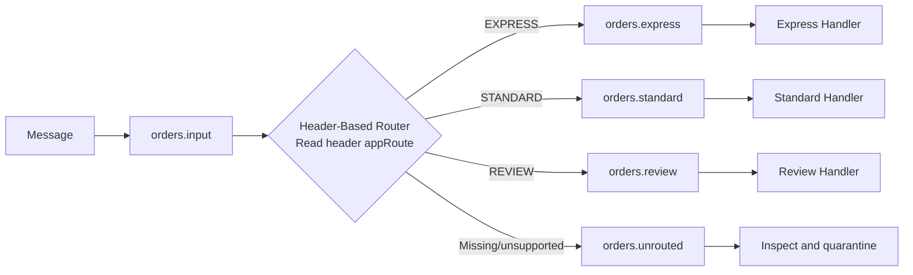
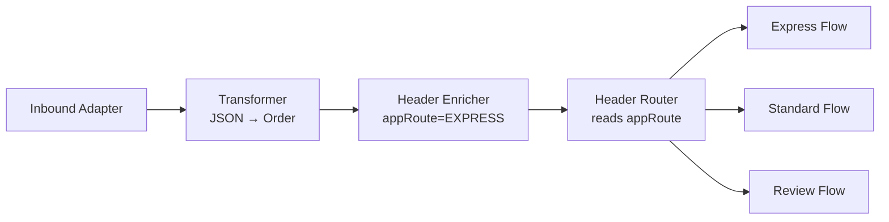

# Fixed Header Names and Header Conventions

## 1. Why does a Header-Based Router need a clear header name?

In an integration system, a *message* consists of a **payload** carrying business data and **headers** carrying metadata. When routing needs to follow pre-determined information, Spring Integration can read a specific header and select the corresponding output channel. This is the common usage of the **Header-Based Router** pattern (also known as **Header Value Router**).

For example, the system receives an order with an `OrderRequest` payload and an `appRoute` header:

```text
Message<OrderRequest>
  payload = OrderRequest(orderId="ORD-42", amountVnd=250000)
  headers = {
    appRoute: "EXPRESS",
    tenantId: "store-hcm",
    eventId: "evt-42",
    traceId: "trace-42"
  }
```

The Router is configured to **read the fixed header name `appRoute`**. The value of the header can vary per message (`EXPRESS`, `STANDARD`, `REVIEW`), and that value is mapped to a channel name:



In the **Header-based router** chapter of the **SPRING_INTEGRATION_PATTERN** module, the goal is to learn how to implement Enterprise Integration Patterns with Spring Integration to build loosely coupled, extensible message flows. Header conventions support Router, Filter, Transformer, Splitter, Aggregator, Gateway, retry, error channel, and correlation, while also making testing and observability of each processing branch consistent.

**Key distinctions:**

- **Header name**: the key name the Router looks up, for example `appRoute`. This name is **fixed in a Router's configuration**.
- **Header value**: the value of that key in each message, for example `EXPRESS`; this is data that **varies per message**.
- **Routing key**: the normalized value used to look up the target mapping table; in this example it matches `appRoute`.
- **Output channel**: where the message is forwarded next, for example `orders.express`.

Do not use a message's value as the **header name to read**. That interpretation would force the Router to look up different keys on every message and break the flow contract.

## 2. Under what contract does a Header-Based Router read data?

In Spring Messaging, `Message<T>` provides `getPayload()` and `getHeaders()`. `MessageHeaders` behaves like a name → value map; header names are `String`s, while values can be of various Java types.

```java
import org.springframework.messaging.Message;
import org.springframework.messaging.support.MessageBuilder;

record OrderRequest(String orderId, long amountVnd) {}

Message<OrderRequest> message = MessageBuilder
        .withPayload(new OrderRequest("ORD-42", 250_000L))
        .setHeader("appRoute", "EXPRESS")
        .setHeader("tenantId", "store-hcm")
        .build();

String routeKey = message.getHeaders().get("appRoute", String.class);
// routeKey = "EXPRESS"
```

This example only shows how to create and read a message; in an actual Java class, the statements above live inside a method or test. `MessageBuilder` itself neither registers a Router nor sends a message to a channel.

### 2.1. Why must the header name be stable?

Suppose a producer sets `appRoute`, but the Router reads `routeKey`. Even though both convey the meaning of "route", the two keys **are not identical**:

```text
Producer: headers["appRoute"] = "EXPRESS"
Router:   reads headers["routeKey"]  -> no value found
```

A single character or casing difference can send messages into the fallback path. Inside the JVM, a header name is a `String` key and must match exactly; `appRoute`, `AppRoute`, and `app-route` are three distinct names. When crossing HTTP, Kafka, JMS, or a broker, adapters may apply their own name/type mapping rules. Therefore, choose **one canonical key name contract at the system boundary** and test it after mapping.

### 2.2. A fixed header name does not mean a fixed value

A `HeaderValueRouter` instance is configured with **one header name** to read. The Router can receive many values and map them to multiple channels:

| `appRoute` in message | Routing key | Target channel |
| --- | --- | --- |
| `EXPRESS` | `EXPRESS` | `orders.express` |
| `STANDARD` | `STANDARD` | `orders.standard` |
| `REVIEW` | `REVIEW` | `orders.review` |
| Unconfigured `SAME_DAY` | No direct mapping | `orders.unrouted` |
| Missing `appRoute` header | Undefined | Fallback/error policy |

To change the **supported values**, we add mappings and consumers; to change the **key name being read**, the contract of both the producer and the Router must change (or a compatibility conversion step must be added before the Router).

## 3. Establishing header naming conventions

No single custom header name fits every system, but a project should choose a unified set of conventions. Below is a suggested convention for an order flow:

| Category | Suggested name | Type | Meaning |
| --- | --- | --- | --- |
| Routing | `appRoute` | `String` | Key used by the Router |
| Business identifier | `eventId` | `String` | Identifies an event across redeliveries |
| Data partitioning | `tenantId` | `String` | Authenticated tenant context |
| Tracing | `traceId` | `String` | Links logs/traces for the same task |
| Correlation | `correlationId` | Per contract/framework | Associates messages belonging to the same group |
| Message classification | `eventType` | `String` | Event type, if needed by the flow |
| Versioning | `schemaVersion` | `String` or agreed number | Identifies the contract version |

Practical guidelines:

1. **Use meaningful names**: `appRoute` makes clear this is the application route; `type`, `key`, or `x1` become obscure across multiple systems.
2. **Pick one casing style and stick to it**: e.g., `camelCase` for internal headers; document how they map to external protocol header names.
3. **Use a controlled set of values**: `EXPRESS`, `STANDARD`, `REVIEW`; accept only values defined in the contract.
4. **Distinguish key names from values**: `appRoute` is the key, `EXPRESS` is the value; do not invent per-message keys like `expressRoute` or `standardRoute` when the Router expects a single common header.
5. **Have a single source of truth**: use Java constants or a shared schema/contract instead of scattering string literals across many classes.
6. **Define rules for missing/invalid values**: reject, fallback, dead-letter/quarantine, or another business handling—never let messages vanish.
7. **Mark trust boundaries explicitly**: headers sent by external clients are not automatically trustworthy, especially for tenant info, permissions, priority levels, and routing.

### 3.1. Using constants to prevent typos

A simple approach is placing string constants in a shared module class:

```java
final class RoutingHeaders {
    private RoutingHeaders() {}

    static final String ROUTE = "appRoute";
    static final String TENANT_ID = "tenantId";
    static final String EVENT_ID = "eventId";
    static final String TRACE_ID = "traceId";
}

final class OrderRoutes {
    private OrderRoutes() {}

    static final String EXPRESS = "EXPRESS";
    static final String STANDARD = "STANDARD";
    static final String REVIEW = "REVIEW";
}
```

`RoutingHeaders.ROUTE` is used in both the producer and the Router. When multiple applications or programming languages are involved, do not treat a Java constants class as sufficient: **publish the names and value types in the integration contract** so producers/consumers in other languages comply as well.

### 3.2. Header names managed by the framework

Spring Messaging and Spring Integration already include metadata used for transport, replies, errors, or correlation. Do not arbitrarily repurpose these names for custom routes:

| Common header | Typical meaning | Note |
| --- | --- | --- |
| `id`, `timestamp` | Message identifier and creation timestamp | Not a durable event ID across every message rebuild |
| `replyChannel` | Request-reply response target | May carry a channel object or internal channel name |
| `errorChannel` | Target for publishing `ErrorMessage` when supported by the endpoint | Does not guarantee catching every exception automatically |
| `correlationId` | Groups related messages | May be managed by Splitter/Aggregator |
| `sequenceNumber`, `sequenceSize` | Position and count within a sequence | Must be preserved accurately when aggregating messages |
| `contentType` | Payload format/content-type hint | May need updating after a Transformer |

Exact names and constant APIs depend on the header type and framework version. Consult the corresponding constants in `MessageHeaders` or `IntegrationMessageHeaderAccessor` when writing code rather than assigning new meanings to system headers.

## 4. Normalizing header **values** before routing

A fixed header name is necessary, but the Router also requires **values that match the mapping**. Decide explicitly:

- Is the value a `String`, enum, number, or object? Values crossing a broker should favor stable serializable types.
- Is it case-sensitive? Should `EXPRESS` and `express` be treated as equivalent?
- How are empty strings, whitespace, `null`, wrong types, or unknown values handled?
- Should a producer be allowed to pick sensitive routes like `REVIEW` or `VIP` directly?
- When updating the route value set, do producers and consumers have version-compatibility rules?

For example, an ingress service can normalize the value into the published key set before building the message:

```java
import java.util.Locale;
import java.util.Set;

final class RouteValueNormalizer {
    private RouteValueNormalizer() {}

    private static final Set<String> SUPPORTED =
            Set.of(OrderRoutes.EXPRESS,
                    OrderRoutes.STANDARD,
                    OrderRoutes.REVIEW);

    static String normalize(String raw) {
        if (raw == null || raw.isBlank()) {
            throw new IllegalArgumentException("Missing appRoute");
        }
        String normalized = raw.trim().toUpperCase(Locale.ROOT);
        if (!SUPPORTED.contains(normalized)) {
            throw new IllegalArgumentException(
                    "Unsupported appRoute: " + normalized);
        }
        return normalized;
    }
}
```

This function enforces a **reject unsupported values** policy. If integration requirements need `SAME_DAY` to go to a monitoring branch for later rollout, do not use a throwing function like this at the start of the flow; let the Router send unmapped values to a fallback with appropriate storage. **Reject and fallback are two distinct contract choices**.

When `routeKey` is derived from the payload (e.g., orders with `manualReview=true` always go to `REVIEW`), define a testable **routing policy**, then write the result into the `appRoute` header. Never accept a header from an external request as the final decision if the sender could exploit it to bypass risk checks.

## 5. Setting headers from a producer or enrichment step

The producer builds a message with route and context before sending:

```java
import org.springframework.beans.factory.annotation.Qualifier;
import org.springframework.messaging.MessageChannel;
import org.springframework.messaging.support.MessageBuilder;
import org.springframework.stereotype.Component;

record OrderRequest(String orderId, long amountVnd) {}

@Component
class OrderProducer {
    private final MessageChannel input;

    OrderProducer(@Qualifier("orders.input") MessageChannel input) {
        this.input = input;
    }

    void submitExpressOrder() {
        OrderRequest order = new OrderRequest("ORD-42", 250_000L);
        input.send(MessageBuilder.withPayload(order)
                .setHeader(RoutingHeaders.ROUTE, OrderRoutes.EXPRESS)
                .setHeader(RoutingHeaders.TENANT_ID, "store-hcm")
                .setHeader(RoutingHeaders.EVENT_ID, "evt-42")
                .setHeader(RoutingHeaders.TRACE_ID, "trace-42")
                .build());
    }
}
```

A **Header Enricher** step can populate `appRoute` when the producer does not know how to classify. Common structure:

```text
Inbound Adapter -> Validation -> Transformer -> Header Enricher
  -> Header-Based Router -> Selected channel -> Service Activator
```

In this example, Validation/Transformer ensures the payload has the expected type; Header Enricher applies the classification policy to set `appRoute`. The Router then simply **reads the classification result**. Separating these two concerns keeps the Router simple and reusable across multiple payload types as long as every producer fulfills the header contract.

If a header needs modification, construct a new message with `MessageBuilder.fromMessage(message).setHeader(...).build()` or use a flow Header Enricher. `MessageHeaders` is designed as metadata that should not be mutated directly; however, a mutable payload can still change state if the application permits it.

## 6. Configuring `HeaderValueRouter` in Java

Spring Integration provides `org.springframework.integration.router.HeaderValueRouter`. Upon instantiation, we select a **fixed header name** to read and declare mappings from **header values** to channels. Example using Spring Java configuration and the constants from section 3.1:

```java
import org.springframework.context.annotation.Bean;
import org.springframework.context.annotation.Configuration;
import org.springframework.integration.annotation.Router;
import org.springframework.integration.channel.DirectChannel;
import org.springframework.integration.config.EnableIntegration;
import org.springframework.integration.dsl.IntegrationFlow;
import org.springframework.integration.router.HeaderValueRouter;
import org.springframework.messaging.MessageChannel;

interface OrderBranchService {
    void acceptExpress(OrderRequest order);
    void acceptStandard(OrderRequest order);
    void queueForReview(OrderRequest order);
    void quarantineUnrouted(OrderRequest order);
}

@Configuration
@EnableIntegration
class OrderHeaderRoutingConfig {

    @Bean("orders.input")
    MessageChannel input() {
        return new DirectChannel();
    }

    @Bean("orders.express")
    MessageChannel express() {
        return new DirectChannel();
    }

    @Bean("orders.standard")
    MessageChannel standard() {
        return new DirectChannel();
    }

    @Bean("orders.review")
    MessageChannel review() {
        return new DirectChannel();
    }

    @Bean("orders.unrouted")
    MessageChannel unrouted() {
        return new DirectChannel();
    }

    @Bean
    @Router(inputChannel = "orders.input")
    HeaderValueRouter orderHeaderRouter() {
        // Router always reads the same header name on every message.
        var router = new HeaderValueRouter(RoutingHeaders.ROUTE);
        router.setChannelMapping(OrderRoutes.EXPRESS, "orders.express");
        router.setChannelMapping(OrderRoutes.STANDARD, "orders.standard");
        router.setChannelMapping(OrderRoutes.REVIEW, "orders.review");
        router.setChannelKeyFallback(false);
        router.setDefaultOutputChannelName("orders.unrouted");
        return router;
    }

    @Bean
    IntegrationFlow expressOrders(OrderBranchService service) {
        return IntegrationFlow.from("orders.express")
                .handle(OrderRequest.class, (order, headers) -> {
                    service.acceptExpress(order);
                    return null;
                })
                .get();
    }

    @Bean
    IntegrationFlow standardOrders(OrderBranchService service) {
        return IntegrationFlow.from("orders.standard")
                .handle(OrderRequest.class, (order, headers) -> {
                    service.acceptStandard(order);
                    return null;
                })
                .get();
    }

    @Bean
    IntegrationFlow reviewOrders(OrderBranchService service) {
        return IntegrationFlow.from("orders.review")
                .handle(OrderRequest.class, (order, headers) -> {
                    service.queueForReview(order);
                    return null;
                })
                .get();
    }

    @Bean
    IntegrationFlow unroutedOrders(OrderBranchService service) {
        return IntegrationFlow.from("orders.unrouted")
                .handle(OrderRequest.class, (order, headers) -> {
                    service.quarantineUnrouted(order);
                    return null;
                })
                .get();
    }
}
```

To run this example, the application needs Spring Integration, the `OrderRequest`, `RoutingHeaders`, and `OrderRoutes` declarations above, and a bean implementing `OrderBranchService`. Branch handlers only act after receiving the message; they do not need to know how the Router mapped the key.

**Explanation of the key lines:**

1. `new HeaderValueRouter(RoutingHeaders.ROUTE)`: the header name to read is chosen **once at configuration time** (`appRoute` in this example).
2. `setChannelMapping(value, destination)`: maps a value to a channel name, without using the header name as the destination.
3. `setChannelKeyFallback(false)`: prevents interpreting unmapped header values as **direct channel names**; only declared routes or the fallback are used.
4. `setDefaultOutputChannelName(...)`: specifies where messages go when no matching route is found according to the router's mechanism.
5. `@Router(inputChannel = "orders.input")`: registers an endpoint consuming messages from the input channel.
6. Each branch has its own consumer, which can be swapped for a queue, adapter, or downstream flow as needed.

In real systems, verify **how the framework handles missing headers, unmatched values, and message send failures** via integration tests on the Spring Integration version in use. Fallbacks are useful, but they do not replace producer validation policies or durable error storage.

### 6.1. Java DSL equivalent with an expression router

If you want to write it directly inside an `IntegrationFlow`, you can extract a header value using Spring Expression Language (SpEL):

```java
@Bean
IntegrationFlow orderRoutingFlow() {
    return IntegrationFlow.from("orders.input")
            .route("headers['appRoute']", mapping -> mapping
                    .channelMapping("EXPRESS", "orders.express")
                    .channelMapping("STANDARD", "orders.standard")
                    .channelMapping("REVIEW", "orders.review")
                    .defaultOutputChannel("orders.unrouted"))
            .get();
}
```

This is an **alternative approach** using an expression-based router that reads the `appRoute` header; channels/consumers still need to be defined as in the main example. Do not register **both** `@Router` and this DSL flow listening to `orders.input` unless dispatching intentionally: a `DirectChannel` with multiple subscribers does not broadcast each message to all of them by default.

The advantage of `HeaderValueRouter` is that the **fixed header name** contract is immediately obvious in the constructor. The DSL style fits when building the entire flow and wanting mappings configured in one place.

## 7. Missing headers, wrong names, and mapping mismatches

These three errors look similar at the end of a flow, yet their causes differ:

| Scenario | Example | Action needed |
| --- | --- | --- |
| **Missing header** | Producer omitted `appRoute` | Require it, route to fallback, or reject |
| **Wrong header name** | Producer wrote `app_route`, Router reads `appRoute` | Fix the naming contract or map at the boundary |
| **Wrong value type** | Router expects `String`, producer sent an unmapped object | Normalize types at ingress |
| **Case convention mismatch** | `express` instead of `EXPRESS` | Normalize intentionally and test |
| **New value** | `SAME_DAY` has no channel mapping yet | Fallback to quarantine/monitor, update rules by version |
| **Wrong target name** | Mapping points to non-existent `orders.expres` | Test channel configuration to catch deployment errors |
| **Target cannot process** | Handler failure, broker timeout | Downstream retry/error channel/recovery |

Distinguish between **no route matched** and **post-routing handler failure**. The default channel handles cases where no matching recipient is found; it is not a mechanism that automatically catches exceptions from all branches and does not turn a `DirectChannel` into a dead-letter queue.

### 7.1. Why should you not route to `nullChannel` by default?

`nullChannel` is a Spring Integration endpoint that intentionally receives and discards messages. It makes sense when business requirements permit ignoring them, such as unneeded debug events. For orders or payments, routing all unknown values to `nullChannel` can cause **hard-to-detect data loss**.

An `orders.unrouted` branch should have clear responsibilities: record enough information for investigation or replay (protected payload or reference, `eventId`, `tenantId`, route value, timestamp, and reason), alert when the message rate spikes, and define who is authorized to replay.

## 8. Header propagation across patterns and adapters

A Router can only read what **is present in the message when it arrives**. Upstream endpoints may transform the payload, construct a new message, or send it over another protocol. Therefore, the header name must remain stable **across the entire flow segment that the Router depends on**.



### 8.1. Transformer

A Transformer may convert a JSON `byte[]` payload into an `OrderRequest`. If a downstream step needs `appRoute`, make sure the header has been created or propagated according to the transformer's rules. With format transformations, the original `contentType` header may no longer describe the payload accurately; verify it again at outbound boundaries.

### 8.2. Splitter and Aggregator

A Splitter produces multiple child messages; in addition to `appRoute`, messages may need `correlationId`, `sequenceNumber`, and `sequenceSize` so the Aggregator can regroup them. Do not use `appRoute` as a correlation key when multiple distinct orders share the `EXPRESS` branch; routing and correlation carry two separate meanings.

### 8.3. Gateway, reply channel, and error channel

A Gateway turns an application call into a message and may use `replyChannel` to receive results; `errorChannel` relates to error reporting. These are orchestration headers supported by the framework. Do not put a business route into `replyChannel` just to reuse a name simply because it also holds channel information: reply behavior and branching behavior are two independent contracts.

### 8.4. When messages cross a broker or HTTP

Spring headers inside the JVM can hold many Java types; adapters for Kafka, RabbitMQ, JMS, or HTTP each have their own mapping, filtering, and serialization rules. Therefore:

1. Identify headers that **must survive crossing boundaries**: e.g., `eventId`, `tenantId`, `traceId`, `appRoute`.
2. Choose appropriate wire types (`String`, numbers, bytes...) and encoding rules.
3. Verify name mapping, casing, size limits, and any stripped headers.
4. After deserialization, validate that the header exists and has the expected type **before the Router uses it**.

Headers are not guaranteed to arrive intact merely because both ends use the same name. If a field is mandatory for cross-system business semantics, consider placing it in a versioned payload schema or envelope rather than relying solely on internal headers.

## 9. Data security and reliability when routing by header

Routing headers look like simple metadata, yet they can decide which service executes a transaction. **Never blindly trust header values passed directly from external sources**. For example, a client must not be allowed to set `appRoute=STANDARD` to bypass a fraud-check branch if the system requires risk checks first.

A safe design:

```text
External request
  -> Authenticate and verify tenant
  -> Payload validation
  -> Trusted classification policy
  -> Header Enricher sets appRoute
  -> Header-Based Router
  -> Business handler
```

Decisions such as access control, tenant ownership, or skipping verification should not rely solely on a caller-supplied header. When messages need replay, use `eventId` or a stable business key for idempotency; `MessageHeaders.ID` can change when a new message is created.

**Reliability** must be designed end-to-end: routing a message to a `DirectChannel` does not mean it has been persisted durably; retries should target transient errors rather than looping endlessly on an invalid header name; recovery needs enough context to fix contracts or replay safely.

## 10. Testing header conventions and routing flows

### 10.1. Unit testing the header contract

A simple unit test can verify that the producer always uses the right header name constant and normalized values:

```java
import org.junit.jupiter.api.Test;
import org.springframework.messaging.Message;
import org.springframework.messaging.support.MessageBuilder;

import static org.junit.jupiter.api.Assertions.*;

class RoutingHeaderContractTest {

    @Test
    void usesOneStableHeaderName() {
        var order = new OrderRequest("ORD-42", 250_000L);
        Message<OrderRequest> message = MessageBuilder
                .withPayload(order)
                .setHeader(RoutingHeaders.ROUTE, OrderRoutes.EXPRESS)
                .build();

        assertEquals("appRoute", RoutingHeaders.ROUTE);
        assertEquals("EXPRESS",
                message.getHeaders().get(RoutingHeaders.ROUTE, String.class));
        assertNull(message.getHeaders().get("routeKey"));
    }

    @Test
    void normalizesSupportedValue() {
        assertEquals("EXPRESS",
                RouteValueNormalizer.normalize(" express "));
    }

    @Test
    void rejectsUnsupportedValueUnderStrictPolicy() {
        assertThrows(IllegalArgumentException.class,
                () -> RouteValueNormalizer.normalize("SAME_DAY"));
    }
}
```

The tests above verify constant conventions and normalization. However, they **do not prove the Router is configured properly** or that handlers received the expected messages.

### 10.2. Integration testing channel mappings

Boot a Spring Test context containing `OrderHeaderRoutingConfig` and a mock `OrderBranchService` bean; send messages to `orders.input` and verify that only the matching branch handler is invoked. Essential scenarios to include:

| Input | Expected result |
| --- | --- |
| `appRoute=EXPRESS` | Only `acceptExpress` is invoked |
| `appRoute=STANDARD` | Only `acceptStandard` is invoked |
| `appRoute=REVIEW` | Only `queueForReview` is invoked |
| `appRoute=SAME_DAY` | Goes to `orders.unrouted`, per the fallback contract |
| Missing `appRoute` | Explicit fallback or error, matching chosen configuration |
| `routeKey=EXPRESS` present without `appRoute` | Must not be mistaken for a valid route |
| Unnormalized `appRoute=express` | Does not match `EXPRESS` mapping; policy must be verified |
| Message passing through Transformer and adapter | Header preserves correct name/type before reaching Router |
| `orders.express` handler throws exception | Downstream error is observed per sync/async contract |
| Redelivery with same `eventId` | Consumer prevents duplicate business processing if required |

With `DirectChannel`, integration tests can call `send` and verify handlers synchronously. With executors, brokers, or polling, wait under a bounded timeout and verify actual outcomes rather than assuming `send` returning `true` means business processing finished.

### 10.3. Monitoring header convention errors

Useful metrics include the rate of messages **missing `appRoute`**, **wrong type**, **unknown route**, messages per branch, channel send errors, downstream latency, and backlog/quarantine depth. You may attach the normalized route key to metrics if the route set is finite; avoid attaching `eventId` or `orderId` as metric labels because cardinality is too high.

Logs/traces should include `traceId` and `eventId` to correlate steps without logging entire payloads or sensitive data.

## 11. Common design mistakes

1. **Changing the header name per message** instead of keeping one fixed name and varying the value.
2. **Inconsistent literals**: using `appRoute`, `app_route`, and `routeKey` as if they were the same key.
3. **Confusing routing keys with channel names** and embedding internal channel bean names directly in external source data.
4. **Forgetting a default/failure policy**, causing messages without a matching route to be lost or fail obscurely.
5. **Inconsistent types and casing**: `EXPRESS` vs. `express`, or an enum that fails serialization over a broker.
6. **Misusing technical headers**: arbitrarily using `replyChannel` or `correlationId` as a routing key.
7. **Trusting client-declared headers** to bypass business checks or authorization.
8. **Losing headers across a Transformer/adapter** while only testing the routing function in isolation.
9. **Treating an in-memory fallback as a DLQ** without durable storage or a replay procedure.
10. **Using message ID as event ID**, making duplicate suppression difficult on message redelivery.

## 12. Hands-on exercise and self-assessment

Design a customer support system receiving `SupportTicket` with payload `ticketId`, `subject`, `priority`; headers include `appRoute`, `tenantId`, `eventId`, and `traceId`.

1. Choose **one fixed header name** for the Router to read. Define Java constants and a value contract for `BILLING`, `TECHNICAL`, `GENERAL`.
2. Write a payload-based classification step to produce that header; enforce validation rather than trusting arbitrary route values sent by callers.
3. Configure `HeaderValueRouter` with mappings to three channels and a fallback for unsupported values.
4. Write separate Service Activators for each branch; verify each message reaches only the expected branch.
5. Test messages with a missing header, wrong casing, wrong name, or a new value `SECURITY`; choose reject/fallback and justify it.
6. Add a Transformer before the Router; verify necessary headers remain preserved.
7. Simulate retries after a transient error; ensure `eventId` stays stable and does not cause duplicate business side effects.
8. Add an unknown-route rate metric and an investigation/replay procedure for quarantined messages.

When checking your work, answer: **Which header name does the Router always read? Who produces the header value and is it trustworthy? Where is the name/type contract published? What happens when there is no mapping? Which headers must be preserved across a Transformer or broker?**

A **Header-Based Router** stays very simple when the whole system agrees on the header name and its values. Using one fixed key, publishing a value contract, configuring clear mappings/fallbacks, and testing propagation keep the Router focused on path selection, endpoints focused on business logic, and EIP flows consistent as they scale.
