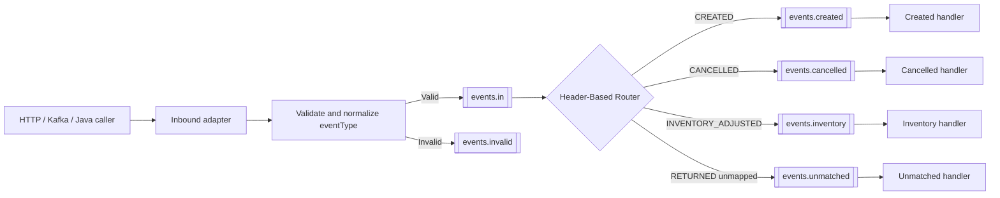
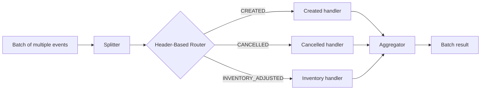

# Header Types and Type Conversion

In an integration system, messages may carry the same payload type while representing different events. For example, three messages might all contain JSON or an `EventEnvelope` object, yet one signals **order created**, another signals **order cancelled**, and the third signals **inventory adjusted**. When metadata describing the event kind lives in a header, a **Header-Based Router** can read that header and choose the right target **Message Channel** without parsing the entire payload.

The subtle trap lies in the word **type**. A header in Spring Messaging can hold **Java values of many types**, such as `String`, `Enum`, `Integer`, `UUID`, or `MimeType`; it is **not always plain text**. For the exact same event kind, an HTTP source might provide `"CREATED"`, an internal Java component might provide `EventType.CREATED`, and a broker adapter might yield `byte[]` depending on its mapping configuration. If the Router expects key `"CREATED"` but receives a value with another type or format, the message can take the wrong branch, fall into a fallback, or trigger a processing error.

The **Header Types and Type Conversion** lesson belongs to the **Header-based router** chapter of the `SPRING_INTEGRATION_PATTERN` module. The goal is to apply **Enterprise Integration Patterns (EIP)** at the right boundaries: normalize data at ingress, route on headers with explicit contracts, coordinate with Filter, Transformer, Gateway, Splitter, Aggregator, retry, error channel, and correlation, and test and observe each branch without leaking secrets.

> **Core principle:** **Identify the actual type of the header**, normalize it to a **stable set of routing keys**, and only then map keys to channels. Never assume `Header-Based Router` will automatically convert every object, byte array, or partner-supplied string into the type you expect.

## 1. How does a Header-Based Router work?

Every Spring `Message<T>` consists of two parts:

- **`payload`:** the primary data, such as a JSON string or business DTO.
- **`headers`:** metadata attached to the message such as `id`, `timestamp`, correlation, reply path, and application-defined headers.

A **Header-Based Router** extracts the value of a designated header, uses that value as a **routing key**, and selects a channel based on its mapping.

Example of an event processing flow:

| Normalized `eventType` header | Target channel | Responsibility |
| --- | --- | --- |
| `CREATED` | `events.created` | Handle order creation events. |
| `CANCELLED` | `events.cancelled` | Handle order cancellation events. |
| `INVENTORY_ADJUSTED` | `events.inventory` | Synchronize inventory. |
| `RETURNED` (recognized, branch not implemented yet) | `events.unmatched` | Quarantine or handle per policy. |
| Missing/wrong type/value outside contract | `events.invalid` | Reject at the normalization boundary; do not let the Router guess. |



**Placing the normalization step before the Router** is a key design decision: the Router is not the place to guess every possible representation of an event type. In the diagram, `events.invalid` and `events.unmatched` carry distinct meanings: **invalid** is an unacceptable value; **unmatched** is a value within the known contract whose branch is not yet supported.

## 2. What data types can Spring Messaging headers hold?

`MessageHeaders` is essentially a **header name → `Object` value** map. Certain framework-provided headers have conventional types; application-added headers retain the object type passed in unless another component performs a conversion.

```java
import java.util.UUID;
import org.springframework.messaging.Message;
import org.springframework.messaging.support.MessageBuilder;

enum EventType {
    CREATED, CANCELLED, INVENTORY_ADJUSTED, RETURNED
}

Message<String> message = MessageBuilder.withPayload("order-42")
    .setHeader("eventType", EventType.CREATED) // Enum
    .setHeader("attempt", 2)                    // Integer
    .setHeader("correlationId", UUID.randomUUID()) // UUID
    .build();

Object type = message.getHeaders().get("eventType");
Object attempt = message.getHeaders().get("attempt");

assert type instanceof EventType;
assert attempt instanceof Integer;
```

Do not infer that just because a log prints `CREATED`, the header must have type `String`. `EventType.CREATED.toString()`, `EventType.CREATED.name()`, and the string `"CREATED"` can **look identical in logs** while having different types at runtime.

### 2.1. Different headers can carry different types

| Header | Common value | Note |
| --- | --- | --- |
| `id` | `UUID` | Technical message identifier, not a default idempotency key. |
| `timestamp` | `Long` (epoch timestamp) | Not a business processing deadline. |
| `replyChannel` | `MessageChannel` reference or configured form | Used for the reply path; should not be arbitrarily serialized to external transports. |
| `errorChannel` | Error channel/reference as configured | Used in appropriate error flows; does not catch every exception automatically. |
| `contentType` | Can be a `MimeType` or corresponding representation | Describes payload format, **distinct** from business event type. |
| `eventType` | `String`, `Enum`, or application-defined type | **Must be normalized** before being used as a route key. |
| `attempt` | `Integer` or deserialized value | Must validate type and range if used in logic. |
| `correlationId` | `String`/`UUID` or application-defined value | Preserve the contract across Splitter/Aggregator, adapters, and tracing. |

In particular, `MessageHeaders` is a metadata map protected against direct structural mutation, which **does not mean every object placed in a header is itself immutable**. If you place a mutable object into a header and mutate it elsewhere, Router evaluation results can become unpredictable. Prefer small, immutable metadata values with a clear schema.

### 2.2. A header named `type` does not always mean the same thing

The word "type" can refer to:

1. **Business event type:** `eventType=CREATED`.
2. **Java class of the payload:** `OrderCreated.class`, which belongs to a Payload Type Router.
3. **Data format:** HTTP `Content-Type: application/json` or message `contentType`.
4. **Class/type metadata added by a serializer/adapter:** used for deserialization according to a transport contract.

These concepts **are not interchangeable**:

| Question | What to rely on |
| --- | --- |
| Which Java class is the payload? | Payload Type Router or runtime class inspection. |
| Which business state does the same DTO represent? | Normalized `eventType` header or payload Content-Based Router. |
| Is the body JSON or XML? | Content type/media type and appropriate decoder. |
| Which schema version does the record belong to? | Boundary-validated version metadata, not an arbitrary client-supplied Java class name. |

Choosing explicit names like `eventType`, `schemaVersion`, and `contentType` is far clearer than an ambiguous header named `type` when a system spans multiple protocol layers.

## 3. Why don't HTTP, Kafka, and internal headers always share the same type?

When a message passes through adapters, data can cross **type boundaries**:

```text
HTTP request headers (usually represented as strings)
    → HTTP inbound adapter / header mapper
    → Spring MessageHeaders (Object values)
    → Transformer / Header Enricher or normalization step
    → Header-Based Router
    → Kafka / AMQP / JMS outbound adapter
    → Transport headers (representation depends on protocol and mapper)
```

Therefore, never assume:

- Headers from HTTP always keep their exact name, casing, and type after mapping.
- Broker headers are always `String`; some transports store them as bytes or transport-specific metadata types.
- HTTP `Content-Type` maps one-to-one with the application header `eventType`.
- An Enum or UUID inside an internal message will be converted/restored with the same type by every adapter.
- All internal headers should be emitted externally.

**Rule:** at **every inbound boundary**, define which headers are accepted and how their types are converted. At **every outbound boundary**, build the allowlisted header set instead of blindly exporting all of `MessageHeaders`.

### 3.1. Example of three representations of the same type

```java
Object fromHttp = "CREATED";               // String
Object fromJava = EventType.CREATED;       // Enum
Object fromBroker = new byte[] {67, 82, 69, 65, 84, 69, 68};
                                            // byte[] containing UTF-8: CREATED
```

All three objects can carry the general meaning "order created", yet they **do not share the same runtime type**. Looking only at what gets printed to logs is not enough.

When handling `byte[]` from an adapter, decoding must rely on an **encoding contract** and source validation. The example below assumes UTF-8 solely for illustration; never use `new String(bytes)` while ignoring charset or transport rules.

### 3.2. Avoid uncontrolled conversion via `toString()`

Suppose one party sends `eventType = 1` and another sends `eventType = "1"`. Calling `String.valueOf(raw)` makes both values look identical, potentially masking a schema mismatch. Conversely, an Enum might override `toString()` for a user-friendly label that differs from the `name()` used as a routing key.

Therefore:

- **Verify allowed types first** before converting into a routing key.
- Normalize enums using **`name()`** when the contract selects enum names.
- Normalize strings with trim/case normalization **when specified by the contract**.
- Do not accept `Number`, `Boolean`, `byte[]`, or arbitrary objects merely because `toString()` can be called on them.
- If the contract genuinely allows numeric codes, define an explicit lookup table (`1 → CREATED`) instead of relying on arbitrary stringification.

## 4. Normalization contract: which types may reach the Router?

A highly testable choice is stipulating that **only a normalized `String` `eventType` header** reaches the Header-Based Router. Meanwhile, external sources may send a String or a valid internal enum; a function/adapter converts it to a single canonical form **before routing**.

Illustrative contract:

| Source value | Boundary outcome | Internal header |
| --- | --- | --- |
| `"created"`, `" CREATED "` | Valid normalization | `"CREATED"` |
| `EventType.CANCELLED` | Enum converted via `name()` | `"CANCELLED"` |
| `"RETURNED"` | Valid value, but branch not yet supported | `"RETURNED"` → Router fallback |
| `"UNKNOWN_X"` | Outside enum/schema | Rejected, not sent to Router |
| `null` or blank string | Missing required field | Rejected |
| `12`, `true`, `byte[]` | Disallowed type under this contract | Rejected or handled at a dedicated adapter |

**Distinguish the two errors:** `RETURNED` is a value **recognized by the schema**, though the Router does not have a handler for it yet. `UNKNOWN_X` does not belong to the schema published by the receiver. A different policy can be chosen if business requirements demand it, but it must be defined explicitly rather than left to framework guesswork.

### 4.1. Explicitly typed normalization function

```java
import java.util.Locale;

enum EventType {
    CREATED,
    CANCELLED,
    INVENTORY_ADJUSTED,
    RETURNED
}

final class EventTypeNormalizer {

    private EventTypeNormalizer() {}

    static String normalize(Object raw) {
        if (raw instanceof EventType eventType) {
            return eventType.name();
        }

        if (raw instanceof String value) {
            String normalized = value.trim().toUpperCase(Locale.ROOT);

            if (normalized.isEmpty()) {
                throw new IllegalArgumentException("eventType is required");
            }

            try {
                return EventType.valueOf(normalized).name();
            } catch (IllegalArgumentException ex) {
                throw new IllegalArgumentException(
                    "Unsupported eventType value", ex);
            }
        }

        // Do not automatically convert numbers, booleans, or byte[] to String.
        throw new IllegalArgumentException(
            "Unsupported eventType header type");
    }
}
```

Benefits of this approach:

1. Only a **finite set of values** is accepted; no partner-chosen channel names slip through.
2. Internal enums and external Strings share the exact same canonical key.
3. Prevents accidentally merging number `1` and String `"1"` via `toString()`.
4. Type mismatches are caught **before the Router**, making responses/logging easy to enforce by policy.
5. Removes reliance on implicit type coercion in SpEL or individual adapters.

**Limitation:** This function only supports String and `EventType` per the contract. If a source actually emits `byte[]`, add a **decoding step with a defined encoding and schema** right in the adapter before calling the normalizer, rather than loosening accepted types ad hoc.

### 4.2. Creating a new message with allowlisted headers

If an external source sends `Authorization`, `Cookie`, `x-api-key`, emails, or unrelated metadata, **do not copy all inbound headers** just to preserve `eventType`. Construct a new internal message with the proper payload and allowlisted headers:

```java
import java.util.UUID;
import org.springframework.messaging.Message;
import org.springframework.messaging.support.MessageBuilder;

final class InboundEventFactory {

    private InboundEventFactory() {}

    static Message<String> create(String body, Object rawEventType) {
        String normalizedType = EventTypeNormalizer.normalize(rawEventType);

        return MessageBuilder.withPayload(body)
            .setHeader("eventType", normalizedType)
            .setHeader("correlationId", UUID.randomUUID().toString())
            .build();
    }
}
```

**This is an example of constructing a message at a new boundary, not a rule replacing correlation across every system.** When a single request spans multiple child messages or multiple services, maintain a **stable correlation key** per the business contract instead of generating a new UUID at every step. Likewise, the `body` payload can still contain sensitive data; changing headers alone does not automatically make the whole event safe.

## 5. Spring Integration Java DSL: routing on a normalized header

The next example uses only internal Spring Integration; the output channels are bounded `QueueChannel`s for convenient observation and testing. In production, each channel needs a business consumer/flow, persistence where required, and full error handling.

### 5.1. Configuring channels and header-based routing

```java
import org.springframework.context.annotation.Bean;
import org.springframework.context.annotation.Configuration;
import org.springframework.integration.channel.QueueChannel;
import org.springframework.integration.config.EnableIntegration;
import org.springframework.integration.dsl.IntegrationFlow;

@Configuration
@EnableIntegration
class HeaderEventRoutingConfiguration {

    @Bean("events.created")
    QueueChannel createdEvents() {
        return new QueueChannel(20);
    }

    @Bean("events.cancelled")
    QueueChannel cancelledEvents() {
        return new QueueChannel(20);
    }

    @Bean("events.inventory")
    QueueChannel inventoryEvents() {
        return new QueueChannel(20);
    }

    @Bean("events.unmatched")
    QueueChannel unmatchedEvents() {
        return new QueueChannel(20);
    }

    @Bean
    IntegrationFlow routeByEventHeader() {
        return IntegrationFlow.from("events.in")
            .route("headers['eventType']", spec -> spec
                .channelMapping("CREATED", "events.created")
                .channelMapping("CANCELLED", "events.cancelled")
                .channelMapping("INVENTORY_ADJUSTED", "events.inventory")
                .channelKeyFallback(false)
                .defaultOutputChannel("events.unmatched"))
            .get();
    }
}
```

**Explanation of the key lines:**

1. `IntegrationFlow.from("events.in")` sets up the entry channel.
2. `.route("headers['eventType']", ...)` uses **SpEL** to read the header value from `MessageHeaders`; because it has already been normalized, it is expected to be a String in the enum name set.
3. `.channelMapping(...)` translates business keys into channel names, decoupling header content from topology.
4. `.channelKeyFallback(false)` prevents unmapped keys from being treated as channel names in routers that support that option; this is an important guardrail when metadata originates externally.
5. `.defaultOutputChannel("events.unmatched")` expresses the path for **valid values that do not yet have a mapping**.

Note that the exact semantics of `channelKeyFallback`, `resolutionRequired`, and default channels can depend on configuration/Spring Integration version. **Tests are mandatory** to verify that unmapped `RETURNED` goes to `events.unmatched` and never unexpectedly resolves a channel name supplied by input.

### 5.2. Why not route directly on the `EventType` enum?

You can build a Java-typed router for enums, or use an expression calling `name()`. However, if mappings are declared as string keys `"CREATED"`, `"CANCELLED"`, do not assume every version of Router/SpEL will automatically convert **every object type** into the same key string.

A "**only normalized Strings reach the Router**" contract makes routing conditions explicit, simplifies testing, and reduces coupling to library type-conversion rules.

### 5.3. When the header is missing or invalid

The flow in section 5 **assumes the normalization step has already run**. If a message missing `eventType` or carrying an `Integer` is sent straight to `events.in`, the outcome falls outside that contract and could hit fallback, a routing error, or another behavior depending on configuration.

Do not treat a fallback as a **validator** for all malformed header types. Place validation at the **inbound adapter/gateway/transformer**, and if multiple producers can send directly to the input channel, consider adding an explicit guard inside the flow to prevent boundary bypass.

### 5.4. From channel to handler

The example uses `QueueChannel`s solely to prove correct routing; a message accepted into a queue **does not mean** business processing succeeded. In real deployments, each channel needs an appropriate poller/handler or subscriber architecture.

If replaced with a `DirectChannel` and Service Activator, processing typically runs on the sender's thread. If switched to an `ExecutorChannel`, an async boundary is introduced without automatic persistence. Timeouts, backpressure, retries, and transactions must be designed specifically for each channel type.

## 6. Testing header types and Router branches

Below is a JUnit 5 + Spring Test example for the configuration above. It tests **exact routing paths**, fallback behavior, and **forbidden input types rejected right at the normalizer**.

```java
import static org.junit.jupiter.api.Assertions.*;

import org.junit.jupiter.api.Test;
import org.springframework.beans.factory.annotation.Autowired;
import org.springframework.context.ApplicationContext;
import org.springframework.integration.channel.QueueChannel;
import org.springframework.messaging.Message;
import org.springframework.messaging.MessageChannel;
import org.springframework.test.context.junit.jupiter.SpringJUnitConfig;

@SpringJUnitConfig(HeaderEventRoutingConfiguration.class)
class HeaderEventRouterTest {

    @Autowired
    ApplicationContext context;

    private MessageChannel input() {
        return context.getBean("events.in", MessageChannel.class);
    }

    private QueueChannel output(String name) {
        return context.getBean(name, QueueChannel.class);
    }

    private void send(String payload, Object rawEventType) {
        Message<String> message =
            InboundEventFactory.create(payload, rawEventType);
        assertTrue(input().send(message));
    }

    @Test
    void routesStringAndEnumHeadersAfterNormalization() {
        send("order-1", " created ");
        send("order-2", EventType.CANCELLED);
        send("stock-7", "INVENTORY_ADJUSTED");
        send("return-1", EventType.RETURNED);

        assertEquals("order-1",
            output("events.created").receive(0).getPayload());
        assertEquals("order-2",
            output("events.cancelled").receive(0).getPayload());
        assertEquals("stock-7",
            output("events.inventory").receive(0).getPayload());
        assertEquals("return-1",
            output("events.unmatched").receive(0).getPayload());

        assertNull(output("events.created").receive(0));
        assertNull(output("events.cancelled").receive(0));
        assertNull(output("events.inventory").receive(0));
        assertNull(output("events.unmatched").receive(0));
    }

    @Test
    void rejectsUnexpectedHeaderTypesBeforeRouting() {
        assertThrows(IllegalArgumentException.class,
            () -> InboundEventFactory.create("payload", 12));
        assertThrows(IllegalArgumentException.class,
            () -> InboundEventFactory.create("payload", true));
        assertThrows(IllegalArgumentException.class,
            () -> InboundEventFactory.create("payload", new byte[]{1, 2}));
        assertThrows(IllegalArgumentException.class,
            () -> InboundEventFactory.create("payload", null));
        assertThrows(IllegalArgumentException.class,
            () -> InboundEventFactory.create("payload", "UNKNOWN_X"));
    }
}
```

**What these tests verify:** String `" created "` and enum `EventType.CANCELLED` become valid route keys; recognized-but-unmapped `RETURNED` enters the fallback; `Number`, `Boolean`, `byte[]`, and out-of-schema values are rejected prior to routing.

**What they do not yet verify:** real HTTP/Kafka header mapping, concurrency, persistence, broker redelivery, transactions, gateway replies, or sensitive data in logs. Add corresponding test layers whenever the system includes those boundaries.

### 6.1. Keeping tests free from scheduling flakiness

The example uses `QueueChannel` and a simple default flow so results can be read with `receive(0)` immediately after sending. If the flow involves an `ExecutorChannel`, broker, or poller, messages may arrive asynchronously; in that case use bounded conditional waits and ensure leftover messages do not bleed across tests.

In production test suites, create isolated fixtures or contexts instead of sharing a global queue whose leftover messages from earlier tests corrupt assertions. Routing tests must assert both **positive checks** (arrived at the right channel) and **negative checks** (no message on other branches).

### 6.2. Testing exact header keys and types

Beyond `eventType`, test these cases:

| Test case | What to observe |
| --- | --- |
| Header written as `eventtype` instead of `eventType` | Is the header naming contract enforced? Never assume Java `MessageHeaders` is case-insensitive. |
| `eventType="created"` | Does it normalize to `CREATED`? |
| `eventType=EventType.CREATED` | Is the enum converted via `name()` before the Router? |
| `eventType=byte[]` from Kafka | Is it decoded per schema/charset in the adapter? |
| `eventType=1` | Rejected or mapped via a designed code table, never blindly stringified. |
| `eventType=null` | Produces a clear validation error, never treated as a valid event. |
| `eventType="RETURNED"` | Goes to the defined fallback, never mistakenly enters a channel named after the key. |
| `eventType="events.admin"` | External data cannot select privileged channels. |
| `contentType=application/json` | Not confused with business event type. |
| Headers containing token/cookie | Not inadvertently propagated to target messages/adapters. |

## 7. Type conversion with SpEL: when is it appropriate?

Spring Integration can use **SpEL** to compute routing keys from `headers`. For example:

```text
headers['eventType']
headers['eventType']?.toString()
headers['attempt']
headers['contentType']
```

These expressions **are not equivalent**:

- `headers['eventType']` returns the object in its actual header runtime type.
- `headers['eventType']?.toString()` may turn an object into a display string, yet **does not validate** that it is an allowed event type.
- `headers['attempt']` might return an Integer, completely different from declared String keys.
- `headers['contentType']` reflects payload format, not necessarily the business kind.

If the system already has trusted data sources and a very simple schema, a short expression can work well. However, for data crossing multiple adapters, a **tested Java normalizer/Transformer** is usually more reliable than a long expression trying to inspect types, decode bytes, parse enums, and decide error handling.

### 7.1. Using a typed Java routing policy

When rules grow complex, compute the route key via a controlled Java method:

```java
import org.springframework.messaging.Message;

final class EventRoutingPolicy {

    String routeKey(Message<?> message) {
        Object raw = message.getHeaders().get("eventType");
        return EventTypeNormalizer.normalize(raw);
    }
}
```

Then wire this method at the right processing point (a method/lambda Router or a normalization step before the Router). The exact DSL API choice depends on the Router kind and version in use; the important rule is that **conversion policy is isolated, strongly typed, unit-tested, and side-effect-free**.

### 7.2. ConversionService cannot replace a validation contract

Spring has **type conversion** mechanisms across several layers. However, the fact that a conversion service knows how to convert String to Enum or Number to String **does not mean** the business allows those conversions.

For instance, if the API requires `eventType` to be one of four valid enum names, a value of `1` is a **contract violation**, even though a converter could technically turn it into `"1"`. Do not rely on framework converters to bypass schema validation.

## 8. Trust boundaries: routing headers are not proof of authorization

A partner could send:

```text
eventType=CREATED
priority=HIGH
role=ADMIN
tenant=some-other-tenant
```

The mere presence of these values in headers **does not prove** the caller is authorized to enter a priority branch, another tenant, or a privileged handler. Any header coming from an external boundary must be treated as untrusted data until authenticated, schema-checked, and authorized.

Best practices:

1. **Authenticate** the source at the inbound boundary (HTTP authentication, broker ACLs, or appropriate mechanism).
2. **Authorize** the business action at the security/application service layer; the Router only dispatches.
3. **Normalize `eventType`** against a known finite value set.
4. **Never construct channel names from client-supplied headers** without an allowlist; disable channel-key fallback where appropriate.
5. **Do not forward** `Authorization`, tokens, cookies, keys, or PII across every message just for Router convenience.
6. **Attach outbound credentials** securely in the outbound adapter instead of arbitrarily reusing inbound tokens.

### 8.1. Header types and serialization carry their own risks

If an internal header is a custom object or Enum, an outbound adapter might not know how to serialize it; if it does, another consumer might deserialize it into a different type or couple tightly to Java class names. At transport boundaries, use an **agreed schema and representation** (such as String keys from a finite set) rather than passing arbitrary Java objects.

Never deserialize partner-supplied class names in a way that allows unrestricted class instantiation. If polymorphic deserialization is required, enforce type allowlists and safe configuration at the adapter/serialization layer.

## 9. How do Gateway, Filter, Transformer, and Router work together?

### 9.1. A Gateway brings messages into the flow without automatically validating every header

A `@MessagingGateway` can expose a Java facade so callers send events without knowing the target channel:

```java
import org.springframework.integration.annotation.MessagingGateway;
import org.springframework.messaging.handler.annotation.Header;

@MessagingGateway(defaultRequestChannel = "events.in")
interface EventGateway {
    void publish(String payload, @Header("eventType") String eventType);
}
```

This is an **example interface for a trusted internal caller**, not an API allowed to pass raw `eventType` straight from an HTTP client to the channel. If the caller holds external data, a normalization/authorization check is still required before calling the gateway. Also, a `void` method **does not guarantee** async execution, persistence, or business completion; that depends on the downstream channels and handlers.

If the Gateway has a return type (request–reply), all Router branches must provide a way to produce an appropriate reply, including unmatched/invalid cases; otherwise the caller may receive nothing or hit a reply timeout. A `QueueChannel` merely holding a message does not automatically return a business result.

### 9.2. Filter enforces the contract, Router picks the branch

```text
Inbound adapter
    -> Authenticate + decode headers
    -> Validate/normalize eventType (canonical String)
    -> Filter: is the message allowed to be processed?
    -> Header-Based Router by eventType
    -> Per-branch handler
```

**Filter** decides whether the message may proceed; **Router** chooses the channel; **Transformer/Header Enricher** normalizes data or metadata; **Service Activator** executes real business logic. Separating these steps makes each piece testable and avoids forcing a single Router to parse JSON, check permissions, convert types, and call an ERP all at once.

### 9.3. Transformer changes the payload, not automatically `eventType`

A Transformer may convert `payload` from a JSON String into `OrderCreated`. The `eventType` header may remain intact per the endpoint's header propagation rules, yet you must **verify in practice how headers are inherited or reconstructed**, especially when developers manually build a new `Message`. Never assume headers always survive across all adapters or transformations.

If the payload type and `eventType` contradict each other—for example header `CREATED` with payload `OrderCancelled`—define the source-of-truth contract (schema, type mapping, or validation). Never let an untrusted header override the meaning of the payload.

## 10. Splitter, Aggregator, and headers used for correlation

A batch of multiple orders can be split by a Splitter into child messages, each carrying `eventType` for the Router to pick its branch:



In this kind of flow, **two groups of headers hold distinct responsibilities**:

| Header/metadata | Role |
| --- | --- |
| `eventType` | Picks the branch by event type. |
| `correlationId` | Binds parts belonging to the same group/batch or request. |
| `sequenceNumber`/`sequenceSize` or equivalent metadata | Helps determine element index/count for grouping strategies. |
| `replyChannel` | Reply path when request–reply results are required. |
| `traceId` | Distributed observability, distinct from business/idempotency keys. |

**Do not blindly mutate or stringify all headers** when trying to normalize `eventType`. For example, converting every header into a String can break `replyChannel`, `timestamp`, or correlation/sequence metadata whose endpoints expect proper types.

If a branch is dropped by a Filter or routed to a fallback that emits no result, the Aggregator may miss required parts. Design **release strategies**, timeouts/expiry, late-arrival handling, and partial-result policies. Simply routing header types accurately does not manage group lifecycles on its own.

## 11. Retry, error channel, and timeouts for mistyped headers

Failures can occur **before**, **during**, or **after** the Router:

| Error | Where does it occur? | How should it be handled? |
| --- | --- | --- |
| Missing `eventType` | Inbound validation | Reject per schema with a clear error code; retrying as-is will not help. |
| Header is `byte[]` when contract requires String | Adapter/normalizer | Decode per protocol if allowed, or reject wrong type. |
| String not in enum | Normalizer | Reject unpublished values; do not create channels dynamically. |
| Known `RETURNED` without a branch yet | Router mapping | Handled fallback or quarantine. |
| SpEL evaluation error | Router runtime | Configuration/data-shape error; fix or classify before retrying. |
| Target channel lacks consumer or is full | Dispatch/channel | Backpressure, send timeout, meaningful error reporting. |
| Handler calling ERP times out | Outbound adapter | Bounded retry, state reconciliation, and idempotency. |

**Note:** A normalizer throwing `IllegalArgumentException` is a validation failure at that step; it **does not automatically** produce an `ErrorMessage` in every flow. Synchronous errors may return directly to the caller; errors in certain async/adapter flows are routed to an error channel when properly configured. Test both execution models.

### 11.1. Do not conflate different kinds of timeouts

- `send(timeout)` on a channel can bound waiting to deliver a message if the channel supports it.
- `receive(timeout)` on a `PollableChannel` bounds waiting to receive a message.
- Gateway reply timeout bounds waiting for a reply in a blocking request–reply model.
- HTTP/broker/database timeouts are separate boundaries.
- Aggregator group timeout governs whether a group completes before collecting all messages.

A successfully routed message does not prove the handler finished; a gateway timeout also **does not prove** the downstream did nothing. When replaying events, rely on a stable `eventId`/idempotency key and guard side effects—never use `eventType` as an idempotency key (since huge numbers of events share the same type).

### 11.2. Do not log arbitrary header values on error

If headers contain tokens or personal data, `log.error("message={}", message)` can leak secrets into logs or the Error Flow. When type conversion fails, prefer logging structured safe fields:

```text
event=header_type_validation_failed
flow=eventIntake
header_name=eventType
expected_type=String_or_EventType
actual_type=Integer
reason_code=UNSUPPORTED_HEADER_TYPE
correlation_id=<opaque-id>
```

This is an **illustrative log format**, not a default output. You may log the **type class name** when filtered/safelisted; never print raw untrusted header values. In metrics, use bounded labels like `reason_code` or `branch`—never use per-message correlation IDs as metric labels.

## 12. Observability: knowing whether routing failed due to type or value

Without dedicated metrics, a system might see `unmatched` spike without knowing why:

- Did a producer just change `eventType` from String to enum/bytes?
- Did a producer change letter-casing conventions?
- Did an adapter mapping rename the header key?
- Is there a newly added `RETURNED` event not yet implemented?
- Are too many messages flowing into a fallback with no active consumer?

Measure at least:

| Signal | Interpretation |
| --- | --- |
| `header_type_invalid_total` | Header had an out-of-contract type before the Router. |
| `header_value_invalid_total` | Header had an acceptable type, but value fell outside the schema. |
| `router_unmatched_total` | Valid value with no processing branch yet. |
| `routed_messages_total{branch=...}` | Distribution across known branches. |
| `channel_send_failures_total` | Failures handing messages off to target channels. |
| `handler_duration`/`handler_errors_total` | Processing quality after the Router selects a branch. |
| Queue depth, queue age, retry count | Detects slow/overloaded branches and backlog risks. |

Metric names are **suggestions** to implement/configure according to your actual framework and observability stack. Use only bounded labels; avoid labeling by event ID, email, token, or raw external header values.

## 13. Common mistakes

### Mistake 1 — "Headers are always strings like HTTP headers"

**False.** Spring `MessageHeaders` holds Java objects. Inspect the runtime type and normalize before the Router.

### Mistake 2 — "If an Enum and String both print `CREATED`, the Router treats them identically"

**Never assume that.** `EventType.CREATED` differs from `"CREATED"`. Apply an explicit normalization rule such as `EventType.name()`.

### Mistake 3 — "`toString()` on any object is enough to route"

**False.** That bypasses the type contract and may accept schema-invalid data or unstable display strings.

### Mistake 4 — "Any unmapped key safely goes to default"

**Not guaranteed if configuration enables channel-key fallback or another resolution mechanism.** Define an explicit fallback, restrict mappings via an allowlist, and test unmapped keys.

### Mistake 5 — "The `type` header is the same as HTTP `Content-Type` and payload class"

**False.** These are distinct kinds of metadata serving different decisions. Use explicit names like `eventType`/`schemaVersion`/`contentType`.

### Mistake 6 — "Every header can be converted to String for simplicity"

**False.** Technical headers such as reply channel, correlation/sequence, and timestamp have specific types and semantics. Convert only defined application fields.

### Mistake 7 — "Client sends `role=ADMIN`, so the Router can send it to the admin branch"

**False.** External headers must be authenticated and authorized; routing never replaces authorization.

### Mistake 8 — "Routing correctly means business work is done"

**False.** The Router only picks the channel. Handlers can fail, time out, retry, or reprocess after restarts; actual outcomes must be tracked.

## 14. Hands-on exercises

**Exercise 1 — Normalize two sources.** Send one message with `eventType=" created "` and one with `eventType=EventType.CREATED`. Ensure both normalize to `"CREATED"` and enter the right channel.

**Exercise 2 — Wrong header types.** Try `eventType=1`, `true`, and `byte[]`. Write tests confirming the normalizer rejects them under the current schema instead of turning them into channel names.

**Exercise 3 — Known but unsupported event.** Add `RETURNED` to the schema without adding a handler yet. Verify it routes to `events.unmatched`, emits metrics, and follows an operational policy rather than dropping silently.

**Exercise 4 — Broker bytes.** Simulate an adapter receiving metadata as `byte[]`. Design a controlled UTF-8 decode, validation, and conversion to String `eventType`. Explain how invalid encoding is handled.

**Exercise 5 — Request–reply Gateway.** Turn a one-way flow into request–reply. Define results for `CREATED` and `CANCELLED`, as well as error responses for invalid/unmatched values instead of relying on reply timeouts.

**Exercise 6 — Correlation after Splitter.** A Splitter emits three child messages with different `eventType` values. Normalize **only `eventType`**, preserving the correlation/sequence metadata needed for the Aggregator to gather results and handle missing/late branches.

**Exercise 7 — Observability during a new release.** After a producer switches from `String` to `Enum`, the unmatched metric spikes. Build a dashboard view separating **wrong type**, **unmapped new value**, and **downstream handler errors**, and propose regression tests.

## 15. Pre-deployment checklist

| Question | What to confirm |
| --- | --- |
| Is the `eventType` header defined in a schema? | Clear name, type, value set, and version. |
| Do inbound adapters alter types? | Tests exist for HTTP/Kafka/AMQP/JMS if used. |
| Is there a normalization step before the Router? | Yes; accepts only defined sources, types, and values. |
| Is `eventType` confused with `contentType` or payload type? | No; each metadata category has its own responsibility. |
| Are Router mappings and fallback safe? | Allowlist in place and `channelKeyFallback`/default behavior tested. |
| Are invalid values distinguished from unmatched ones? | Separate rejection path/handling policy and separate metrics. |
| Are we avoiding converting all headers to String? | Yes, valid reply/correlation/sequence headers are preserved. |
| Do target channels have consumers? | Proper handlers, capacity/backpressure, timeouts, and error handling. |
| Is request–reply or an Aggregator involved? | Reply/correlation, release/expiry, and late-result handling defined. |
| Could retries cause duplicate side effects? | Idempotency keys and business state guards in place. |
| Are secrets and access controls protected? | External headers authenticated; no tokens, cookies, or PII logged. |
| Do tests cover runtime types and negative cases? | String/Enum/Number/byte[]/null/unmatched and valid/invalid mappings covered. |
| Can exact failure branches be observed? | Metrics exist for invalid type, invalid value, unmatched, and downstream failures. |

## Conclusion

**Header types and type conversion** determine the reliability of a **Header-Based Router**. Spring Integration can read `MessageHeaders` and map header values to channels, yet **Spring headers hold Java objects**, whereas headers from external protocols can arrive in different representations. The same `CREATED` signal arriving as a String, Enum, or bytes must be handled under an **explicit type contract** before reaching the Router.

A sound design **normalizes the right business header**, preserves essential technical metadata, uses safe mappings/fallbacks, distinguishes invalid data from unsupported event types, and tests actual delivery at each channel. Combined with Filter, Transformer, Gateway, Splitter, Aggregator, retry, error channel, correlation, and observability, the system becomes **more loosely coupled, easier to extend, and resilient even when producers change formats or a branch fails**.
