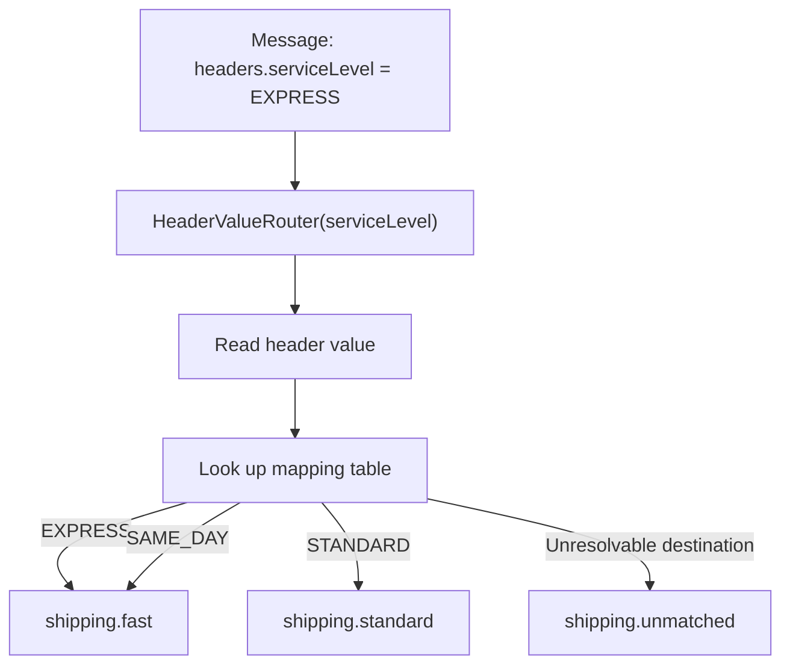
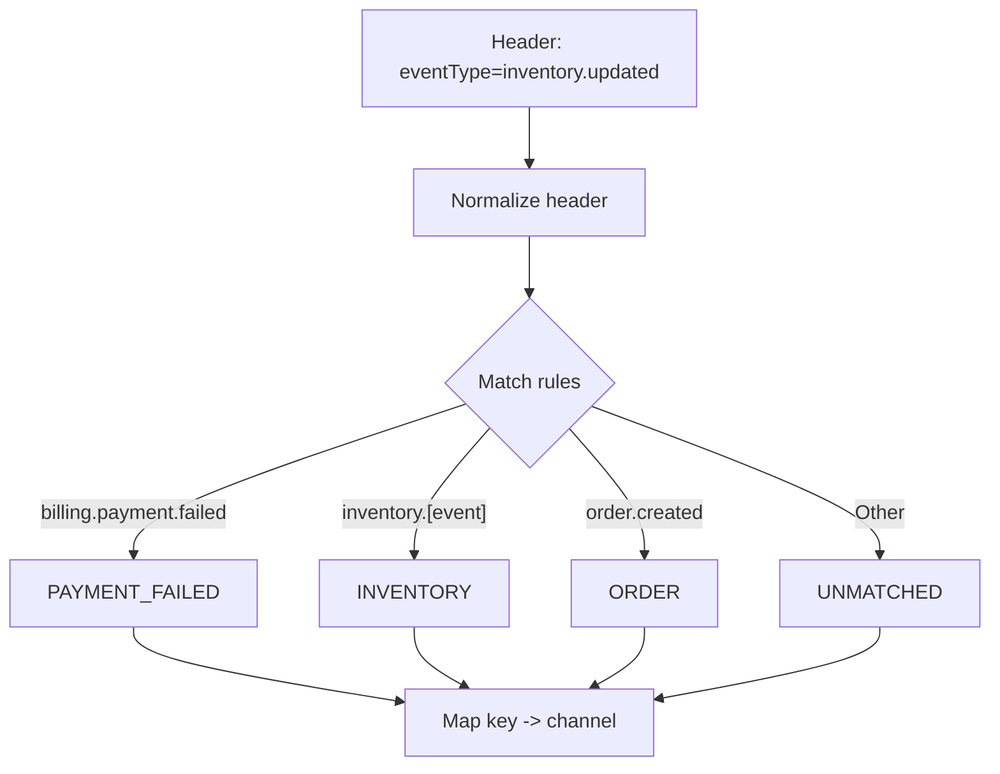
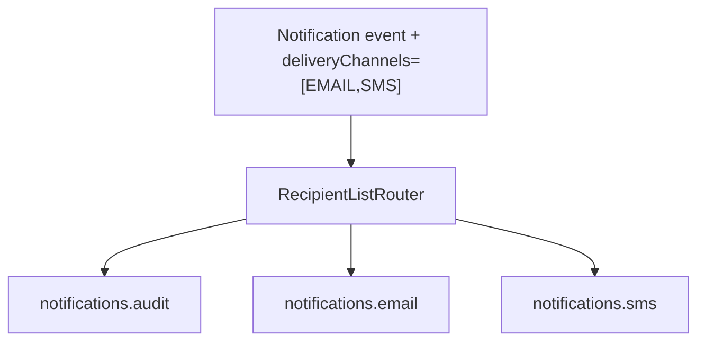
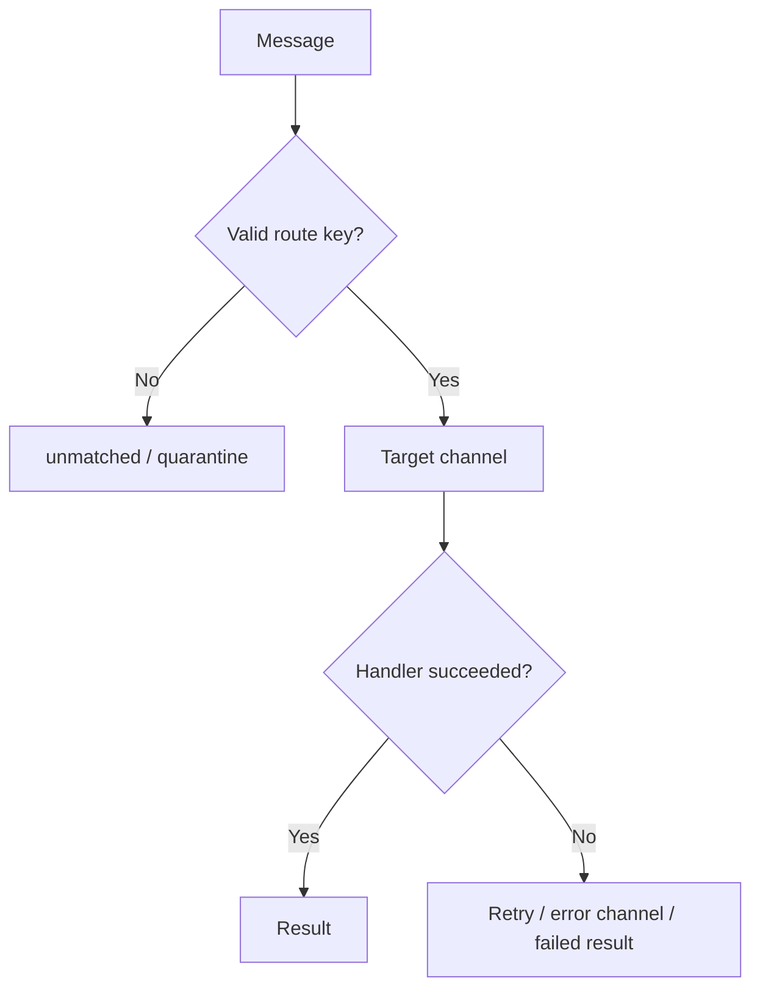

# Wildcards or Multi-Value Mappings in Spring Integration Header-Based Router

## Learning objectives

In an integration system, a message often carries a header such as `serviceLevel`, `region`, `eventType`, or `deliveryChannels` to decide its path. The problem becomes interesting when **multiple header values must go to the same channel**, when a family of values must be matched by **wildcard/pattern**, or when **one message must reach multiple channels**.

This lesson belongs to the **Header-based router** chapter of the **SPRING_INTEGRATION_PATTERN** module. The overall goal of the module is implementing Enterprise Integration Patterns (EIP) with Spring Integration to create loosely coupled, extensible message flows; combining Router, Filter, Transformer, Splitter, Aggregator, Gateway, retry, error channel, and correlation; and testing and observing processing branches.

After this lesson, you will be able to:

1. Describe the **header value → channel** mapping mechanism of `HeaderValueRouter`.
2. Define multiple **exact values** pointing to the same channel without confusing that with sending a message to multiple destinations.
3. Explain why `channelMapping("inventory.*", ...)` **is not a wildcard by default**, and implement pattern rules via a verifiable route-key selector function.
4. Handle multi-valued headers: distinguish a **comma-separated single value**, a **Collection**, and **multiple recipients**.
5. Choose `RecipientListRouter` when conditional fan-out is genuinely needed.
6. Test missing headers, wrong types, casing differences, overlapping patterns, fallbacks, header propagation, and unintended target branches.
7. Design safely for client-supplied headers, error handling, correlation, replay, and operational observability.

## 1. Three distinct meanings of "multi-value mapping"

The phrase "multi-value" can refer to three completely different scenarios:

| Scenario | Input | Desired outcome | Implementation |
| --- | --- | --- | --- |
| **Multiple aliases to one target** | `serviceLevel=EXPRESS` or `serviceLevel=SAME_DAY` | Both enter `shipping.fast` | Declare **two** `channelMapping` entries for the same channel |
| **A family of values matching a pattern** | `eventType=inventory.created` or `inventory.adjusted` | Entire family enters `events.inventory` | Normalize/check in Java or regex, then return **one route key** |
| **One message to multiple targets** | `deliveryChannels=[EMAIL,SMS]` | One copy to EMAIL, one copy to SMS | `RecipientListRouter` or a Router returning **multiple recipients** |

These three cases cannot be interchanged simply by adding `*` or commas to a single `channelMapping`.

### Illustrative example

```text
(A) Multiple values -> one channel
    EXPRESS -----\
                  +--> shipping.fast
    SAME_DAY ----/

(B) Multi-value pattern -> one channel
    inventory.created ----\
    inventory.updated -----+--> events.inventory
    inventory.deleted ----/

(C) One message -> multiple channels
    deliveryChannels=[EMAIL, SMS]
                  +----> notifications.email
                  |
                  +----> notifications.sms
```

**Core point:** mapping decides the **destination of a route key**, wildcards define the **rule for deriving or classifying a route key**, and fan-out decides **how many destinations simultaneously receive a message**.

## 2. How does HeaderValueRouter process a message?

`HeaderValueRouter` is a built-in Router in Spring Integration under the `org.springframework.integration.router` package. It reads the value of **one designated header**, uses that value as a routing key, and maps it to a channel.



Example mapping table:

| `serviceLevel` value | Channel |
| --- | --- |
| `EXPRESS` | `shipping.fast` |
| `SAME_DAY` | `shipping.fast` |
| `STANDARD` | `shipping.standard` |
| Other or missing | `shipping.unmatched`, if configured |

The header value can be a business code or an actual channel name. When the value is a business code such as `EXPRESS`, define an explicit mapping. When values match channel names, the framework has an option to resolve a channel directly from the key; this behavior should be controlled with `channelKeyFallback`.

### Step sequence

1. **Ingress** receives the message and validates headers per contract.
2. **HeaderValueRouter** reads the target header value.
3. **Mapping** looks up the key in the table and resolves the channel bean.
4. **Send** delivers the message to the target channel.
5. **Consumer** downstream executes that branch's business logic.

The Router only decides where to send the message; it does not have to alter the payload. Business headers like `traceId`, `tenantId`, or `orderId` generally remain on the message across the branch.

## 3. Mapping multiple exact values to the same channel

Suppose there are three shipping service levels:

- Both `SAME_DAY` and `EXPRESS` go to the fast processing branch.
- `STANDARD` goes to the standard processing branch.
- Unsupported values must go to an inspection branch.

Two mappings with different keys pointing to the same destination are completely valid:

```java
HeaderValueRouter router = new HeaderValueRouter("serviceLevel");
router.setChannelMapping("SAME_DAY", "shipping.fast");
router.setChannelMapping("EXPRESS", "shipping.fast");
router.setChannelMapping("STANDARD", "shipping.standard");
```

For each message, the Router reads **one `serviceLevel` header**. When the header is `EXPRESS`, the Router selects `shipping.fast` exactly **once**; having `SAME_DAY` also point to that channel never duplicates the message.

### Complete Java DSL example

```java
import org.springframework.context.annotation.Bean;
import org.springframework.context.annotation.Configuration;
import org.springframework.integration.channel.DirectChannel;
import org.springframework.integration.channel.QueueChannel;
import org.springframework.integration.config.EnableIntegration;
import org.springframework.integration.dsl.IntegrationFlow;
import org.springframework.integration.router.HeaderValueRouter;
import org.springframework.messaging.MessageChannel;
import org.springframework.messaging.PollableChannel;

@Configuration
@EnableIntegration
public class ShippingHeaderRouterConfig {

    @Bean("shipping.in")
    MessageChannel input() {
        return new DirectChannel();
    }

    @Bean("shipping.fast")
    PollableChannel fastQueue() {
        return new QueueChannel();
    }

    @Bean("shipping.standard")
    PollableChannel standardQueue() {
        return new QueueChannel();
    }

    @Bean("shipping.unmatched")
    PollableChannel unmatchedQueue() {
        return new QueueChannel();
    }

    @Bean
    IntegrationFlow shippingHeaderRoutingFlow() {
        HeaderValueRouter router = new HeaderValueRouter("serviceLevel");

        // Two aliases, same destination.
        router.setChannelMapping("EXPRESS", "shipping.fast");
        router.setChannelMapping("SAME_DAY", "shipping.fast");
        router.setChannelMapping("STANDARD", "shipping.standard");

        // Prevent client-supplied keys from becoming arbitrary channel names.
        router.setChannelKeyFallback(false);
        router.setDefaultOutputChannelName("shipping.unmatched");

        return IntegrationFlow.from("shipping.in")
            .route(router)
            .get();
    }
}
```

In this example, the outputs are `QueueChannel`s so tests can call `receive()`. They do not yet have background consumers/pollers; in a real application, attach a queue-reading endpoint or pick another suitable channel type.

`setDefaultOutputChannelName(...)` sets the channel receiving cases where the Router cannot find a destination. Since Spring Integration 6.0, setting a default output channel also disables `channelKeyFallback`; the example still expresses the intent with `setChannelKeyFallback(false)` for clarity. When changing versions, confirm routing options against the actual dependency.

### Equivalent XML configuration

```xml
<int:header-value-router
    input-channel="shipping.in"
    header-name="serviceLevel"
    default-output-channel="shipping.unmatched">

    <int:mapping value="EXPRESS" channel="shipping.fast"/>
    <int:mapping value="SAME_DAY" channel="shipping.fast"/>
    <int:mapping value="STANDARD" channel="shipping.standard"/>
</int:header-value-router>
```

The XML example assumes Spring Integration's `int` namespace is declared and the channels have corresponding beans. Each `mapping` element represents one exact value. If you need to restrict channel-key fallback according to your version's policy, check the corresponding configuration attribute and test unknown keys.

**Do not write:**

```xml
<!-- Does not mean EXPRESS or SAME_DAY. -->
<int:mapping value="EXPRESS,SAME_DAY" channel="shipping.fast"/>

<!-- Does not mean any value starting with EXPRESS. -->
<int:mapping value="EXPRESS*" channel="shipping.fast"/>
```

Under the standard value-mapping model, the strings `EXPRESS,SAME_DAY` and `EXPRESS*` are treated as **a single literal key**. There is no built-in wildcard or CSV splitting syntax in `HeaderValueRouter`.

## 4. Testing exact mappings and header propagation

Tests must prove that both aliases reach the same channel, another value goes to its own branch, and unknown values never slip into unintended channels.

```java
import static org.assertj.core.api.Assertions.assertThat;

import org.junit.jupiter.api.Test;
import org.springframework.beans.factory.annotation.Autowired;
import org.springframework.beans.factory.annotation.Qualifier;
import org.springframework.messaging.Message;
import org.springframework.messaging.MessageChannel;
import org.springframework.messaging.PollableChannel;
import org.springframework.messaging.support.MessageBuilder;
import org.springframework.test.context.junit.jupiter.SpringJUnitConfig;

@SpringJUnitConfig(ShippingHeaderRouterConfig.class)
class ShippingHeaderRouterTest {

    @Autowired
    @Qualifier("shipping.in")
    MessageChannel input;

    @Autowired
    @Qualifier("shipping.fast")
    PollableChannel fast;

    @Autowired
    @Qualifier("shipping.standard")
    PollableChannel standard;

    @Autowired
    @Qualifier("shipping.unmatched")
    PollableChannel unmatched;

    private void send(String serviceLevel) {
        assertThat(input.send(
            MessageBuilder.withPayload("order-42")
                .setHeader("serviceLevel", serviceLevel)
                .setHeader("traceId", "trace-42")
                .setHeader("tenantId", "tenant-a")
                .build()
        )).isTrue();
    }

    @Test
    void bothAliasesGoToFastChannel() {
        send("EXPRESS");
        send("SAME_DAY");

        Message<?> first = fast.receive(2_000);
        Message<?> second = fast.receive(2_000);

        assertThat(first).isNotNull();
        assertThat(second).isNotNull();
        assertThat(first.getHeaders().get("serviceLevel"))
            .isEqualTo("EXPRESS");
        assertThat(second.getHeaders().get("serviceLevel"))
            .isEqualTo("SAME_DAY");
        assertThat(first.getHeaders().get("traceId"))
            .isEqualTo("trace-42");
        assertThat(second.getHeaders().get("tenantId"))
            .isEqualTo("tenant-a");

        // Two input messages, exactly two output messages,
        // no copies on other channels.
        assertThat(fast.receive(0)).isNull();
        assertThat(standard.receive(0)).isNull();
        assertThat(unmatched.receive(0)).isNull();
    }

    @Test
    void standardUsesDedicatedChannel() {
        send("STANDARD");

        Message<?> result = standard.receive(2_000);
        assertThat(result).isNotNull();
        assertThat(result.getPayload()).isEqualTo("order-42");
        assertThat(fast.receive(0)).isNull();
        assertThat(unmatched.receive(0)).isNull();
    }

    @Test
    void unknownValueGoesToUnmatchedChannel() {
        send("PREMIUM");

        Message<?> result = unmatched.receive(2_000);
        assertThat(result).isNotNull();
        assertThat(result.getHeaders().get("serviceLevel"))
            .isEqualTo("PREMIUM");
        assertThat(fast.receive(0)).isNull();
        assertThat(standard.receive(0)).isNull();
    }

    @Test
    void prefixDoesNotMatchAnExactAlias() {
        send("EXPRESS_X");

        assertThat(unmatched.receive(2_000)).isNotNull();
        assertThat(fast.receive(0)).isNull();
    }

    @Test
    void commaSeparatedValuesAreNotTwoMappings() {
        send("EXPRESS,SAME_DAY");

        assertThat(unmatched.receive(2_000)).isNotNull();
        assertThat(fast.receive(0)).isNull();
        assertThat(standard.receive(0)).isNull();
    }
}
```

These tests assume each test class uses empty queues and does not run concurrently against an unisolated shared context. With `DirectChannel`, routing executes synchronously on the send path; when moving to an executor or broker, test with appropriate waiting and confirmation mechanisms.

**Missing header cases** also need testing:

```java
input.send(MessageBuilder.withPayload("order-without-level")
    .setHeader("traceId", "trace-missing")
    .build());
```

Never assume `null` will always behave like a specific alias. Depending on router settings, failing to extract a key may take the default path or raise a resolution error. Place an explicit validation/normalization step before the Router if the business requires consistent behavior on missing headers.

## 5. Wildcards: why classify before mapping?

Suppose messages carry `eventType`:

```text
inventory.created
inventory.updated
inventory.adjusted
billing.payment.failed
order.created
unknown.type
```

Requirements:

- Every event in the `inventory.<event>` family goes to `events.inventory`.
- `billing.payment.failed` goes to a dedicated alert branch.
- `order.created` goes to `events.order`.
- Any other value goes to `events.unmatched`.

Adding:

```java
router.setChannelMapping("inventory.*", "events.inventory");
```

**does not perform glob-style pattern matching**. It creates a mapping with the literal string key `inventory.*`. To support wildcards, you need a step that computes a **route key** from patterns or replace it with a custom Router that understands those rules.



### Glob wildcards vs. regex

| Pattern | Language | Meaning |
| --- | --- | --- |
| `inventory.*` | Glob if you define it as glob | Any string following the `inventory.` prefix |
| `inventory\.[a-z0-9_-]+` | Java regex | Prefix `inventory.` plus at least one valid trailing character |
| `inventory.*` | Java regex | `.` matches any character and `*` repeats the preceding token; **differs from glob** |
| `startsWith("inventory.")` | Java predicate | Prefix check; can match bare `"inventory."` unless length is also checked |

When using Java regex, `matcher.matches()` tests **the entire string** against the pattern. `find()` only locates a substring match, so inputs with an unwanted prefix could slip through if the wrong method is called.

### Define an explicit priority order

When specific rules and broad rules coexist, evaluate **specific first, broad second**:

1. `billing.payment.failed` → `PAYMENT_FAILED`.
2. `inventory.<valid_name>` → `INVENTORY`.
3. `order.created` → `ORDER`.
4. Everything else → `UNMATCHED`.

If `inventory.deleted` also needs its own branch, check exact `inventory.deleted` **before** the `inventory.*` group rule. The Router does not infer "most specific wins" from the order of `channelMapping` calls; that ordering must live in the key-classification logic.

## 6. Java DSL example: controlled wildcard routing

This example uses Java's `Pattern` to group event types. For each incoming message, the Router computes a canonical string key and looks up the mapping.

```java
import java.util.Locale;
import java.util.regex.Pattern;

import org.springframework.context.annotation.Bean;
import org.springframework.context.annotation.Configuration;
import org.springframework.integration.channel.DirectChannel;
import org.springframework.integration.channel.QueueChannel;
import org.springframework.integration.config.EnableIntegration;
import org.springframework.integration.dsl.IntegrationFlow;
import org.springframework.messaging.Message;
import org.springframework.messaging.MessageChannel;
import org.springframework.messaging.PollableChannel;

@Configuration
@EnableIntegration
public class EventPatternRouterConfig {

    // At least one character after "inventory.", restricted character set.
    private static final Pattern INVENTORY_EVENT =
        Pattern.compile("inventory\\.[a-z0-9_-]+");

    @Bean("events.in")
    MessageChannel eventInput() {
        return new DirectChannel();
    }

    @Bean("events.inventory")
    PollableChannel inventoryQueue() {
        return new QueueChannel();
    }

    @Bean("events.order")
    PollableChannel orderQueue() {
        return new QueueChannel();
    }

    @Bean("events.paymentFailed")
    PollableChannel paymentFailedQueue() {
        return new QueueChannel();
    }

    @Bean("events.unmatched")
    PollableChannel unmatchedQueue() {
        return new QueueChannel();
    }

    @Bean
    IntegrationFlow eventRoutingFlow() {
        return IntegrationFlow.from("events.in")
            .route(Message.class,
                message -> classifyEventType(
                    message.getHeaders().get("eventType", String.class)),
                router -> router
                    .channelMapping("INVENTORY", "events.inventory")
                    .channelMapping("ORDER", "events.order")
                    .channelMapping("PAYMENT_FAILED", "events.paymentFailed")
                    .channelKeyFallback(false)
                    .defaultOutputChannel("events.unmatched"))
            .get();
    }

    static String classifyEventType(String raw) {
        if (raw == null || raw.isBlank()) {
            return "UNMATCHED";
        }

        String value = raw.trim().toLowerCase(Locale.ROOT);

        if (value.equals("billing.payment.failed")) {
            return "PAYMENT_FAILED";
        }
        if (INVENTORY_EVENT.matcher(value).matches()) {
            return "INVENTORY";
        }
        if (value.equals("order.created")) {
            return "ORDER";
        }
        return "UNMATCHED";
    }
}
```

**Why use `.route(Message.class, ...)`?** The example needs to inspect the `eventType` header on the full message rather than just the payload. The function returns a route key like `INVENTORY`; `channelMapping` maps that key to a channel bean. This is a **generic Router computing keys from a header**, rather than a pure value-mapping `HeaderValueRouter`.

**Why include `channelKeyFallback(false)`?** So an unsupported value or key cannot be treated as a channel bean name outside the allowed table. `defaultOutputChannel` keeps unrecognized messages on an observable channel. Since that channel has no handler attached here, production code must wire an appropriate consumer or storage.

In this example, `inventory.updated` matches the regex and goes to `events.inventory`; `inventory.` fails because the event suffix is missing; `xinventory.updated` fails because `matches()` checks the whole string. `INVENTORY.CREATED` is lowercased before matching.

If business rules require case-sensitive event names, remove `toLowerCase(...)` and update tests accordingly. Never change normalization rules arbitrarily between producer and consumer.

### Unit testing the pattern classification logic

```java
import static org.assertj.core.api.Assertions.assertThat;

import org.junit.jupiter.api.Test;

class EventPatternClassificationTest {

    @Test
    void matchesKnownInventoryEvents() {
        assertThat(EventPatternRouterConfig.classifyEventType(
            "inventory.created")).isEqualTo("INVENTORY");

        assertThat(EventPatternRouterConfig.classifyEventType(
            " INVENTORY.updated ")).isEqualTo("INVENTORY");
    }

    @Test
    void rejectsNearMissesInsteadOfMatchingAnySubstring() {
        assertThat(EventPatternRouterConfig.classifyEventType(
            "inventory.")).isEqualTo("UNMATCHED");

        assertThat(EventPatternRouterConfig.classifyEventType(
            "xinventory.created")).isEqualTo("UNMATCHED");

        assertThat(EventPatternRouterConfig.classifyEventType(
            "inventory.created.more")).isEqualTo("UNMATCHED");
    }

    @Test
    void choosesSpecificEventAndHandlesMissingHeader() {
        assertThat(EventPatternRouterConfig.classifyEventType(
            "billing.payment.failed")).isEqualTo("PAYMENT_FAILED");

        assertThat(EventPatternRouterConfig.classifyEventType(
            null)).isEqualTo("UNMATCHED");

        assertThat(EventPatternRouterConfig.classifyEventType(
            "order.created")).isEqualTo("ORDER");
    }
}
```

These tests verify the classification algorithm independently of the Spring context. You should also add integration tests sending messages to `events.in` and asserting output channels, similar to the test structure in section 4.

### Controlling pattern cost

If you allow external configuration of regexes, bound input length and expression complexity. Regexes with expensive backtracking can consume heavy CPU on client-controlled inputs. For "same prefix" checks, `startsWith` combined with length/character validation is often clearer, easier to test, and lower risk.

Alternative example:

```java
boolean isInventoryFamily(String type) {
    return type != null
        && type.startsWith("inventory.")
        && type.length() > "inventory.".length();
}
```

This function is broader than the earlier regex: it permits additional characters and dots. Only use it when the contract genuinely allows them.

## 7. A header carrying multiple values: data vs. multiple recipients

Consider the `deliveryChannels` header:

```text
deliveryChannels = ["EMAIL", "SMS"]
```

The business goal is sending the event to **both EMAIL and SMS**. First, distinguish the representations:

| Representation | Java example | Note |
| --- | --- | --- |
| Single header | `"EMAIL"` | One single key |
| CSV string | `"EMAIL,SMS"` | Still **one String** until parsed; must handle whitespace, duplicates, unknown values |
| `Collection<String>` | `List.of("EMAIL", "SMS")` | Clearer list model in-process, but serialization across adapters must be considered |
| Separate messages | Each message has `deliveryChannel="EMAIL"` or `"SMS"` | Can be produced via a Splitter and routed per message |

Never assume `HeaderValueRouter` treats `"EMAIL,SMS"` as two keys and dispatches to two channels. With Collection data, explicitly choose between splitting per element or selecting multiple recipients, and test your Spring Integration version's exact behavior.

### One message going to multiple channels: RecipientListRouter

`RecipientListRouter` is the right pattern when the recipient set is determined from conditions on the message. For instance, audit receives **every** notification, while Email and SMS receive only when selected.



One Java configuration approach using `RecipientListRouter` and `MessageSelector`:

```java
import java.util.Collection;

import org.springframework.integration.router.RecipientListRouter;
import org.springframework.integration.dsl.IntegrationFlow;
import org.springframework.messaging.Message;

class NotificationRecipientRouting {

    static boolean selected(Message<?> message, String channel) {
        Object raw = message.getHeaders().get("deliveryChannels");
        if (!(raw instanceof Collection<?> values)) {
            return false;
        }

        return values.stream().anyMatch(value ->
            channel.equals(value));
    }

    static IntegrationFlow flow() {
        RecipientListRouter router = new RecipientListRouter();

        // Audit is always included in the recipient set.
        router.addRecipient("notifications.audit");
        router.addRecipient("notifications.email",
            message -> selected(message, "EMAIL"));
        router.addRecipient("notifications.sms",
            message -> selected(message, "SMS"));

        return IntegrationFlow.from("notifications.in")
            .route(router)
            .get();
    }
}
```

This is a **configuration excerpt**, assuming channels `notifications.in`, `notifications.audit`, `notifications.email`, and `notifications.sms` are registered; declare the flow as a `@Bean` inside a real `@Configuration` class. The sample uses Java 17+ for `instanceof` pattern matching.

If the header is `List.of("EMAIL", "SMS")`, all three recipients (audit, email, sms) receive the message as configured—**not only the first matching recipient**. If only EMAIL is present, audit and email receive it. If neither EMAIL nor SMS is present, audit still receives it, so at the Router level this is not a "no recipients" case.

The `selected` helper above accepts only a Collection containing the exact defined strings; add normalization/validation if external sources may send lowercase or CSV. Never turn user data into channel names via arbitrary string concatenation.

### XML configuration with selector-expression

```xml
<int:recipient-list-router input-channel="notifications.in">
    <int:recipient channel="notifications.audit"/>
    <int:recipient
        channel="notifications.email"
        selector-expression="headers['deliveryChannels'] != null
            and headers['deliveryChannels'].contains('EMAIL')"/>
    <int:recipient
        channel="notifications.sms"
        selector-expression="headers['deliveryChannels'] != null
            and headers['deliveryChannels'].contains('SMS')"/>
</int:recipient-list-router>
```

This XML snippet illustrates recipient `selector-expression`s; it assumes `deliveryChannels` is already a proper Collection before entering the Router. If left as a raw CSV string, `contains('EMAIL')` behaves as substring matching and can cause false positives; parse into a validated set first.

### Multi-value mapping ≠ broadcasting

```text
EXPRESS -> shipping.fast
SAME_DAY -> shipping.fast
```

This is **multiple keys to one channel**; a message with `EXPRESS` is never duplicated just because two mappings exist.

```text
deliveryChannels=[EMAIL,SMS]
    -> notifications.email
    -> notifications.sms
```

This is **one message to multiple channels**. You must design retries, per-branch error handling, and potential duplicate side effects. The two problems differ in semantics, throughput, and testing.

## 8. When to use a Splitter instead of RecipientListRouter?

If the header truly represents a list of **independent work units**, you can use a Splitter to emit child messages and then use `HeaderValueRouter` for each part:

```text
Message:
  payload=Notification("order-42")
  header deliveryChannels=[EMAIL, SMS]
           |
           v
Custom Splitter
   |                       |
   v                       v
Message EMAIL          Message SMS
header target=EMAIL    header target=SMS
   |                       |
   +----------+------------+
              v
       HeaderValueRouter("target")
         EMAIL -> notifications.email
         SMS   -> notifications.sms
```

Choose this approach when you need **per-item retry, idempotency, and correlation**. Each child message needs `notificationId + channel` as an idempotency key so retrying Email does not re-trigger SMS.

If a downstream Aggregator needs to know when both channels finished, use `correlationId` and an appropriate sequence/release strategy. Recipient-list routers offer an `applySequence` option (disabled by default) for cases needing group metadata; do not rely on sequence headers unless configured. If you only need one-way event broadcast to two subscribers, a simple recipient list can be less complex than Splitter/Aggregator.

## 9. Overlapping wildcards and rule precedence

Suppose the data needs three branches:

1. `inventory.deleted`: requires special approval.
2. `inventory.*`: everything else goes to inventory processing.
3. `*`: all other events go to unmatched.

You must make the evaluation order explicit:

```java
static String route(String rawType) {
    if (rawType == null) {
        return "UNMATCHED";
    }

    String type = rawType.trim().toLowerCase(java.util.Locale.ROOT);

    if (type.equals("inventory.deleted")) {
        return "INVENTORY_DELETE_REVIEW";
    }
    if (type.startsWith("inventory.")
        && type.length() > "inventory.".length()) {
        return "INVENTORY";
    }
    return "UNMATCHED";
}
```

If `startsWith("inventory.")` comes first, `inventory.deleted` messages will be swallowed by the broader rule. **First-match-wins policy lives in the classification function**, not in the declaration order of `channelMapping` lines.

With many rules, build a **decision table**:

| `eventType` header | Matched rule | Route |
| --- | --- | --- |
| `inventory.deleted` | Special exact rule and wildcard | `INVENTORY_DELETE_REVIEW` |
| `inventory.created` | Inventory wildcard | `INVENTORY` |
| `inventory.` | Missing event suffix | `UNMATCHED` |
| `INVENTORY.updated` | Wildcard after normalization | `INVENTORY` |
| `billing.payment.failed` | Exact billing rule | `PAYMENT_FAILED` |
| `other.created` | No matching rule | `UNMATCHED` |

If rules are owned by multiple teams, add explicit priorities and tie-breakers, test overlaps, and store the policy version to explain historical routing decisions.

## 10. Externally sourced headers: normalize, validate, allowlist

A header used to pick a channel can originate from an HTTP request, Kafka record, AMQP message, JMS property, or an internal Gateway. Each boundary has different mapping rules and trust levels.

**Never let external actors arbitrarily pick channel names or privileges.** For example, a user-entered header `destination=adminApprovalChannel` must never make the Router send the message to that channel if the user lacks authorization. A safer design:

1. **Accept only values from a defined set**: `EXPRESS`, `SAME_DAY`, `STANDARD`.
2. **Normalize at ingress** per contract: trimming, casing rules, data types, and length limits.
3. **Verify against identity**: `tenantId` or `serviceLevel` used for authorization/billing must be checked against trusted sources.
4. **Map through an allowlist** to internal channels.
5. **Controlled fallback**: unsupported values → reject/quarantine with trace context for investigation; never fall back to another privileged branch.
6. **Map outbound headers** via HTTP/Kafka/AMQP/JMS adapters using allowlists; never forward `replyChannel`, `errorChannel`, or internal Java objects indiscriminately.

When passing custom headers across a broker, some adapters only support specific value types or require serializers/header mappers. The fact that a header exists on a message before an outbound adapter does not guarantee it arrives at the consumer with the same type.

### Input cases that require explicit decisions

| Input | Risk | Recommended behavior |
| --- | --- | --- |
| Missing header | Cannot determine route | Validation error or unmatched with reason |
| `null` | Expressions/predicates throw | Check for null first |
| Wrong type such as Integer | Incompatible with String header | Reject with error code; avoid silent coercion |
| `" express "` | Misses exact mapping | Intentional normalization |
| `"EXPRESS,SAME_DAY"` | Mistaken for two aliases, actually one String | Parse per schema or reject |
| List with duplicate entries | Fan-out delivers twice unless deduplicated | Deduplicate if once-per-recipient is required |
| Excessively long `inventory...` | CPU/memory cost, log bloat | Enforce length and charset limits |
| Client-declared `ADMIN` value | Could cross trust boundaries | Enforce authorization and allowlists |

## 11. Default output channel, delivery failures, and retries

The following three failure classes are **distinct**:

- **Unmatched route**: header value matches no mapping/pattern and the Router has no destination.
- **Delivery failure**: Router picks a channel, yet `send()` fails, a queue is full, or no consumer is attached.
- **Handler failure**: the message reached the branch, yet business execution threw an exception.

`defaultOutputChannel` handles **not finding a destination**. It does not catch handler exceptions or send failures on the chosen channel. For post-routing failures, use retries, error flows, dead-letter handling, or error responses according to channel/adapter configuration.



### Gateways can time out

When a synchronous Gateway sends a request to a Header-Based Router:

- A valid branch returns a reply → caller receives the response.
- An unmatched branch merely puts the message into a `QueueChannel` with no consumer → caller may hang until timeout.
- A recipient-list fan-out produces multiple replies → a contract is required to select/aggregate outcomes; never assume the Gateway combines all replies automatically.

When using an unmatched channel to reject requests, attach a handler that builds an appropriate business error reply or throws a managed exception per the caller contract.

### Retries and idempotency during fan-out

A message fans out to audit and SMS; audit succeeds while SMS fails. Retrying the entire event can cause audit to run a second time. Design idempotency keys such as `eventId + recipientName`, retry at the per-branch level whenever possible, and persist per-branch state if guaranteed delivery is required.

For unsupported route keys, repeatedly retrying the exact same header against the exact same mapping rarely yields a new outcome. Quarantine, update policy, and then replay in a controlled, deduplicated manner.

## 12. Combining with other Enterprise Integration Patterns

| Pattern / component | How they work together | What to check |
| --- | --- | --- |
| **Filter** | Blocks schema-invalid headers before the Router | Appropriate discard/error response exists |
| **Transformer** | Normalizes payload; header enricher normalizes route key | Routing headers and `traceId` are not lost |
| **Content-Based Router** | Selects keys via logic across payload/header fields | Rule overlap and evaluation order |
| **RecipientListRouter** | Selects multiple receivers based on one or more headers | Recipient count, per-branch errors, duplicates |
| **Splitter** | Turns a list of values/work units into child messages | Per-item correlation and idempotency |
| **Aggregator** | Combines multi-message results by group | `correlationId`, release, timeout, missing-part handling |
| **Gateway** | Uses method-declared headers to route requests | Every permitted path has a reply/error contract |
| **Retry / error channel** | Handles post-routing execution errors | Never conflate with unmatched-route fallback |
| **PriorityChannel** | Prioritizes queued messages within a branch | Routing does not guarantee completion order |

### Routing by header does not guarantee completion order

A message entering `shipping.fast` can still finish after a message in `shipping.standard` if the fast handler is busy while the standard branch is idle. **A channel named "fast" is a business routing choice, not an automatic scheduling guarantee.** If SLAs require priority, allocate dedicated resources, thread pools/queues, and per-branch monitoring.

### Correlation during fan-out or split

An event fanned out to EMAIL and SMS produces two outcomes to track. Set a durable `eventId` or `correlationId`; if using an Aggregator, know the **expected part count**, group release rules, and failure policy if one branch errors. Never treat a skipped branch as "whole group completed."

## 13. Operational observability and integration testing

Metrics worth tracking:

| Illustrative metric | Question it answers |
| --- | --- |
| `header_router_received_total` | How many messages enter the Router? |
| `header_router_route_total{route}` | Distribution of route keys after normalization? |
| `header_router_unmatched_total` | How many headers went unmatched? |
| `header_router_invalid_header_total{reason}` | Rate of missing/mistyped/schema-invalid headers? |
| `recipient_router_fanout_total` | How many recipients per event? |
| `router_delivery_failures_total{channel}` | Which channels fail on delivery? |
| `router_branch_latency{channel}` | Which branch is actually slow? |
| `aggregation_pending_groups` | Are result groups stuck waiting on missing parts? |

These are **application-definable metric names**, not claims that Spring Integration emits all of them verbatim by default. Use Micrometer/observation and structured logging per your stack.

When debugging, log only approved fields:

```text
traceId=trace-42 event=route_selected
headerName=serviceLevel headerValue=EXPRESS
routeKey=EXPRESS destination=shipping.fast

traceId=trace-43 event=route_unmatched
headerName=serviceLevel reason=unsupported_value
destination=shipping.unmatched
```

Avoid logging full headers or payloads containing tokens, personal information, or credentials.

### Required test matrix

| Case | Data | Expectation |
| --- | --- | --- |
| Alias 1 | `EXPRESS` | `shipping.fast` once |
| Alias 2 | `SAME_DAY` | `shipping.fast` once |
| Other mapping | `STANDARD` | `shipping.standard` |
| Unknown | `PREMIUM` | `shipping.unmatched` |
| Valid wildcard | `inventory.updated` | `events.inventory` |
| Near miss | `inventory.` or `xinventory.updated` | `events.unmatched` |
| Case normalization | ` INVENTORY.created ` | `events.inventory` if policy permits |
| One message, two recipients | `[EMAIL,SMS]` | Both EMAIL and SMS receive it; audit if configured |
| Missing/mistyped header | `null`, `Integer` | Reject/unmatched per contract; never wrong channel |
| One recipient fails | SMS fails, audit succeeds | Clear retry/idempotency policy |

With synchronous channels in this lesson, tests can call `QueueChannel.receive(0)` right after sending. With async executors or brokers, wait on events/state with a bounded observation window before concluding a branch did not receive a message.

## 14. Hands-on exercises

### Exercise 1 — Multiple aliases to one target

Building on `ShippingHeaderRouterConfig`, add `NEXT_DAY` to `shipping.fast`. Write tests proving `EXPRESS`, `SAME_DAY`, and `NEXT_DAY` enter the same channel, with only one copy per message.

### Exercise 2 — Wildcards are not mappings

Intentionally add `setChannelMapping("inventory.*", "events.inventory")` to a `HeaderValueRouter` inspecting `eventType`. Send `inventory.updated` and observe pattern matching failing. Then replace it with `classifyEventType(...)` and test the desired behavior.

### Exercise 3 — Precedence of overlapping patterns

Add a special route for `inventory.deleted`. Write a test proving it goes to the review branch instead of the general inventory branch. Swap condition ordering in the classifier and explain the difference.

### Exercise 4 — CSV and Collection headers

Receive `deliveryChannels="EMAIL,SMS"` from an adapter, parse/validate into a `Set<String>`, and reject unknown values and duplicates. Use `RecipientListRouter` to send to the matching channels; test that `"EMAIL,EMAIL"` does not deliver to Email twice under your contract.

### Exercise 5 — Fan-out with one failing branch

Set up audit and SMS, and simulate an SMS timeout after audit completes. Compare retrying the whole event vs. retrying SMS alone; propose an idempotency key and test that audit side effects never repeat.

### Exercise 6 — Splitter/Aggregator

From one message with `deliveryChannels=[EMAIL,SMS]`, emit two child messages with a Splitter. Route each part by its `target` header, then aggregate results. Verify `correlationId`, sequence, timeouts, and the case where SMS yields no result.

### Exercise 7 — Untrusted headers

Send `serviceLevel=ADMIN` or a value matching an internal channel bean name. Prove that the allowlist policy and `channelKeyFallback(false)` prevent routing to channels outside the mapping.

### Exercise 8 — Observability and replay

Add an unmatched metric and quarantine events with a new type. After adding a mapping for the new value, replay using `eventId` to prevent duplicate processing; distinguish unmatched routes from handler failures.

## 15. Design checklist

1. Does "multi-value" mean **multiple aliases to one target**, **a wildcard pattern**, or **multiple recipients**?
2. Are you using the right Router: `HeaderValueRouter` for exact mappings, a classifier function for patterns, `RecipientListRouter` for fan-out?
3. Are inbound headers validated for **origin, type, length, charset, and allowed values**?
4. Do all mappings point to **existing channel beans**, preventing unknown keys from turning into channel names?
5. Have you distinguished **glob `*`, regex `.*`, and literal strings**?
6. Do overlapping patterns have **explicit precedence**, testing specific rules before broad patterns?
7. For Collections/CSV, is there a clear contract for **parsing, normalizing, deduplicating, and rejecting**?
8. With multiple recipients, are **retries, idempotency, and partial branch failures** defined?
9. With Gateway/Scatter-Gather/Aggregator, do unmatched or error paths return replies/partial results within SLA?
10. Are headers like `traceId`, `tenantId`, and `correlationId` propagated and mapped across protocols properly?
11. Have tests covered **exact matches, aliases, wildcards, near misses, unknowns, missing headers, wrong types, overlaps, and fan-out**?
12. Do logs/metrics track routing decisions, unmatched rates, delivery failures, handler errors, and backlog age?

### Takeaways

**Header-Based Router separates routing decisions from payloads.** With `HeaderValueRouter`, you can map **multiple exact values to the same channel** via multiple mappings. When wildcards are needed, define **pattern-recognition logic before mapping**; never assume `*` inside a key carries special meaning by itself. When a message must reach **multiple recipients**, use an explicit fan-out mechanism and control retries/idempotency per branch. Keeping these three needs separate makes Spring Integration flows easier to test, easier to observe, and safe from sending messages to unintended business handlers.

### References

- [Spring Integration Reference — Router Implementations](https://docs.spring.io/spring-integration/reference/router/implementations.html)
- [Spring Integration Reference — Common Router Parameters](https://docs.spring.io/spring-integration/reference/router/common-parameters.html)
- [Spring Integration Reference — Changes between 5.5 and 6.0](https://docs.spring.io/spring-integration/reference/changes-5.5-6.0.html)
- [Spring Integration API — AbstractMappingMessageRouter](https://docs.spring.io/spring-integration/api/org/springframework/integration/router/AbstractMappingMessageRouter.html)
