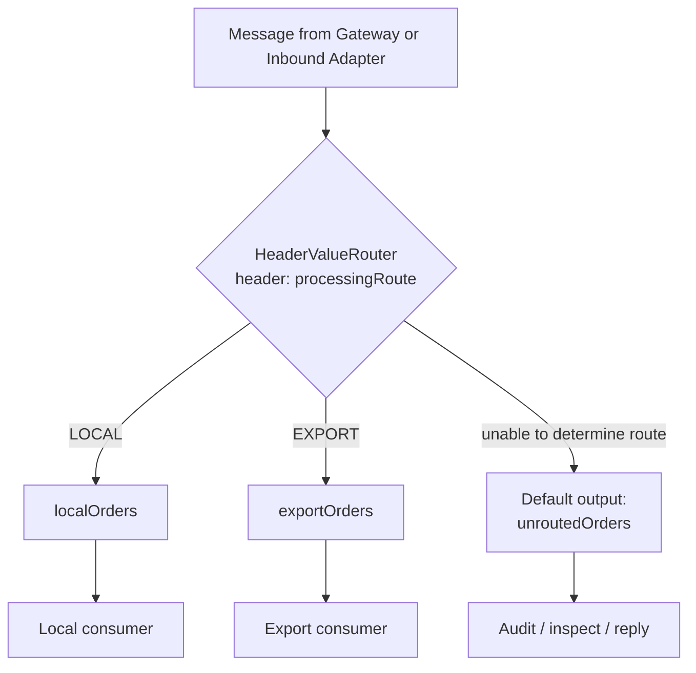
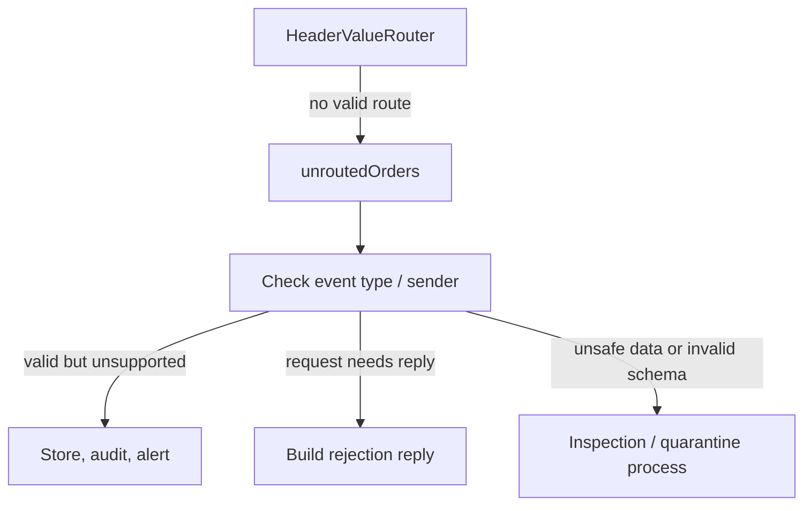
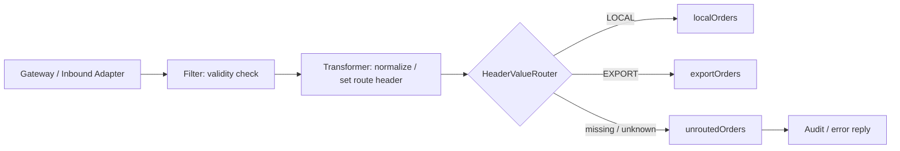
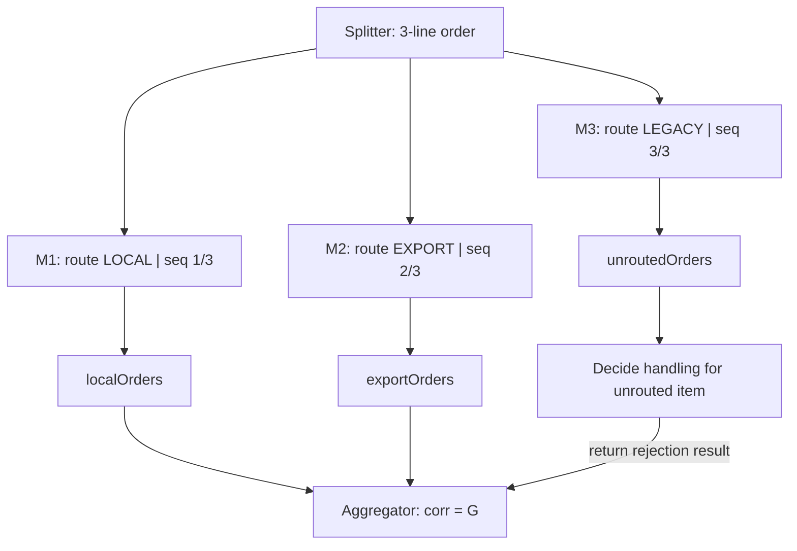

# Default Output Channel in Header-Based Router

A system receiving messages from multiple sources often uses **Message headers** to decide the next processing step. For instance, a producer emits an order event with header `processingRoute=LOCAL` to forward it to a domestic channel or `processingRoute=EXPORT` to forward it to an export channel. But what happens when the header is missing, its value is unsupported yet, or the mapping configuration is wrong?

In Spring Integration, the **default output channel** is the fallback destination for Messages for which a Router **cannot determine a target channel** according to its configured rules. For a **Header-Based Router**, defining an explicit default branch helps handle unrecognized messages, preserve traceability, and prevent a Gateway from waiting indefinitely for a reply.

This lesson belongs to the **Header-based router** chapter in the `SPRING_INTEGRATION_PATTERN` module. The overall objective is practicing Enterprise Integration Patterns with Spring Integration to build loosely coupled, extensible message flows, combining Router, Filter, Transformer, Splitter, Aggregator, Gateway, retry, error channel, correlation, and testing Message paths. This lesson focuses on **when the default branch is used, how to configure it, and how to verify outcomes**.

## 1. The problem: missing headers or unmatched routes

Suppose an application has three order processing flows:

| `processingRoute` header value | Target channel | Meaning |
| --- | --- | --- |
| `LOCAL` | `localOrders` | Domestic delivery processing |
| `EXPORT` | `exportOrders` | Export delivery processing |
| Missing or unsupported | `unroutedOrders` | Record and classify for follow-up handling |

Messages can carry identical payloads yet be routed differently based on headers:

```text
Message A: payload=ORD-101, processingRoute=LOCAL
Message B: payload=ORD-102, processingRoute=EXPORT
Message C: payload=ORD-103, processingRoute=LEGACY
Message D: payload=ORD-104, no processingRoute
```

With a proper default output configured, A and B reach their mapped channels, while C and D enter the unrouted handling branch. This is an **intentional fallback policy**; it does not automatically imply that the data was successfully processed.



### Distinguishing three names

- **Header name** is the metadata field name inspected: `processingRoute`.
- **Route key** is the value extracted from the header: `LOCAL`, `EXPORT`, `LEGACY`.
- **Channel name** is the `MessageChannel` bean name to which the Router sends: `localOrders`, `exportOrders`, `unroutedOrders`.

A route key does not have to match a channel name. `HeaderValueRouter` can use **channel mappings** to connect business labels to concrete channel names.

## 2. How does HeaderValueRouter work?

`org.springframework.integration.router.HeaderValueRouter` is a Router that uses the value of **one specified header** to determine the channel. The header may directly hold a channel name or hold a logical key mapped to a channel.

The basic flow:

1. The Router receives `Message<?>` from its input channel.
2. It reads the header declared when instantiating `HeaderValueRouter`.
3. It looks up the corresponding channel via the `channelMapping` table or configured channel-resolution rules.
4. It sends the Message to the resolved channel.
5. If no valid target is found under the Router's policy, it uses `defaultOutputChannel` if present and if fallback conditions are satisfied.

**The condition "cannot find a destination" must be understood accurately.** A route key absent from the mapping table can be diverted to the default channel. Conversely, a key mapped to a **misspelled or non-existent channel name** can cause a channel resolution failure, depending on `resolutionRequired`. Default output is not a catch-all mechanism for every error across the entire flow.

### Default output is not a second Router

The default channel is an **output channel**, such as a `QueueChannel`, `DirectChannel`, or a channel wired to another endpoint. It does not automatically inspect, repair, or re-inject Messages back into the main flow. If unrecognized messages need a reply, persistence, or analysis, **there must be a consumer/flow listening on the default channel**.

## 3. Configuring HeaderValueRouter with default output in Java

The example below uses Spring Integration Java DSL to wire `HeaderValueRouter` to an input channel. `localOrders`, `exportOrders`, and `unroutedOrders` are small-capacity `QueueChannel`s for easy observation during test runs.

```java
package example.integration;

import org.springframework.context.annotation.Bean;
import org.springframework.context.annotation.Configuration;
import org.springframework.integration.channel.DirectChannel;
import org.springframework.integration.channel.QueueChannel;
import org.springframework.integration.config.EnableIntegration;
import org.springframework.integration.dsl.IntegrationFlow;
import org.springframework.integration.router.HeaderValueRouter;
import org.springframework.messaging.MessageChannel;
import org.springframework.messaging.PollableChannel;

@Configuration
@EnableIntegration
public class HeaderRouterConfiguration {

    @Bean
    public MessageChannel ordersInput() {
        return new DirectChannel();
    }

    @Bean
    public PollableChannel localOrders() {
        return new QueueChannel(20);
    }

    @Bean
    public PollableChannel exportOrders() {
        return new QueueChannel(20);
    }

    @Bean
    public PollableChannel unroutedOrders() {
        return new QueueChannel(20);
    }

    @Bean
    public IntegrationFlow ordersRoutingFlow() {
        HeaderValueRouter router = new HeaderValueRouter("processingRoute");
        router.setChannelMapping("LOCAL", "localOrders");
        router.setChannelMapping("EXPORT", "exportOrders");
        router.setDefaultOutputChannelName("unroutedOrders");

        return IntegrationFlow.from("ordersInput")
                .route(router)
                .get();
    }
}
```

Explanation:

- `new HeaderValueRouter("processingRoute")` specifies **which header will be read**.
- `setChannelMapping("LOCAL", "localOrders")` and the corresponding mapping for `EXPORT` define valid routes.
- `setDefaultOutputChannelName("unroutedOrders")` declares the **fallback destination**.
- `.route(router)` wires the Router into an `IntegrationFlow` consuming Messages from `ordersInput`.
- Output `QueueChannel`s hold Messages awaiting a consumer via `receive()`; the example does not register pollers for them automatically.

You do not need another `@ServiceActivator` class to wire the Router to the input channel because `.route(router)` attaches the endpoint to the flow. If you prefer annotations or XML, ensure only **one Router mechanism is registered for the input** in this exercise so results remain unambiguous.

### 3.1. Sending mapped, unknown, and missing-header cases

```java
package example.integration;

import org.springframework.context.annotation.AnnotationConfigApplicationContext;
import org.springframework.messaging.Message;
import org.springframework.messaging.MessageChannel;
import org.springframework.messaging.PollableChannel;
import org.springframework.messaging.support.MessageBuilder;

public class HeaderRouterDemo {

    public static void main(String[] args) {
        try (var context = new AnnotationConfigApplicationContext(
                HeaderRouterConfiguration.class)) {

            MessageChannel input =
                    context.getBean("ordersInput", MessageChannel.class);
            PollableChannel local =
                    context.getBean("localOrders", PollableChannel.class);
            PollableChannel export =
                    context.getBean("exportOrders", PollableChannel.class);
            PollableChannel unrouted =
                    context.getBean("unroutedOrders", PollableChannel.class);

            Message<String> a = MessageBuilder.withPayload("ORD-101")
                    .setHeader("processingRoute", "LOCAL")
                    .setHeader("businessOrderId", "ORD-101")
                    .build();
            Message<String> b = MessageBuilder.withPayload("ORD-102")
                    .setHeader("processingRoute", "EXPORT")
                    .build();
            Message<String> c = MessageBuilder.withPayload("ORD-103")
                    .setHeader("processingRoute", "LEGACY")
                    .build();
            Message<String> d = MessageBuilder.withPayload("ORD-104")
                    .build(); // Missing processingRoute header

            input.send(a);
            input.send(b);
            input.send(c);
            input.send(d);

            printPayload(local.receive(0));    // ORD-101
            printPayload(export.receive(0));   // ORD-102
            printPayload(unrouted.receive(0)); // ORD-103
            printPayload(unrouted.receive(0)); // ORD-104
        }
    }

    private static void printPayload(Message<?> message) {
        System.out.println(message == null ? "<empty>" : message.getPayload());
    }
}
```

In this configuration, A and B enter their mapped branches, while C and D go to the default branch. `printPayload()` checks for `null` because `receive(0)` returns `null` when a channel has no Message yet.

`input.send()` indicates whether delivering the Message through the synchronous channels/endpoints succeeded; with output queues, that **does not prove downstream business work finished**. In a real system, consumers might pull the Message only after some delay.

## 4. What happens if no default output is configured?

When no output channel is found and the Router has no default output channel, Spring Integration's standard behavior is **throwing a routing exception** rather than picking an arbitrary branch.

```java
HeaderValueRouter router = new HeaderValueRouter("processingRoute");
router.setChannelMapping("LOCAL", "localOrders");
router.setChannelMapping("EXPORT", "exportOrders");
// No default output channel declared
```

A Message with `processingRoute=UNKNOWN` or a missing header has no valid route in this table. Keep in mind, however, that mapping routers have a **channel-key fallback** mechanism: if enabled and the header value happens to match an existing channel name, the Router may try resolving that name directly. Thus, an "unmapped" value does not always guarantee no path is found.

Since Spring Integration **6.0**, configuring a default output on a mapping router also sets `channelKeyFallback` to `false` by default as part of that configuration action. The goal is preventing unmapped keys from being used as arbitrary channel names before falling back to the default branch.

### When should you intentionally omit a default?

Omitting a default fits when the **route set is strictly closed** and any value outside it must be treated as a contract error—for example, a payment command accepting only `AUTHORIZE` or `CAPTURE`. In that case, design an explicit exception/error flow and Gateway response.

Providing a default fits when upstream sources can introduce new event types, or when unsupported Messages must be retained for later handling. Either way, test missing headers, wrong types, casing mismatches, and unknown values.

## 5. Distinguishing unmapped keys from unresolved channels

This is the most frequently misunderstood aspect of `defaultOutputChannel`.

| Situation | Example | Behavior to know |
| --- | --- | --- |
| Key has a valid mapping | `LOCAL → localOrders` and channel exists | Sent to `localOrders` |
| Missing header | No `processingRoute` | No route key; if Router uses default, sent to default |
| Unmapped key | `LEGACY` has no mapping | If no corresponding channel is allowed to resolve, sent to default |
| Key is mapped, yet target channel does not exist | `LOCAL → misspelledLocalOrders` | Can throw an error when `resolutionRequired=true` |
| Channel exists, yet refuses/fails Message | `localOrders` full or consumer/handler fails | Send/processing error; not automatically diverted to default |
| Router expression/handler itself throws | Metadata processing failure or custom router bug | Handled by error flow, not treated as "unknown route" |

### How does `resolutionRequired` affect fallback?

In mapping routers, `resolutionRequired` defaults to **`true`**. If a key **is mapped** to an unresolvable channel name, the configuration can throw `MessagingException` even when a default output channel exists. When `resolutionRequired=false`, unresolvable targets can fall back to the default output under the Router's rules.

Conceptual Java example:

```java
HeaderValueRouter router = new HeaderValueRouter("processingRoute");
router.setChannelMapping("LOCAL", "channelThatDoesNotExist");
router.setDefaultOutputChannelName("unroutedOrders");

// Use only when desired policy allows channel resolution
// errors to be routed to the fallback branch:
router.setResolutionRequired(false);
```

**Operational warning:** If you accidentally misspell a channel name in configuration, setting `resolutionRequired=false` can disguise a real deployment bug as Messages entering the default branch. For critical systems, **keep `resolutionRequired=true` so misconfigurations fail loudly**, and reserve default output solely for headers lacking a valid mapping.

### `channelKeyFallback` and client-supplied routes

`channelKeyFallback` controls whether an unmapped key is tried **directly as a channel name**. When enabled, a header `processingRoute=adminChannel` could resolve an internal channel named `adminChannel` if configuration permits. This is dangerous when headers arrive from untrusted external sources.

Therefore, in an explicit-mapping model, **never rely on channel names sent by clients**. Configuring default output in modern Spring Integration releases routes unmapped keys to the fallback branch; also check Router settings if your application explicitly turns on `channelKeyFallback`.

Combining `defaultOutputChannel`, `channelKeyFallback=true`, and `resolutionRequired=true` creates conflicting fallback semantics and is rejected when initializing mapping routers on versions enforcing that check.

## 6. Default channel vs. `nullChannel`, `errorChannel`, and discard channel

These channel types may appear in a flow, yet they solve **different problems**:

| Channel/concept | When it is used | Is payload processed? |
| --- | --- | --- |
| **Default output channel** | Router cannot determine an output target under its config | Yes, if wired to an appropriate consumer |
| **`nullChannel`** | Intentionally consuming and dropping a Message | No further business dispatch |
| **`errorChannel`** | Infrastructure/flow sends `ErrorMessage` on execution failure | Depends on configured error handler |
| **`discardChannel`** | Filter rejects a Message or component applies discard policy | Depends on consumer at discard branch |
| **Normal output channel** | Router picks a valid route | Has business consumer/flow |

**Default output is not automatically an error channel.** A Message with `LEGACY` may be structurally valid while lacking a routing rule yet. Conversely, `localOrders` failing because a handler throws an exception is not an "unknown route" situation; that error belongs to the flow's error handling mechanism.

### Can `nullChannel` be set as default output?

You can configure a Router to send unmatched Messages to `nullChannel` when the **business intent is to ignore them**:

```java
HeaderValueRouter router = new HeaderValueRouter("processingRoute");
router.setChannelMapping("LOCAL", "localOrders");
router.setDefaultOutputChannelName("nullChannel");
```

However, this choice must be deliberate. With request-reply APIs, dropping a Message without producing a reply can cause the Gateway to hang until timeout. For flows requiring audit or recovery, `nullChannel` retains nothing for later processing.

### Does defaulting to a `QueueChannel` guarantee durability?

No. A standard `QueueChannel` holds Messages **in memory**; if the JVM stops, queued Messages can be lost. To persist and reprocess unrouted Messages, design an appropriate store or broker with acknowledgments, retries, idempotency, and monitoring.

## 7. Policies for handling Messages on the default branch

An `unroutedOrders` branch is useful when it has **clear responsibilities**. Depending on the contract, you can choose:

1. **Audit and alert:** record `eventId`, routing header, received timestamp, and unsupported reason.
2. **Manual inspection:** store Messages in a queryable store with tooling to reassign routes.
3. **Return a business outcome:** construct `UnsupportedRoute` or `RejectedOrder` so the Gateway/API gets an answer.
4. **Quarantine external inputs:** if the header is untrusted, stop before sensitive endpoints.
5. **Intentional drop:** only when out-of-scope events are permitted to be discarded and no reply is needed.

Preliminary design for the fallback branch:



Do not immediately **loop the Message straight back to the same Router's input** while its header remains unchanged. That creates an infinite loop. If reprocessing is needed, introduce a normalization/route-correction step, bound attempts, prevent duplicate processing, and verify outcomes explicitly.

## 8. Combining Gateway, Filter, and Transformer

Consider a pipeline where a Gateway receives `OrderRequest`. A Transformer determines `processingRoute` from the verified payload, then the Router picks the channel:



**Order matters:** a request missing mandatory fields should be caught by validation/Filter or an explicit error branch; it should not be treated as a valid order simply because the Router has a default.

If the Gateway uses request-reply, Messages on the default branch **also need a reply or error path**. Placing a Message into a queue with no consumer generating a reply can cause the Gateway call to hit `replyTimeout`.

If the producer uses a one-way Gateway and only needs receipt acknowledgment, sending the Message to a default queue may suffice. Still, distinguish the states:

| State | Meaning |
| --- | --- |
| `RECEIVED` | Adapter/Gateway constructed the Message |
| `ROUTED` | Router picked and sent the Message to a mapped channel |
| `UNROUTED` | Router used the fallback branch because no route matched |
| `PROCESSED` | Business consumer completed the work |
| `FAILED` | Execution error occurred in routing or consumer |

Entering the default branch only confirms a **routing decision**, not the final business outcome.

## 9. Where do headers come from, and are they trustworthy?

Headers can be set by a Gateway, Transformer, inbound adapter, or external producer. How far a Message may navigate depends on header origin:

- **Trusted internal headers:** computed from verified data, such as `processingRoute` set by an internal service.
- **Headers from external clients:** can be forged arbitrarily; never treat them as authorization to access sensitive channels.
- **Headers crossing a broker/HTTP:** can be renamed, type-changed, or dropped if header mappers are not configured properly.

To prevent arbitrary routing, define an **allowed set of route keys**, explicit mappings, a default policy, and ingress validation at system boundaries. A `defaultOutputChannel` never replaces authorization or access control.

For example, instead of letting a client send `processingRoute=internalAdminChannel`, accept `shippingMode=INTERNATIONAL`, validate it, and have an internal Transformer attach `processingRoute=EXPORT`.

### Errors from wrong header types

`HeaderValueRouter` matches on header values. If a producer sends `processingRoute` in a form differing from mapping keys (e.g., enum, number, or whitespace-padded string), behavior may miss expectations. Never assume `"LOCAL"`, `"local"`, `" LOCAL "`, and an enum `LOCAL` always resolve identically.

When normalization is required by the contract, perform it in an explicit pre-Router step, then test edge values.

## 10. Default channel in flows with Splitter/Aggregator

The default route also affects patterns handling **multiple related Messages**. Suppose a Splitter breaks an order into three parts, each carrying `correlationId` and `sequenceNumber`, and a Router picks branches by header.



If the default branch only logs or stores the Message without **producing a result back to the Aggregator**, the Aggregator might receive only two of three items and wait forever if its release strategy requires `sequenceSize=3`.

Design options to plan:

1. Emit a **rejection result** for the unrouted item and return it to the group so the Aggregator has complete status.
2. Configure a **release strategy or timeout** for incomplete groups, with a policy for returning an error or partial result.
3. Validate and normalize the route **before the Splitter** whenever the rule applies to the entire request.
4. Use a stable **correlation** key per processing attempt; define clearly how to avoid mixing results from two separate attempts.

Do not assume the Router updates sequence headers or adjusts how many Messages the Aggregator expects. `defaultOutputChannel` only solves **where an unrouted Message goes**, not **group completion conditions**.

## 11. Retry, error handling, and idempotency

A Message hitting default because `LEGACY` is unsupported **is not a transient error**. Retrying the exact same Message immediately yields the same result. Conversely, consumer errors from timeouts, DB unavailability, or channel send failures may need retries under a separate policy.

| Case | Suggested handling |
| --- | --- |
| Missing header because upstream omitted it | Validate contract, return error reply, or divert for inspection |
| Header holds unsupported key | Default branch, audit, and update mapping when required |
| Mapping points to non-existent channel | Report configuration error, fix bean name; prefer keeping `resolutionRequired=true` |
| Target channel refuses delivery | Apply timeouts/backpressure and appropriate error handling |
| Consumer temporarily fails processing | Bounded retry with backoff and idempotency checks |
| Message replayed after route update | Keep `eventId` or stable business key to prevent duplicate execution |

On a `DirectChannel`, errors can propagate straight to the sender; on a `QueueChannel`, executor, or broker, consumers can fail at a later time. Configure `errorChannel` and retry policies at the right execution boundaries.

Using `MessageHeaders.ID` alone is not enough to prevent duplicate processing: when the same event is replayed, the system may mint a new Message ID. Use `eventId` or a stable business key combined with operation type.

## 12. Testing default output channel

A unit test checking only header values does not prove the Router delivered Messages to the right channel. Use integration tests with real channels to confirm **the path** for each case.

JUnit 5 example using the configuration from section 3:

```java
package example.integration;

import static org.junit.jupiter.api.Assertions.*;

import org.junit.jupiter.api.Test;
import org.springframework.context.annotation.AnnotationConfigApplicationContext;
import org.springframework.messaging.Message;
import org.springframework.messaging.MessageChannel;
import org.springframework.messaging.PollableChannel;
import org.springframework.messaging.support.MessageBuilder;

class HeaderRouterIntegrationTest {

    @Test
    void shouldUseMappedChannelsAndDefaultForUnknownOrMissingHeader() {
        try (var context = new AnnotationConfigApplicationContext(
                HeaderRouterConfiguration.class)) {

            MessageChannel input =
                    context.getBean("ordersInput", MessageChannel.class);
            PollableChannel local =
                    context.getBean("localOrders", PollableChannel.class);
            PollableChannel export =
                    context.getBean("exportOrders", PollableChannel.class);
            PollableChannel fallback =
                    context.getBean("unroutedOrders", PollableChannel.class);

            Message<String> validLocal = MessageBuilder.withPayload("A")
                    .setHeader("processingRoute", "LOCAL")
                    .setHeader("eventId", "evt-A")
                    .build();
            Message<String> validExport = MessageBuilder.withPayload("B")
                    .setHeader("processingRoute", "EXPORT")
                    .build();
            Message<String> unknown = MessageBuilder.withPayload("C")
                    .setHeader("processingRoute", "LEGACY")
                    .build();
            Message<String> missing = MessageBuilder.withPayload("D").build();

            assertTrue(input.send(validLocal));
            assertTrue(input.send(validExport));
            assertTrue(input.send(unknown));
            assertTrue(input.send(missing));

            Message<?> a = local.receive(0);
            Message<?> b = export.receive(0);
            Message<?> c = fallback.receive(0);
            Message<?> d = fallback.receive(0);

            assertNotNull(a);
            assertNotNull(b);
            assertNotNull(c);
            assertNotNull(d);
            assertEquals("A", a.getPayload());
            assertEquals("B", b.getPayload());
            assertEquals("C", c.getPayload());
            assertEquals("D", d.getPayload());
            assertEquals("evt-A", a.getHeaders().get("eventId"));
            assertNull(local.receive(0));
            assertNull(export.receive(0));
            assertNull(fallback.receive(0));
        }
    }
}
```

The example uses a synchronous `DirectChannel` input and `QueueChannel` outputs with no polling consumers, so right after `send()` completes, `receive(0)` can read immediately. When adding executors, pollers, brokers, or async handlers, wait on a bounded-timeout condition instead of assuming completion order.

### Follow-up test scenarios

1. **Mapping match:** `LOCAL` and `EXPORT` arrive at their exact channels, never entering fallback.
2. **Missing header:** Message goes to default per current contract.
3. **Unsupported header:** `LEGACY`, empty strings, lowercase, or extra whitespace are handled consistently.
4. **Mapping to non-existent bean:** clear failure when `resolutionRequired=true`.
5. **Policy permitting unresolved channels:** if choosing `resolutionRequired=false`, verify the Message actually reaches default.
6. **No default:** verify exception on unresolvable routes; no silent Message loss.
7. **Fallback set to `nullChannel`:** test explicitly only when intentionally ignoring messages.
8. **Gateway:** unrouted Messages return a contract-compliant reply or error instead of timing out inexplicably.
9. **Splitter/Aggregator:** items hitting default still allow groups to finish properly.
10. **Backpressure:** full default queue or failing consumer is monitored, reported, or persisted per policy.

Tests should assert preserved business and correlation headers, without pinning to specific runtime-generated UUIDs or timestamps.

## 13. Monitoring the default branch in operations

The volume of Messages entering the default channel is often a key signal of **inbound data quality** and **integration contract alignment**. If its rate spikes suddenly, a producer may have begun emitting an unsupported route key or a mapping may have changed.

A log entry should capture:

```json
{
  "stage": "header-based-router",
  "decision": "DEFAULT",
  "headerName": "processingRoute",
  "headerValue": "LEGACY",
  "defaultChannel": "unroutedOrders",
  "messageId": "<uuid>",
  "businessOrderId": "ORD-103",
  "reason": "UNMAPPED_ROUTE_KEY"
}
```

This is a **suggested log schema**, not full default output generated by Spring Integration. Messages missing the header can log `headerValue: null`; separate missing headers from unknown values during analysis.

| Suggested metric | Meaning |
| --- | --- |
| `router.input.count` | Total Messages entering the Router |
| `router.mapped.count` | Messages routed via declared mappings |
| `router.default.count` | Messages sent to fallback |
| `router.missing_header.count` | Messages lacking the routing header |
| `router.unknown_route.count` | Messages carrying an unsupported key |
| `router.resolution_error.count` | Channel name resolution failures |
| `default.queue.depth` | Backlog in the fallback channel |
| `default.consumer.error` | Errors in the consumer handling unrouted Messages |

Metric names are illustrative; implement them using Micrometer, Spring Boot Actuator, and custom meters. Avoid placing high-cardinality values like `eventId` or `orderId` into metric tags; those belong in logs or traces.

## 14. Common design mistakes

| Symptom | Possible cause | Fix |
| --- | --- | --- |
| Unknown header reaches sensitive channel | Using key directly as channel name | Disable channel-key fallback; define explicit mappings |
| Unmatched Message throws exception | No default output or mismatched resolution config | Define unmatched-route policy and test |
| Message hits fallback even though mapped | Case mismatch, wrong header type, or missing mapping | Normalize input, reconcile mappings and logs |
| Broken mapping hidden silently | `resolutionRequired=false` diverts resolution errors to fallback | Keep fail-fast for true configuration errors |
| Messages pile up unhandled in fallback | No consumer/poller attached | Attach a consuming endpoint and monitor backlog |
| Gateway waits until timeout | Default branch produces no reply | Emit a reply or exception per contract |
| Aggregator stalls missing items | Child Message hit fallback without yielding a result | Handle partial groups or emit rejection results |
| Fallback data lost on restart | Held only in an in-memory `QueueChannel` | Use durable storage/transport if recovery is needed |
| Retries duplicate business side effects | Replaying Messages without an idempotency key | Use stable `eventId` and record business state |

## 15. Checklist for using default output channel

- **Choose an explicit routing header:** agree on name, data type, and valid value set.
- **Use explicit mappings:** business route keys must point to exact channel bean names.
- **Specify missing/unmatched behavior:** fallback, fail fast, or intentional drop.
- **Understand `resolutionRequired`:** a missing target channel bean is a different problem from an unmapped key.
- **Control `channelKeyFallback`:** prevent untrusted header values from selecting arbitrary channels.
- **Build a consumer for the default branch:** audit, return error, persist, or manually inspect as needed.
- **Do not equate with `errorChannel`:** post-routing execution failures follow a different policy.
- **Design Gateway replies:** default does not invent business outcomes on its own.
- **Check correlation:** a child Message entering default can affect when an Aggregator completes its group.
- **Monitor and test:** verify normal routes, missing headers, unknown keys, bad mappings, retries, and high load.

A **default output channel** gives a Header-Based Router a transparent handling path for messages with no matching route. Combined with explicit mappings, channel resolution policies, a consumer on the default branch, and thorough tests, a Spring Integration flow can gracefully handle new event types while catching configuration errors early and tracking every Message's full journey.
