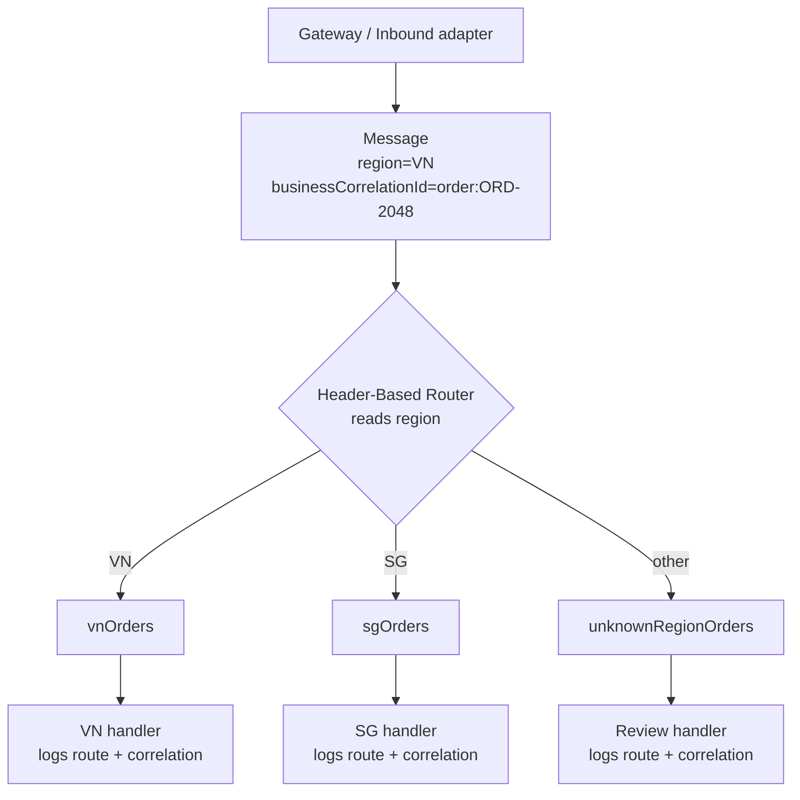
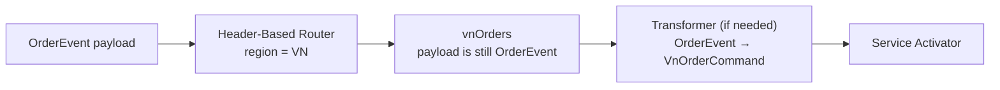
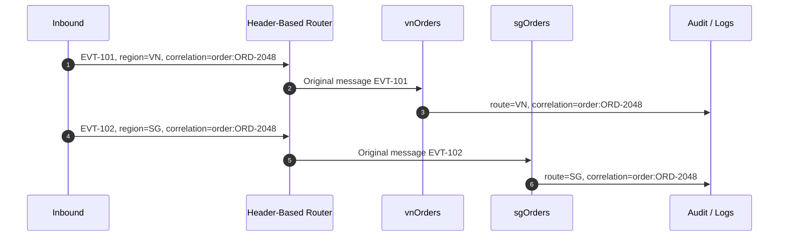
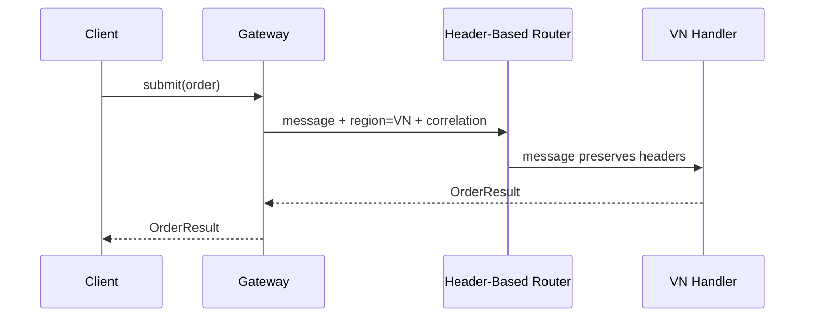
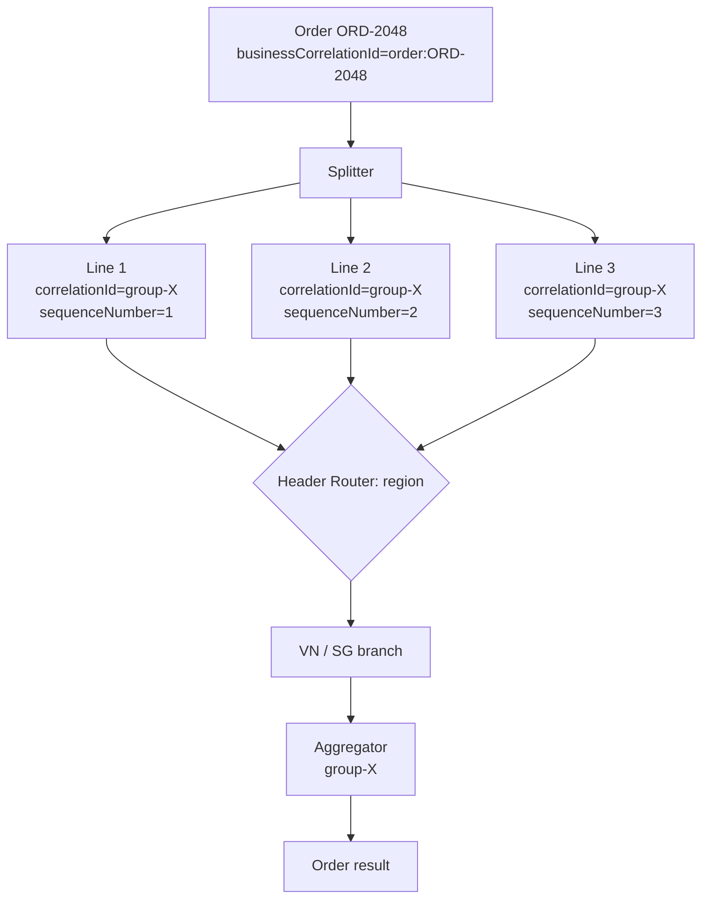
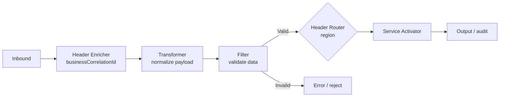

# Tracking Routes with Correlation Headers in Spring Integration

> **Chapter:** Header-based router  
> **Lesson:** Tracking Routes with Correlation Headers  
> **Context:** Building Enterprise Integration Patterns with Spring Integration to connect components via messages, coordinating Router, Filter, Transformer, Splitter, Aggregator, and Gateway; tracing flows, controlling retries, error channels, and correlation.

## 1. The problem: which branch did a message take?

A service receives order events from multiple stores. Each event may be routed to a domestic channel, an international region channel, or a manual review channel. Operations teams need answers to:

- Which branch did the Router send request `ORD-2048` to?
- Do two separate messages belong to the same order?
- When a handler fails and retries, can the retry logs be linked back to the original event?
- If a Splitter breaks an order into multiple lines and an Aggregator reassembles them, how do we avoid confusing group correlation with the ID used for business tracing?

A Header-Based Router decides the target from **message headers**, such as `region=VN`. To trace hops across the flow, we can propagate a stable correlation header—such as `businessCorrelationId=order:ORD-2048`—from ingress through downstream channels and handlers.



**Key takeaway:** the header driving routing (`region`) and the header linking steps (`businessCorrelationId`) play different roles. The Router reads `region` to pick a channel; endpoints downstream read the shared `businessCorrelationId` to stitch traces together. **Selecting a destination** does not guarantee the handler succeeded.

## 2. Distinguishing three identifier kinds in a message

When working with Spring Integration, the term "correlation ID" easily causes confusion because multiple IDs serve different purposes.

| Value | Purpose | Who manages it? |
| --- | --- | --- |
| `MessageHeaders.id` | Identifies a single message instance in Spring Messaging | Framework upon message creation |
| `businessCorrelationId` | Links events, logs, and outcomes belonging to the same business request | Set by the application per contract |
| `traceId` | Links spans in a distributed tracing system | Observability/tracing system |
| `correlationId` | Commonly used to **group** child messages for an Aggregator | Spring Integration/Splitter or declared correlation strategy |
| `sequenceNumber`, `sequenceSize` | Identifies position and count within a group | Splitter/framework or explicitly configured flow |

### Example of two messages for the same order

```text
Message A
  messageId             = 76c1...
  businessCorrelationId = order:ORD-2048
  traceId               = 4bf9...
  region                = VN
  payload               = OrderEvent(eventId=EVT-101, orderId=ORD-2048)

Message B
  messageId             = 8d32...
  businessCorrelationId = order:ORD-2048
  traceId               = 4bf9... or a different trace
  region                = SG
  payload               = OrderEvent(eventId=EVT-102, orderId=ORD-2048)
```

Both messages have **distinct message IDs** yet belong to the same order, so they can share `businessCorrelationId`. `traceId` may match within a single distributed transaction or differ if the two events originated from separate traces.

Do not try to override `MessageHeaders.id` to turn multiple messages into one. Nor should you arbitrarily overwrite the framework's standard `correlationId` as a business tracing ID when a Splitter/Aggregator is active in the flow.

**Convention used in this lesson:** use `businessCorrelationId` as the business header for audit and reconciliation; leave `correlationId` for grouping mechanisms used by the framework. Project-specific header names like `orderCorrelationId` or `workflowId` are fine as long as they are consistent and do not collide with technical headers.

## 3. How does a Header-Based Router pick a target?

A Header-Based Router is a Message Router that reads the value of a specified header and maps that value to one or more target channels per configuration.

Example:

```text
headers:
  region: "VN"
  businessCorrelationId: "order:ORD-2048"
  traceId: "4bf9..."

routing header = region
routing key    = VN
channelMapping = VN → vnOrders
destination    = vnOrders
```

Here:

1. `region` is the **routing header**.
2. `VN` is the **routing key**.
3. `vnOrders` is the **destination channel**.
4. `businessCorrelationId` is **tracing metadata**, not a routing input in this example.

If you change `businessCorrelationId` while keeping `region=VN`, the Router still picks `vnOrders`. Conversely, if `region` changes to `SG` while `businessCorrelationId` stays the same, the message routes to `sgOrders` yet remains queryable under the same order.

### A Router is not a Transformer

A Content-Based Router and a Header-Based Router may differ in where they look up routing criteria, yet both share the routing responsibility. A Router does not need to alter the payload to make this decision:



If a destination expects a specialized payload, place a Transformer on that branch. If correlation metadata needs to be added, use a Header Enricher or message construction at a trusted boundary. Never force a routing function to both choose a channel and mutate business objects.

## 4. Metadata contract before writing code

An observable system requires clear conventions for creating, preserving, and consuming headers.

| Header | Example | Rule |
| --- | --- | --- |
| `region` | `VN` | Normalized before the Router; used to pick the target |
| `businessCorrelationId` | `order:ORD-2048` | Stable across messages related to the same order |
| `eventId` | `EVT-101` | Distinguishes individual events and supports duplicate detection |
| `sourceSystem` | `checkout-api` | Set or verified by a trusted adapter |
| `traceId` | `4bf9...` | Obtained from tracing infrastructure when present |
| `correlationId` | Splitter group ID | Do not overwrite if an Aggregator is using it |
| `replyChannel` | Gateway-created channel | Let the Gateway/framework manage it |
| `errorChannel` | Error destination channel | Configured per sync/async execution semantics |

A linking ID needs a **trusted source, stable semantics, and sensible lifecycle**. For instance, a `businessCorrelationId` derived from a verified `orderId` suffices for order reconciliation. If two tenants' identifiers can collide, add a namespace or use a verified `tenantId + orderId` pair; never rely on a self-declared client tenant header for access control.

Avoid placing payment card numbers, access tokens, sensitive PII, or full payloads inside correlation headers. Headers frequently enter logs and message transports, so they also need data-protection policies.

## 5. Java DSL: routing by region while preserving correlation

This example uses Spring Integration Java DSL. The flow receives `OrderEvent`, reads the `region` header to route, and forwards the original message intact to one of three `QueueChannel`s.

In this lesson, `QueueChannel` makes Router outputs easy to **inspect in tests**. In production applications, each channel needs a consumer/poller or can be replaced with a `DirectChannel` wired to a Service Activator.

### 5.1. Configuring channels and flow

```java
package example.integration;

import org.springframework.context.annotation.Bean;
import org.springframework.context.annotation.Configuration;
import org.springframework.integration.channel.DirectChannel;
import org.springframework.integration.channel.QueueChannel;
import org.springframework.integration.config.EnableIntegration;
import org.springframework.integration.dsl.IntegrationFlow;
import org.springframework.messaging.MessageChannel;

@Configuration
@EnableIntegration
public class HeaderRoutingConfiguration {

    public record OrderEvent(
        String eventId,
        String orderId,
        String description
    ) {}

    @Bean
    public MessageChannel ordersInput() {
        return new DirectChannel();
    }

    @Bean
    public QueueChannel vnOrders() {
        return new QueueChannel();
    }

    @Bean
    public QueueChannel sgOrders() {
        return new QueueChannel();
    }

    @Bean
    public QueueChannel unknownRegionOrders() {
        return new QueueChannel();
    }

    @Bean
    public IntegrationFlow routeOrdersByRegion() {
        return IntegrationFlow.from("ordersInput")
            .route("headers['region']", spec -> spec
                .channelMapping("VN", "vnOrders")
                .channelMapping("SG", "sgOrders")
                .channelKeyFallback(false)
                .defaultOutputChannel("unknownRegionOrders")
                .resolutionRequired(true))
            .get();
    }
}
```

Explanation of key decisions:

- `.route("headers['region']", ...)` uses a SpEL expression reading the `region` header as the routing key.
- `channelMapping("VN", "vnOrders")` and the SG mapping assign channels for valid keys.
- `channelKeyFallback(false)` prevents undeclared keys from being used directly as internal channel names.
- `defaultOutputChannel("unknownRegionOrders")` diverts messages with unsupported regions to a dedicated handler.
- `resolutionRequired(true)` requires a destination to resolve; with a valid default channel, unknown keys resolve to the fallback destination.
- The Router neither alters nor overwrites `businessCorrelationId`, `traceId`, or payload.

**API note:** Java DSL provides `route(...)` overloads for SpEL, payloads, and Router components. This example uses the SpEL expression overload. When applying this in a project, verify your exact Spring Integration version to pick the right DSL style.

### 5.2. Sending messages with correlation headers

The entry point can be a Gateway, HTTP adapter, or message broker listener. This direct example shows how to construct a message once the ingress point has verified inputs:

```java
package example.integration;

import org.springframework.messaging.Message;
import org.springframework.messaging.support.MessageBuilder;

public final class OrderMessages {

    private OrderMessages() {}

    public static Message<HeaderRoutingConfiguration.OrderEvent> fromTrustedInput(
            HeaderRoutingConfiguration.OrderEvent event,
            String trustedRegion,
            String currentTraceId) {

        if (event == null || event.orderId() == null
                || event.orderId().isBlank()) {
            throw new IllegalArgumentException("Missing valid orderId");
        }
        if (trustedRegion == null || trustedRegion.isBlank()) {
            throw new IllegalArgumentException("Missing region");
        }

        return MessageBuilder.withPayload(event)
            .setHeader("region", trustedRegion)
            .setHeader("businessCorrelationId",
                "order:" + event.orderId())
            .setHeader("eventId", event.eventId())
            .setHeader("traceId", currentTraceId)
            .build();
    }
}
```

Here `trustedRegion` must come from a normalized/authenticated source. `currentTraceId` merely illustrates a trace ID supplied by an observability system; projects using Micrometer Observation or OpenTelemetry should rely on infrastructure propagation rather than manually minting new trace IDs at every step.

Because `businessCorrelationId` is derived consistently from `orderId`, two events for the same order can be queried by the same key even when they take different branches.

Sending example:

```java
var event = new HeaderRoutingConfiguration.OrderEvent(
    "EVT-101", "ORD-2048", "Order accepted");

var message = OrderMessages.fromTrustedInput(
    event, "VN", "trace-42");

boolean accepted = ordersInput.send(message);
```

`ordersInput` here is an injected `MessageChannel`. Because the flow enters via a `DirectChannel`, routing usually executes synchronously on the caller thread. `accepted` being `true` does not prove a business handler finished; in the demo, the message has only arrived in a `QueueChannel` and may still await a consumer.

## 6. Correlation flow when two messages pick two different branches

Let us send two events belonging to the same order:

```text
EVT-101 / ORD-2048 / region=VN / businessCorrelationId=order:ORD-2048
EVT-102 / ORD-2048 / region=SG / businessCorrelationId=order:ORD-2048
```

Expected outcome:



An audit report queried by `businessCorrelationId` sees two distinct routes for the same order:

| eventId | businessCorrelationId | route | Observed outcome |
| --- | --- | --- | --- |
| `EVT-101` | `order:ORD-2048` | `VN` | Message entered the VN channel |
| `EVT-102` | `order:ORD-2048` | `SG` | Message entered the SG channel |

These rows describe **channel handoff**. To confirm a handler succeeded, add signals from the downstream service/adapter, such as `processingCompleted`, database state, or broker acknowledgment.

### Correlation ID is not a routing key

Do not configure a Router to read `businessCorrelationId` just because you want to "track" routes. That header links logs. The example Router still reads `region`. If you want to partition load by order key to preserve ordering, that is a separate key-based partitioning problem requiring its own contract.

## 7. Where should the selected route be recorded?

If you only log at the **Router input**, you know the message arrived with `region=VN`, yet you have not proven it was sent to `vnOrders`. Logging at the **target channel** gives stronger evidence of the dispatch decision.

### Approach 1: logging inside the target branch handler

Example of a VN handler receiving the message and logging with correlation:

```java
import org.slf4j.Logger;
import org.slf4j.LoggerFactory;
import org.springframework.messaging.Message;

public class RegionalOrderHandler {

    private static final Logger log =
        LoggerFactory.getLogger(RegionalOrderHandler.class);

    public void handleVn(
            Message<HeaderRoutingConfiguration.OrderEvent> message) {

        var headers = message.getHeaders();
        var event = message.getPayload();

        log.info("route=VN eventId={} businessCorrelationId={} messageId={}",
            event.eventId(),
            headers.get("businessCorrelationId"),
            headers.getId());

        // Execute business logic.
        // Record a separate success event/status only after completion.
    }
}
```

For the handler to actually receive messages, `vnOrders` needs a suitable consumer. In the `QueueChannel` demo, attach a polling consumer. For an event-driven flow, replace `vnOrders` with a `DirectChannel` and wire a Service Activator `.handle(regionalHandler, "handleVn")` on the consuming flow.

### Approach 2: using a `ChannelInterceptor` on the target channel

When you need to observe **the moment a message is sent to a channel**, attach a `ChannelInterceptor` to the target channel. Standalone class example:

```java
import org.slf4j.Logger;
import org.slf4j.LoggerFactory;
import org.springframework.messaging.Message;
import org.springframework.messaging.MessageChannel;
import org.springframework.messaging.support.ChannelInterceptor;

public final class RouteAuditInterceptor implements ChannelInterceptor {

    private static final Logger log =
        LoggerFactory.getLogger(RouteAuditInterceptor.class);

    private final String routeName;

    public RouteAuditInterceptor(String routeName) {
        this.routeName = routeName;
    }

    @Override
    public Message<?> preSend(
            Message<?> message,
            MessageChannel channel) {

        log.info(
            "routeDispatchAttempt={} businessCorrelationId={} messageId={}",
            routeName,
            message.getHeaders().get("businessCorrelationId"),
            message.getHeaders().getId());

        return message; // Do not alter the message in flight.
    }
}
```

Attach the interceptor to the specific channel bean:

```java
@Bean
public QueueChannel vnOrders() {
    QueueChannel channel = new QueueChannel();
    channel.addInterceptor(new RouteAuditInterceptor("VN"));
    return channel;
}
```

This snippet is an **enhancement to the `vnOrders` bean from section 5**, not a second duplicate bean with the same name.

`preSend(...)` runs **before** the channel completes the send. That is why the log uses `routeDispatchAttempt`: it confirms the message reached the selected channel boundary, **not yet that the send succeeded**. To record completed sends, use `postSend(...)` and check the `sent` flag per the interceptor contract. Business completion must still be measured inside the handler or target system.

### Comparing three recording points

| Location | What is known for sure? | What is still unknown? |
| --- | --- | --- |
| Before Router | Message arrived with routing header | Which channel was actually picked and delivered to |
| Target channel | Router/flow attempted to send message into this channel | Whether the consumer completed business processing |
| End of handler | Handler reached the recording point; can report success/failure | Outcomes in external downstream systems if unverified |

A good logging design records explicit **stages**: `ROUTING_RECEIVED` → `ROUTE_DISPATCHED` → `PROCESSING_COMPLETED` or `PROCESSING_FAILED`, all sharing the same `businessCorrelationId`. If the handler retries, add an `attempt` or per-attempt `operationId` to distinguish retries.

## 8. Tracking with headers across a request-reply Gateway

A Gateway brings Java calls into a message flow. In request-reply mode, the Gateway expects a reply holding the chosen branch's outcome, usually via a framework-managed `replyChannel`.



When designing, distinguish:

- `businessCorrelationId` links business events.
- `replyChannel` specifies the request-reply return path.
- `errorChannel` specifies the error notification path where error handling applies.
- Spring Integration's standard `correlationId` may be used by another pattern to group messages.

**Never overwrite `replyChannel` with a correlation ID.** Nor should you manually hijack the framework's `correlationId` just for the Gateway to find its caller. Gateways and request-reply components manage reply routing with their own mechanisms.

If the target branch only pushes the message into a queue with no handler sending a reply, the Gateway can still hang until timeout. Keeping `businessCorrelationId` helps trace the request, yet does not manufacture a reply.

### Adding correlation when the source lacks one

An ingress adapter can build the header from a verified business ID, as in `OrderMessages.fromTrustedInput(...)`. When retaining an upstream-verified value, follow the rule "keep the trusted ID if present; mint one per contract only if missing." If every hop invents a brand-new ID, logs can no longer be stitched together.

Use a Header Enricher at the intake boundary to centralize this logic. In multi-tenant environments, add a tenant namespace or use globally unique IDs so two orders with identical IDs never tangle audit logs.

## 9. Separating business correlation from Aggregator correlation

This is the most critical detail when combining a Header-Based Router with **Splitter → Router → Aggregator**.

An order has three line items:

```text
Order ORD-2048
  line-1: region=VN
  line-2: region=SG
  line-3: region=VN
```

The Splitter emits three child messages. Spring Integration may attach grouping headers:

- `correlationId`: group key for the child messages.
- `sequenceNumber`: index within the group.
- `sequenceSize`: group size, when known.
- Additional metadata depending on flow and version.

The child messages can also retain `businessCorrelationId=order:ORD-2048` for operational lookup.



**Two kinds of correlation coexist:**

| ID type | Example | What is it for? |
| --- | --- | --- |
| `businessCorrelationId` | `order:ORD-2048` | Tracing the full order lifecycle, potentially across multiple requests |
| `correlationId` | `group-X` | Telling the Aggregator which child messages belong to the current group |

The two values do not have to match. One order can be split multiple times at different stages; each group has its own lifecycle and release strategy. If you force `correlationId` to equal `orderId` on every split without accounting for nested groups, two groups can collide or release prematurely.

### What to preserve at the Router

1. The routing function reads only `region` or the designated routing header.
2. Never overwrite `correlationId`, `sequenceNumber`, or `sequenceSize` just to "record the route."
3. Never silently drop a child message when the Aggregator is waiting for every item.
4. When a handler constructs a new message, preserve group metadata per contract.
5. Configure the Aggregator with release/timeout/expiry strategies suited for failed or late items.

If `unknownRegionOrders` receives a child message, it should emit a **structured error result** back toward the Aggregator or trigger controlled group failure rather than leaving the Aggregator waiting forever on a missing piece.

## 10. Correlation across Router, Filter, and Transformer

A real pipeline may include these stages:



At each step:

- **Header Enricher** adds metadata where source trustworthiness is known.
- **Transformer** transforms the payload while retaining required correlation metadata on the output message.
- **Filter** decides pass vs. drop; for critical messages, the reject branch should log a correlated outcome.
- **Router** picks a channel by header; it does not need to change payload or correlation.
- **Service Activator** executes business logic and can use correlation for logs, idempotency, or reconciliation.

It is easy to keep payloads consistent yet lose correlation if a custom component builds a new message and omits required headers. Integration tests should therefore assert **both payload and metadata** after each critical boundary.

### When a step constructs a new Message

Example of a custom Transformer working with `Message<OrderEvent>`:

```java
import org.springframework.messaging.Message;
import org.springframework.messaging.support.MessageBuilder;

public Message<String> summarize(
        Message<HeaderRoutingConfiguration.OrderEvent> source) {

    String summary = "Order " + source.getPayload().orderId();

    return MessageBuilder.withPayload(summary)
        .copyHeaders(source.getHeaders())
        .build();
}
```

This only shows copying needed headers when manually building a new message. In real applications, **never blindly copy all headers across external boundaries**: `replyChannel`, `errorChannel`, and sensitive fields have their own lifecycles. At outbound HTTP/Kafka/AMQP adapters, apply an appropriate header mapper/allowlist.

When a Transformer returns a plain payload (without manually building a `Message`), Spring Integration normally propagates appropriate headers onto the resulting message; still test the contract instead of assuming every adapter preserves identical headers.

## 11. Tracing correlation across asynchronous boundaries

Suppose the Router dispatches into an `ExecutorChannel` where handlers run on worker threads:

```text
Thread HTTP/Listener:
  messageId=A
  businessCorrelationId=order:ORD-2048
  -> Router: region=VN
  -> ExecutorChannel

Worker thread:
  receive message with businessCorrelationId=order:ORD-2048
  -> Handler
  -> Log/metric/business result
```

**Headers travel inside the message**, so the worker can read them as long as the message is handed off cleanly. However, `ThreadLocal` state such as MDC logging, transaction contexts, or security contexts **does not automatically follow across threads** merely because the message has a correlation header.

Two options commonly used together:

1. Inside the handler, read `businessCorrelationId` directly from `message.getHeaders()` and log explicitly.
2. If the project uses tracing/MDC, configure proper propagation (`TaskDecorator` or framework-supported observation mechanisms) and clear the context after each execution.

Never propagate `SecurityContext` or access permissions based solely on a client-supplied string header. Authorization inputs must be authenticated, and security context propagation requires security-layer solutions.

### Relationship with retries

A message may be reprocessed after a timeout. Both attempts should keep the same `businessCorrelationId` to link them to the same request, while adding per-attempt metadata:

```text
businessCorrelationId = order:ORD-2048
eventId               = EVT-101
route                 = VN
attempt               = 1
result                = TIMEOUT

businessCorrelationId = order:ORD-2048
eventId               = EVT-101
route                 = VN
attempt               = 2
result                = SUCCESS
```

Note at payment API layers: retries can cause duplicate side effects if the prior attempt actually succeeded while the response was lost. Correlation for logging **differs from idempotency mechanisms**; even if both derive keys from the same business ID, duplicate protection must still be enforced where side effects occur.

## 12. Unroutable messages and correlation

A Router must define a policy when `region` is blank, unsupported, or unmapped. For example, `region=TH` when configuration only covers `VN`/`SG`:

```text
routingKey = TH
mappings   = {VN -> vnOrders, SG -> sgOrders}
fallback   = false
default    = unknownRegionOrders
```

The message enters `unknownRegionOrders` **with its original `businessCorrelationId`**. This is helpful when requests require manual review:

```text
route=UNKNOWN
businessCorrelationId=order:ORD-2048
eventId=EVT-103
region=TH
action=MANUAL_REVIEW
```

If there is no default channel and `resolutionRequired=true`, the Router can raise an error when failing to resolve a destination. That error should also carry correlation in logs/error flows so it never turns into an untraceable exception.

### Do not confuse routing errors with downstream processing errors

| Symptom | Meaning | Where to inspect |
| --- | --- | --- |
| `region` fails to map | No matching channel found | Mappings, default, `resolutionRequired` |
| Channel selected, yet no subscriber | Dispatch is not consumed as expected | Subscribers/pollers and channel lifecycle |
| Queue receives message, yet consumer lags | Downstream processing slow or stalled | Poller/consumer/queue metrics |
| Handler ran, yet business step failed | Business/transport failure | Retries, error flows, idempotency |
| Correlation header lost after broker | Serialization/header-mapping boundary | Adapter config and contract |

A correlation header helps **locate a failure**, yet does not fix routing bugs, attach missing consumers, or persist messages across restarts on its own.

## 13. Correlation IDs across HTTP, Kafka, and AMQP

Inside one JVM, Spring Integration can pass the same message (or rebuilt messages with appropriate headers) across many channels. When crossing out to an external transport, check header limits and mapping mechanisms.

### HTTP

A REST adapter may receive headers like `X-Correlation-Id` or `traceparent`. Never trust arbitrary client values for security purposes. When using custom business correlation, define how HTTP headers map to `businessCorrelationId`, validate length/characters, and tie them to authenticated data.

### Kafka

Spring Messaging headers do not automatically map one-to-one to Kafka headers the way you might expect. Adapters and header mappers decide which headers are transmitted, how they are encoded/decoded, and their deserialized runtime types. Write producer-to-consumer integration tests confirming `businessCorrelationId` actually survives on the receiving side.

### AMQP

Similarly, broker message properties/headers and Spring Messaging have distinct conventions. If the environment uses a broker-level correlation ID, keep it distinct from `correlationId` used by Aggregators and from application business IDs. Choose explicit mappings to avoid name and semantic collisions.

**Do not use Java object identity to trace across transports.** After serialization and deserialization, the message/payload will be fresh objects. Rely on consistent correlation values, event IDs, and tracing metadata.

## 14. JUnit 5 tests: proving routes and correlation

These tests directly verify the channels in `HeaderRoutingConfiguration`. They confirm accurate routing, preserved correlation, and that two distinct messages can share the same business correlation.

```java
package example.integration;

import static org.junit.jupiter.api.Assertions.*;

import org.junit.jupiter.api.Test;
import org.springframework.beans.factory.annotation.Autowired;
import org.springframework.beans.factory.annotation.Qualifier;
import org.springframework.integration.channel.QueueChannel;
import org.springframework.messaging.Message;
import org.springframework.messaging.MessageChannel;
import org.springframework.messaging.support.MessageBuilder;
import org.springframework.test.context.junit.jupiter.SpringJUnitConfig;

@SpringJUnitConfig(HeaderRoutingConfiguration.class)
class HeaderRoutingTest {

    @Autowired
    @Qualifier("ordersInput")
    private MessageChannel ordersInput;

    @Autowired
    @Qualifier("vnOrders")
    private QueueChannel vnOrders;

    @Autowired
    @Qualifier("sgOrders")
    private QueueChannel sgOrders;

    @Autowired
    @Qualifier("unknownRegionOrders")
    private QueueChannel unknownRegionOrders;

    @Test
    void routeVnPreservesCorrelation() {
        var event = new HeaderRoutingConfiguration.OrderEvent(
            "EVT-101", "ORD-2048", "Accepted");

        Message<?> input = MessageBuilder.withPayload(event)
            .setHeader("region", "VN")
            .setHeader("businessCorrelationId", "order:ORD-2048")
            .setHeader("eventId", "EVT-101")
            .setHeader("traceId", "trace-42")
            .build();

        assertTrue(ordersInput.send(input));

        Message<?> output = vnOrders.receive(1_000);
        assertNotNull(output);
        assertSame(event, output.getPayload());
        assertEquals("order:ORD-2048",
            output.getHeaders().get("businessCorrelationId"));
        assertEquals("trace-42",
            output.getHeaders().get("traceId"));
        assertEquals("VN", output.getHeaders().get("region"));

        assertNull(sgOrders.receive(0));
        assertNull(unknownRegionOrders.receive(0));
    }

    @Test
    void twoRoutesCanShareBusinessCorrelation() {
        var vn = new HeaderRoutingConfiguration.OrderEvent(
            "EVT-102", "ORD-2048", "VN step");
        var sg = new HeaderRoutingConfiguration.OrderEvent(
            "EVT-103", "ORD-2048", "SG step");

        assertTrue(ordersInput.send(
            MessageBuilder.withPayload(vn)
                .setHeader("region", "VN")
                .setHeader("businessCorrelationId", "order:ORD-2048")
                .build()));

        assertTrue(ordersInput.send(
            MessageBuilder.withPayload(sg)
                .setHeader("region", "SG")
                .setHeader("businessCorrelationId", "order:ORD-2048")
                .build()));

        Message<?> outVn = vnOrders.receive(1_000);
        Message<?> outSg = sgOrders.receive(1_000);

        assertNotNull(outVn);
        assertNotNull(outSg);
        assertSame(vn, outVn.getPayload());
        assertSame(sg, outSg.getPayload());
        assertEquals("order:ORD-2048",
            outVn.getHeaders().get("businessCorrelationId"));
        assertEquals("order:ORD-2048",
            outSg.getHeaders().get("businessCorrelationId"));
        assertNotEquals(outVn.getHeaders().getId(),
            outSg.getHeaders().getId());
    }

    @Test
    void unknownRegionKeepsCorrelationOnDefaultRoute() {
        var event = new HeaderRoutingConfiguration.OrderEvent(
            "EVT-104", "ORD-2050", "New region");

        assertTrue(ordersInput.send(
            MessageBuilder.withPayload(event)
                .setHeader("region", "TH")
                .setHeader("businessCorrelationId", "order:ORD-2050")
                .build()));

        Message<?> output = unknownRegionOrders.receive(1_000);
        assertNotNull(output);
        assertSame(event, output.getPayload());
        assertEquals("TH", output.getHeaders().get("region"));
        assertEquals("order:ORD-2050",
            output.getHeaders().get("businessCorrelationId"));

        assertNull(vnOrders.receive(0));
        assertNull(sgOrders.receive(0));
    }
}
```

These are **integration tests for the Router and channels within the same Spring context**, not tests invoking payment APIs or Kafka. Because the tests use `QueueChannel`s with no pollers, messages stay in the queues for the tests to read directly.

`assertSame` proves the exact same payload object passed through the Router in this **minimal internal flow**. Once Transformers, serialization, or external adapters are introduced, assert value equality per the data contract rather than object identity.

### Additional critical scenarios to test

| Case | What to verify |
| --- | --- |
| Missing `region` header | Goes to default or raises a clear error per policy |
| Unsupported `region` value | Never enters an identically named channel bean outside mappings |
| Two distinct events on same order | Same `businessCorrelationId`, different event IDs |
| Two different orders | Correlation and business outcomes never cross-contaminate |
| Missing correlation header | Adapter/Enricher populates or rejects per contract |
| Service Activator fails | Error retains correlation and reaches the proper error flow |
| Crossing `ExecutorChannel` | Metadata remains intact on worker threads |
| Child messages from Splitter | `correlationId`/sequence stay intact for the Aggregator |
| Crossing a broker | Header mapper and deserializer preserve correlation values |

Never use fixed `Thread.sleep(...)` calls to test asynchronous flows. Use `CountDownLatch`, Awaitility, or bounded-timeout waits and verify final state.

## 15. Practical walkthrough: Splitter, routing, and per-line tracing

Suppose order `ORD-3001` has three lines, each needing to reach a handler according to `fulfillmentRegion`.

### Input contract

```text
Order
  orderId: ORD-3001
  businessCorrelationId: order:ORD-3001

Line-1: fulfillmentRegion=VN
Line-2: fulfillmentRegion=SG
Line-3: fulfillmentRegion=VN
```

A viable design:

1. At intake, set `businessCorrelationId` from the validated order.
2. The Splitter produces child messages with required grouping metadata.
3. If the Router keys on a header, populate/normalize `fulfillmentRegion` on **each child message** before the Router.
4. The Router selects VN/SG without modifying `businessCorrelationId` or grouping headers.
5. Each handler returns a structured outcome, including failure outcomes expected by the Aggregator.
6. The Aggregator groups outcomes using its correlation strategy and emits an `OrderFulfillmentResult`.
7. Record audit/metrics by `businessCorrelationId` and `eventId`, while also recording the group ID for batch processing.

Example logs:

```text
stage=SPLIT    businessCorrelationId=order:ORD-3001 groupId=g-01 seq=1
stage=ROUTE    businessCorrelationId=order:ORD-3001 groupId=g-01 route=VN
stage=COMPLETE businessCorrelationId=order:ORD-3001 groupId=g-01 seq=1

stage=SPLIT    businessCorrelationId=order:ORD-3001 groupId=g-01 seq=2
stage=ROUTE    businessCorrelationId=order:ORD-3001 groupId=g-01 route=SG
stage=COMPLETE businessCorrelationId=order:ORD-3001 groupId=g-01 seq=2

stage=AGGREGATE businessCorrelationId=order:ORD-3001 groupId=g-01 status=COMPLETED
```

This is purely illustrative logging; `groupId` represents technical group metadata and does not have to equal `order:ORD-3001`. Production systems should use a shared formatter/logging policy to avoid malformed logs or data leaks.

## 16. Common mistakes

### 16.1. Naming everything `correlationId`

If a single header serves as order ID, trace ID, Aggregator group key, and reply matcher, a single step overwriting it destroys traceability. Give distinct names to distinct roles: `businessCorrelationId` for business linking, `traceId` for tracing, and `correlationId` for grouping when used by the framework.

### 16.2. Minting a new ID in every handler

A message enters the Router with correlation A, becomes B in a Service Activator, and turns into C on retry. Logs for the same business operation splinter across unrelated chains. Keep the primary correlation stable; add `attemptId` or `operationId` for individual steps.

### 16.3. Logging "route succeeded" before the channel sends

`ChannelInterceptor.preSend` runs before dispatch, proving neither subscriber delivery nor handler execution. Log `dispatchAttempt` at that moment, and use `postSend` or downstream events/metrics for higher confidence levels.

### 16.4. Trusting client-sent correlation headers for authorization

A correlation ID is only linking metadata. It does not prove the sender owns the order. Always check principal, tenant, and business ownership at authenticated boundaries.

### 16.5. Losing headers in external adapters

A passing in-memory test does not guarantee Kafka/HTTP/AMQP preserves `businessCorrelationId`. Inspect mappers, serialization, and run end-to-end producer/consumer tests.

### 16.6. Mutating Splitter-created `correlationId`

If a Router or handler overwrites `correlationId`, the Aggregator may misgroup items or stall release. Preserve grouping metadata and configure the Aggregator's correlation strategy properly.

### 16.7. Assuming the Router generates correlation automatically

A Header-Based Router only picks a destination from a header; it does not invent a business correlation ID suitable for every workflow. Set the ID at the gateway/adapter/Enricher boundary where verified context exists.

### 16.8. Dropping child messages on unsupported regions

If the Router drops a child message belonging to a group with `sequenceSize=3`, the Aggregator may receive only 2 results. Use a default/error result or controlled timeout/expiry policy while retaining correlation for reconciliation.

## 17. Capstone exercise

**Context:** a support-ticket platform receives `SupportTicket(ticketId, region, priority)` from a Gateway and a message broker. A Router selects regional groups based on `region`. Two distinct ticket events can share the same `ticketId`.

**Requirements:**

1. Define a clear input contract for `SupportTicket` and the `region` header.
2. Assign `businessCorrelationId=ticket:<ticketId>` at a verified boundary.
3. Create a Header-Based Router with `VN` and `SG` mappings plus a default channel for unsupported regions.
4. Add auditing at destination channels recording `businessCorrelationId`, `eventId`, `route`, and processing stage.
5. Write a test where two events for the same ticket take two different routes yet share the same correlation.
6. Verify messages with an unknown region retain correlation along the default path.
7. Switch one branch to an `ExecutorChannel` and verify metadata on worker threads plus tracing propagation.
8. Simulate a service timeout, add bounded retries and idempotency, distinguishing attempt IDs from business correlation.
9. Simulate Splitter/Aggregator on child steps; prove `correlationId` and sequence headers are not overwritten.
10. If publishing messages to Kafka, write an integration test verifying correlation at the consumer.

### Expected results table

| Input | Route | Output correlation header |
| --- | --- | --- |
| `TICKET-1, region=VN` | `vnTickets` | `ticket:TICKET-1` |
| `TICKET-1, region=SG` | `sgTickets` | `ticket:TICKET-1` |
| `TICKET-2, region=TH` | `unknownRegionTickets` | `ticket:TICKET-2` |
| Same ticket, second retry | Routed per policy | Same business ID, different attempt |
| Child line from Splitter | Routed by its own header | Valid business ID and group correlation |

### Self-assessment questions

**Question 1:** Is `businessCorrelationId` the default routing key of a Header-Based Router?

*No. The Router reads whichever header is configured, such as `region`. Correlation links related messages and logs.*

**Question 2:** Why not use `MessageHeaders.id` as the shared key for every event of an order?

*Each message has its own ID; multiple events for the same order need a stable business linking key.*

**Question 3:** Why should you avoid overwriting `correlationId` when Splitter/Aggregator are in use?

*Because that ID may be the group key the Aggregator uses to assemble outcomes; altering it mixes groups or prevents completion.*

**Question 4:** If `preSend` on the VN channel logs an entry, does that prove business processing completed?

*No. It only records an attempt to send to the channel. Track post-dispatch outcomes and completion status inside handlers.*

**Question 5:** Can correlation headers still trace messages after crossing Kafka?

*Yes, provided adapters/mappers transmit them over the transport and consumers decode them properly; this must be configured and tested.*

## 18. Production deployment checklist

- **Identifiers:** clear conventions separating message ID, business correlation, tracing, and group correlation.
- **Metadata origin:** use only values verified/normalized at trusted boundaries.
- **Routing:** appropriate condition header; explicit mappings, default, and fallback.
- **Preservation:** preserve needed correlation across Router, Transformer, Gateway, and adapters.
- **Observability:** log chosen routes at the right points and distinguish dispatch from processing success.
- **Errors:** preserve correlation in error flows, retries, rejections, and default branches.
- **Aggregation:** never corrupt group `correlationId`, `sequenceNumber`, or `sequenceSize`.
- **Async:** never rely on unpropagated ThreadLocals; use message metadata and tracing framework support.
- **Transport:** test header mappers/serializers across HTTP/Kafka/AMQP.
- **Testing:** verify exact destinations, multi-event correlation, errors, retries, and child messages.
- **Security:** never turn correlation IDs into access credentials and never log sensitive data.

**Takeaway:** A Header-Based Router picks the **destination** from a header; correlation headers let us link the **processing journey** across multiple messages. Use a stable business correlation ID for business lookups, keep Splitter/Aggregator technical correlation dedicated to grouping, and record each router/handler stage clearly. That keeps Spring Integration branches easy to orchestrate, test, and observe without tangling routing, tracing, and message grouping.
