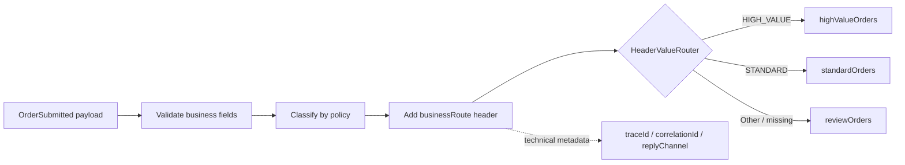
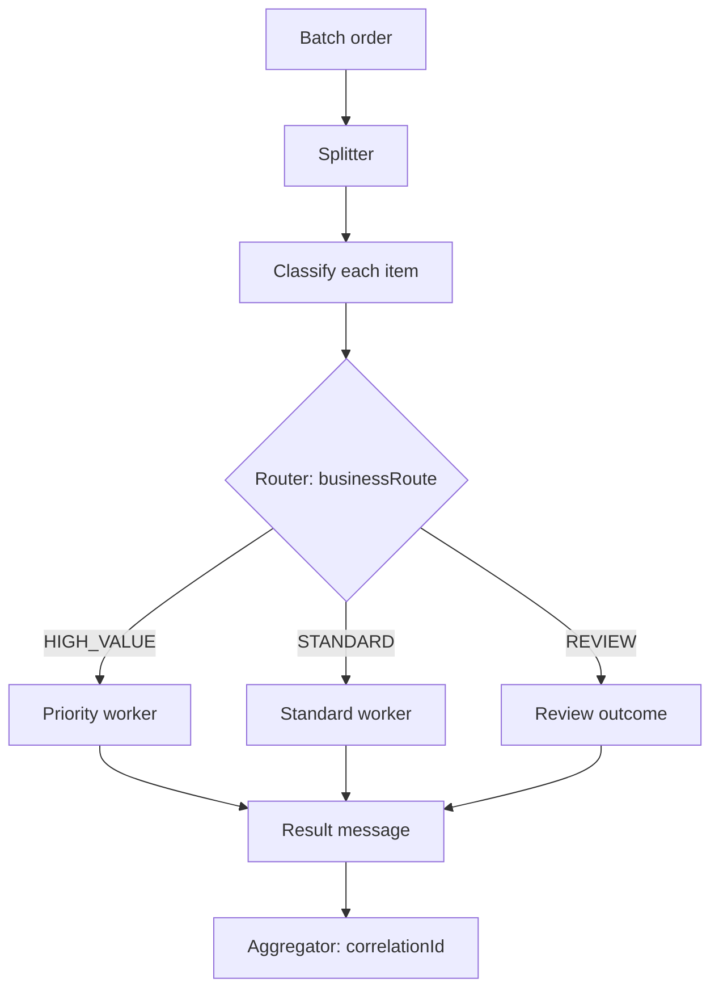
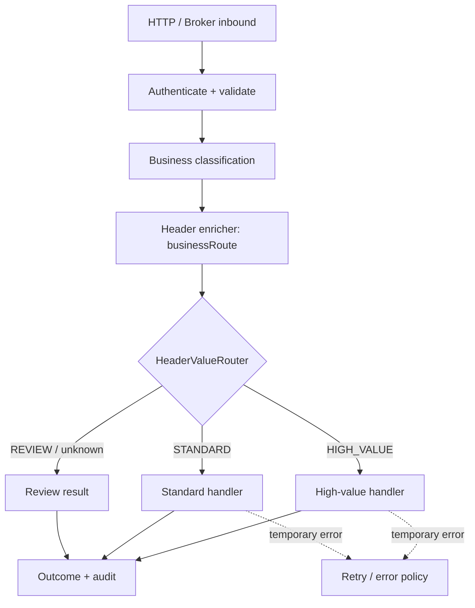

# Distinguishing Technical Headers from Business Headers

In **Spring Integration**, a message consists of a **payload** and **headers**. The payload generally represents the data being processed; accompanying headers help the system dispatch, correlate, observe, and explain processing context. However, **not every header is purely technical**. Some headers carry information used to route according to business rules, such as `businessRoute=HIGH_VALUE`, `fulfillmentRegion=VN_SOUTH`, or `processingClass=MANUAL_REVIEW`.

Distinguishing **technical headers** from **business headers** helps design a sound **Header-based Router**, preserve data across adapter changes, avoid confusing routing keys with correlation IDs, and prevent client-attached metadata from turning into system access privileges. This is the topic of the **Header-based router** chapter in the `SPRING_INTEGRATION_PATTERN` module: learning to implement Enterprise Integration Patterns (EIP) with Router, Filter, Transformer, Splitter, Aggregator, Gateway, retry, error channel, and correlation, while testing and observing branches so flows stay loosely coupled and extensible.

**Learning objectives:**

- State the purpose, lifecycle, and trust origin of technical headers vs. business headers.
- Classify fields such as `id`, `replyChannel`, `correlationId`, `traceId`, `businessRoute`, `tenantId`, and `eventType` in a concrete scenario.
- Decide which information must live in a **durable data contract** vs. metadata for a single processing pass.
- Set a **business routing header** from a validated payload, then use `HeaderValueRouter` to choose a channel without relying on internal framework headers.
- Handle missing, wrong-type, spoofed, and adapter-dropped headers; write tests proving both normal branches and fallbacks.

## 1. Two roles, not two separate Java header types

Spring Messaging provides `org.springframework.messaging.Message<T>` with `getPayload()` and `getHeaders()`. Inside `MessageHeaders`, both technical headers and application-defined headers are **key–value metadata entries**. Spring does not define a universal, automatic taxonomy called `TechnicalHeader` and `BusinessHeader` for all applications.

The distinction lies in **semantics and ownership**:

| Aspect | Technical header | Business / business-routing header |
| --- | --- | --- |
| Question it answers | "How is the message transported, traced, or orchestrated inside the flow?" | "Which branch should the message take under business policy?" |
| Typical creator | Framework, endpoint, channel, adapter, tracing infrastructure, or the application itself for operations. | Business classification component or **Header Enricher** step based on validated data. |
| Examples | `id`, `timestamp`, `replyChannel`, `errorChannel`, `correlationId`, `sequenceNumber`, `sequenceSize`. | Application-defined `businessRoute`, `fulfillmentRegion`, `processingClass`, `riskBand`. |
| Lifetime | Usually scoped to a single message creation/handoff, flow, or processing group. | May live only within one flow or require durable storage if the decision has lasting business value. |
| Across transport changes | May be regenerated, replaced, or omitted on the new transport. | Must **explicitly specify** whether it is mapped, recomputed, or stored in the event contract. |
| Primary risk | Misusing framework IDs/metadata as stable business data. | Trusting externally self-declared values, causing wrong branching or privilege bypass. |

Do not read this table as a rule that "technical headers are always created by Spring; business headers are always created by developers." A `traceId` added by the application still serves **technical observability**; a `businessRoute` computed by an automated step still carries a **business routing decision**. **Who created the header is not the sole criterion for classification.**

## 2. Example looking at a real message

Suppose an order-inspection flow receives a command. After validation and classification, the application adds a routing header to select a handler:

```text
Message<OrderSubmitted>
├── payload
│   ├── eventId           = "evt-8101"
│   ├── orderId           = "ORD-8101"
│   ├── customerId        = "CUS-12"
│   ├── amountCents       = 1500000
│   └── occurredAt        = 2026-11-21T03:00:00Z
└── headers
    ├── id                = message UUID
    ├── timestamp         = message creation time (if present)
    ├── businessRoute     = "HIGH_VALUE"
    ├── traceId           = "trace-abc"
    ├── correlationId     = "batch-52"
    ├── replyChannel      = reply channel (if present)
    └── errorChannel      = error channel (if present)
```

`eventId`, `orderId`, `customerId`, `amountCents`, and `occurredAt` describe **the business event and state**. They must be preserved in the payload or persisted/serialized event envelope whenever another consumer needs to interpret and replay the event.

`businessRoute=HIGH_VALUE` may be computed from `amountCents` and system policy. **This header does not change the amount or event type**; it expresses the **branching decision** at processing time. If policy is re-evaluated during replay, this value could be computed differently; pick a strategy and state it in the contract.

By contrast, `correlationId=batch-52` groups messages belonging to the same processing run; `traceId` aids log lookup; `replyChannel` indicates where to send replies. This metadata should never substitute for `orderId` or `eventId`.



## 3. Classifying common headers

### 3.1. Headers typically serving technical mechanisms

| Header / metadata field | Typical role | Confusions to avoid |
| --- | --- | --- |
| `id` | Spring message ID (normally assigned by the framework when building the message). | **Not** an order ID or a durable event ID across replays. |
| `timestamp` | Message creation timestamp, when populated. | **Not** business time `occurredAt`; may change when messages are rebuilt. |
| `replyChannel` | Target channel for replies in request–reply patterns. | Not a routing key for business flows; may be an internal channel reference. |
| `errorChannel` | Target channel for error handling in supported Spring Integration mechanisms. | Not a "business rejected" value to return to every caller. |
| `correlationId` | Groups related messages, especially in Splitter/Aggregator. | Does not automatically equal `orderId`, `eventId`, or route key. |
| `sequenceNumber` | Position of a message within a group when a pattern emits sequences. | Not a retry count or global system order. |
| `sequenceSize` | Group size in pattern metadata. | Does not auto-adjust if a Filter drops a child message. |
| `traceId` / trace context | Links logs and distributed traces per system conventions. | Only convention/framework-specific; not authentication proof. |
| `contentType` | Content-type hint for conversion/serialization where supported. | Not guaranteed to survive unchanged across every adapter. |

Headers like `id`, `timestamp`, `replyChannel`, and `errorChannel` have names and roles defined by Spring Messaging. Correlation/sequence headers are used by Spring Integration in corresponding EIPs. String `traceId` in the example is solely an **application convention**; tracing systems may use other fields/propagation formats (such as W3C Trace Context) and must be configured accordingly.

Never overwrite critical framework headers just to stuff business data inside. For example, setting `headers.id = orderId` breaks the separation between message lifecycle and order lifecycle; instead, store `orderId` in the payload, and if a header copy is needed, use a dedicated clearly named header.

### 3.2. Business headers used to select branches

| Custom header | Assumed semantics | Illustrative branch | Risks to manage |
| --- | --- | --- | --- |
| `businessRoute` | Classification result for needed processing type. | `HIGH_VALUE`, `STANDARD`, `REVIEW`. | Must align enum/strings and trusted creation source. |
| `fulfillmentRegion` | Region executing fulfillment. | `VN_NORTH`, `VN_SOUTH`. | May be contract data requiring durable storage if used for shipping settlement. |
| `processingClass` | SLA policy or review level. | `FAST`, `MANUAL_REVIEW`. | Never trust client-requested priority if paid or subject to screening. |
| `riskBand` | Risk tier assigned by business models/methods. | `LOW`, `MEDIUM`, `HIGH`. | Requires policy versioning, security handling, and audit explainability. |
| `tenantRoute` | Directive selecting pipeline for a verified tenant. | `TENANT_A_PIPELINE`, `TENANT_B_PIPELINE`. | Never replaces authentication/authorization or tenant data isolation. |

**The header names in this table are application-defined**, not a fixed list built into Spring. They are business headers because **their values carry a domain classification or decision**. If a decision has long-term significance, placing it only in an internal header may not suffice: persist it as a field in the event contract, a decision record, or durably transmitted metadata per agreed schema.

### 3.3. "Hybrid" fields to evaluate in context

A field does not automatically belong exclusively to one category in every system:

**`tenantId`:** If the tenant owns the data and is required to interpret the record, it belongs to **business context and security boundaries**; it may live in the data contract. A verified copy in a header can aid routing, yet a client-attached value is **not inherently trustworthy**.

**`eventType`:** Usually part of the **durable event contract** (e.g., `OrderCreated`, `OrderCancelled`). It can be copied into a header so a Router selects branches easily, yet should not live solely in headers if consumers re-read events from a broker or database.

**`priority`:** Can be a **business rule** ("customer bought express delivery"), or **technical dispatch priority** ("this message is processed first in a channel/queue"). These semantics are related yet not identical. Prefer explicit names like `serviceTier` and `dispatchPriority`, avoiding one ambiguous header governing both customer entitlements and queue scheduling.

**`sourceSystem`:** Can serve metrics and technical routing, or identify a business event's origin. Even when used as a route key, verify it at the intake boundary if it influences access control or branching.

## 4. Two questions more important than the header name

Instead of asking "is this a *business header* according to Spring?", answer:

1. **What does the value mean?** Does it describe a **business fact to preserve** or merely **how to process one message pass**?
2. **Who may create/modify it and how long does it live?** Can it be regenerated at a gateway, altered in a transformer, dropped at a broker, or forged by a client?

A practical decision matrix:

| When you need to… | Recommended design |
| --- | --- |
| Persist and accurately replay `orderId`, `amountCents`, `occurredAt`. | Put them in the payload/event contract; do not rely on an internal Spring header. |
| Hold an SLA route only for the current pass. | Compute `businessRoute` in a trusted classifier, attach to header, route via `HeaderValueRouter`. |
| Explain an SLA decision months later. | Store decision, timestamp, and `policyVersion` in durable audit/contract data. |
| Aggregate Splitter/Aggregator outcomes. | Use group-scoped correlation/sequence; never substitute business route for group key. |
| Return a reply to a Gateway request. | Keep reply/correlation mechanisms per request–reply pattern; never use business route names as reply destinations. |
| Dispatch requests across tenants. | Authenticate identity and verify tenant first, then mint routing metadata via an allowlist. |
| Trace a message across async/brokers. | Use transport-compatible tracing/context propagation; never assume a custom header crosses every adapter automatically. |

## 5. Java DSL: creating business headers without touching technical headers

This example shows the minimal end-to-end path: **payload holds business data**, **Header Enricher** computes `businessRoute`, and **`HeaderValueRouter`** selects the channel. The framework manages technical headers across endpoints itself; the application never touches `id`, `replyChannel`, or `correlationId` to perform routing.

### 5.1. Data model and classification rule

```java
record OrderSubmitted(String eventId, String orderId, long amountCents) {}

final class OrderRoutePolicy {

    private OrderRoutePolicy() {}

    static String route(OrderSubmitted order) {
        if (order.orderId() == null || order.orderId().isBlank()
                || order.amountCents() <= 0) {
            return "REVIEW";
        }
        return order.amountCents() >= 1_000_000 ? "HIGH_VALUE" : "STANDARD";
    }
}
```

`REVIEW`, `HIGH_VALUE`, and `STANDARD` are **application-defined values**, not Spring Integration states. For simplicity, the example classifies from existing fields; production systems must validate `eventId`, trusted origin, data integrity, and entitlement policies before treating the outcome as authoritative.

### 5.2. Building the flow with Header Enricher + HeaderValueRouter

```java
import org.springframework.context.annotation.Bean;
import org.springframework.context.annotation.Configuration;
import org.springframework.integration.channel.DirectChannel;
import org.springframework.integration.channel.QueueChannel;
import org.springframework.integration.dsl.IntegrationFlow;
import org.springframework.integration.router.HeaderValueRouter;

@Configuration
class BusinessHeaderRouterConfig {

    @Bean
    DirectChannel ordersInput() {
        return new DirectChannel();
    }

    @Bean
    QueueChannel highValueOrders() {
        return new QueueChannel();
    }

    @Bean
    QueueChannel standardOrders() {
        return new QueueChannel();
    }

    @Bean
    QueueChannel reviewOrders() {
        return new QueueChannel();
    }

    @Bean
    HeaderValueRouter businessRouteRouter() {
        HeaderValueRouter router = new HeaderValueRouter("businessRoute");
        router.setChannelMapping("HIGH_VALUE", "highValueOrders");
        router.setChannelMapping("STANDARD", "standardOrders");
        router.setChannelMapping("REVIEW", "reviewOrders");
        router.setChannelKeyFallback(false);
        router.setDefaultOutputChannelName("reviewOrders");
        return router;
    }

    @Bean
    IntegrationFlow orderRoutingFlow(HeaderValueRouter businessRouteRouter) {
        return IntegrationFlow.from("ordersInput")
                .enrichHeaders(headers -> headers.headerFunction(
                        "businessRoute",
                        message -> OrderRoutePolicy.route(
                                (OrderSubmitted) message.getPayload())))
                .route(businessRouteRouter)
                .get();
    }
}
```

**Explanation by responsibility:**

1. `ordersInput` is the entry point into the flow.
2. Header Enricher reads a payload **already permitted for processing** and computes `businessRoute` via `OrderRoutePolicy`.
3. `businessRouteRouter` reads that header and uses its mapping table to pick `highValueOrders`, `standardOrders`, or `reviewOrders`.
4. `setChannelKeyFallback(false)` prevents an unknown value from being tried as a **direct channel name**, reducing the risk of escaping the allowlist.
5. `setDefaultOutputChannelName("reviewOrders")` acts as fallback when no valid route resolves; the application must ensure this branch has an active consumer if requests need persistence or resolution.

`QueueChannel` in the example lets tests read messages at branch endpoints. It is **not a durable broker** and does not implement order fulfillment itself. In production, use channels/endpoints and delivery mechanisms suited to data criticality.

**Note on header names:** `businessRoute` is a **custom** header. Never misuse `id`, `timestamp`, `replyChannel`, `errorChannel`, or `correlationId` for this purpose because they carry their own technical semantics.

### 5.3. Creating an input message

```java
import org.springframework.messaging.Message;
import org.springframework.messaging.MessageChannel;
import org.springframework.messaging.support.MessageBuilder;

class OrderPublisher {

    void publish(MessageChannel ordersInput) {
        OrderSubmitted order = new OrderSubmitted(
                "evt-8101", "ORD-8101", 1_500_000);

        Message<OrderSubmitted> message = MessageBuilder.withPayload(order)
                .setHeader("traceId", "trace-abc")
                .build();

        ordersInput.send(message);
        // The producer does not need to attach businessRoute itself:
        // the enrichment step computes it from the processed business data.
    }
}
```

Upon arriving at `highValueOrders`, the payload is still `OrderSubmitted`; `businessRoute` was added by the flow. `traceId` is observability metadata and is **not** used to decide whether the customer belongs to the high-value tier. A successful `send()` only applies at the current channel boundary, **not** as proof that order processing completed.

## 6. Anti-patterns: using technical headers for business routing

### Mistake A — Using `correlationId` as a customer tier code

```java
// Do not use correlationId to represent an order value tier.
Message<OrderSubmitted> message = MessageBuilder.withPayload(order)
        .setHeader("correlationId", "HIGH_VALUE")
        .build();
```

A Splitter/Aggregator can use `correlationId` to **identify a group of messages belonging to the same processing batch**. If all high-value orders carry `correlationId=HIGH_VALUE`, the Aggregator risks mixing independent orders together. Keep processing group IDs properly scoped and use a separate header like `businessRoute` to pick branches.

### Mistake B — Using `replyChannel` as a business target channel

`replyChannel` carries the technical semantics of **request–reply**. Gateways or endpoints can use it to send responses back to the right caller. If an application overwrites `replyChannel` to `highValueOrders` just to route, a Gateway call's reply can be lost or misdirected. Use `HeaderValueRouter` with `businessRoute` for primary branching, **leaving the reply contract untouched**.

### Mistake C — Using `headers.id` as an event ID

`MessageHeaders.id` identifies one framework message instance, not a durable `eventId`. When a message is rebuilt, crosses an adapter, or replays, the new message's ID can differ. If deduplication relies on `headers.id`, the exact same event may be processed multiple times. `eventId` must live in the event contract or a durable data store.

### Mistake D — Using `traceId` as proof of authorization

A `traceId` header may be supplied by a client or adapter, missing, or spoofed. It exists for **observability**, not authentication. Routing a message to a refund branch merely because `traceId` carries some prefix is an unsafe design. For sensitive operations, authenticate identity and enforce permissions independently at ingress and handlers.

## 7. Business headers do not equal durable business truth

This is the easiest boundary to confuse: a header used for business routing **is not necessarily the canonical store of business data**.

Suppose `OrderSubmitted` has `amountCents=1_500_000`, and policy version `v1` sets `businessRoute=HIGH_VALUE`. A month later, policy `v2` changes the threshold. When replaying the same event, two goals differ:

| Replay goal | Suitable design |
| --- | --- |
| **Apply the new policy** to old orders. | Recompute `businessRoute` from validated payload, record new version, and control side effects. |
| **Reproduce the exact prior decision** for audit or compensation. | Persist `policyVersion`, classification outcome, and decision time in the event envelope or durable record. |
| **Send messages to another app** over a broker. | Specify clearly which fields belong in payload/serialized envelope vs. mapped transport headers. |

Example of a **serialized** event envelope storing decision and version when required by the contract:

```json
{
  "eventId": "evt-8101",
  "eventType": "OrderSubmitted",
  "orderId": "ORD-8101",
  "amountCents": 1500000,
  "occurredAt": "2026-11-21T03:00:00Z",
  "routingDecision": {
    "businessRoute": "HIGH_VALUE",
    "policyVersion": "v1"
  }
}
```

This is an **application data contract**, not a `MessageHeaders` format automatically generated by Spring. Inside a flow, you can extract `routingDecision.businessRoute` from the payload into a temporary header for `HeaderValueRouter` to route. That way **the source of truth lives in durable data**, while headers help internal endpoints operate cleanly.

## 8. Headers across adapters and system boundaries

Technical/business classification does not replace asking **whether the value actually crosses protocol boundaries**. Spring `MessageHeaders` lives inside the application; Kafka record headers, AMQP properties/headers, and HTTP headers have their own schemas, types, and constraints.

```text
Spring Message
  payload = OrderSubmitted
  headers = {businessRoute, traceId, correlationId, replyChannel, ...}
       |
       v
Outbound adapter / serializer / header mapper
       |
       v
External transport (Kafka, AMQP, HTTP, ...)
       |
       v
Inbound adapter / deserializer / header mapper
       |
       v
New Spring Message (payload + headers may differ)
```

Scenarios to account for:

- **Internal headers holding `MessageChannel` objects:** e.g., `replyChannel` may be an in-process channel reference; never assume it serializes intact to another service.
- **Unmapped custom headers:** `businessRoute` may vanish at the consumer if outbound/inbound mappers omit that name/type. Configure and test mappings or recompute routes from payloads.
- **Name or type changes:** transports may carry bytes/strings differing from the original Java type. Routers should use canonical value sets and explicit validation.
- **Tracing:** a manually set `traceId` header does not ensure tracing context propagates across every thread or adapter; use supported context propagation/tracing mechanisms.
- **Security:** sensitive fields must never be copied blindly into logs or transport headers. Define explicitly which fields may leave the boundary.

**Practical rule:** Whenever a business routing header is required for downstream consumers to behave properly, establish a **transport contract** or **reliable header recomputation rule** instead of assuming `MessageHeaders` survives untouched end-to-end.

## 9. Security: business headers can steer sensitive branches

A client might send `businessRoute=HIGH_VALUE`, `tenantRoute=TENANT_A_PIPELINE`, or `riskBand=LOW` to manipulate the execution path. If the system merely reads those values without verification, a routing header turns into a **bypass around business controls or tenant isolation**.

Critical safeguards:

1. **Authenticate at ingress** (HTTP, broker, gateway) and **authorize** the relevant operation/tenant.
2. **Compute or overwrite routing headers** from validated payloads and server policy. User-supplied headers are untrusted inputs to inspect, never trusted policy outcomes.
3. **Use a value → channel allowlist**, never arbitrary client-supplied channel names. With mapping routers, disable channel-key fallback when unnecessary.
4. **Re-check permissions in sensitive handlers**; reaching the right channel does not equal permission to issue refunds or read tenant data.
5. **Audit critical decisions** with policy version, business IDs, outcome, and verified source; avoid exposing PII/secrets in headers or metrics.

A technical header like `sourceSystem` is not automatically trustworthy either simply because its name sounds "infrastructure-related." **Trust boundaries depend on origin and verification mechanisms**, not technical vs. business labels.

## 10. Impact on Enterprise Integration Patterns

When a message traverses multiple patterns, each header category should keep its own responsibility:

| EIP / component | Related headers | Design notes |
| --- | --- | --- |
| **Header-based Router** | `businessRoute`, `fulfillmentRegion` | Read key from trusted policy; fall back on unknown values; never treat as authorization. |
| **Filter** | May evaluate technical or business headers conditionally. | Predicate returning `false` does not auto-create `ErrorMessage`; discard differs from exception. |
| **Transformer** | Typically transforms payloads; may create/retain/alter headers per endpoint. | Test propagation; do not drop critical correlation/reply metadata. |
| **Splitter** | Pattern-level `correlationId`, `sequenceNumber`, `sequenceSize`. | Never use `businessRoute` to distinguish child groups. |
| **Aggregator** | Correlation and release strategy. | If Router/Filter drops a child message, groups can stall; configure timeouts or explicit rejection results. |
| **Gateway** | `replyChannel`, error/reply correlation. | Every branch expecting a reply must satisfy the contract; Router does not send replies itself. |
| **Retry** | Attempt metadata, durable event ID. | Never use message ID as an idempotency key across redeliveries. |
| **Error flow** | `errorChannel`, `ErrorMessage`, exception context. | Never turn normal business rejections into technical errors unintentionally. |

### Example: routing by business rules while grouping by technical correlation



Within a three-item batch, two items might carry `businessRoute=HIGH_VALUE` and one `STANDARD`; all three still belong to **the same correlation group** if the Aggregator must assemble one batch outcome. If a branch drops an item without producing an outcome, `sequenceSize=3` can leave the Aggregator waiting forever. Design an `ItemRejected`/`ItemSkipped` outcome with matching correlation, or an explicit timeout/release policy; never overwrite `correlationId` with the route value just for routing convenience.

## 11. Testing: verifying the right headers and the right branches

Beyond unit tests for `OrderRoutePolicy`, integration tests must prove **the routing header is derived from payload**, **technical headers are not misused**, **messages reach the right channel**, and **fallbacks have a handling path**.

### 11.1. Unit testing the classification policy

```java
import static org.junit.jupiter.api.Assertions.assertEquals;

import org.junit.jupiter.api.Test;

class OrderRoutePolicyTest {

    @Test
    void classifiesValidAndInvalidOrders() {
        assertEquals("HIGH_VALUE", OrderRoutePolicy.route(
                new OrderSubmitted("evt-1", "ORD-1", 1_500_000)));
        assertEquals("STANDARD", OrderRoutePolicy.route(
                new OrderSubmitted("evt-2", "ORD-2", 500_000)));
        assertEquals("REVIEW", OrderRoutePolicy.route(
                new OrderSubmitted("evt-3", "ORD-3", -1)));
    }
}
```

### 11.2. Integration testing the Router flow

Example using `BusinessHeaderRouterConfig` from section 5, JUnit 5, and Spring Test:

```java
import static org.junit.jupiter.api.Assertions.assertEquals;
import static org.junit.jupiter.api.Assertions.assertNotNull;
import static org.junit.jupiter.api.Assertions.assertNull;
import static org.junit.jupiter.api.Assertions.assertTrue;

import org.junit.jupiter.api.Test;
import org.springframework.beans.factory.annotation.Autowired;
import org.springframework.beans.factory.annotation.Qualifier;
import org.springframework.integration.channel.QueueChannel;
import org.springframework.messaging.Message;
import org.springframework.messaging.MessageChannel;
import org.springframework.messaging.support.MessageBuilder;
import org.springframework.test.context.junit.jupiter.SpringJUnitConfig;

@SpringJUnitConfig(BusinessHeaderRouterConfig.class)
class BusinessHeaderRoutingFlowTest {

    @Autowired @Qualifier("ordersInput")
    MessageChannel input;

    @Autowired @Qualifier("highValueOrders")
    QueueChannel highValue;

    @Autowired @Qualifier("standardOrders")
    QueueChannel standard;

    @Autowired @Qualifier("reviewOrders")
    QueueChannel review;

    @Test
    void createsBusinessHeaderAndPreservesUnrelatedMetadata() {
        OrderSubmitted order = new OrderSubmitted("evt-1", "ORD-1", 1_500_000);
        assertTrue(input.send(MessageBuilder.withPayload(order)
                .setHeader("traceId", "trace-1")
                .build()));

        Message<?> routed = highValue.receive(1_000);
        assertNotNull(routed);
        assertEquals(order, routed.getPayload());
        assertEquals("HIGH_VALUE", routed.getHeaders().get("businessRoute"));
        assertEquals("trace-1", routed.getHeaders().get("traceId"));
        assertNull(standard.receive(0));
        assertNull(review.receive(0));
    }

    @Test
    void invalidAmountGoesToReviewInsteadOfBeingSilentlyDropped() {
        OrderSubmitted order = new OrderSubmitted("evt-2", "ORD-2", 0);
        assertTrue(input.send(MessageBuilder.withPayload(order).build()));

        Message<?> routed = review.receive(1_000);
        assertNotNull(routed);
        assertEquals(order, routed.getPayload());
        assertEquals("REVIEW", routed.getHeaders().get("businessRoute"));
        assertNull(highValue.receive(0));
        assertNull(standard.receive(0));
    }
}
```

`QueueChannel` serves as an observation target so the example does not need real business API calls. To run in a project, include Spring Integration/Spring Test/JUnit dependencies, an appropriate application context, and place sample classes in matching source folders. The tests above prove only the illustrated primary branches; they do not verify broker delivery/ACKs or business transactions.

### 11.3. A more complete test matrix

| Case | What must be verified |
| --- | --- |
| Valid payload with no initial `businessRoute`. | Enrichment creates the right route; Router sends to the proper channel. |
| Invalid payload. | Goes to `REVIEW` or error branch per contract; never defaults to success. |
| Client tries forcing `businessRoute=HIGH_VALUE` against policy. | Trusted component recomputes/overwrites or rejects; never lets clients pick branches. |
| Missing `traceId`. | Business routing still follows policy; observability applies appropriate fallback. |
| Valid correlation and sequence headers. | Routing neither uses them as route keys nor corrupts grouping. |
| Unknown/mistyped header at ingress. | Validation/normalization or fallback runs, emitting metrics. |
| Transformer/adapter rebuilds message. | Required fields survive or are mapped/rebuilt accurately. |
| Request–reply Gateway. | Reply reaches the right caller; `REVIEW` branch returns outcome or no-reply behavior per contract. |
| Splitter fans a batch across branches. | Aggregator gathers with matching correlation without hanging forever if an item is rejected. |
| Retry after transient failure. | Idempotency relies on a durable key; no duplicate side effects. |

## 12. Observability and operations: what should be logged?

When investigating an "order went to the wrong branch" incident, logging only `messageId` or `channel=highValueOrders` is rarely enough to find root cause. You need **business inputs**, **policy version**, **routing decision**, and **delivery outcome**.

Example structured log event:

```text
eventId=evt-8101 orderId=ORD-8101 policyVersion=v1
businessRoute=HIGH_VALUE selectedChannel=highValueOrders
traceId=trace-abc routingOutcome=ROUTED
```

This is an **illustrative application log format**, not automatic output generated by Spring. For metrics, you can track `router_received_total`, `router_routed_total{route="HIGH_VALUE"}`, `router_unmatched_total`, and `router_delivery_failed_total`, though you must instrument or configure observability accordingly.

Never use `orderId`, `eventId`, or `customerId` as metric labels due to **high cardinality**; and never unconditionally log payloads or headers containing personal data. When tracing across executors/reactive channels, verify context propagation rather than assuming every `ThreadLocal`/MDC follows threads automatically.

## 13. Comprehensive scenario: routing order fulfillment requests

An e-commerce system receives `OrderSubmitted` over HTTP and a broker. Business rules: high-value orders go to a dedicated branch; regular orders go to the standard branch; invalid data goes to review. At the same time, every branch must return an outcome if requests arrive from a Gateway, and multi-order batches must preserve correlation for Aggregator assembly. The broker can replay messages after a crash.

**Sensible metadata separation:**

| Data | Preferred storage/representation | Responsibility |
| --- | --- | --- |
| `eventId`, `orderId`, `amountCents`, `occurredAt` | Durable payload/event contract | Event semantics, replay, auditing, contract idempotency. |
| `businessRoute`, `policyVersion` | Temporary routing header; persist decision/version if audit requires. | Branch selection per policy. |
| `correlationId`, `sequenceNumber`, `sequenceSize` | Split/aggregate group metadata. | Accurate assembly of outcomes from the same processing run. |
| `replyChannel`, `errorChannel` | Message/endpoint orchestration metadata. | Correct request replies and error routing under supported mechanisms. |
| `traceId`/tracing context | Explicitly propagated observability metadata. | Tracing branches; never replaces permission checks. |

Reference flow:



**Hands-on exercises:**

1. Write a table defining **every header** in the flow: name, creator, data type, whether it is trusted, and whether it survives replay.
2. Suppose a client sends `businessRoute=HIGH_VALUE` while payload has `amountCents=100`. What must happen? **The trusted classifier must recompute or reject**, never allowing client headers to elevate routing treatment.
3. Suppose a Splitter creates four child messages and one is sent by a Router to `nullChannel`. What problem can an Aggregator expecting `sequenceSize=4` encounter? **It may receive only three results and stall indefinitely** without a timeout/release policy or substitute outcome.
4. Suppose a Kafka adapter does not forward `businessRoute` to the consumer. How do you prevent misrouting? **Configure an appropriate mapper or recompute the route from the durable event contract**, then test end-to-end.
5. Suppose a Gateway waits for a result while the `REVIEW` branch only logs. What will the caller receive? **No automatic business reply**; define either a rejection result or an explicit no-reply/timeout policy.

## Summary

- **Technical headers** serve message lifecycle, transport, replies, errors, correlation, sequences, or observability; **business headers** carry classification/routing decisions from application policy. This is a **semantic** distinction, not two separate Java types.
- **Names and creators do not strictly determine header category**: a custom `traceId` remains mainly technical, while an automatically computed `businessRoute` still expresses business policy.
- **Business data needing durable persistence** belongs in the payload/event contract or a schema-governed decision record; never count on an internal header surviving every replay or transport hop.
- **`HeaderValueRouter`** should consume routing headers produced from trusted sources, normalized values, allowlisted mappings, and explicit fallback branches; never replace business keys with `replyChannel`, `correlationId`, `id`, or `traceId`.
- With **Gateway, Splitter/Aggregator, retry, and error channels**, keep separate ownership for replies, correlation, idempotency, and errors; never mistake successful routing for completed business execution.
- **Test branches and adapter boundaries**, track the origin of routing decisions, and protect headers from spoofing or leaking sensitive data.
