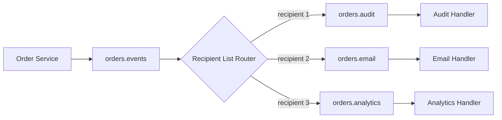
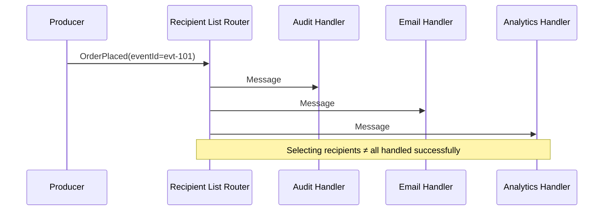
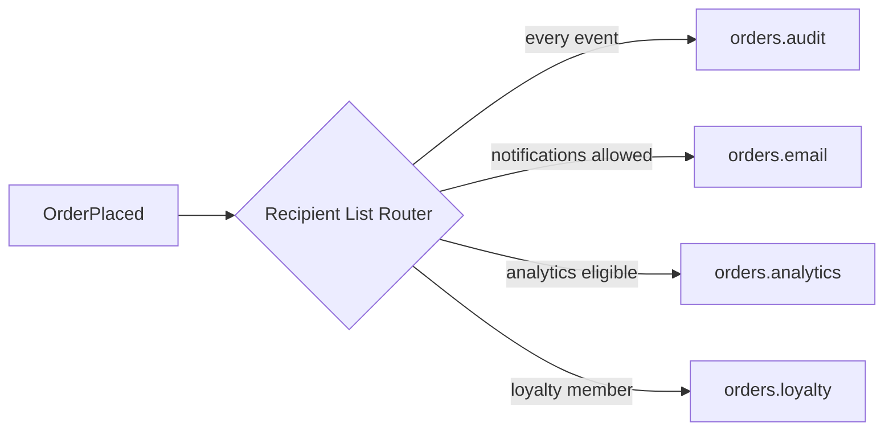
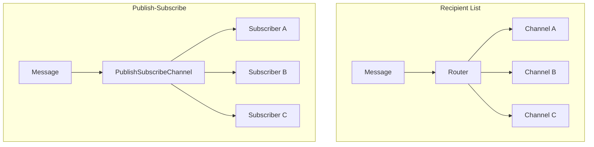
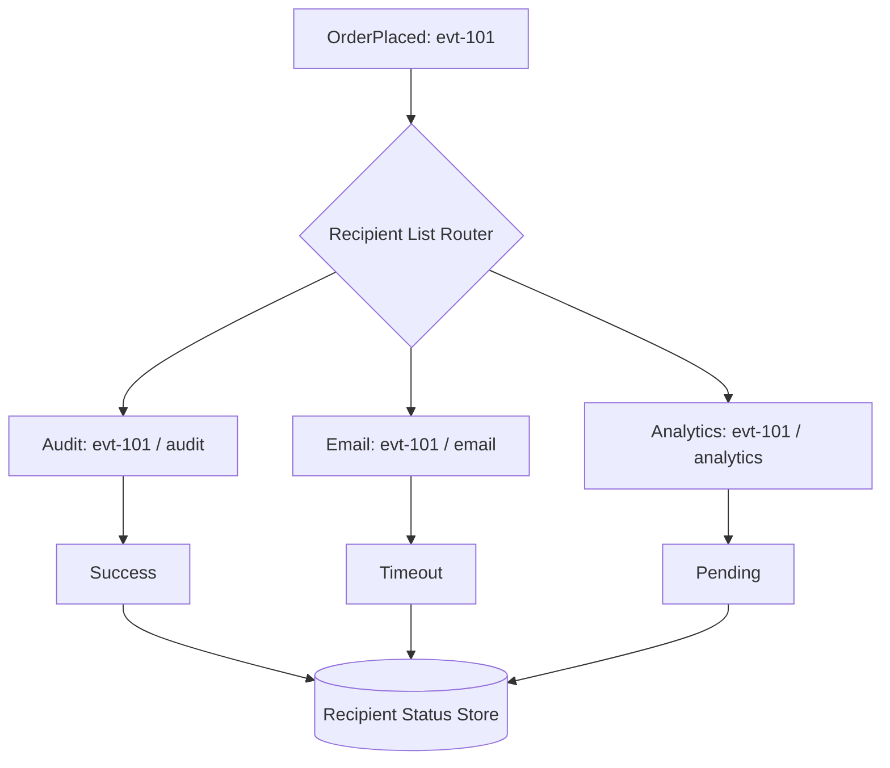
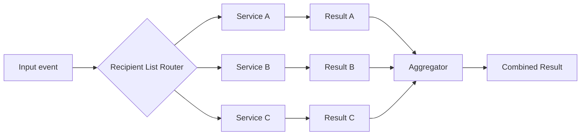
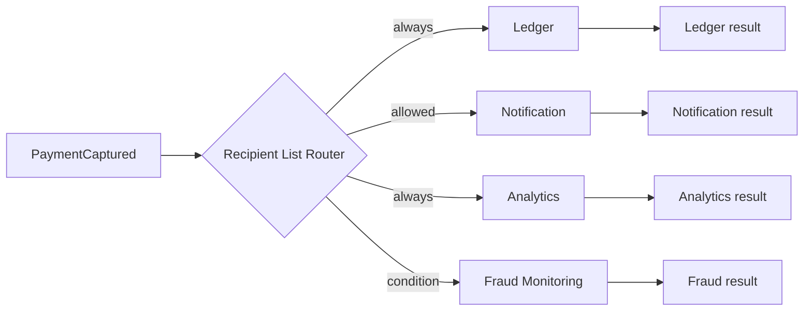

# Recipient List Router Sends One Message to Multiple Destinations

In Enterprise Integration Patterns (EIP), **Recipient List** is a routing pattern that sends **one message to a list of recipients**. Instead of choosing a single branch like a simple Content-Based Router, a Recipient List Router can distribute the same event to multiple components with independent responsibilities.

For example, after an order is placed successfully, the system might need to:

- Record the event for auditing.
- Send a confirmation email.
- Update the analytics system.
- Notify the loyalty program if the order meets the criteria.

All of those components may be interested in the same `OrderPlaced` event while performing different work. The producer does not need to call each service directly; a **Recipient List Router** is responsible for deciding the list of destinations to send to.

In the **SPRING_INTEGRATION_PATTERN** module, this is the foundation for building loosely coupled and extensible messaging flows with Spring Integration. This lesson focuses on how a **Recipient List Router sends one message to multiple destinations**, then connects it with Filter, Transformer, Gateway, Splitter, Aggregator, retry, error channel, correlation, testing, and observing each processing branch.

By the end of the lesson, you should be able to explain: how a Recipient List Router differs from a single-destination Router; where the recipient list is determined; whether sending to multiple destinations guarantees all succeed; and how to verify that each recipient has actually processed the message.

## 1. What is a Recipient List?

The **Recipient List** pattern receives a message, determines the **set of matching recipients**, and forwards the message to each recipient in that list.



An `OrderPlaced(eventId="evt-101", orderId="O-101")` message enters the router. According to the configuration, three recipients are selected: audit, email, and analytics. Each branch receives the message to perform its own work.

**One input can produce multiple deliveries**, though the number of recipients does not always have to be the same. The destination list can be:

- **Fixed:** every event goes to audit, email, and analytics.
- **Conditional:** add loyalty when the order belongs to a membership program.
- **Policy-driven:** the list is provided by a managed configuration or a recipient-selection step.

Depending on requirements, the list can be empty, have one destination, or have many destinations. If a message must reach at least one place, the system needs to **define and check** that condition instead of assuming the router always has recipients.

### Which object is multiplied?

From a business perspective, the **same event** is distributed to multiple places. This does not necessarily mean the framework deep-copies the payload into independent objects. When channels reside in the same JVM, the sent messages or message copies may reference the same payload object.

Therefore, prefer an **immutable** payload (for example, a Java `record` with suitably immutable fields) or create an independent copy if each handler needs to modify the data. One branch should not mutate an object shared with other branches.

## 2. Comparing Recipient List Router with Related Patterns

| Pattern or Mechanism | Primary Question | Meaning of Distribution |
| --- | --- | --- |
| **Content-Based Router** | Which business branch does this message belong to? | Usually selects one destination based on conditions, though routers in general can have multi-destination variants |
| **Recipient List Router** | Which recipients need to receive this message? | Can send the same message to **multiple destinations selected from a list** |
| **Publish-Subscribe Channel** | Which subscribers are registered with the channel? | Broadcasts the message to the channel's subscribers according to the configured dispatch mechanism |
| **Splitter** | Which elements inside one message need to be separated? | Produces **multiple child messages** from the content of a single message |
| **Aggregator** | Which messages belong to the same group to be combined? | Collects messages according to a correlation/release strategy, usually downstream |

Both Recipient List Router and Publish-Subscribe Channel can create **fan-out**, but their control models differ:

- With a Recipient List Router, the **destination list** is an explicit part of the routing decision, which can be declared statically or selected based on per-recipient conditions.
- With a Publish-Subscribe Channel, the producer sends to a channel; the channel distributes to the registered subscribers according to its mechanism.

Thus, the choice depends on where you want to place responsibility for managing destinations. If business policy determines recipients per message, Recipient List Router expresses that intent clearly. If multiple components subscribe to a shared published event, Publish-Subscribe Channel can be simpler.

**A Recipient List Router is not a Splitter.** In the case of order `O-101`, audit and email both receive information about **one order**. If an order has 20 line items that need separate processing, a Splitter is the component that divides it into 20 child messages; each of those child messages can still pass through a Recipient List Router later if fan-out is needed.

## 3. Actual Processing Flow and Three Distinct Success Milestones

When sending to multiple recipients, there are three different questions:

1. **Whom did the router select?** What is the recipient list for the message?
2. **Did the message reach each channel?** Which recipient dispatches succeeded, were rejected, or threw an exception?
3. **Did each handler complete?** Did the email destination send the email, did analytics record the data, and did audit save the record?



On **`DirectChannel`** channels, handlers can execute synchronously on the sending thread. If one handler throws an exception, whether subsequent branches execute and whether the exception propagates to the producer depend on dispatch order and error-handling configuration; do not assume all remaining recipients are still invoked.

If asynchronous channels such as `ExecutorChannel`, `QueueChannel`, or broker-backed adapters are used, accepting a message is usually **different** from completing processing. The producer may return while email or analytics has not even started running.

In particular, Recipient List Router **does not automatically create an atomic transaction** spanning all recipients. "Audit succeeded, email failed, analytics not yet processed" is a partial-failure state that the design must anticipate.

## 4. First Example with Spring Integration Java DSL

Let's build an integration flow that receives an `OrderPlaced` event and sends it to three independent handlers: audit, email, and analytics.

### 4.1. Defining the Message and Branch Contracts

```java
import java.math.BigDecimal;
import java.time.Instant;

record OrderPlaced(
    String eventId,
    String orderId,
    BigDecimal totalAmount,
    Instant occurredAt
) {}

interface AuditService {
    void recordOrderPlaced(OrderPlaced event);
}

interface EmailService {
    void sendConfirmation(OrderPlaced event);
}

interface AnalyticsService {
    void recordSale(OrderPlaced event);
}
```

`eventId` is the **event** identifier and should remain stable across replays. `orderId` is the **business** key. These two values support reconciliation and deduplication at each recipient.

If the services only need the same set of information, this record is a concise contract. In a real system, fields can be added under a managed schema; avoid passing sensitive data to every branch if a recipient does not need it.

### 4.2. Gateway, Channels, and Recipient List Router

```java
import org.springframework.context.annotation.Bean;
import org.springframework.context.annotation.Configuration;
import org.springframework.integration.annotation.Gateway;
import org.springframework.integration.annotation.IntegrationComponentScan;
import org.springframework.integration.annotation.MessagingGateway;
import org.springframework.integration.channel.DirectChannel;
import org.springframework.integration.config.EnableIntegration;
import org.springframework.integration.dsl.IntegrationFlow;
import org.springframework.messaging.MessageChannel;

@MessagingGateway
interface OrderEventGateway {
    @Gateway(requestChannel = "orders.events")
    void publish(OrderPlaced event);
}

@Configuration
@EnableIntegration
@IntegrationComponentScan
class OrderRecipientListConfiguration {

    @Bean("orders.events")
    MessageChannel orderEvents() {
        return new DirectChannel();
    }

    @Bean("orders.audit")
    MessageChannel auditChannel() {
        return new DirectChannel();
    }

    @Bean("orders.email")
    MessageChannel emailChannel() {
        return new DirectChannel();
    }

    @Bean("orders.analytics")
    MessageChannel analyticsChannel() {
        return new DirectChannel();
    }

    @Bean
    IntegrationFlow recipients() {
        return IntegrationFlow.from("orders.events")
            .routeToRecipients(spec -> spec
                .recipient("orders.audit")
                .recipient("orders.email")
                .recipient("orders.analytics"))
            .get();
    }

    @Bean
    IntegrationFlow auditOrders(AuditService audit) {
        return IntegrationFlow.from("orders.audit")
            .handle(OrderPlaced.class, (event, headers) -> {
                audit.recordOrderPlaced(event);
                return null;
            })
            .get();
    }

    @Bean
    IntegrationFlow notifyCustomer(EmailService email) {
        return IntegrationFlow.from("orders.email")
            .handle(OrderPlaced.class, (event, headers) -> {
                email.sendConfirmation(event);
                return null;
            })
            .get();
    }

    @Bean
    IntegrationFlow updateAnalytics(AnalyticsService analytics) {
        return IntegrationFlow.from("orders.analytics")
            .handle(OrderPlaced.class, (event, headers) -> {
                analytics.recordSale(event);
                return null;
            })
            .get();
    }
}
```

The application needs the Spring Integration dependency along with beans implementing `AuditService`, `EmailService`, and `AnalyticsService`. The gateway must be scanned by `@IntegrationComponentScan` or registered via an equivalent mechanism. The code snippet illustrates using the Java DSL with `routeToRecipients(...)` and a directly declared recipient list.

The gateway can be called from a business service:

```java
class OrderApplicationService {
    private final OrderEventGateway events;

    OrderApplicationService(OrderEventGateway events) {
        this.events = events;
    }

    void afterOrderCommitted(OrderPlaced event) {
        events.publish(event);
    }
}
```

The method name `afterOrderCommitted` indicates the intended call site after business data has been written successfully; the method itself **does not automatically provide** post-commit publishing or atomicity between the database and messaging. If events must not be lost, an appropriate transaction/outbox design is needed upstream.

### 4.3. Step-by-Step Flow

1. `OrderEventGateway.publish(event)` sends the event to `orders.events`.
2. The Recipient List Router reads the configured list of three recipients.
3. The router forwards the message to `orders.audit`, `orders.email`, and `orders.analytics` according to its dispatch mechanism.
4. Each channel has an endpoint that receives the message and invokes the corresponding service.
5. Because the channels are currently `DirectChannel`, execution normally occurs synchronously and handler errors can affect the send call.

The handlers return `null` to end one-way processing without producing a reply payload. This is an example of *fire-and-forget in terms of response contract*, but **does not mean asynchronous** when the underlying channels remain synchronous.

## 5. Fixed Recipients and Conditional Recipients

The list in Section 4 is **fixed**: all three recipients are selected for every `OrderPlaced`. In practice, the number of recipients may depend on the content.

For example:

- Audit receives **every** `OrderPlaced`.
- Analytics receives orders recorded as eligible.
- Email receives the event if the customer has a contact channel and allows notifications.
- Loyalty receives the event if the customer participates in the program.



There are two common design approaches:

**Declare a predicate for each recipient.** The Recipient List Router evaluates the corresponding condition and adds that channel to the destination list. Predicate/expression configuration APIs can differ across Spring Integration versions, so when moving to production code, use the exact DSL overload suited to your running version.

**Separate the decision step.** A pure business component computes the recipient list beforehand; the router or distribution step reads the **computed decision**. This approach is easy to test when policies are complex, when rule versions need to be recorded, or when a decision needs to be reused across retries.

Pseudocode describing the policy:

```text
recipients = ["orders.audit"]

if event.isEligibleForAnalytics:
    recipients += "orders.analytics"

if event.customerAllowsEmail:
    recipients += "orders.email"

if event.customerIsLoyaltyMember:
    recipients += "orders.loyalty"

dispatch(event, recipients)
```

This is **rule pseudocode**, not DSL syntax. Rules need to use trustworthy data with a clear contract. For example, email consent can change over time; if legal requirements demand applying the current state at send time, re-check it right before the side effect instead of relying solely on a flag inside an old event.

### Changing the recipient list while the system is running

Dynamic recipient configuration can be allowed, but you need to manage:

- The active **list/rule version**.
- Who has permission to add or remove a recipient.
- Whether the list is read as a **consistent snapshot** or can change between dispatches.
- Whether retries use the old list or the new list.
- Whether recipients are authorized to process the message under the payload/header contract.

If event `evt-101` already sent an email successfully and a retry after updating the recipient list sends the email again, that behavior must be deduplicated in the email handler. If a retry runs from before the router after a recipient was removed, that branch may no longer receive the message even though it failed previously.

## 6. Comparing Recipient List Router with Publish-Subscribe Channel

Both support fan-out, but they place variability in different locations.



| Question | Recipient List Router | Publish-Subscribe Channel |
| --- | --- | --- |
| Where is the destination list? | Router / recipient policy | The channel's set of subscribers |
| Select based on individual message content? | Convenient for configuring conditional recipients | Can combine selectors/filters or other steps, though not the channel's primary focus |
| Easy to add an independent recipient? | Add the recipient to the policy/router | Register a new subscriber on the channel per configuration |
| Supports multiple destinations | Yes | Yes |
| Asynchrony | Depends on target channels, executors, and endpoints | Depends on the PublishSubscribeChannel's executor configuration |
| Guarantees all succeed | Not out of the box | Not out of the box |
| When a specific recipient should only receive certain event types | Recipient policy expresses it clearly | Usually requires additional filtering/selection logic in the subscriber or before the channel |

**How to choose:** if the recipient list is a **business rule** that must be explainable per event, Recipient List Router fits well. If the main goal is **broadcasting an event to all subscribers** within the same application context, Publish-Subscribe Channel can be cleaner.

Neither pattern by itself provides durable brokering, exact-once delivery, process independence, or atomic transactions across multiple subscribers. Those properties must be designed through transport, message stores, and operational policy.

## 7. Partial Failure Risks When Sending to Multiple Destinations

This is the most important part when bringing Recipient List into a production system.

Suppose the router distributes to three branches—audit, email, and analytics:

```text
eventId = evt-101
    audit      -> SUCCESS
    email      -> TIMEOUT
    analytics  -> PENDING / UNKNOWN
```

From the producer's perspective, it is impossible to conclude that all work succeeded. Nor can it be concluded that the email definitely was not sent: a timeout can occur after the email system already received the request or performed the side effect.

### 7.1. No atomic multicast by default

The Recipient List Router forwards the message to multiple recipients using the corresponding channel and handler mechanisms. It **does not turn all downstream actions into a single shared transaction**. With many external systems, rolling back all operations is often infeasible.

An application should distinguish:

- **All branches must succeed before responding:** requires clear result coordination/aggregation, timeouts, and compensation policies.
- **Primary branch mandatory, secondary branches best-effort:** only the primary branch determines business status; secondary branches are observed and retried under their own SLAs.
- **Branches are independent and can be processed later:** consider broker/event infrastructure, durable subscriptions, or separate queues per recipient.

Sending one message to two additional channels does not automatically create any of those three semantics.

### 7.2. Synchronous errors can block remaining recipients

If `orders.audit`, `orders.email`, and `orders.analytics` are all `DirectChannel` instances and the audit handler throws an exception, the router's forwarding to subsequent recipients may be affected depending on send mechanics and exception handling. Never claim that "even if one recipient fails, all other recipients are guaranteed to receive the message."

You need to decide on a **per-recipient error policy** and verify it with integration tests. Depending on the version/router type, there may be configuration options for handling send failures; meanwhile, handler, channel, or transport errors must be handled properly at the execution boundary. A setting that ignores send errors does not automatically make all downstream side effects safe.

### 7.3. Asynchronous branching isolates timing, but adds operational obligations

If email takes 5 seconds and analytics takes 2 seconds, processing everything over synchronous channels can prolong the initial request. You can use `ExecutorChannel`, `QueueChannel`, or broker-backed adapters for the appropriate branches.

However:

- `ExecutorChannel` offloads work to an executor; you still must size capacity and handle errors occurring outside the calling thread.
- An in-memory `QueueChannel` uses a poller to receive messages; it does not automatically preserve messages across application restarts.
- A broker can provide durable storage, redelivery, and multi-consumer distribution as configured; you need to understand acks, retention, consumer groups, dead-letter handling, and potential duplicates.

**Asynchronous fan-out does not automatically equal reliable fan-out.** You must explicitly design **message durability**, **error handling**, and **per-recipient confirmation**.

## 8. Retry, Idempotency, and Each Recipient's Responsibility

An event may be redelivered due to a producer timeout, router or adapter retry, consumer restart, broker redelivery, or an operator-triggered replay. With fan-out, retries can cause some recipients to receive a message again even though they already succeeded.

Suppose the first-attempt statuses are:

| Recipient | Attempt 1 | If the entire message is fanned out again |
| --- | --- | --- |
| Audit | Recorded successfully | Risk of creating two records |
| Email | Unknown due to timeout | Risk of sending two emails |
| Analytics | Not yet processed | May receive for the first time or as a duplicate depending on the mechanism |

If you only know "the event needs a retry" without tracking **individual status per recipient**, the system has a hard time resending only where needed.

### 8.1. Idempotency keys must be scoped per recipient

A common strategy is to use the pair:

```text
(eventId, recipientId)
```

For example, `(evt-101, orders.email)` and `(evt-101, orders.analytics)` are two independent units of work. Each consumer stores a processed marker or protects the side effect with an appropriate key in the database/API. For databases, the deduplication record and the side effect should run inside an appropriate transaction if they share a transaction boundary.

Keeping an `eventId` only in memory is insufficient when multiple instances run in parallel or when a process restarts. Furthermore, for external email/payment providers, an internal record does not guarantee the provider did not execute the command before the connection timed out; you need a provider-supported idempotency key or a reconciliation mechanism.

### 8.2. Replay everything or only failed recipients?

Both options involve trade-offs:

**Replay the entire message:** simple on the producer side, but every recipient must tolerate duplicates and recognize already-completed work.

**Per-recipient replay:** maintain a work record or `PENDING/SUCCESS/FAILED/UNKNOWN` status for each recipient; replay only to the recipients that need processing. This adds state-management overhead but reduces impact on already-succeeded branches.

Example status record:

```json
{
  "eventId": "evt-101",
  "recipients": {
    "orders.audit": "SUCCESS",
    "orders.email": "UNKNOWN",
    "orders.analytics": "PENDING"
  }
}
```

This is an **illustrative business model**, not a status structure automatically created by Spring Integration. For it to be useful for crash recovery, it must be persisted durably and updated under appropriate transactions/acks.

### 8.3. Transactional Outbox when publishing events after commit

If the application saves an order to the database and immediately sends an event to multiple recipients, there is a risk that **the order commits while the event is never sent** if the process crashes between the two steps.

A common solution is to write an outbox record in the same transaction as the order data; a publisher reads the outbox and emits the event. When properly designed, this mechanism avoids missing events caused by dual writes, though the publisher may emit duplicates. Recipients must still be idempotent.

If the goal is to guarantee that every recipient receives the event, you must design **durable fan-out**: for example, storing events in a broker with appropriate subscriptions/consumer groups or maintaining a durable per-recipient task list. Having just one outbox event and an in-memory router does not prove all recipients have processed it.

## 9. Correlation, Path Tracking, and Completion Confirmation

When one message goes to multiple destinations, tracing requires two dimensions of information:

- **A shared ID** to know which event all branches originated from.
- **A branch/recipient ID** to know the outcome of each specific branch.



In Spring Messaging, `MessageHeaders` includes an ID and timestamp; however, correlation ID, recipient ID, and business event ID need an **explicit contract** if used for reconciliation. Do not assume the Spring message ID remains unchanged across all Transformers, adapters, and brokers.

### 9.1. Structured logging per recipient

A useful log template:

```json
{
  "event": "recipient_delivery_attempt",
  "eventId": "evt-101",
  "orderId": "O-101",
  "recipientId": "orders.email",
  "attempt": 2,
  "status": "STARTED",
  "correlationId": "checkout-101"
}
```

When an outcome is known, log another event such as `recipient_delivery_completed` or `recipient_delivery_failed` with the error code, duration, and relevant endpoint. Do not log the entire sensitive payload just to know which event was emitted.

A log line saying `"router selected 3 recipients"` does not prove the three recipients **completed**. You should track metrics for the number of selected recipients, send attempts, delivery errors, latency, and pending work items. Keep `eventId` in logs/traces or audits, and **do not put event IDs into metrics tags** due to high cardinality.

### 9.2. When is an Aggregator needed?

If the business requirement needs to **return a combined result after all recipients respond**, you can design an Aggregator downstream to receive results linked by a correlation ID.



However, **Recipient List Router does not automatically create three result messages** just because it sent three times. Downstream services must be designed to **emit results** to where the Aggregator consumes them. The Aggregator needs to know:

- The group's correlation ID.
- The expected recipient count or release condition.
- How to represent failures, timeouts, duplicate messages, and missing results.
- Where to store group state for long-running processing or across restarts.

If the audit/email branches simply finish with `void`, there are no results to aggregate automatically. To produce a combined report, you must change the contracts and flow rather than just attaching an Aggregator downstream and expecting it to know all recipients ran.

## 10. Error Channel and Fan-Out Error Classification

Different error cases must be treated differently:

| Error | Location | Handling Direction to Consider |
| --- | --- | --- |
| Payload missing `eventId` | Before router or validation | Reject per contract, avoid emitting to multiple branches |
| Unintended empty recipient list | Recipient selection step | Raise a policy error or send for review |
| Channel has no subscriber | Dispatch | Record dispatch failure, fix configuration/route |
| Audit handler fails synchronously | A DirectChannel branch | Determine impact on remaining recipients, inspect exception |
| Email API timeout | External handler/adapter | `UNKNOWN` status, retry/reconciliation, and idempotency |
| Queue consumer failure | Poller/listener | Retry/error channel/dead-letter per configuration |
| Analytics receives event again | Consumer | Idempotency or upsert by appropriate key |

An **error channel** is where an error-handling mechanism publishes an `ErrorMessage` per configuration. It differs from a **recipient channel** (business execution target) and a **discard channel** (messages dropped by a Filter). In synchronous processing with `DirectChannel`, exceptions can propagate back to the producer; merely defining an `orders.errors` bean does not automatically send all errors there.

When using executors, pollers, or external adapters, determine **who catches exceptions**, **who publishes ErrorMessage**, **when to retry**, **which errors go to dead-letter**, and **how recipient status is updated**. An error handler that logs and swallows an exception does not guarantee the recipient's requirement has been fulfilled.

### Deciding which branches are mandatory

In an order-event publishing system:

- **Audit** may be a mandatory obligation under internal policy.
- **Email** may tolerate delayed processing, as long as recovery is possible.
- **Analytics** may allow delays and replays.

If audit is mandatory and must not be lost, do not rely solely on a best-effort in-memory tap and assume it is saved. Define durability guarantees, retry strategy, and state handling when the audit service is down. This requirement is part of business/operations, not solved by the pattern name.

## 11. Testing Recipient List Router

Tests must verify **the right set of recipients is selected**, **how each branch receives the message**, and **behavior when one recipient fails**.

### 11.1. Test Matrix

| Case | Expectation |
| --- | --- |
| Valid event, fixed list | Audit, email, and analytics all receive the same `eventId` |
| Sending two distinct events | Each branch receives its corresponding event without mixing correlation |
| Conditional recipient does not match | Only branches satisfying the condition are selected |
| No recipient matches | Empty behavior is handled per policy, not assumed delivered |
| One handler throws an exception | Verify impact on caller and remaining branches under actual configuration |
| One async branch is slow | Producer/other branches do not falsely assert early completion |
| Replay an event already processed by audit | Audit does not write two semantically identical records if idempotency is required |
| Email times out after provider may have sent | `UNKNOWN` status and safe reconciliation/retry mechanism |
| Recipient list changes between two attempts | Test replay policy with snapshot/version if needed |
| Aggregator combines results | Releases only when correlation/completion conditions are met |

### 11.2. Synchronous Test with Mock Services

With the `DirectChannel` configuration in Section 4, you can write an integration test using mock beans for the three services. When calling the gateway with a valid `OrderPlaced`, verify:

```java
// Sketch of the test assertion part with Mockito:
OrderPlaced event = new OrderPlaced(
    "evt-101",
    "O-101",
    new java.math.BigDecimal("125000"),
    java.time.Instant.parse("2026-11-21T04:00:00Z")
);

gateway.publish(event);

verify(auditService, times(1)).recordOrderPlaced(event);
verify(emailService, times(1)).sendConfirmation(event);
verify(analyticsService, times(1)).recordSale(event);
```

The snippet above is an **illustrative test body**: `gateway` and the mocks are provided by Spring Test/JUnit/Mockito in a test fixture, not a standalone immediately compilable test class. With synchronous channels, asserting right after the call is generally appropriate when all handlers finish normally.

You also need to test when a handler throws an exception. Do not only assert that an exception is thrown: check **which branches ran and which did not**, and compare against the business policy. Exact ordering/dispatch depends on router and channel configuration.

### 11.3. Asynchronous and Broker Testing

With `ExecutorChannel` or `QueueChannel`, await conditions within a bounded timeout instead of asserting all handlers ran immediately after `send`. With brokers and independent consumers, integration tests should also check:

- Serialization/schema and header mapping.
- Ack, redelivery, retry, and dead-letter handling.
- Whether one message reaches **every required consumer group** per transport semantics.
- Idempotency when the same `eventId` reappears.
- Recovery after restart while messages are pending.
- Correlation/trace IDs persisting across boundaries.
- Per-recipient results being stored properly and queryable.

## 12. Common Pitfalls

**"Recipient List Router only sends to one branch."** That describes a single-destination router. A Recipient List Router aims to send to a **list of recipients**; one message can enter multiple branches.

**"Sending to three channels means three handlers finished."** The number of selected recipients does not prove the number of completed tasks, especially with queues/brokers.

**"Recipient List Router automatically creates a safe object copy for each branch."** Within one JVM, payloads can share references. Prefer immutable payloads or copy as needed.

**"If one handler fails, the router definitely still sends to every other handler."** You must understand dispatch, exceptions, error handling, and recipient ordering. There is no universal guarantee like that.

**"Fan-out is an atomic transaction."** Recipients usually have independent side effects; you need policies for partial failure, idempotency, and compensation/reconciliation where appropriate.

**"Publish-Subscribe Channel and Recipient List Router are the same."** Both can fan out, but they differ in where recipients are managed and how conditions are modeled.

**"Splitter is a form of Recipient List."** A Splitter breaks one message into multiple child messages; a Recipient List distributes one message to multiple destinations.

**"Retrying from the beginning is fine because it is just one event."** Full retries can cause duplicate emails or duplicate updates. Track `eventId` alongside `recipientId` and design idempotent side effects.

**"Having an error channel means every failed branch retries automatically."** An error channel transports error information when configured; retry, dead-letter handling, and durable storage must be designed separately.

**"Adding a recipient is just adding a channel."** A new recipient must understand the data contract, have appropriate authorization/security rules, monitoring, retry, capacity, and independent tests.

## 13. Design Exercise: One Event, Multiple Obligations

An e-commerce platform emits a `PaymentCaptured` event after payment is confirmed. Requirements:

1. **Ledger:** record accounting entries, must never be lost.
2. **Notification:** send notification to the customer, allowed to process later.
3. **Analytics:** update reports, allowed to be slow.
4. **Fraud monitoring:** receive the event if the amount exceeds a threshold or belongs to a monitored group.

Design the Recipient List Router and downstream flows:



Answer for yourself:

1. Which conditions determine the recipient list? How is an empty valid recipient list handled?
2. Should the HTTP producer wait for all four branches to finish? Which contract drives that decision?
3. Why does ledger need stronger durability guarantees than analytics? At which boundaries are outbox or a broker appropriate?
4. If the notification was already sent but the router retries after a ledger timeout, how do you prevent duplicate notifications?
5. If fraud monitoring only needs large messages, do you place the condition in the Recipient List Router or in a separate Filter? What is the trade-off?
6. If you must display a status showing `PaymentCaptured` was processed by all recipients, which results will you store and aggregate? What correlation and completion policies does the Aggregator need?
7. Which metrics/logs/audits show that each recipient has received, is waiting on, failed, or completed processing?

A solid solution must distinguish **recipient selected**, **dispatched**, and **side effect completed**, while providing a policy for each branch when failures or replays occur.

## Key Takeaways

A **Recipient List Router** receives one message and distributes it to **a list of destinations**, either fixed or conditional. It clearly expresses when one event must trigger multiple independent responsibilities in Enterprise Integration Patterns.

In **Spring Integration**, `routeToRecipients(...)` is the direct way to express this pattern in Java DSL. When designing it, choose the recipient list explicitly, avoid shared mutable payloads, distinguish Recipient List from Publish-Subscribe Channel and Splitter, and define synchronous/asynchronous semantics for each branch. In real systems, you must test **partial failure**, retry, idempotency, correlation, error channels, and per-recipient observability; only then can fan-out flows scale while keeping behavior under control.
