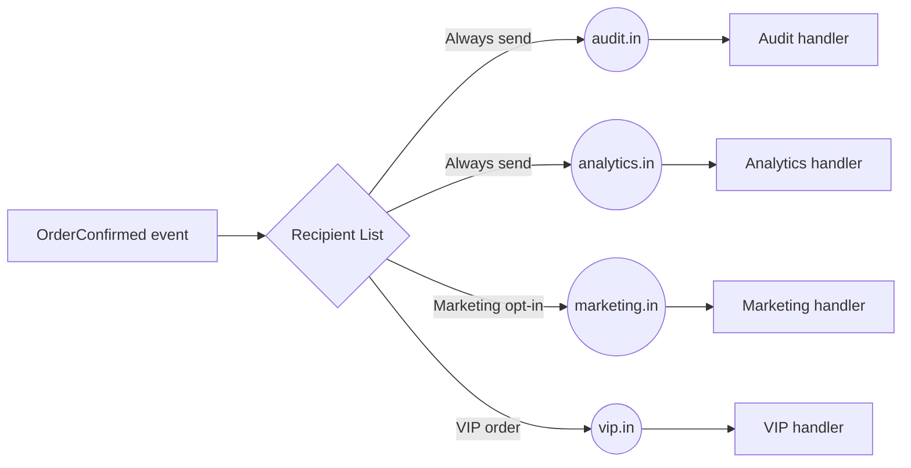
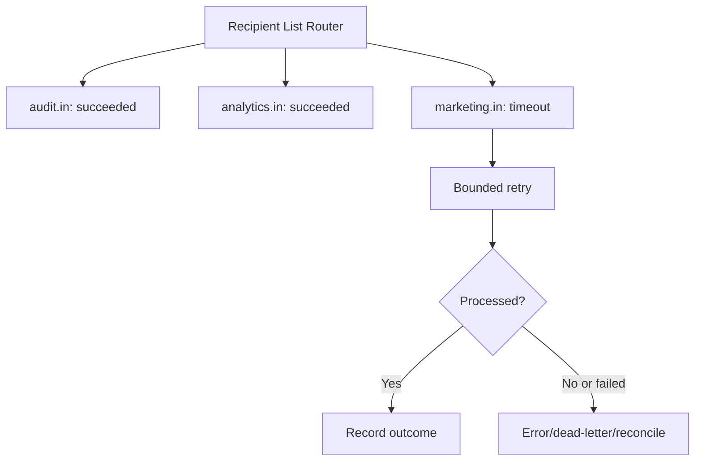

# Fixed and Dynamic Recipient Lists

> **Chapter:** Recipient list  
> **Module:** `SPRING_INTEGRATION_PATTERN` — learn to implement Enterprise Integration Patterns with Spring Integration to build loosely coupled, extensible messaging flows; practice Router, Filter, Transformer, Splitter, Aggregator, Gateway, retry, error channel, correlation, testing, and per-branch observability. This lesson focuses on how to **select a set of recipients** that is either fixed or varies per message.

## 1. Learning Objectives

After this lesson, you will be able to:

1. Explain what **Recipient List** is and when a message needs to be sent to **multiple destinations** instead of a single channel.
2. Distinguish **fixed recipient lists**, **fixed candidate lists with conditional selection**, and **recipient lists computed dynamically at runtime**.
3. Compare Recipient List with **Content-Based Router**, **Publish-Subscribe Channel**, **Splitter**, and **Aggregator**.
4. Declare a Recipient List using **Spring Integration Java DSL**, and write policies to select recipients based on business content.
5. Handle zero-recipient cases, nonexistent recipients, failure of one out of multiple recipients, duplicate deliveries caused by retries, and correlation metadata across branches.
6. Test the exact set of receiving channels, delivery counts, and branches that were **not** selected; observe each branch without leaking sensitive data.

## 2. The Problem: One Event, Multiple Stakeholders

When order `ORD-801` is confirmed, the business may need to:

- Record an **audit** trail for every order.
- Update the **analytics** system for every order.
- Send a **marketing notification** if the customer opted into that type of notification.
- Notify the **VIP care service** if the order belongs to the VIP tier.

One input message may need to go to **two, three, or four channels**. If the producer calls each service directly, it has to know the destination list, sending conditions, retries, and failures of every destination. Every time a new stakeholder is added, the producer code has to change.

The **Recipient List** pattern from Enterprise Integration Patterns (EIP) separates **determining the recipient list** from **each recipient's processing**. The routing component determines which channels should receive the message; downstream endpoints subscribe to their respective channels to handle it.



**A message can be distributed to multiple recipients, but it is not automatically processed in parallel or delivered successfully to all of them.** Dispatch behavior, acknowledgment timing, and error handling depend on channel types, handlers, and external infrastructure.

## 3. How Does a Recipient List Work?

A Recipient List Router receives a message and determines the **set of destination targets** for that message. A recipient can be a channel or an endpoint receiving messages through a corresponding channel.

```text
Input message
   payload = OrderConfirmed(orderId="ORD-801", marketingOptIn=true, vip=false)
   headers = { correlationId: "ORD-801", source: "order-service" }
        |
        v
Recipient List decision
   recipients = [audit.in, analytics.in, marketing.in]
        |
        +----> audit.in
        +----> analytics.in
        +----> marketing.in

Not sent to vip.in because vip=false.
```

Each branch can have its own Filter, Transformer, Service Activator, outbound adapter, error channel, and retry policy. **The Recipient List only decides the destinations**; it does not implement business processing for each target.

### 3.1. Key Concepts to Distinguish

| Concept | Meaning | Example |
| --- | --- | --- |
| **Recipient** | Destination to which the Router intends to send a message | `audit.in` |
| **Candidate recipient** | Destination in the set eligible to be selected | `marketing.in` |
| **Recipient selector** | Condition deciding whether a candidate is chosen | `marketingOptIn == true` |
| **Recipient list** | Actual set of destinations selected for the current message | `[audit.in, marketing.in]` |
| **Channel mapping/resolution** | How a key or recipient name maps to an existing channel | `AUDIT` → `audit.in` |
| **Delivery outcome** | Delivery result for each destination | Enqueued, handler succeeded, or failed |

At internal boundaries, a message is typically forwarded with its existing payload/headers. **Do not assume the payload is deep-copied for each recipient**: if the payload contains mutable objects, one handler could mutate data referenced by another branch. Prefer immutable payloads or deliberate copying when needed.

## 4. Three Ways to Form a Recipient List

### 4.1. Fixed list: all destinations always receive

The recipient list is predefined in configuration and **every message entering the flow goes to the exact same set of targets**:

```text
OrderConfirmed -> Recipient List
                   |- audit.in
                   |- analytics.in
                   `- search-index.in
```

**When appropriate:** every event requires auditing, analytics, and search index updates. This approach is simple, easy to read in topology, easy to test, and requires minimal decision logic. However, adding or removing a destination still requires configuration changes or deployment according to your operational workflow.

### 4.2. Fixed candidate set, conditional recipient selection

The list of **potential receiving channels** is still declared ahead of time, but the **actual receiving set varies by payload/header**:

```text
Candidates: audit.in, analytics.in, marketing.in, vip.in

Event A: marketingOptIn=true,  vip=false
   -> audit.in, analytics.in, marketing.in

Event B: marketingOptIn=false, vip=true
   -> audit.in, analytics.in, vip.in

Event C: marketingOptIn=false, vip=false
   -> audit.in, analytics.in
```

This is a **conditional Recipient List**: targets are selected dynamically **per message**, yet no arbitrary unknown channels are created. This is usually the best choice when the set of destinations is finite and policies can be expressed with clear conditions.

### 4.3. Recipient list computed dynamically at runtime

In a multi-tenant system, a subscription configuration might store that tenant A wants events sent to audit and webhook A, while tenant B wants analytics and webhook B. **The recipient set is computed while processing the message**, potentially based on a configuration/registry that changes over time.

```text
OrderConfirmed(tenant=A)
   -> Recipient resolver / policy
   -> [audit.in, tenant-A-events.in]

OrderConfirmed(tenant=B)
   -> Recipient resolver / policy
   -> [audit.in, analytics.in, tenant-B-events.in]
```

**Important:** "dynamic recipient" does not mean accepting any arbitrary channel name from an HTTP header and sending directly to that bean. The registry must be controlled by the application, enforce an **allowlist**, verify tenant permissions, and filter out disabled recipients. If the number of channels genuinely changes at runtime, you also need lifecycle management, registration/unregistration, memory management, and monitoring; never assume returning a name string makes a channel appear automatically.

### 4.4. Comparing the Three Strategies

| Criterion | Fixed | Conditional Selection | Dynamic from Policy/Registry |
| --- | --- | --- | --- |
| Candidate set | Declared upfront | Declared upfront | Can change via runtime configuration |
| Per-message decision | Constant | Selectors on payload/header | Function/registry picks destination set |
| Complexity | Low | Medium | High |
| Testability | Fixed channel set | True/false condition matrix | Policy, permissions, registry, configuration changes |
| Main risks | All targets receive even when unnecessary | Wrong selector, missing metadata | Nonexistent target, tenant privilege leak, mid-flight config change |
| Typical choice | Mandatory audit + analytics | Preference-based notifications | Per-tenant subscription or routing registry |

## 5. How Recipient List Differs from Single-Destination Router, Publish-Subscribe, and Splitter

| Pattern | Intent | Typical Output Count | Example |
| --- | --- | --- | --- |
| **Content-Based Router** | Choose the matching branch based on content | Usually **one** channel | Urgent order **or** standard order |
| **Recipient List** | Choose the **set of recipients** matching the message | **0..N** per policy | Audit + analytics + marketing if opt-in |
| **Publish-Subscribe Channel** | Broadcast message to registered subscribers | Multiple subscribers per channel configuration | Broadcast `OrderConfirmed` event to interested consumers |
| **Splitter** | Split one payload into **multiple data parts** | Multiple messages with sub-payloads | Split an order into individual line items |
| **Aggregator** | Combine messages in the same group by correlation/release | Usually one result per group | Combine inventory check responses |

**Example:** Recipient List sends **the same event** to audit and marketing; Splitter creates **two messages with different payloads** from two line items. If the audit branch only needs the ID while marketing needs the customer name and contact channel, each branch can use its own Transformer **after recipients are selected**, rather than asking the Router to transform payloads for every destination.

`PublishSubscribeChannel` fits when you want to broadcast to subscribers of a channel, while Recipient List fits when **deciding exactly which recipients** are chosen is an important part of business logic. Both techniques can be combined: a Recipient List selects a publish-subscribe channel, which in turn distributes to its subscribers.

**Do not treat multiple subscribers on a `DirectChannel` as a broadcast:** that channel has point-to-point distribution semantics via its dispatcher; pick the EIP/channel that matches your fan-out goal.

## 6. Spring Integration Example: Fixed Recipients with Java DSL

This example uses Java 17+ and Spring Integration Java DSL. Once the application has the appropriate Spring Integration dependencies and configuration, you can define the event and integration flows: one for routing and the rest as illustrative consumers.

```java
record OrderConfirmed(String orderId, boolean marketingOptIn,
                      boolean vip) {}
```

```java
import org.springframework.context.annotation.Bean;
import org.springframework.context.annotation.Configuration;
import org.springframework.integration.annotation.Gateway;
import org.springframework.integration.annotation.IntegrationComponentScan;
import org.springframework.integration.annotation.MessagingGateway;
import org.springframework.integration.config.EnableIntegration;
import org.springframework.integration.dsl.IntegrationFlow;

@MessagingGateway
interface OrderEventGateway {
    @Gateway(requestChannel = "orders.events.fixed")
    void publishFixed(OrderConfirmed event);

    @Gateway(requestChannel = "orders.events.conditional")
    void publishConditional(OrderConfirmed event);
}

@Configuration
@EnableIntegration
@IntegrationComponentScan
class RecipientListConfiguration {

    @Bean
    IntegrationFlow fixedRecipients() {
        return IntegrationFlow.from("orders.events.fixed")
            // All three recipients are always selected.
            .routeToRecipients(r -> r
                .recipient("audit.in")
                .recipient("analytics.in")
                .recipient("search-index.in"))
            .get();
    }

    @Bean
    IntegrationFlow auditConsumer() {
        return IntegrationFlow.from("audit.in")
            .handle(message -> System.out.println(
                "AUDIT: " + message.getPayload()))
            .get();
    }

    @Bean
    IntegrationFlow analyticsConsumer() {
        return IntegrationFlow.from("analytics.in")
            .handle(message -> System.out.println(
                "ANALYTICS: " + message.getPayload()))
            .get();
    }

    @Bean
    IntegrationFlow searchIndexConsumer() {
        return IntegrationFlow.from("search-index.in")
            .handle(message -> System.out.println(
                "INDEX: " + message.getPayload()))
            .get();
    }

    @Bean
    IntegrationFlow conditionalRecipients() {
        return IntegrationFlow.from("orders.events.conditional")
            // Fixed candidates, membership varies per message.
            .routeToRecipients(r -> r
                .recipient("audit.in")
                .recipient("analytics.in")
                .recipient("marketing.in", "payload.marketingOptIn()")
                .recipient("vip.in", "payload.vip()"))
            .get();
    }

    @Bean
    IntegrationFlow marketingConsumer() {
        return IntegrationFlow.from("marketing.in")
            .handle(message -> System.out.println(
                "MARKETING: " + message.getPayload()))
            .get();
    }

    @Bean
    IntegrationFlow vipConsumer() {
        return IntegrationFlow.from("vip.in")
            .handle(message -> System.out.println(
                "VIP: " + message.getPayload()))
            .get();
    }
}
```

In an application with the gateway injected:

```java
orderEventGateway.publishFixed(
    new OrderConfirmed("ORD-801", false, false));

orderEventGateway.publishConditional(
    new OrderConfirmed("ORD-802", true, false));

orderEventGateway.publishConditional(
    new OrderConfirmed("ORD-803", false, true));
```

Expected results by **destination set**, not necessarily in log order across asynchronous systems:

| Event | Selected Recipient Set |
| --- | --- |
| `ORD-801` via `publishFixed` | Audit, analytics, search-index |
| `ORD-802` via `publishConditional` | Audit, analytics, marketing |
| `ORD-803` via `publishConditional` | Audit, analytics, VIP |

### 6.1. Reading the DSL Meaning Correctly

- `.routeToRecipients(...)` declares a **Recipient List Router** in the flow.
- `.recipient("audit.in")` selects the audit channel **unconditionally**.
- `.recipient("marketing.in", "payload.marketingOptIn()")` uses **SpEL** to decide whether to send to the marketing channel; the example payload is a Java record with the corresponding accessor.
- Those channel names are application-configured names; they are not external endpoints created automatically by the Router.
- Each separate consumer in the example only prints to the console, **which does not prove business work in an external service completed**.

**Security/business note:** `marketingOptIn` in the example assumes the value was **verified by the service that owns consent** before publishing the event. Never trust a client-supplied opt-in flag when sending communications subject to privacy regulations.

### 6.2. Fixed does not mean hardcoded forever

In production deployments, a fixed list can be declared via controlled configuration rather than hardcoded. The distinction is whether **membership for messages within a configuration version** varies. A fixed list can be updated when deploying a new version; a dynamic list can vary per message within the same running version.

## 7. Dynamic Recipients: Building a Policy That Returns a Channel Set

When conditions become more complex than a few selectors, extract destination selection into a **pure policy function**. This supports isolated testing, reuse, and recording decision rationale.

```java
import java.util.ArrayList;
import java.util.List;

final class RecipientPolicy {
    private RecipientPolicy() {}

    static List<String> select(OrderConfirmed event) {
        if (event == null || event.orderId() == null
                || event.orderId().isBlank()) {
            throw new IllegalArgumentException("Invalid order event");
        }

        List<String> channels = new ArrayList<>();
        channels.add("audit.in");
        channels.add("analytics.in");

        if (event.marketingOptIn()) {
            channels.add("marketing.in");
        }
        if (event.vip()) {
            channels.add("vip.in");
        }

        return List.copyOf(channels);
    }
}
```

Example of a **Router method** in Spring Integration returning the set of selected channel names:

```java
import java.util.Collection;
import org.springframework.integration.annotation.Router;
import org.springframework.stereotype.Component;

@Component
class DynamicRecipientRouter {

    // Used instead of a routeToRecipients flow on a dedicated input channel.
    @Router(inputChannel = "orders.events.policy")
    public Collection<String> selectRecipients(OrderConfirmed event) {
        return RecipientPolicy.select(event);
    }
}
```

In Spring Integration, a router can return a collection of channel names to route to multiple recipients. The example above assumes channels `audit.in`, `analytics.in`, `marketing.in`, and `vip.in` are already registered with appropriate handlers as in the earlier example. Do **not** attach both `@Router` and another DSL Router competing to read `orders.events.policy` unless the topology is intentionally designed for it.

### 7.1. Content-dynamic vs. registry-dynamic

The `RecipientPolicy.select` method above builds a **dynamic actual list**, though the channel names remain in source code. If recipients vary by tenant/subscription registry, a lookup service can return **logical keys** such as `AUDIT`, `ANALYTICS`, `TENANT_NOTIFICATION`; then a safe mapping step resolves keys to authorized channels. You should:

1. Verify tenant permissions and the registration data source.
2. Restrict target channels using an allowlist or trusted registry.
3. Deduplicate recipients if the registry returns duplicates.
4. Define behavior if a subscription is deleted while a message is sitting in a queue.
5. Provide a handling branch if a channel cannot be resolved or there are zero recipients.
6. Record `policyVersion`/`subscriptionVersion` if decision history must be reproducible.

**Never use a user-supplied channel name as an arbitrary destination.** Recipient List is a distribution mechanism, not an access-control bypass for every channel in the application.

## 8. Zero, One, or N Recipients

A Recipient List can yield multiple outcomes. Before implementation, decide whether **having zero recipients** is valid:

| Recipient Count | Example | Behavior to Define |
| --- | --- | --- |
| **0** | No subscriber registered for the event type | Drop with audit, park/store, send to fallback, or treat as error? |
| **1** | Only audit needs to receive | Deliver to audit per contract |
| **N** | Audit + analytics + marketing | Each recipient receives per channel semantics; track per-destination outcomes |

In the previous example, audit and analytics are always selected, so the result set is non-empty. With a fully dynamic Router, **do not assume zero recipients throws an error or is silently ignored by default**: check/configure the behavior of your Spring Integration version and write tests matching business policy.

## 9. Fan-Out Does Not Automatically Mean Successful Delivery to All Targets

Suppose the Recipient List sends to `audit.in`, `analytics.in`, and `marketing.in`. The first two targets finish processing, but the marketing target times out. You now have a **partial failure**: the message produced effects at some parties but not all.



Key points:

- **Receipt and processing order** may depend on configuration and channel types. Do not rely on log order in examples to guarantee cross-service ordering.
- If handlers are synchronous and one throws an exception, other recipients **may not have been dispatched yet**; verify actual behavior per configuration/version.
- If an executor or broker is used, the Router may succeed only at near-term delivery/scheduling while downstream fails later.
- There is no **global distributed transaction** guaranteed simply by using a Recipient List.
- Retrying the **entire** fan-out operation can cause duplicate deliveries to audit/analytics that already succeeded; typically you should retry **only on the failed branch**.

### 9.1. Idempotency upon redelivery

An `OrderConfirmed` event can be redelivered due to timeouts, restarts, or retries. Each consumer should have an appropriate idempotency/deduplication mechanism, such as `(eventId, consumerName)` or a well-defined business key. `MessageHeaders.id` can change when a message is rebuilt or traverses a broker, so **do not treat it as a business idempotency key**.

A downstream service sending email has different side effects from analytics incrementing metrics: both must define behavior when receiving the same event again. The email service can persist send state by event ID; analytics can upsert by business key so counts are not incremented twice.

### 9.2. When higher reliability is needed

For mandatory recipients, consider a message broker with per-consumer queues/subscriptions, a producer outbox, per-consumer retries, dead-letter queues, replay, and backlog monitoring. Delivery guarantees depend on end-to-end design, transactions, and per-consumer acknowledgments; you cannot infer **exactly-once business processing** from a single route call.

## 10. Correlation and Replies When Sending to Multiple Branches

A message typically carries a `correlationId` linking the entire order journey; messages forwarded to recipients should preserve required metadata per contract. When crossing adapters/brokers, headers may need explicit mapping and serialization.

```text
OrderConfirmed(eventId=evt-801, orderId=ORD-801)
    correlationId=ORD-801
         |
         +--> audit.in       (eventId=evt-801)
         +--> analytics.in   (eventId=evt-801)
         +--> marketing.in   (eventId=evt-801)
```

**Correlation is not idempotency.** Correlation links messages belonging to the same workflow; idempotency helps a single recipient avoid repeating side effects when receiving the same business event again.

### 10.1. What if recipients all return results?

A request–reply Gateway typically expects **one result** per its contract. A Recipient List can produce **multiple independent replies**; do not assume the Gateway will automatically merge them into one value.

If the business requires results from three services (for example, three price quotes), design **request → fan-out → collect correlated replies → Aggregator** with a release strategy, timeout, and missing-result handling. When a payload needs to be broken into independent tasks, **Splitter + Router + Aggregator** may fit better than a Recipient List sending the same message to multiple parties.

### 10.2. Per-recipient audit/correlation

For tracing, distinguish: the original event's `eventId`, the workflow's `correlationId`, the recipient name, the attempt count, and the recipient's processing outcome. Do not make `recipientName` a random part of `eventId` if the goal is recognizing the same event sent to multiple targets; you can use a processing key `(eventId, recipientName)` at the consumer.

## 11. Testing Fixed and Dynamic Recipient Lists

**Testing principle:** do not just assert that a channel received a message—assert the **exact set of channels**, the **delivery count**, and that **unselected channels received nothing**.

### 11.1. Test Matrix

| Scenario | Audit | Analytics | Marketing | VIP |
| --- | --- | --- | --- | --- |
| Fixed list audit + analytics + search-index | 1 | 1 | 0 | 0 |
| Conditional: `optIn=false`, `vip=false` | 1 | 1 | 0 | 0 |
| Conditional: `optIn=true`, `vip=false` | 1 | 1 | 1 | 0 |
| Conditional: `optIn=false`, `vip=true` | 1 | 1 | 0 | 1 |
| Conditional: `optIn=true`, `vip=true` | 1 | 1 | 1 | 1 |

For the fixed row, `search-index` must also receive **1 message** even though it is not shown as a column in the table. Real tests should cover every configured recipient, not only three or four monitored channels.

### 11.2. Integration Test Using QueueChannel to Collect Results

The following test uses `QueueChannel` instances as **in-memory message collectors** so production consumers are not needed. That way, the test knows exactly which channels received messages without relying on log ordering.

```java
import org.springframework.context.annotation.Bean;
import org.springframework.context.annotation.Configuration;
import org.springframework.integration.channel.DirectChannel;
import org.springframework.integration.channel.QueueChannel;
import org.springframework.integration.config.EnableIntegration;
import org.springframework.integration.dsl.IntegrationFlow;

@Configuration
@EnableIntegration
class RecipientTestConfiguration {

    @Bean("test.events")
    DirectChannel input() { return new DirectChannel(); }

    @Bean("test.audit")
    QueueChannel audit() { return new QueueChannel(); }

    @Bean("test.analytics")
    QueueChannel analytics() { return new QueueChannel(); }

    @Bean("test.marketing")
    QueueChannel marketing() { return new QueueChannel(); }

    @Bean("test.vip")
    QueueChannel vip() { return new QueueChannel(); }

    @Bean
    IntegrationFlow recipientFlow() {
        return IntegrationFlow.from("test.events")
            .routeToRecipients(r -> r
                .recipient("test.audit")
                .recipient("test.analytics")
                .recipient("test.marketing", "payload.marketingOptIn()")
                .recipient("test.vip", "payload.vip()"))
            .get();
    }
}
```

```java
import static org.junit.jupiter.api.Assertions.assertEquals;
import static org.junit.jupiter.api.Assertions.assertNotNull;
import static org.junit.jupiter.api.Assertions.assertNull;
import static org.junit.jupiter.api.Assertions.assertTrue;

import org.junit.jupiter.api.Test;
import org.springframework.beans.factory.annotation.Autowired;
import org.springframework.beans.factory.annotation.Qualifier;
import org.springframework.messaging.Message;
import org.springframework.messaging.MessageChannel;
import org.springframework.messaging.PollableChannel;
import org.springframework.messaging.support.MessageBuilder;
import org.springframework.test.context.junit.jupiter.SpringJUnitConfig;

@SpringJUnitConfig(RecipientTestConfiguration.class)
class RecipientRoutingTest {

    @Autowired @Qualifier("test.events") MessageChannel input;
    @Autowired @Qualifier("test.audit") PollableChannel audit;
    @Autowired @Qualifier("test.analytics") PollableChannel analytics;
    @Autowired @Qualifier("test.marketing") PollableChannel marketing;
    @Autowired @Qualifier("test.vip") PollableChannel vip;

    @Test
    void selectsExactlyThreeRecipientsForOptedInNonVipOrder() {
        OrderConfirmed event = new OrderConfirmed("ORD-801", true, false);

        boolean accepted = input.send(MessageBuilder.withPayload(event)
            .setHeader("correlationId", "ORD-801")
            .build());

        assertTrue(accepted);

        Message<?> auditMessage = audit.receive(1000);
        Message<?> analyticsMessage = analytics.receive(1000);
        Message<?> marketingMessage = marketing.receive(1000);

        assertNotNull(auditMessage);
        assertNotNull(analyticsMessage);
        assertNotNull(marketingMessage);
        assertEquals("ORD-801", auditMessage.getHeaders().get("correlationId"));
        assertEquals(event, marketingMessage.getPayload());

        assertNull(vip.receive(50), "VIP is not selected");
        assertNull(audit.receive(0), "No duplicate at audit");
        assertNull(analytics.receive(0), "No duplicate at analytics");
        assertNull(marketing.receive(0), "No duplicate at marketing");
    }
}
```

`receive(timeout)` returns `null` if no message arrives within the wait window. The test fixture executes **synchronously at the `DirectChannel` → `QueueChannel` boundary**; with executors or brokers, design timeout waits and isolate queue state between tests. This test verifies routing/channel dispatch, **not** that production consumers processed successfully.

### 11.3. Unit Testing Pure Java Dynamic Policy

For `RecipientPolicy.select(...)`, test:

- A basic event returns exactly `audit.in`, `analytics.in`.
- `marketingOptIn=true` adds only `marketing.in`, not VIP.
- `vip=true` adds only `vip.in`; when both flags are true, both are included.
- Invalid events are rejected before the Router uses the list.
- If a registry returns duplicates or disabled channels, the final list is handled per defined policy.
- A channel outside the allowlist cannot be selected, even if a message contains a header naming that channel.

For policies using a remote registry, mock configuration data as well as timeout/permission-denied scenarios separately. Do not treat a registry failure as "no subscribers" when reliable decision data is unavailable.

## 12. Per-Branch Observability and Performance Considerations

When fanning out to multiple recipients, the number of internal message deliveries can exceed the number of original business events. With 1,000 events and an average of 3 recipients, the system handles about 3,000 dispatches at those points. Never interpret per-channel send counts as unique order counts.

| Measurement Point | Suggested Signals | Avoid False Inferences |
| --- | --- | --- |
| Ingress | `eventId`, event type, total events | One event does not equal one delivery |
| Recipient List decision | Selected recipients, `policyVersion`, recipient count | A correct decision does not prove all recipients succeeded |
| Each target channel | Send count, dispatch errors, queue depth | Channel accepted does not mean business completed |
| Each consumer | Processing success/error, retry attempts, latency | Retry count differs from unique event count |
| Error/dead-letter | Failed recipient, cause, attempt count | Do not treat one branch's failure as failure of all branches |

You can use **ChannelInterceptor**, **Wire Tap**, logs, metrics, and tracing for observability, while keeping in mind:

- `eventId`, `orderId`, and `correlationId` belong in controlled logs/traces; they should not be metric tags due to high cardinality.
- Do not log raw payloads containing PII or customer tokens across all four recipients' logs.
- Do not invoke slow monitoring APIs directly inside the Router or hot channel callbacks; control backpressure and retention.
- Concurrent branch spans may need explicit trace context propagation; do not assume tracing headers survive every adapter/broker.
- The audit flow can be decoupled via an appropriate queue if auditing is slow, but determine durability and consistency requirements before choosing.

## 13. Common Anti-Patterns

| Anti-pattern | Consequence | Improvement |
| --- | --- | --- |
| **Producer calls every consumer directly** | Tight coupling, hard to add recipients | Move destination selection into Recipient List/contract |
| **Sending side-effect commands to multiple logical owners** | Duplicate actions such as creating shipments or charging cards | Pick one owner; fan out events only after the action completes |
| **Any channel can be targeted** | Data leak across tenants or to unauthorized targets | Allowlist, trusted policy/registry, source verification |
| **Trusting client-supplied `marketingOptIn`** | Sending messages without proper consent | Verify consent at the authoritative source |
| **Retrying entire fan-out on one recipient failure** | Succeeded recipients receive duplicates | Retry per branch, idempotent consumers, outbox if appropriate |
| **Assuming fan-out always runs in parallel** | Wrong latency/ordering assumptions | Choose channel/executor/broker and measure actual behavior |
| **No policy for zero recipients** | Messages silently dropped or unexpected errors | Explicitly specify fallback, audit/drop, or fail |
| **Shared mutable payload** | One branch mutates data for another branch | Immutable payload or deliberate copying |
| **Confusing Recipient List with Splitter** | Unclear whether distributing same event or splitting work | Use the right pattern per payload contract |
| **Gateway expects one reply from multiple recipients** | Ambiguous or lost replies | Design dedicated Aggregator/reply correlation |

## 14. Pre-Deployment Checklist

- [ ] Clearly distinguish event vs. command; identify how many logical recipients exist and who owns side effects.
- [ ] Choose **fixed**, **conditional**, or **runtime dynamic** based on actual requirements without adding unnecessary complexity.
- [ ] Verify decision fields and metadata from trusted sources, especially tenant permissions and opt-in consent.
- [ ] Define handling for empty, nonexistent, disabled, and duplicate recipient lists.
- [ ] Verify target channels exist and have appropriate consumers/adapters.
- [ ] Define synchronous, queue, broker, ordering semantics, and how partial failures are observed.
- [ ] Place retries on recoverable consumers/adapters with a stable idempotency key.
- [ ] Preserve `eventId`, correlation, and trace context per contract across necessary boundaries.
- [ ] Test every condition combination and assert the **exact destination set**, including unselected branches.
- [ ] Bound logging, metric cardinality, sensitive data exposure, and fan-out load.

## 15. Practice Exercise

An e-learning platform emits a `CoursePublished` event with `courseId`, `category`, `language`, `isPremium`, and publishing tenant. Potential recipients are `search-index`, `analytics`, `email`, `mobile-push`, and `partner-feed`.

Design two approaches:

1. **Fixed list:** every event always goes to `search-index` and `analytics`; write the corresponding Java DSL.
2. **Conditional list:** email when recipients opted in, mobile-push when the app has a subscription, partner-feed only for allowed tenants and categories; write a decision table.
3. **Dynamic policy:** the partner list changes via a versioned registry; specify the allowlist, tenant authentication, and how to handle a recipient removed while a message is queued.
4. Write a test matrix covering 0/1/N recipients, revoked consent, registry failure, duplicate events, and one failing consumer.
5. If ACKs must be aggregated from all `partner-feed` targets before marking publication complete, design correlation, timeout, release strategy, and the Aggregator mechanism; avoid mistaking `send=true` for a business ACK.

**Hint:** `Gateway/Adapter → Validate/Enrich metadata → Recipient List → target channels → separate consumers`. If multiple results must be combined, add an explicit request–reply/aggregation model with clear correlation; if only broadcasting an event, you do not need to wait for all consumers to reply, though you still need retry capability and failure monitoring.

## 16. Summary

**Recipient List** is an EIP pattern for **selecting a set of recipients for a message**. With a **fixed** list, every message goes to the same configured channels; with a **conditional** list, each message selects a subset of fixed candidates; with a **dynamic list**, a policy or registry determines targets at runtime and requires controlling permissions, configuration, and channel existence.

In Spring Integration, you can use `.routeToRecipients(...)` for fixed or selector-based recipient lists, and a Router method returning a collection of channels for dynamic selection. Separate the routing decision from **success at each destination**, design appropriate retry/idempotency/error-channel and correlation mechanisms, and test **the exact recipient set—no misrouting, no duplicates**. That is how to build loosely coupled, observable fan-out flows as your system scales.

**References:** Gregor Hohpe & Bobby Woolf, *Enterprise Integration Patterns* (Recipient List, Content-Based Router, Publish-Subscribe Channel); Spring Integration documentation on Recipient List Router, Routers, Java DSL, Message Channels, Error Handling, and Testing.
