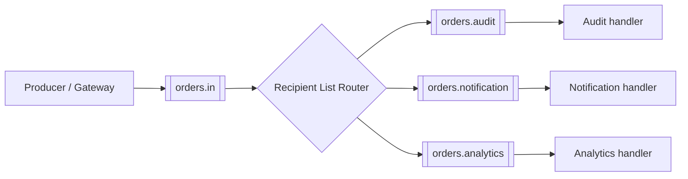
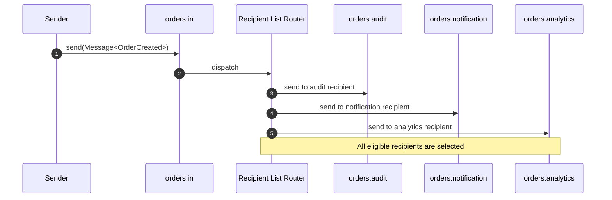
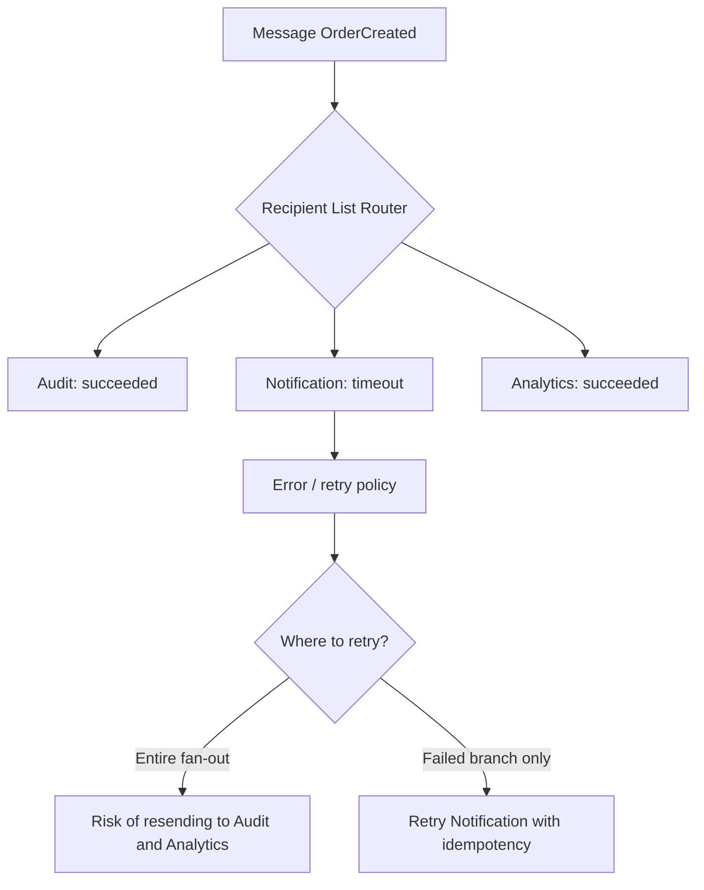

# Channel Name in a Recipient List

A successfully created order may need to trigger **multiple independent tasks**: saving an audit event, sending a notification, updating reports, and publishing data to the warehouse system. If each handler directly calls other handlers, a change in the notification branch can affect the entire workflow. Spring Integration's **Recipient List Router** lets you declare **the list of channels that receive the message** at a single coordination point, decoupling the producer from individual consumers.

In the **Recipient List** pattern of **Enterprise Integration Patterns (EIP)**, a **channel name** is not merely a descriptive string: it is **the identifier Spring Integration uses to locate the exact `MessageChannel` and send the message to the corresponding recipient**. A single-character typo, confusing a bean name with a method name, or letting external data arbitrarily choose channel names can cause routing failures, loss of observability, or delivery to unintended places.

The lesson **Channel Name in a Recipient List**, part of the **Recipient list** chapter of the `SPRING_INTEGRATION_PATTERN` module, explains how to name and resolve channels, declare fixed and conditional recipient lists, handle errors, fan-out, retries, correlation, Gateway, Filter, Transformer, Splitter/Aggregator, and how to test each branch.

> **Remember:** A Recipient List Router decides **which recipients a message will be sent to**; `recipient("orders.audit")` requires a **channel resolved under the exact name** `orders.audit`. It does not create consumers automatically, does not guarantee all recipients succeed together, and does not turn messages into durable broker records.

## 1. What Problem Do Recipient Lists and Channel Names Solve?

Suppose an application receives an `OrderCreated` event. Every valid event is forwarded to:

| Recipient | Internal Channel Name | Purpose |
| --- | --- | --- |
| Audit | `orders.audit` | Record an event trail per policy. |
| Notification | `orders.notification` | Request sending a notification to the customer. |
| Reporting | `orders.analytics` | Update aggregated metrics. |

Instead of forcing the producer to call three services in sequence:

```text
Producer
  ├── auditService.save(...)
  ├── notificationService.send(...)
  └── analyticsService.record(...)
```

we define a messaging topology:



The producer only knows `orders.in` or a Java facade in front of it. When you need to add a reporting recipient, you configure an additional channel/handler and update the recipient list policy; callers do not need to know receiver details.

**Important:** multiple arrows leaving the Router represent **multiple message deliveries to recipients**, not splitting a message into pieces. Recipient List differs from Splitter in that **Splitter produces child data parts according to a rule**, whereas Recipient List typically distributes **the same message or corresponding messages** to multiple receivers.

## 2. What Is a Channel Name in Spring Integration?

`MessageChannel` is the interface representing where a producer sends a message and where consumers receive or are dispatched messages. In a Spring application context, channels are typically registered by **bean name**. The Recipient List Router uses the channel name to **resolve a destination** instead of holding direct references to each implementation class.

Example:

```java
import org.springframework.context.annotation.Bean;
import org.springframework.context.annotation.Configuration;
import org.springframework.integration.channel.QueueChannel;

@Configuration
class OrderChannels {

    @Bean("orders.audit")
    QueueChannel auditChannel() {
        return new QueueChannel(32);
    }

    @Bean("orders.notification")
    QueueChannel notificationChannel() {
        return new QueueChannel(32);
    }

    @Bean("orders.analytics")
    QueueChannel analyticsChannel() {
        return new QueueChannel(32);
    }
}
```

Here, the actual bean names are:

- `orders.audit` — **not** `auditChannel`;
- `orders.notification` — **not** `notificationChannel`;
- `orders.analytics` — **not** `analyticsChannel`.

Because `@Bean("...")` specifies an **explicit bean name**, the Java method `auditChannel()` is only the declaration method name. When `@Bean` is used **without a name**, the default name usually derives from the method name; this is why you should standardize on **contractual channel names** and verify actual bean registration.

### 2.1. A channel name is not a broker topic name

| Concept | Example | Scope |
| --- | --- | --- |
| Spring `MessageChannel` name | `orders.audit` | Destination identifier within the Spring/integration application context. |
| `@Bean` method name | `auditChannel()` | Java bean declaration site; may differ from the channel name. |
| Kafka topic name | `commerce.order.audit` | External out-of-JVM Kafka resource identifier. |
| RabbitMQ exchange/routing key/queue | `order.exchange`, `audit.q` | Transport objects with their own semantics. |
| HTTP endpoint | `POST /api/orders` | Network communication address. |

A Spring channel named `orders.audit` **does not automatically create a Kafka topic with the same name**. Sending to a broker requires connecting the channel to an outbound adapter or endpoint with proper authentication, serialization, acknowledgment, and retry configuration.

### 2.2. Why use names instead of injecting channel objects directly?

Names allow defining **topology through configuration**:

- Integration flows can reference a channel via a consistent contract.
- A router can distribute to multiple registered channels without holding a Java field for every handler.
- Tests can fetch the exact bean by name and read messages from a `QueueChannel`.
- When changing a channel implementation, callers/flows using the same name may need no edits as long as semantics remain compatible.

Even so, **a name is a dependency**. Renaming `orders.notification` to `orders.notify` while forgetting the recipient list is a wiring bug. Manage names as **tested internal contracts**, avoiding strings scattered across dozens of places.

## 3. How Does Recipient List Router Use Channel Names?

Spring Integration Java DSL lets you declare a recipient list with `routeToRecipients(...)`. Each `recipient(...)` call describes a receiving channel; recipients can be **unconditional** or **selected by a condition**.

Static example:

```java
import org.springframework.context.annotation.Bean;
import org.springframework.context.annotation.Configuration;
import org.springframework.integration.config.EnableIntegration;
import org.springframework.integration.dsl.IntegrationFlow;

@Configuration
@EnableIntegration
class OrderRecipientListFlow {

    @Bean
    IntegrationFlow fanOutOrders() {
        return IntegrationFlow.from("orders.in")
            .routeToRecipients(spec -> spec
                .recipient("orders.audit")
                .recipient("orders.notification")
                .recipient("orders.analytics"))
            .get();
    }
}
```

Reading the DSL top to bottom:

1. The producer sends to `orders.in`, the flow's input channel.
2. `routeToRecipients(...)` creates a Recipient List Router endpoint.
3. `recipient("orders.audit")` requests sending to the `orders.audit` channel.
4. `recipient("orders.notification")` requests sending to `orders.notification`.
5. `recipient("orders.analytics")` requests sending to `orders.analytics`.

**The three strings passed to `recipient(...)` are destination names**, not Java methods, payload types, JSON expressions, or event IDs. They must resolve to valid channels/recipients in the runtime configuration.

### 3.1. What happens when a message is sent?



The diagram shows the **logical delivery path**. Synchronous/asynchronous behavior, delivery timing, whether one recipient's failure affects subsequent recipients, and how exceptions propagate **depend on router/channel/endpoint configuration**; do not interpret it as an atomic guarantee across three business operations.

### 3.2. Can channel names contain dots?

Yes. A bean name like `orders.notification` with a dot can be used as a normal **channel name**. What you must distinguish is:

```text
"orders.notification"    ← channel / bean name
"payload.notification"   ← could be a data-access expression in another context
"notification"           ← a routing key or metadata value
```

For `recipient("orders.notification")`, the target is the **named channel**, not an instruction for the framework to read property `notification` from an `orders` object.

## 4. A Standalone Example: Defining and Testing Multiple Recipients

To test easily, let's create a Spring configuration containing **both the Router and the target channels**. All recipients are bounded `QueueChannel` instances; the example requires no external broker or service.

### 4.1. Complete Configuration

```java
import org.springframework.context.annotation.Bean;
import org.springframework.context.annotation.Configuration;
import org.springframework.integration.channel.QueueChannel;
import org.springframework.integration.config.EnableIntegration;
import org.springframework.integration.dsl.IntegrationFlow;

@Configuration
@EnableIntegration
public class RecipientListConfiguration {

    @Bean("orders.audit")
    QueueChannel auditOrders() {
        return new QueueChannel(16);
    }

    @Bean("orders.notification")
    QueueChannel notificationOrders() {
        return new QueueChannel(16);
    }

    @Bean("orders.analytics")
    QueueChannel analyticsOrders() {
        return new QueueChannel(16);
    }

    @Bean
    IntegrationFlow orderRecipients() {
        return IntegrationFlow.from("orders.in")
            .routeToRecipients(spec -> spec
                .recipient("orders.audit")
                .recipient("orders.notification")
                .recipient("orders.analytics"))
            .get();
    }
}
```

In the configuration above, `orders.in` is the integration flow's input channel; the output channels are defined with `@Bean("...")`. In a real application, you need **consumers/pollers** to process these queues. `QueueChannel` holds messages in memory in this example; it is non-durable and produces no business side effects.

### 4.2. JUnit 5 Test: One Message Reaches All Three Channels

```java
import static org.junit.jupiter.api.Assertions.*;

import org.junit.jupiter.api.Test;
import org.springframework.beans.factory.annotation.Autowired;
import org.springframework.context.ApplicationContext;
import org.springframework.integration.channel.QueueChannel;
import org.springframework.messaging.Message;
import org.springframework.messaging.MessageChannel;
import org.springframework.messaging.support.MessageBuilder;
import org.springframework.test.context.junit.jupiter.SpringJUnitConfig;

@SpringJUnitConfig(RecipientListConfiguration.class)
class RecipientListConfigurationTest {

    @Autowired
    ApplicationContext context;

    private QueueChannel queue(String name) {
        return context.getBean(name, QueueChannel.class);
    }

    @Test
    void oneMessageIsDeliveredToAllThreeRecipients() {
        Message<String> input = MessageBuilder
            .withPayload("ORDER-1001")
            .setHeader("eventType", "ORDER_CREATED")
            .setHeader("correlationId", "corr-1001")
            .build();

        MessageChannel ingress = context.getBean("orders.in", MessageChannel.class);
        assertTrue(ingress.send(input));

        Message<?> audit = queue("orders.audit").receive(0);
        Message<?> notify = queue("orders.notification").receive(0);
        Message<?> analytics = queue("orders.analytics").receive(0);

        assertNotNull(audit);
        assertNotNull(notify);
        assertNotNull(analytics);

        assertEquals("ORDER-1001", audit.getPayload());
        assertEquals("ORDER-1001", notify.getPayload());
        assertEquals("ORDER-1001", analytics.getPayload());

        assertEquals("corr-1001", audit.getHeaders().get("correlationId"));
        assertEquals("corr-1001", notify.getHeaders().get("correlationId"));
        assertEquals("corr-1001", analytics.getHeaders().get("correlationId"));

        assertNull(queue("orders.audit").receive(0));
        assertNull(queue("orders.notification").receive(0));
        assertNull(queue("orders.analytics").receive(0));
    }
}
```

This test verifies:

- Exactly three **channel names** are declared as resolvable beans.
- The producer sends **one** message to `orders.in`.
- The router forwards data to **all three recipients**, not just a single branch.
- The application header `correlationId` is preserved in the example, supporting trace correlation at each recipient.
- No leftover messages remain in the queues after the test reads them.

**Do not assert that the three recipients receive the exact same object reference** or share a message ID across all configurations. What matters is the **data/contract and delivery count**. In practice, building new messages, adding sequence headers, crossing adapters, or serialization can alter objects and metadata.

### 4.3. What this example does not guarantee yet

- No business consumers or external systems.
- No durable store, distributed transaction, or broker acknowledgment.
- Does not measure processing order across recipients.
- Does not verify operations succeeded in all three systems.
- Does not simulate retries, duplicate messages, full queues, or dropped connections.

This is a **fan-out topology test**, not proof of exactly-once delivery or end-to-end business success.

## 5. Conditional Recipients: Fixed Channel Names, Flexible Send Decisions

Not every message needs to reach every recipient. For example, every order must go to audit, but only orders permitted to receive notifications go to `orders.notification`, and only priority orders go to `orders.priority`.

Spring Integration DSL lets you declare recipients **with conditional expressions**, for example:

```java
@Bean
IntegrationFlow conditionalRecipients() {
    return IntegrationFlow.from("orders.conditional.in")
        .routeToRecipients(spec -> spec
            .recipient("orders.audit")
            .recipient("orders.notification",
                "headers['notificationAllowed'] == true")
            .recipient("orders.priority",
                "headers['priority'] == true"))
        .get();
}
```

**This is an alternative illustrative configuration**, not a direct addition to `RecipientListConfiguration` in Section 4. It assumes the `orders.priority` channel bean and related channels already exist, and that `notificationAllowed` and `priority` are **Booleans validated/normalized beforehand**. If external headers arrive as the String `"true"` or are missing, do not rely on implicit type coercion.

### 5.1. Two separate decisions

For each recipient, there are two factors:

| Decision | Example | Meaning |
| --- | --- | --- |
| **Send or not?** | `headers['notificationAllowed'] == true` | Recipient selection condition. |
| **Send where?** | `orders.notification` | Registered **channel name**, the configured target. |

In this example, conditional expressions are **not used to construct arbitrary channel names**. They only decide whether to include an already-declared recipient. This limits the risk of external data controlling topology.

### 5.2. One or multiple recipients

| Pattern | Distribution Rule | Typical Case |
| --- | --- | --- |
| **Content-Based Router** | Usually computes a route key and picks a target per configured rules. | Separating priority orders vs. standard orders. |
| **Recipient List Router** | Selects a **list** of recipients; each can have its own condition. | Same event goes to audit and analytics, plus notification if allowed. |
| **PublishSubscribeChannel** | Fans out to registered subscribers of one channel. | Broadcasting the same message to multiple handlers subscribed to an internal topic. |
| **Splitter** | Splits one payload into **child data parts**. | Splitting a list of line items to check stock per item. |

Both Recipient List and PublishSubscribe can support **fan-out**, but with different coordination boundaries. Recipient List expresses the **destination list on the router**, convenient when each destination has its own condition. PublishSubscribeChannel coordinates **subscribers of a channel**; subscriber registration, dispatch control, and dispatch characteristics depend on that channel's configuration.

There is no single right choice for every case: weigh policy, fan-out needs, configuration-driven recipient changes, failures, backpressure, and coupling.

## 6. How Spring Integration Resolves Channel Names

When a recipient uses a name like `orders.audit`, the router must locate a matching destination in the application configuration. In a bean-based environment, the most common mechanism is looking up the **`MessageChannel` bean registered under that name**; resolution may use a channel resolver and Spring Integration infrastructure.

### 6.1. Nonexistent name

Suppose the code uses:

```java
.routeToRecipients(spec -> spec
    .recipient("orders.audit")
    .recipient("orders.notfication"))  // Typo: missing the letter i
```

Meanwhile, the actual channel is named `orders.notification`. The router will not guess that the two names are the same. Whether the application fails at startup or when processing a message can depend on how endpoints/channels are resolved and the Spring Integration version; **never assume name errors are caught at compile time**.

If a recipient cannot be resolved to a valid channel, a **configuration/routing or message delivery error** will occur at runtime. You must catch these with **integration tests** that send real messages into the flow, not just Java compilation.

### 6.2. Channel exists but has no subscriber

When a channel is a `DirectChannel` with no subscriber, dispatching can fail. That differs from a `QueueChannel`, which can **accept and hold messages** even without a poller, until full or hitting resource limits.

| Situation | What to Check |
| --- | --- |
| Wrong channel name | Bean/resolver cannot locate the target destination. |
| Right channel name, wrong bean type | Destination lacks the expected `MessageChannel` semantics. |
| `DirectChannel` without subscriber | Delivery may fail to execute. |
| `QueueChannel` without poller | Messages may accumulate and eventually fill/saturate the queue. |
| Overloaded `ExecutorChannel` | Executor may reject tasks; requires rejection/backpressure policy. |
| Outbound adapter cannot connect | Message reached the channel, but transport output may fail. |

Do not treat `router sent to the right channel name` as sufficient proof that the receiver processed the message successfully.

### 6.3. Is a channel name a global namespace?

Channel names are resolved **within the active integration context and resolver mechanism**; they are not automatically global identifiers across all applications or services. Two different services can have channels with the same name without exchanging data. Communicating across service boundaries requires explicit adapters/protocols and transport contracts.

### 6.4. Managing names by convention

There is no mandatory format across all projects. One convention might be:

```text
<domain>.<event-or-flow>.<purpose>
orders.created.audit
orders.created.notification
orders.created.analytics
```

Good names should:

1. Clearly state domain and purpose, avoiding `channel1`, `foo`.
2. Remain stable when implementation method names change.
3. Never embed sensitive data such as emails, tokens, or customer IDs.
4. Use a registered/allowed set of names, never accepting arbitrary names from HTTP requests.
5. Have wiring tests for every recipient.
6. Never imply automatic durability, retries, transactions, or access control based on the name alone.

If multiple modules share the same names, use controlled and reviewed constants/configs rather than copying strings everywhere. Still, creating constants does not replace **bean resolution tests**.

## 7. If One Recipient Fails, Do Others Still Receive the Message?

This question matters more than spelling the channel name right.

A Recipient List can send to multiple channels within the same coordination step, but **it is not automatically a distributed transaction**. If Audit succeeds while Notification fails, you cannot assume:

- all recipients committed together;
- the Router will automatically roll back Audit's success;
- retrying the whole message will not duplicate Audit;
- all three recipients receive in the exact same order at the exact same time;
- failure in one branch has no effect on dispatching other branches.

**Actual behavior** depends on synchronous/asynchronous channels, dispatch ordering/strategy, transaction scopes, retry advice, adapters, and error policies.

### 7.1. Synchronous fan-out

With `DirectChannel` instances and synchronous handlers, a recipient can run directly on the caller thread. If one handler throws an exception, whether remaining recipients still receive the message depends on the error-handling path and Router configuration. Therefore, never treat a recipient list configuration as a universal "keep trying every remaining branch even if an earlier branch fails" guarantee.

### 7.2. Fan-out over queues or brokers

With `QueueChannel` or broker outbound adapters, the Router may accept each send before business work finishes. However:

- In-memory queues do not persist across restarts by default.
- A successful send does not mean a service has processed the message.
- If a queue is full, send may block and then fail depending on timeout configuration.
- If a broker redelivers, a recipient can receive the message again.

For "zero loss" or "business-level once-only processing" requirements, use durable storage, transactions/outbox where appropriate, and **idempotency at every recipient with side effects**.

### 7.3. Design suggestions when tasks vary in criticality

| Recipient | Illustrative Criticality | Policy to Consider |
| --- | --- | --- |
| Mandatory Audit | High | Appropriate durable write/transaction and controlled replay capability. |
| Notification | Retryable | Separate retry/backoff without duplicating the primary action. |
| Analytics | Eventual consistency acceptable | Buffering/broker and backfill capability. |

If audit must commit alongside the business action while notification may lag, consider a **transactional outbox** or post-commit event publishing architecture rather than using a plain Recipient List Router as a transaction commitment. The choice depends on data properties and product constraints.

## 8. Retry, Error Channel, and Idempotency in a Recipient List

A common mistake is **retrying the entire input** when one recipient times out. If the Audit branch already wrote successfully, a full retry can insert a second Audit record unless there is a deduplication key.

### 8.1. Illustrative Failure Model



This diagram does not depict default auto-retry behavior; it illustrates **two retry placements** leading to different outcomes. When independent per-recipient delivery and processing must be guaranteed, prefer **per-recipient processing state**, appropriate queues/brokers, and stable idempotency keys.

### 8.2. An error channel does not automatically collect every error

When a handler runs synchronously on a `DirectChannel`, exceptions can propagate back to the caller. Across async/poller/adapter boundaries, errors can become `ErrorMessage` instances routed to an error channel **when properly configured**. Wrong channel names, full queues, outbound timeouts, and business rejections all have different semantics.

| Failure Type | Detection Point | How to Handle |
| --- | --- | --- |
| Wrong recipient name | Channel resolution | Fix configuration, test wiring; retrying as-is will not help. |
| Recipient has no consumer | Dispatch/queue/poller | Add handler, check backlog and capacity. |
| Notification API transient error | Outbound Gateway/client | Bounded retry on that branch, backoff, and DLQ if designed. |
| Audit DB commit failure | Audit handler | Transaction/rollback or durable persistence per contract. |
| Message redelivered | Producer/broker/flow retry | Idempotency by event + recipient to avoid duplicate side effects. |
| Payload violates policy | Filter/validation before Router | Reject with clear error code; do not fan out to recipients. |

**Do not send raw messages or credentials into unprotected logs, error channels, or DLQs**. When retrying a branch, preserve useful correlation/trace context without leaking personal data.

### 8.3. How is an idempotency key used?

Suppose an `OrderCreated` has `eventId = EVT-001`. Each recipient can record a processing marker keyed by **`(eventId, recipientId)`**. When the broker or flow redelivers the message, the recipient recognizes the same event was already processed and avoids repeating side effects.

This is an illustrative strategy, not a built-in feature of Recipient List Router. Duplicate checking must be **concurrency-safe** with appropriate storage/transactions; merely putting `eventId` in a header without tracking state does not solve the problem.

## 9. Recipient List and Request–Reply Gateway: Clarifying Expectations

A `@MessagingGateway` can provide a Java facade for callers, for example:

```java
import org.springframework.integration.annotation.MessagingGateway;

@MessagingGateway(defaultRequestChannel = "orders.in")
interface OrderEventGateway {
    void publish(OrderEvent event);
}

// OrderEvent is an application-defined DTO.
```

This interface **returns no business value**; it fits better when the caller wants to **emit an event** while recipients handle it independently. Still, `void` does not automatically guarantee asynchronous sending, broker durability, retries, or completion by all recipients.

### 9.1. What if the caller needs a return value?

Suppose the interface is:

```java
@MessagingGateway(defaultRequestChannel = "orders.in")
interface OrderProcessingGateway {
    OrderResult submit(OrderEvent event);
}
```

When a message fans out to three recipients, **no single response automatically represents all three outcomes**. You must decide:

1. Which recipient's result is the primary reply?
2. Must the caller wait for all recipients?
3. Are partial results acceptable?
4. What are the Gateway timeout and each downstream timeout?
5. What happens if a recipient finishes after the caller times out?

If the requirement truly needs combining multiple results, design **scatter–gather** using Recipient List/Publish-Subscribe paired with an **Aggregator** with correlation and a release strategy. Do not expect a `routeToRecipients(...)` call to automatically return `List<Result>`.

### 9.2. Distinguishing Router from Aggregator

`Recipient List Router` decides **who to send to**; `Aggregator` decides **when enough replies in the same group have arrived** to emit a combined result. With optional recipients, the expected reply count can vary per message. You must design group metadata/recipient counts and how to handle unselected branches, Filter-rejected branches, or timed-out branches.

Some routers/flows can attach **correlation and sequence headers** when distributing to multiple recipients depending on configuration; do not assume they are always added automatically or survive every adapter. Verify which headers actually appear and your Aggregator strategy in the version you run.

## 10. Security Contract: Never Let External Data Pick Arbitrary Channels

A header like `recipientChannel` sent by an HTTP client **must never be passed directly** into channel resolution to select arbitrary beans/channels in the application. If a sender can guess a privileged channel's name, they can route messages into unauthorized workflows.

Best practices:

- Keep **recipient names in trusted configuration**, or restrict with an explicit allowlist.
- Use **verified conditions**, such as system-determined `notificationAllowed`, instead of trusting `role=ADMIN` headers from clients.
- Enforce authorization at the boundary and in business logic; routers do not replace permission checks.
- Never construct channel names from emails, tokens, account numbers, or sensitive identifiers.
- Do not copy every inbound header to every recipient; keep only necessary metadata.
- Give each recipient only the payload/data fields allowed by contract; if Audit and Notification require different data, consider **separate Transformers/adapters** before each target.

### 10.1. Multiple recipients expand data exposure

When `OrderCreated` contains email addresses and payment details, sending that same payload to Analytics, Audit, and Notification can expose unnecessary data across multiple systems. The convenience of fan-out does not override **data minimization**. You can have the Router send a minimal event, and let each branch fetch authorized data or convert to an appropriate DTO.

If a recipient truly requires sensitive data, define access controls, transport encryption, retention, masking, logging policies, and error/DLQ handling. An internal channel name is not an automatic security boundary.

## 11. Testing Channel Names and Conditional Recipient Policies

Your test suite should go beyond checking that messages appear in three queues.

| Test Case | Outcome to Verify |
| --- | --- |
| Three channels declared with exact names | Each recipient resolves and receives the right message. |
| One channel name misspelled | Test catches wiring/dispatch error rather than ignoring it. |
| Channel exists with no consumer | System applies proper policy; does not report fake completion. |
| `notificationAllowed=true` | Notification is selected and receives the message. |
| `notificationAllowed=false` | No message reaches Notification; Audit still receives it. |
| `notificationAllowed="true"` (String) | Normalized/validated per contract; no reliance on implicit coercion. |
| One recipient fails | Observed what happens to the remaining recipients. |
| Recipient queue is full | Backpressure/send timeout and error policy take effect. |
| Message retried/replayed | Recipients handle idempotently without duplicate side effects. |
| Message contains sensitive data | Not logged/leaked to unauthorized branches. |
| With Aggregator | Correlation, selected recipient count, timeout, and late replies behave properly. |
| Replacing `QueueChannel` with async/broker | Tests await conditions rather than calling `receive(0)` immediately. |

### 11.1. Direct bean name check

In an integration test, you can verify infrastructure registered channels under the expected names:

```java
import static org.junit.jupiter.api.Assertions.assertNotNull;

import org.springframework.context.ApplicationContext;
import org.springframework.messaging.MessageChannel;

void assertChannelExists(ApplicationContext context, String name) {
    MessageChannel channel = context.getBean(name, MessageChannel.class);
    assertNotNull(channel);
}

// Example calls:
// assertChannelExists(context, "orders.audit");
// assertChannelExists(context, "orders.notification");
// assertChannelExists(context, "orders.analytics");
```

This is only an **existence test**: the channel name exists, which does not yet prove the Router actually dispatches properly or consumers process messages. Always include end-to-end **message path tests** as in Section 4.

### 11.2. Proactively test misspelled names

Change one recipient `orders.notification` to `orders.notfication` in an isolated test configuration. Observe how message sending or flow startup fails in actual runtime behavior. Then restore the name and rerun.

Never use intentional misspellings in production config as a "fallback." If a recipient might not be installed in a given environment, express enabling/disabling the recipient through **controlled configuration/properties**, or use an environment-compatible topology. **Never silently send to a nonexistent name.**

## 12. Timeouts, Ordering, and Recipient Capacity Limits

### 12.1. Send timeout only bounds handoff at the right channel

If `orders.audit` is a `QueueChannel(16)` with 16 unread messages, a subsequent send may wait or fail depending on timeout and dispatch mode. `send(timeout)` bounds **waiting to hand off the message**, not how long the audit DB takes to write.

With a `DirectChannel`, the handler may run synchronously; send timeout **does not interrupt** a long handler method or external HTTP call. With an `ExecutorChannel`, work can run on another thread, yet it has no built-in durability.

### 12.2. Recipient order does not guarantee completion order

Suppose the router declares:

```text
recipient("orders.audit")
recipient("orders.notification")
recipient("orders.analytics")
```

Declaration line order **is not a guarantee** that audit in the DB always commits before email is sent, especially when executors, queues, or brokers are involved. When business rules require temporal dependencies (such as "only send email after the main transaction commits"), design **explicit workflows/transactions/outbox or completion signals**, rather than inferring guarantees from recipient name order.

### 12.3. Each recipient can be an independent bottleneck

Each branch has its own processing speed and resource limits. Notifications may slow down due to an email provider, analytics due to a data warehouse, and audit due to DB saturation. Monitor queue depth, queue age, send failures, and handler latency **per channel name**, instead of relying on one average metric for the entire flow.

## 13. Observability: Channel Names Are Good Technical Labels When Controlled

When the recipient list is predefined and the number of names is bounded, `channelName` is a useful observability label for:

- Messages entering the Recipient List Router.
- Recipients selected per event type.
- Sends to each channel.
- Resolution/dispatch/timeout errors per channel.
- Queue depth, queue age, and consumer processing rate.
- Retries and business errors per branch.
- Correlation/trace linking a source event to downstream recipients.

Example structured log:

```text
event=recipient_dispatch
flow=orderCreatedFanout
recipient_channel=orders.notification
outcome=accepted_by_channel
event_type=ORDER_CREATED
correlation_id=8ef7ae3b-94b6-47f4-a903-73e346f379bb
```

This is a **suggested format**, not an automatically generated default log. `accepted_by_channel` only describes message handoff at the channel boundary; never relabel it `business_completed` before downstream confirms.

**Security and cardinality:** put only **configured channel names** into metric labels. Never put event IDs, correlation IDs, emails, or channel names constructed from untrusted data into metric labels. You can use opaque correlation IDs in access-controlled logs/traces when investigating issues.

### 13.1. When one branch receives no messages

If Analytics receives the event but Notification does not, check in order:

1. Was recipient `orders.notification` declared/selected by the condition?
2. Does the recipient name match the registered bean/channel?
3. Does the channel have a subscriber/poller? Is it full?
4. Did an error occur before dispatching to this recipient?
5. Is there an async/adapter boundary where the message is delayed or routed to a DLQ?
6. Did the error happen at **message handoff** or inside the **business handler**?

Tracing boundary by boundary is far more accurate than reading producer logs and assuming the Router "sent to everyone."

## 14. Practice Exercises

**Exercise 1 — Add a new recipient.** Add channel `orders.search-index` to the configuration in Section 4, then add `recipient("orders.search-index")`. Write a test proving one event reaches all four queues with no leftover messages after reading.

**Exercise 2 — Controlled rename.** Rename `@Bean("orders.notification")` to `@Bean("orders.notify")` while leaving the Router unchanged. Observe the failure in an integration test and explain why the Java compiler does not necessarily catch this bug.

**Exercise 3 — Conditional recipient.** Have Audit always receive the event, and Notification only when `notificationAllowed=true`. Write tests for both boolean values and an unnormalized String value `"true"`.

**Exercise 4 — Per-branch retry.** Simulate Notification failing transiently after Audit has already completed. Design a policy that avoids re-writing Audit when only Notification needs a retry.

**Exercise 5 — Channel name from header.** A client sends `recipientChannel="admin.command"`. Explain the risk and propose an allowlist/authorization model so a client cannot route directly to a privileged bean.

**Exercise 6 — Aggregator.** A request goes to three recipients, where one optional recipient may not be selected. Describe the correlation key, expected reply count, group timeout, and how to handle a late reply.

**Exercise 7 — Per-recipient dashboard.** Build metrics by `recipient_channel` and `outcome`. Explain why you do not use `correlation_id` as a metric label even though it is very helpful for log tracing.

## 15. Pre-Deployment Checklist for Recipient Lists

| Question | What to Verify |
| --- | --- |
| Does every recipient have a clear channel name? | Stable, meaningful names, never taken directly from untrusted sources. |
| Does the bean/channel actually exist with the exact name? | `@Bean("...")` or equivalent configuration plus resolution test. |
| Is method name confused with bean name? | No; understand `@Bean(name)` determines the registered name. |
| Is channel confused with broker topic? | No; adapters connect to external transport when needed. |
| Should one message go to one or many destinations? | Right choice among Recipient List/Router/Publish-Subscribe/Splitter. |
| Are conditional recipients clearly defined? | Predicates inspect normalized, trusted data. |
| Does any recipient lack a handler/poller? | No, or explicit policy for holding/queuing pending work. |
| How does one recipient's failure affect others? | Tested under actual channel, dispatch, and transaction boundaries. |
| Could retries cause duplicate side effects? | Idempotency by event + recipient and per-branch retry strategy where needed. |
| Is there request–reply or an Aggregator? | Reply, correlation, release, timeout, and partial/late-reply handling defined. |
| Could queues fill up or lose messages on restart? | Capacity, backpressure, persistence, and recovery match requirements. |
| Are data/privilege restrictions enforced per recipient? | Allowlist, data minimization, authorization, and safe logging in place. |
| Are valid/invalid channel names and each branch tested? | Yes, including negative cases, full queues, and downstream errors. |
| Is observability granular enough per branch? | Metrics/logs by bounded channel/recipient without exposing personal data. |

## Conclusion

In a **Recipient List Router**, a **channel name** is the **destination identifier** that Spring Integration must resolve to deliver a message to one or more recipients. Names like `orders.audit` or `orders.notification` must match registered channels; they are not Java method names, Kafka topic names, payload access expressions, or a guarantee that downstream processing succeeded.

Good Recipient List design requires **contractual channel names, explicit mappings, controlled recipient selection conditions, consumers for each branch, timeout/backpressure management, and resolution failure testing**. When reliable fan-out is required, add idempotent retries, error flows, correlation, transaction/durability boundaries, and observability. Combined with Filter, Transformer, Gateway, Splitter, and Aggregator, this lets you build messaging flows that are **loosely coupled, extensible, and transparent to operate when a recipient fails**.
