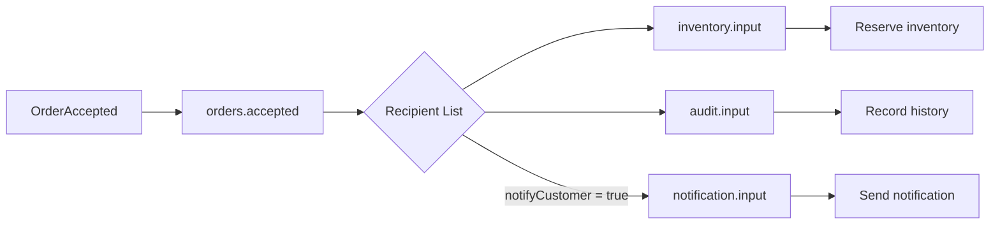
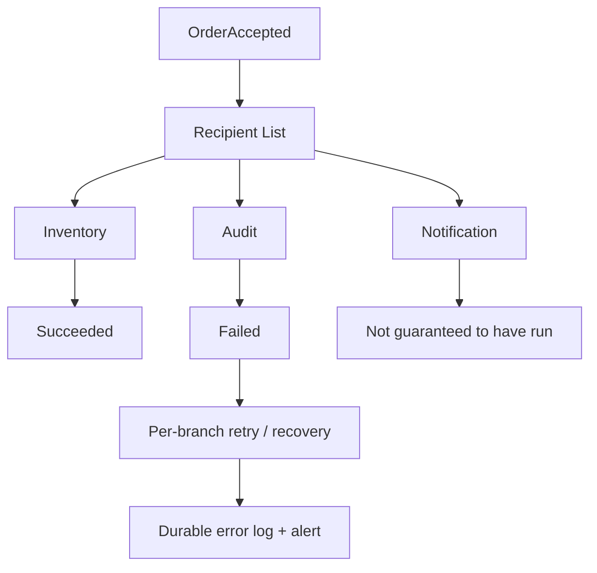
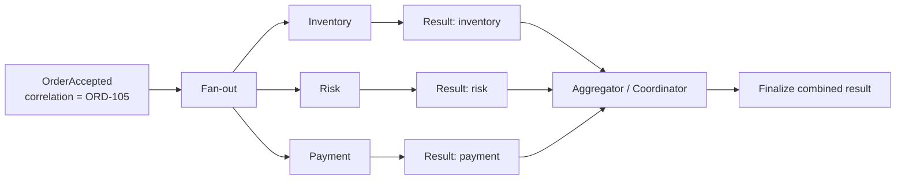

# Broadcast and Fan-Out

## 1. Why Does One Message Need to Be Sent to Multiple Places?

Suppose an e-commerce system emits an `OrderAccepted` event when an order is accepted. The same event may need to trigger three independent activities: updating inventory, writing an audit log, and sending a customer notification. If the event producer calls all three services directly, it must know those services, their call order, and how each one handles errors. Every time a new receiver is added, the producer code has to change.

**Recipient List** is an *Enterprise Integration Patterns* (EIP) pattern that lets one component route a message to **a set of recipients**. That set can be fixed or computed from information in the message. When every recipient in the list receives the message, that is **broadcast**; when a message is distributed into multiple logically parallel or independent processing paths, it is usually called **fan-out**.

In the **Recipient list** chapter of the **SPRING_INTEGRATION_PATTERN** module, this lesson helps you implement EIP patterns with Spring Integration to build loosely coupled and extensible messaging flows. Branches receiving messages can continue using Router, Filter, Transformer, Splitter, Aggregator, Gateway, retry, error channels, and correlation; testing and observing each branch is also an essential part of the design.



For a valid message with `notifyCustomer=true`, all three branches are selected. If `notifyCustomer=false`, only the inventory and audit branches receive the message. **Recipient List does not wait for branches to finish or aggregate their responses by default**; those behaviors depend on channels, endpoints, and dedicated configuration.

### 1.1. Three Easily Confused Concepts

| Concept | Meaning | Example |
| --- | --- | --- |
| **Broadcast** | Sending the same information to all receivers within a defined scope | Audit, inventory, and notification all receive `OrderAccepted` |
| **Fan-out** | Splitting processing of one event into multiple branches | One event triggers three distinct tasks |
| **Fan-in / aggregation** | Gathering results or completion signals from multiple branches | Waiting for risk, inventory, and payment checks before confirming an order |

Fan-out **does not necessarily mean running concurrently across multiple threads**. With synchronous channels such as `DirectChannel`, multiple recipients may be invoked sequentially on the sending thread. With queues or executors, branches may execute at different times.

## 2. How Does a Recipient List Select Receivers?

Each recipient typically corresponds to a `MessageChannel` or a target flow. There are two common ways to organize this:

1. **Static recipients:** a preconfigured list of channels, such as `inventory.input` and `audit.input`. Both branches are always selected.
2. **Conditional recipients:** a predicate/expression inspects the message before selecting the branch, such as only sending to `notification.input` when `notifyCustomer=true`.

Suppose the payload is:

```java
record OrderAccepted(
        String orderId,
        long amountVnd,
        boolean notifyCustomer) {}
```

Rules:

| Recipient | Selection Condition | Responsibility |
| --- | --- | --- |
| `inventory.input` | Always selected | Reserve inventory |
| `audit.input` | Always selected | Record the event |
| `notification.input` | `notifyCustomer=true` | Notify the customer |

The conditions here only decide **whether to send to the recipient**. Accepting a recipient does not mean the business operation at that recipient has completed. If notification fails after inventory already processed, the system needs a separate recovery policy.

### 2.1. What roles do payload and headers play?

```text
payload:
  OrderAccepted("ORD-105", 350000, true)
headers:
  eventId = "evt-105"
  tenantId = "shop-hcm"
  traceId = "trace-105"
```

The payload carries the business event. Headers carry context such as event identifier, tenant, and trace. Recipients can read the same payload, while each branch uses only the fields it needs. For example, inventory needs `orderId`, audit needs `eventId`, and notification needs contact info from the business system.

**Do not use `MessageHeaders.ID` as a cross-system deduplication key.** When a message is recreated for replay, the envelope ID can change. A stable event-specific `eventId` is a far better key to help branches accept redeliveries without duplicating effects.

### 2.2. Does each branch receive a deep copy of the payload?

No. Sending a message to multiple recipients **does not automatically deep-copy Java objects inside the payload**. Branches may see the exact same payload or message wrappers holding references to the same payload. If one branch mutates a mutable object, another branch can observe the mutated data, especially under concurrent processing.

Therefore, for events used in fan-out, prefer **immutable payloads**, such as a `record` containing only immutable fields, along with well-defined header values. With nested mutable collections or objects, a `record` does not automatically make elements inside immutable; copy or guard defensively at appropriate boundaries.

## 3. How Do Recipient List, Publish-Subscribe, and Splitter Differ?

Spring Integration provides multiple message distribution mechanisms; the choice depends on the system's goal.

| Mechanism | Receiver Selection | What Is Distributed | When Appropriate |
| --- | --- | --- | --- |
| **Recipient List Router** | Configured list, where each recipient can have a condition | Messages to selected recipients | Need to choose multiple targets with per-target rules |
| **PublishSubscribeChannel** | Subscribers registered on the channel | Messages published to subscribers per channel configuration | Want every subscriber to receive the event |
| **Content-Based Router** | Usually chooses one primary branch based on content | Message to the chosen branch | Standard orders go to A, priority orders go to B |
| **Splitter** | Divides one payload into multiple parts | Child messages with distinct payloads | Splitting an order into individual line items |
| **Aggregator** | Combines messages belonging to the same group | One aggregated result | Must wait for/combine results from multiple parts or branches |

**Recipient List** emphasizes the set of recipients. **Publish-Subscribe** emphasizes a channel with multiple subscribers. Both can perform broadcast, but their selection mechanisms and where branches are declared differ. **Splitter** differs at the data level: it typically creates messages from *different parts* of a payload; Recipient List typically sends the same event to multiple places.

Example:

```text
Recipient List:
  OrderAccepted(ORD-105) ─┬─> Inventory Handler: OrderAccepted(ORD-105)
                          ├─> Audit Handler:     OrderAccepted(ORD-105)
                          └─> Notify Handler:    OrderAccepted(ORD-105)

Splitter:
  Order(items=[A,B,C]) ───┬─> Item(A)
                          ├─> Item(B)
                          └─> Item(C)
```

Do not use an Aggregator simply because there are multiple recipients. If branches **do not need to return a combined result**, letting them process independently is usually simpler and more resilient.

## 4. Implementing Recipient List with Java DSL

Let's use Java 17+ and Spring Integration Java DSL. Data and business interface:

```java
record OrderAccepted(
        String orderId,
        long amountVnd,
        boolean notifyCustomer) {}

interface OrderFanoutEffects {
    void reserveInventory(OrderAccepted order, String eventId);
    void appendAudit(OrderAccepted order, String eventId);
    void notifyCustomer(OrderAccepted order, String eventId);
}
```

`eventId` is passed to each task so the implementation has a basis for **idempotency** on its own branch. One `eventId` can appear across three branches: do not use a single global "event already processed" table that accidentally causes the three tasks to exclude one another. If deduplication is needed, the check key should include **both event ID and task/recipient identifier**, or be stored separately per consumer.

### 4.1. Configuring Channels and Routing to Multiple Recipients

```java
import java.util.Map;
import org.springframework.context.annotation.Bean;
import org.springframework.context.annotation.Configuration;
import org.springframework.integration.channel.DirectChannel;
import org.springframework.integration.config.EnableIntegration;
import org.springframework.integration.dsl.IntegrationFlow;
import org.springframework.messaging.MessageChannel;

@Configuration
@EnableIntegration
class OrderFanoutConfig {

    @Bean("orders.accepted")
    MessageChannel acceptedOrders() {
        return new DirectChannel();
    }

    @Bean("inventory.input")
    MessageChannel inventoryInput() {
        return new DirectChannel();
    }

    @Bean("audit.input")
    MessageChannel auditInput() {
        return new DirectChannel();
    }

    @Bean("notification.input")
    MessageChannel notificationInput() {
        return new DirectChannel();
    }

    @Bean
    IntegrationFlow orderFanoutFlow() {
        return IntegrationFlow.from("orders.accepted")
                .routeToRecipients(recipients -> recipients
                        .recipient("inventory.input")
                        .recipient("audit.input")
                        .recipient(
                                "notification.input",
                                "payload.notifyCustomer()"))
                .get();
    }

    @Bean
    IntegrationFlow inventoryFlow(OrderFanoutEffects effects) {
        return IntegrationFlow.from("inventory.input")
                .handle(OrderAccepted.class, (order, headers) -> {
                    effects.reserveInventory(order, requireEventId(headers));
                    return null; // One-way branch, no reply sent.
                })
                .get();
    }

    @Bean
    IntegrationFlow auditFlow(OrderFanoutEffects effects) {
        return IntegrationFlow.from("audit.input")
                .handle(OrderAccepted.class, (order, headers) -> {
                    effects.appendAudit(order, requireEventId(headers));
                    return null;
                })
                .get();
    }

    @Bean
    IntegrationFlow notificationFlow(OrderFanoutEffects effects) {
        return IntegrationFlow.from("notification.input")
                .handle(OrderAccepted.class, (order, headers) -> {
                    effects.notifyCustomer(order, requireEventId(headers));
                    return null;
                })
                .get();
    }

    private static String requireEventId(Map<String, Object> headers) {
        Object value = headers.get("eventId");
        if (!(value instanceof String eventId) || eventId.isBlank()) {
            throw new IllegalArgumentException("eventId is required");
        }
        return eventId;
    }
}
```

Explanation:

1. `orders.accepted` is the input channel of the broadcast flow.
2. `routeToRecipients(...)` selects the recipient set; `inventory.input` and `audit.input` always receive the message.
3. The expression `payload.notifyCustomer()` is the condition for `notification.input`: only messages with `notifyCustomer=true` are sent to this branch.
4. Each output channel has a corresponding consumer performing one specific type of work.
5. `requireEventId(...)` guards the data contract. In a real flow, validate mandatory headers **before fan-out**, so one recipient does not succeed before another recipient discovers `eventId` is missing.

This is a **synchronous in-memory** example over `DirectChannel`. It demonstrates how recipients are selected but does not by itself provide durable storage, independent retries, cross-branch transactions, or ACKs from external systems. Application code must provide a bean implementing `OrderFanoutEffects`.

### 4.2. Sending an Input Event

A producer injected with `orders.accepted` can construct a message with an immutable payload and sufficient contextual headers:

```java
import org.springframework.beans.factory.annotation.Qualifier;
import org.springframework.messaging.MessageChannel;
import org.springframework.messaging.support.MessageBuilder;
import org.springframework.stereotype.Component;

@Component
class AcceptedOrderPublisher {
    private final MessageChannel acceptedOrders;

    AcceptedOrderPublisher(
            @Qualifier("orders.accepted") MessageChannel acceptedOrders) {
        this.acceptedOrders = acceptedOrders;
    }

    void publishExample() {
        var order = new OrderAccepted("ORD-105", 350_000L, true);
        acceptedOrders.send(MessageBuilder.withPayload(order)
                .setHeader("eventId", "evt-105")
                .setHeader("tenantId", "shop-hcm")
                .setHeader("traceId", "trace-105")
                .build());
    }
}
```

Expected outcomes when `notifyCustomer=true`:

| Branch | Business Call | Expected Invocation Count |
| --- | --- | --- |
| Inventory | `reserveInventory(order, "evt-105")` | 1 |
| Audit | `appendAudit(order, "evt-105")` | 1 |
| Notification | `notifyCustomer(order, "evt-105")` | 1 |

When `notifyCustomer=false`, only the inventory and audit calls are made. This is a **recipient selection policy**, not re-checking content with a Filter inside each branch.

### 4.3. When should you use a static Recipient List?

If every `OrderAccepted` event always requires both inventory and audit tasks, an unconditional recipient list for those two tasks suffices:

```java
.routeToRecipients(recipients -> recipients
        .recipient("inventory.input")
        .recipient("audit.input"))
```

If all subscribers of a channel must receive every message and adding a subscriber is a channel-level configuration change, **`PublishSubscribeChannel`** can express it more naturally. Recipient List is advantageous when each receiver needs its own condition or the flow designer wants to list recipients right at the routing point.

## 5. Does Broadcast Run in Parallel or Guarantee Order?

Three concepts must be kept distinct:

- **Logical fan-out:** one event is sent to multiple branches.
- **Concurrency:** whether branches run across multiple threads.
- **Reliability:** whether each branch persists messages, retries, and recovers on failure.

For example, `DirectChannel` has synchronous handlers, so when the producer sends `OrderAccepted`, one branch may finish before the Router proceeds to send to the next branch. Do not treat fan-out as an automatic throughput booster.

If the notification branch calls a slow email API, using a synchronous channel can block the sending thread. To decouple speeds, you can replace the target with a queue/consumer backed by an executor or a dedicated broker; when switching to asynchronous execution, consider:

| Aspect | In-Memory Synchronous Channel | Configured Durable Queue / Broker |
| --- | --- | --- |
| Execution timing | Usually within the send call | Can happen later |
| Slowness in one branch | Can slow the producer and subsequent sends | Can decouple load, though backlog can grow |
| Handler failure | May throw back to the sender | Usually handled in a separate consumer/error handler |
| Durability across restarts | Not provided by default | Depends on storage, ACKs, and source retries |
| Cross-branch ordering | Should not be assumed as a business contract | Should not assume branches complete in the same order |

`ExecutorChannel` provides in-process asynchrony but **does not guarantee durability**. A standard `QueueChannel` also only holds messages in memory unless backed by a persistent message store. A broker can support persistence and retries, though you must configure and test the broker's exact semantics.

### 5.1. If recipients are listed in order, do they finish in that order?

Do not rely on recipient declaration order to establish a **cross-branch business ordering guarantee**. Different channels have different dispatch types; queues, executors, or brokers can cause the third branch to finish before the first.

If business logic requires `reserveInventory` to **succeed before** `notifyCustomer`, that is a **sequential dependency**. Design an orchestration flow with explicit completion confirmation rather than broadcasting and hoping handlers finish in order.

## 6. If One Branch Fails, What Happens to the Others?

This is the most critical question in fan-out design. Suppose the inventory branch updated successfully, but the audit branch throws an exception. In a synchronous setup, the exception can propagate upstream and affect subsequent dispatches; there is no guarantee that all recipients received and completed their work.



The diagram illustrates **one failure possibility**; it does not assert exact dispatch order for all channel types. An exception thrown after side effects occurred will not automatically undo work in external systems outside the transaction.

A sound reliability policy can include:

1. **Persist the original event durably** before considering event emission complete; for example, a transactional outbox for database-backed systems.
2. **Give each recipient its own receive/ACK mechanism** when independent recovery is needed; typically a durable queue or subscription per task type.
3. **Classify failures:** service timeouts can have bounded retries; malformed payloads or missing identifiers should be quarantined and fixed.
4. **Per-recipient idempotency:** if inventory already processed `evt-105`, redelivery must not reserve stock twice; audit and notification track their own states.
5. **Dead-letter or per-branch error table:** store `eventId`, `recipient`, payload/reference, failure reason, attempt count, and timestamp for safe replay.

### 6.1. Why can retrying the entire fan-out be dangerous?

Suppose on the first run inventory succeeded, audit failed, and notification did not run. Retrying **the entire event from the start** without idempotency could cause inventory to reserve stock twice. Typically you should narrow retries to the **failed branch**, or ensure every branch is idempotent when the event is redelivered.

A practical key for an inbox/processed-events table is:

```text
(event_id, recipient_name)
("evt-105", "inventory")
("evt-105", "audit")
("evt-105", "notification")
```

Recording the processed marker and updating business data should share the same transaction when using the same database. If a branch calls a remote API, a DB transaction cannot roll back that remote action; you need a target-side idempotency key or a reconciliation mechanism.

### 6.2. When should you use a transactional outbox?

If the system persists order status and then needs to emit `OrderAccepted` to multiple recipients, consider:

```text
DB Transaction:
  UPDATE orders SET status = ACCEPTED
  INSERT INTO outbox(event_id, payload, event_type)
COMMIT

Outbox publisher:
  read unpublished events
  -> publish to broker / flows
  -> mark as published
```

If the publisher crashes after sending but before marking as published, the event can be sent again. Thus, an outbox prevents **losing events between the DB and message transport**, though it does not by itself make every recipient exactly-once. Consumers still need idempotency and ACK/replay policies.

## 7. Fan-Out and Fan-In: When Must Results Be Aggregated?

Recipient List only decides **which recipients receive the message**. If there is a requirement to "only finalize the order once inventory, risk, and payment all confirm," you must also design a result-collection mechanism.



A fan-in design must answer:

- **Correlation key:** how to recognize that three results belong to the same order, e.g., `orderId` or a stable `correlationId`?
- **Expected recipient set:** are all three branches mandatory, or is notification optional? Never always wait for three when only two recipients were actually selected.
- **Release strategy:** which results are sufficient to complete? Are partial results allowed?
- **Timeout:** if a branch does not reply, do we emit an error result, roll back/compensate, or escalate to manual handling?
- **Duplicates:** if one result is sent twice, does the Aggregator count it as two results?

Some Spring Integration mechanisms can assist with sequence/correlation headers during fan-out when configured appropriately. **Do not assume every Recipient List automatically attaches complete `correlationId`, `sequenceNumber`, and `sequenceSize` headers suitable for fan-in**. When waiting for N results, explicitly design the result message contract and test with the exact number of selected recipients.

A request-reply `Gateway` usually awaits one logical response. If multiple recipients return replies without an aggregation step, extra replies or ambiguous results can occur. Place an Aggregator/Coordinator before returning to the Gateway when business requirements demand a combined outcome.

## 8. Conditional Recipient Selection and Untrusted Data

Dynamic Recipient Lists avoid unnecessary work. For example, if `notifyCustomer=false`, nothing is sent to the notification branch. However, selection conditions must follow a **controlled contract**.

Suppose an external request contains header `skipFraudCheck=true`: directly using that header to omit the fraud-check recipient would let callers bypass a security step. Sensitive routing decisions must be computed from trusted data and policies, or headers must be authenticated at the ingress boundary.

A proper pipeline:

```text
External Request
  -> Authenticate / Validate
  -> Transformer normalizes payload
  -> Enricher computes required attributes
  -> Recipient List selects branches
  -> Consumer for each branch
```

Distinguish:

| Condition | Expected Behavior |
| --- | --- |
| Customer does not need notification | Omit notification recipient per valid policy |
| Payload missing `orderId` | Validation rejects before fan-out |
| `eventId` missing | Do not emit an event lacking the identifier needed for recovery |
| Optional recipient unavailable | Explicitly define whether to skip, retry, or store for later processing |
| Mandatory recipient fails | Track and recover; never treat the entire business flow as automatically successful |

## 9. Testing Broadcast and Fan-Out

Checking only that `MessageChannel.send(...)` returns `true` is not enough: that result does not prove all recipients finished processing, especially in asynchronous flows. You must verify the **selected set of recipients**, each branch's behavior, and error paths.

### 9.1. Integration Test of the Synchronous Example

This example uses Spring Test + JUnit 5 + Mockito; `OrderFanoutConfig` is the configuration from Section 4. With `DirectChannel`, handlers run synchronously so assertions can run right after sending:

```java
import org.junit.jupiter.api.BeforeEach;
import org.junit.jupiter.api.Test;
import org.springframework.beans.factory.annotation.Autowired;
import org.springframework.beans.factory.annotation.Qualifier;
import org.springframework.context.annotation.Bean;
import org.springframework.context.annotation.Configuration;
import org.springframework.messaging.MessageChannel;
import org.springframework.messaging.support.MessageBuilder;
import org.springframework.test.context.junit.jupiter.SpringJUnitConfig;

import static org.mockito.Mockito.*;

@SpringJUnitConfig(classes = {
        OrderFanoutConfig.class,
        OrderFanoutIntegrationTest.Stubs.class
})
class OrderFanoutIntegrationTest {

    @Autowired
    @Qualifier("orders.accepted")
    MessageChannel ordersAccepted;

    @Autowired
    OrderFanoutEffects effects;

    @BeforeEach
    void resetEffects() {
        reset(effects);
    }

    @Test
    void broadcastsToAllSelectedRecipients() {
        var order = new OrderAccepted("ORD-105", 350_000L, true);
        ordersAccepted.send(MessageBuilder.withPayload(order)
                .setHeader("eventId", "evt-105")
                .build());

        verify(effects).reserveInventory(order, "evt-105");
        verify(effects).appendAudit(order, "evt-105");
        verify(effects).notifyCustomer(order, "evt-105");
        verifyNoMoreInteractions(effects);
    }

    @Test
    void skipsOptionalNotification() {
        var order = new OrderAccepted("ORD-106", 210_000L, false);
        ordersAccepted.send(MessageBuilder.withPayload(order)
                .setHeader("eventId", "evt-106")
                .build());

        verify(effects).reserveInventory(order, "evt-106");
        verify(effects).appendAudit(order, "evt-106");
        verify(effects, never()).notifyCustomer(order, "evt-106");
    }

    @Configuration
    static class Stubs {
        @Bean
        OrderFanoutEffects effects() {
            return mock(OrderFanoutEffects.class);
        }
    }
}
```

The tests above verify **the exact set of recipients invoked** in a synchronous configuration. `@BeforeEach` resets mock interaction history between tests so earlier tests do not affect later ones. With `ExecutorChannel`, queues, or brokers, use bounded condition waiting and inspect durable outputs; do not verify immediately since tasks may not have completed yet.

### 9.2. Test Case Matrix

| Scenario | What Must Be Verified |
| --- | --- |
| Valid message, `notifyCustomer=true` | Inventory, audit, and notification all receive the exact event |
| Valid message, `notifyCustomer=false` | Only inventory and audit are selected |
| Missing `eventId` | Blocked before fan-out per input contract, avoiding partial processing |
| One recipient throws an exception | Verify which branches executed, which did not; error is observed |
| Slow recipient | Measure producer latency and actual per-channel backlog |
| Process crash after one branch succeeds | Message replays safely without repeating business side effects |
| Same `eventId` redelivered | Each recipient deduplicates independently; does not suppress other branches' tasks |
| Fan-in missing one result | Coordinator times out or routes to error handling per policy |
| Two branches running concurrently | Immutable payload, required headers neither lost nor leaked across messages |
| Adding a new recipient | Tests confirm recipient set and conditions per updated contract |

### 9.3. Monitoring Fan-Out Activity

Track **messages selected per recipient**, processing successes/failures, retries, per-branch latency, backlog, oldest message age, and events in dead-letter/quarantine storage. For fan-in, monitor pending groups, timed-out groups, and latency from fan-out to release.

Include `eventId`, `traceId`, and recipient name in logs to trace a single event across multiple tasks. Avoid using `orderId` or `eventId` as metric labels because cardinality can explode; keep them in access-controlled logs and traces.

## 10. Common Design Mistakes

1. **Assuming fan-out equals parallel execution.** Recipient List only chooses targets; channel types dictate execution mechanics.
2. **Assuming each recipient gets a deep-copied payload.** Shared mutable objects can corrupt data across branches.
3. **Expecting a Gateway to collect all replies without an Aggregator/Coordinator.** Recipient List does not aggregate responses automatically.
4. **Failing to distinguish mandatory vs. optional branches.** When one service fails, it becomes unclear whether the business operation succeeded.
5. **Retrying the whole event without idempotency.** Already-succeeded branches can execute side effects twice.
6. **Treating `DirectChannel` as a durable queue.** A process crash can lose undelivered events.
7. **Having no default/error policy for empty recipient sets.** Messages may produce zero actions without anyone noticing.
8. **Using one shared processed flag for all recipients.** One branch marking completion can cause remaining branches to skip work.
9. **Trusting caller-supplied recipient conditions.** Allows skipping mandatory business steps.
10. **Not monitoring individual branches.** Producer logs report send success while the notification backlog silently grows.

## 11. Practice Exercise

Design a flow when the application receives a `PaymentSettled` event containing `paymentId`, `amount`, `currency`, and headers `eventId`, `tenantId`, `traceId`. Business requirements: always post to the ledger and audit; send email when the customer opted into notifications; send large-amount transactions to an additional monitoring branch.

1. Build a table of **recipient / selection condition / behavior**. Separate mandatory branches from optional ones.
2. Configure `routeToRecipients` with two unconditional recipients and conditional selector recipients.
3. Write an immutable payload, ensuring a stable `eventId` across redeliveries.
4. Simulate one recipient throwing an error after another branch succeeded; explain why per-recipient idempotency is necessary.
5. Replace one branch with an asynchronous consumer and measure completion time; determine where messages are stored across application restarts.
6. If a combined result must be returned to the caller, propose the correlation key, release strategy, and fan-in timeout.
7. Write tests for selected and unselected cases, missing headers, downstream exceptions, and duplicate events.
8. Design per-recipient metrics/logs to detect backlogs, repeated failures, and long recovery times.

Answer for yourself: **How does Broadcast differ from Splitter? Does Recipient List automatically run in parallel or aggregate replies? If one recipient fails, how do already-succeeded recipients avoid repeating side effects?**

**Broadcast and fan-out** allow a single event to trigger multiple actions without the producer directly calling every service. To use Recipient List reliably, clearly specify the recipient set, selection conditions, per-branch durability, error handling, idempotency, and tests for independent tasks. When results must be gathered, design fan-in and correlation as a dedicated flow responsibility.
