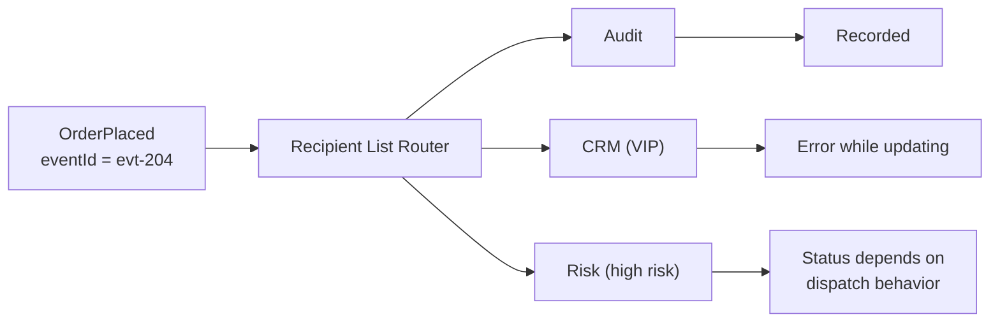
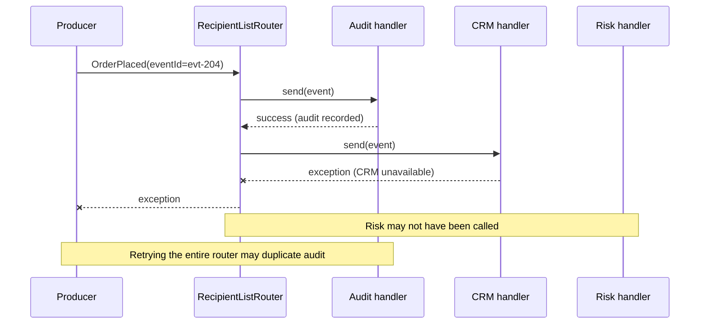
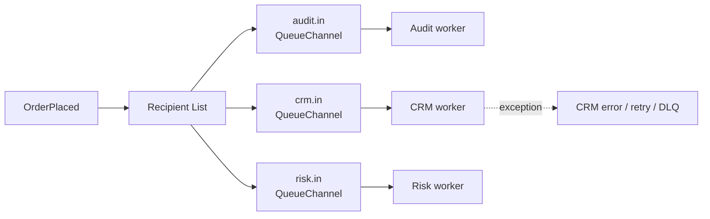
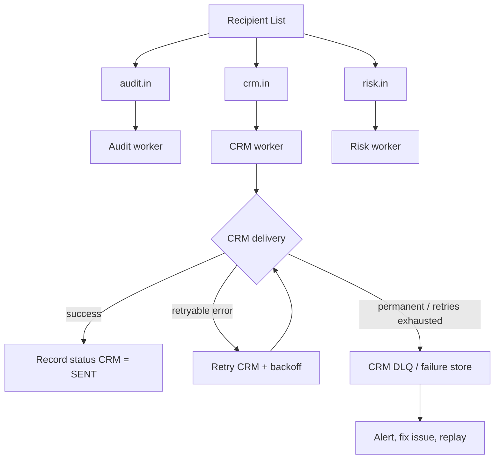
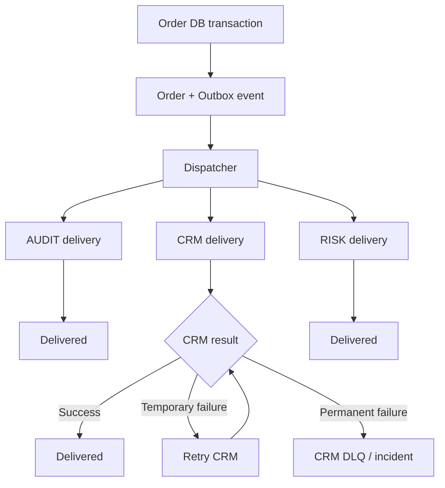

# Handling Failure in One Recipient

## 1. The Problem: One Message, Multiple Recipients, One Fails

An e-commerce system just completed an order and needs to emit an `OrderPlaced` event to three departments:

1. **Audit** records the business trail.
2. **CRM** updates the loyalty program if the order belongs to a VIP customer.
3. **Risk** receives an alert if the order is high-risk.

In the **Recipient List** pattern of Enterprise Integration Patterns (EIP), each message is routed to a **list of recipients**, optionally with per-recipient conditions. For a high-risk VIP event, all three recipients qualify to receive it.

But what happens if Audit already wrote successfully and CRM throws an exception? Should the whole message be resent? Is Risk guaranteed to still receive it? How do you know what was sent, received, processed, or failed? If the message is replayed, will Audit write two identical records?

That is the central problem of **"Handling Failure in One Recipient"**, part of the **Recipient list** chapter of the **SPRING_INTEGRATION_PATTERN** module. This module focuses on implementing Enterprise Integration Patterns with Spring Integration, combining Router, Filter, Transformer, Splitter, Aggregator, Gateway, retry, error channels, and correlation to build loosely coupled flows that can be tested and observed per branch.

After this lesson, you should be able to:

- Distinguish **successfully sending to a channel** from **a recipient completing business processing**.
- Understand how one recipient's failure affects remaining recipients when using synchronous or asynchronous channels.
- Choose between **fail-fast**, **best effort**, or **independent per-recipient recovery** policies.
- Place retries, error channels, idempotency, and dead-letter handling at the right scope.
- Know when you need a broker, outbox, event delivery status tracking, and business compensation.
- Write tests for partial failure, message replay, and late recipients.

## 2. What Does Recipient List Guarantee?

Spring Integration provides `RecipientListRouter` and the Java DSL `routeToRecipients(...)` to express fan-out over a recipient list. Each recipient can receive the same message or only receive it when its corresponding condition holds.



**Key point to remember:** Recipient List is a **mechanism for selecting targets and sending a message to them**. By itself, it does not create an atomic transaction across multiple channels, databases, or external services, does not automatically track "which recipients finished," and does not automatically aggregate responses.

A single send operation can pass through multiple stages:

| Milestone | Meaning | Not Yet Guaranteed |
| --- | --- | --- |
| Router selects recipient | Recipient is in the target list | Channel exists or has an active subscriber |
| Router sends to channel | Channel accepts the message per its rules | Handler finished running if the channel switches threads or buffers |
| Handler starts processing | Consumer pulled the message | Downstream database/API committed |
| Handler returns success | Work within the handler scope finished | Multiple external systems have consistent state |
| Recipient confirms result per contract | Evidence exists that the specific task was processed | Other recipients completed or no redelivery will occur |

With `DirectChannel`, the handler usually runs on the sending thread. If the handler throws an exception, it can propagate back to the router/caller. With `QueueChannel` or `ExecutorChannel`, channel acceptance and handler completion occur at different times. Therefore, never infer from `send() == true` that all recipients executed successfully.

### How Recipient List differs from Publish-Subscribe and Aggregator

| Pattern | Role | Does it handle single-recipient failure automatically? |
| --- | --- | --- |
| **Recipient List** | Selects target set using recipient list and selectors | No; you must design dispatch/recovery policy |
| **Publish-Subscribe Channel** | Broadcasts message to channel subscribers | Depends on dispatcher/channel mechanics and error policy; not a multi-subscriber commit |
| **Content-Based Router** | Usually chooses one business route based on payload/header, though some routers can pick multiple targets | No |
| **Aggregator** | Combines results from multiple messages based on correlation/release | Only solves fan-in when configured; does not fix fan-out failures automatically |

If the requirement is **"notify interested systems"**, Recipient List fits. If the requirement is **"wait for all three answers to produce one result"**, you must additionally design Gateway/Aggregator with correlation, a release strategy, and timeouts.

## 3. Real-World Failure Modes

Not every failure means "the recipient never received the message." Distinguishing failure types helps you choose safe retry behavior.

| Scenario | What Is Known | Risk of Blind Retries |
| --- | --- | --- |
| Selector or expression evaluation error | Recipient list may not be fully determined | Changing rules or data makes the recipient set differ between runs |
| Channel not found or channel has no subscriber | Cannot dispatch to that target | Message may still have reached recipients dispatched earlier |
| `DirectChannel` handler throws an exception | Handler may have performed some side effects before throwing | Re-invoking the handler or whole router may write duplicates |
| `QueueChannel` accepts message, consumer fails processing | Handoff succeeded, downstream business step failed | Caller sees no direct exception; without recovery, the message may be lost after dequeuing |
| `ExecutorChannel` accepts task, worker fails | Send finished before error surfaced | Sender and worker retries may act independently, causing duplicate work |
| HTTP recipient timeout | Unclear whether server received/committed | Replaying side-effect commands (especially payments) can cause duplicates |
| Broker accepts message, producer misses ack | Delivery state is ambiguous | Retries can create duplicates even though initial send succeeded |
| Consumer crashes after commit, before ack | Data changed, yet broker may redeliver | Requires per-recipient idempotency |

These cases highlight three distinct states: **not yet sent**, **delivered with unknown outcome**, and **confirmed processed**. A single `boolean success` flag is rarely sufficient to represent reliable messaging state across multiple systems.

## 4. Synchronous Failure: One Recipient May Finish Before Another Fails

Suppose a Recipient List Router sends to `DirectChannel` instances or channels with synchronous handlers. One possible execution order is:



The diagram depicts **one possible scenario** where Audit is dispatched before CRM. Do not turn recipient order into a business guarantee without explicit contracts and tests. The critical point is **there is no automatic rollback** for side effects Audit already performed when CRM fails.

With synchronous dispatch, an error from one recipient can **interrupt sending to subsequent recipients**. Alternatively, the application might use advice, channels, or dedicated handlers to handle errors, producing different behavior. Always verify on the actual topology rather than guessing from the pattern name.

### Why is retrying the entire Recipient List dangerous?

Suppose the router already succeeded with Audit and failed on CRM. Wrapping **the whole router call** in a retry can send to Audit again before reaching CRM. Result:

- Audit gets two records for one `eventId`.
- CRM might still be failing.
- Subsequent recipients do not get called if failure happens before their turn.

Therefore, **the ideal unit of retry is usually delivering to one recipient**, combined with idempotency at that recipient. Retrying the entire fan-out is only safe when all side effects are safely repeatable and duplicate handling has been verified.

## 5. Asynchronous Failure: Send Succeeds, Later Processing Fails

To make recipients relatively independent, the application can have the Recipient List send to buffered or executor-backed channels. For example:



In this architecture, CRM's business failure **occurs after** the router places the message into `crm.in`. Audit and Risk can proceed without waiting for CRM to finish.

However, understand the limitations:

1. A default in-memory `QueueChannel` **is not a durable broker**. If the process stops or a consumer pulls a message and fails, the application needs explicit retry/recovery mechanisms.
2. Queues can fill up. When `send` cannot enqueue a message, the router can still hit a dispatch failure right at send time.
3. Even though each branch processes independently, the router sending to three channels is still not an atomic transaction.
4. `ExecutorChannel` changes the execution thread but provides no message durability on application shutdown.
5. Different consumption speeds can build up backlog on one branch; monitor queue depth, wait times, and deadlines.

For **reliable delivery across restarts** or across applications, you typically need AMQP/JMS/Kafka, a persistent store, or an outbox architecture, together with controlled ack, retry, and dead-letter rules.

## 6. Three Response Strategies When One Recipient Fails

No single policy fits every flow. Start from the **business meaning of each recipient**.

| Strategy | Reaction When One Recipient Fails | When Appropriate | Key Requirements |
| --- | --- | --- | --- |
| **Fail-fast** | Report error and stop or return failure to caller | Recipient is mandatory to complete the request | Must know which side effects already succeeded before failure |
| **Best effort** | Log/record error and let remaining recipients continue | Low-criticality notifications, telemetry, or secondary updates | Acceptable to drop some notifications, with metrics |
| **Independent recovery** | Track per-recipient state, retry only failed branch or route to DLQ | CRM, audit, data sync, business events needing reliability | Idempotency, retention, and operational ownership for backlog/errors |

Examples:

- **Mandatory audit:** if an event must be audited before finishing the transaction, consider writing audit/outbox in the same transaction as the source data, then publishing to remaining recipients.
- **Potentially slow CRM:** can process asynchronously with its own retries and CRM backlog monitoring without blocking order completion.
- **Critical risk alert:** usually needs eventual delivery guarantees or escalation to operations after retries exhaust, rather than silently dropping the message.

**Never use "ignore the exception" as the sole definition of best effort.** Even non-mandatory branches need metrics, correlated logs, and a clear policy: drop permanently, retry with limits, or route to incident handling.

## 7. Spring Integration Java DSL Example: Separate Receiving Queues per Recipient

This example creates a **Recipient List Router** receiving `OrderPlaced` and selecting independent `QueueChannel`s. It illustrates the **dispatch** stage; workers and retry strategies are designed in the next step.

```java
import org.springframework.context.annotation.Bean;
import org.springframework.context.annotation.Configuration;
import org.springframework.integration.channel.DirectChannel;
import org.springframework.integration.channel.QueueChannel;
import org.springframework.integration.config.EnableIntegration;
import org.springframework.integration.dsl.IntegrationFlow;

record OrderPlaced(String eventId, String orderId) {}

@Configuration
@EnableIntegration
public class OrderEventFanoutConfig {

    @Bean("events.in")
    DirectChannel eventsIn() {
        return new DirectChannel();
    }

    @Bean("audit.in")
    QueueChannel auditInput() {
        return new QueueChannel(100);
    }

    @Bean("crm.in")
    QueueChannel crmInput() {
        return new QueueChannel(100);
    }

    @Bean("risk.in")
    QueueChannel riskInput() {
        return new QueueChannel(100);
    }

    @Bean
    IntegrationFlow orderFanout() {
        return IntegrationFlow.from("events.in")
            .routeToRecipients(spec -> spec
                .recipient("audit.in")
                .recipient("crm.in", "headers['notifyCrm'] == true")
                .recipient("risk.in", "headers['highRisk'] == true"))
            .get();
    }
}
```

**How it works:**

- Every message passing through the router includes the Audit recipient.
- Messages with header `notifyCrm=true` are also sent to CRM.
- Messages with `highRisk=true` are also sent to Risk.
- A message matching both conditions can enter **all three queues**.
- A 100-message queue capacity is an **example setting**, not a universal recommendation. You need policies for full queues and persistence across restarts.
- `notifyCrm` and `highRisk` are assumed to be produced by a trusted business step. Never let HTTP clients arbitrarily set headers to trigger or bypass sensitive actions.

**What is missing from this example:** no polling consumers, error handlers, dead-letter handling, or persistent storage. A queue accepting a message **does not prove CRM/Audit/Risk processed it successfully**. That is why dispatch and delivery/recovery must be separated.

### Testing fan-out before adding workers

You can test the DSL at the internal channel level using JUnit 5 and AssertJ:

```java
import static org.assertj.core.api.Assertions.assertThat;

import org.junit.jupiter.api.Test;
import org.springframework.beans.factory.annotation.Autowired;
import org.springframework.beans.factory.annotation.Qualifier;
import org.springframework.integration.channel.QueueChannel;
import org.springframework.messaging.Message;
import org.springframework.messaging.MessageChannel;
import org.springframework.messaging.support.MessageBuilder;
import org.springframework.test.context.junit.jupiter.SpringJUnitConfig;

@SpringJUnitConfig(OrderEventFanoutConfig.class)
class OrderEventFanoutTest {

    @Autowired
    @Qualifier("events.in")
    MessageChannel input;

    @Autowired
    @Qualifier("audit.in")
    QueueChannel audit;

    @Autowired
    @Qualifier("crm.in")
    QueueChannel crm;

    @Autowired
    @Qualifier("risk.in")
    QueueChannel risk;

    @Test
    void matchingRecipientsReceiveOneCopyEach() {
        Message<OrderPlaced> event = MessageBuilder
            .withPayload(new OrderPlaced("evt-204", "order-204"))
            .setHeader("notifyCrm", true)
            .setHeader("highRisk", true)
            .build();

        assertThat(input.send(event)).isTrue();

        Message<?> auditMessage = audit.receive(1_000);
        Message<?> crmMessage = crm.receive(1_000);
        Message<?> riskMessage = risk.receive(1_000);

        assertThat(auditMessage).isNotNull();
        assertThat(crmMessage).isNotNull();
        assertThat(riskMessage).isNotNull();

        assertThat(auditMessage.getPayload()).isEqualTo(event.getPayload());
        assertThat(crmMessage.getPayload()).isEqualTo(event.getPayload());
        assertThat(riskMessage.getPayload()).isEqualTo(event.getPayload());

        assertThat(audit.receive(0)).isNull();
        assertThat(crm.receive(0)).isNull();
        assertThat(risk.receive(0)).isNull();
    }

    @Test
    void nonVipLowRiskEventGoesOnlyToAudit() {
        Message<OrderPlaced> event = MessageBuilder
            .withPayload(new OrderPlaced("evt-205", "order-205"))
            .setHeader("notifyCrm", false)
            .setHeader("highRisk", false)
            .build();

        assertThat(input.send(event)).isTrue();
        assertThat(audit.receive(1_000)).isNotNull();
        assertThat(crm.receive(0)).isNull();
        assertThat(risk.receive(0)).isNull();
    }
}
```

These tests verify **which recipients are selected**, not consumer failures. To test a single recipient failing, build a controlled failing worker/handler and observe the outcome in the recovery system. Isolate queue state between tests so leftover messages from prior runs do not interfere.

## 8. Handling Errors in Workers: Per-Recipient Retries

An operationally clean design gives each recipient its own handler and recovery path:



**Unit of processing:** the pair `(eventId, recipientId)`. Event `evt-204` already processed by Audit does not need reprocessing just because CRM failed. With a delivery status store, a record might look like:

| Field | Example | Purpose |
| --- | --- | --- |
| `eventId` | `evt-204` | Stable identifier of the business event |
| `recipientId` | `CRM` | Exact receiving system |
| `status` | `PENDING / RETRYING / DELIVERED / DEAD` | Track progress per recipient |
| `attemptCount` | `3` | Retry limit tracking |
| `lastErrorCode` | `CRM_TIMEOUT` | Narrow down error; avoid storing secrets |
| `nextAttemptAt` | Next attempt timestamp | Backoff and scheduling |
| `policyVersion` | `fanout-v2` | Explain which policy version selected the recipient set |

This is an **application-level proposed state model**, not a schema generated automatically by Spring Integration. State must be updated with proper transactions and concurrency control so multiple workers do not concurrently process the same item uncontrollably.

### Where to place retries?

**Do not wrap the entire Recipient List Router in a retry** if recipients have distinct side effects not designed for safe repetition. Instead:

1. The Router sends messages to independent targets.
2. Each recipient worker receives its message, keeping `eventId` alongside `recipientId`.
3. The worker attempts its operation a bounded number of times.
4. For recoverable errors, apply controlled backoff and retries.
5. For permanent errors or exhausted retries, move the message and failure reason to a failure store/DLQ.
6. Audit and Risk continue according to their own policies.

Spring Integration provides handler advice mechanisms such as `RequestHandlerRetryAdvice` with Spring Retry, along with error flows and polling endpoints. **Attach advice to the specific recipient endpoint/handler that needs retries**, rather than wrapping the global router when per-recipient recovery is the goal. When using a broker, understand nack/requeue, delayed retry, dead-lettering, and delivery counts for your specific adapter.

### Illustrative worker in Java DSL

The snippet below is an **architectural illustration** adding a CRM consumer to the `crm.in` channel from Section 7:

```java
import org.springframework.context.annotation.Bean;
import org.springframework.beans.factory.annotation.Qualifier;
import org.springframework.integration.dsl.IntegrationFlow;
import org.springframework.integration.dsl.Pollers;
import org.springframework.messaging.MessageHandler;

// crmDeliveryHandler is a separately configured MessageHandler.
// It is responsible for idempotency, calling CRM, and emitting errors on failure.
@Bean
IntegrationFlow crmWorker(
        @Qualifier("crm.in")
        org.springframework.integration.channel.QueueChannel crmInput,
        @Qualifier("crmDeliveryHandler")
        MessageHandler crmDeliveryHandler) {

    return IntegrationFlow.from(crmInput,
            endpoint -> endpoint.poller(
                Pollers.fixedDelay(250)
                    .maxMessagesPerPoll(1)
                    .receiveTimeout(100)))
        .handle(crmDeliveryHandler)
        .get();
}
```

When the CRM consumer throws an exception, errors from the polling endpoint must be **captured through error handling configured for the poller/flow** and routed to CRM's recovery policy. This snippet **does not yet configure retries or a DLQ**, as it only illustrates where the worker attaches; never assume an exception automatically causes `QueueChannel` to re-enqueue a consumed message.

In production, connect one of two clear models:

- **Broker with dedicated consumers:** each recipient has its own queue/subscription and broker-managed retry/dead-lettering; workers ensure idempotent processing.
- **Persistent delivery store:** a transaction creates per-recipient delivery tasks, a scheduler picks due tasks, and workers update success/failure states with bounded attempt counts.

Both require monitoring backlog age, delivery deadlines, and handling unrecoverable messages.

## 9. Distinguishing Retryable, Permanent, and Ambiguous Failures

Before retrying, classify the error:

| Error Category | Examples | Typically Appropriate Response |
| --- | --- | --- |
| **Transient** (*retryable*) | HTTP 503, connect timeout before sending, exhausted connection pool | Bounded retry with backoff and jitter to avoid thundering herds |
| **Permanent** (*permanent*) | Invalid schema, 400 from bad data, permission denied that retrying cannot fix | Do not retry indefinitely; log to dead-letter/failure store and alert |
| **Ambiguous** (*ambiguous*) | Client timeout after request reached CRM, lost response after commit | Require an idempotency key or status-lookup API before retrying |
| **Local infrastructure error** | Queue full, channel resolution failure, process shutdown | Review capacity, lifecycle, and persistence; dispatch step may need retry |
| **Logic/programming bug** | `NullPointerException` in handler or selector | Fix code/contract and perform controlled replay afterward |

**Do not lump every exception into a blanket 3-retry policy.** Retries make sense only when the error has a chance of clearing without changing data or code. For ambiguous failures, *idempotency* matters more than retry count.

An illustrative policy for CRM:

```text
Max attempts: 5 (including initial attempt)
Backoff: 1s → 2s → 4s → 8s (with jitter)
HTTP 5xx / connection errors: retry if still within deadline
Invalid HTTP 4xx: move to failure store and alert
Timeout after sending: check status by eventId,
  or retry with the same idempotency key
After final attempt: move to CRM-specific DLQ, preserving eventId and cause
```

These numbers are for design practice only; production must factor in deadlines, upstream/downstream limits, and cost.

## 10. Idempotency: The Prerequisite for Safe Replay

When a failure happens after a recipient committed data but before acknowledgment, the producer or broker can replay the event. Every recipient with significant side effects should handle **the same event multiple times without duplicating business outcomes**.

For example, CRM receives:

```text
eventId = evt-204
recipientId = CRM
orderId = order-204
```

An idempotency key can be:

```text
CRM:evt-204
```

CRM records the processed-event marker within the same transaction as the loyalty points update, if infrastructure permits. Redeliveries detect that the event was already processed and **do not award points again**.

**Caution:** checking and then writing in two non-atomic operations is vulnerable to race conditions when multiple workers receive the same event. Use a unique constraint, transaction, or equivalent consistency mechanism. If a recipient calls an external API lacking idempotency support, design a lookup/status check or compensation workflow; you cannot prevent duplicates using `MessageHeaders.ID` alone.

### Scope of the idempotency key

`eventId` must represent **the same business event across retries**. Never generate `UUID.randomUUID()` per delivery attempt and use it for deduplication, since each attempt would produce a different key.

If the same event goes to three recipients, each recipient can use `eventId` within its own namespace. In a central delivery store, `(eventId, recipientId)` tracks each target independently without conflating "Audit processed" with "CRM processed."

## 11. Error Channel: Where Do Errors Surface?

Spring Integration uses `ErrorMessage` to represent failures on appropriate processing paths. An asynchronous error can be sent to an error channel configured on an endpoint/poller or via the `errorChannel` header in applicable situations. However, **there is no universal guarantee that every exception on every `DirectChannel` or adapter automatically routes through a global `errorChannel`**.

Distinguish:

| Context | Where Errors Typically Surface | Recovery Scope Needed |
| --- | --- | --- |
| Synchronous handler on `DirectChannel` | Exception propagates to caller/router if uncaught | Just-failed recipient; prior side effects may persist |
| Handler on polling consumer | Configured polling endpoint error flow | Message already pulled from queue; needs retry/replay plan |
| Handler running via executor | Error handler bound to executor/endpoint or `errorChannel` if configured | Task on another thread; sender may have returned |
| Gateway calling HTTP or broker | Adapter exception/timeout, reply/error flow | Distinguish failed send from unknown remote commit |
| Broker consumer | Nack/requeue/DLQ or adapter error flow | Control acks and message redelivery |

### Preserving metadata to know which recipient failed

An error log saying `"CRM timeout"` without `eventId` is hard to replay accurately. Each branch should retain:

- `eventId`: business event identifier.
- `recipientId`: AUDIT, CRM, or RISK.
- `correlationId`/`requestId` per tracing conventions.
- `attemptCount`, error code, attempt timestamp, and deadline.
- Payload reference/schema version for safe replay.

In Spring Integration, message-handling exceptions can expose `failedMessage` for source metadata. Still, never assume every exception carries the full original message. Design envelopes and tracking at the boundary before invoking external systems.

Use **separate error flows for error types with distinct policies**, or a shared error flow that classifies by recipient. Avoid a catch-all handler that simply logs and drops critical failures.

## 12. Transactional Outbox When Durable Fan-Out Is Required

If emitting events to Audit/CRM/Risk is a critical part of the business process, consider a **transactional outbox**:

1. In the same transaction as saving the order, write an `OrderPlaced(evt-204)` record to the outbox.
2. A dispatcher reads unpublished events and determines the recipient list according to the chosen policy.
3. Create delivery states for each `(eventId, recipientId)` or publish to broker queues/subscriptions.
4. Each recipient processes and records completion per its own policy.
5. If CRM fails, the dispatcher/CRM worker retries **CRM alone**, while Audit and Risk remain complete.
6. On permanent failure, retain the error record for alerting, data repair, or controlled replay.



An outbox prevents **dropping event emission intent** when the database commits successfully but the process crashes before sending. It **does not automatically guarantee exactly-once delivery to external systems**: the dispatcher can redeliver after a crash, and consumers still need idempotency.

### Recipient sets can change over time

If the CRM condition only applied to VIP customers at order placement time, a retry the next day must not accidentally re-evaluate updated VIP status and change which recipients were selected.

Two reasonable approaches:

- **Snapshot the recipient list** when creating the event or delivery tasks.
- **Version the routing policy** and persist the version/inputs needed to reproduce the decision.

Do not let retrying one recipient turn into "re-run the entire router on current data" if the business rule requires delivering to the exact recipient set determined when the event occurred.

## 13. When Is Business Compensation Needed?

Some fan-outs are not purely independent notifications. For example:

- One recipient reserves inventory.
- One recipient captures payment.
- One recipient creates a shipment.

If one system commits while another fails, you are dealing with a **distributed business workflow**. Recipient List cannot turn these three changes into a single ACID transaction.

When partial results are unacceptable, you need a **workflow orchestration / saga** that explicitly defines:

1. Which step must precede which.
2. Which steps may run concurrently.
3. Which event/response confirms success.
4. On failure, whether to retry, await intervention, or **compensate** (e.g., refund payment, release inventory).
5. How idempotency is guaranteed for both forward and compensating actions.

Recipient List can participate in event emission, but never dump end-to-end transaction coordination onto a list of recipients without explicit state and failure workflows.

## 14. Testing Scenarios Where One Recipient Fails

To test behavior accurately, do not just assert the router sent three messages. Distinguish:

- Failures **at dispatch time** (channel rejects).
- Failures **inside a synchronous handler** (exception reaches router).
- Failures **after queue/executor acceptance** (downstream fails post-handoff).
- Failures **after side effect commit but before ack** (ambiguous).
- **Replay** of the same `eventId` and **duplicates** at one recipient.

### 14.1. Testing a synchronously failing CRM handler

The small configuration below intentionally uses a `DirectChannel` for CRM so the exception happens on the sending thread. Audit uses a `QueueChannel` to observe the message the router already delivered before CRM failed.

```java
import org.springframework.context.annotation.Bean;
import org.springframework.context.annotation.Configuration;
import org.springframework.integration.channel.DirectChannel;
import org.springframework.integration.channel.QueueChannel;
import org.springframework.integration.config.EnableIntegration;
import org.springframework.integration.dsl.IntegrationFlow;
import org.springframework.messaging.MessageHandler;

@Configuration
@EnableIntegration
class SynchronousFailureDemoConfig {

    @Bean("sync.events.in")
    DirectChannel input() {
        return new DirectChannel();
    }

    @Bean("sync.audit.in")
    QueueChannel audit() {
        return new QueueChannel();
    }

    @Bean("sync.crm.in")
    DirectChannel crm() {
        return new DirectChannel();
    }

    @Bean
    IntegrationFlow sendToRecipients() {
        return IntegrationFlow.from("sync.events.in")
            .routeToRecipients(spec -> spec
                .recipient("sync.audit.in")
                .recipient("sync.crm.in"))
            .get();
    }

    @Bean
    IntegrationFlow failingCrm() {
        return IntegrationFlow.from("sync.crm.in")
            .handle((MessageHandler) message -> {
                throw new IllegalStateException("CRM unavailable");
            })
            .get();
    }
}
```

JUnit 5 + AssertJ example:

```java
import static org.assertj.core.api.Assertions.assertThat;
import static org.assertj.core.api.Assertions.assertThatThrownBy;

import org.junit.jupiter.api.Test;
import org.springframework.beans.factory.annotation.Autowired;
import org.springframework.beans.factory.annotation.Qualifier;
import org.springframework.integration.channel.QueueChannel;
import org.springframework.messaging.MessageChannel;
import org.springframework.messaging.support.MessageBuilder;
import org.springframework.test.context.junit.jupiter.SpringJUnitConfig;

@SpringJUnitConfig(SynchronousFailureDemoConfig.class)
class SynchronousFailureDemoTest {

    @Autowired
    @Qualifier("sync.events.in")
    MessageChannel input;

    @Autowired
    @Qualifier("sync.audit.in")
    QueueChannel audit;

    @Test
    void oneFailedRecipientDoesNotUndoPreviousDelivery() {
        assertThatThrownBy(() -> input.send(
            MessageBuilder.withPayload("evt-204").build()))
            .isInstanceOf(RuntimeException.class);

        // Audit is the recipient declared before CRM in the demo.
        // Verify that an already-completed dispatch step remains.
        assertThat(audit.receive(1_000)).isNotNull();
    }
}
```

This test **illustrates a specific topology** and verifies partial-completion risk; it is not a contract that all Recipient List variants always dispatch in the same order or that every recipient failure always halts remaining recipients. When switching to executors, brokers, or recovery strategies, re-verify propagation and ordering expectations.

### 14.2. Testing per-recipient recovery

With an architecture having a delivery store and independent consumers, configure a fake CRM that fails once and then succeeds:

| Attempt | Audit | CRM | Risk | Expectation |
| --- | --- | --- | --- | --- |
| Initial dispatch | Delivered | Transient failure | Delivered | Only CRM enters retry state |
| CRM retry #1 | Does not rerun | Delivered | Does not rerun | All three complete |
| Subsequent replay of same event | Recognized as processed | Recognized as processed | Recognized as processed | No new side effects |

Assertions to include:

1. `eventId` and `recipientId` remain identical on CRM retry.
2. Audit writes only one business result for `evt-204`.
3. CRM retries the exact configured count and backoff (use a fake clock when testing schedulers).
4. Risk is not delayed indefinitely by CRM unavailability.
5. After retries exhaust, CRM moves to a failure store/DLQ with cause code and safe payload reference.
6. Replayed messages do not duplicate side effects for already-succeeded recipients.
7. Under concurrent consumption of the same event, unique keys/transactions prevent two workers from double-committing.

Avoid using `Thread.sleep(...)` to "prove" backoff or ordering. For asynchronous consumers, use test support utilities, latches, bounded waits, and controlled clocks/schedulers where available.

## 15. Operations: Seeing Errors for *Each* Recipient

A log stating `"Error sending event"` is not enough to investigate a multi-recipient system. Use **per-target metadata** for observability.

Suggested log fields:

```text
event=recipient_delivery_failed
eventId=evt-204
recipientId=CRM
attempt=3
errorCode=CRM_TIMEOUT
nextAttemptAt=2026-11-21T09:05:00Z
correlationId=req-204
```

These values are illustrative. Avoid logging bearer tokens, personal data, full payloads, or exception text that may leak secrets.

Application metrics to track:

- Events selected per `recipientId`.
- Dispatch failures before queue/broker acceptance.
- Processing successes/failures per recipient.
- Retry counts and messages moved to dead-letter/failure stores.
- Oldest undelivered message age and backlog size per recipient.
- End-to-end time from event creation to recipient processing confirmation.
- Replays/duplicates blocked by idempotency.

These are **recommended metric groups**, not claims that Spring Integration exposes matching metric names out of the box in every version.

### Troubleshooting Table

| Symptom | Likely Cause | How to Check |
| --- | --- | --- |
| Producer receives exception when CRM fails | CRM executes synchronously on `DirectChannel` | Identify thread and endpoint, inspect exception path and previously invoked recipients |
| Producer returns success yet CRM never updates | Message entered queue/executor and worker failed later | Inspect poller, error channel, retry store, and CRM logs |
| Audit has duplicate records after CRM failure | Entire Recipient List retried | Check retry scope and Audit idempotency key |
| Risk never receives message | Earlier synchronous recipient failed, wrong selector, or unresolved target | Verify recipient list, channels, conditions, and failure point |
| CRM queue grows continuously | CRM slow, broken, or retrying too aggressively | Measure backlog, failure rate, throughput, and backoff |
| DLQ fills up with no one handling it | Missing operational process and replay tooling | Assign owner, alerts, dashboard, and recovery runbook |
| CRM awards points twice | Committed before ack, message redelivered | Add consumer idempotency key/transaction |
| Replay changes recipient set | Selector re-evaluated changed live data | Snapshot recipients or version routing policies |
| Cannot tell which recipient failed | `ErrorMessage` lacks recipient-identifying context | Attach `eventId`/`recipientId` before dispatch and keep in error envelope |

## 16. Practice Exercises

**Exercise 1 — Predict partial failure.** Build a flow with a Recipient List sending Audit → CRM → Risk over `DirectChannel`. Have Audit increment a counter and CRM throw an exception. Determine the counter value after one send and after one full-flow retry. Explain why the result is not an atomic transaction. Test against an explicit topology instead of guessing from channel names.

**Exercise 2 — Isolate retries.** Using the per-recipient queues from Section 7, add a CRM worker with bounded retries and delivery status tracking. Simulate CRM failing twice before succeeding; prove Audit and Risk are not invoked again.

**Exercise 3 — Idempotency.** Send the same `eventId=evt-204` twice to the CRM worker. Use a unique `(recipientId, eventId)` key and an appropriate transaction so loyalty points change only once per event. Test two consumers concurrently processing the duplicate event.

**Exercise 4 — Ambiguous failure.** CRM received and persisted data, then the HTTP client timed out. Design an API accepting an idempotency key or a status-lookup endpoint for safe retries. Contrast this with an HTTP 400 caused by an invalid payload.

**Exercise 5 — Operations plan.** Design a dashboard and runbook for a 30-minute CRM outage. Define max backlog, retry policy, alert thresholds, DLQ handling, operator responsibilities, and how to replay without re-emitting to Audit/Risk.

A complete solution must clearly explain **failure type**, **which recipients succeeded**, **retry scope**, **delivery state**, **deduplication**, and **how recovery is verified**.

## 17. Key Principles to Remember

- **Recipient List selects multiple targets; it does not mean a shared transaction.** One recipient failing can leave committed results at other recipients.
- **Synchronous and asynchronous errors have different observation paths.** Specifically, `send() == true` only confirms a handoff boundary, not business completion.
- **Per-recipient retries** generally prevent repeating side effects at already-completed recipients. If retrying the whole fan-out, prove every branch is idempotent.
- **Stable idempotency keys** like `(recipientId, eventId)` and proper transaction boundaries are the foundation of safe replay.
- **Error channels, broker retries, and DLQs** must be configured deliberately. They do not automatically turn an in-memory `QueueChannel` into a high-reliability queue.
- **An outbox** persists emission intent alongside the source transaction, yet consumers still need idempotency for redeliveries.
- **If recipients perform dependent business steps requiring compensation**, design an explicit workflow/saga instead of forcing Recipient List to act as an orchestrator.

## References

- [Spring Integration Reference — Message Routing](https://docs.spring.io/spring-integration/reference/router.html)
- [Spring Integration Reference — Router Implementations](https://docs.spring.io/spring-integration/reference/router/implementations.html)
- [Spring Integration Reference — Message Channels](https://docs.spring.io/spring-integration/reference/channel.html)
- [Spring Integration Reference — Error Handling](https://docs.spring.io/spring-integration/reference/error-handling.html)
- [Spring Integration Reference — Polling Consumer](https://docs.spring.io/spring-integration/reference/endpoint/polling-consumer.html)
- [Spring Integration Reference — Messaging Gateways](https://docs.spring.io/spring-integration/reference/gateway.html)
- [Enterprise Integration Patterns — Recipient List](https://www.enterpriseintegrationpatterns.com/patterns/messaging/RecipientList.html)
- [Enterprise Integration Patterns — Dead Letter Channel](https://www.enterpriseintegrationpatterns.com/patterns/messaging/DeadLetterChannel.html)
- [Enterprise Integration Patterns — Idempotent Receiver](https://www.enterpriseintegrationpatterns.com/patterns/messaging/IdempotentReceiver.html)

These examples reflect Spring Integration Java DSL in modern versions. When applying them in production, verify APIs for your running version, channel threading models, polling/error flow settings, transactions, and target adapter acknowledgment semantics.
