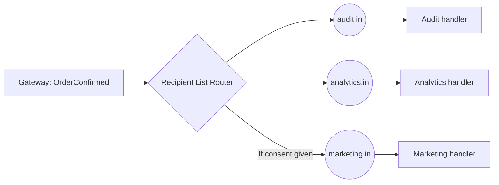
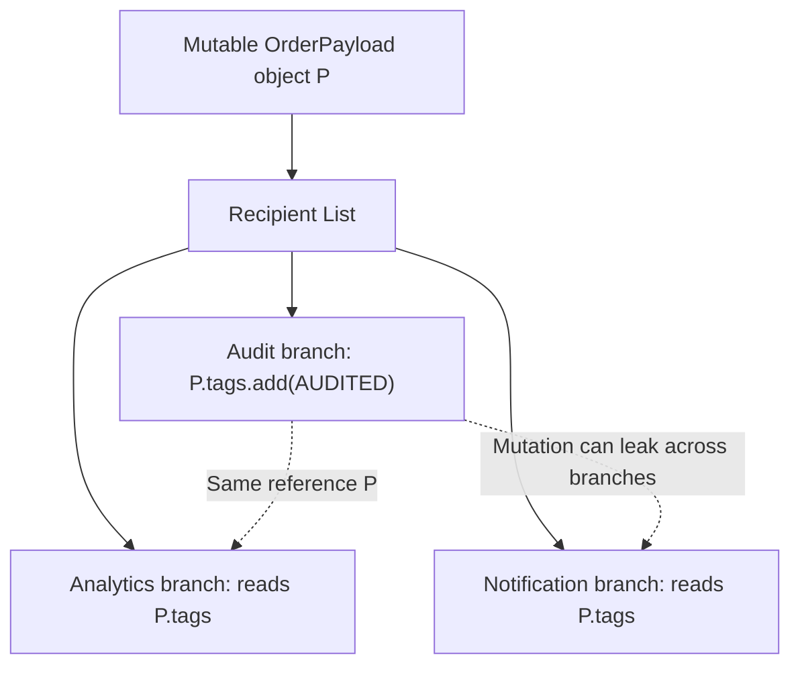

# Message Copying and Payload Sharing

> **Chapter:** Recipient list  
> **Module:** `SPRING_INTEGRATION_PATTERN` — implement Enterprise Integration Patterns with Spring Integration to build loosely coupled, extensible messaging flows; practice Router, Filter, Transformer, Splitter, Aggregator, Gateway, retry, error channel, correlation, testing, and per-branch observability. This lesson focuses on **message copying and payload sharing when a Recipient List sends the same message to multiple targets**.

## 1. Learning Objectives

After this lesson, you will be able to:

1. Distinguish **one message sent to multiple recipients** from **multiple independent copies of data**.
2. Understand the differences between **same message reference**, **envelope copy**, **shallow payload copy**, and **deep/defensive copy**.
3. Explain why structurally unmodifiable `MessageHeaders` do not mean **every header value and payload is immutable**.
4. Use Java records/immutable DTOs and per-branch Transformers to prevent cross-branch data mutation.
5. Write Recipient List examples with Spring Integration Java DSL; test the recipient set and demonstrate the risks of sharing mutable payloads.
6. Design fan-out policies involving executors, queues, brokers, retries, single-recipient failures, correlation, security, and tracing.

## 2. One Event, Multiple Recipients: What Is Actually Copied?

Suppose when order `ORD-901` is confirmed, the application emits an `OrderConfirmed` event. The Recipient List decides to send the message to three channels: audit, analytics, and marketing (the marketing branch is selected only if the customer opted in).



All branches need to know about **the same business event**, yet they do not necessarily need **the same set of fields**. Audit may need `orderId` and timestamp; analytics needs products and quantities; marketing only needs data it is permitted to use.

A common misconception is: "Recipient List sends to three destinations, so Spring Integration definitely deep-copied the payload into three independent objects." **That is not guaranteed.** In an in-memory fan-out without a transformation/serialization step, recipients can receive messages holding **the exact same payload object**. The framework may construct or adjust the *message envelope* when adding sequence/correlation headers, but doing so **does not automatically deep-copy business data**.

### 2.1. A Message Consists of an Envelope and a Payload

```text
Message<T>
  +-- headers: id, timestamp, correlationId, ...
  +-- payload: T

Recipient A: envelope A ----+
                            +----> same payload object P (possibly)
Recipient B: envelope B ----+
Recipient C: envelope C ----+
```

Even when `envelope A != envelope B`, it can still be true that `envelopeA.getPayload() == envelopeB.getPayload()` by **object identity**. Whether data gets mutated across branches depends on the **immutability of the entire object graph** referenced by the payload, not merely on how many messages were sent.

## 3. Four Copy Scenarios to Distinguish

| Scenario | Envelope | Payload | Independent on mutation? |
| --- | --- | --- | --- |
| **Forwarding the same message** | May be the same object | Same object | **No** if payload is mutable |
| **Copying envelope/headers** | New message object | Usually still the same payload object | **No** for mutable payload data |
| **Shallow copy of payload** | May be new | Outer container new, nested objects may still be shared | **Only partially** |
| **Deep/defensive copy** | May be new | Mutable parts needing isolation are cloned separately | **Yes**, if all mutable components needing protection are copied properly |
| **Serialize then deserialize across an external boundary** | Envelope may be reconstructed | Usually reconstructed as objects in the receiving process | Usually isolated from source memory; **does not** guarantee copy, schema, or delivery semantics without verification |

There is no rule stating "every `send` call performs a deep copy." **Spring Integration Message Channel** is a delivery mechanism; whether payloads are kept as-is, cloned, or transformed is the responsibility of contracts, endpoints, and technology boundaries.

### 3.1. Copying an envelope does not copy the payload

`MessageBuilder.fromMessage(original)` can build a new message with additional headers. The reconstructed message's payload can still be **the exact same reference**:

```java
import java.util.ArrayList;
import java.util.HashMap;
import java.util.List;
import java.util.Map;

import org.springframework.messaging.Message;
import org.springframework.messaging.support.MessageBuilder;

List<String> labels = new ArrayList<>(List.of("NEW"));
Map<String, Object> mutablePayload = new HashMap<>();
mutablePayload.put("labels", labels);

Message<Map<String, Object>> original =
    MessageBuilder.withPayload(mutablePayload).build();

Message<Map<String, Object>> envelopeCopy =
    MessageBuilder.fromMessage(original)
        .setHeader("recipient", "analytics")
        .build();

System.out.println(original.getPayload() == envelopeCopy.getPayload());
// true: the payload is still shared in this example.

labels.add("UPDATED_BY_OTHER_BRANCH");
System.out.println(envelopeCopy.getPayload().get("labels"));
// [NEW, UPDATED_BY_OTHER_BRANCH]
```

In this example, `recipient` is merely an application-defined header, not a mandatory Spring Integration header. `MessageBuilder.fromMessage` does not automatically convert mutable `Map` and `ArrayList` instances into independent objects.

### 3.2. Shallow copy: new outer object, shared nested parts

```java
Map<String, Object> shallow = new HashMap<>(mutablePayload);

System.out.println(shallow != mutablePayload); // true
System.out.println(shallow.get("labels") == mutablePayload.get("labels"));
// true: both Maps still reference the same List.
```

That is why merely using `new HashMap<>(...)`, `new ArrayList<>(...)`, or a DTO copy constructor is **not necessarily enough** to protect nested structures. You must examine **the entire mutable data graph accessible by each recipient**.

### 3.3. Defensive copy: isolating mutable parts properly

```java
Map<String, Object> defensive = new HashMap<>();
defensive.put("labels", List.copyOf(labels));

labels.add("LATE_CHANGE");

System.out.println(defensive.get("labels"));
// Does not contain LATE_CHANGE; the List copy disallows add/remove.
```

However, `List.copyOf` only creates a **shallow copy of the list**. If the list holds mutable elements (such as `List<MutableAddress>`), mutating a field on an element will still be visible in the copied list. You need **immutable element DTOs** or deliberate copying of each mutable element when deep isolation is required.

## 4. Traps of Mutable Payloads During Fan-Out

Suppose both audit and analytics receive a payload containing `lineItems`. Audit inserts a processing flag into a `Map` inside the payload; analytics reads that `Map` to compute reports. If run synchronously, results can **depend on handler invocation order**. If run on an executor, two handlers can run on different threads, introducing **data races**, inconsistent values, or concurrent modification exceptions when iterating collections.



### 4.1. Common False Assumptions

1. **"`MessageHeaders` is immutable so the payload is immutable too."** False: an unmodifiable header map has no effect on payload mutability.
2. **"A record is deeply immutable."** False: a record prevents reassigning fields, yet fields holding a `List`, `Map`, array, or mutable object can still be mutated through the reference.
3. **"Each recipient gets its own message ID so the data is independent."** False: different IDs/envelopes do not prove the payload was copied.
4. **"`ExecutorChannel` automatically isolates data."** False: switching threads does not copy objects; sharing mutable state across threads is usually even more dangerous.
5. **"A broker prevents sharing mutable objects so we do not need to care."** Only true across process boundaries if serialization/deserialization actually reconstructs objects; you still need schemas, security, copy semantics when multiple consumers run **in the same receiving process**, and idempotency upon redelivery.

### 4.2. What if handlers only read data?

**Sharing an immutable payload is usually the best option**: you avoid deep-copying all data per recipient, reducing memory allocations and GC overhead. Multiple subscribers reading an immutable object is an efficient form of fan-out. The prerequisite is that the object graph is never mutated after sending—neither by the producer, an adapter, nor another handler.

If you send a message containing a `List` that the producer later updates, even read-only recipients can observe data changing after event emission. Therefore, **freezing data at emission time** is part of the contract.

## 5. Recommendation: Design Immutable Payloads from the Start

One Java 17+ approach is defining a `record` for the event and each line item, copying the input list upon event construction:

```java
import java.math.BigDecimal;
import java.util.List;
import java.util.Objects;

record OrderLine(String sku, int quantity, BigDecimal unitPrice) {
    OrderLine {
        Objects.requireNonNull(sku, "sku");
        Objects.requireNonNull(unitPrice, "unitPrice");
        if (sku.isBlank() || quantity <= 0 || unitPrice.signum() < 0) {
            throw new IllegalArgumentException("Invalid order line");
        }
    }
}

record OrderConfirmed(
    String orderId,
    List<OrderLine> lines,
    boolean marketingConsent
) {
    OrderConfirmed {
        if (orderId == null || orderId.isBlank()) {
            throw new IllegalArgumentException("orderId is required");
        }
        lines = List.copyOf(Objects.requireNonNull(lines, "lines"));
    }
}
```

Here, `OrderLine` only holds `String`, `int`, and `BigDecimal` (none of which allow mutating content in normal usage), and `OrderConfirmed` holds an unmodifiable `List`.

```java
import java.util.ArrayList;
import java.util.List;
import java.math.BigDecimal;

List<OrderLine> source = new ArrayList<>();
source.add(new OrderLine("SKU-A", 2, new BigDecimal("100000")));

OrderConfirmed event = new OrderConfirmed("ORD-901", source, true);
source.clear(); // Does not alter lines inside the event.

System.out.println(event.lines().size()); // 1
// event.lines().add(...); // Will throw UnsupportedOperationException.
```

**Limitation:** Records and `List.copyOf` are not enough if `OrderLine` contains `Date`, `byte[]`, mutable `Map`s, or nested mutable objects. Design **deep immutability** per schema or perform defensive copies for each mutable field. Never neglect validation, access control, or event semantics just because a DTO is immutable.

## 6. Recipient List Example with Spring Integration Java DSL

The following example uses internal channels to inspect fan-out by **recipient count and payload sharing**. One flow sends events to audit and analytics; marketing receives only when `marketingConsent=true` was verified by an authoritative system.

### 6.1. Declaring the Flow and Message-Collecting Channels

```java
import org.springframework.context.annotation.Bean;
import org.springframework.context.annotation.Configuration;
import org.springframework.integration.channel.DirectChannel;
import org.springframework.integration.channel.QueueChannel;
import org.springframework.integration.config.EnableIntegration;
import org.springframework.integration.dsl.IntegrationFlow;

@Configuration
@EnableIntegration
class RecipientCopyDemoConfiguration {

    @Bean("events.input")
    DirectChannel input() {
        return new DirectChannel();
    }

    @Bean("recipients.audit")
    QueueChannel audit() {
        return new QueueChannel();
    }

    @Bean("recipients.analytics")
    QueueChannel analytics() {
        return new QueueChannel();
    }

    @Bean("recipients.marketing")
    QueueChannel marketing() {
        return new QueueChannel();
    }

    @Bean
    IntegrationFlow distributeOrderEvents() {
        return IntegrationFlow.from("events.input")
            .routeToRecipients(r -> r
                .recipient("recipients.audit")
                .recipient("recipients.analytics")
                .recipient("recipients.marketing", "payload.marketingConsent()"))
            .get();
    }
}
```

`QueueChannel` is used here **as a collector for lesson/testing purposes**, not as a recommendation to use in-memory queues for production fan-out. No production consumers/pollers are declared; a test explicitly calls `receive()` on each queue to read messages.

### 6.2. What the framework guarantees and does not guarantee

- The Recipient List Router determines the **set of target channels** based on configuration and selectors.
- The message is sent to **each selected channel** per endpoint/channel semantics.
- The example **does not request or configure payload deep copying**; internal branches can share the `OrderConfirmed` reference.
- The framework may add or alter sequence/correlation headers depending on configuration and version; **do not use envelope object identity or message ID as a copy contract**.
- `input.send(message)` returning `true` does not mean three consumers finished business processing; in this example, messages only sit in the target queues.
- If `QueueChannel` is replaced with `DirectChannel` and synchronous handlers, side effects of one handler can affect orchestration or subsequent handlers if they read a shared mutable payload.

### 6.3. Testing the Recipient Set and Payload Sharing

```java
import static org.junit.jupiter.api.Assertions.*;

import java.math.BigDecimal;
import java.util.List;

import org.junit.jupiter.api.Test;
import org.springframework.beans.factory.annotation.Autowired;
import org.springframework.beans.factory.annotation.Qualifier;
import org.springframework.messaging.Message;
import org.springframework.messaging.MessageChannel;
import org.springframework.messaging.PollableChannel;
import org.springframework.messaging.support.MessageBuilder;
import org.springframework.test.context.junit.jupiter.SpringJUnitConfig;

@SpringJUnitConfig(RecipientCopyDemoConfiguration.class)
class RecipientCopyDemoTest {

    @Autowired @Qualifier("events.input") MessageChannel input;
    @Autowired @Qualifier("recipients.audit") PollableChannel audit;
    @Autowired @Qualifier("recipients.analytics") PollableChannel analytics;
    @Autowired @Qualifier("recipients.marketing") PollableChannel marketing;

    @Test
    void fanOutSharesImmutablePayloadAndPreservesBusinessHeader() {
        OrderConfirmed payload = new OrderConfirmed(
            "ORD-901",
            List.of(new OrderLine("SKU-A", 2, new BigDecimal("100000"))),
            true);

        Message<OrderConfirmed> message = MessageBuilder.withPayload(payload)
            .setHeader("businessCorrelationId", "ORD-901")
            .build();

        assertTrue(input.send(message));

        Message<?> audited = audit.receive(1000);
        Message<?> analyzed = analytics.receive(1000);
        Message<?> marketed = marketing.receive(1000);

        assertNotNull(audited);
        assertNotNull(analyzed);
        assertNotNull(marketed);

        // This test observes payload reference sharing within the internal topology.
        assertSame(payload, audited.getPayload());
        assertSame(payload, analyzed.getPayload());
        assertSame(payload, marketed.getPayload());

        assertEquals("ORD-901",
            analyzed.getHeaders().get("businessCorrelationId"));
        assertEquals("ORD-901", marketed.getHeaders()
            .get("businessCorrelationId"));

        // No recipient is duplicated in this fixture.
        assertNull(audit.receive(0));
        assertNull(analytics.receive(0));
        assertNull(marketing.receive(0));
    }

    @Test
    void marketingRecipientIsNotSelectedWithoutConsent() {
        OrderConfirmed payload = new OrderConfirmed(
            "ORD-902", List.of(), false);

        assertTrue(input.send(MessageBuilder.withPayload(payload).build()));

        assertNotNull(audit.receive(1000));
        assertNotNull(analytics.receive(1000));
        assertNull(marketing.receive(0));
    }
}
```

**Subtle point:** `assertSame(payload, received.getPayload())` only suits this internal topology **with no payload copy/serialization/Transformer step** in the fixture. Network adapters may produce new objects carrying equivalent data; in that case test **business values and schema**, not `assertSame`.

Tests should run with clean queue state per test method. The example has two tests that each drain all of their messages; if expanding fixtures or running tests in parallel, isolate contexts/queues per test or reset state deliberately to prevent cross-test state leaks.

## 7. Per-Recipient Transformation to Reduce Coupling

Not every receiver needs the entire `OrderConfirmed`. When audit only needs order ID and line count while analytics needs total item quantity, create **separate projections per branch** after the Recipient List distributes the event.

```java
record AuditRecord(String orderId, int lineCount) {}
record AnalyticsRecord(String orderId, int quantity) {}
record MarketingNotice(String orderId) {}

static AuditRecord toAudit(OrderConfirmed event) {
    return new AuditRecord(event.orderId(), event.lines().size());
}

static AnalyticsRecord toAnalytics(OrderConfirmed event) {
    int quantity = event.lines().stream()
        .mapToInt(OrderLine::quantity)
        .sum();
    return new AnalyticsRecord(event.orderId(), quantity);
}

static MarketingNotice toMarketing(OrderConfirmed event) {
    return new MarketingNotice(event.orderId());
}
```

You can place a Transformer at the start of each branch **after** the Recipient List:

```text
                          +--> recipients.audit
                          |        -> Transformer(OrderConfirmed -> AuditRecord)
OrderConfirmed -> Router -+        -> Audit handler
                          |
                          +--> recipients.analytics
                          |        -> Transformer(OrderConfirmed -> AnalyticsRecord)
                          |        -> Analytics handler
                          |
                          +--> recipients.marketing (only if consent)
                                   -> Transformer(OrderConfirmed -> MarketingNotice)
                                   -> Notification gateway
```

These functions create **new payloads for each branch** without modifying the original event. If writing to files or networks, each branch also needs appropriate outbound adapters/gateways and error handling. When transforming inside Spring Integration, verify which headers are preserved; across external protocols, configure header mapping if downstream needs correlation or schema versions.

### 7.1. Why not copy the entire payload to every branch?

- **Security:** audit does not need contact details; analytics does not need tokens; marketing must have verified consent.
- **Coupling:** each consumer depends only on the schema it needs, not every change in the Order aggregate.
- **Size:** large payloads multiplied by many recipients increase memory, bandwidth, and serialization costs.
- **Testing:** dedicated projections make it easy to assert no sensitive fields leak into unauthorized branches.

**Copying and redacting are two different tasks:** deep-copying sensitive data intact to an unauthorized recipient **is still a leak**. Build properly scoped views/projections and enforce recipient permissions, rather than merely making technical clones.

## 8. Headers, Correlation, and Sequencing During Fan-Out

Spring Messaging's `MessageHeaders` provides a structured metadata map that resists direct modification under normal use. However, **objects stored as header values can still be mutable** if the application places a mutable `List`, `Map`, or DTO into a header.

```java
// Do not assume header values are always deep-frozen.
Map<String, String> options = new HashMap<>();
Message<String> m = MessageBuilder.withPayload("ORD-901")
    .setHeader("unsafeOptions", options)
    .build();

options.put("route", "changed-later");
// Other code reading m.getHeaders().get("unsafeOptions")
// can observe the same mutated Map.
```

Recommendation: routing/correlation headers should be **scalar/immutable values** (`String`, `UUID`, normalized enums) or immutable DTOs; avoid stuffing entire customer profiles or complex mutable structures into headers.

### 8.1. Correlation must be preserved, yet it is not idempotency

| Field | Role | Note |
| --- | --- | --- |
| `eventId` | Original business event identifier | Supports deduplication at each consumer |
| `messageId` | Framework message/envelope ID | Can change across message rebuilds/adapters |
| `correlationId` | Links messages belonging to a workflow | Insufficient to prevent duplicate processing |
| `recipientKey` | Logical label of recipient for auditing | Supports recording per-branch outcomes |
| `sequenceNumber`/`sequenceSize` | Ordering/total-part info in a group if configured | Does not guarantee all replies arrived |

With Recipient List, a single event sent to three targets can result in three distinct **executions**. Each consumer needs idempotency keyed by `(eventId, consumerName)` or a suitable business key; never rely solely on `MessageHeaders.id` to ensure business actions occur only once.

When **collecting replies from all recipients**, design request–reply with an **Aggregator**, correlation strategy, release strategy, timeouts/expiry, and missing/late-reply handling. Setting sequence headers (if supported by configuration) does not automatically gather replies or guarantee each recipient succeeded.

### 8.2. Should headers be modified separately per recipient?

You can add a header-enrichment step **inside each branch** to attach `recipientKey`, `deliveryAttempt`, or trace labels. Never attempt to mutate a shared header map already sent to multiple targets; use `MessageBuilder` or a Header Enricher to construct new messages properly. Fields like `replyChannel`, `errorChannel`, and trace/security contexts carry special semantics; **do not blindly copy or overwrite them** without understanding the contract.

## 9. Synchronous, Asynchronous, and Dangerous Data-Sharing Cases

| Configuration | Closest Delivery Mechanism | Copy-Related Risk |
| --- | --- | --- |
| `DirectChannel` + synchronous handler | Calls handlers sequentially on sending thread | Earlier handler mutating payload affects what later handlers see |
| `ExecutorChannel` | Submits work to an executor | Recipients may run concurrently, causing data races on mutable payloads |
| In-memory `QueueChannel` | Enqueues message reference for poller | Mutable objects may be modified **after enqueue, before dequeue** |
| External broker via adapter | Serializes and publishes per broker protocol | Network copies decouple memory references, yet schema/header/ack/redelivery still need management |
| `PublishSubscribeChannel` | Distributes to channel subscribers | Can also share payloads; fan-out does not imply automatic deep copy |

### 9.1. The problem of producers mutating after send

An easily overlooked bug: a producer sends a message and then keeps modifying the DTO/list it just sent. On asynchronous channels, consumers may read the modified data instead of the snapshot at emission time.

```text
Producer creates mutable payload P
   -> send(P) to QueueChannel
   -> producer mutates P.status="CANCELLED"
   -> poller later receives the message

Consumer may read P.status="CANCELLED", even though it was "CONFIRMED" at send time.
```

The preferred fix is creating an immutable snapshot before sending. Deep copying via serialization, if used, must account for performance overhead and schema risks; do not use it to mask uncontrolled mutable data design.

### 9.2. Same event, multiple handlers with side effects

Recipient List suits fanning out **events** to multiple interested parties. If the payload is a **command to create a shipment**, sending that command to three logical owners could create three shipments. That is a **business semantics error**, not solved by copying payloads. Pick one owner responsible for executing the command; only after success should events be emitted to interested subscribers.

### 9.3. Partial failure and retry

Suppose audit and analytics finished, while marketing timed out. Retrying the entire Recipient List can send duplicates to audit and analytics. Track per-recipient state and place retries **on the failed branch**, combined with idempotent consumers or independent outbox/broker/subscriptions when high reliability is required.

**Recipient List does not provide a distributed transaction across all targets.** `send=true` at the entry point only confirms the send boundary per channel type; it does not assert all recipients committed business changes.

## 10. Copying, Observability, and Sensitive Data

With multiple recipients, the same message may be logged or wire-tapped in multiple places. This increases data exposure risk compared to single-destination flows.

| Observation Point | Should Log | Avoid Logging |
| --- | --- | --- |
| Recipient List decision | `eventId`, `correlationId`, logical recipient set | Full payload containing PII |
| Target channel | Channel name, dispatch outcome, receive count | Tokens, addresses, payment details |
| Each consumer | Business outcome, latency, attempts | Raw event object dumps unless necessary |
| Error channel | Error, exception type, recipient, safe lookup code | Exception messages containing secrets or full requests |
| Distributed tracing | Trace/span IDs, boundaries, timing | Detailed identifying data in public tags |

For metrics, `recipientName`, `channel`, and `outcome` typically have bounded cardinality; `orderId`, `messageId`, and `eventId` have high cardinality and **must not be used as tags on aggregated metrics**. Keep correlation IDs in access-controlled logs/traces.

**Wire Tap is not a deep copy:** if you attach a Wire Tap for auditing, the tapped branch can receive shared object references depending on implementation semantics. Build a safe projection for the audit channel so an observation branch cannot accidentally mutate the original event or trigger observation loops.

## 11. Additional Testing for Copying and Isolation

Beyond the JUnit cases in Section 6, test behaviors in scenarios that are easy to overlook:

| Scenario | Expectation |
| --- | --- |
| Consent `true` | Audit, analytics, and marketing all receive the exact event |
| Consent `false` | Audit/analytics receive it; marketing does **not** |
| Shared mutable payload across two branches | Test demonstrates/detects aliasing; production never mutates shared objects |
| Record DTO with `List.copyOf` | Mutating source list after construction does not affect the event |
| DTO with nested mutable elements | Unit test catches shallow-immutability risks |
| Audit projection | Contains no email/address/token if audit contract excludes them |
| Queue receives message after producer mutates object | Immutable snapshot remains unchanged across wait time |
| Concurrent executor dispatch | No data races from shared mutable payloads |
| Recipient fails mid-way | Other recipients' outcomes recorded; per-branch retry/dedup |
| Redelivery of same event ID | No duplicate side effects in consumers |
| Across broker or adapter | Equivalent payload/schema, correlation headers preserved per config |
| Splitter/Aggregator after fan-out | Correlation, release strategy, and timeouts match contract |

### 11.1. A test illustrating shallow-copy failure

```java
import static org.junit.jupiter.api.Assertions.*;

import java.util.ArrayList;
import java.util.HashMap;
import java.util.List;
import java.util.Map;

import org.junit.jupiter.api.Test;

class MutablePayloadSharingTest {
    @Test
    void copyingOuterMapDoesNotCopyNestedList() {
        List<String> originalTags = new ArrayList<>(List.of("NEW"));
        Map<String, Object> origin = new HashMap<>();
        origin.put("tags", originalTags);

        Map<String, Object> shallow = new HashMap<>(origin);
        originalTags.add("AUDIT_CHANGED");

        assertSame(origin.get("tags"), shallow.get("tags"));
        assertEquals(List.of("NEW", "AUDIT_CHANGED"),
            shallow.get("tags"));
    }

    @Test
    void immutableElementsAndListSnapshotRemainStable() {
        List<String> mutable = new ArrayList<>(List.of("NEW"));
        List<String> snapshot = List.copyOf(mutable);
        mutable.add("LATER");

        assertEquals(List.of("NEW"), snapshot);
        assertThrows(UnsupportedOperationException.class,
            () -> snapshot.add("SHOULD_FAIL"));
    }
}
```

These two tests prove **copy mechanics in Java**, not all of Spring Integration. Combine them with channel integration tests and executor/queue tests to demonstrate risks in your actual topology.

### 11.2. Testing against payload leaks into other branches

In production, analytics may be permitted to see product details while marketing may only receive a minimal projection when consent is valid. Assert **output DTO types/structures** and **absence of non-allowlisted fields** after the Transformer step. This test differs from aliasing tests: a payload can be deeply copied yet still carry data unauthorized for that branch.

## 12. Design Decision: Share, Copy, or Serialize?

| Goal | Recommended Choice | Trade-off |
| --- | --- | --- |
| Multiple **read-only** branches in the same process | Immutable payload with shared reference | Efficient, yet requires guaranteeing deep immutability |
| Each branch has its own schema | Transformer creates recipient-specific DTOs | Extra mapping, lower coupling and data leakage |
| Consumer must mutate data | Copy the specific mutable parts before mutating | Allocation cost, requires deep/shallow copy unit tests |
| Branch needs thread/time isolation | Executor/Queue/Broker with immutable DTOs | Introduces separate backlog, timeout, delivery, and error policies |
| Branch lives in another application | Serialization/adapter with schema + header contracts | Network cost, versioning, ack/retry/redelivery |
| Need durable processing and independent replay | Broker subscriptions/queues, outbox if appropriate | Higher operational complexity; idempotency still required |

**Not every message needs a deep copy.** With immutable payloads, copying everything on every fan-out adds cost without benefit. Conversely, **never take "copying the envelope" as proof that mutable data is isolated**. Copy decisions must align with contracts and actual sharing boundaries.

## 13. Anti-Patterns and Improvements

| Anti-pattern | Consequence | Improvement |
| --- | --- | --- |
| Assuming Recipient List always deep-copies payloads | Mutating in one branch corrupts others | Immutable payloads or defensive copies |
| `record` holding a mutable `ArrayList` passed directly from caller | Caller mutates list after publishing | `List.copyOf` + immutable elements |
| Shallow-copying a `Map` containing nested mutable objects | Nested data remains shared | Deliberate deep copy or immutable DTOs |
| Sharing mutable payloads across `ExecutorChannel` | Race conditions and flaky results | Immutable snapshot before async boundaries |
| Trusting all header values because the header map is unmodifiable | Header values mutable or spoofed | Store only normalized/trusted immutable metadata |
| Deep-copying the whole event to every recipient | High cost and still leaks PII | Minimal projection scoped to recipient permissions |
| Marketing recipient receives events regardless of consent | Privacy violation | Selector based on verified consent |
| Retrying whole fan-out when one target fails | Succeeded targets receive duplicates | Per-branch retries + idempotent consumers |
| Treating correlation ID as the sole dedup key | Multiple actions in one workflow collide wrongly | Stable event/operation ID and recipient key |
| Using Wire Tap to "durably back up" messages | Confuses monitoring with reliable storage | Choose message store/outbox/broker per requirements |

## 14. Pre-Deployment Checklist

- [ ] Know clearly whether **payload references can be shared** in your current topology.
- [ ] Avoid mutating message payloads in any recipient unless an independent copy was created.
- [ ] Inspect nested objects, `List`, `Map`, `byte[]`, and header values.
- [ ] Define immutable event DTOs and copy mutable inputs at construction time.
- [ ] Create dedicated DTOs/Transformers for recipients with different permissions and data needs.
- [ ] Define explicit recipient selection conditions, especially for consent and tenant authorization.
- [ ] Handle 0/1/N recipient lists and test exact recipient sets.
- [ ] Define synchronous, executor, queue, or broker boundaries; never infer business success from `send=true`.
- [ ] Configure per-recipient idempotency/retry/error policies and correlation when replies must be aggregated.
- [ ] Test aliasing, post-publish mutation, sensitive data redaction, and async states.
- [ ] Measure dispatch count, latency, failure count, and backlog per branch without putting unique IDs in metric tags.

## 15. Practice Exercise

An e-commerce application emits `InvoiceIssued` to `audit`, `accounting`, `analytics`, and `customer-notification`. The payload includes `invoiceId`, `customerEmail`, `items`, `amount`, `taxDetails`, and `apiToken` (a token meant only for a specific adapter). Only accounting needs tax details; analytics only needs total amount and product categories; notification may send emails only with valid contact consent.

**Requirements:**

1. Design an immutable event DTO; identify which fields **must not** be placed in the broadly shared event.
2. Build a fixed Recipient List for audit/accounting/analytics and a conditional notification recipient based on contact consent.
3. Create per-recipient projections; indicate required fields and fields that must be stripped.
4. Write a unit test proving a shallow-copied `Map` still shares a mutable `List`, and a test proving an immutable snapshot stays unchanged when the producer mutates its source.
5. Write an integration test verifying exact channels when consent is present/absent; assert delivery counts and that payloads are not mutated across branches.
6. If accounting times out after audit succeeded, where do you place retries? Which idempotency key do you use? How do you design the error channel and alerts?
7. When recipients use executors or brokers, how will you observe `correlationId`, trace context, queue wait, and business completion?

**Hint:** `Gateway/Adapter → Validate/Enrich consent → Recipient List → (Per-branch Transformer) → Consumer/Outbound Gateway`. Place `apiToken` in the secret configuration of the authorized adapter, **not** inside the event broadcast to all subscribers. If ACKs must be gathered, add an Aggregator with explicit correlation/release/timeout policies.

## 16. Summary

**Recipient List selects multiple targets for a message; it is not a data deep-copy mechanism.** Recipients can receive the exact same payload reference or different envelopes pointing to the same object. Thus, immutable events can be shared efficiently, whereas payloads/headers containing mutable data can cause cross-branch corruption, especially under asynchronous processing.

Solid design in Spring Integration means **freezing data at emission time**, using **separate projections/Transformers when recipients have different contracts**, copying only mutable parts that genuinely need isolation, and testing both *exact recipient selection* and *absence of mutation/data leaks*. Combine this with per-branch retries, idempotency, error channels, correlation, tracing, and async tests so fan-out stays both safe and observable.

**References:** Gregor Hohpe & Bobby Woolf, *Enterprise Integration Patterns* (Recipient List, Message, Publish-Subscribe Channel); official Spring Integration documentation on Recipient List Router, Message Channels, Transformers, Message Headers, Java DSL, and Error Handling; Spring Messaging documentation on `Message<T>` and `MessageBuilder`.
