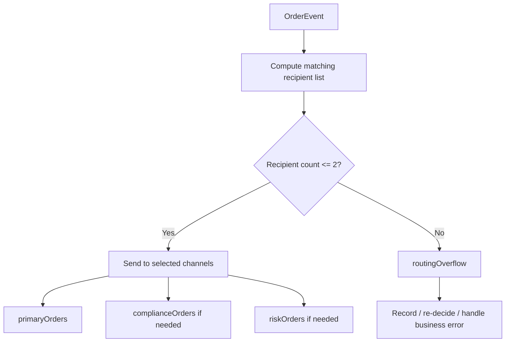
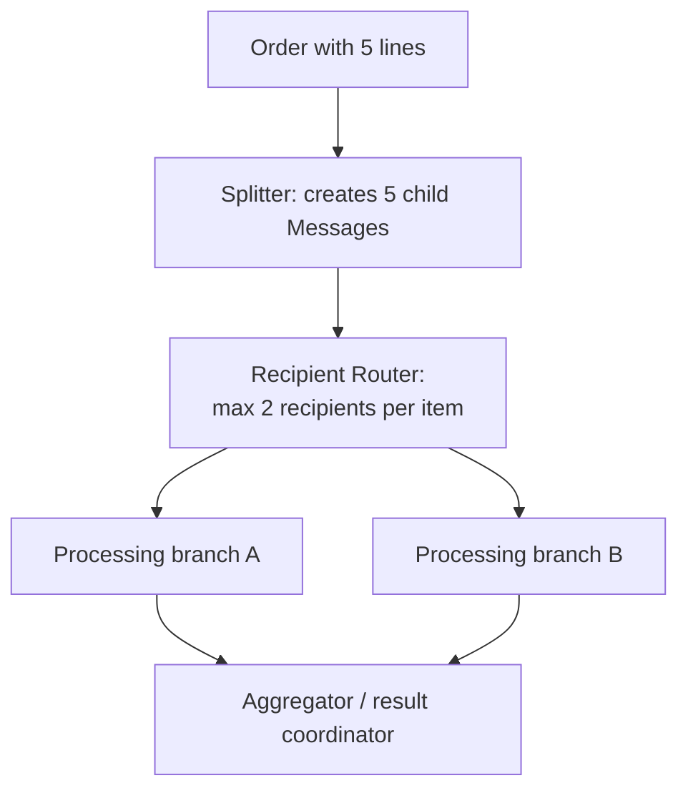

# Limiting the Number of Branches Created in a Recipient List

In an integration architecture, a single Message may need to be sent to multiple handlers: persisting the order, checking fraud, calculating taxes, sending notifications, or recording an audit log. The **Recipient List** pattern from Enterprise Integration Patterns (EIP) lets you specify **the list of destinations that will receive a Message**. With Spring Integration, a **Recipient List Router** can select recipients conditionally, so a Message matching multiple conditions can be forwarded to multiple channels.

However, the number of selected recipients can grow as the system adds rules or loads configuration from dynamic sources. **Limiting the number of created branches** means specifying and enforcing *at most how many targets are allowed to receive a Message in a single routing pass*. This helps control fan-out cost, prevent unintended bursts of message propagation, and clarify how to respond when a request carries too much work.

This lesson belongs to the **Recipient list** chapter of the `SPRING_INTEGRATION_PATTERN` module, which teaches how to implement Enterprise Integration Patterns with Spring Integration to build loosely coupled, extensible messaging flows. The topic connects directly with Router, Filter, Transformer, Splitter, Aggregator, Gateway, retry, error channels, correlation, testing, and per-branch observability.

## 1. How Many Branches Can One Message Create?

Suppose the system has three business rules for orders:

| Condition | Receiving Branch | Responsibility |
| --- | --- | --- |
| Every valid order | `primaryOrders` | Core order processing |
| Cross-border order | `complianceOrders` | Compliance check |
| Order requiring risk assessment | `riskOrders` | Risk analysis |

A single Message can satisfy all three rules. If the Router sends to all three recipients, the branch count for that dispatch is **3**. If the system allows at most **2 recipients**, you need a policy to handle exceeding the threshold.



In the diagram, the `routingOverflow` branch receives the **original Message**, allowing the application to preserve the information, place the request into a review queue, or return a clear business result. This is an **example policy**, not automatic behavior of `RecipientListRouter`.

### How is a "branch" counted here?

A useful way to count is the **number of distinct target channels selected by the Router for a single Message pass**. For example:

```text
Message ORD-101
  recipients = [primaryOrders, complianceOrders]
  branch count = 2

Message ORD-102
  recipients = [primaryOrders, complianceOrders, riskOrders]
  branch count = 3
```

Counting distinct target channels avoids counting one channel twice due to duplicate entries in a list. Still, the policy must be enforced before sending; if a router contains two entries for the same channel, do not assume every implementation automatically deduplicates them.

## 2. Branch Limits Differ from Concurrency and Buffer Limits

A fan-out limit is **not the same** as a consumption rate limit or a thread limit.

| Concept | What It Limits | Example |
| --- | --- | --- |
| **Recipient limit** | Number of channels selected for one Message | Max 2 branches/Message |
| **Concurrency limit** | Number of tasks executing simultaneously | Max 4 workers running at once |
| **Queue capacity** | Number of Messages waiting in a queue | `new QueueChannel(100)` |
| **Polling batch size** | Number of Messages fetched per poll | `maxMessagesPerPoll=10` |
| **Rate limit** | Number of requests accepted within a time window | 100 Messages/second |
| **Timeout** | Wait duration for handoff or processing | `send(..., 500)` |

Suppose routing allows at most two branches per Message, yet 2,000 Messages arrive every second. The Router can still generate up to 4,000 channel dispatches per second before even accounting for retries. Therefore, **limiting recipient count alone does not solve overload**. Combine it with queue bounds, consumer capacity, controlled retries, and alerts.

Conversely, an `ExecutorChannel` with only two threads can still receive Messages sent to many different channels. A thread pool does not replace the Router in deciding recipient count.

## 3. When Should You Limit Branches?

Branch limits are useful in several scenarios:

1. **Dynamic recipient lists:** users, tenant configs, or a registry generate many potential targets for a Message.
2. **High per-branch cost:** each recipient triggers an external API, expensive computation, or separate transaction.
3. **Fan-out feeds a gathering step:** an Aggregator/Gateway must wait for multiple replies and processing time scales with branch count.
4. **Business quota rules:** only up to a certain number of check types may be requested per processing pass.
5. **Misconfiguration safeguard:** a change causing nearly all conditions to evaluate to `true` could trigger a sudden dispatch spike.

However, limiting branches can drop mandatory business work if implemented by blindly truncating the list. For instance, you cannot drop a compliance check simply because it happens to be third in the list.

**Principle:** identify *which branches are mandatory, which are optional, and what happens when the limit is exceeded* before choosing an algorithm.

## 4. Policies When Recipient Count Exceeds the Threshold

Suppose the limit is `MAX_RECIPIENTS = 2`, while a Message needs three handlers.

| Policy | Behavior | Appropriate When |
| --- | --- | --- |
| **Reject or overflow** | Do not send to primary branches; route the request to an overflow-handling channel | No mandatory task may be dropped |
| **Priority** | Select up to two recipients in a published priority order | Lower-priority branches are optional and may be deferred or dropped |
| **Batching** | Send up to two branches per batch, then send remaining branches later | Business requires all tasks, yet execution can be paced over time |
| **Reject before work arises** | Filter/validator rejects requests containing too many processing types | Immediate error can be returned to sender |
| **Change the model** | Use queues, schedulers, or orchestration workflows for spawned tasks | Recipient count is large or unbounded ahead of time |

**Reject/overflow** is the easiest policy to verify for correctness when all matching branches are mandatory. Instead of emitting two out of three Messages and silently losing one branch, the system routes **the whole request** to `routingOverflow` to handle per contract.

If choosing **priority**, record which recipients were selected and which were deferred/skipped; stakeholders must accept that trade-off. If choosing **batching**, manage batch progress, crash recovery, and deduplication; a single `RecipientListRouter` call does not create durable batching automatically.

## 5. How to Enforce the Limit Before Sending Messages

The key is to **check the recipient count before performing any send**. Counting after Messages have already been dispatched to channels is too late.

In Spring Integration, `RecipientListRouter` lets you declare recipients with selectors/conditions. When three independent conditions all evaluate to true, it can pick all three. **Do not assume a universal configuration property like `maxRecipients=2` exists to truncate every recipient list automatically**. For business-specific limit policies, use a **method-based router** to compute the channel list and decide whether to proceed with sending.

Selection flow:

```text
1. Validate Message
2. Compute full list of condition-matching recipients
3. Deduplicate channel names
4. Count selected recipients
5. If <= MAX_RECIPIENTS: send to that list
6. If > MAX_RECIPIENTS: handle overflow per contract
```

### Preserving all mandatory branches

For example, an order always needs `primaryOrders`. If it needs both `complianceOrders` and `riskOrders`, the system must handle the over-limit request; **never simply take the first two items** because the third is also mandatory work.

## 6. Java Example: Limiting an Order to at Most Two Recipients

This example uses Java 17+, Spring Integration, and Spring Messaging. `@Router` returns a list of channel names. All output channels in the example are `QueueChannel` instances to make observing delivered messages straightforward.

```java
package example.integration;

import java.util.LinkedHashSet;
import java.util.List;
import java.util.Set;

import org.springframework.context.annotation.Bean;
import org.springframework.context.annotation.Configuration;
import org.springframework.integration.annotation.Router;
import org.springframework.integration.channel.DirectChannel;
import org.springframework.integration.channel.QueueChannel;
import org.springframework.integration.config.EnableIntegration;
import org.springframework.messaging.MessageChannel;
import org.springframework.messaging.PollableChannel;

@Configuration
@EnableIntegration
public class LimitedRecipientsConfiguration {

    private static final int MAX_RECIPIENTS = 2;

    public record OrderEvent(
            String eventId,
            String orderId,
            boolean requiresCompliance,
            boolean requiresRiskCheck) {
    }

    @Bean
    public MessageChannel ordersInput() {
        return new DirectChannel();
    }

    @Bean
    public PollableChannel primaryOrders() {
        return new QueueChannel(20);
    }

    @Bean
    public PollableChannel complianceOrders() {
        return new QueueChannel(20);
    }

    @Bean
    public PollableChannel riskOrders() {
        return new QueueChannel(20);
    }

    @Bean
    public PollableChannel routingOverflow() {
        return new QueueChannel(20);
    }

    @Bean
    public PollableChannel invalidOrders() {
        return new QueueChannel(20);
    }

    @Router(inputChannel = "ordersInput")
    public List<String> selectRecipients(OrderEvent order) {
        if (order.eventId() == null || order.eventId().isBlank()
                || order.orderId() == null || order.orderId().isBlank()) {
            return List.of("invalidOrders");
        }

        Set<String> selected = new LinkedHashSet<>();
        selected.add("primaryOrders");

        if (order.requiresCompliance()) {
            selected.add("complianceOrders");
        }
        if (order.requiresRiskCheck()) {
            selected.add("riskOrders");
        }

        if (selected.size() > MAX_RECIPIENTS) {
            // Preserve the request: forward the entire Message to an
            // overflow-handling branch instead of silently dropping mandatory work.
            return List.of("routingOverflow");
        }

        return List.copyOf(selected);
    }
}
```

### Behavior Analysis

| Condition | Matching Recipients | Result with `MAX_RECIPIENTS=2` |
| --- | --- | --- |
| No extra checks needed | `primaryOrders` | Sends to one branch |
| Needs compliance only | `primaryOrders`, `complianceOrders` | Sends to two branches |
| Needs risk check only | `primaryOrders`, `riskOrders` | Sends to two branches |
| Needs both compliance and risk | `primaryOrders`, `complianceOrders`, `riskOrders` | Sends only to `routingOverflow` |
| Missing `eventId` or `orderId` | Invalid data | Sends only to `invalidOrders` |

Sending to `routingOverflow` **does not mean the work is complete**. Consumers of that channel might produce a rejection reply, store the request for processing under higher quotas, or trigger a separate approval workflow. Regardless of downstream handling, **never treat a Message as successfully processed just because the overflow queue accepted it**.

In this example, `LinkedHashSet` preserves insertion order of channel names and prevents duplicates. This gives the branch count clear meaning. List order **does not guarantee task completion order** when branches use different pollers, executors, or brokers.

### Why use a router method instead of enforcing a limit after `routeToRecipients`?

When declaring multiple `.recipient(...)` entries directly, the Router can start dispatching to matching recipients per its mechanics. If policy requires **knowing the entire list before sending**, a router method is a clean way to compute an atomic decision at the target-selection layer.

Note that "atomic decision" here refers only to **deciding the recipient list**. Dispatching the Message to multiple channels afterward **is not automatically a distributed atomic transaction**.

## 7. Smoke-Testing Cases in the Application

The following runner sends one two-recipient Message and one over-limit Message; queues have no consumers so they can be read immediately after synchronous `send()` returns.

```java
package example.integration;

import org.springframework.context.annotation.AnnotationConfigApplicationContext;
import org.springframework.messaging.Message;
import org.springframework.messaging.MessageChannel;
import org.springframework.messaging.PollableChannel;
import org.springframework.messaging.support.MessageBuilder;

import example.integration.LimitedRecipientsConfiguration.OrderEvent;

public class LimitedRecipientsDemo {

    public static void main(String[] args) {
        try (var context = new AnnotationConfigApplicationContext(
                LimitedRecipientsConfiguration.class)) {

            MessageChannel input =
                    context.getBean("ordersInput", MessageChannel.class);
            PollableChannel primary =
                    context.getBean("primaryOrders", PollableChannel.class);
            PollableChannel compliance =
                    context.getBean("complianceOrders", PollableChannel.class);
            PollableChannel risk =
                    context.getBean("riskOrders", PollableChannel.class);
            PollableChannel overflow =
                    context.getBean("routingOverflow", PollableChannel.class);

            OrderEvent accepted = new OrderEvent(
                    "evt-101", "ORD-101", true, false);
            OrderEvent tooMany = new OrderEvent(
                    "evt-102", "ORD-102", true, true);

            input.send(MessageBuilder.withPayload(accepted)
                    .setHeader("businessOrderId", "ORD-101")
                    .build());
            input.send(MessageBuilder.withPayload(tooMany)
                    .setHeader("businessOrderId", "ORD-102")
                    .build());

            Message<?> first = primary.receive(0);
            Message<?> second = compliance.receive(0);
            Message<?> third = risk.receive(0);
            Message<?> deferred = overflow.receive(0);

            System.out.println(first == null ? "empty" : first.getPayload());
            System.out.println(second == null ? "empty" : second.getPayload());
            System.out.println(third == null ? "risk empty" : third.getPayload());
            System.out.println(deferred == null ? "empty" : deferred.getPayload());
        }
    }
}
```

With the configuration above, `ORD-101` reaches `primaryOrders` and `complianceOrders`; `riskOrders` is empty. `ORD-102` goes only to `routingOverflow`. To move this code into a real application, add appropriate Spring Integration/Spring Context dependencies, real consumers, and error handling rules.

**Never call `receive(-1)` in examples when a Message is not guaranteed**, as it can block indefinitely. `receive(0)` fits synchronous tests with known topology; with asynchronous flows, await conditions with finite timeouts.

## 8. What If You Still Want Conditional Recipient List Router?

**Recipient List Router** fits when a set of recipients is declared and each recipient has its own selector. Conceptual Java DSL example:

```java
// Illustrative flow; an alternative to @Router in Section 6,
// do not register concurrently on the same ordersInput.
@Bean
public IntegrationFlow conditionalRecipientFlow() {
    return IntegrationFlow.from("ordersInput")
            .routeToRecipients(spec -> spec
                    .recipient("primaryOrders")
                    .recipient("complianceOrders",
                            "payload.requiresCompliance")
                    .recipient("riskOrders",
                            "payload.requiresRiskCheck"))
            .get();
}
```

In this example, **all three conditions can route to three recipients**. The DSL snippet does not automatically cap at two targets. Before picking a model, determine:

- Can any recipient be omitted without violating business rules?
- Should the entire Message be rejected when matching conditions exceed the threshold?
- Do you need a single centralized decision computed before dispatching to any channel?
- Must the recipient list vary dynamically by tenant, configuration, or event type?

If you must count total recipients before dispatching, insert a **routing-planning step** that computes the allowed list and rationale, then route based on that confirmed list. That keeps selectors/conditions in one testable place instead of expecting each recipient to know the global quota.

Different Spring Integration / Spring Framework versions evaluate record accessors in SpEL differently depending on property accessors; verify predicate syntax against your project's version. In the main example in Section 6, conditions are written in Java to show pre-send count validation clearly.

## 9. Priority and Branch Allocation When Optional Tasks Exist

If not all branches share the same criticality, you can limit via **priority rules**. Example:

| Level | Recipient | Rule |
| --- | --- | --- |
| Mandatory | `primaryOrders` | Always selected |
| Mandatory under regulations | `complianceOrders` | Cannot be skipped |
| Optional | `analyticsOrders` | Can be deferred or recorded for later processing |
| Optional | `notificationOrders` | Can be split to another pipeline |

With `MAX_RECIPIENTS=2`, a cross-border order can pick `primaryOrders` and `complianceOrders`, while analytics/notification can run through a separate event publication architecture. However, if every branch is mandatory, **you cannot solve the problem by ranking priorities and dropping the rest**.

A priority selection rule must be deterministic:

1. Build the full list of matching recipients and classify mandatory vs. optional.
2. If mandatory branch count exceeds the limit, route to overflow or reject.
3. With remaining budget, add optional branches in a stable priority order.
4. Record selected recipients, deferred recipients, and rationale.
5. Handle deferred tasks later if business rules require.

Never label a policy "branch limiting" if it silently **loses required work**.

## 10. Risks When Sending Concurrently to Multiple Channels

Routing to multiple recipients creates multiple **Message dispatches**. Even with just two channels, handle cases where:

- Channel A accepted the Message, yet channel B is out of capacity.
- Handler A committed to the database, yet handler B throws an exception.
- Retrying the entire Message causes A to receive the same event again.
- One channel processes fast while the other is slow and builds a backlog.
- One branch runs on another thread and finishes after the initial `send()` call returns.

**Limiting recipients shrinks fan-out scale but does not turn fan-out into an atomic transaction.** Define policies for partial success, partial failure, per-branch retries, and idempotency.

A branch-level idempotency key can be:

```text
idempotencyKey = eventId + ":" + branchType

evt-101:PRIMARY
evt-101:COMPLIANCE
```

A redelivery of `evt-101` still uses the same key for the corresponding branch. The system must persist/query keys using an atomic mechanism; merely concatenating strings without guarding side effects does not prevent duplicate processing.

### Does limiting recipients reduce queue load?

It bounds max dispatches per Message, yet if the overflow branch receives too many Messages or consumers are slow, queues still fill up. With `QueueChannel`, configure appropriate capacity and timeouts. With brokers, size capacity, retries, consumer groups, and retention policies; **Recipient Limit is not Backpressure**.

## 11. Gateway, Splitter, Aggregator, and Correlation

### 11.1. A Gateway needs one meaningful result

A messaging Gateway may await a reply. A Router dispatching to two channels whose two consumers return independent results does not automatically produce **one combined response**. If the caller must wait for both, use proper coordination/aggregation such as Scatter-Gather or a configured Aggregator.

When routing to `routingOverflow`, a consumer should emit a structured error or pending-status response if the API expects a reply. Simply placing the Message into an unread queue can cause the Gateway to time out.

### 11.2. Limiting recipients does not replace Splitter limits

**Recipient List Router** decides which channels receive a Message; **Splitter** breaks one payload into multiple child Messages. One flow can use both:



A limit of two recipients **per child Message** does not mean the whole order creates at most two tasks: five child Messages, each routed to two channels, produce up to ten dispatches.

Depending on fan-out mechanics, Messages forwarded by a Router to multiple channels may carry the same original headers. A Router does not automatically assign `sequenceNumber=1/2`, `2/2` simply by sending to two recipients. For an Aggregator to wait for results across branches, define an explicit **correlation key** and **completion condition**.

### 11.3. How many results to expect?

If `ORD-101` was sent to `PRIMARY` and `COMPLIANCE`, the Aggregator should wait for **two matching results** if policy requires both. If `ORD-102` went to overflow, do not wait for results from three primary branches that never received the Message.

To avoid confusion, a plan record can retain:

```json
{
  "eventId": "evt-101",
  "correlationKey": "attempt-101",
  "expectedBranches": ["PRIMARY", "COMPLIANCE"],
  "expectedResultCount": 2
}
```

This is an example of **application business metadata you can store or forward**, not a mandatory Spring Integration schema. When using an Aggregator, `correlationId`, release strategy, `MessageGroupStore`, timeouts, and duplicate handling must match the branches actually dispatched.

## 12. Testing Branch Limits with JUnit 5

Tests must verify **which channels actually received Messages**, not only the size of the list returned by `selectRecipients()`. The example below uses the configuration from Section 6:

```java
package example.integration;

import static org.junit.jupiter.api.Assertions.*;

import org.junit.jupiter.api.Test;
import org.springframework.context.annotation.AnnotationConfigApplicationContext;
import org.springframework.messaging.Message;
import org.springframework.messaging.MessageChannel;
import org.springframework.messaging.PollableChannel;
import org.springframework.messaging.support.MessageBuilder;

import example.integration.LimitedRecipientsConfiguration.OrderEvent;

class LimitedRecipientsIntegrationTest {

    @Test
    void twoRequiredRecipientsReceiveTheSameEvent() {
        try (var context = new AnnotationConfigApplicationContext(
                LimitedRecipientsConfiguration.class)) {
            MessageChannel input =
                    context.getBean("ordersInput", MessageChannel.class);
            PollableChannel primary =
                    context.getBean("primaryOrders", PollableChannel.class);
            PollableChannel compliance =
                    context.getBean("complianceOrders", PollableChannel.class);
            PollableChannel risk =
                    context.getBean("riskOrders", PollableChannel.class);
            PollableChannel overflow =
                    context.getBean("routingOverflow", PollableChannel.class);

            OrderEvent event = new OrderEvent(
                    "evt-201", "ORD-201", true, false);
            assertTrue(input.send(MessageBuilder.withPayload(event)
                    .setHeader("businessOrderId", event.orderId())
                    .build()));

            Message<?> p = primary.receive(0);
            Message<?> c = compliance.receive(0);
            assertNotNull(p);
            assertNotNull(c);
            assertEquals(event, p.getPayload());
            assertEquals(event, c.getPayload());
            assertEquals("ORD-201", p.getHeaders().get("businessOrderId"));
            assertNull(risk.receive(0));
            assertNull(overflow.receive(0));
            assertNull(primary.receive(0));
            assertNull(compliance.receive(0));
        }
    }

    @Test
    void threeRequiredRecipientsAreRoutedToOverflowOnly() {
        try (var context = new AnnotationConfigApplicationContext(
                LimitedRecipientsConfiguration.class)) {
            MessageChannel input =
                    context.getBean("ordersInput", MessageChannel.class);
            PollableChannel primary =
                    context.getBean("primaryOrders", PollableChannel.class);
            PollableChannel compliance =
                    context.getBean("complianceOrders", PollableChannel.class);
            PollableChannel risk =
                    context.getBean("riskOrders", PollableChannel.class);
            PollableChannel overflow =
                    context.getBean("routingOverflow", PollableChannel.class);

            OrderEvent event = new OrderEvent(
                    "evt-202", "ORD-202", true, true);
            assertTrue(input.send(MessageBuilder.withPayload(event).build()));

            Message<?> deferred = overflow.receive(0);
            assertNotNull(deferred);
            assertEquals(event, deferred.getPayload());
            assertNull(primary.receive(0));
            assertNull(compliance.receive(0));
            assertNull(risk.receive(0));
            assertNull(overflow.receive(0));
        }
    }
}
```

These tests use `DirectChannel` and `QueueChannel` instances with no consumers, so right after `send()` returns, you can inspect immediately with `receive(0)`. If adding executors, pollers, or brokers, tests must await conditions with finite timeouts; **never depend on completion order of asynchronous branches**.

### Scenarios to add

1. **Zero optional branches:** only `primaryOrders` receives the Message.
2. **One optional branch:** receives exactly two dispatched Messages, with no extra recipients outside the list.
3. **Two optional branches:** only `routingOverflow` receives the Message; never silently emit a partial subset.
4. **Missing identifier key:** only `invalidOrders` receives the Message.
5. **List containing duplicate channel names:** count matches unique-recipient policy.
6. **Varying limits:** boundary values around the threshold, such as 1, 2, and 3 recipients.
7. **Full or failing branch:** verify partial-dispatch logging/handling policy.
8. **Retry:** replay the same `eventId` without causing duplicate side effects on already-succeeded branches.
9. **Gateway/Aggregator:** expected result count matches branches actually selected.
10. **Load test:** recipient quotas do not let queues or consumers overload when Message volume increases.

## 13. Monitoring Branch Counts in Production

Logs and metrics should reveal **how many recipients were proposed, how many were selected, and whether a Message exceeded the limit**.

A structured log record:

```json
{
  "stage": "limited-recipient-router",
  "eventId": "evt-202",
  "businessOrderId": "ORD-202",
  "maxRecipients": 2,
  "matchedRecipients": [
    "primaryOrders",
    "complianceOrders",
    "riskOrders"
  ],
  "selectedRecipients": ["routingOverflow"],
  "decision": "OVERFLOW"
}
```

This log schema is application-designed, not metadata fields always emitted automatically by Spring Integration. Never put raw sensitive payloads into logs; `eventId`/`orderId` fit logs and traces better than metric tags.

| Suggested Metric | Purpose |
| --- | --- |
| `routing.recipient.candidates` | Distribution of matching recipients before applying the limit |
| `routing.recipient.selected` | Distribution of recipients actually selected |
| `routing.overflow.count` | Count of requests exceeding the limit |
| `routing.invalid.count` | Count of invalid Messages |
| `routing.dispatch.failure` | Failures dispatching to channels |
| `routing.branch.process.duration` | Detect slow processing branches |
| `routing.branch.retry.count` | Detect repeated failures and retry burden |
| `routing.aggregation.timeout` | Result groups failing to complete on time |

These are **metric suggestions**, not a guarantee that all names exist out of the box in Spring Integration. Instrument using Micrometer, Spring Boot Actuator, logging/tracing, and measurement hooks at appropriate endpoints.

## 14. Common Mistakes

| Symptom | Cause | Fix |
| --- | --- | --- |
| Limit is two branches yet three channels receive Messages | Checked count only after dispatch | Enforce limit on recipient list before routing |
| Mandatory check skipped | Truncated list with `limit(2)` ignoring business meaning | Reject/overflow when mandatory branches exceed the limit |
| Thinking branches are limited because there are only two threads | Confused concurrency with fan-out | Enforce limit directly on the recipient list |
| One channel receives two copies | Duplicate channel name added or retries | Deduplicate recipients; use idempotency |
| Overflow Messages lost after restart | In-memory queue only | Use durable storage when recovery is required |
| Gateway times out | Overflow branch emits no reply | Design pending or rejection reply |
| Aggregator waits for wrong result count | Hardcoded branch count instead of actual selection | Persist expected branches and matching correlation |
| One branch reprocesses when another fails | Retried the entire fan-out | Scope retries and idempotency keys per branch |
| Queue capacity sufficient yet system still slow | Consumers cannot keep up with Message volume | Measure throughput, manage backlogs and backpressure |

## 15. Design Principles for Limiting Recipients

- **Define the limit unit clearly:** max distinct target channels **per Message** or across an entire request spanning multiple child Messages?
- **Identify mandatory branches:** never drop a business obligation simply because the recipient budget ran out.
- **Count before dispatching:** use one consistent recipient-calculation step before forwarding the Message.
- **Pick an explicit overflow policy:** reject, defer, or orchestrate further, complete with consumers and monitoring.
- **Separate recipients, concurrency, capacity, and rate:** control them independently according to load requirements.
- **Specify partial failures and retries:** fan-out does not automatically guarantee all channels succeed together.
- **Maintain idempotency and correlation:** prevent duplicates and gather exact result counts matching selected branches.
- **Test real behavior:** for 0, 1, 2, and 3 matching conditions, verify which channels actually receive data.
- **Observe decisions:** log matched recipients, selected recipients, quotas, and overflow reasons.

Limiting the number of branches in a Recipient List is a **work-coordination rule**. When the recipient list is known, mandatory responsibilities are classified, and an explicit overflow plan exists, Spring Integration can bound fan-out while preserving correctness, testability, and message-flow observability.
