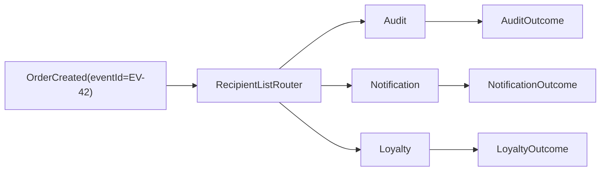
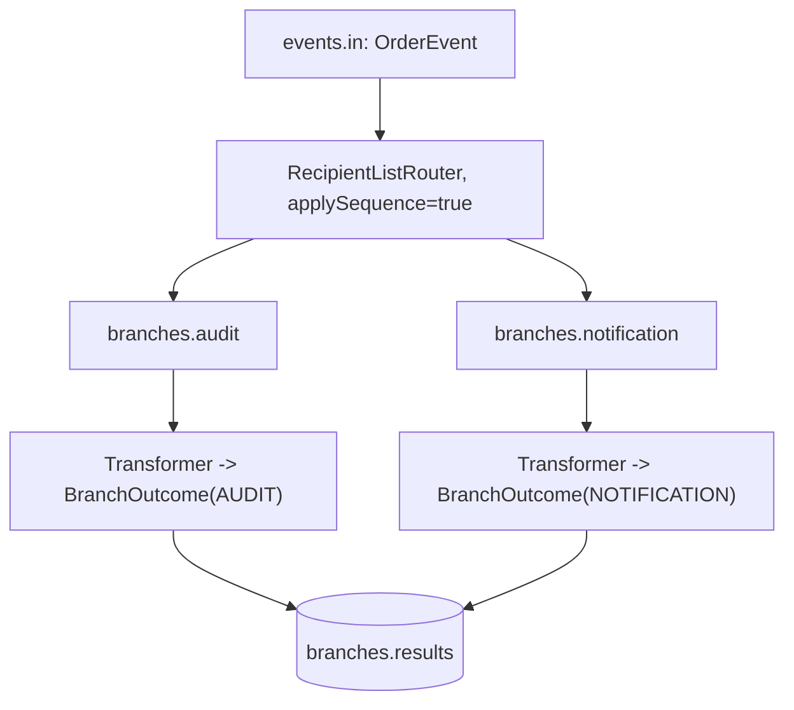
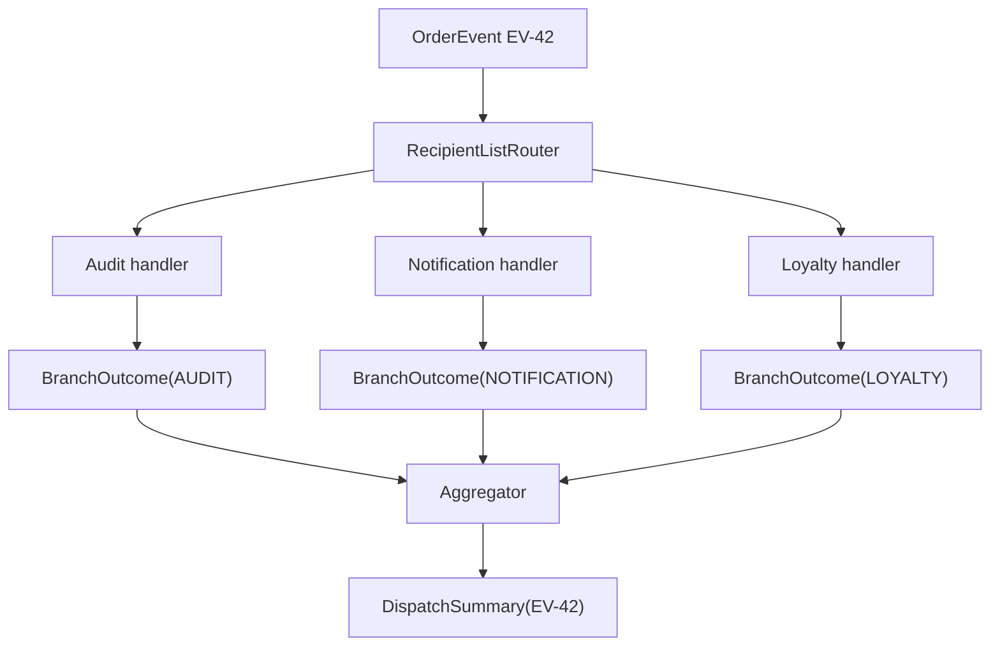

# Tracking Per-Branch Outcomes with Recipient List in Spring Integration

## Lesson Objectives

When an event goes to multiple receivers, the important question does not stop at "Which channels did the Router send to?" The system also needs to know **which branches were selected, which branches received the message, which branches finished processing, and which branches failed or timed out**. For example, an order creation event must record an audit log, send a notification, and update loyalty points. Audit succeeding does not mean SMS succeeded; an SMS timeout does not mean the message was never sent.

This lesson belongs to the **Recipient list** chapter of the **SPRING_INTEGRATION_PATTERN** module, where we learn to implement Enterprise Integration Patterns (EIP) with Spring Integration to create loosely coupled, extensible messaging flows. It connects Recipient List with Router, Filter, Transformer, Splitter, Aggregator, Gateway, retry, error channels, and correlation, while emphasizing testing and observing each processing branch.

After completing this lesson, you will be able to:

1. Distinguish **recipient selected**, **message dispatched to channel**, **handler completed successfully**, and **outcomes aggregated**.
2. Design a clear `BranchOutcome` for each branch with a business key, status, timestamp, and error code.
3. Use Java DSL `routeToRecipients(...)` and `applySequence(true)`, understanding the value of `correlationId`, `sequenceNumber`, and `sequenceSize`.
4. Track outcomes via output messages from each handler, or use Aggregator/Scatter-Gather when the caller needs a combined result.
5. Handle zero matching recipients, single-branch failures, branch timeouts, duplicate retries, and asynchronous processing.
6. Write tests verifying **both branch count and business outcomes**, not merely sends into the Router.

## 1. Recipient List Sends One Message to Multiple Branches

**Recipient List** is an EIP pattern in which one message is sent to **a list of receivers**. In Spring Integration, `RecipientListRouter` is an implementation of this pattern. The recipient list can be fixed or have **selectors** deciding which recipients are chosen for each message.



Suppose for event `EV-42`, the system requires:

- Audit must always receive the event.
- Notification receives only if the user enabled notifications.
- Loyalty receives only if the order qualifies for points.

Thus, an event may be sent to **one, two, or three** recipients. When aggregating, the number of results to wait for must match the **number of recipients actually selected**, not always be fixed at three.

### Recipient List vs. related patterns

| Pattern | Behavior | Example |
| --- | --- | --- |
| **Content-Based Router** | Chooses a route based on content; common designs map one key to one target | Route order to VIP or STANDARD |
| **Recipient List** | Selects a set of recipients; one message can go to multiple channels | Audit + Notification + Loyalty |
| **Publish/Subscribe** | Broadcasts events to subscribers of a channel, per configuration | Components all listening to `OrderCreated` |
| **Splitter** | Splits one payload into multiple messages carrying different data parts | Order split into line items |
| **Aggregator** | Combines related messages into one result | Gather results from three branches |
| **Scatter-Gather** | Combines distributing messages to multiple targets and gathering replies | Query multiple quote services and collect results |

Recipient List **does not automatically generate a summary of business outcomes** for each recipient. If the goal is purely one-way event fan-out, you may not need an Aggregator. If the caller wants to know which branches succeeded, the application needs a mechanism to produce and collect outcomes.

## 2. Four Status Milestones to Distinguish

A message passes through multiple layers. Each layer has its own meaning of success.

| Milestone | Evidence | Does it prove business success? |
| --- | --- | --- |
| **Selected** | Router's selector chose the recipient | **No**. Only proves the branch is in the target list |
| **Dispatched / accepted** | Message was sent to the channel per its send mechanics | **Not necessarily**. A queue/broker may hold the message with no handler having run yet |
| **Processed** | Branch handler explicitly reports its final outcome | **Yes**, if the outcome contract is designed and recorded properly |
| **Aggregated / acknowledged** | Gatherer observed enough outcomes per a completion policy | **Policy-dependent**: could be all-success, all-completed, or partial |

For example, `input.send(message)` returning `true` means the sender finished the send operation per the channel's contract. With `DirectChannel`, handlers usually run synchronously; with `QueueChannel`, a successful send mainly proves the message entered the queue. Therefore, **never use `send()`'s return value as a `"Notification SUCCEEDED"` flag**.

An audit log might record:

```text
eventId=EV-42 recipient=AUDIT state=SELECTED
eventId=EV-42 recipient=AUDIT state=STARTED
eventId=EV-42 recipient=AUDIT state=SUCCEEDED

eventId=EV-42 recipient=SMS state=SELECTED
eventId=EV-42 recipient=SMS state=STARTED
eventId=EV-42 recipient=SMS state=FAILED errorCode=PROVIDER_TIMEOUT
```

Statuses such as `SELECTED` and `FAILED` are **application-defined contracts**, not headers automatically emitted by `RecipientListRouter`.

## 3. Outcome Contract for Each Branch

To track an event across multiple branches, an outcome DTO should carry enough identifying data.

```java
import java.time.Instant;

public record BranchOutcome(
    String eventId,         // Stable business key
    String recipient,       // AUDIT, NOTIFICATION, LOYALTY...
    String status,          // SUCCEEDED, FAILED, SKIPPED...
    String errorCode,       // null when no error
    Instant finishedAt
) {}
```

Some principles:

- `eventId` links branches of the same business request; it is the key across retries.
- `recipient` distinguishes branches, even when every branch received the same payload.
- `status` describes the **business outcome**; use an enum/predefined values rather than arbitrary strings in real deployments.
- `errorCode` aids retries/investigation; avoid putting exception stack traces or sensitive data into client-facing messages.
- `finishedAt` helps measure latency; node clocks can drift, so proper latency monitoring still requires separate instrumentation.
- If deduplication is needed, also store `attemptId` and/or key by `eventId + recipient` to decide when an outcome has already been counted.

### Example per-branch summary

```json
{
  "eventId": "EV-42",
  "overallStatus": "PARTIAL_FAILURE",
  "branches": [
    {"recipient": "AUDIT", "status": "SUCCEEDED"},
    {"recipient": "NOTIFICATION", "status": "FAILED", "errorCode": "PROVIDER_TIMEOUT"},
    {"recipient": "LOYALTY", "status": "SUCCEEDED"}
  ]
}
```

This payload must be **built from real outcomes**, such as via an Aggregator or a workflow tracker. Recipient List does not supply `overallStatus` automatically.

## 4. Java DSL: Send to Two Recipients and Collect Each Branch's Outcome

The complete example below uses:

1. A `DirectChannel` receiving the input event.
2. A `RecipientListRouter` sending to two recipients: `audit` and `notification`.
3. Each branch using a Transformer to produce a `BranchOutcome`.
4. Both outcomes routed into a shared `QueueChannel` so tests can read them actively.
5. `applySequence(true)` adding metadata to identify messages emitted in the same pass.

This is an example of **collecting per-branch outcomes**, not yet a real SMS-sending or database-writing workflow. Handlers simulate success to verify flow structure; the error-handling section builds the failure contract next.



### Configuration

```java
import org.springframework.context.annotation.Bean;
import org.springframework.context.annotation.Configuration;
import org.springframework.integration.channel.DirectChannel;
import org.springframework.integration.channel.QueueChannel;
import org.springframework.integration.config.EnableIntegration;
import org.springframework.integration.dsl.IntegrationFlow;
import org.springframework.messaging.MessageChannel;
import org.springframework.messaging.PollableChannel;

@Configuration
@EnableIntegration
public class RecipientOutcomeFlowConfig {

    public record OrderEvent(String eventId) {}

    public record BranchOutcome(
        String eventId,
        String recipient,
        String status
    ) {}

    @Bean("events.in")
    MessageChannel input() {
        return new DirectChannel();
    }

    @Bean("branches.audit")
    MessageChannel auditChannel() {
        return new DirectChannel();
    }

    @Bean("branches.notification")
    MessageChannel notificationChannel() {
        return new DirectChannel();
    }

    @Bean("branches.results")
    PollableChannel resultsChannel() {
        return new QueueChannel();
    }

    @Bean
    IntegrationFlow recipientFlow() {
        return IntegrationFlow.from("events.in")
            .routeToRecipients(r -> r
                .applySequence(true)
                .recipient("branches.audit")
                .recipient("branches.notification"))
            .get();
    }

    @Bean
    IntegrationFlow auditFlow() {
        return IntegrationFlow.from("branches.audit")
            .transform(OrderEvent.class, event ->
                new BranchOutcome(event.eventId(), "AUDIT", "SUCCEEDED"))
            .channel("branches.results")
            .get();
    }

    @Bean
    IntegrationFlow notificationFlow() {
        return IntegrationFlow.from("branches.notification")
            .transform(OrderEvent.class, event ->
                new BranchOutcome(
                    event.eventId(), "NOTIFICATION", "SUCCEEDED"))
            .channel("branches.results")
            .get();
    }
}
```

The code uses Java DSL, `@EnableIntegration`, and Spring Integration's `DirectChannel`/`QueueChannel` APIs. In a Spring Boot application, the configuration must be properly component-scanned/imported with the Spring Integration dependency present.

### What happens when sending a message?

```java
import org.springframework.messaging.Message;
import org.springframework.messaging.support.MessageBuilder;

Message<RecipientOutcomeFlowConfig.OrderEvent> request =
    MessageBuilder.withPayload(
        new RecipientOutcomeFlowConfig.OrderEvent("EV-42"))
        .setHeader("traceId", "trace-42")
        .setHeader("tenantId", "tenant-a")
        .build();

eventsIn.send(request);
```

`eventsIn` is the `MessageChannel` bean named `events.in` injected from the context. When no errors occur in this synchronous example, the two branches produce two independent `BranchOutcome` messages in `branches.results`.

**Key takeaway:** `applySequence(true)` attaches correlation and sequence metadata to messages sent to recipients, making result gathering easier if handlers forward those headers properly. It **does not record** whether a handler succeeded or failed.

### Why use a Transformer returning a payload?

Both branches return a `BranchOutcome` as a plain payload. Spring Integration typically builds a reply message and carries over appropriate request headers, including correlation/sequence, onto a Transformer's reply. If a handler returns a `Message<?>` directly, you must explicitly manage which headers are preserved. Never expect every handler/adapter to behave identically; verify with tests at the result-collection point.

When constructing a reply manually, one way to preserve required headers is:

```java
import org.springframework.messaging.Message;
import org.springframework.messaging.support.MessageBuilder;

Message<BranchOutcome> outcomeMessage(
    Message<?> request,
    BranchOutcome outcome
) {
    return MessageBuilder.withPayload(outcome)
        .copyHeaders(request.getHeaders())
        .build();
}
```

`BranchOutcome` in this snippet is the corresponding application DTO type. Only copy permitted headers when a message leaves the process or crosses a trust boundary.

## 5. Testing: Verify All Branches, All Outcomes, and Correlation

With the configuration from Section 4, you can write an integration test. We **send one message and then await exactly two outcomes**; never draw conclusions from `send()` alone.

```java
import static org.assertj.core.api.Assertions.assertThat;

import java.util.List;

import org.junit.jupiter.api.Test;
import org.springframework.beans.factory.annotation.Autowired;
import org.springframework.beans.factory.annotation.Qualifier;
import org.springframework.messaging.Message;
import org.springframework.messaging.MessageChannel;
import org.springframework.messaging.PollableChannel;
import org.springframework.messaging.support.MessageBuilder;
import org.springframework.test.context.junit.jupiter.SpringJUnitConfig;

@SpringJUnitConfig(RecipientOutcomeFlowConfig.class)
class RecipientOutcomeFlowTest {

    @Autowired
    @Qualifier("events.in")
    MessageChannel input;

    @Autowired
    @Qualifier("branches.results")
    PollableChannel results;

    @Test
    void recordsAnOutcomeForEachSelectedRecipient() {
        var event = new RecipientOutcomeFlowConfig.OrderEvent("EV-42");

        assertThat(input.send(
            MessageBuilder.withPayload(event)
                .setHeader("traceId", "trace-42")
                .build()
        )).isTrue();

        Message<?> first = results.receive(2_000);
        Message<?> second = results.receive(2_000);

        assertThat(first).isNotNull();
        assertThat(second).isNotNull();

        var one = (RecipientOutcomeFlowConfig.BranchOutcome)
            first.getPayload();
        var two = (RecipientOutcomeFlowConfig.BranchOutcome)
            second.getPayload();

        assertThat(List.of(one.recipient(), two.recipient()))
            .containsExactlyInAnyOrder("AUDIT", "NOTIFICATION");
        assertThat(one.eventId()).isEqualTo("EV-42");
        assertThat(two.eventId()).isEqualTo("EV-42");
        assertThat(one.status()).isEqualTo("SUCCEEDED");
        assertThat(two.status()).isEqualTo("SUCCEEDED");

        Object correlation = first.getHeaders().get("correlationId");
        assertThat(correlation).isNotNull();
        assertThat(second.getHeaders().get("correlationId"))
            .isEqualTo(correlation);

        assertThat(first.getHeaders().get("sequenceSize")).isEqualTo(2);
        assertThat(second.getHeaders().get("sequenceSize")).isEqualTo(2);
        assertThat(List.of(
            first.getHeaders().get("sequenceNumber"),
            second.getHeaders().get("sequenceNumber")))
            .containsExactlyInAnyOrder(1, 2);

        assertThat(first.getHeaders().get("traceId"))
            .isEqualTo("trace-42");
        assertThat(second.getHeaders().get("traceId"))
            .isEqualTo("trace-42");

        assertThat(results.receive(0)).isNull();
    }
}
```

This test applies to **two fixed recipients**, `applySequence(true)`, an output queue with no other consumers, and branches using synchronous channels. It verifies two business outcomes sharing trace/correlation. The order pulled from `branches.results` must not be used to infer that Audit always runs or finishes before Notification.

When switching to executors/brokers and running multiple events concurrently, separate outcomes by `eventId`/correlation key in tests. Never use a shared queue and assume two consecutively received messages always belong to the same event when multiple producers are sending.

## 6. Conditional Recipients: Count Only Branches Actually Selected

A `RecipientListRouter` can combine unconditional recipients and selector-based recipients. For example:

- `audit`: always selected.
- `notification`: selected only when header `sendNotification=true`.
- `loyalty`: selected only when header `eligibleForPoints=true`.

Building the Router directly:

```java
import org.springframework.integration.router.RecipientListRouter;

RecipientListRouter router = new RecipientListRouter();
router.setApplySequence(true);

router.addRecipient("branches.audit");
router.addRecipient("branches.notification", message ->
    Boolean.TRUE.equals(
        message.getHeaders().get("sendNotification")));
router.addRecipient("branches.loyalty", message ->
    Boolean.TRUE.equals(
        message.getHeaders().get("eligibleForPoints")));
```

The channels in the example must exist. When registering the Router in a flow, you can use `IntegrationFlow.from("events.in").route(router).get()` if compatible with your application configuration. Selectors only decide whether a recipient is chosen; they do not perform business processing themselves.

### Expected Recipients Matrix

| `sendNotification` | `eligibleForPoints` | Recipients to Await | Total |
| --- | --- | --- | ---: |
| false | false | AUDIT | 1 |
| true | false | AUDIT, NOTIFICATION | 2 |
| false | true | AUDIT, LOYALTY | 2 |
| true | true | AUDIT, NOTIFICATION, LOYALTY | 3 |

With `applySequence(true)`, the Router can set `sequenceSize` to the number of recipients actually selected. However, **number of selected branches** and **number of completed outcomes** are two different numbers. A recipient can be selected yet still not report a result, fail, or time out.

### When no recipient matches

If all recipients have selectors and none match, the Router has no destination to send to. Define an explicit policy: a `defaultOutputChannel` to handle zero-recipient cases, or a routing error. Never interpret "0 messages sent" as "all branches succeeded."

A sensible business outcome could be `NO_RECIPIENT` with a reason code, or `SKIPPED` when skipping is allowed. Align with callers and record an audit of the decision.

## 7. Aggregating Results: Aggregator Needs Correlation and Release Strategy

If callers only need to inspect two `BranchOutcome` records using internal tools, writing each outcome to a queue/DB suffices. If callers want **one `DispatchSummary`**, add an aggregation step.



Two key concepts:

- **Correlation strategy**: determines which messages belong to the same group. With sequence headers created by the Router, the Aggregator can rely on `correlationId`.
- **Release strategy**: determines when the group is released. One policy waits for the full count per `sequenceSize`; another waits for results from the registered recipient set, or accepts a partial result on timeout.

Spring Integration provides an Aggregator to store message groups and apply release logic. Illustrative DSL snippet:

```java
@Bean
IntegrationFlow aggregateBranchOutcomes() {
    return IntegrationFlow.from("branches.outcomes.forAggregation")
        .aggregate()
        .channel("branches.summaries")
        .get();
}
```

This is a **snippet** requiring definitions for the channels and how `BranchOutcome` messages reach `branches.outcomes.forAggregation`. With a default aggregator, the aggregated payload is typically a collection of results, while the application can define a custom `MessageGroupProcessor` to build `DispatchSummary` and classify `SUCCEEDED / PARTIAL_FAILURE / FAILED` per business rules.

**You cannot simply swap `branches.results` from a `QueueChannel` to an Aggregator and assume the whole problem is solved.** You must design state storage, reply contracts, timeouts, duplicates, silent branches, and incomplete-group handling.

### Why does `applySequence(true)` matter?

`RecipientListRouter` has `applySequence` **disabled** by default. When enabled, the Router attaches correlation/sequence headers to emitted messages, supporting the Aggregator's default strategies. In flows with Selectors, `sequenceSize` should reflect the **number of selected recipients**.

Without `applySequence`, you can use a **custom correlation strategy** based on `eventId` and a **custom release strategy** based on the contractually recorded expected recipient set. Merely setting `eventId` does not automatically tell the Aggregator when enough outcomes have arrived.

### Failures must be emitted as messages when waiting for "all branches to finish"

Suppose three recipients were selected, yet Notification throws an exception and never emits a `BranchOutcome`:

```text
AUDIT        -> BranchOutcome(SUCCEEDED)
NOTIFICATION -> exception, no outcome
LOYALTY      -> BranchOutcome(SUCCEEDED)

Aggregator: received only 2/3 -> cannot conclude all completed.
```

If the policy is "wait for each branch to **finish, succeed or fail**," Notification's error flow must **emit a `BranchOutcome(FAILED)`** carrying the proper correlation/sequence headers, or the coordinator must track failures separately and emit a summary once all branches have finished.

A branch that did not receive the message because its selector did not match must not be counted as failed unless business rules specify otherwise. A selected branch that never returns a result should be marked `TIMED_OUT` upon expiration.

## 8. Scatter-Gather: When a Combined Request-Reply Is Needed

Spring Integration supports **Scatter-Gather** as an endpoint combining distribution to multiple targets and gathering their replies. This fits when the caller **must wait for the aggregated result** across branches.

In *distribution* mode, Scatter-Gather can use a `RecipientListRouter` as the scatterer and an Aggregator as the gatherer. Suppliers return replies, and the gatherer emits the combined result.

```text
Gateway / Caller
       |
       v
Scatter-Gather
       |------> Recipient AUDIT ------> Reply
       |------> Recipient NOTIFY -----> Reply
       |------> Recipient LOYALTY ----> Reply
       |
       v
Gatherer / Aggregator
       |
       v
Combined reply to caller
```

Key points from this mechanism:

1. With a distribution-style Recipient List, `applySequence(true)` supports default correlation/release; since Spring Integration 6.0, XML/Java DSL Scatter-Gather configurations provide convenient sequence-enabling options, though you should verify settings against your project version.
2. Suppliers must **actually produce replies**, by default sent via the `replyChannel` provided by Scatter-Gather; applications can also use a configured `gatherChannel`.
3. `gatherTimeout` bounds how long to wait; `requiresReply` determines whether a result is required on timeout.
4. Scatter-Gather **does not automatically convert a handler exception into a business failure result**. To report partial failures, design an error flow or failure outcome for failing branches.
5. If you only need to write audit or send notifications asynchronously without awaiting replies, using a Recipient List with a separate status tracker may be more appropriate.

### When to choose each mechanism?

| Requirement | Appropriate Design |
| --- | --- |
| Just emit an event; each branch owns its work | Recipient List + per-branch retries/observability |
| Need to know which branches finished after a while | Recipient List + `BranchOutcome` + durable tracker |
| Need a synchronous reply once all suppliers report | Scatter-Gather / Aggregator with timeout |
| Partial results acceptable | Custom release/completion policy + partial status |
| Need only one primary branch yet audit every message | Content-Based Router + separate wire tap/audit, if contract permits |

## 9. Per-Branch Error Handling and `ignoreSendFailures`

**Dispatch errors** and **business processing errors** mean different things:

| Error | Example | How to Observe |
| --- | --- | --- |
| **Routing/selection** | Zero recipients selected | Default route or policy error |
| **Send/delivery** | Target channel full, missing subscriber, send timeout | Router and channel send-failure metrics/exceptions |
| **Handler** | SMS send failed, DB write error, remote API timeout | Error flow, retries, and `BranchOutcome(FAILED)` |
| **Reply/aggregation** | Handler finished without replying; group missing part | Timeout, pending group, incomplete result |
| **Duplicate** | Retry caused Audit to write a second time | Idempotency key, per-recipient processing status |

`RecipientListRouter` offers `ignoreSendFailures(...)` and `sendTimeout(...)`. They govern **sending to channels**, not tracking whether each handler succeeded or failed. In particular, enabling `ignoreSendFailures(true)` without separate failure monitoring can cause the application to miss branches that failed to receive messages.

### When sending via `DirectChannel`

Handlers typically execute directly on the producer's call stack. Exceptions can propagate back, and depending on Router/channel/configuration, one error can affect sending to other recipients. Never claim "if Notification fails, Audit and Loyalty definitely finished running."

### When sending via `QueueChannel` or a broker

`send()` can succeed once the message is enqueued while downstream handlers have not run yet. Error flows run **later**; callers cannot infer business status from the initial send result. Tracking must live on the consumer side or in a shared workflow tracker.

### Example: turning errors into explicit outcomes

```java
BranchOutcome performBranch(String eventId, String branch) {
    try {
        // Perform idempotent operation and confirm result.
        performBusinessOperation(eventId, branch);

        return new BranchOutcome(
            eventId, branch, "SUCCEEDED", null, Instant.now());
    } catch (KnownBusinessException ex) {
        // Record error code/branch for reporting; never swallow errors silently.
        return new BranchOutcome(
            eventId, branch, "FAILED", ex.errorCode(), Instant.now());
    }
}
```

`KnownBusinessException` and `performBusinessOperation` are **illustrative** application-defined types; `BranchOutcome` here is the five-field DTO from Section 3. In practice, decide explicitly which exceptions become `FAILED` and which must be retried; never swallow every exception as "success." For ambiguous errors where side effects may or may not have happened, use idempotency and status checks before retrying.

### Per-branch retries

Suppose Audit completed while Notification failed. Replaying **the entire event** through the Recipient List could invoke Audit again. Two common approaches:

- Retry **only the Notification branch**, using key `eventId + recipient` to prevent duplicates.
- If replaying the whole event is unavoidable, every handler must be idempotent and per-branch outcome updates must remain consistent.

Reports should distinguish retryable `FAILED` from `PERMANENT_FAILURE` or a clear terminal status. If a `FAILED` status is merely transient, the Aggregator should not finalize permanently while valid retry attempts remain.

## 10. Correlation, Ordering, and Identifiers

When multiple messages are emitted from one input, distinguish these identifiers:

| Identifier | Purpose | Stability |
| --- | --- | --- |
| `MessageHeaders.ID` | ID of an individual Spring Message | May change when building new messages |
| `traceId` | Traces processing across endpoints and services | Stable per trace when configured properly |
| `eventId` / `requestId` | Business key for idempotency and outcome lookup | Stable across retries by design |
| `correlationId` | Groups messages belonging to an outcome group | Generated by Router/flow or assigned by application |
| `sequenceNumber` | Position in sequence when sequence is applied | Does not equal completion order |
| `sequenceSize` | Expected part count in one fan-out pass | Must match selected recipient set |

Never use message arrival order at the Aggregator as a substitute for `recipient`. Under concurrent execution, Notification can finish before Audit; reports should use a map/list keyed **by branch name**, never assuming "first result is Audit."

### Handling duplicate or late outcomes

A workflow tracker needs state per pair:

```text
(eventId, recipient) -> status, attempt, updatedAt
```

If the same outcome arrives multiple times due to retries/redeliveries, the tracker must be idempotent. Once a `TIMED_OUT` summary has been emitted, late outcomes should be recorded to update status/history per rules, or marked `LATE`; never silently alter the conclusion already returned to the caller unless the contract permits it.

With multiple application instances, never rely on a single in-memory map as the "source of truth" if outcomes must remain queryable across restarts. Use durable storage and conditional updates to avoid race conditions.

## 11. Timeouts, Partial Results, and Completion Policies

The final outcome depends on the **definition of completion**. Three common policies:

| Policy | Condition to Emit Summary | Pros / Cons |
| --- | --- | --- |
| **All-success** | All mandatory branches report `SUCCEEDED` | Strict, requires handling failed/timed-out branches so groups do not hang forever |
| **All-terminal** | All selected branches reached `SUCCEEDED`, `FAILED`, or `SKIPPED` | Can return a partial-success summary |
| **Deadline / partial** | Deadline expired or minimum criteria met; remaining branches marked `TIMED_OUT`/`PENDING` | Responds within SLA, though incomplete parts must be disclosed |

Example of a system with three branches:

```text
AUDIT         SUCCEEDED  09:00:01
NOTIFICATION  FAILED     09:00:02
LOYALTY       PENDING    09:00:05
Deadline      09:00:10
```

At the deadline, the report may be `PARTIAL_FAILURE` with Loyalty `TIMED_OUT`. Avoid writing "Loyalty failed" without verifying the result; a timeout only proves **no result arrived before the deadline**, not that the task never ran.

An Aggregator waiting for `sequenceSize` messages can hang forever if one branch never emits a reply. Therefore, configure expiry/timeouts, incomplete-group handling, and required outcome persistence. Never assume default timeouts suffice for accurate reporting.

### Distinguish unselected recipients

When `eligibleForPoints=false`, Loyalty is **not in the selected recipient set**. Depending on the reporting interface, omit Loyalty from the list or mark it `NOT_SELECTED`. Never include `NOT_SELECTED` in the denominator of success-rate percentages if the contract only counts selected recipients.

## 12. Observability: Tracking Each Branch via Logs and Metrics

With a Recipient List, total inbound messages tell you less than counts of **selected branches** and **completed branches**.

Illustrative metrics an application can define:

| Metric | Question Answered |
| --- | --- |
| `recipient_selected_total{recipient}` | How many messages did the Router select for this branch? |
| `recipient_send_failed_total{recipient}` | How many sends to the channel failed? |
| `recipient_processing_started_total{recipient}` | How many times did the handler start running? |
| `recipient_processing_completed_total{recipient,status}` | Successes/failures per branch? |
| `recipient_processing_duration{recipient}` | Which branch is slow? |
| `recipient_pending_age{recipient}` | Which tasks are waiting and for how long? |
| `recipient_retry_total{recipient}` | Which branch is retrying heavily? |
| `recipient_summary_partial_total` | How many events ended with missing/partial failures? |
| `recipient_duplicate_outcome_total{recipient}` | How many duplicate outcomes arrived? |

These metric names are **not a fixed built-in metric set** provided by Spring Integration. Combine Spring Integration management/observation, Micrometer, structured logging, and application outcome storage.

Selective logging example:

```text
traceId=trace-42 eventId=EV-42 recipient=AUDIT
stage=completed status=SUCCEEDED durationMs=25

traceId=trace-42 eventId=EV-42 recipient=NOTIFICATION
stage=completed status=FAILED errorCode=PROVIDER_TIMEOUT

traceId=trace-42 eventId=EV-42
stage=summary status=PARTIAL_FAILURE
completed=2 expected=2
```

Do not log full payloads, tokens, personal data, or payment details. Use event IDs, safe error codes, and bounded-cardinality tags. Do not use `eventId` as a metric label if cardinality is high; keep it in logs/traces or key-queryable storage.

### Timestamps to observe

A branch can slow down in several places:

```text
selectedAt -> enqueuedAt -> startedAt -> finishedAt -> outcomeRecordedAt
```

This distinguishes long queue waits from slow handler execution or slow outcome recording. Measuring only from Router entry to final summary easily hides the specific bottleneck branch.

## 13. Common Design Mistakes

| Symptom | Possible Cause | Resolution |
| --- | --- | --- |
| `send()` succeeded yet SMS was not sent | Channel accepted message; handler queued or provider failed | Track outcomes inside handlers; separate accepted from processed |
| Only one result even though Router sent to three branches | Other branches emit no replies, Filter dropped them, or errors occurred | Define terminal outcomes per branch; verify selectors |
| Aggregator waits forever | `sequenceSize` expects more replies than arrived | Enable sequence, correlate replies, configure timeouts/partials |
| Report mislabels "second branch = SMS" | Relied on completion order instead of recipient ID | Put `recipient` inside DTO; verify by key |
| Duplicate audit on notification retry | Replayed entire event instead of retrying failed branch | Key idempotency as `eventId+recipient` and checkpoint per branch |
| One branch failing prevents other branches from running | Synchronous dispatch where exception interrupts send loop | Isolate branches, configure error handling/retries, test partial failure |
| `ignoreSendFailures` enabled with no alerts | Send errors silently ignored without metrics/status | Record send failures and enforce explicit policy |
| User hits Gateway timeout | A branch never replied or gather never completed | Clear reply/error contracts, timeouts, and partial summaries |
| Outcome arriving after deadline overwrites summary | Missing late-outcome policy | Terminal/versioned state and history update rules |
| No outcome when zero branches match | Router had no matching recipient and no default | Default route or `NO_RECIPIENT` response |
| Unselected branch counted as failed | Confused selection with completion | Persist selected recipient set and await only those branches |

## 14. Practice Exercises

### Exercise 1 — Tracking two fixed recipients

Use `RecipientOutcomeFlowConfig` from Section 4. Send event `EV-100` and collect two `BranchOutcome` messages. Assert the recipient set with `containsExactlyInAnyOrder`, matching correlation, `sequenceSize=2`, and preserved `traceId` header.

### Exercise 2 — Selecting recipients by header

Add Loyalty with selector `eligibleForPoints` and Notification with selector `sendNotification`. Across all four boolean combinations, record the selected recipient set and verify expected result counts without hardcoding three outcomes.

### Exercise 3 — One branch fails

Have Notification throw a controlled error. Compare two configurations: dispatching over `DirectChannel` vs. via a queue with an independent consumer. Observe where the error surfaces, whether Audit proceeds, and how to produce `BranchOutcome(FAILED)`.

### Exercise 4 — Aggregator and partial results

Enable `applySequence(true)`, route outcomes to a shared channel, and gather with an Aggregator. Test three scenarios: all succeed, one sends `FAILED`, and one stops responding. Design `gatherTimeout` or group timeout and define the summary when results are missing.

### Exercise 5 — Retrying a single recipient

Audit finishes while SMS fails. Design replay for SMS only or idempotency in both branches. Test that total side effects per `eventId + recipient` never exceed one contractual success.

### Exercise 6 — Late outcomes

Have Loyalty finish after the deadline. Emit a `TIMED_OUT` summary first, then receive the late `SUCCEEDED` outcome. Design history persistence rules and reconcile the status returned to the caller vs. actual final state.

### Exercise 7 — Gateway and Scatter-Gather

Create a request-reply Gateway calling Scatter-Gather with two suppliers. Verify the caller receives the summary when both replies arrive. Then drop one branch's reply and verify configured timeout/error behavior.

### Exercise 8 — Per-branch metrics

Count `selected`, `started`, `succeeded`, `failed` messages and processing duration per recipient. Run load where Notification is slower than Audit and explain the difference between queue latency and handler latency.

## 15. Operational Design Checklist

1. Does every recipient have a **stable name/ID** inside outcomes?
2. Is the selected recipient set recorded, especially when using selectors?
3. Are **dispatched to channel**, **started processing**, and **business success** clearly distinguished?
4. Which handlers only perform side effects, and which must **return a `BranchOutcome`**?
5. If aggregation is needed, do correlation and release strategies match the selected recipient count?
6. Is `applySequence` enabled if relying on default sequence metadata?
7. When a branch fails or does not reply, is there a clear **timeout / `FAILED` / `TIMED_OUT`** representation?
8. Are retries scoped per recipient or whole-event, with an `eventId + recipient` idempotency key?
9. What rules govern late or duplicate outcomes from a branch?
10. If using a Gateway, do all valid paths produce a reply or error within SLA?
11. Do channels/adapters propagate headers and trace context across threads/brokers?
12. Are per-recipient metrics/logs present, minimizing sensitive data and bounding cardinality?
13. Are there tests for 0, 1, and N recipients, exceptions, timeouts, duplicates, and partial success?

### Key Takeaways

**Tracking per-branch outcomes requires an explicit outcome contract for each recipient.** `RecipientListRouter` handles **selecting and dispatching messages**; actual processing status is confirmed on the handler side and represented with `BranchOutcome` or a workflow tracker. When callers need a single combined result, use Aggregator/Scatter-Gather with well-defined correlation, sequencing, release, and timeout policies. Separating **recipient selected, message accepted, branch completed, and summary emitted** is the foundation for controlling partial failures, retries, and observability in multi-branch Spring Integration flows.

### References

- [Spring Integration Reference — `RecipientListRouter` and Router implementations](https://docs.spring.io/spring-integration/reference/router/implementations.html)
- [Spring Integration Reference — Scatter-Gather](https://docs.spring.io/spring-integration/reference/scatter-gather.html)
- [Spring Integration Reference — Common Router Parameters](https://docs.spring.io/spring-integration/reference/router/common-parameters.html)
