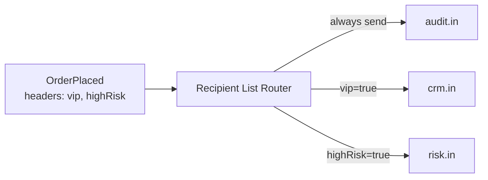
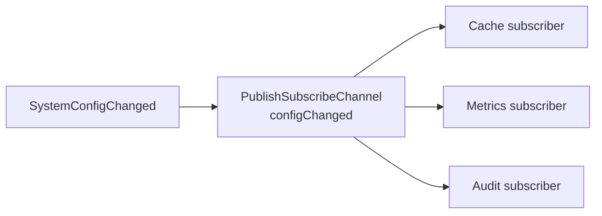
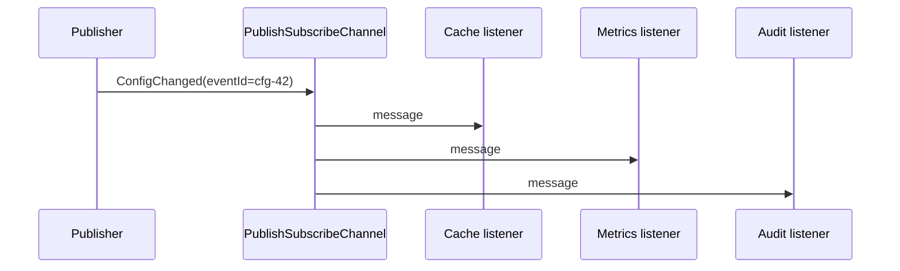
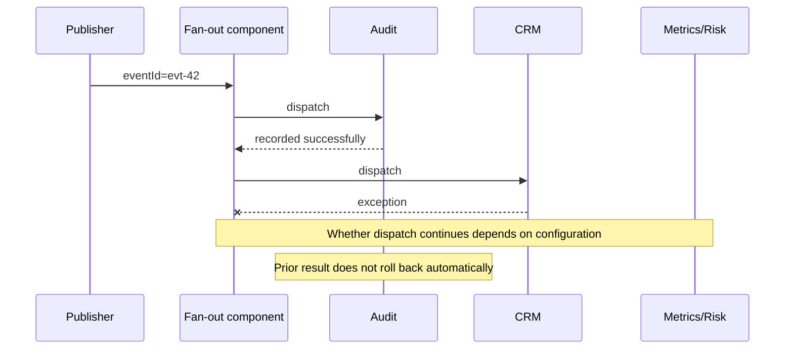
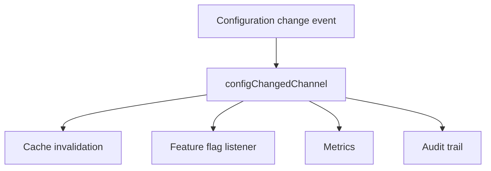
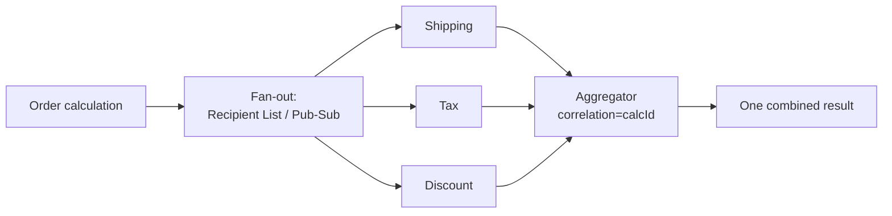

# Distinguishing Recipient List from Publish-Subscribe Channel

## 1. Both Send One Message to Multiple Destinations—Why Are There Two Ways?

In an order-processing system, when an `OrderPlaced` event occurs, the system may need:

- **Audit** to receive every event to record a business log.
- **CRM** to receive only events for VIP customers.
- **Risk** to receive only events flagged as high risk.

In another system, a `SystemConfigChanged` notification needs to be broadcast to **every component currently listening**. A component can be added to or removed from the listener list without the event publisher knowing the identity of each component.

Both problems look like *one message to many consumers*, yet they express different intents:

- **Recipient List** selects a **list of recipients per message**, typically based on a target set managed by routing rules; each recipient can have its own condition.
- **Publish-Subscribe Channel** broadcasts **each message to the subscribers currently registered on the channel**; subscriber participation is part of topology configuration.

This lesson belongs to the **Recipient list** chapter of the **SPRING_INTEGRATION_PATTERN** module, where we learn to implement Enterprise Integration Patterns with Spring Integration to create loosely coupled and extensible flows. Choosing the right pattern directly affects how Router, Filter, Transformer, Splitter, Aggregator, Gateway, retry, error channels, and correlation work together, as well as how each branch is tested and monitored.

Learning objectives after this lesson:

1. Distinguish a **recipient chosen by a router** from a **subscriber of a channel**.
2. Understand that both models can fan out to multiple consumers, yet differ in flexibility, configuration, and semantics.
3. Configure `routeToRecipients(...)` and `PublishSubscribeChannel` using Java DSL.
4. Evaluate filtering conditions, topology, threading, delivery order, partial failures, retries, and idempotency.
5. Test the recipient/subscriber set and pick the right solution for business requirements.

## 2. Two Diagrams to See the Difference

### Recipient List: Router decides who receives each message



An event with `vip=true` and `highRisk=false` is sent to Audit and CRM. For an event with `vip=false` and `highRisk=true`, the recipient set becomes Audit and Risk. **Same router, while the receiver set changes per message.**

### Publish-Subscribe: Channel broadcasts to registered subscribers



When three subscribers are registered and active, all three receive messages dispatched by the channel. The channel acts as a broadcaster to its subscribers; normally it **does not decide by business content whether subscriber A receives while subscriber B does not**.

If one subscriber only wants messages conditionally, you can place a `Filter` inside that subscriber's flow, or switch to Recipient List when per-message recipient selection is a central responsibility of the system.

## 3. Core Comparison Table

| Criterion | Recipient List Router | Publish-Subscribe Channel |
| --- | --- | --- |
| Component deciding targets | **Router** with recipient list / selectors | **Channel** dispatching to registered subscribers |
| Receiver set for a message | Can vary across messages per each recipient's condition | Usually the set of subscribers currently on the channel |
| Typical configuration | `routeToRecipients(...)`, `recipient(channel, selector)` | `PublishSubscribeChannel`, subscriber endpoints, or DSL `publishSubscribeChannel(...)` |
| Primary goal | **Conditional fan-out**: pick appropriate destinations | **Broadcast**: notify listeners of a channel |
| Per-consumer condition? | Can attach selectors right when declaring recipients | Usually uses a `Filter` inside the subscriber flow if needed |
| Adding a receiver | Update recipient policy; can use dynamic recipient lists | Register an additional subscriber on the channel via subscription mechanics |
| Publisher coupling | Publisher sends to router/input channel; Router knows recipient addresses | Publisher sends to one pub-sub channel; no need to list subscribers |
| Default threading in common setups | Depends on target channels; sending to `DirectChannel` is usually synchronous | Without an executor, dispatching to subscribers is usually synchronous on the sending thread |
| Asynchronous handling | Use appropriate target channels/adapters, executors, or polling consumers | Can supply a `TaskExecutor` to `PublishSubscribeChannel` |
| One subscriber/recipient fails | May affect delivery to others if dispatched synchronously | May also affect other subscribers if dispatched synchronously |
| Durable across process restarts? | Not out of the box; depends on downstream channels/adapters | Not out of the box; in-memory pub-sub is not a durable broker topic |
| Best fit | VIP CRM routing, risk-based routing, notifying a dynamic recipient set | Internal events broadcast to all currently registered listeners |

**The main difference lies in how the destination set is decided, not the number of output messages.** A Recipient List can send to one or many recipients; a Publish-Subscribe Channel can also have only one subscriber. Runtime count does not change the essence of the model.

## 4. Recipient List: Conditions Evaluated per Recipient

In Spring Integration, `RecipientListRouter` is typically configured with Java DSL `routeToRecipients(...)`. You can declare always-on recipients alongside conditional recipients whose expression/selector evaluates to true:

```java
@Bean
public IntegrationFlow recipientListFlow() {
    return IntegrationFlow.from("orders.recipient.in")
        .routeToRecipients(spec -> spec
            .recipient("orders.audit")
            .recipient("orders.crm", "headers['vip'] == true")
            .recipient("orders.risk", "headers['highRisk'] == true"))
        .get();
}
```

Read this snippet as three **independent** rules:

1. Every message is sent to `orders.audit`.
2. If header `vip` equals `true`, the message is also sent to `orders.crm`.
3. If header `highRisk` equals `true`, the message is also sent to `orders.risk`.

When both conditions are true, all matching recipients can be selected. This is **not** an `if/else if` chain taking only the first match.

### When does the recipient set change?

There are two types of changes:

- **Per-message variation:** `vip`/`highRisk` values differ, so selected recipients differ; this is natural Recipient List behavior.
- **Policy variation:** adding `orders.marketing` during a promotional campaign; may require config changes or a controlled list/selector update mechanism.

When different tenants have different recipient sets, routing policy must use an **authenticated tenant**. Never use raw client-supplied headers directly to send data to another tenant's recipients.

### No matching recipients

If only conditional recipients are declared and none match, the system must define the behavior: drop with monitoring, send to a default branch, or raise a business error. How the router handles zero resolved destinations depends on configuration and API version. **Never treat "sent nowhere" as success when an event must be delivered.**

Having at least one always-on recipient like Audit may fit some systems, though it is not a universal fix. What matters is defining the recipient set per requirements and making it testable.

## 5. Publish-Subscribe Channel: Sender Does Not Choose Individual Consumers

Spring Integration's `PublishSubscribeChannel` is a `SubscribableChannel`. Handler endpoints **subscribe** to the channel; when a message arrives, the channel dispatches it to subscribers per its mechanism.

Example broadcasting a config change to every listener in an application:



The key point is the publisher only knows `configChangedChannel`. It needs no logic changes when a new listener registers. Once a new listener subscribes properly, it receives messages emitted **from the time it became an active subscriber**.

This is not an old-event replay mechanism: an in-memory `PublishSubscribeChannel` does not buffer past messages for late subscribers. If events must be retained for new or offline consumers, evaluate durable broker topics/subscriptions or an event store; that is a separate delivery concern.

### Can a Pub-Sub Channel use Filters?

Yes. Each subscriber can have its own flow, for instance:

```text
configChangedChannel
  ├── Cache subscriber: always runs
  ├── Metrics subscriber: always runs
  └── Partner subscriber: Filter by tenant/change type
```

However, when you end up creating many Filters merely to decide **who should receive a message**, Recipient List expresses that intent more directly. Pub-Sub makes sense when **every listener is permitted to observe the event** and each listener decides independently whether to act.

## 6. Distinguishing from `DirectChannel` and Content-Based Router

Three models frequently confused:

| Component | Intended handlers invoked per message | Selection mechanism |
| --- | --- | --- |
| `DirectChannel` | One subscriber chosen by dispatcher to process | Point-to-point dispatch among subscribers |
| Content-Based Router | Usually one business branch; may support multiple targets depending on router | Based on content/headers/route key |
| Recipient List Router | A set of recipients, potentially multiple targets at once | List and selectors |
| `PublishSubscribeChannel` | All registered subscribers | Channel dispatches to its subscriber list |

**Subscribing three handlers to a `DirectChannel` does not broadcast messages to all three.** On `DirectChannel`, subscribers compete to handle each message according to the dispatcher's strategy; Pub-Sub intentionally broadcasts to all subscribers.

Conversely, creating three target channels in a Recipient List does not force the publisher to wire directly to three handlers. The Router acts as a **target-selecting intermediary**. It can route to `DirectChannel`, `QueueChannel`, outbound adapters, or other messaging infrastructure.

### How does "publish-subscribe" here differ from a broker topic?

Do not equate Spring Integration's `PublishSubscribeChannel` with a Kafka topic or RabbitMQ exchange:

- `PublishSubscribeChannel` typically connects active endpoints **within one application context/process**.
- Kafka/RabbitMQ/JMS provide protocols, storage, acks, consumer groups/subscriptions, retries, and cross-process communication per configuration.
- Both express fan-out, yet **delivery guarantees, ordering, replay, and infrastructure failure modes** differ vastly.

Refactoring from an in-memory channel to a broker topic is an architectural change that requires testing actual semantics rather than relying on the shared name "pub-sub."

## 7. Java DSL Example Placing Both Patterns Side by Side

The following example uses one Spring Integration application with two separate send paths:

- `orders.recipient.in` enters a **Recipient List**, selecting Audit and CRM based on `vip`.
- `orders.broadcast.in` is a **`PublishSubscribeChannel`** with two subscribers: Audit and Metrics. Every send to this channel reaches both active subscribers.

`QueueChannel` instances are used to inspect messages in unit/integration tests, not as production storage design.

```java
import org.springframework.beans.factory.annotation.Qualifier;
import org.springframework.context.annotation.Bean;
import org.springframework.context.annotation.Configuration;
import org.springframework.integration.channel.DirectChannel;
import org.springframework.integration.channel.PublishSubscribeChannel;
import org.springframework.integration.channel.QueueChannel;
import org.springframework.integration.config.EnableIntegration;
import org.springframework.integration.dsl.IntegrationFlow;
import org.springframework.messaging.Message;
import org.springframework.messaging.MessageHandler;

record OrderEvent(String eventId, String orderId) {}

@Configuration
@EnableIntegration
public class FanoutPatternsConfig {

    // Input for Recipient List.
    @Bean("orders.recipient.in")
    public DirectChannel recipientInput() {
        return new DirectChannel();
    }

    @Bean("recipient.audit")
    public QueueChannel recipientAudit() {
        return new QueueChannel();
    }

    @Bean("recipient.crm")
    public QueueChannel recipientCrm() {
        return new QueueChannel();
    }

    @Bean
    public IntegrationFlow recipientListOrders() {
        return IntegrationFlow.from("orders.recipient.in")
            .routeToRecipients(spec -> spec
                .recipient("recipient.audit")
                .recipient("recipient.crm",
                    "headers['vip'] == true"))
            .get();
    }

    // Direct input is a PublishSubscribeChannel.
    @Bean("orders.broadcast.in")
    public PublishSubscribeChannel broadcastInput() {
        return new PublishSubscribeChannel();
    }

    @Bean("broadcast.audit")
    public QueueChannel broadcastAudit() {
        return new QueueChannel();
    }

    @Bean("broadcast.metrics")
    public QueueChannel broadcastMetrics() {
        return new QueueChannel();
    }

    // Both IntegrationFlows subscribe to the same pub-sub channel.
    @Bean
    public IntegrationFlow auditBroadcastSubscriber(
            @Qualifier("orders.broadcast.in")
            PublishSubscribeChannel broadcast,
            @Qualifier("broadcast.audit")
            QueueChannel audit) {

        return IntegrationFlow.from(broadcast)
            .handle((MessageHandler) message -> {
                if (!audit.send(message)) {
                    throw new IllegalStateException(
                        "Audit output rejected message");
                }
            })
            .get();
    }

    @Bean
    public IntegrationFlow metricsBroadcastSubscriber(
            @Qualifier("orders.broadcast.in")
            PublishSubscribeChannel broadcast,
            @Qualifier("broadcast.metrics")
            QueueChannel metrics) {

        return IntegrationFlow.from(broadcast)
            .handle((MessageHandler) message -> {
                if (!metrics.send(message)) {
                    throw new IllegalStateException(
                        "Metrics output rejected message");
                }
            })
            .get();
    }
}
```

**How to read the example:**

- In `recipientListOrders()`, the Router **knows the names** `recipient.audit` and `recipient.crm`. It can route to 1 or 2 channels depending on headers.
- `orders.broadcast.in` is a channel with subscribers. The two flows `auditBroadcastSubscriber()` and `metricsBroadcastSubscriber()` register their own handlers on that same channel.
- The sender only needs to know `orders.broadcast.in`; sending one message to the channel dispatches to both active subscribers.
- `PublishSubscribeChannel()` in the example receives no `TaskExecutor`, so dispatch is **synchronous by default**. Attaching an executor changes threading and error-handling behavior.
- The `if (!queue.send(message))` check prevents the lesson from assuming every send to a target channel succeeds; with unbounded queues in normal operation, sends in the example typically succeed.

The example declares `record OrderEvent` independently of `IntegrationFlow`. In production, payloads can be other Java records/DTOs and each recipient needs real executing consumers or outbound adapters.

### A shorter Pub-Sub DSL configuration

If you only need two subscribers inside one flow, Spring Integration Java DSL also supports inline declaration via `publishSubscribeChannel(...)`:

```java
@Bean
public IntegrationFlow inlineBroadcast() {
    return IntegrationFlow.from("config.events.in")
        .publishSubscribeChannel(spec -> spec
            .subscribe(sub -> sub.handle(
                (MessageHandler) message ->
                    System.out.println("Cache: " + message.getPayload())))
            .subscribe(sub -> sub.handle(
                (MessageHandler) message ->
                    System.out.println("Metrics: " + message.getPayload()))))
        .get();
}
```

The purpose of this example is showing **two subscribers** on a channel, not recommending `System.out.println` in production. When subscribers perform I/O or substantial business logic, extract them into named services/flows with dedicated error handling.

**Note:** Inline subscriber declarations and separate subscriber flows are two organizational styles. Do not use both on the same channel unless you intentionally want extra executions.

## 8. Testing the Difference with the Same Event

With `FanoutPatternsConfig`, we can use JUnit 5 + AssertJ to verify:

- Recipient List selects Audit for every message and CRM only when VIP.
- Pub-Sub dispatches the same message to both Audit and Metrics because both flows subscribed.
- Application tracing headers are not lost when sent to these endpoints.

```java
import static org.assertj.core.api.Assertions.assertThat;

import org.junit.jupiter.api.Test;
import org.springframework.beans.factory.annotation.Autowired;
import org.springframework.beans.factory.annotation.Qualifier;
import org.springframework.integration.channel.PublishSubscribeChannel;
import org.springframework.integration.channel.QueueChannel;
import org.springframework.messaging.Message;
import org.springframework.messaging.MessageChannel;
import org.springframework.messaging.support.MessageBuilder;
import org.springframework.test.context.junit.jupiter.SpringJUnitConfig;

@SpringJUnitConfig(FanoutPatternsConfig.class)
class FanoutPatternsTest {

    @Autowired
    @Qualifier("orders.recipient.in")
    MessageChannel recipientsInput;

    @Autowired
    @Qualifier("recipient.audit")
    QueueChannel recipientAudit;

    @Autowired
    @Qualifier("recipient.crm")
    QueueChannel recipientCrm;

    @Autowired
    @Qualifier("orders.broadcast.in")
    PublishSubscribeChannel broadcast;

    @Autowired
    @Qualifier("broadcast.audit")
    QueueChannel broadcastAudit;

    @Autowired
    @Qualifier("broadcast.metrics")
    QueueChannel broadcastMetrics;

    private Message<OrderEvent> event(boolean vip) {
        return MessageBuilder.withPayload(
                new OrderEvent("evt-42", "order-42"))
            .setHeader("vip", vip)
            .setHeader("requestId", "req-42")
            .build();
    }

    @Test
    void recipientListSelectsRecipientsForEachMessage() {
        assertThat(recipientsInput.send(event(false))).isTrue();

        assertThat(recipientAudit.receive(0)).isNotNull();
        assertThat(recipientCrm.receive(0)).isNull();

        assertThat(recipientsInput.send(event(true))).isTrue();

        Message<?> audit = recipientAudit.receive(0);
        Message<?> crm = recipientCrm.receive(0);
        assertThat(audit).isNotNull();
        assertThat(crm).isNotNull();
        assertThat(crm.getHeaders().get("requestId"))
            .isEqualTo("req-42");

        assertThat(recipientAudit.receive(0)).isNull();
        assertThat(recipientCrm.receive(0)).isNull();
    }

    @Test
    void publishSubscribeDeliversToBothSubscribers() {
        assertThat(broadcast.send(event(false))).isTrue();

        Message<?> audit = broadcastAudit.receive(0);
        Message<?> metrics = broadcastMetrics.receive(0);

        assertThat(audit).isNotNull();
        assertThat(metrics).isNotNull();
        assertThat(audit.getPayload())
            .isEqualTo(new OrderEvent("evt-42", "order-42"));
        assertThat(metrics.getHeaders().get("requestId"))
            .isEqualTo("req-42");

        assertThat(broadcastAudit.receive(0)).isNull();
        assertThat(broadcastMetrics.receive(0)).isNull();
    }
}
```

These are **dispatch tests within the same `ApplicationContext`**; they do not prove recipients wrote to a database, subscribers called external APIs successfully, or messages survive restarts. When switching from synchronous channels to executors, use bounded waits/test synchronization instead of assuming results appear immediately.

### Behavior Matrix for Further Testing

| Scenario | Recipient List | Publish-Subscribe Channel |
| --- | --- | --- |
| `vip=false`, no other conditions | Only always-on recipients | All current subscribers receive the message |
| `vip=true` | Always-on recipients + CRM | Still all current subscribers; VIP does not alter topology |
| Add a conditional marketing recipient | Router/policy must learn the new mapping | Add marketing subscriber if broadcasting to all messages |
| Remove CRM from the system | Update router or handle missing destination | Unsubscribe / stop deploying CRM flow |
| No active receivers | Depends on no-match / channel resolution policy | Depends on min-subscribers rules and channel config |
| One consumer throws an exception | Can affect other recipients if dispatched synchronously | Can affect other subscribers if dispatched synchronously |
| One consumer is slow | Impact depends on target channel | With synchronous dispatch, can block publisher thread |
| Must retain messages for offline consumers | Must add storage/broker | Must add storage/broker |

## 9. Threading and Ordering: Both Can Be Synchronous or Asynchronous

### Recipient List does not automatically mean parallel execution

In a Recipient List, each destination can be:

- `DirectChannel`: receiving handler usually executes on the sending thread.
- `QueueChannel`: message enters a buffer; a polling consumer processes later.
- `ExecutorChannel`: dispatches to an executor; sending and processing can use separate threads.
- Outbound adapter: sends via HTTP, AMQP, JMS, or Kafka with that transport's semantics.

Routing to three targets **does not guarantee** three handlers run concurrently. If all three are `DirectChannel`s and each handler calls a slow service, the sender can wait on handlers per the current dispatch mechanics.

### `PublishSubscribeChannel` does not automatically mean parallel execution

A `PublishSubscribeChannel` without an executor uses synchronous dispatch. The publisher can wait for subscriber callbacks; a slow or throwing subscriber can affect the `send` call.

You can configure a `TaskExecutor` for asynchronous dispatch:

```java
import java.util.concurrent.Executor;

import org.springframework.context.annotation.Bean;
import org.springframework.integration.channel.PublishSubscribeChannel;

// Executor must be managed properly with Spring context and shutdown policy.
@Bean
public PublishSubscribeChannel asynchronousBroadcast(Executor executor) {
    return new PublishSubscribeChannel(executor);
}
```

This example shows **how to pass an executor**, assuming the application already provides a suitable `Executor` bean. When using a worker pool, also configure queue limits, task rejection policies, exception handling, and shutdown. Switching to an executor does not add durability: if the process dies while tasks sit in the pool, messages can be lost.

### Ordering and delivery

Never rely on an invariant order across recipients/subscribers when the architecture has not specified and tested that order. With an executor, subscriber start and finish orders can vary; multiple concurrent events can shift observed order further.

If downstream must process events in order for a given `orderId`, use explicit ordering contracts and appropriate partitioning/keys, or serialize at the consumer. **Fan-out does not create end-to-end business ordering automatically.**

## 10. Failure in One Recipient or Subscriber

A shared challenge of both patterns is **partial completion**: Audit may save successfully while CRM fails, and Metrics or Risk have not processed yet. Sending to multiple targets via a router or channel does not automatically turn side effects into an atomic transaction.



In Recipient List, an error while routing to one destination can propagate back to the caller or be handled per send-error config. In Pub-Sub, an error in a synchronous subscriber can likewise affect dispatch. With executors, errors surface on another thread and must be tracked via proper error handling.

| Risk | Approach |
| --- | --- |
| Retrying entire fan-out causes Audit to write twice | Use stable `eventId`, per-recipient idempotency, and tightly scoped retries |
| One offline recipient blocks publisher | Decouple delivery via queues/brokers, bound timeouts and backlogs |
| Subscriber fails after publisher returned success | Observe errors at executor/poller/consumer; use a failure store or DLQ |
| Missing destination | Validate topology at startup and test mappings/subscriptions |
| Mandatory recipient fails | Define fail-fast, error reporting, or compensation if required |
| Optional recipient fails | Monitored best-effort, bounded retries, or contractual loss tolerance |

### Choosing retry scope

Suppose both Audit and CRM were selected; Audit finished writing, then CRM timed out. Retrying **the entire Recipient List** or replaying **the entire Pub-Sub event** can cause Audit to receive it again.

A reliable design typically uses:

1. A durable business event identifier such as `eventId=evt-42`.
2. Per-recipient delivery state keyed by `(eventId, recipientId)` when individual receivers must be tracked.
3. Retries with backoff per recipient/consumer or via broker.
4. Idempotency when recipients write to databases or call side-effect APIs.
5. Error flows, dead-letter/failure stores, and controlled replay capabilities.

If recipients only update charts or non-critical logs, simpler policies may fit. If they capture payments, deduct stock, or create shipments, you likely need a workflow/saga and compensation steps, because fan-out cannot coordinate distributed transactions.

## 11. Should Each Subscriber Use a Filter?

When a Publish-Subscribe Channel sends every event to every subscriber, each subscriber can still place a `Filter` right after the channel:

```text
orders.broadcast
  ├── Audit subscriber: processes all messages
  ├── CRM subscriber: Filter(vip == true) → CRM handler
  └── Risk subscriber: Filter(highRisk == true) → Risk handler
```

That structure **can be valid**, especially when individual subscribers own their logic and want to decide independently whether an event is relevant.

Still, it differs from Recipient List in several ways:

- The initial message is still dispatched by the channel to CRM and Risk even though the Filter later discards it.
- Selection logic is scattered across subscribers instead of centralized in a Router.
- Observed metrics for "published" vs. "processed after filter" diverge.
- When adding a new subscriber, the publisher typically does not need to know; the new subscriber owns its own Filter.
- If a subscriber's Filter throws or is slow in synchronous mode, the publisher can be affected even when the message ends up discarded.

**Put Filters at subscribers when deciding interest is each subscriber's responsibility.** Choose Recipient List when the business requires one active place deciding the destination list—for example, selecting notification vendors by order type or enforcing an approved delivery policy.

## 12. When to Choose Recipient List

Recipient List is especially well suited when:

- The recipient set **varies per message**.
- Each recipient has its own condition and multiple conditions can hold simultaneously.
- You need to record why "who was selected" for auditing or replay.
- The system owns recipient-selection policy and wants to test a decision table.
- You need to forward the same event to multiple specific target integration flows/adapters.

Example routing policy:

| Event | Audit | CRM | Risk |
| --- | --- | --- | --- |
| Regular customer, low risk | Yes | No | No |
| VIP customer, low risk | Yes | Yes | No |
| Regular customer, high risk | Yes | No | Yes |
| VIP customer, high risk | Yes | Yes | Yes |

Note that `vip` and `highRisk` must come from **verified data or computed policies**. Never let clients supply arbitrary headers to pick sensitive targets or access another tenant's data.

When the number of recipients and policies grows large, extract recipient selection into a typed, unit-tested service instead of embedding complex business logic inside long SpEL expressions.

## 13. When to Choose Publish-Subscribe Channel

Publish-Subscribe Channel fits when:

- A publisher needs to emit an event to **all registered listeners**.
- Listeners can be added or removed independently of publisher logic.
- Subscribers own handling the event and can filter locally if needed.
- The use case is **internal notification/broadcast**.
- You want a clear integration point: `domainEvents`, `cacheInvalidationEvents`, `configChangedEvents`.

Example:



Here, a new subscriber can join without the publisher updating a `vip`/`risk` condition table. Operators must still govern **subscription lifecycle, latency, error handling, and data security** across all listeners.

If an application publishes events containing confidential data onto a Pub-Sub Channel where every subscriber can inspect the payload, revisit your trust boundaries. In-memory pub-sub does not automatically enforce per-tenant or per-role payload authorization.

## 14. Choosing When Durable Messaging and Multiple Applications Are Needed

In multi-process systems, asking "Recipient List or Publish-Subscribe Channel?" may not be enough. Also ask about **delivery goals**:

- Must a consumer receive events after coming back from being offline?
- Do you need acks, replay, dead-lettering, retries, and retention?
- Can the same event sent to multiple independent services be processed safely if redelivered?
- Do you need ordering constraints by `orderId` or partition?
- Who owns memory, storage, and state for each subscription?

Sound patterns include a **Recipient List routing to dedicated queues**, or a **broker topic feeding per-service subscriptions**. These implementations carry very different semantics from an in-JVM `PublishSubscribeChannel`.

| Goal | Design Direction to Consider |
| --- | --- |
| Conditional fan-out within one app | Recipient List |
| Broadcast within one application context | `PublishSubscribeChannel` |
| Every service needs a copy and may go offline | Broker pub-sub with appropriate subscriptions/queues |
| Rules select a subset of services from message attributes | Recipient List or policy-based router, optionally paired with a broker |
| Must persist per-recipient delivery status | Delivery store/outbox + idempotent consumers |
| Must aggregate replies from multiple services | Aggregator with correlation/release/deadline, not fan-out alone |

### Can the two patterns be combined?

Yes. For instance, a Recipient List selects **which service groups are allowed to receive** an event, and each service then uses an internal Pub-Sub Channel to broadcast to modules inside itself. When combining them, distinguish **outer-layer routing keys** from **inner-layer subscriptions**, along with error observability at each boundary.

## 15. Correlation, Splitter, and Aggregator with Multiple Branches

Both Recipient List and Publish-Subscribe can deliver the same event to multiple branches, yet **neither combines results automatically**.

Suppose an order must calculate three values: shipping fee, tax, and discount. Selecting three targets is only the **fan-out** step. To wait for three results and combine them into one response, add:

1. A **correlation key** identifying replies belonging to the same request—for example, a `calculationId` preserved across branches.
2. A **release strategy** specifying whether all three results are required or partial results are acceptable.
3. **Timeouts** for the result group and for the Gateway awaiting the reply; the two timeouts may differ.
4. **Deduplication** if a service retries and emits the same reply twice.
5. **Error flows** handling cases where a service never replies or returns an error.



Do not assume `MessageHeaders.ID`, `JMSCorrelationID`, and the `correlationId` used by Aggregator are always interchangeable. Define metadata explicitly per layer so two requests never merge accidentally and groups never stall waiting for missing messages.

If a subscriber's Filter drops one branch while the Aggregator still expects three, the group will never release under default count rules. In that case, track the expected result set, emit a "not applicable" signal, or configure timeout/partial-result policies.

## 16. System Observability: Measuring Receiver Sets and Subscriber Sets

The same "messages sent" number can mean different things in the two models.

For Recipient List, track:

- Messages entering the router.
- Recipients selected per message and per recipient type.
- Dispatch successes/failures per destination.
- Messages matching zero recipients, dropped, or sent to fallback.
- Errors and retries per recipient.

For Publish-Subscribe Channel, track:

- Active subscriber count at key moments.
- Messages published.
- Messages accepted/processed per subscriber.
- Latency or backlog per subscriber when using executors/buffers.
- Errors inside one subscriber and impact on other subscribers.

Log a trusted `eventId` or `requestId` at key stages, propagating trace context across thread or process boundaries. Metrics like `fanout.recipient.selected` and `broadcast.subscriber.failed` are **suggested application metric names**, not claims that Spring Integration exports those exact names out of the box.

### Quick Diagnostic Table

| Symptom | Likely Cause | How to Check |
| --- | --- | --- |
| VIP misses event | Wrong selector, missing `vip`, or wrong CRM channel | Inspect headers before router, SpEL, channel mappings/recipients |
| One event delivered twice to same consumer | Both recipient router and pub-sub feed the same target, or non-idempotent retry | Check topology, `eventId`, and retry scope |
| Pub-sub reaches only one listener | Other endpoints unsubscribed/inactive or accidentally using `DirectChannel` | Inspect channel bean type and subscription lifecycle |
| Publisher blocked by one slow listener | Synchronous dispatch with a handler doing slow I/O | Measure handler duration; consider executor and load policy |
| Publisher reports success yet downstream fails | Async handoff finished before handler ran | Check error flows/consumers; never treat send result as business ack |
| Events lost after restart | In-memory channel has no retention | Use a broker/store when durable delivery is needed |
| Two subscribers see sensitive data they should not | Overly broad broadcast with no access boundaries | Narrow topics/channels, enforce authorization, and filter before emitting |
| Aggregator waits forever | Missing one result, wrong correlation, or wrong release strategy | Inspect groups, `expectedCount`, timeouts, and duplicates |

## 17. Practice Exercises

**Exercise 1 — Compare receiver sets.** For four events covering `vip=true/false` and `highRisk=true/false`, list the selected recipients of a Recipient List (Audit, CRM, Risk). Then compare with a Pub-Sub Channel having three subscribers Audit, CRM, and Risk. Explain why the receiver sets differ between the two models despite having the same number of handlers.

**Exercise 2 — Implement both and test.** Building on the code in Section 7, add `orders.risk` to the Recipient List; verify with JUnit that a high-risk VIP event reaches all three channels. Add a new subscriber to the Pub-Sub Channel and prove the publisher needs no payload or send-logic changes for the new subscriber to receive messages.

**Exercise 3 — Single-branch failure.** Simulate Audit writing successfully while CRM throws an exception. Run under both synchronous and asynchronous models. Record what the caller receives, whether other consumers are invoked, and where retries belong so Audit does not double-write.

**Exercise 4 — Offline consumer.** Suppose the Risk subscriber must receive every event even if the service is down for 30 minutes. Explain why an in-memory `PublishSubscribeChannel` falls short. Design a broker/topic/subscription or persistent delivery store and an idempotent replay policy.

**Exercise 5 — Fan-out/fan-in.** Three services—Shipping, Tax, and Discount—receive the same request yet return independent results. Design the right fan-out and downstream Aggregator. Handle Discount not replying, Shipping replying twice, and Tax arriving after the deadline.

**Exercise 6 — Ownership decision.** An operations team wants every config change observed by all modules; a business team wants vouchers sent only to CRM for VIP customers. Pick the pattern for each need, state where policies belong, where Filters belong, what must be logged, and how to test each branch.

A thorough solution must explain **who owns the send decision**, **how many destinations each message reaches**, **how subscribers join**, **how errors/timeouts propagate**, and **when a broker or Aggregator is required**.

## 18. Key Principles to Remember

- **Recipient List** represents a receiver set chosen by a router/policy, often varying across messages; each recipient can have its own selector.
- **`PublishSubscribeChannel`** broadcasts messages to the channel's registered subscribers; the publisher normally does not need to know those subscribers.
- Both can fan out to multiple consumers, and both carry **partial failure** risks when one consumer causes side effects and another fails.
- **Do not assume pub-sub is asynchronous**: in Spring Integration, a channel without an executor dispatches synchronously by default.
- **Do not assume pub-sub is durable**: in-memory channels lack broker retention, replay, or acks.
- When per-message conditions are needed, Recipient List expresses them directly; when every listener should observe an event, Pub-Sub states that intent more clearly.
- Retries must account for `eventId`, idempotency, and per-recipient/subscriber delivery status; never interpret `send() == true` as completed business work.
- When multiple branches must return and combine results, design correlation, release strategies, and timeouts with an Aggregator or appropriate workflow.

## References

- [Spring Integration Reference — Router implementations](https://docs.spring.io/spring-integration/reference/router/implementations.html)
- [Spring Integration Reference — Message Routing](https://docs.spring.io/spring-integration/reference/router.html)
- [Spring Integration Reference — Message Channels](https://docs.spring.io/spring-integration/reference/channel.html)
- [Spring Integration Reference — Channel Implementations](https://docs.spring.io/spring-integration/reference/channel/implementations.html)
- [Spring Integration Reference — Java DSL](https://docs.spring.io/spring-integration/reference/dsl.html)
- [Spring Integration Reference — Error Handling](https://docs.spring.io/spring-integration/reference/error-handling.html)
- [Spring Integration Reference — Aggregator](https://docs.spring.io/spring-integration/reference/aggregator.html)
- [Enterprise Integration Patterns — Recipient List](https://www.enterpriseintegrationpatterns.com/patterns/messaging/RecipientList.html)
- [Enterprise Integration Patterns — Publish-Subscribe Channel](https://www.enterpriseintegrationpatterns.com/patterns/messaging/PublishSubscribeChannel.html)

These examples use Java records (Java 17+) and modern Spring Integration Java DSL. When applying them to production applications, check API overloads, subscription lifecycles, threading/executors, error handling, and delivery semantics for your running version.
