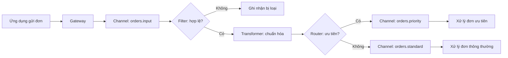

# Enterprise Integration Pattern là gì?

> **Chương:** Nhập môn  
> **Module:** `SPRING_INTEGRATION_PATTERN` — học triển khai Enterprise Integration Patterns bằng Spring Integration để xây dựng luồng thông điệp ít phụ thuộc, dễ mở rộng; thực hành Router, Filter, Transformer, Splitter, Aggregator, Gateway, retry, error channel, correlation và kiểm thử/quan sát từng nhánh.

## 1. Mục tiêu học tập

Sau bài này, bạn có thể:

1. Giải thích **Enterprise Integration Patterns (EIP)** giải quyết vấn đề gì khi nhiều hệ thống phải trao đổi dữ liệu.
2. Phân biệt **message**, **channel**, **endpoint** và **integration flow**; hiểu sự khác nhau giữa một mẫu thiết kế với công nghệ triển khai nó.
3. Nhận diện những EIP phổ biến như **Gateway, Filter, Transformer, Content-Based Router, Splitter, Aggregator** và biết khi nào nên dùng.
4. Phác thảo một luồng Spring Integration đơn giản, chỉ ra cách định tuyến, xử lý lỗi, tương quan thông điệp và những điểm cần kiểm thử.

## 2. Vì sao cần Enterprise Integration Patterns?

Hãy hình dung một hệ thống thương mại điện tử phải kết nối với ERP, dịch vụ thanh toán, kho hàng, email và nền tảng vận chuyển. Mỗi hệ thống có thể dùng API, định dạng dữ liệu, lịch hoạt động và khả năng chịu tải khác nhau. Nếu mã nguồn xử lý đơn hàng gọi trực tiếp mọi hệ thống và tự chứa tất cả các quy tắc chuyển đổi/định tuyến, nó sẽ dễ gặp các vấn đề:

- **Phụ thuộc chặt:** thay đổi API kho hàng buộc sửa cả logic đặt hàng.
- **Dữ liệu không đồng nhất:** nơi dùng JSON, nơi dùng XML; cùng một trường có thể được đặt tên hoặc biểu diễn khác nhau.
- **Luồng xử lý khó mở rộng:** thêm nhánh cho đơn ưu tiên, đơn quốc tế hay kênh thông báo mới dẫn đến điều kiện `if/else` rải rác.
- **Lỗi lan truyền:** dịch vụ đích chậm hoặc mất kết nối có thể làm treo cả giao dịch nếu không có chính sách giới hạn thời gian, retry và xử lý lỗi thích hợp.
- **Khó theo dõi:** không rõ một đơn hàng đã đi qua những bước nào, bị loại ở đâu và các thông điệp kết quả có thuộc cùng một yêu cầu hay không.

**Enterprise Integration Patterns** là **tập hợp các mẫu thiết kế có tên gọi, cấu trúc và mục đích rõ ràng** để giải những bài toán lặp lại trong việc kết nối ứng dụng, đặc biệt thông qua **message-based integration** (tích hợp dựa trên thông điệp). Các mẫu được hệ thống hóa nổi bật trong sách *Enterprise Integration Patterns* của Gregor Hohpe và Bobby Woolf.

EIP là **ngôn ngữ thiết kế chung**, không phải một thư viện, giao thức hay sản phẩm cụ thể. Bạn có thể vận dụng chúng bằng Spring Integration, Apache Camel, một hệ thống message broker hoặc bằng giải pháp tự phát triển. Tên mẫu giúp các thành viên mô tả kiến trúc chính xác: “lọc thông điệp không hợp lệ”, “định tuyến theo nội dung”, “tách đơn hàng thành các dòng”, “gom kết quả theo đơn hàng” thay vì mô tả một khối mã xử lý mơ hồ.

> **Ý tưởng cốt lõi:** chia một quy trình tích hợp lớn thành các bước nhỏ có trách nhiệm riêng, nối chúng bằng thông điệp và kênh truyền. Các bước có thể được cấu hình, kiểm thử, thay thế và quan sát độc lập hơn.

## 3. Các thành phần nền tảng

### 3.1. Message — thông điệp

Một thông điệp thường gồm **payload** (nội dung nghiệp vụ) và **headers** (siêu dữ liệu phục vụ định tuyến, truy vết, phản hồi...). Spring Integration biểu diễn bằng `Message<T>`.

Ví dụ một đơn hàng có thể được đóng gói như sau:

```java
import org.springframework.messaging.Message;
import org.springframework.messaging.support.MessageBuilder;

Message<String> message = MessageBuilder.withPayload(
        "{\"orderId\":\"ORD-101\",\"total\":750000}")
    .setHeader("sourceSystem", "web-store")
    .setHeader("tenantId", "shop-vn")
    .build();

System.out.println(message.getPayload());
System.out.println(message.getHeaders().get("sourceSystem"));
```

Payload là thông tin cần xử lý; header có thể mang các thông tin như `id`, `timestamp`, `replyChannel`, `errorChannel`, `correlationId` hoặc dữ liệu truy vết. Không nên mặc định mọi header sẽ được giữ nguyên khi đi qua mọi hệ thống hoặc adapter: việc ánh xạ header qua ranh giới giao thức cần được cấu hình/kiểm tra.

### 3.2. Message Channel — kênh thông điệp

Channel là đường trao đổi thông điệp giữa các bước. Thành phần phát thông điệp không nhất thiết biết cụ thể thành phần nào sẽ nhận và xử lý nó.

Trong Spring Integration, các channel thường gặp gồm:

| Channel | Đặc tính chính | Khi nào cân nhắc |
| --- | --- | --- |
| `DirectChannel` | Chuyển trực tiếp cho subscriber, thông thường cùng luồng gọi | Luồng đồng bộ, đơn giản, cần phản hồi/lỗi ngay |
| `QueueChannel` | Giữ thông điệp trong hàng đợi để consumer lấy ra | Tách thời điểm gửi và nhận trong phạm vi cấu hình của ứng dụng |
| `ExecutorChannel` | Chuyển việc xử lý qua `TaskExecutor` | Tách luồng xử lý; cần quản trị thread pool và tải |
| `PublishSubscribeChannel` | Phát một thông điệp đến nhiều subscriber | Cùng một sự kiện cần đi qua nhiều nhánh độc lập |

**Lưu ý:** `QueueChannel` mặc định không đồng nghĩa với hàng đợi bền vững khi ứng dụng khởi động lại. Độ bền dữ liệu, giao nhận qua mạng và bảo đảm delivery phụ thuộc vào message store, broker/adapter, transaction và cấu hình cụ thể. *Channel của Spring Integration* cũng không tự động là *topic/queue của RabbitMQ hoặc Kafka*.

### 3.3. Message Endpoint — điểm xử lý

Endpoint là thành phần kết nối với channel để tiếp nhận, tạo hoặc xử lý thông điệp. Ví dụ:

- **Gateway:** cung cấp giao diện gọi quen thuộc cho mã nghiệp vụ, đồng thời đưa yêu cầu vào hệ thống thông điệp.
- **Transformer:** thay đổi cấu trúc/biểu diễn payload để phù hợp bước kế tiếp.
- **Filter:** quyết định thông điệp nào được phép đi tiếp.
- **Router:** chọn nhánh hoặc channel đích theo nội dung/header.
- **Service Activator:** gọi logic nghiệp vụ từ một thông điệp.
- **Splitter/Aggregator:** tách một thông điệp thành nhiều phần và gom các kết quả liên quan.

### 3.4. Integration Flow — luồng tích hợp

Integration flow là chuỗi endpoint/channel phối hợp để đạt một mục tiêu, chẳng hạn **nhận đơn → kiểm tra → chuẩn hóa → định tuyến → gửi hệ thống phù hợp**. Luồng không bắt buộc chỉ chạy tuần tự; nó có thể phân nhánh, xử lý song song, chờ kết quả hoặc đi qua các thành phần bên ngoài.



Sơ đồ minh họa **trách nhiệm** của từng bước, chưa nói rằng mọi channel đều bất đồng bộ hoặc rằng bản thân việc định tuyến bảo đảm gửi thành công tới hệ thống đích.

## 4. Những mẫu EIP thường gặp

| Mẫu | Câu hỏi giải quyết | Ví dụ trong hệ thống đơn hàng |
| --- | --- | --- |
| **Messaging Gateway** | Làm sao ứng dụng gọi luồng thông điệp mà không phải biết chi tiết channel? | `orderGateway.submit(order)` |
| **Message Channel** | Các bộ phận giao tiếp qua đường nào? | `orders.input`, `orders.priority` |
| **Message Filter** | Thông điệp nào đủ điều kiện đi tiếp? | Chỉ nhận đơn có tổng tiền dương |
| **Message Translator / Transformer** | Chuyển dữ liệu giữa hai biểu diễn khác nhau như thế nào? | Đổi payload từ đơn web sang định dạng ERP |
| **Content-Based Router** | Chọn đích theo giá trị của thông điệp ra sao? | Đơn gấp đi nhánh ưu tiên |
| **Recipient List** | Một thông điệp phải đến nhiều đích được chọn thế nào? | Gửi đến các hệ thống cần nhận tùy loại đơn |
| **Splitter** | Một thông điệp lớn được tách thành các phần độc lập thế nào? | Tách đơn hàng thành các dòng sản phẩm |
| **Aggregator** | Gom các thông điệp liên quan thành một kết quả thế nào? | Gom kết quả kiểm tra tồn kho của từng dòng |
| **Resequencer** | Sắp lại thứ tự thông điệp đến không đúng thứ tự ra sao? | Khôi phục thứ tự các sự kiện có sequence |
| **Service Activator** | Kết nối message flow với xử lý nghiệp vụ thế nào? | Gọi dịch vụ kiểm tra/đặt giữ hàng |
| **Publish-Subscribe Channel** | Một sự kiện được phát tới nhiều bên nhận ra sao? | Cập nhật kho và gửi thông báo sau khi xác nhận |
| **Wire Tap** | Quan sát thông điệp mà không đổi luồng chính ra sao? | Gửi bản sao thông điệp sang nhánh audit |

EIP còn mô tả những cách xử lý độ tin cậy và ranh giới giữa hệ thống như **Dead Letter Channel**, **Idempotent Receiver**, **Correlation Identifier** và **Message Store**. Trong Spring Integration, **retry advice** và **error channel** là những cơ chế thực thi quan trọng giúp hiện thực hóa chính sách chịu lỗi; không nên coi “cứ retry” là giải pháp mặc định cho mọi lỗi nghiệp vụ.

### 4.1. Phân biệt Filter, Router và Transformer

Ba mẫu rất hay bị nhầm:

- **Filter:** quyết định *giữ hay loại* thông điệp, không có nhiệm vụ chọn một trong nhiều nhánh nghiệp vụ.
- **Router:** quyết định thông điệp *đi tới đâu*; thông điệp có thể được gửi tới một hoặc nhiều kênh tùy loại router và cấu hình.
- **Transformer:** quyết định dữ liệu *trông như thế nào* sau bước chuyển đổi, không nhất thiết định tuyến.

Ví dụ với đơn `ORD-101`: Filter bác đơn có `total <= 0`; Transformer đổi `total` sang một cấu trúc nội bộ chuẩn; Router gửi đơn `urgent=true` tới `orders.priority`.

### 4.2. Splitter và Aggregator phải đi kèm quy tắc tương quan

Giả sử đơn `ORD-101` có ba dòng hàng. Splitter có thể tạo ba thông điệp kiểm tra tồn kho. Aggregator cần biết **ba kết quả nào cùng thuộc `ORD-101`** và **khi nào được xem là đã đủ** để phát một kết quả chung.

```text
Order ORD-101
   |
   v
 Splitter
   +--> Line A -- kiểm tra kho -- kết quả A --+
   +--> Line B -- kiểm tra kho -- kết quả B --+--> Aggregator --> Kết quả ORD-101
   +--> Line C -- kiểm tra kho -- kết quả C --+
```

Các khái niệm quan trọng:

1. **Correlation ID:** khóa nối các thông điệp thuộc cùng một nhóm (ví dụ `orderId`).
2. **Sequence number / sequence size:** số thứ tự và tổng số phần, nếu hệ thống phát ra đủ thông tin này.
3. **Release strategy:** điều kiện cho phép trả kết quả nhóm (đủ ba phần, đủ các loại phản hồi bắt buộc hoặc đạt một điều kiện nghiệp vụ).
4. **Timeout / group expiry:** hành vi khi có phần bị thiếu, bị trễ hoặc không bao giờ đến.
5. **Message group store:** cách lưu trạng thái nhóm; với yêu cầu chịu lỗi sau restart cần thiết kế lưu bền vững phù hợp.

**Correlation ID không thay thế idempotency.** Cùng một phản hồi bị gửi lặp có thể khiến bộ gom tính nhầm nếu không có quy tắc phát hiện và xử lý trùng.

## 5. Spring Integration hiện thực EIP như thế nào?

**Spring Integration** là một thành phần trong hệ sinh thái Spring cho phép khai báo luồng tích hợp qua Java DSL, annotation hoặc cấu hình khác. Nó cung cấp `Message`, `MessageChannel`, các endpoint, channel adapter, gateway, transformer, router, aggregator và các thành phần hỗ trợ tương tác với dịch vụ ngoài.

Nhờ đó, phần xử lý nghiệp vụ (đơn hợp lệ là gì, đơn ưu tiên là gì) có thể nằm trong các hàm riêng, còn cấu trúc luồng (nhận từ đâu, qua bước nào, sang kênh nào) được mô tả ở một nơi.

### 5.1. Ví dụ tối giản bằng Java DSL

Ví dụ dưới đây minh họa một flow trong ứng dụng Spring đã khai báo dependency Spring Integration. Để dễ hiểu, hai nhánh chỉ ghi ra console thay vì gọi ERP thực tế.

```java
import java.math.BigDecimal;

import org.springframework.context.annotation.Bean;
import org.springframework.context.annotation.Configuration;
import org.springframework.integration.annotation.Gateway;
import org.springframework.integration.annotation.IntegrationComponentScan;
import org.springframework.integration.annotation.MessagingGateway;
import org.springframework.integration.config.EnableIntegration;
import org.springframework.integration.dsl.IntegrationFlow;

record Order(String id, BigDecimal total, boolean urgent) {}
record NormalizedOrder(String id, BigDecimal total, boolean urgent) {}

@MessagingGateway
interface OrderGateway {
    @Gateway(requestChannel = "orders.input")
    void submit(Order order);
}

@Configuration
@EnableIntegration
@IntegrationComponentScan
class OrderFlowConfiguration {

    @Bean
    IntegrationFlow incomingOrders() {
        return IntegrationFlow.from("orders.input")
            // Filter: chỉ cho đơn có tổng tiền dương đi tiếp.
            .filter(Order.class, order -> order.total().signum() > 0)
            // Transformer: chuẩn hóa dữ liệu trước khi định tuyến.
            .transform(Order.class, order -> new NormalizedOrder(
                order.id().trim(), order.total(), order.urgent()))
            // Router: chọn tên channel theo nội dung.
            .route(NormalizedOrder.class,
                order -> order.urgent() ? "orders.priority" : "orders.standard")
            .get();
    }

    @Bean
    IntegrationFlow priorityOrders() {
        return IntegrationFlow.from("orders.priority")
            .handle(message -> System.out.println(
                "PRIORITY: " + message.getPayload()))
            .get();
    }

    @Bean
    IntegrationFlow standardOrders() {
        return IntegrationFlow.from("orders.standard")
            .handle(message -> System.out.println(
                "STANDARD: " + message.getPayload()))
            .get();
    }
}
```

Khi ứng dụng có bean gateway, phía gửi chỉ cần gọi:

```java
orderGateway.submit(new Order("ORD-101", new BigDecimal("750000"), true));
// Kết quả tại nhánh ưu tiên: PRIORITY: NormalizedOrder[...]
```

**Đọc flow từ trái sang phải:** gateway đưa `Order` vào `orders.input` → Filter kiểm tra `total` → Transformer tạo `NormalizedOrder` → Router chọn channel ưu tiên/thông thường → handler tương ứng xử lý.

Ví dụ này cố ý đơn giản: Filter mặc định có thể loại thông điệp không đạt điều kiện mà không phát lỗi nghiệp vụ; handler chỉ ghi console và kết thúc flow; chưa cấu hình discard channel, retry, error handling, persistence hoặc adapter ngoài. Trong sản phẩm thực tế cần thiết kế rõ điều gì xảy ra với đơn bị loại và thất bại khi giao tiếp với hệ thống đích.

### 5.2. EIP không quyết định đồng bộ hay bất đồng bộ

Nếu một flow chủ yếu dùng `DirectChannel`, các bước có thể được gọi **đồng bộ trên cùng thread**. Khi dùng executor, hàng đợi hay broker ngoài, ranh giới thực thi và cách lỗi được phát hiện sẽ khác. Do đó:

- **Message-based** không đồng nghĩa với **asynchronous**.
- **Có channel** không đồng nghĩa với **đã có durable queue**.
- **Định tuyến thành công** không đồng nghĩa với **hệ thống đích đã xử lý thành công**.
- **Gateway trả về** không tự chứng minh một quy trình phân tán đã hoàn tất ở mọi hệ thống.

Với lời gọi request–reply, cần thiết kế thêm reply channel, timeout và hành vi khi không có phản hồi; với thông điệp một chiều, cần làm rõ khi nào được xem là đã chấp nhận và ai chịu trách nhiệm xử lý về sau.

## 6. Retry, error channel và khả năng vận hành

Trong tích hợp doanh nghiệp, lỗi không chỉ đến từ code mà còn từ thời gian chờ mạng, broker, xác thực, dữ liệu không hợp lệ hoặc hệ thống thứ ba dừng hoạt động.

| Tình huống | Hướng xử lý phù hợp | Điều cần tránh |
| --- | --- | --- |
| Kết nối dịch vụ ngoài thất bại tạm thời | Retry có giới hạn, backoff, timeout | Retry vô hạn hoặc dồn tải khi đích đang quá tải |
| Dữ liệu đầu vào sai quy tắc nghiệp vụ | Filter kèm discard channel hoặc luồng từ chối rõ ràng | Retry một dữ liệu chắc chắn không thể hợp lệ |
| Một handler phát sinh exception | Xác định lỗi đồng bộ hay lỗi của poller/async flow; cấu hình error handling phù hợp | Giả định mọi exception đều tự đến cùng một `errorChannel` |
| Thông điệp giao lại nhiều lần | Idempotent Receiver/deduplication theo khóa nghiệp vụ | Tạo trùng đơn, giao hàng hoặc thanh toán |
| Một phần của nhóm không đến | Aggregator timeout và chính sách xử lý nhóm thiếu | Đợi mãi, giữ bộ nhớ/nhóm không giới hạn |

Trong Spring Integration, lỗi trên luồng đồng bộ thường có thể lan ngược qua stack gọi; lỗi ở ranh giới bất đồng bộ có thể được chuyển thành thông điệp lỗi và gửi đến **error channel** theo cấu hình. Retry thường được đặt tại điểm có thể phục hồi (ví dụ khi gọi adapter ra dịch vụ ngoài), kết hợp **số lần thử tối đa**, **backoff**, **phân loại lỗi có thể retry** và **idempotency**. Không được dựa vào retry để mặc nhiên suy ra xử lý “exactly once” trên nhiều hệ thống.

### Theo dõi một thông điệp qua các nhánh

Để kiểm thử và vận hành flow, hãy gắn các dấu vết có ý nghĩa: `orderId`, mã hệ thống nguồn, correlation ID, tên endpoint/nhánh, kết quả và thời gian xử lý. Có thể dùng logging, metrics/tracing, các điểm quan sát như Wire Tap và cơ chế quan sát tích hợp phù hợp phiên bản Spring. Cần che dữ liệu nhạy cảm (thông tin khách hàng, token, nội dung thanh toán) khỏi log/trace.

Ví dụ tập câu hỏi cần trả lời khi đơn bị mất dấu:

- Gateway đã nhận đơn chưa? Đầu vào có đạt điều kiện Filter không?
- Transformer có sinh đúng payload đích không?
- Router thực tế chọn channel nào và có subscriber xử lý không?
- Lỗi có xuất hiện trước/sau ranh giới bất đồng bộ không?
- Nếu Splitter tạo ba phần, cả ba kết quả có cùng correlation ID và đã được Aggregator giải phóng chưa?

## 7. Kiểm thử luồng EIP theo hành vi

Một integration flow không nên chỉ được kiểm thử bằng cách gọi riêng từng hàm nghiệp vụ. Cần xác minh **message đi đúng đường**, **payload/header đúng**, **nhánh lỗi rõ ràng** và **cách hoạt động khi một bước chậm hoặc thiếu dữ liệu**.

| Kịch bản kiểm thử | Kết quả mong đợi |
| --- | --- |
| Đơn hợp lệ, `urgent=true` | Đi đến nhánh `orders.priority`, không đi nhánh thường |
| Đơn hợp lệ, `urgent=false` | Đi đến `orders.standard` |
| `total = 0` hoặc âm | Không chuyển đến handler; nếu có luồng từ chối thì ghi nhận đúng lý do |
| Payload cần chuẩn hóa | Handler nhận cấu trúc `NormalizedOrder`, trường `id` được chuẩn hóa |
| Adapter bên ngoài lỗi tạm thời | Chỉ retry theo chính sách; thông điệp thất bại được ghi nhận khi hết lượt |
| Splitter phát ba phần, một phần đến trễ | Aggregator không nhầm nhóm, tuân thủ release/timeout strategy |
| Cùng một event được giao lại | Xử lý có idempotency nếu nghiệp vụ yêu cầu không thực hiện trùng |

Với Spring Integration, có thể tạo test bằng Spring Test/JUnit, dùng channel/handler giả để quan sát thông điệp hoặc công cụ kiểm thử của Spring Integration. Mấu chốt là **assert kết quả ở channel đích và header quan trọng**, không chỉ kiểm tra một method trả về giá trị đúng.

## 8. Khi nào nên và không nên dùng EIP?

**Nên cân nhắc EIP** khi quy trình cần kết nối nhiều hệ thống, có bước chuyển đổi dữ liệu, định tuyến động, xử lý theo sự kiện, chia/gom công việc hoặc yêu cầu khả năng thay thế adapter. EIP đặc biệt hữu ích khi flow có thể được mô tả qua các trách nhiệm rõ ràng thay vì một hàm lớn.

**Không cần dựng flow phức tạp** chỉ để gọi một method nội bộ đơn giản. Nếu bài toán chỉ gồm vài phép tính đồng bộ trong cùng ứng dụng, triển khai trực tiếp có thể rõ ràng và dễ bảo trì hơn. EIP giúp giảm phụ thuộc giữa các bước, nhưng đồng thời bổ sung các khái niệm về channel, delivery, trạng thái, lỗi và quan sát; mức trừu tượng nên tương xứng với bài toán.

## 9. Bài tập tư duy

Thiết kế luồng tiếp nhận yêu cầu giao hàng từ hai nguồn **website** và **ERP**, trong đó dữ liệu đầu vào khác định dạng; chỉ chấp nhận đơn có địa chỉ giao; đơn quốc tế cần nhánh kiểm tra riêng; mỗi đơn có nhiều kiện cần tính phí vận chuyển rồi tổng hợp lại.

Gợi ý tự trả lời:

1. Dùng mẫu nào để đưa hai nguồn đầu vào vào cùng một flow mà không buộc nghiệp vụ biết giao thức nguồn?
2. Bạn sẽ đặt Transformer, Filter và Router ở vị trí nào? Vì sao?
3. Splitter chia theo kiện; Aggregator dựa vào khóa nào và khi nào kết thúc nhóm?
4. Nếu API tính phí bị timeout, retry bao nhiêu lần, lỗi nào không retry và làm thế nào tránh tính phí trùng?
5. Bạn sẽ đặt điểm đo/ghi log ở đâu để biết một kiện đi nhánh nào và mất ở bước nào?

**Một thiết kế tham khảo:** `Inbound Adapter/Gateway → Transformer chuẩn hóa → Filter địa chỉ → Router nội địa/quốc tế → Splitter kiện → tính phí từng kiện → Aggregator theo orderId → Service Activator lưu kết quả`. Đường lỗi, timeout, idempotency và chính sách giải phóng nhóm cần được xác định riêng trước khi đưa vào vận hành.

## 10. Tổng kết

**Enterprise Integration Patterns là các mẫu thiết kế tái sử dụng để mô hình hóa cách ứng dụng giao tiếp, chuyển đổi, định tuyến, tách/gom và xử lý thông điệp.** Trong Spring Integration, các mẫu này được ghép thành integration flow từ message, channel và endpoint. Hiểu đúng trách nhiệm của từng mẫu giúp bạn thiết kế luồng ít phụ thuộc, dễ mở rộng, dễ kiểm thử và dễ tìm lỗi hơn.

Ba điều cần nhớ khi học tiếp các mẫu cụ thể: **(1)** xác định rõ payload, headers và contract của từng channel; **(2)** xem Filter, Transformer, Router, Splitter, Aggregator như những nhiệm vụ riêng; **(3)** thiết kế retry, error channel, correlation, timeout, idempotency và quan sát ngay từ đầu khi luồng vượt qua ranh giới hệ thống.

**Đọc thêm:** Gregor Hohpe & Bobby Woolf, *Enterprise Integration Patterns*; tài liệu tham khảo chính thức của dự án Spring Integration về Messaging, Java DSL, Routing, Message Endpoints và Error Handling.
