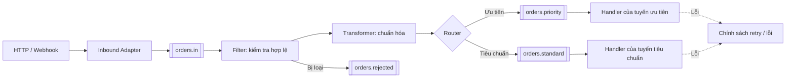

# Vì sao hệ thống tích hợp cần mẫu giao tiếp rõ ràng?

Một hệ thống có thể chạy đúng khi chỉ có một ứng dụng, một cơ sở dữ liệu và vài lệnh gọi hàm. Nhưng khi phải kết nối website, ERP, thanh toán, kho, email, ứng dụng đối tác và hệ thống phân tích, câu hỏi không còn đơn giản là *gửi dữ liệu bằng cách nào*. Nhóm phát triển còn phải trả lời: **ai nhận thông điệp, theo quy tắc nào, có cần chờ kết quả không, nếu lỗi thì xử lý ra sao và làm thế nào biết một đơn hàng đã đi tới đâu?**

Đó là lý do cần **mẫu giao tiếp rõ ràng** (*integration patterns*): cách mô tả những trách nhiệm lặp lại trong luồng tích hợp thành các bước có tên gọi, ranh giới, hợp đồng dữ liệu và quy tắc lỗi cụ thể. Trong hệ sinh thái Java, **Spring Integration** hiện thực nhiều **Enterprise Integration Patterns (EIP)** để xây dựng luồng thông điệp ít phụ thuộc, dễ kiểm thử và dễ mở rộng.

> **Ý chính:** Mẫu giao tiếp không chỉ làm sơ đồ đẹp hơn. Chúng giúp biến các giả định ngầm trong mã nguồn thành các quyết định có thể đọc, kiểm thử, quan sát và thay đổi độc lập.

## 1. Từ một lệnh gọi đơn giản đến một hệ thống tích hợp

Giả sử một nền tảng thương mại điện tử nhận yêu cầu tạo đơn hàng. Sau khi tiếp nhận, hệ thống phải:

1. Kiểm tra dữ liệu, loại bỏ yêu cầu không hợp lệ và chuẩn hóa mã hàng.
2. Chuyển đơn ưu tiên sang tuyến xử lý nhanh, đơn thường sang tuyến tiêu chuẩn.
3. Tách từng dòng hàng để kiểm tra tồn kho tại nhiều kho.
4. Gom các kết quả kiểm tra thành kết quả cho toàn bộ đơn.
5. Gửi thông tin sang ERP, kích hoạt thanh toán rồi phát thông báo.
6. Theo dõi lỗi mạng, hết thời gian chờ, phản hồi trùng và các lần xử lý lại.

Nếu viết tất cả trong một phương thức `createOrder()`, hệ thống có vẻ đơn giản lúc đầu:

```java
// Phác họa cách tổ chức khó bảo trì; không phải ví dụ nên áp dụng.
void createOrder(Order order) {
    validate(order);
    normalize(order);
    if (order.isPriority()) {
        priorityService.send(order);
    } else {
        standardService.send(order);
    }
    for (OrderLine line : order.getLines()) {
        warehouseClient.check(line);
    }
    erpClient.create(order);
    paymentClient.charge(order);
    notificationClient.send(order);
}
```

Đoạn mã không thể hiện rõ việc kiểm tra tồn kho có cần hoàn thành hết trước khi tạo đơn ERP hay không; lỗi thanh toán có phải làm lại bước tạo đơn hay không; một lần gọi lại từ đối tác có được phép phát thông báo lần nữa hay không. Chuyển lời gọi HTTP sang hàng đợi cũng không tự trả lời các câu hỏi này.

Khi quy mô lớn lên, các vấn đề thường xuất hiện cùng nhau:

| Vấn đề | Hệ quả nếu quy ước giao tiếp chỉ nằm rải rác trong mã |
| --- | --- |
| **Phụ thuộc chặt** | Đổi API của ERP có thể buộc sửa controller, quy tắc phân loại và thông báo. |
| **Định dạng không đồng nhất** | Mỗi bên diễn giải khác nhau về mã hàng, trạng thái đơn, thời gian và trường bắt buộc. |
| **Thiếu chính sách định tuyến** | Không rõ đơn nào đi vào nhánh nào, nhánh mặc định ở đâu và xử lý trường hợp không khớp thế nào. |
| **Lỗi từng phần** | Kho đã giữ hàng nhưng thanh toán thất bại; chạy lại cả phương thức có thể tạo hiệu ứng phụ trùng lặp. |
| **Không rõ tính đồng bộ** | Một API tưởng phản hồi nhanh nhưng lại phải chờ nhiều đối tác chậm hoặc không sẵn sàng. |
| **Khó truy vết** | Log riêng lẻ không cho thấy các thông điệp thuộc cùng đơn hàng hay cùng lần xử lý. |
| **Khó kiểm thử** | Muốn kiểm tra một nhánh nhỏ phải dựng gần như toàn bộ hệ thống bên ngoài. |

**Vấn đề gốc là thiếu hợp đồng giữa các bước**, không phải thiếu một thư viện gửi nhận dữ liệu.

## 2. “Mẫu giao tiếp” mô tả điều gì?

Một mẫu EIP trả lời một câu hỏi thiết kế lặp lại: làm thế nào chuyển đổi thông điệp, chọn người nhận, bỏ qua dữ liệu, chia nhỏ công việc, kết hợp kết quả hoặc xử lý lỗi mà không buộc các thành phần biết quá nhiều về nhau.

Ví dụ, thay vì đặt nhiều câu `if` trong dịch vụ nghiệp vụ, ta dùng **Content-Based Router** để biểu đạt quyết định chuyển thông điệp sang kênh phù hợp. Thay vì rải phép chuyển JSON/XML qua từng bộ điều khiển, ta dùng **Message Translator/Transformer** để chuẩn hóa tại một ranh giới. Mỗi bước có nhiệm vụ riêng, đầu vào/đầu ra và cách ứng xử khi bất thường được mô tả rõ.

### 2.1. Bộ ba cơ bản: Message, Channel, Endpoint

Spring Integration thường tổ chức luồng quanh ba khái niệm:

- **Message (thông điệp):** gồm `payload` chứa dữ liệu chính và `headers` chứa metadata như định danh, thời điểm, thông tin liên kết hoặc hướng trả lời. Thông điệp là một đơn vị trao đổi, không nhất thiết là một bản ghi trong broker.
- **Message Channel (kênh):** ranh giới chuyển thông điệp giữa các bước. Bên gửi biết kênh cần gửi tới, không nhất thiết biết lớp Java hay địa chỉ mạng của bên nhận.
- **Endpoint (điểm xử lý):** thành phần kết nối với kênh để biến đổi, lọc, định tuyến, xử lý nghiệp vụ hoặc giao tiếp hệ thống bên ngoài.

Một kiến trúc đơn giản có thể mô tả như sau:



Sơ đồ biểu diễn **trách nhiệm logic**. Các kênh có thể hoàn toàn nằm trong cùng một tiến trình Java; bản thân sơ đồ không khẳng định luồng đã chạy bất đồng bộ, có hàng đợi bền vững hay bảo đảm giao nhận sau khi ứng dụng khởi động lại.

### 2.2. Hợp đồng cần rõ hơn tên kênh

Với từng đoạn nối, nhóm phát triển nên thống nhất ít nhất:

| Khía cạnh | Câu hỏi cần trả lời |
| --- | --- |
| Dữ liệu | Payload có kiểu và phiên bản nào? Trường nào bắt buộc? |
| Định tuyến | Điều kiện vào từng nhánh là gì? Không khớp nhánh nào thì sao? |
| Thời gian | Có phải chờ phản hồi không? Timeout bao lâu? |
| Trật tự | Những sự kiện nào bắt buộc đúng thứ tự? |
| Độ tin cậy | Khi xử lý thất bại, có retry, đưa vào dead-letter queue hay cần can thiệp thủ công? |
| Trùng lặp | Dùng khóa nào để nhận biết một yêu cầu đã xử lý? |
| Theo dõi | Dựa vào `orderId`, `eventId` hoặc correlation ID nào để truy vết? |
| Bảo mật | Payload có dữ liệu nhạy cảm không; được phép ghi log những trường nào? |

Nói cách khác, **“gửi qua một channel” là một chi tiết triển khai; “người nhận cam kết làm gì với thông điệp đó” mới là hợp đồng tích hợp**.

## 3. Những mẫu EIP làm rõ trách nhiệm như thế nào?

| Mẫu | Trách nhiệm chính | Ví dụ trong xử lý đơn hàng |
| --- | --- | --- |
| **Message Gateway** | Cho mã gọi nghiệp vụ một giao diện quen thuộc để gửi yêu cầu qua hệ thống nhắn tin; có thể theo mô hình yêu cầu–phản hồi. | REST/controller gọi `orderGateway.submit(...)` thay vì biết các channel bên trong. |
| **Filter** | Chỉ cho thông điệp đạt điều kiện đi tiếp; chính sách đối với thông điệp bị loại phải được xác định. | Đẩy đơn thiếu mã hàng sang luồng từ chối và ghi nhận lý do. |
| **Transformer** | Chuyển payload sang dạng hoặc kiểu dữ liệu phù hợp cho bước sau. | Chuẩn hóa mã SKU và đơn vị tiền tệ theo hợp đồng đích. |
| **Router** | Chọn một hoặc nhiều kênh dựa trên quy tắc định tuyến. | Chuyển đơn ưu tiên và đơn thường sang các tuyến riêng. |
| **Splitter** | Chia một thông điệp thành các thông điệp con để xử lý độc lập. | Tách một đơn thành nhiều dòng hàng để kiểm tra tồn kho. |
| **Aggregator** | Gom các thông điệp liên quan theo khóa tương quan và điều kiện hoàn tất. | Chỉ ra kết quả tồn kho sau khi nhận đủ kết quả cần thiết. |
| **Service Activator** | Gọi một hàm hoặc dịch vụ nghiệp vụ để xử lý thông điệp. | Gửi yêu cầu thực tế sang bộ xử lý ERP. |
| **Channel Adapter** | Kết nối nguồn/đích không dùng message channel nội bộ với luồng tích hợp. | Nhận HTTP, đọc từ broker, ghi file hoặc gửi sang hệ thống ngoài. |
| **Error Channel / Error Flow** | Tập trung hóa một phần xử lý lỗi dưới dạng thông điệp lỗi ở các luồng thích hợp. | Ghi nhận lỗi, phát cảnh báo và chuyển vào tuyến xử lý lại. |

Không phải mọi luồng đều cần đủ các mẫu. Chúng là **từ vựng thiết kế**, không phải một chuỗi bước bắt buộc. Việc đặt tên bước đúng ý nghĩa giúp người mới đọc sơ đồ cũng hiểu hệ thống đang làm gì và phần nào chịu trách nhiệm.

### 3.1. Router khác Filter

**Filter** trả lời “thông điệp này có đủ điều kiện để đi tiếp không?”. **Router** trả lời “thông điệp này cần đi đến kênh nào?”. Một thông điệp bị Filter chặn không mặc nhiên là lỗi; nó có thể là sự kiện được phép bỏ qua. Ngược lại, nếu đơn hàng không tìm được nhánh phù hợp tại Router, đó có thể là lỗi dữ liệu hoặc lỗi cấu hình. Cần định nghĩa nhánh mặc định, đường từ chối hoặc cơ chế báo lỗi phù hợp.

### 3.2. Splitter phải đi cùng câu hỏi về Aggregator

Khi tách một đơn thành năm dòng hàng, có thể năm yêu cầu đi qua các đường truyền khác nhau và trả về không đúng thứ tự. **Aggregator** cần biết:

- Những phản hồi nào thuộc cùng đơn (`correlationId` hoặc khóa nghiệp vụ ổn định)?
- Khi nào được coi là đủ kết quả (`release strategy`)? Có bắt buộc nhận đủ năm dòng hàng không?
- Điều gì xảy ra khi một phản hồi bị mất hoặc đến muộn (timeout, partial result, báo lỗi, xử lý bù)?
- Nhóm đang chờ được lưu ở đâu, và làm sao tránh tăng bộ nhớ không giới hạn?

Trong Spring Integration, Splitter/Aggregator hỗ trợ các cơ chế liên quan đến correlation và sequence. Tuy nhiên, **không nên giả định một Aggregator sẽ tự giải quyết mọi trường hợp mất gói, kết quả đến muộn hoặc restart**; cần chọn message store, timeout và chính sách kết thúc nhóm theo yêu cầu thực tế.

## 4. Cùng một luồng, nhưng chọn kênh khác nhau sẽ đổi hành vi

Tên pattern không đồng nghĩa với cơ chế thực thi. Đặc biệt, **channel** tác động trực tiếp đến việc ai chạy xử lý, lúc nào và khả năng chịu tải:

| Cơ chế thường gặp trong Spring Integration | Hành vi nổi bật | Điểm cần chú ý |
| --- | --- | --- |
| `DirectChannel` | Giao message trực tiếp cho subscriber, thông thường ngay trên luồng (thread) của bên gửi. | Handler chậm sẽ khiến bên gửi phải chờ; lỗi có thể truyền ngược qua lời gọi đồng bộ. |
| `ExecutorChannel` | Chuyển công việc cho `TaskExecutor`, tạo ranh giới bất đồng bộ khi executor chấp nhận tác vụ. | Không tự tạo độ bền; cần quản lý kích thước hàng chờ, bão hòa executor và lỗi bất đồng bộ. |
| `QueueChannel` | Lưu tạm message trong một hàng đợi để consumer/poller lấy sau. | Giới hạn dung lượng, cơ chế polling và độ bền phụ thuộc cấu hình/channel store. |
| `PublishSubscribeChannel` | Phân phối cho nhiều subscriber. | Mặc định không đồng nghĩa với broker pub/sub bền vững; cách gọi subscriber phụ thuộc executor/configuration. |

Ví dụ, dùng `DirectChannel` giữa Router và Handler phù hợp khi xử lý ngắn, yêu cầu đồng bộ và lỗi cần trả về ngay. Khi Handler gọi một đối tác phản hồi chậm, có thể cần kênh bất đồng bộ và thiết kế phản hồi riêng. Nhưng **thay `DirectChannel` bằng `ExecutorChannel` không tự động làm dữ liệu an toàn trước mất điện hoặc bảo đảm không xử lý trùng**.

Tương tự, tích hợp qua Kafka, RabbitMQ hay HTTP là lựa chọn **transport/adapter**, còn Filter, Router, Transformer, Splitter và Aggregator là cách **tổ chức hành vi**. Hai tầng này bổ sung cho nhau, không thay thế cho nhau.

## 5. Minh họa cách diễn đạt luồng bằng Spring Integration DSL

Đoạn sau minh họa riêng **tuyến tiếp nhận và phân loại**. Giả sử `OrderEvent` có các phương thức `isWellFormed()`, `normalized()` và `priority()`. Các kênh `orders.rejected`, `orders.priority`, `orders.standard` phải có subscriber/flow xử lý tương ứng trong ứng dụng thực tế.

```java
import org.springframework.context.annotation.Bean;
import org.springframework.context.annotation.Configuration;
import org.springframework.integration.dsl.IntegrationFlow;

@Configuration
class OrderFlowConfiguration {

    @Bean
    IntegrationFlow classifyOrders() {
        return IntegrationFlow.from("orders.in")
            .filter(OrderEvent.class,
                OrderEvent::isWellFormed,
                endpoint -> endpoint.discardChannel("orders.rejected"))
            .transform(OrderEvent.class, OrderEvent::normalized)
            .route(OrderEvent.class,
                event -> event.priority() ? "priority" : "standard",
                router -> router
                    .channelMapping("priority", "orders.priority")
                    .channelMapping("standard", "orders.standard"))
            .get();
    }
}
```

Đọc từ trên xuống, ta thấy **hợp đồng tuyến** rất rõ: nhận dữ liệu từ `orders.in` → lọc thông điệp không hợp lệ sang `orders.rejected` → chuẩn hóa → định tuyến theo mức ưu tiên. Một thay đổi trong thuật toán kiểm tra đầu vào không cần kéo theo thay đổi phần gọi ERP; một thay đổi chính sách ưu tiên không cần viết lại Transformer.

Đây là **ví dụ cấu trúc luồng**, chưa phải ứng dụng hoàn chỉnh: muốn chạy thật cần định nghĩa `OrderEvent`, nguồn gửi tới `orders.in`, các flow nhận ba kênh đích, xử lý dữ liệu lỗi và cấu hình phù hợp với phiên bản Spring Integration đang dùng. Nếu `orders.rejected` không có bên nhận, `discardChannel` **không tự bảo đảm lưu được bản ghi bị từ chối**.

Một flow lớn hơn có thể tiếp tục thêm Splitter cho từng dòng hàng, Aggregator cho kết quả tồn kho và Gateway cho lớp gọi nghiệp vụ. Quan trọng là **mỗi bước giữ một trách nhiệm giải thích được**, thay vì nhồi tất cả vào một handler.

## 6. Khi có lỗi: hợp đồng giao tiếp phải nói rõ điều xảy ra tiếp theo

Trong hệ thống nhiều đối tác, lỗi là chuyện bình thường: mạng chập chờn, dịch vụ trả `429`, hết thời gian chờ, dữ liệu sai, một nhánh hoàn tất nhưng nhánh khác thất bại. “Thử lại khi lỗi” là yêu cầu quá mơ hồ để triển khai an toàn.

### 6.1. Phân biệt loại lỗi trước khi retry

| Tình huống | Hướng xử lý thường phù hợp |
| --- | --- |
| Timeout mạng hoặc lỗi tạm thời từ hệ thống ngoài | Retry có giới hạn, độ trễ tăng dần (*backoff*) và quan sát số lần thử. |
| Payload sai schema, thiếu trường bắt buộc | Từ chối/cách ly, trả lý do hoặc chuyển hàng chờ lỗi; retry y nguyên thường vô ích. |
| Phía nhận phản hồi chậm nhưng có thể đã hoàn tất tác vụ | Tra cứu trạng thái hoặc retry **có idempotency** để tránh tạo hiệu ứng phụ lặp. |
| Một nhánh trong chuỗi nhiều hệ thống thất bại | Quy định trạng thái trung gian, bù trừ (*compensation*) hoặc xử lý thủ công theo nghiệp vụ. |
| Thông điệp lỗi liên tục (*poison message*) | Giới hạn retry, đưa sang dead-letter queue/quarantine, cảnh báo và có quy trình replay. |

**Spring Integration có thể hỗ trợ retry và định tuyến lỗi**, nhưng cơ chế thực tế phụ thuộc endpoint, advice, transaction, channel và adapter. Trong luồng đồng bộ, ngoại lệ có thể được ném về caller; trong nhiều luồng bất đồng bộ, lỗi có thể được chuyển thành `ErrorMessage` tới error channel nếu đã cấu hình. **Không giả định rằng chỉ cần khai báo một `errorChannel` thì mọi ngoại lệ, ở mọi transport, đều được giữ lại hoặc xử lý an toàn.**

### 6.2. At-most-once, at-least-once và idempotency

Ba khái niệm dễ bị đánh đồng:

- **At-most-once:** hạn chế xử lý lặp nhưng có thể mất thông điệp nếu lỗi xảy ra trước khi hoàn thành.
- **At-least-once:** thông điệp có thể được gửi/xử lý lại để giảm nguy cơ bỏ sót, nên consumer phải tính đến bản trùng.
- **Exactly-once theo hiệu ứng nghiệp vụ:** trạng thái cuối cùng chỉ được áp dụng một lần theo khóa nghiệp vụ, dù có gửi hoặc nhận lại. Đây là thuộc tính **của toàn thiết kế và ranh giới giao dịch**, không phải một bảo đảm tự động của Spring Integration.

Ví dụ đối tác gửi lại sự kiện `eventId=EVT-781`, điều kiện nhận đúng nên là “sự kiện này đã được xử lý thành công chưa?”, không phải “message mới trong JVM có `MessageHeaders.ID` mới không?”. Cần một khóa idempotency ổn định (ví dụ `eventId` từ nguồn), kho lưu kết quả/xử lý đã hoàn tất, và cách kiểm soát cạnh tranh khi hai bản trùng đến đồng thời. Với giao dịch nhiều hệ thống, có thể cân nhắc **transactional outbox**, consumer idempotent hoặc mô hình bù trừ; mỗi giải pháp đều có phạm vi bảo đảm riêng.

### 6.3. Correlation không đồng nghĩa với message ID

Một thông điệp kỹ thuật có thể đổi `id` khi được xây dựng lại hoặc đi qua adapter. Nhưng các bước kiểm tra kho của cùng `orderId` vẫn cần liên kết với nhau. Vì vậy, nên tách:

- **`eventId`:** định danh sự kiện để phát hiện lần giao lại/trùng lặp.
- **`orderId`:** định danh nghiệp vụ bền vững của đơn hàng.
- **`correlationId` hoặc business correlation key:** liên kết các message thuộc một yêu cầu/nhóm xử lý, đặc biệt khi Splitter/Aggregator hoạt động.
- **`traceId`:** giúp nối các log/span phục vụ quan sát phân tán; không thay thế khóa nghiệp vụ hay idempotency.

Một số pattern của Spring Integration dùng header correlation/sequence riêng; cần kiểm tra cách gắn, chuyển tiếp và bảo toàn header qua các adapter, thay vì mặc định header sẽ đi xuyên mọi ranh giới.

## 7. Tính rõ ràng còn quyết định khả năng kiểm thử và vận hành

Khi luồng chia thành các bước minh bạch, kiểm thử có thể tập trung vào hợp đồng:

| Kịch bản | Điều cần xác minh |
| --- | --- |
| Đơn hợp lệ, ưu tiên | Qua Filter, Transformer và đi tới đúng `orders.priority`; không tới nhánh tiêu chuẩn. |
| Đơn không hợp lệ | Không gọi ERP/thanh toán; có lý do từ chối ở tuyến đã định nghĩa. |
| Đơn thường | Chỉ tới `orders.standard`, payload giữ đúng schema sau chuẩn hóa. |
| Splitter tạo nhiều message | Các phần mang đúng định danh tương quan và thông tin nhóm cần thiết. |
| Phản hồi từ kho về sai thứ tự | Aggregator không nhầm đơn; tuân thủ điều kiện hoàn tất và chính sách timeout. |
| Đối tác chậm hoặc lỗi tạm thời | Retry hữu hạn, có backoff; không nhân đôi tác vụ tính phí. |
| Gửi lại cùng `eventId` | Kết quả nghiệp vụ không bị ghi hoặc phát sinh hai lần ngoài chủ đích. |

Trong Spring Integration, các flow và endpoint có thể được kiểm tra riêng với mock/stub tại ranh giới kênh. Kiểm thử đơn vị cho Router/Filter không cần khởi động ERP thật; kiểm thử tích hợp riêng xác nhận adapter, transaction, broker và lỗi khi mạng bị ngắt.

Về vận hành, một hệ thống có pattern rõ nên cung cấp các tín hiệu như **số message nhận/xử lý/từ chối**, độ trễ mỗi bước, tuổi và độ sâu hàng đợi, tỉ lệ retry, số message ở tuyến lỗi, số nhóm Aggregator tồn lâu và trace theo `orderId`/correlation key. Khi xuất log, phải loại hoặc che dữ liệu nhạy cảm như thông tin thanh toán và token truy cập. Metrics/observability cần được **cấu hình và đo thực tế**, không mặc nhiên xuất hiện chỉ vì đã dùng DSL.

## 8. Nguyên tắc chọn mẫu: rõ ràng nhưng không phức tạp hóa quá mức

Một luồng đơn giản có thể chỉ cần **Inbound Adapter → Transformer → Service Activator**. Không nên tạo Router khi chỉ có một đích, Aggregator khi không có kết quả cần gom, hoặc broker riêng chỉ để thay thế một lời gọi hàm nội bộ không có yêu cầu bất đồng bộ.

Khi thiết kế một tích hợp mới, hãy lần lượt trả lời:

1. **Ai phát, ai nhận và payload chuẩn là gì?** Chọn ranh giới chuyển đổi định dạng.
2. **Một message cần đi một nhánh hay nhiều nhánh?** Chọn Filter/Router/Publish-Subscribe đúng ý nghĩa.
3. **Công việc có cần tách và tổng hợp lại không?** Nếu có, xác định correlation, completion, timeout và nơi lưu trạng thái nhóm.
4. **Caller có chờ kết quả không?** Xác định Gateway, timeout, phản hồi, channel đồng bộ hay bất đồng bộ.
5. **Có thể mất hoặc nhận lặp không?** Nêu rõ giả định transport, acknowledgement, retry, transaction và idempotency.
6. **Lỗi sẽ đi đâu?** Định nghĩa từ chối, retry, error flow, dead-letter và đường can thiệp.
7. **Làm sao chứng minh hệ thống đúng?** Thiết kế test case, log/trace, metrics trước khi triển khai.

Đừng chọn pattern vì tên gọi hấp dẫn. Hãy chọn pattern vì nó **đặt tên chính xác cho một quyết định nghiệp vụ hoặc hạ tầng cần quản lý**.

## 9. Tự kiểm tra mức hiểu

**Tình huống A.** Một webhook gửi lại cùng thông điệp thanh toán ba lần vì không nhận được HTTP `200`. Dùng `DirectChannel` hoặc `QueueChannel` có tự ngăn thu tiền ba lần không?

*Không.* Channel chỉ xác định một phần cách giao message. Cần khóa idempotency ổn định và bảo đảm phía xử lý/ghi nhận thanh toán không tạo hiệu ứng phụ lặp.

**Tình huống B.** Một đơn gồm bốn dòng hàng được Splitter tách ra; chỉ ba phản hồi kiểm tra kho quay về. Aggregator nên làm gì?

*Không có đáp án mặc định cho mọi hệ thống.* Phải theo hợp đồng: chờ tới timeout, trả lỗi, cho phép kết quả một phần hay kích hoạt quy trình xử lý bù. Quyết định cần được thể hiện trong release/expiry policy và test.

**Tình huống C.** Một luồng dùng `ExecutorChannel` để xử lý yêu cầu từ API. API đã trả thành công, nhưng ứng dụng đột ngột dừng trước khi hoàn tất tác vụ. `ExecutorChannel` có tự đảm bảo chạy lại sau restart không?

*Không.* Việc chuyển sang thread khác không tương đương hàng đợi bền vững. Nếu yêu cầu chịu lỗi tiến trình, cần cân nhắc broker/persistent store và cơ chế xác nhận, retry, deduplication thích hợp.

## Kết luận

Hệ thống tích hợp trở nên khó bảo trì không chỉ vì có nhiều API mà vì có nhiều **giả định không được nói rõ**: ai chịu trách nhiệm dữ liệu, đường đi nào hợp lệ, bước nào phải chờ, lúc nào có thể thử lại và cần theo dõi kết quả ra sao. **Enterprise Integration Patterns** tạo một ngôn ngữ chung để mô hình hóa các quyết định ấy; **Spring Integration** cung cấp các thành phần hiện thực chúng bằng `Message`, `Channel`, `Endpoint` và các flow có thể kết hợp.

Khi được áp dụng đúng mức, Router, Filter, Transformer, Splitter, Aggregator, Gateway, retry, error channel và correlation giúp **giảm phụ thuộc giữa các bước, làm sáng tỏ luồng xử lý, tạo ranh giới kiểm thử và vận hành có thể quan sát**. Mục tiêu cuối cùng không phải dùng càng nhiều pattern càng tốt, mà là khiến người đọc có thể trả lời: *“Với thông điệp này, hệ thống sẽ làm gì — kể cả khi mọi chuyện không suôn sẻ?”*
