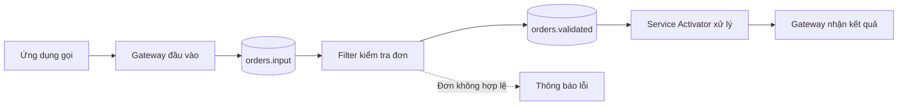

# Message, channel và endpoint trong một integration flow

## 1. Bức tranh tổng thể

Trong một ứng dụng tích hợp, yêu cầu thường không chỉ là gọi một phương thức Java rồi nhận kết quả. Dữ liệu có thể đi từ HTTP, hệ thống hàng đợi, tệp, cơ sở dữ liệu hoặc một ứng dụng khác; trên đường đi, dữ liệu cần được kiểm tra, biến đổi, định tuyến, gom nhóm và chuyển tới đích phù hợp. **Spring Integration** triển khai các **Enterprise Integration Patterns (EIP)** để diễn tả những bước đó bằng các thành phần có trách nhiệm rõ ràng.

Ba khái niệm nền tảng là:

| Khái niệm | Trả lời câu hỏi | Trách nhiệm chính |
|---|---|---|
| **Message** | *Điều gì đang được truyền?* | Đóng gói dữ liệu nghiệp vụ (payload) và ngữ cảnh xử lý (headers). |
| **Message channel** | *Message đi qua đâu?* | Nối các thành phần, chuyển giao message và xác định cách giao nhận đồng bộ, bất đồng bộ, điểm-điểm hay phát tán. |
| **Endpoint** | *Ai gửi, nhận hoặc xử lý message?* | Kết nối nguồn/đích bên ngoài hoặc thực hiện một bước xử lý như filter, transformer, router, service activator. |

**Integration flow** là cách nối các endpoint thông qua channel để tạo thành một tuyến xử lý có thể đọc, kiểm thử và thay đổi từng phần. Ví dụ, với đơn hàng:



Trong sơ đồ: **đơn hàng là payload của message**, `orders.input` và `orders.validated` là **channel**, còn gateway, filter và service activator là **endpoint**. Channel không tự kiểm tra đơn hàng; endpoint không cần biết toàn bộ hệ thống phía sau để thực hiện trách nhiệm riêng.

## 2. Message: đơn vị dữ liệu được trao đổi

Spring Messaging định nghĩa `Message<T>` gồm hai phần:

- **Payload (`T`)**: dữ liệu chính, chẳng hạn `Order`, `PaymentEvent`, `String`, `byte[]` hoặc một DTO khác.
- **Headers (`MessageHeaders`)**: metadata để điều phối và quan sát, ví dụ ID message, thời điểm tạo, mã truy vết, correlation ID, kênh trả lời hoặc kênh xử lý lỗi.

Ví dụ tạo message:

```java
import org.springframework.messaging.Message;
import org.springframework.messaging.support.MessageBuilder;

Message<String> message = MessageBuilder.withPayload("ORDER-1001")
        .setHeader("tenantId", "shop-vn")
        .setHeader("traceId", "trace-8f21")
        .build();

String payload = message.getPayload();       // ORDER-1001
String traceId = (String) message.getHeaders().get("traceId");
```

Một số headers cần nhận biết:

| Header | Ý nghĩa trong thực hành |
|---|---|
| `id`, `timestamp` | Thường được framework tạo khi xây dựng message, hỗ trợ nhận diện và quan sát. |
| `replyChannel` | Nơi gửi phản hồi khi luồng có mô hình request–reply. |
| `errorChannel` | Nơi chuyển `ErrorMessage` trong những cấu hình xử lý lỗi phù hợp. |
| `correlationId` | Ghép các message có liên quan, thường dùng trong Splitter/Aggregator. |
| `sequenceNumber`, `sequenceSize` | Hỗ trợ xác định phần tử và kích thước một nhóm message khi chia/gom. |
| Header tùy biến như `tenantId`, `traceId` | Truyền ngữ cảnh ứng dụng qua những bước xử lý. |

`Message` và tập headers cung cấp giao diện bất biến: thay đổi một header thường cần **tạo message mới**, chẳng hạn qua `MessageBuilder.fromMessage(original).setHeader(...).build()`. Tính bất biến của vỏ message **không đồng nghĩa** đối tượng payload luôn bất biến; nên ưu tiên DTO/record không bị sửa tùy ý khi đi qua nhiều endpoint.

Không nên nhầm `id` của message với **mã nghiệp vụ** (`orderId`, `transactionId`). Một đơn hàng có thể tạo nhiều message trong quá trình xử lý; ID message và ID đơn hàng có vòng đời khác nhau. Tương tự, `correlationId` không mặc nhiên xuất hiện trên mọi message; luồng hoặc thành phần liên quan phải thiết lập/duy trì ngữ nghĩa tương quan phù hợp.

## 3. Message channel: đường vận chuyển và hợp đồng giao nhận

Một `MessageChannel` là trừu tượng cho nơi gửi message. Thành phần gửi chỉ cần biết channel đích, không cần gọi trực tiếp phương thức của thành phần nhận. Từ đó, ta có thể thay đổi người xử lý hoặc cơ chế thực thi mà không phải gắn chặt hai phía với nhau.

Hai nhóm interface quan trọng:

- **`SubscribableChannel`**: endpoint đăng ký để nhận message theo kiểu **event-driven**; message được dispatch tới subscriber khi gửi vào channel.
- **`PollableChannel`**: endpoint chủ động **poll/receive** message khi sẵn sàng; thường dùng khi cần bộ đệm hoặc kiểm soát nhịp tiêu thụ.

### Các channel thường dùng

| Channel | Mô hình | Đặc điểm | Dùng khi |
|---|---|---|---|
| `DirectChannel` | Subscribable, điểm-điểm | Dispatch đồng bộ trên thread của bên gửi; exception có thể truyền ngược qua lời gọi. | Luồng xử lý nhanh, request–reply đồng bộ, cần ngữ cảnh giao dịch cùng thread. |
| `ExecutorChannel` | Subscribable, điểm-điểm | Dispatch thông qua `TaskExecutor`; tách thread gửi/nhận. | Muốn xử lý bất đồng bộ, không buộc caller đợi phần xử lý. |
| `QueueChannel` | Pollable, hàng đợi | Lưu message tạm thời cho poller/consumer lấy sau; có thể đặt giới hạn dung lượng. | Cần bộ đệm và kiểm soát tốc độ tiêu thụ. |
| `PublishSubscribeChannel` | Subscribable, một-nhiều | Phát message cho nhiều subscriber; mặc định không nhất thiết bất đồng bộ, phụ thuộc cấu hình executor. | Một sự kiện cần nhiều nhánh như audit, thông báo, cập nhật chỉ số. |

**Lưu ý về bảo đảm giao nhận:** `DirectChannel`, `ExecutorChannel` và `QueueChannel` thông thường là thành phần **trong tiến trình ứng dụng**, không mặc nhiên bền vững qua restart. Chọn channel không tự động mang lại retry, durability, exactly-once hay phân tán nhiều máy. Nếu cần các khả năng đó, phải thiết kế thêm message store, transaction, idempotency hoặc adapter/broker tương ứng.

Với `DirectChannel`, nếu nhiều handler đăng ký, thông thường **một handler** nhận một message theo chiến lược dispatch. Trái lại, với `PublishSubscribeChannel`, **nhiều handler** có thể nhận cùng một thông điệp. Việc phân nhánh có điều kiện dựa trên nội dung thường thuộc trách nhiệm **Router**, không phải channel tự quyết định.

Ví dụ khai báo hai channel có tên rõ ràng:

```java
@Bean(name = "orders.input")
MessageChannel ordersInput() {
    return new DirectChannel();
}

@Bean(name = "orders.validated")
MessageChannel ordersValidated() {
    return new DirectChannel();
}
```

Tên bean là địa chỉ logic để các endpoint tìm nhau. Đây là lý do phải phân biệt **tên method Java** `ordersInput` và **tên channel** `orders.input` được chỉ định trong `@Bean(name = ...)`.

## 4. Endpoint: nơi tương tác và nơi thực thi EIP

**Endpoint** là thành phần đưa message vào flow, nhận message ra khỏi flow hoặc kết nối một bước xử lý với channel. Có thể hình dung endpoint như một trạm trên tuyến đường, còn channel là đoạn đường giữa các trạm.

| Nhóm endpoint | Vai trò | Ví dụ |
|---|---|---|
| **Inbound channel adapter** | Đọc/sinh message từ nguồn bên ngoài, thường một chiều. | Đọc tệp mới và gửi nội dung vào channel. |
| **Outbound channel adapter** | Tiêu thụ message để ghi/gửi ra hệ thống ngoài, thường không trả reply vào flow. | Gửi sự kiện sang broker hoặc ghi tệp. |
| **Inbound/outbound gateway** | Giao tiếp **request–reply** ở ranh giới hệ thống hoặc API. | Nhận HTTP request, gửi vào flow và trả response; gọi dịch vụ khác rồi nhận đáp ứng. |
| **Service activator** | Gọi logic ứng dụng để xử lý message, có thể trả message/giá trị kết quả. | Kiểm tra tồn kho, tạo phiếu xác nhận đơn. |
| **Transformer** | Chuyển dạng payload và/hoặc headers. | JSON → DTO, DTO → cấu trúc dành cho hệ thống đích. |
| **Filter** | Giữ hoặc loại message theo predicate. | Chỉ xử lý đơn hàng có tổng tiền hợp lệ. |
| **Router** | Chọn channel/nhánh đích dựa trên điều kiện. | Đơn giá trị cao → nhánh phê duyệt. |
| **Splitter / Aggregator** | Chia một message thành nhiều phần / gom các phần liên quan. | Chia đơn theo sản phẩm / tổng hợp kết quả xử lý sản phẩm. |

Ba chi tiết quan trọng:

1. **Adapter khác gateway**: adapter thường làm việc một chiều; gateway có hợp đồng phản hồi. Không nên sử dụng outbound adapter rồi mong nó tự trả kết quả xử lý cho caller.
2. **Endpoint không đồng nghĩa với HTTP endpoint**: một filter, transformer hay service activator ở giữa flow cũng là integration endpoint, dù không có URL.
3. **Channel là nơi giao nhận, endpoint là nơi quyết định**: một filter không hợp lệ có thể discard hoặc throw exception; channel không thay filter quyết định điều đó.

Trong Java DSL, nhiều endpoint và channel trung gian được Spring Integration đăng ký giúp khi dựng `IntegrationFlow`. Vì vậy, đoạn `.filter(...).handle(...)` vẫn tương ứng với các endpoint trong mô hình EIP dù không tự viết class riêng cho từng endpoint.

## 5. Ví dụ hoàn chỉnh: flow nhận và xác nhận đơn hàng

Ta triển khai một đường đi đơn giản: ứng dụng gửi `Order` qua **messaging gateway**; một **filter** từ chối đơn có số tiền không dương; **service activator** tạo `OrderReceipt`; kết quả quay lại gateway. Sử dụng `DirectChannel` để caller nhận phản hồi trên đường đi đồng bộ.

### 5.1. Khai báo các thành phần

Với Java 17+, Spring Boot và dependency `spring-boot-starter-integration`, ví dụ dưới đây có thể đặt trong cùng package (tách class/file khi đưa vào dự án thực tế):

```java
import java.math.BigDecimal;

import org.springframework.context.annotation.Bean;
import org.springframework.context.annotation.Configuration;
import org.springframework.integration.annotation.Gateway;
import org.springframework.integration.annotation.IntegrationComponentScan;
import org.springframework.integration.annotation.MessagingGateway;
import org.springframework.integration.channel.DirectChannel;
import org.springframework.integration.config.EnableIntegration;
import org.springframework.integration.dsl.IntegrationFlow;
import org.springframework.messaging.MessageChannel;

record Order(String id, BigDecimal amount) {}

record OrderReceipt(String orderId, String status) {}

@MessagingGateway
interface OrderGateway {
    @Gateway(requestChannel = "orders.input")
    OrderReceipt submit(Order order);
}

@Configuration
@EnableIntegration
@IntegrationComponentScan
class OrderIntegrationConfig {

    @Bean(name = "orders.input")
    MessageChannel ordersInput() {
        return new DirectChannel();
    }

    @Bean(name = "orders.validated")
    MessageChannel ordersValidated() {
        return new DirectChannel();
    }

    @Bean
    IntegrationFlow validateOrderFlow() {
        return IntegrationFlow.from("orders.input")
                .filter(Order.class,
                        order -> order.amount() != null
                                && order.amount().signum() > 0,
                        spec -> spec.throwExceptionOnRejection(true))
                .channel("orders.validated")
                .get();
    }

    @Bean
    IntegrationFlow processOrderFlow() {
        return IntegrationFlow.from("orders.validated")
                .handle(Order.class, (order, headers) ->
                        new OrderReceipt(order.id(), "ACCEPTED"))
                .get();
    }
}
```

Ứng dụng gọi gateway như một interface Java thông thường:

```java
OrderReceipt receipt = orderGateway.submit(
        new Order("ORD-1001", new BigDecimal("250000")));

// receipt.orderId() = "ORD-1001"
// receipt.status()  = "ACCEPTED"
```

`@IntegrationComponentScan` giúp đăng ký interface có `@MessagingGateway` thành bean; `orderGateway` được inject vào thành phần gọi, ví dụ qua constructor injection. Nó **không** phải một object do ta tự `new`.

### 5.2. Điều gì xảy ra với message ở từng bước?

1. **Gateway** nhận đối số `Order`, tạo message có payload là đơn hàng và cung cấp đường nhận phản hồi (`replyChannel`) cho lời gọi request–reply.
2. Message đi vào **`orders.input`**. Đây là `DirectChannel`, nên filter được gọi trong cùng chuỗi thực thi đồng bộ của phía gửi.
3. **Filter** kiểm tra `amount`. Nếu không hợp lệ, `throwExceptionOnRejection(true)` tạo lỗi thay vì âm thầm bỏ message. Đây là lựa chọn có chủ đích cho gateway cần phản hồi.
4. Message hợp lệ được chuyển qua **`orders.validated`**. Channel không sửa `Order`; nó chỉ chuyển message tới subscriber.
5. **Service activator** (`.handle(...)`) tạo `OrderReceipt`. Hạ tầng request–reply dùng ngữ cảnh reply của message để trả kết quả về gateway.
6. Caller nhận `OrderReceipt` mà không cần tự quản lý `Message<?>` hay trực tiếp gọi handler.

Nếu không cấu hình `throwExceptionOnRejection(true)` hoặc một **discard flow** có phản hồi phù hợp, filter có thể loại message và gateway không nhận được reply như mong đợi; lời gọi có thể phải đợi đến khi timeout. Khi thiết kế request–reply, phải định nghĩa rõ **nhánh thành công lẫn nhánh bị từ chối**.

### 5.3. Khi nào cần thêm transformer, router và adapter?

Ví dụ trên cố tình ngắn để thấy ba thành phần nền tảng. Một flow thực tế có thể phát triển theo cấu trúc:

```text
HTTP inbound gateway
  -> inboundOrders channel
  -> Transformer (JSON/request -> Order)
  -> Filter (Order hợp lệ?)
  -> Router (đơn thường / đơn cần phê duyệt)
     -> normalOrders channel -> Service Activator
     -> reviewOrders channel -> Service Activator
  -> Outbound gateway/adapter (ghi hệ thống đích)
```

Không phải mọi nhánh đều tự động hợp lại sau router. Muốn gom nhiều kết quả, cần thiết kế bước tập hợp, correlation và timeout rõ ràng; lúc đó mới sử dụng Aggregator. Cũng không nên xem `JSON -> DTO` là hoạt động vốn có của channel: đó là **Transformer** hoặc cơ chế chuyển đổi message được cấu hình.

## 6. Đồng bộ, bất đồng bộ và những điểm dễ nhầm

Xét hai flow cùng dùng service activator xử lý đơn, nhưng thay kiểu channel ở đầu vào:

```text
A. Gateway -> DirectChannel -> Service Activator -> Reply
   Caller và handler có thể xử lý trong cùng thread; lỗi đồng bộ
   có thể quay lại caller.

B. Producer -> ExecutorChannel -> Service Activator
   Thread gửi giao message cho executor, handler chạy ở thread khác;
   lỗi và phản hồi cần cơ chế xử lý phù hợp với tính bất đồng bộ.
```

Những điều cần kiểm tra trước khi thay `DirectChannel` bằng `ExecutorChannel` hoặc `QueueChannel`:

- **Request–reply:** Có chờ phản hồi không? Gateway cần timeout, reply channel và semantics rõ ràng. Đừng cho rằng chuyển thành bất đồng bộ thì lời gọi Java vẫn nhận kết quả tức thì.
- **Transaction:** Ngữ cảnh transaction/thread-local không tự nhiên truyền qua ranh giới thread của executor hoặc poller.
- **Áp lực tải:** `QueueChannel` cần capacity, poller và cách xử lý khi đầy; executor cần giới hạn thread, hàng đợi và chính sách từ chối.
- **Thứ tự:** Xử lý đa luồng và nhiều subscriber có thể làm thay đổi thứ tự hoàn tất; yêu cầu thứ tự phải được thiết kế và kiểm thử riêng.
- **Lỗi:** Lỗi trong luồng đồng bộ có thể được ném về caller. Trong luồng bất đồng bộ, cần xem xét `errorChannel`, `ErrorMessage`, retry và cơ chế xác nhận của transport thực tế.

Ngoài ra, header `replyChannel` hoặc `errorChannel` đôi khi chứa tham chiếu đối tượng channel nội bộ. Khi chuyển message qua ranh giới tiến trình/broker, không thể giả định các tham chiếu Java đó được tuần tự hóa và dùng lại nguyên vẹn; cần thiết kế giao thức reply/error ở ranh giới hệ thống.

## 7. Kiểm thử và quan sát một flow

Với flow ví dụ, nên kiểm tra tối thiểu ba kịch bản:

| Kịch bản | Dữ liệu gửi | Hành vi kỳ vọng |
|---|---|---|
| Đơn hợp lệ | `amount = 250000` | Gateway trả `OrderReceipt` với `status = ACCEPTED`. |
| Đơn có giá trị bằng không | `amount = 0` | Filter từ chối và caller nhận lỗi, không chạy bước xử lý thành công. |
| Đơn thiếu số tiền | `amount = null` | Filter từ chối mà không gây `NullPointerException`. |

Một kiểm thử tích hợp minh họa với JUnit 5 và Spring Boot:

```java
import java.math.BigDecimal;
import org.junit.jupiter.api.Test;
import org.springframework.beans.factory.annotation.Autowired;
import org.springframework.boot.test.context.SpringBootTest;
import org.springframework.messaging.MessagingException;

import static org.junit.jupiter.api.Assertions.assertEquals;
import static org.junit.jupiter.api.Assertions.assertThrows;

@SpringBootTest
class OrderIntegrationTest {
    @Autowired
    private OrderGateway orderGateway;

    @Test
    void acceptsPositiveAmount() {
        OrderReceipt result = orderGateway.submit(
                new Order("ORD-1", new BigDecimal("100")));

        assertEquals("ORD-1", result.orderId());
        assertEquals("ACCEPTED", result.status());
    }

    @Test
    void rejectsZeroAmount() {
        assertThrows(MessagingException.class, () ->
                orderGateway.submit(new Order("ORD-2", BigDecimal.ZERO)));
    }
}
```

Đoạn test đặt trong cùng package với các kiểu `Order`, `OrderReceipt` và `OrderGateway`, và cần dependency Spring Boot Test/JUnit 5. Kết quả test chứng minh tuyến **gateway → channel → filter → channel → handler → reply**, chứ không chỉ kiểm tra một hàm nghiệp vụ riêng lẻ. Với flow bất đồng bộ, thay giả định về kết quả tức thì bằng đồng bộ hóa/await có timeout và kiểm thử error flow.

Khi vận hành, nên ghi log có cấu trúc dựa trên **mã nghiệp vụ** (`orderId`) và **trace/correlation ID** phù hợp, theo dõi lượng message vào/ra các điểm quan trọng và đo độ trễ. Có thể dùng interceptor, wire tap hoặc Micrometer/observation tùy cấu hình; tránh log nguyên payload chứa dữ liệu nhạy cảm.

## 8. Các lỗi thiết kế thường gặp

| Hiểu nhầm | Cách hiểu đúng |
|---|---|
| “Message chỉ là payload.” | Message còn có headers; chúng quyết định nhiều hành vi reply, error và correlation. |
| “Channel tự xử lý nghiệp vụ.” | Channel vận chuyển; endpoint/handler thực hiện logic. |
| “Mọi channel đều bất đồng bộ.” | `DirectChannel` xử lý đồng bộ; `PublishSubscribeChannel` cũng không tự động async nếu không cấu hình executor. |
| “Có QueueChannel là dữ liệu chắc chắn không mất.” | Hàng đợi in-memory không thay thế broker hoặc lưu trữ bền vững. |
| “Filter loại bỏ message là gateway tự biết thất bại.” | Request–reply phải định nghĩa rõ exception, discard/rejection reply hoặc timeout. |
| “Dùng Router là tự có đường gom kết quả.” | Router chọn nhánh; việc ghép các nhánh cần mô hình bổ sung như Aggregator nếu nghiệp vụ yêu cầu. |
| “Chuyển channel sang thread pool không đổi transaction.” | Ranh giới thread thay đổi propagation và cách xử lý lỗi; cần đánh giá lại semantics. |

## 9. Bài thực hành mở rộng

Từ ví dụ đơn hàng, hãy làm lần lượt:

1. Thêm header `traceId` từ phía phát message và log nó tại handler; xác định bước nào đang tạo hoặc chuyển tiếp header.
2. Thay chính sách filter từ `throwExceptionOnRejection` sang **discard channel** có endpoint trả `OrderReceipt(..., "REJECTED")`. Kiểm tra cả hai nhánh đều hoàn tất request–reply.
3. Bổ sung **Router** tách đơn có `amount >= 10_000_000` sang nhánh xét duyệt, đơn còn lại sang xử lý thông thường; lập bảng message nào đi vào channel nào.
4. Thử thay một channel đồng bộ bằng `ExecutorChannel`, quan sát thread thực thi, thời gian phản hồi và cách lỗi xuất hiện. Chỉ thực hiện khi đã xác định hợp đồng phản hồi phù hợp.

**Câu hỏi tự kiểm tra:** Trong sơ đồ `Source -> Channel A -> Filter -> Channel B -> Service Activator -> Destination`, thành phần nào chứa dữ liệu nghiệp vụ, thành phần nào đảm nhiệm chuyển giao, và thành phần nào quyết định có tiếp tục xử lý? Đáp án lần lượt là **payload của Message**, **Channel**, và **Filter endpoint**. Tách bạch được ba trách nhiệm này là nền tảng để thiết kế Router, Transformer, Splitter, Aggregator, Gateway, retry và error flow một cách có kiểm soát.
