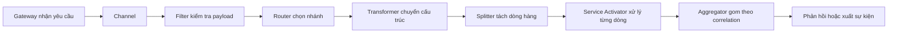

# Phân biệt dữ liệu nghiệp vụ với message envelope

Trong **Spring Integration**, một luồng xử lý không chỉ truyền đối tượng nghiệp vụ từ bước này sang bước khác. Mỗi bước thường làm việc với một **message** gồm hai phần: **payload** (nội dung được xử lý) và **headers** (thông tin đi kèm để hệ thống định tuyến, liên kết và điều phối việc xử lý). Phân biệt hai phần này là nền tảng để áp dụng các **Enterprise Integration Patterns** như Router, Filter, Transformer, Splitter, Aggregator và Gateway mà không làm logic nghiệp vụ phụ thuộc quá chặt vào hạ tầng messaging.

Sau bài học, bạn có thể:

- Xác định thông tin nào thuộc **dữ liệu nghiệp vụ** và thông tin nào thuộc **message envelope**.
- Đọc và tạo `Message<T>` trong hệ sinh thái Spring Messaging/Spring Integration.
- Chọn đúng nơi đặt định danh, thời gian phát sinh sự kiện, thông tin correlation, retry và kênh lỗi.
- Nhận biết các lỗi thiết kế thường gặp khi message đi qua nhiều endpoint hoặc ranh giới hệ thống.

## 1. Hai lớp thông tin trong một message

### Dữ liệu nghiệp vụ: hệ thống đang nói *điều gì*?

Dữ liệu nghiệp vụ mô tả sự kiện, lệnh hoặc trạng thái mà ứng dụng cần xử lý, chẳng hạn:

- `orderId`: mã đơn hàng.
- `customerId`: khách hàng đặt mua.
- `totalAmount`: tổng tiền cần thanh toán.
- `occurredAt`: thời điểm nghiệp vụ ghi nhận đơn hàng đã được tạo.

Các trường này phải có ý nghĩa đối với nghiệp vụ ngay cả khi không còn Spring Integration, message broker hoặc một luồng xử lý cụ thể. Chúng thường nằm trong **payload**, được biểu diễn bằng một kiểu rõ ràng như `OrderPlaced`, `PaymentRequested` hoặc `InventoryReserved`.

### Message envelope: hệ thống cần chuyển và xử lý *như thế nào*?

Message envelope là lớp bao quanh payload để mang thông tin phục vụ trao đổi message. Trong mô hình lập trình của Spring, `org.springframework.messaging.Message<T>` có hai thành phần chính:

| Thành phần | Kiểu/khái niệm | Vai trò |
| --- | --- | --- |
| `payload` | `T` | Dữ liệu mà endpoint sẽ xử lý; có thể là đối tượng Java, chuỗi, mảng byte hoặc kiểu khác. |
| `headers` | `MessageHeaders` | Tập metadata dạng khóa–giá trị về message và quá trình tích hợp. |

Ví dụ về một message nhận yêu cầu xử lý đơn hàng:

```text
Message<OrderPlaced>
├── payload: OrderPlaced
│   ├── orderId       = "ORD-1001"
│   ├── customerId    = "CUS-08"
│   ├── totalAmount   = 350000
│   └── occurredAt    = 2026-11-21T02:00:00Z
└── headers: MessageHeaders
    ├── id            = UUID của message
    ├── timestamp     = thời điểm tạo message (nếu có)
    ├── traceId       = "trace-abc" (header tùy biến)
    └── replyChannel  = kênh trả lời (nếu luồng yêu cầu)
```

`orderId` **không đồng nghĩa** với `headers.id`: một đơn hàng có thể được truyền qua nhiều message khác nhau. Tương tự, `occurredAt` là thời điểm **sự kiện nghiệp vụ**, không mặc nhiên bằng `headers.timestamp` là thời điểm **message** được tạo. Một message có thể được tái tạo, gửi lại hoặc chuyển đổi sau khi sự kiện xảy ra.

> **Quy tắc nền tảng:** Đừng dùng metadata của lần truyền message làm nguồn dữ liệu chuẩn cho sự thật nghiệp vụ cần lưu trữ và truy xuất lâu dài.

## 2. Bảng phân loại thông tin thường gặp

| Thông tin | Vị trí thường phù hợp | Lý do |
| --- | --- | --- |
| Mã đơn hàng, số tiền, danh sách sản phẩm | Payload | Là nội dung quyết định kết quả xử lý nghiệp vụ. |
| Thời điểm đơn hàng được đặt | Payload/hợp đồng sự kiện bền vững | Phải có ý nghĩa khi lưu trữ, phát lại hoặc kiểm toán. |
| `headers.id` của Spring | Message headers | Nhận diện một message ở lớp framework, không thay thế khóa nghiệp vụ. |
| `traceId` / `spanId` | Headers/metadata quan sát | Liên kết log và vết xử lý giữa các bước; cần ánh xạ rõ khi đi qua adapter. |
| `replyChannel`, `errorChannel` | Headers | Phục vụ điều phối phản hồi và xử lý lỗi trong luồng. |
| `correlationId` để gom các mảnh từ Splitter | Headers | Cho Aggregator biết các message nào cùng một nhóm xử lý. |
| `sequenceNumber`, `sequenceSize` khi Splitter phân tách | Headers | Hỗ trợ xác định vị trí và số lượng phần tử trong nhóm. |
| Số lần gửi lại hoặc thông tin giao hàng | Metadata tích hợp, nếu adapter/framework cung cấp | Thể hiện một lần giao nhận; không mặc định tồn tại ở mọi transport. |
| `eventId` dùng khử trùng lặp sau khi lưu/phát lại | Hợp đồng sự kiện bền vững, có thể nằm trong payload hoặc event envelope được tuần tự hóa | Danh tính của **sự kiện** phải sống lâu hơn `MessageHeaders.id`. |

Đây là các **nguyên tắc thiết kế**, không phải yêu cầu mọi hệ thống phải đặt cùng một tên trường ở cùng một vị trí. Ví dụ, một `tenantId` có thể là thông tin nghiệp vụ bắt buộc trong hợp đồng sự kiện, hoặc chỉ là metadata điều phối nội bộ. Cách chọn phụ thuộc vào việc bên nhận có cần giá trị đó để hiểu đúng dữ liệu hay không và nó có phải được giữ lại khi phát lại sự kiện hay không.

### Ba tầng envelope rất dễ bị nhầm lẫn

1. **Spring message envelope:** đối tượng `Message<T>` chứa `payload` và `headers` trong ứng dụng.
2. **Event envelope ở cấp hợp đồng:** ví dụ JSON `{ "eventId": "...", "occurredAt": "...", "data": { ... } }`; đây là một phần nội dung **được truyền và lưu bền vững** theo schema do các hệ thống thỏa thuận. Event envelope này hoàn toàn có thể chính là payload của một Spring message.
3. **Transport envelope:** thông tin mà Kafka, AMQP hoặc HTTP dùng để vận chuyển dữ liệu, như topic, partition, routing key hoặc HTTP headers. Adapter có thể ánh xạ một số thông tin sang Spring headers nhưng không có nghĩa chúng là cùng một cấu trúc.

Vì vậy, câu hỏi “đặt vào header hay payload?” phải được hiểu theo **ranh giới nào**: trong một `IntegrationFlow`, khi xuất ra broker, hay khi định nghĩa hợp đồng dữ liệu giữa hai hệ thống.

## 3. Tạo và đọc message với Spring

Ví dụ dưới đây dùng Java 17+ để minh họa một sự kiện nghiệp vụ bằng `record` và bao nó trong `Message<OrderPlaced>`:

```java
import java.math.BigDecimal;
import java.time.Instant;
import java.util.UUID;

import org.springframework.messaging.Message;
import org.springframework.messaging.support.MessageBuilder;

record OrderPlaced(
        String orderId,
        String customerId,
        BigDecimal totalAmount,
        Instant occurredAt
) {}

class MessageExample {
    void demonstrate() {
        OrderPlaced event = new OrderPlaced(
                "ORD-1001",
                "CUS-08",
                new BigDecimal("350000"),
                Instant.parse("2026-11-21T02:00:00Z")
        );

        Message<OrderPlaced> message = MessageBuilder.withPayload(event)
                .setHeader("traceId", "trace-abc")
                .setHeader("sourceSystem", "checkout")
                .build();

        // Đọc sự thật nghiệp vụ từ payload.
        String orderId = message.getPayload().orderId();
        BigDecimal amount = message.getPayload().totalAmount();

        // Đọc metadata xử lý từ headers.
        String traceId = (String) message.getHeaders().get("traceId");
        UUID messageId = message.getHeaders().getId();

        // orderId và messageId có ý nghĩa khác nhau.
        System.out.println(orderId + " / " + amount + " / " + traceId + " / " + messageId);
    }
}
```

Ở đây `OrderPlaced` không cần biết message được gửi qua `DirectChannel`, RabbitMQ hay Kafka. Bài toán nghiệp vụ không bị buộc phải phụ thuộc vào các khái niệm kênh gửi, định tuyến hoặc correlation.

`MessageHeaders` được thiết kế như một tập metadata **không sửa trực tiếp** sau khi tạo message. Khi cần bổ sung header trong một bước xử lý, hãy tạo message mới thay vì cố gắng sửa `message.getHeaders()`:

```java
Message<OrderPlaced> enriched = MessageBuilder.fromMessage(message)
        .setHeader("validationStage", "accepted")
        .build();
```

Đừng tự giả định mọi header, kể cả `id` hoặc `timestamp`, sẽ giữ nguyên qua mọi lần dựng lại message, qua transformer hay qua adapter. Khi danh tính phải ổn định giữa nhiều lần truyền, hãy quản lý **định danh sự kiện bền vững** một cách tường minh.

## 4. Ý nghĩa của phân biệt này trong Enterprise Integration Patterns

Xét luồng nhận một đơn hàng, kiểm tra điều kiện xử lý, tách từng dòng hàng và chờ gom kết quả:



**Gateway và Channel.** Gateway biến lời gọi hoặc dữ liệu đầu vào thành message đi vào luồng, còn channel là đường truyền giữa các endpoint. Payload mang yêu cầu nghiệp vụ; các header như `replyChannel`/`errorChannel` có thể giúp chuyển phản hồi hoặc lỗi đúng nơi.

**Filter.** Filter thường quyết định cho qua hay loại bỏ dựa trên payload, ví dụ tổng tiền phải lớn hơn 0. Một `traceId` vắng mặt không nên khiến đơn hàng hợp lệ biến thành đơn hàng sai nghiệp vụ, trừ khi có một yêu cầu vận hành được định nghĩa rõ.

**Router.** Router chọn một nhánh dựa trên loại yêu cầu, vùng nghiệp vụ hoặc trạng thái đơn hàng. Một router kỹ thuật cũng có thể đọc header phục vụ định tuyến. Không nên coi routing key là trường nghiệp vụ chuẩn chỉ vì nó nằm trên message.

**Transformer.** Transformer thay đổi biểu diễn payload, chẳng hạn chuyển sự kiện thành một lệnh xử lý hoặc chuẩn hóa cấu trúc dữ liệu. Message được trả về có thể vẫn mang một số header từ đầu vào, nhưng cách chuyển tiếp header phụ thuộc vào endpoint, cấu hình và adapter; cần kiểm tra khi ranh giới hệ thống thay đổi.

**Splitter và Aggregator.** Splitter có thể tạo các message con từ một đơn hàng, mỗi message mang payload của một dòng hàng. Spring Integration có cơ chế gắn metadata như `correlationId`, `sequenceNumber`, `sequenceSize` để Aggregator nhận diện các message thuộc cùng nhóm, tùy cách cấu hình. `correlationId` dùng để **gom các mảnh của một lần xử lý** không nhất thiết là `orderId`: một đơn có thể được xử lý lại ở nhiều đợt, và việc dùng chung `orderId` làm khóa nhóm có thể dẫn đến ghép nhầm.

**Retry và Error Channel.** Retry là cơ chế xử lý thất bại tạm thời; lỗi có thể được định tuyến thành error message hoặc qua `errorChannel` tùy flow. Metadata retry và thông tin exception không phải dữ liệu trạng thái nghiệp vụ đáng tin cậy nếu không có hợp đồng riêng. Nếu yêu cầu “đã thanh toán” hay “đã hủy” phải được ghi nhận, hãy cập nhật trạng thái nghiệp vụ trong nơi lưu trữ phù hợp; đừng chỉ gắn header rồi xem như đã hoàn thành giao dịch.

### Ví dụ endpoint đọc hai lớp đúng mục đích

```java
import org.springframework.messaging.Message;
import org.springframework.integration.annotation.ServiceActivator;
import org.springframework.stereotype.Component;

@Component
class OrderReceiver {
    @ServiceActivator(inputChannel = "ordersIn")
    public void accept(Message<OrderPlaced> message) {
        OrderPlaced order = message.getPayload();
        String traceId = (String) message.getHeaders().get("traceId");

        // Logic nghiệp vụ sử dụng order.orderId(), order.totalAmount(), ...
        // Log/observability có thể kèm traceId nếu có.
        // Việc ghi dữ liệu, kiểm tra idempotency phải dựa vào khóa bền vững.
    }
}
```

Đoạn mã chỉ minh họa cách nhận message ở một **Service Activator**. Để chạy thành ứng dụng hoàn chỉnh, cần cấu hình channel `ordersIn`, các dependency Spring Integration tương ứng và dịch vụ xử lý thực tế. Endpoint cũng có thể chỉ nhận đối tượng payload khi không cần truy cập headers.

## 5. Khi message đi qua ranh giới hệ thống

Giả sử hệ thống đặt hàng phát sự kiện cho hệ thống kho. Phía kho cần biết `orderId`, các dòng hàng và `eventId` ổn định để tránh xử lý lặp. Những giá trị đó phải được ghi trong **hợp đồng dữ liệu phát đi** và sống được qua việc serialize, lưu vào broker, phát lại hoặc đổi adapter.

Ngược lại, header nội bộ như `replyChannel` có thể tham chiếu tới một đối tượng channel tồn tại trong một ứng dụng, không thể mặc nhiên truyền nguyên vẹn sang ứng dụng khác. Ngay cả các header đơn giản như `traceId` chỉ xuất hiện ở bên nhận khi producer, outbound adapter, broker và inbound adapter có cách ánh xạ tương thích.

Ví dụ một event envelope **được tuần tự hóa** (đây là JSON dữ liệu, không phải bản sao nguyên xi của `MessageHeaders`):

```json
{
  "eventId": "evt-7e1",
  "eventType": "OrderPlaced",
  "occurredAt": "2026-11-21T02:00:00Z",
  "data": {
    "orderId": "ORD-1001",
    "customerId": "CUS-08",
    "totalAmount": 350000
  }
}
```

Một ứng dụng có thể đặt toàn bộ JSON đó vào payload rồi gắn thêm `traceId` ở Spring headers. Ứng dụng khác có thể dùng schema riêng nhưng vẫn phải bảo đảm những trường **bắt buộc để tái xử lý đúng nghiệp vụ** thực sự được chuyển đi, thay vì chỉ tồn tại ở một header nội bộ.

### Lưu ý về độ tin cậy và bảo mật

- **Không dùng `MessageHeaders.id` làm khóa idempotency xuyên các lần phát lại.** ID này thuộc vòng đời message; hãy dùng `eventId`, khóa lệnh hoặc khóa nghiệp vụ được quy định bền vững.
- **Không tin header tùy biến như bằng chứng xác thực.** Header có thể bị gửi giả, bị rơi khi ánh xạ hoặc đến từ nguồn không đáng tin. Danh tính và quyền truy cập phải được kiểm tra theo cơ chế bảo mật của hệ thống.
- **Không đổ dữ liệu nhạy cảm vào header để tiện log.** Headers có thể bị ghi nhận bởi công cụ giám sát hoặc adapter; chỉ truyền metadata cần thiết và kiểm soát việc ghi log.
- **Không giả định một cách biểu diễn header áp dụng cho mọi transport.** Kiểm tra serialization, header mapper, quy ước content type và khả năng tương thích giữa producer/consumer.

## 6. Những lỗi thiết kế thường gặp

| Sai lầm | Hậu quả | Cách sửa |
| --- | --- | --- |
| Đặt `orderId` chỉ trong một header nội bộ | Mất khóa nghiệp vụ khi tái tạo payload hoặc qua adapter không chuyển header. | Giữ `orderId` trong payload/hợp đồng sự kiện. |
| Dùng `headers.id` làm mã sự kiện hoặc khóa khử trùng lặp | Message được tạo lại có thể mang ID khác dù nội dung cùng một sự kiện. | Cấp `eventId` ổn định trong hợp đồng dữ liệu. |
| Dùng `headers.timestamp` thay cho thời gian đặt hàng | Thời điểm gửi lại bị hiểu nhầm là thời điểm sự kiện xảy ra. | Có `occurredAt` do nghiệp vụ xác định. |
| Trộn `replyChannel`, `traceId`, `totalAmount` vào một `Map` payload không có schema | Logic nghiệp vụ và tích hợp phụ thuộc chéo; khó kiểm tra kiểu và phát triển schema. | Dùng payload có kiểu rõ ràng; để metadata vận hành trong headers. |
| Nhóm message của mọi đợt xử lý theo cùng `orderId` | Aggregator có thể kết hợp các phần không thuộc cùng một lượt split. | Thiết kế khóa correlation và điều kiện giải phóng nhóm đúng phạm vi. |
| Cho rằng retry header tự động có mặt ở mọi flow | Thiếu thông tin hoặc áp dụng sai chính sách retry/idempotency. | Dựa vào cấu hình retry cụ thể và trạng thái bền vững khi cần. |
| Coi header là trường đáng tin tuyệt đối | Nguy cơ bỏ qua xác thực hoặc quyết định nghiệp vụ dựa trên metadata sai. | Xác minh nguồn và ranh giới tin cậy. |

## 7. Cách ra quyết định: nên đặt trường ở đâu?

Với mỗi trường, hãy lần lượt tự hỏi:

1. **Nếu lưu payload vào cơ sở dữ liệu rồi phát lại sau một ngày, thiếu trường này có làm thay đổi ý nghĩa nghiệp vụ không?** Nếu có, trường đó phải thuộc hợp đồng dữ liệu bền vững.
2. **Trường này nói về đơn hàng/sự kiện hay chỉ nói về một lần truyền/xử lý message?** Vế đầu nghiêng về payload/event envelope; vế sau nghiêng về headers.
3. **Bên nhận khác ứng dụng có bắt buộc cần trường này không?** Nếu có, hãy quy định rõ cách truyền trong schema hoặc giao thức và kiểm thử mapping; không dựa vào giả định header nội bộ tự đi theo.
4. **Trường này có bị thay đổi giữa các lần retry, split, transform hoặc replay không?** Nếu sự thay đổi là bình thường, nó thường không phù hợp làm định danh nghiệp vụ.
5. **Trường này liên quan đến bảo mật hay dữ liệu cá nhân không?** Chọn cách truyền và kiểm soát truy cập theo ranh giới tin cậy, không chỉ theo sự tiện lợi.

## 8. Bài tập tình huống

Một `OrderPlaced` được gửi tới Spring Integration để kiểm tra và tách thành các dòng hàng. Hãy phân loại:

| Trường | Gợi ý phân loại |
| --- | --- |
| `orderId = ORD-1001` | Payload: định danh đơn hàng. |
| `totalAmount = 350000` | Payload: thông tin nghiệp vụ. |
| `occurredAt = ...` | Payload/event contract: thời điểm nghiệp vụ. |
| `eventId = evt-7e1` | Event contract bền vững: khử trùng lặp/phát lại. |
| `traceId = trace-abc` | Header: truy vết qua các bước, với mapping rõ ràng ở ranh giới. |
| `replyChannel` | Header: điều phối phản hồi trong luồng. |
| `sequenceNumber = 2` | Header: vị trí một message con do Splitter tạo. |
| `correlationId = batch-41` | Header: nhóm xử lý được Aggregator dùng, nếu cấu hình theo khóa này. |

**Câu hỏi mở:** Nếu cùng `ORD-1001` được xử lý lại hai lần, bạn sẽ dựa vào `orderId`, `eventId` hay `correlationId` để (a) chống ghi nhận cùng sự kiện hai lần và (b) gom đúng các message con của *một lần* split? Gợi ý: (a) dùng định danh ổn định theo **đơn vị cần khử trùng lặp** (`eventId` hoặc khóa nghiệp vụ đã thỏa thuận); (b) dùng correlation riêng cho **từng nhóm split/aggregate**, tránh trộn hai lần chạy.

## Tổng kết

- **Payload** diễn đạt thông tin nghiệp vụ cần xử lý và thường là phần có schema rõ ràng, có thể lưu trữ và phát lại.
- **Spring message envelope** chứa payload cùng **headers** để phục vụ điều phối, correlation, phản hồi, lỗi và observability.
- **Framework message ID** khác với **business ID** và **event ID**; thời điểm tạo message khác thời điểm nghiệp vụ xảy ra.
- **Event envelope được tuần tự hóa**, **Spring headers** và **transport metadata** là ba lớp khác nhau; không mặc định một header sẽ đi qua mọi hệ thống.
- Giữ ranh giới này rõ ràng giúp các luồng Enterprise Integration Patterns dễ thay đổi transport, kiểm thử, theo dõi và mở rộng mà ít ảnh hưởng tới mô hình nghiệp vụ.
