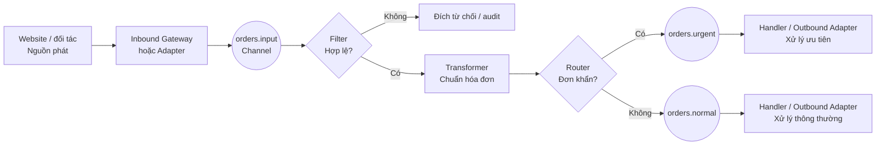
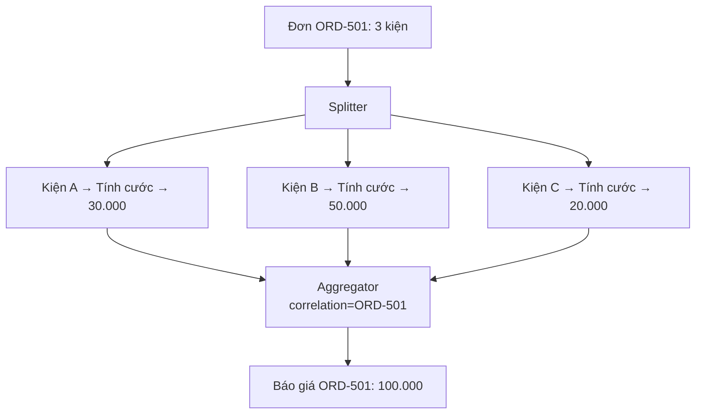
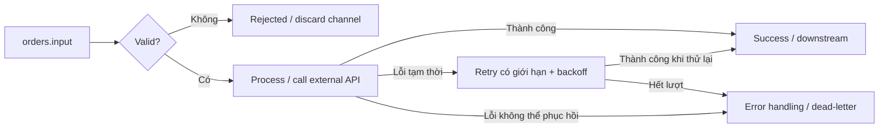

# Từ nguồn phát đến đích nhận qua nhiều bước

> **Chương:** Nhập môn  
> **Phạm vi:** `SPRING_INTEGRATION_PATTERN` — học cách áp dụng Enterprise Integration Patterns bằng Spring Integration để ghép các bước xử lý thông điệp ít phụ thuộc, có thể mở rộng, kiểm thử và quan sát được. Bài này tập trung vào **hành trình của một thông điệp từ hệ thống phát đến hệ thống nhận**, làm nền cho Router, Filter, Transformer, Splitter, Aggregator, Gateway, retry, error channel và correlation.

## 1. Mục tiêu học tập

Sau bài học, bạn có thể:

1. Đọc và tự vẽ một đường đi thông điệp gồm **nguồn phát → cổng vào → channel → các bước xử lý → channel → đích nhận**.
2. Phân biệt vai trò **producer, inbound adapter/gateway, message, channel, endpoint, outbound adapter/gateway**; nhận ra thời điểm payload hoặc header thay đổi.
3. Xác định nơi đặt **Filter, Transformer, Router**, và giải thích cách mở rộng bằng **Splitter/Aggregator** khi một yêu cầu tạo nhiều công việc con.
4. Mô tả được hành vi của luồng **đồng bộ, bất đồng bộ, lỗi, retry và tương quan thông điệp** mà không đánh đồng “gửi thành công” với “xử lý xong”.
5. Triển khai và kiểm thử một ví dụ Spring Integration Java DSL với các nhánh xử lý rõ ràng.

## 2. Bối cảnh: một đơn hàng đi qua nhiều hệ thống

Giả sử cửa hàng nhận đơn từ website và một đối tác. Hai nguồn có thể có định dạng đầu vào khác nhau; sau khi tiếp nhận, hệ thống phải kiểm tra tính hợp lệ, đưa dữ liệu về một cấu trúc chung, định tuyến đơn khẩn và đơn thường, rồi chuyển sang các bộ phận xử lý tương ứng.

Nếu đưa toàn bộ logic vào một method như `receiveAndProcessOrder()`, method đó sẽ vừa phải hiểu giao thức đầu vào, vừa kiểm tra nghiệp vụ, đổi định dạng, chọn đích, gọi API và đối phó với lỗi. Khi mở thêm một nguồn hoặc đích mới, nguy cơ sửa nhiều phần mã tăng lên.

Tư duy **Enterprise Integration Patterns (EIP)** tách hành trình thành những trách nhiệm nhỏ, trao đổi qua **message channel**. Một endpoint chỉ cần hiểu thông điệp nhận được và contract của kết quả mà nó phải tạo ra, không cần biết mọi chi tiết của cả hệ thống.



Sơ đồ mô tả **logic xử lý**, chưa mặc định channel là hàng đợi bền vững hoặc rằng các bước chạy trên thread khác nhau. Những thuộc tính đó do cách hiện thực và cấu hình vận hành quyết định.

## 3. Bản đồ thành phần của một hành trình

| Thành phần | Trách nhiệm | Trong ví dụ | Điều cần chú ý |
| --- | --- | --- | --- |
| **Producer / Source** | Phát sinh sự kiện, yêu cầu hoặc dữ liệu cần tích hợp | Website, API đối tác | Nguồn có thể phát cùng một yêu cầu nhiều lần |
| **Inbound Channel Adapter** | Nhận từ công nghệ ngoài và đưa thành message vào flow, thường theo mô hình một chiều | Bộ đọc file, listener từ broker | Cần biết cơ chế polling/event-driven, acknowledgement và retry |
| **Inbound Gateway** | Tiếp nhận mô hình request–reply và nối với luồng message | HTTP gateway hoặc interface gateway | Có thể cần response, timeout và xử lý lỗi trả về |
| **Message** | Đóng gói `payload` và `headers` | Đơn hàng + `orderId`, `sourceSystem`, thông tin truy vết | Payload và header không nên bị đánh đồng |
| **Message Channel** | Chuyển message giữa các endpoint | `orders.input`, `orders.urgent` | Channel quyết định một phần mô hình dispatch và threading |
| **Filter / Transformer / Router** | Lọc, biến đổi, chọn kênh đích | Kiểm tra đơn, chuẩn hóa, phân nhánh | Mỗi bước có contract và tình huống lỗi riêng |
| **Service Activator / Handler** | Gọi logic nghiệp vụ với message | Tính phí, xác nhận đơn | Có thể xử lý tại chỗ hoặc gọi dịch vụ ngoài |
| **Outbound Channel Adapter** | Đẩy message ra hệ thống đích, thường không chờ reply nghiệp vụ | Gửi sự kiện, ghi file, publish broker | Gửi thành công không luôn là đích xử lý xong |
| **Outbound Gateway** | Gửi yêu cầu đến đích và nhận phản hồi | Truy vấn API tồn kho | Cần chính sách timeout, retry và lỗi trả về |
| **Consumer / Sink** | Đích cuối của một nhánh xử lý | ERP, dịch vụ giao hàng, hệ thống audit | Một flow có thể có nhiều sink khác nhau |

### 3.1. Message không chỉ là dữ liệu payload

Trong Spring Integration, thông điệp được biểu diễn bằng `org.springframework.messaging.Message<T>`; `getPayload()` lấy nội dung, `getHeaders()` lấy metadata:

```java
import org.springframework.messaging.Message;
import org.springframework.messaging.support.MessageBuilder;

Message<String> incoming = MessageBuilder.withPayload(
        "{\"orderId\":\"ORD-501\",\"total\":1250000}")
    .setHeader("sourceSystem", "website")
    .setHeader("businessKey", "ORD-501")
    .build();

System.out.println(incoming.getPayload());
System.out.println(incoming.getHeaders().get("businessKey"));
```

Từ góc nhìn xử lý:

- **Payload** cho biết *cần xử lý điều gì*: nội dung đơn hàng, sự kiện thanh toán, danh sách kiện hàng...
- **Header** cho biết *thông điệp cần được xử lý trong bối cảnh nào*: nguồn phát, loại nghiệp vụ, khóa liên hệ, reply/error channel, mã truy vết...
- Mỗi message có thể mang `id` và `timestamp`; **message ID không tự động là khóa nghiệp vụ**. Một đơn hàng có thể phát sinh nhiều message với ID khác nhau.
- Khi message đi qua Transformer, payload có thể đổi kiểu; các header có thể được giữ/ánh xạ theo endpoint, nhưng **không nên mặc định chúng được bảo toàn qua mọi adapter và mọi giao thức ngoài**.

### 3.2. Channel là điểm ghép nối, không nhất thiết là broker

Một producer gửi vào `orders.input`; nó không cần giữ tham chiếu trực tiếp đến object `ValidationService`, `NormalizationService` hay `WarehouseClient`. Consumer đăng ký nhận từ channel và thực hiện phần việc của mình. Điều này giúp **giảm coupling về cấu trúc**.

Tuy vậy, giảm coupling trong code **không đồng nghĩa** đã độc lập về thời gian, deployment hoặc độ bền. Ví dụ, `DirectChannel` của Spring Integration thông thường gọi subscriber trên thread gửi; nó có thể là một bước đồng bộ, cùng ứng dụng. Chỉ khi có executor, queue, broker hoặc ranh giới phù hợp khác mới xuất hiện những tính chất bất đồng bộ/đệm tải nhất định.

## 4. Theo dõi một thông điệp qua từng chặng

Ta dùng đơn `ORD-501`, tổng tiền `1.250.000`, có cờ `urgent=true`. Hành trình lý tưởng gồm các bước sau.

### Chặng 1 — Tiếp nhận từ nguồn phát

Nguồn bên ngoài có thể gọi HTTP, đẩy message vào broker hoặc ghi một file. **Inbound adapter/gateway** diễn giải đầu vào thành message và đặt lên channel đầu tiên, chẳng hạn `orders.input`.

Ở ranh giới này, nên trả lời: Ai xác thực nguồn? Dữ liệu có đúng schema không? Khóa định danh nghiệp vụ là gì? Có cần acknowledgement ngay khi nhận hay chỉ sau khi xử lý? Yêu cầu bị gửi lại có phát sinh tác dụng phụ trùng không?

### Chặng 2 — Filter: thông điệp có được đi tiếp?

Filter kiểm tra một điều kiện như mã đơn không rỗng và tổng tiền lớn hơn 0. Nếu không hợp lệ, thông điệp có thể **bị loại** hoặc được chuyển sang **discard channel** để ghi nhận/từ chối rõ ràng.

Không nên đánh đồng “Filter không cho qua” với “ứng dụng gặp exception”. Bị loại theo quy tắc nghiệp vụ là một quyết định được thiết kế; exception là lỗi trong thực thi. Hai trường hợp thường cần đo lường và phản hồi khác nhau.

### Chặng 3 — Transformer: chuẩn hóa thông điệp

Transformer tạo payload thống nhất, ví dụ cắt khoảng trắng ở `orderId`, chuyển mã tiền tệ về kiểu chuẩn hoặc ánh xạ trường theo schema nội bộ. Nó giải quyết vấn đề **khác biểu diễn**, chứ không phải là nơi tự động xử lý mọi luật nghiệp vụ.

Ví dụ hai nguồn:

| Nguồn | Biểu diễn ban đầu | Sau Transformer |
| --- | --- | --- |
| Website | `{ "orderId": " ORD-501 ", "total": 1250000 }` | `PreparedOrder(id="ORD-501", amount=1250000)` |
| Đối tác | `{ "external_id": "ORD-501", "gross_amount": "1250000" }` | `PreparedOrder(id="ORD-501", amount=1250000)` |

Mỗi nguồn có thể cần một transformer đầu vào riêng trước khi hợp lưu vào schema chung. Ví dụ đơn giản bên dưới giả định gateway đã nhận được `OrderRequest` hợp lệ về kiểu dữ liệu.

### Chặng 4 — Router: chọn đích kế tiếp

Router đọc payload hoặc header và chọn kênh: `orders.urgent` hay `orders.normal`. Nó **không** thay thế Filter hoặc Transformer; công việc của Router là quyết định **đường đi**.

Một flow tốt cần có chính sách với dữ liệu không khớp nhánh nào (ví dụ default output channel hoặc exception theo cấu hình), không để thông điệp rơi vào khoảng trống mà không có dấu vết.

### Chặng 5 — Handler và hệ thống đích

Một handler nội bộ có thể gọi dịch vụ tính phí; một outbound adapter có thể publish sự kiện; outbound gateway có thể gọi API ngoài và chờ kết quả. Sau đó luồng có thể kết thúc hoặc tiếp tục bằng kết quả trả về.

**Có ba mốc khác nhau cần phân biệt:**

1. **Đã gửi vào channel:** framework đã tiếp nhận/dispatch theo semantics của channel.
2. **Đã gửi thành công qua ranh giới ngoài:** broker/API phía ngoài chấp nhận theo giao thức và xác nhận tương ứng.
3. **Đích hoàn tất nghiệp vụ:** ERP đã tạo đơn, kho đã giữ hàng, dịch vụ vận chuyển đã tạo vận đơn.

Không được suy từ mốc 1 thành mốc 3. Cần lời đáp, sự kiện xác nhận hoặc trạng thái nghiệp vụ nếu hệ thống yêu cầu biết thời điểm hoàn tất thật sự.

## 5. Hiện thực một luồng bằng Spring Integration Java DSL

Ví dụ dùng **Java 17+** (`record`) và API Spring Integration Java DSL; giả định dự án đã cấu hình Spring Integration thích hợp. Ba sink hiện chỉ ghi console để tập trung minh họa đường đi. Trong ứng dụng thực tế, thay handler console bằng service activator hoặc adapter/gateway đến hệ thống đích.

```java
import java.math.BigDecimal;

import org.springframework.context.annotation.Bean;
import org.springframework.context.annotation.Configuration;
import org.springframework.integration.annotation.Gateway;
import org.springframework.integration.annotation.IntegrationComponentScan;
import org.springframework.integration.annotation.MessagingGateway;
import org.springframework.integration.config.EnableIntegration;
import org.springframework.integration.dsl.IntegrationFlow;
import org.springframework.messaging.handler.annotation.Header;

// Contract tại nguồn phát.
record OrderRequest(String orderId, BigDecimal amount, boolean urgent) {}

// Contract nội bộ sau khi chuẩn hóa.
record PreparedOrder(String orderId, BigDecimal amount, boolean urgent) {}

@MessagingGateway
interface OrderIngress {
    @Gateway(requestChannel = "orders.input")
    void submit(OrderRequest request, @Header("sourceSystem") String sourceSystem);
}

@Configuration
@EnableIntegration
@IntegrationComponentScan
class OrderPipelineConfiguration {

    @Bean
    IntegrationFlow acceptOrders() {
        return IntegrationFlow.from("orders.input")
            // 1. Filter: thông điệp sai quy tắc đi sang nhánh từ chối.
            .filter(OrderRequest.class,
                order -> order.orderId() != null
                    && !order.orderId().isBlank()
                    && order.amount() != null
                    && order.amount().signum() > 0,
                spec -> spec.discardChannel("orders.rejected"))

            // 2. Transformer: chuẩn hóa payload, không đổi ý nghĩa nghiệp vụ.
            .transform(OrderRequest.class,
                order -> new PreparedOrder(
                    order.orderId().trim(), order.amount(), order.urgent()))

            // 3. Router: trả về tên channel đã được khai báo ở các flow dưới.
            .route(PreparedOrder.class,
                order -> order.urgent() ? "orders.urgent" : "orders.normal")
            .get();
    }

    @Bean
    IntegrationFlow rejectedOrders() {
        return IntegrationFlow.from("orders.rejected")
            .handle(message -> System.out.println(
                "REJECTED: " + message.getPayload()))
            .get();
    }

    @Bean
    IntegrationFlow urgentOrders() {
        return IntegrationFlow.from("orders.urgent")
            .handle(message -> System.out.println(
                "URGENT: " + message.getPayload()))
            .get();
    }

    @Bean
    IntegrationFlow normalOrders() {
        return IntegrationFlow.from("orders.normal")
            .handle(message -> System.out.println(
                "NORMAL: " + message.getPayload()))
            .get();
    }
}
```

Đoạn mã gọi từ một Spring-managed bean có inject `OrderIngress`:

```java
orderIngress.submit(
    new OrderRequest(" ORD-501 ", new BigDecimal("1250000"), true),
    "website");

orderIngress.submit(
    new OrderRequest("ORD-502", new BigDecimal("90000"), false),
    "partner");

orderIngress.submit(
    new OrderRequest("ORD-503", BigDecimal.ZERO, false),
    "website");
```

Hành vi mong đợi (lược bớt phần định dạng `record`):

```text
URGENT: PreparedOrder[orderId=ORD-501, amount=1250000, urgent=true]
NORMAL: PreparedOrder[orderId=ORD-502, amount=90000, urgent=false]
REJECTED: OrderRequest[orderId=ORD-503, amount=0, urgent=false]
```

Điểm cần quan sát ở ví dụ:

- Gateway giấu chi tiết messaging khỏi mã gửi. Tham số `sourceSystem` được đặt vào header, còn `OrderRequest` là payload.
- Filter có nhánh `discardChannel` rõ ràng, thay vì âm thầm bỏ những đơn sai quy tắc.
- Transformer tạo một payload mới; nhánh sau không cần biết dữ liệu gốc đến từ website hay đối tác.
- Router chỉ đưa message vào một trong hai channel, hai sink là các flow riêng.
- Mẫu hiện tại sử dụng channel nội bộ và handler đồng bộ theo cấu hình mặc định; **chưa có xử lý lưu bền, retry, broker ngoài hoặc bảo đảm hoàn tất nghiệp vụ**.
- API `void submit(...)` không trả trạng thái xử lý phân tán. Nếu đổi sang request–reply, cần thiết kế return value và timeout tương ứng.

## 6. Khi hành trình không còn tuyến tính: phân nhánh, tách và gom

Một đơn hàng có ba kiện. Sau khi chấp nhận, cần tính cước cho từng kiện từ một dịch vụ độc lập và gom lại thành báo giá chung. Lúc này ta cần **Splitter** và **Aggregator**.



### 6.1. Vì sao Aggregator cần correlation?

Nếu nhiều đơn đi qua pipeline đồng thời, kết quả tính cước của `ORD-501` và `ORD-502` có thể đến xen kẽ. Aggregator phải **nhóm các kết quả cùng đơn**, chẳng hạn bằng `orderId` hoặc `correlationId`, chứ không gom bừa ba kết quả đến gần nhau nhất.

Cơ chế gom thường phải định nghĩa thêm:

- **Correlation strategy:** khóa nhóm chính xác là gì? Có duy nhất trong phạm vi xử lý không?
- **Release strategy:** biết đủ kết quả nhờ `sequenceSize`, đếm theo danh sách kiện hoặc quy tắc riêng nào?
- **Timeout và expiry:** nếu một kiện không có phản hồi thì chờ bao lâu, trả kết quả thiếu hay đánh dấu lỗi?
- **Message group store:** trạng thái các phần đã nhận nằm ở đâu, có cần sống sót sau restart không?
- **Deduplication:** nếu kết quả kiện B đến hai lần, hệ thống có tính tiền hai lần hay không?

Spring Integration có thể cung cấp sequence/correlation metadata trong các luồng Splitter/Aggregator tương ứng, nhưng khi qua broker hay dịch vụ ngoài, bạn cần **kiểm tra cách ánh xạ và bảo toàn header**. Không nên phụ thuộc tuyệt đối vào header ngầm nếu ranh giới kỹ thuật có thể làm mất chúng.

### 6.2. Fan-out khác request–reply

Một thông điệp có thể được đưa tới nhiều subscriber bằng Publish-Subscribe Channel, hoặc nhiều đích được chọn bằng Recipient List. Đây là **nhân bản/định tuyến tới nhiều nơi**. Aggregator lại là **gom nhiều phản hồi thành một nhóm kết quả**. Hai ý tưởng có thể xuất hiện trong cùng một flow, nhưng không phải cứ gửi tới nhiều nơi là tự động nhận được kết quả hợp nhất.

## 7. Luồng đồng bộ, bất đồng bộ và ranh giới giao nhận

Phần quan trọng khi đi từ thiết kế logic sang hệ thống vận hành là xác định **bước nào chạy lúc nào, ai chịu trách nhiệm giữ thông điệp, và lỗi xuất hiện ở đâu**.

| Mô hình | Hành vi nổi bật | Hệ quả thiết kế |
| --- | --- | --- |
| `DirectChannel` | Subscriber thường chạy ngay trên thread của producer | Đơn giản, dễ thấy lỗi đồng bộ; một bước chậm có thể kéo dài thời gian gọi |
| `ExecutorChannel` | Đưa việc gọi consumer qua executor | Tách thread; cần giới hạn queue/thread pool và chiến lược khi quá tải |
| `QueueChannel` | Giữ message để consumer/poller nhận | Có thể đệm tạm; cần poller, giới hạn dung lượng, quản lý lưu trữ/khởi động lại |
| Broker bên ngoài qua adapter | Thông điệp đi qua mạng và cơ chế delivery của broker | Phải xác định acknowledgement, transaction, redelivery, serialization và lỗi kết nối |
| Request–reply gateway | Caller thường chờ phản hồi trong giới hạn cấu hình | Cần timeout, response contract và xử lý khi reply đến muộn |

**Cẩn thận với các suy luận sai:**

1. “Dùng message thì mặc nhiên bất đồng bộ” — sai: `DirectChannel` có thể xử lý đồng bộ.
2. “Có QueueChannel thì không sợ restart” — sai: độ bền phụ thuộc message store và thiết lập.
3. “Đã publish ra broker thì bên nhận chắc chắn xử lý đúng một lần” — sai: còn phụ thuộc semantics của broker, ack, retry và idempotency nghiệp vụ.
4. “Hàm gateway không ném lỗi nghĩa là đơn đã xử lý xong ở mọi đích” — sai: phạm vi xác nhận phụ thuộc ranh giới và loại gateway/flow.

Nếu cần tách tải, có thể đặt ranh giới bất đồng bộ **sau khi** xác thực cơ bản và trước tác vụ nặng; nhưng cần thiết kế thêm backlog, backpressure, replay và thời điểm xác nhận yêu cầu cho caller.

## 8. Đường lỗi cũng là một phần của đường đi

Một hành trình production không chỉ có đường thành công. Hãy biểu diễn riêng các kết cục:



### 8.1. Filter reject, exception và timeout là ba trường hợp khác nhau

- **Filter reject:** thông điệp không đạt quy tắc được nêu rõ; nên đưa tới discard channel/nhánh nghiệp vụ nếu cần lưu lý do hoặc gửi phản hồi.
- **Exception:** lỗi phát sinh trong code hoặc khi gọi hệ thống khác; cần xác định lỗi nào truyền ngược caller và lỗi nào được gửi sang kênh xử lý lỗi.
- **Timeout:** không có phản hồi đúng hạn; **không thể tự suy ra đích chưa xử lý**. Đích có thể đã thực hiện xong nhưng phản hồi bị trễ hoặc mất.

Trong Spring Integration, lỗi xảy ra trên chuỗi handler đồng bộ có thể lan ngược lên bên gửi; lỗi tại ranh giới bất đồng bộ có thể được chuyển thành `ErrorMessage` theo cơ chế xử lý lỗi và `errorChannel` được cấu hình. Không nên mặc định mọi exception, tại mọi loại channel, đều tự động xuất hiện trên cùng một error channel.

### 8.2. Retry đúng vị trí và tránh tác dụng phụ trùng lặp

Retry có ích với lỗi mạng tạm thời, giới hạn tốc độ hoặc kết nối đứt ngắn hạn. Nhưng retry yêu cầu tạo đơn, thanh toán hoặc vận chuyển khi chưa rõ kết quả lần đầu có thể gây **thực hiện lặp**.

Một chính sách cơ bản cần có: số lần thử hữu hạn, backoff, phân loại lỗi có thể thử lại, log/metrics của từng lần thử, tuyến xử lý khi hết lượt và **idempotency key** ở đích cho các hành động có side effect.

Ví dụ dùng khóa `orderId + operation` để tránh tạo vận đơn hai lần. **Correlation ID** để nhóm/truy vết các message liên quan không thay thế **idempotency key** dùng để ngăn tác dụng phụ trùng lặp.

## 9. Quan sát được từng chặng, thay vì chỉ thấy lỗi ở đích

Khi lỗi xảy ra sau nhiều bước, câu hỏi không chỉ là “đích có nhận không?” mà còn là “message đã đi đến chặng nào và biến thành gì?”. Nên thiết kế khả năng quan sát theo bảng:

| Điểm đo | Thông tin nên ghi/đo | Câu hỏi có thể trả lời |
| --- | --- | --- |
| Inbound | `orderId`, `sourceSystem`, thời điểm nhận, kết quả parse | Có nhận được yêu cầu chưa? |
| Sau Filter | Số message đạt/không đạt, mã lý do từ chối | Vì sao đơn không đi tiếp? |
| Sau Transformer | Schema/version, kết quả validate, loại payload | Đầu ra chuẩn hóa có đúng không? |
| Sau Router | Tên nhánh, giá trị quyết định | Đơn đã được đưa tới kênh nào? |
| Tại outbound | Mã yêu cầu ngoài, thời gian chờ, trạng thái transport | Đã gọi/publish thành công chưa? |
| Sau phản hồi / Aggregator | Correlation key, số phần nhận/thiếu, release reason | Đã nhận đủ và ghép đúng kết quả chưa? |
| Error handler | Loại lỗi, attempt count, bước gây lỗi, đường xử lý cuối | Có cần retry, bù trừ hay can thiệp? |

Log và trace cần thống nhất khóa nghiệp vụ/correlation, đồng thời **không ghi lộ dữ liệu cá nhân, token hoặc chi tiết thanh toán**. Wire Tap hoặc luồng audit giúp quan sát mà không buộc thay đổi xử lý nghiệp vụ chính, nhưng chi phí lưu/ghi của nhánh quan sát cũng phải được kiểm soát.

## 10. Kiểm thử theo hành trình hoàn chỉnh

Kiểm thử một Transformer đơn lẻ là cần thiết nhưng **chưa đủ**: phải kiểm tra message có thật sự đi qua đúng endpoint, đúng channel và tới đúng sink hay không. Có thể dùng Spring Test/JUnit cùng channel và handler giả để quan sát kết quả cuối.

| Kịch bản | Điểm cần xác minh |
| --- | --- |
| Đơn hợp lệ, khẩn cấp | Đến **chỉ** `orders.urgent`, payload đã chuẩn hóa |
| Đơn hợp lệ, bình thường | Đến **chỉ** `orders.normal` |
| Mã đơn trắng hoặc tổng tiền không dương | Đi `orders.rejected`; không gọi downstream nghiệp vụ |
| Hai nguồn gửi cùng ý nghĩa nghiệp vụ với schema khác | Sau khâu chuẩn hóa, contract nội bộ nhất quán |
| Gọi đích thất bại tạm thời | Số lần retry không vượt chính sách; lỗi cuối đi đúng kênh |
| Reply đến muộn | Caller nhận timeout theo thiết kế; xử lý reply muộn không gây hiệu ứng trùng |
| Splitter tạo ba message, thiếu một phản hồi | Aggregator áp dụng đúng correlation, timeout và release strategy |
| Một message đến hai lần | Side effect không bị lặp khi đã có idempotency phù hợp |

Khi kiểm thử, nên assert cả **payload, header quan trọng, số lần xử lý, đường nhánh và tình huống không có message ở nhánh khác**. Các test bất đồng bộ cần dùng điều kiện chờ có timeout rõ ràng, tránh giả định kết quả xuất hiện tức thì hoặc phụ thuộc vào `Thread.sleep()` tùy tiện.

### Checklist trước khi đưa một flow vào vận hành

- [ ] Mỗi channel có tên và contract payload/header dễ hiểu.
- [ ] Đường hợp lệ, đường bị loại và đường lỗi được xác định riêng.
- [ ] Ranh giới đồng bộ/bất đồng bộ, timeout và mức đảm bảo delivery được ghi rõ.
- [ ] Retry, backoff, idempotency và khả năng xử lý giao lại đã được xem xét.
- [ ] Với Splitter/Aggregator: có correlation key, release strategy và chính sách cho nhóm thiếu.
- [ ] Có metrics/tracing cho các nhánh và bài kiểm thử end-to-end tương ứng.
- [ ] Dữ liệu nhạy cảm được giới hạn trong log, trace và thông điệp lỗi.

## 11. Bài tập vận dụng

Thiết kế luồng đồng bộ hóa khách hàng từ **CRM** sang **ERP** và **dịch vụ email**. CRM gửi sự kiện `CustomerUpdated`. ERP yêu cầu schema khác CRM; chỉ khách hàng đã đồng ý nhận thư mới được gửi đến email. API ERP có thể timeout; email service có thể trả về lỗi tạm thời.

Hãy tự trả lời:

1. Bạn chọn inbound adapter hay gateway ở đầu vào? Vì sao? Chỗ nào cần acknowledgement?
2. Transformer nên được đặt ở đâu để ERP nhận đúng schema mà không làm hỏng thông điệp dành cho email?
3. Dùng Filter cho điều kiện đồng ý nhận thư ở **nhánh email** hay trước toàn bộ flow? Quyết định này ảnh hưởng ERP như thế nào?
4. Dùng Router, Publish-Subscribe Channel hay Recipient List để phân phối sự kiện? Điều gì quyết định lựa chọn?
5. Khi API ERP timeout, bạn phân biệt **đã gửi**, **đã được nhận** và **đã cập nhật ERP** như thế nào? Làm sao tránh cập nhật lặp khi retry?
6. Mỗi message cần gắn những khóa nào để truy vết đầy đủ từ CRM tới hai đích?

Một phương án tham khảo:

```text
CRM event
   |
   v
Inbound Adapter -> Channel: customer.updated
   |
   +--> ERP branch: Transformer(ERP schema) -> Outbound Gateway -> ERP
   |
   +--> Email branch: Filter(opt-in) -> Transformer(email payload)
                        -> Outbound Adapter -> Email service

Các nhánh cần có timeout, retry, idempotency và đường xử lý lỗi riêng.
```

Lưu ý: nếu một nhánh chạy đồng bộ và phát exception, nó có thể ảnh hưởng những nhánh khác tùy kiểu channel và cách cấu hình. Muốn hai đích được xử lý thực sự độc lập, cần chủ động thiết kế ranh giới thực thi và chính sách lỗi của từng nhánh.

## 12. Tổng kết

Đi từ **nguồn phát đến đích nhận qua nhiều bước** là chuyển từ tư duy “gọi nối tiếp nhiều method” sang mô hình **các endpoint trao đổi message qua channel và chịu trách nhiệm riêng**. Inbound adapter/gateway đưa dữ liệu vào flow; Filter quyết định thông điệp có tiếp tục, Transformer chuẩn hóa nội dung, Router chọn nhánh, handler/outbound adapter hoặc gateway đưa kết quả tới đích. Khi một yêu cầu tách thành nhiều phần, Splitter và Aggregator đòi hỏi correlation và quy tắc kết thúc nhóm.

Hãy luôn đọc một integration flow theo **ba lớp song song**: **đường nghiệp vụ** (message đi đâu và thay đổi gì), **đường thực thi** (đồng bộ, hàng đợi, broker, thời điểm xác nhận) và **đường lỗi/quan sát** (reject, retry, error channel, trace, idempotency). Cả ba lớp quyết định luồng Spring Integration có thực sự dễ mở rộng, dễ kiểm thử và đáng tin cậy hay không.

**Tài liệu đọc thêm:** Gregor Hohpe & Bobby Woolf, *Enterprise Integration Patterns*; tài liệu chính thức Spring Integration về Messaging, Java DSL, Message Channels, Routers, Gateways, Splitters/Aggregators và Error Handling.
