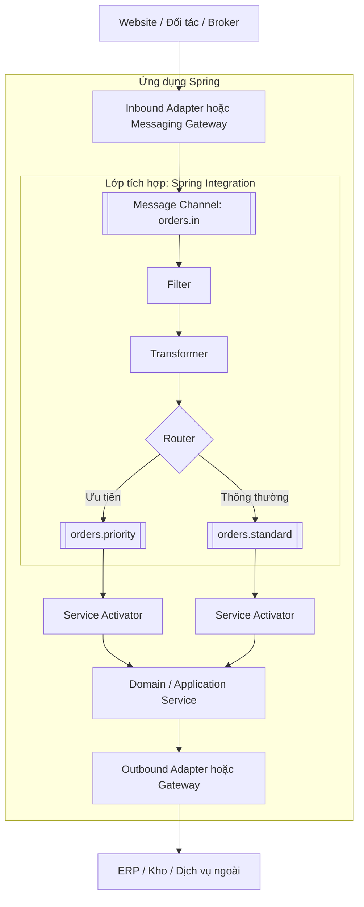
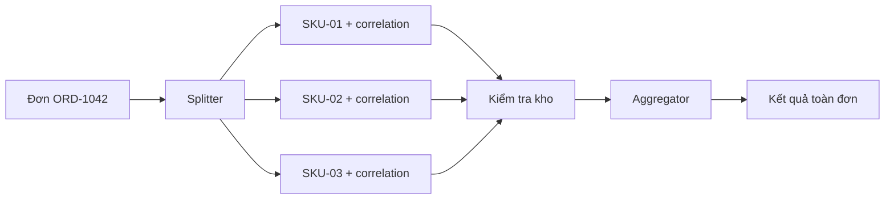
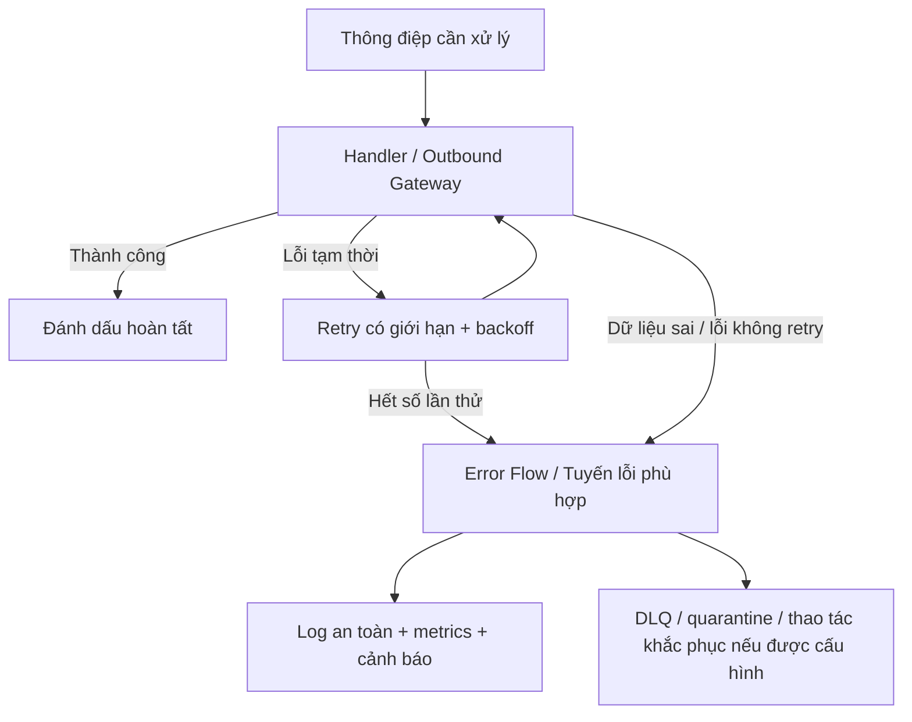

# Spring Integration hiện thực các pattern ở lớp nào?

Khi học **Enterprise Integration Patterns (EIP)**, một câu hỏi nền tảng thường xuất hiện: **Router, Filter, Transformer, Splitter, Aggregator, Gateway… nằm ở lớp nào của hệ thống?** Chúng có thuộc tầng HTTP, broker, service nghiệp vụ, hay là một kiến trúc độc lập?

**Câu trả lời ngắn:** Spring Integration hiện thực EIP chủ yếu ở **lớp tích hợp ứng dụng** (*application integration layer*), thông qua **message, channel, endpoint và integration flow** bên trong ứng dụng Spring. Lớp này đứng giữa những nơi gửi/nhận dữ liệu và các năng lực nghiệp vụ, điều phối **thông điệp đi đâu, được biến đổi ra sao, khi nào cần gom kết quả và xử lý lỗi thế nào**. Nó có thể kết nối HTTP, Kafka, RabbitMQ, JMS, file, cơ sở dữ liệu và các hệ thống ngoài, nhưng **không đồng nhất với bất kỳ giao thức hay broker nào**.

Đây là nội dung nhập môn cho module `SPRING_INTEGRATION_PATTERN`: hiểu được vị trí và trách nhiệm của lớp tích hợp là tiền đề để triển khai Router, Filter, Transformer, Splitter, Aggregator, Gateway, retry, error channel, correlation; đồng thời viết kiểm thử và theo dõi các nhánh xử lý một cách có hệ thống.

## 1. “Lớp” ở đây là lớp kiến trúc, không phải một tầng OSI cố định

Từ *layer* dễ gây hiểu nhầm vì có ít nhất ba cách dùng khác nhau:

| Cách hiểu | Ví dụ | Mối liên hệ với Spring Integration |
| --- | --- | --- |
| **Tầng mạng/giao thức** | TCP, HTTP, AMQP; các lớp trong mô hình OSI | Là phương tiện vận chuyển hoặc giao tiếp ra/vào. EIP không được gán cố định vào một tầng OSI. |
| **Lớp kiến trúc ứng dụng** | Controller, application service, domain, infrastructure, integration | **Đây là cách hiểu chính:** Spring Integration cung cấp lớp tích hợp, nối đầu vào/đầu ra với logic nghiệp vụ. |
| **Lớp Java/framework** | `Message`, `MessageChannel`, `IntegrationFlow`, `@MessagingGateway` | Là API, đối tượng và cấu hình kỹ thuật dùng để **hiện thực** lớp tích hợp. |

Một thông điệp HTTP đi vào ứng dụng có thể được chuyển thành `Message<OrderEvent>`, định tuyến giữa hai channel nội bộ rồi được xử lý trong cùng một JVM. **Không có broker hay giao thức mạng mới** ở giữa hai channel đó. Ngược lại, một flow khác có thể đẩy thông điệp ra Kafka và nhận kết quả qua một adapter riêng. Trong cả hai trường hợp, các pattern logic vẫn thuộc cách tổ chức **luồng tích hợp**, không chuyển thành một tầng mạng riêng.

> **Nguyên tắc ghi nhớ:** Giao thức quyết định *cách dữ liệu đi qua ranh giới kỹ thuật*; EIP quyết định *dữ liệu phải đi đâu và được xử lý theo chuỗi trách nhiệm nào*; domain quyết định *nghiệp vụ đúng hay sai*.

## 2. Bức tranh kiến trúc: lớp tích hợp nằm ở đâu?

Xem hệ thống nhận đơn hàng từ website, phân loại đơn, kiểm tra kho và gửi sang ERP:



Các lớp trong sơ đồ là **ranh giới trách nhiệm**, không nhất thiết là các tiến trình, máy chủ, module Maven hay thư mục Java khác nhau. Một `Service Activator` thuộc tích hợp có thể gọi một application service thuộc nghiệp vụ; bản thân nghiệp vụ không cần biết message đang đến từ webhook, scheduler hay broker.

### 2.1. Các vùng trách nhiệm thường gặp

| Vùng | Câu hỏi nó giải quyết | Thành phần Spring Integration liên quan |
| --- | --- | --- |
| **Biên nhận dữ liệu (inbound)** | Dữ liệu đến từ đâu? Khi nào biến thành `Message` nội bộ? | Inbound Channel Adapter, Inbound Gateway, Messaging Gateway. |
| **Hạ tầng trao đổi thông điệp** | Các bước truyền thông điệp cho nhau như thế nào? | `Message`, `MessageHeaders`, `MessageChannel`, `DirectChannel`, `QueueChannel`, `ExecutorChannel`. |
| **Xử lý/điều phối EIP** | Có lọc, chuyển đổi, định tuyến, chia nhỏ, gom lại không? | Filter, Transformer, Router, Splitter, Aggregator, Resequencer, Bridge. |
| **Kết nối nghiệp vụ** | Bước nào thật sự tạo đơn, tính giá, giữ hàng, áp quy tắc nghiệp vụ? | Service Activator gọi application/domain service; đôi khi Gateway gọi tới flow. |
| **Biên phát dữ liệu (outbound)** | Gửi kết quả sang dịch vụ nào, theo giao thức nào? Có cần chờ phản hồi? | Outbound Channel Adapter, Outbound Gateway, connector theo giao thức. |
| **Chính sách xuyên suốt** | Lỗi, retry, correlation, timeout, trạng thái nhóm, quan sát luồng ra sao? | Error channel/flow, advice, message store, correlation headers, metrics/tracing khi được cấu hình. |

Không nên hiểu bảng trên như “mỗi vùng phải có một server”. Một service Spring Boot có thể chứa tất cả; cũng có thể chỉ chứa một adapter và vài endpoint. **Giá trị của việc tách lớp nằm ở sự rõ ràng của trách nhiệm và hợp đồng**, không nằm ở số lượng service.

## 3. Nền móng kỹ thuật: Message, Channel, Endpoint và Flow

Ở mức API, Spring Integration xây trên các khái niệm messaging của Spring và bổ sung thành phần để tổ chức EIP.

### 3.1. Message: dữ liệu đi kèm ngữ cảnh

`Message<T>` gồm:

- **Payload**: dữ liệu được trao đổi, chẳng hạn `OrderEvent` hoặc `PaymentResult`.
- **Headers**: metadata phục vụ xử lý như message ID, timestamp, correlation, reply/error channel hoặc thông tin định tuyến do ứng dụng bổ sung.

Ví dụ về một thông điệp theo cách mô tả logic:

```text
Message<OrderEvent>
  payload:
    orderId = "ORD-1042"
    priority = true
    items = ["SKU-01", "SKU-02"]
  headers:
    id = <message-id>
    correlationId = "ORD-1042"  (nếu flow thiết lập/giữ giá trị này)
    traceId = <trace-context>   (nếu hệ thống tracing cung cấp)
```

**Không nhầm** message ID do hạ tầng tạo với `orderId` hoặc khóa chống xử lý trùng của nghiệp vụ. Message có thể được xây dựng lại khi đi qua một bước xử lý; ID kỹ thuật không phải lúc nào cũng là định danh ổn định xuyên hệ thống.

### 3.2. Channel: ranh giới gửi/nhận

`MessageChannel` là nơi bên gửi đưa message và bên nhận lấy hoặc nhận message. Channel giúp **producer không phụ thuộc trực tiếp vào class consumer**. Tuy vậy, các loại channel có hành vi khác nhau:

| Channel | Điều cần hiểu trước khi chọn |
| --- | --- |
| `DirectChannel` | Gọi handler theo cách đồng bộ, thường trên thread bên gửi; handler chậm có thể làm caller chậm. |
| `ExecutorChannel` | Chuyển xử lý sang `TaskExecutor`; tạo ranh giới bất đồng bộ nhưng không tự đảm bảo lưu bền hoặc tự chạy lại sau restart. |
| `QueueChannel` | Lưu tạm thông điệp để phía nhận poll; có thể dùng store thích hợp, nhưng không mặc nhiên là queue bền vững. |
| `PublishSubscribeChannel` | Phân phối thông điệp cho nhiều subscriber; cách thực thi đồng bộ/bất đồng bộ phụ thuộc cấu hình. |

**Channel nội bộ không phải broker.** Muốn có Kafka/RabbitMQ/JMS, cần adapter/gateway và cấu hình hệ thống tương ứng. Muốn bảo đảm xử lý sau sự cố cũng cần xem xét persistence, acknowledgement, transaction và idempotency.

### 3.3. Endpoint: nơi EIP thực sự có hành vi

Các **endpoint** nối channel với chức năng xử lý. Một endpoint có thể kiểm tra điều kiện, biến đổi payload, định tuyến hoặc gọi dịch vụ. Ví dụ:

- Filter nhận từ `orders.in`, chỉ đưa đơn hợp lệ sang bước sau.
- Transformer nhận `OrderEvent` ở dạng đầu vào, trả payload đã chuẩn hóa.
- Router chọn `orders.priority` hoặc `orders.standard` theo thuộc tính của thông điệp.
- Service Activator nhận từ channel và gọi method xử lý trong một Spring bean.

Về bản chất, **Router/Filter/Transformer là trách nhiệm xử lý thông điệp do endpoint thực hiện**, chứ không phải các biến thể của HTTP controller hoặc câu lệnh gửi tới broker.

### 3.4. IntegrationFlow: kết nối các trách nhiệm thành một tuyến

`IntegrationFlow` và Java DSL giúp diễn đạt thứ tự các bước, ranh giới channel, cách chọn endpoint và một phần cấu hình xử lý. Flow không phải “service nghiệp vụ tự chạy ở nền”; nó là **định nghĩa cách một message được chuyển qua các endpoint** khi có nguồn phát tới kênh đầu vào.

```text
Nguồn → Channel → Filter → Transformer → Router → Channel → Service Activator
                               │
                               └── nhánh khác → Channel → Handler khác
```

Một flow có thể hoàn toàn đồng bộ hoặc chứa các đoạn bất đồng bộ. Chỉ nhìn thấy mũi tên trong DSL **chưa đủ để kết luận** về thread, transaction, thứ tự xử lý hay độ bền.

## 4. Từng Enterprise Integration Pattern nằm ở đâu?

Nhiều EIP được hiện thực bằng **endpoint/flow logic**, một số là **adapter/gateway ở ranh giới**, một số là **cơ chế hạ tầng hỗ trợ nhiều endpoint**.

| Pattern/khái niệm | Vị trí trách nhiệm chính | Không nên hiểu thành |
| --- | --- | --- |
| **Filter** | Endpoint tích hợp kiểm soát thông điệp được đi tiếp. | Quy tắc xác thực người dùng toàn hệ thống hoặc nghiệp vụ hoàn chỉnh. |
| **Transformer** | Endpoint tích hợp chuyển kiểu/định dạng payload. | Tự quyết định mọi giá trị nghiệp vụ mới. |
| **Content-Based Router** | Endpoint tích hợp chọn tuyến theo nội dung/header. | Load balancer hạ tầng hoặc gateway HTTP. |
| **Splitter** | Endpoint tích hợp chia message thành nhiều phần có liên hệ. | Tự động xử lý song song; điều đó còn tùy channel/executor. |
| **Aggregator** | Endpoint tích hợp trạng thái để nhóm và phát kết quả khi đạt điều kiện. | Cơ chế giao dịch phân tán hoặc tự bảo đảm đủ phản hồi. |
| **Messaging Gateway** | Biên giữa lời gọi phương thức và message flow; có thể hỗ trợ request–reply. | HTTP API Gateway hoặc hệ thống gateway mạng. |
| **Channel Adapter** | Biên kết nối ứng dụng với nguồn/đích ngoài. | Nơi đặt tất cả logic nghiệp vụ. |
| **Service Activator** | Nút nối thông điệp với method xử lý. | Bản thân quy tắc domain bắt buộc nằm trong framework. |
| **Retry** | Chính sách bao quanh hoạt động xử lý/endpoint hoặc adapter thích hợp. | Bảo đảm đúng một lần trên mọi hệ thống. |
| **Error channel / error flow** | Tuyến thông báo/xử lý lỗi khi hệ thống phát `ErrorMessage`. | Cơ chế tự động bắt mọi lỗi trong mọi flow mà không cấu hình. |
| **Correlation** | Metadata/chiến lược liên kết các message cùng nghiệp vụ/nhóm xử lý. | Đồng nghĩa với message ID hoặc HTTP session. |

### 4.1. Router và Filter xử lý *luồng*, không thay thế domain

Giả sử đơn có `priority=true` phải vào tuyến ưu tiên. Router là nơi phù hợp để **chọn kênh**. Nhưng điều kiện một khách hàng có được hưởng ưu tiên hay không có thể liên quan tới hợp đồng, thanh toán và tài khoản — thuộc **business policy** nên được quyết định/kiểm tra bởi nghiệp vụ hoặc một thành phần chuyên trách, không nên nhồi quy tắc phức tạp vào DSL rồi coi đó là trách nhiệm của thư viện.

Phân tách hữu ích:

```text
Domain/Application Service: đơn này có quyền ưu tiên không?
Integration Router: với kết quả đã xác định, gửi thông điệp sang kênh nào?
```

Tương tự, Filter có thể loại message sai schema hoặc không thuộc luồng, nhưng không thay thế kiểm soát quyền truy cập hoặc các bất biến nghiệp vụ trong domain.

### 4.2. Splitter và Aggregator cần cả lớp tích hợp lẫn hợp đồng trạng thái

Một đơn có ba dòng hàng cần được kiểm tra ở ba kho. Splitter tạo các thông điệp con; Aggregator gom kết quả dựa vào **khóa tương quan** và **điều kiện hoàn tất**.



Ở **lớp tích hợp**, cần xác định `correlationKey`, sequence/nhóm, điều kiện release và expiry; ở **lớp nghiệp vụ**, phải quyết định “hai trong ba kho trả về” có được phép coi là thành công không. Nếu có bất đồng bộ, phải cân nhắc message store và timeout. Spring Integration cung cấp công cụ; **không tự chọn thay nghiệp vụ chính sách khi thiếu kết quả hoặc nhận kết quả trễ**.

### 4.3. Gateway là *cửa vào/ra mô hình lập trình*, không nhất thiết là server mạng

Một interface Java có thể được gắn `@MessagingGateway` để caller gọi `submit(order)` như một method thông thường. Framework chuyển lời gọi thành message gửi tới channel đã cấu hình. Caller không cần viết `MessageBuilder`, biết tên từng endpoint, hay phụ thuộc vào class Router.

Gateway có thể cho phép request–reply, nhưng **hành vi chờ phản hồi, timeout, lỗi và ranh giới thread phụ thuộc chữ ký method cùng cấu hình luồng**. `MessagingGateway` không đồng nghĩa với NGINX, API gateway, reverse proxy hay HTTP endpoint.

## 5. Minh họa bằng Spring Integration Java DSL

Giả sử ứng dụng cần nhận `OrderEvent`, loại sự kiện thiếu mã đơn, chuẩn hóa mã và phân loại vào hai channel. Ví dụ dưới minh họa **phân công trách nhiệm**, không cố triển khai toàn bộ ERP hay xử lý lỗi production trong một snippet.

```java
import java.util.Locale;
import org.springframework.context.annotation.Bean;
import org.springframework.context.annotation.Configuration;
import org.springframework.integration.annotation.MessagingGateway;
import org.springframework.integration.dsl.IntegrationFlow;

// Interface cho lớp gọi nghiệp vụ: không cần biết Filter/Router ở phía sau.
@MessagingGateway(defaultRequestChannel = "ordersIn")
interface OrderGateway {
    void submit(OrderEvent order);
}

record OrderEvent(String orderId, boolean priority) {
    boolean valid() {
        return orderId != null && !orderId.isBlank();
    }

    OrderEvent normalized() {
        return new OrderEvent(
            orderId.trim().toUpperCase(Locale.ROOT), priority);
    }
}

@Configuration
class OrderIntegrationConfiguration {

    @Bean
    IntegrationFlow classifyOrders() {
        return IntegrationFlow.from("ordersIn")
            .filter(OrderEvent.class, OrderEvent::valid,
                spec -> spec.discardChannel("ordersRejected"))
            .transform(OrderEvent.class, OrderEvent::normalized)
            .route(OrderEvent.class,
                event -> event.priority() ? "P" : "S",
                spec -> spec
                    .channelMapping("P", "ordersPriority")
                    .channelMapping("S", "ordersStandard"))
            .get();
    }
}
```

Giải thích theo lớp:

1. **Biên API Java:** `OrderGateway` là interface mà mã gọi có thể sử dụng. Ứng dụng phải cấu hình việc phát hiện/đăng ký gateway phù hợp, chẳng hạn cấu hình scan cho integration component.
2. **Đầu vào messaging:** `ordersIn` là tên message channel đầu vào của flow.
3. **Endpoint Filter:** chỉ để đơn hợp lệ đi tiếp; đơn bị loại hướng về `ordersRejected`.
4. **Endpoint Transformer:** tạo một `OrderEvent` đã chuẩn hóa mã đơn.
5. **Endpoint Router:** chọn nhánh `ordersPriority` hoặc `ordersStandard`.
6. **Hệ thống nghiệp vụ phía sau:** cần thêm subscriber/flow/handler thực tế cho các channel đích, ví dụ Service Activator gọi ứng dụng xử lý đơn và adapter liên hệ ERP.

Đây **chưa phải ứng dụng chạy độc lập**: cần các dependency và cấu hình Spring Integration thích hợp, bean/handler cho những channel liên quan và chính sách lỗi. Đặc biệt, một thông điệp bị chuyển sang `ordersRejected` **không tự được ghi bền hoặc có người xử lý** chỉ nhờ khai báo tên channel.

### 5.1. Đường đi khi đơn hợp lệ

```text
OrderGateway.submit(event)
        |
        v
      ordersIn
        |
        v
 Filter: valid() == true
        |
        v
 Transformer: normalized()
        |
        v
 Router: priority ? P : S
     /                 \
 ordersPriority    ordersStandard
     |                  |
 Service Activator / Handler phù hợp
     |                  |
 Application Service → Adapter ra hệ thống ngoài
```

### 5.2. Đường đi khi dữ liệu sai

Nếu `orderId` là `null` hoặc rỗng, Filter không gọi Transformer và Router. Message chuyển sang `ordersRejected` theo cấu hình `discardChannel`. Để triển khai thực tế, nhóm cần định nghĩa handler ở tuyến từ chối, cách phản hồi cho caller, mức độ log an toàn và liệu có lưu sự kiện để điều tra hay không.

### 5.3. Vì sao cách tách này tốt hơn một method dài?

Khi thay định dạng `OrderEvent`, nhóm có thể điều chỉnh Transformer/adapter. Khi thay cách phân tuyến, sửa Router. Khi ERP nâng API, sửa service/adapter phía đích. Các quyết định đều có **điểm thay đổi cụ thể**, có thể đo/ghi log và kiểm thử độc lập; không cần để Controller gọi trực tiếp mọi hệ thống rồi tự xử lý retry, routing, chuyển dữ liệu và timeout cùng lúc.

## 6. Ranh giới quan trọng: Spring Integration làm được gì và không tự làm gì?

### 6.1. Không thay thế HTTP, Kafka, RabbitMQ hoặc JMS

Spring Integration là **framework tổ chức luồng và adapter**. HTTP, Kafka, AMQP hay JMS vẫn là giao thức/hệ thống truyền tải riêng, với acknowledgment, transaction, ordering và cơ chế lưu trữ riêng. Chọn broker không tự biến một message thành `Message<?>` trong Spring Integration; phải cấu hình adapter tương ứng và hợp đồng mapping payload/header.

Một `DirectChannel` chạy trong JVM không có bảo đảm persistence giống durable queue. Một `QueueChannel` trong bộ nhớ cũng không tự giữ dữ liệu qua restart. **Độ tin cậy end-to-end là kết quả của toàn bộ chuỗi**, từ nguồn, adapter, message store, handler cho tới trạng thái trong hệ thống đích.

### 6.2. Không thay thế domain/application service

Không nên dùng Router để tự quyết định toàn bộ quy tắc thanh toán hoặc dùng Transformer để thay cả quy trình định giá. Domain vẫn sở hữu các quyết định như:

- Khách hàng nào được giao hàng ưu tiên.
- Khi nào một đơn đủ điều kiện xuất hóa đơn.
- Trừ tồn kho, ghi nhận thanh toán, bù trừ lỗi có nghĩa nghiệp vụ ra sao.

Integration flow sở hữu **vị trí và cách liên kết bước xử lý**. Cùng một domain service có thể được gọi từ HTTP, scheduler hoặc message flow mà không bắt buộc nhận `Message<?>` trong phương thức cốt lõi.

### 6.3. Không tự bảo đảm xử lý đúng một lần

Retry có thể khiến message được xử lý lại. Nếu một HTTP request đã trừ tiền nhưng response bị timeout, việc gửi lại cùng yêu cầu có thể phát sinh giao dịch thứ hai nếu phía đích không có hợp đồng idempotency.

Nên phân biệt:

| Khái niệm | Cần thiết kế ở đâu? |
| --- | --- |
| **Retry** | Lớp tích hợp/adapter, với giới hạn số lần, backoff và phân loại lỗi. |
| **Idempotency** | Ranh giới tác dụng phụ nghiệp vụ; khóa ổn định như `paymentId`/`eventId`, lưu trạng thái và kiểm soát cạnh tranh. |
| **Transaction** | Ở tài nguyên hỗ trợ transaction và phạm vi được cấu hình; giao dịch cục bộ không bao trùm tất cả hệ thống từ xa. |
| **Bù trừ** | Quy trình nghiệp vụ khi một chuỗi nhiều bước không thể rollback nguyên tử. |

**Spring Integration hỗ trợ xây dựng cơ chế**, nhưng không tự cung cấp cam kết exactly-once trên mọi transport, service và cơ sở dữ liệu.

### 6.4. Error channel không bao phủ tự động mọi trường hợp lỗi

Một flow đồng bộ qua `DirectChannel` có thể ném exception trực tiếp về caller. Một luồng bất đồng bộ có thể được cấu hình để chuyển exception thành `ErrorMessage` gửi đến error channel. Điều này **phụ thuộc loại endpoint, adapter, cơ chế thực thi và cấu hình**. Vì thế, cần kiểm thử đường lỗi thực tế, không chỉ thêm một kênh có tên `errorChannel` rồi cho rằng mọi lỗi đã được xử lý.

Ví dụ về chính sách lỗi cần thiết:



Sơ đồ là **chính sách mong muốn**, không phải cấu hình mặc định của mọi endpoint. Nếu cần dead-letter queue hay lưu bền, phải triển khai adapter/store cụ thể.

## 7. Correlation và Aggregator minh họa ranh giới giữa lớp tích hợp và nghiệp vụ

Một tình huống điển hình: đơn `ORD-1042` được tách thành ba yêu cầu kiểm tra tồn kho. Phản hồi có thể đến theo thứ tự `SKU-03`, `SKU-01`, `SKU-02`. Các thông điệp cần mang thông tin đủ để Aggregator biết **cùng một nhóm**, nhưng kết quả được coi là thành công hay thất bại phải dựa trên quy tắc nghiệp vụ.

Thiết kế nên trả lời:

1. **Correlation key:** Dùng `orderId`, `requestId` hay định danh nhóm riêng? Làm sao tránh trộn hai lần kiểm tra của cùng đơn?
2. **Release strategy:** Chờ đủ ba phản hồi, chờ phản hồi cuối hoặc cho phép kết quả một phần?
3. **Timeout/expiry:** Sau bao lâu thì không chờ nữa? Nhóm chưa hoàn tất được đưa đi đâu?
4. **Message store:** Có cần lưu trạng thái nhóm bền vững qua restart không?
5. **Duplicate/late arrivals:** Xử lý phản hồi trùng, đến muộn và việc phát lại kết quả thế nào?
6. **Tracing:** Có thể truy từ `orderId` tới tất cả bước phân nhánh không?

Trong các flow có Splitter/Aggregator, Spring Integration hỗ trợ các header correlation/sequence và các chiến lược gom nhóm. Tuy vậy, **không nên mặc định header tồn tại và được bảo toàn ở mọi adapter**; việc tạo, truyền, ánh xạ và kiểm tra metadata ở ranh giới ngoài là trách nhiệm thiết kế.

## 8. Các lớp ảnh hưởng trực tiếp đến kiểm thử như thế nào?

Tách đúng trách nhiệm giúp kiểm thử có mục tiêu rõ ràng, tránh việc phải khởi động toàn bộ ERP/broker cho mọi phép kiểm tra.

| Lớp kiểm thử | Câu hỏi | Ví dụ |
| --- | --- | --- |
| **Unit test cho chính sách** | Điều kiện và phép chuyển đổi có đúng không? | `OrderEvent.valid()`, chuẩn hóa mã đơn, phân loại ưu tiên. |
| **Integration-flow test** | Message đi qua đúng endpoint/channel chưa? | Đơn ưu tiên đi tới `ordersPriority`, không tới `ordersStandard`. |
| **Contract test ở biên** | Adapter mapping đúng payload/header và phiên bản schema không? | JSON webhook chuyển thành `OrderEvent`; correlation key không bị mất. |
| **Integration test hạ tầng** | Transport, transaction, poller, retry, restart có hành vi mong muốn không? | Tắt broker, gửi message trùng, thử nghiệm timeout hoặc redelivery. |
| **End-to-end nghiệp vụ** | Trạng thái nghiệp vụ cuối cùng đúng không? | Đơn được tạo một lần, không giữ hàng hai lần sau khi replay. |

Khi viết test, cần xác định channel nào là đồng bộ và channel nào tạo bất đồng bộ. Với asynchronous flow, `assert` tức thì ngay sau khi send có thể chưa phản ánh trạng thái cuối cùng; cần chờ bằng điều kiện có timeout phù hợp. Với Aggregator, phải kiểm thử trường hợp **thiếu, thừa, trùng và đến sai thứ tự**, không chỉ trường hợp đủ message theo thứ tự đẹp.

## 9. Theo dõi luồng: quan sát phải gắn với ranh giới cụ thể

Sau khi có nhiều nhánh Router hoặc nhiều phần Splitter, log `Received order` và `Finished order` là chưa đủ để chẩn đoán. Ở lớp tích hợp nên chủ động theo dõi:

- **Số message** đi vào, được xử lý, bị lọc và đi vào từng nhánh router.
- **Thời gian xử lý** trên từng endpoint; thời gian chờ ở kênh, poller hay outbound gateway.
- **Tỉ lệ lỗi và retry**, lý do từ chối, lần retry cuối, số message đến tuyến lỗi.
- **Nhóm Aggregator** đang chờ, đã release, hết hạn; phản hồi đến muộn.
- **Correlation/business key và trace context** để nối các bước mà không phụ thuộc vào message ID kỹ thuật.

Metrics/tracing phải được **bật và cấu hình** theo phiên bản Spring, observability stack và adapter đang dùng; không giả định mọi giá trị được thu thập tự động. Log nên tránh lưu token, thông tin thẻ thanh toán, dữ liệu cá nhân hoặc toàn bộ payload nhạy cảm.

Sơ đồ trách nhiệm giúp câu hỏi vận hành trở nên cụ thể:

```text
Message không xuất hiện ở đầu vào?
  → kiểm tra inbound adapter / kết nối / mapping
Message bị Filter loại nhiều?
  → xem hợp đồng dữ liệu và điều kiện lọc
Message đi sai nhánh?
  → xem Router, header và policy quyết định tuyến
Message chờ quá lâu?
  → xem Queue/Executor, poller, outbound service hoặc Aggregator
Message bị xử lý trùng?
  → xem redelivery, retry, idempotency và transaction boundary
```

## 10. Cách tổ chức mã để giữ lớp tích hợp rõ ràng

Không có một package structure bắt buộc cho mọi dự án. Một cách bố trí có thể là:

```text
com.example.orders
├── api/
│   └── OrderController.java             # nhận HTTP, ủy quyền gọi ứng dụng
├── integration/
│   ├── OrderGateway.java               # biên phương thức → message
│   ├── OrderFlows.java                 # filter, transform, router, split...
│   ├── OrderChannels.java              # cấu hình channel nếu cần
│   └── OrderErrorFlow.java             # chính sách xử lý lỗi tích hợp
├── application/
│   └── OrderApplicationService.java    # use case và orchestration nghiệp vụ
├── domain/
│   └── Order.java                      # quy tắc và trạng thái nghiệp vụ
└── infrastructure/
    └── ErpClient.java                  # giao tiếp hệ thống ngoài
```

Thư mục chỉ là minh họa. Trong thực tế adapter outbound cũng có thể nằm dưới `integration/adapters/`, gateway domain-facing được đặt gần use case, hoặc ứng dụng áp dụng hexagonal architecture với **ports and adapters**. Quan trọng hơn tên package là **chiều phụ thuộc hợp lý**: domain tránh phụ thuộc vào kiểu dữ liệu hoặc API của các integration endpoint nếu không thật sự cần thiết; adapter và flow phụ thuộc vào hợp đồng nghiệp vụ ổn định.

### Dấu hiệu lớp tích hợp bị trộn lẫn trách nhiệm

- Controller tự chọn broker/topic, retry và chia message thành nhiều phần thay vì gọi một API ứng dụng rõ ràng.
- Router chứa cả truy vấn quyền lợi khách hàng, tính phí, trừ tiền và cập nhật cơ sở dữ liệu.
- Domain service cần biết tên `DirectChannel`, `replyChannel` hoặc cấu trúc header chỉ để tính toán nghiệp vụ.
- Mọi exception đều được bắt và trả `SUCCESS`, trong khi luồng lỗi không ghi lại nguyên nhân hay trạng thái.
- Cùng một sự kiện bị phân loại theo quy tắc khác nhau ở HTTP controller, consumer Kafka và scheduler.

Các dấu hiệu này không có nghĩa phải “đưa tất cả vào EIP”; giải pháp thường là làm rõ hợp đồng giữa **domain, integration và infrastructure**.

## 11. Checklist thiết kế một flow Spring Integration

Trước khi đưa một pattern vào hệ thống, thử điền bảng sau:

| Quyết định | Ví dụ cho xử lý đơn hàng |
| --- | --- |
| Nguồn và biên giao tiếp | HTTP webhook hoặc một inbound broker adapter. |
| Payload chuẩn | `OrderEvent` có version, `orderId`, `eventId`, `priority`. |
| Kênh đầu vào | `ordersIn`, xác định subscriber và hành vi đồng bộ. |
| Lọc/chuẩn hóa | Filter kiểm tra dữ liệu, Transformer chuẩn hóa mã. |
| Tuyến đích | Router ưu tiên/thường; định nghĩa cả trường hợp không hợp lệ. |
| Xử lý nghiệp vụ | Service Activator gọi `OrderApplicationService`. |
| Bất đồng bộ/độ bền | Chọn channel và store/broker theo yêu cầu chịu lỗi. |
| Correlation và kết quả nhóm | Khóa nhóm, release, timeout, phản hồi trùng/đến muộn. |
| Retry và lỗi | Phân loại lỗi, backoff, giới hạn, error flow, quarantine. |
| Kiểm thử và quan sát | Test theo channel/endpoint, metrics từng nhánh, trace với `orderId`. |

Nếu không trả lời được một dòng quan trọng, thay đổi tên class hoặc thêm một annotation **chưa giải quyết được rủi ro tích hợp**.

## 12. Câu hỏi tự kiểm tra

**Câu 1.** Nếu một ứng dụng chỉ dùng `DirectChannel`, Filter và Router, không cấu hình Kafka/RabbitMQ, nó có đang áp dụng EIP không?

**Có.** EIP mô tả cách tổ chức và xử lý thông điệp. Framework có thể chạy hoàn toàn trong cùng tiến trình; broker ngoài là lựa chọn hạ tầng, không phải điều kiện bắt buộc.

**Câu 2.** Đặt Router trong Spring Integration có thay thế được thuật toán xác định khách hàng VIP trong domain không?

**Không.** Router thực thi quyết định đi kênh nào. Tiêu chí VIP có thể là một quy tắc nghiệp vụ phức tạp, nên được đóng gói và kiểm thử ở lớp sở hữu business policy phù hợp.

**Câu 3.** Thay `DirectChannel` bằng `ExecutorChannel` có đồng nghĩa với giao nhận bền vững và xử lý lại sau restart không?

**Không.** Đó chủ yếu là thay đổi ranh giới thực thi bất đồng bộ. Độ bền cần cơ chế lưu trữ/giao nhận, transaction/acknowledgement và chính sách xử lý lỗi thích hợp.

**Câu 4.** Aggregator đã nhận hai trong ba kết quả kiểm tra kho. Spring Integration có tự biết nên tiếp tục chờ hay trả kết quả một phần không?

**Không nên giả định.** Cần cấu hình điều kiện release, timeout/expiry và quy tắc xử lý theo nghiệp vụ; đồng thời quan tâm message store và kết quả đến muộn.

**Câu 5.** Một request đi qua Gateway tới một flow rồi timeout. Có thể retry ngay toàn bộ yêu cầu mà không lo trùng tác dụng phụ không?

**Không.** Phải phân biệt chưa xử lý với đã xử lý nhưng mất phản hồi; dùng định danh nghiệp vụ/idempotency và kiểm tra trạng thái đích khi cần.

## Kết luận

**Spring Integration hiện thực Enterprise Integration Patterns tại lớp tích hợp của ứng dụng**, chủ yếu qua mô hình **`Message` → `Channel` → `Endpoint` → `IntegrationFlow`**; các adapter và gateway nối lớp này với API, broker, file và hệ thống ngoài. Filter, Transformer, Router, Splitter, Aggregator biểu đạt trách nhiệm **xử lý/định tuyến thông điệp**; Gateway/Adapter biểu đạt **ranh giới giao tiếp**; retry, error channel, correlation và observability hỗ trợ **độ tin cậy và khả năng theo dõi** khi được thiết kế, cấu hình đúng.

Phân lớp đúng không có nghĩa tách thành nhiều microservice. Nó có nghĩa mỗi câu hỏi có một nơi chịu trách nhiệm: **transport chuyển dữ liệu, integration điều phối dòng dữ liệu, domain quyết định nghiệp vụ, infrastructure kết nối tài nguyên thực tế**. Nhờ vậy, hệ thống ít phụ thuộc hơn, dễ mở rộng, có thể kiểm thử từng nhánh và truy được nguyên nhân khi thông điệp xử lý không như mong đợi.
