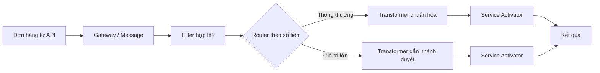
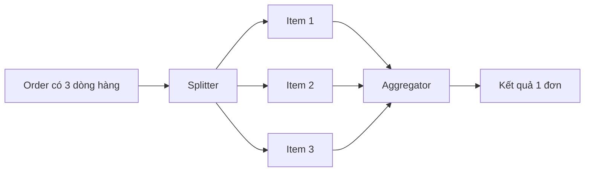
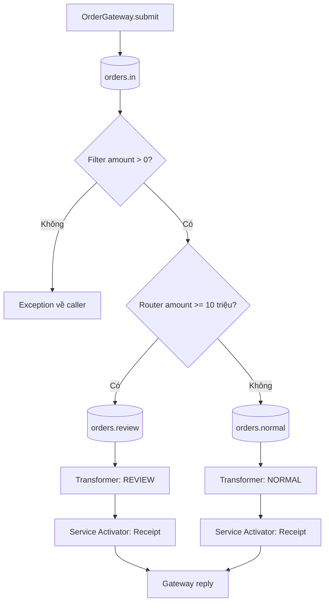

# Mẫu cấu trúc, mẫu định tuyến và mẫu biến đổi

## 1. Ba góc nhìn để thiết kế integration flow

Trong hệ thống doanh nghiệp, một yêu cầu tích hợp hiếm khi chỉ là chuyển dữ liệu từ A sang B. Chẳng hạn, khi tiếp nhận đơn hàng, ứng dụng phải đóng gói thông tin để các dịch vụ hiểu được, quyết định đơn nào xử lý tự động và đơn nào cần duyệt, rồi chuyển đổi định dạng phù hợp với từng hệ thống đích. **Spring Integration** giúp diễn tả các công việc này thông qua **Enterprise Integration Patterns (EIP)**, thay vì viết một chuỗi lời gọi Java phụ thuộc trực tiếp lẫn nhau.

Ở bài nhập môn này, ta phân nhóm theo **vấn đề thiết kế**:

| Nhóm mẫu | Câu hỏi cốt lõi | Ví dụ nhiệm vụ | Thành phần Spring Integration liên quan |
|---|---|---|---|
| **Cấu trúc** (message/flow structure) | Message gồm những gì, các bên trao đổi theo hợp đồng nào và kết nối với nhau ra sao? | Command/Event/Document Message, Request–Reply, Correlation Identifier, Message Channel, Gateway | `Message<?>`, headers, `MessageBuilder`, `MessageChannel`, `@MessagingGateway`, adapter |
| **Định tuyến** (routing) | Message này có được đi tiếp và phải chuyển tới nhánh/người nhận nào? | Message Filter, Content-Based Router, Recipient List, Splitter, Aggregator | `.filter()`, `.route()`, `.split()`, `.aggregate()`, `PublishSubscribeChannel` |
| **Biến đổi** (transformation) | Dữ liệu cần có hình dạng hoặc ngữ nghĩa gì để bước sau sử dụng? | Message Translator, Content Enricher, Header Enricher, Content Filter, Normalizer | `.transform()`, `.enrich()`, `.enrichHeaders()` |

**Lưu ý về cách gọi:** Đây là cách gom các mẫu để học và thiết kế, **không phải ba nhóm duy nhất hoặc một hệ phân loại tuyệt đối của EIP**. Trong phân loại EIP gốc còn có *Messaging Channels*, *Messaging Endpoints*, *Message Construction*, *Messaging Systems Management* và các nhánh khác; một mẫu như Splitter/Aggregator có thể nằm ở họ routing nhưng đồng thời ảnh hưởng cấu trúc chuỗi message. Mục đích ở đây là biết **khi nào dùng mẫu nào** và **điểm nào chịu trách nhiệm gì**.

Ví dụ một luồng xử lý đơn hàng:



- **Cấu trúc:** gateway biến lời gọi thành message có payload/headers và đưa vào channel.
- **Định tuyến:** filter quyết định chấp nhận hay từ chối; router quyết định nhánh xử lý.
- **Biến đổi:** transformer xây dựng payload phù hợp cho mỗi nhánh.

Các mẫu này **phối hợp**, không thay thế nhau. Một message hoàn toàn có thể đi qua nhiều endpoint routing và transformation liên tiếp.

## 2. Nền tảng chung: message, channel, endpoint

Mỗi flow được ghép từ ba thành phần:

1. **Message** chứa `payload` (dữ liệu nghiệp vụ) và `headers` (metadata như `id`, `timestamp`, `replyChannel`, `correlationId`, `traceId`).
2. **Channel** vận chuyển message giữa các điểm xử lý. `DirectChannel` thường dispatch đồng bộ, `ExecutorChannel` chuyển việc sang executor, `QueueChannel` giữ message cho consumer poll, `PublishSubscribeChannel` phát cho nhiều subscriber.
3. **Endpoint** tiếp nhận, xử lý hoặc phát message: adapter, gateway, filter, router, transformer, service activator, splitter, aggregator...

Ví dụ minh họa, với một payload đơn hàng:

```java
import org.springframework.messaging.Message;
import org.springframework.messaging.support.MessageBuilder;

Message<String> orderMessage = MessageBuilder.withPayload("ORDER-1001")
        .setHeader("source", "checkout-api")
        .setHeader("traceId", "checkout-a71c")
        .build();

System.out.println(orderMessage.getPayload());              // ORDER-1001
System.out.println(orderMessage.getHeaders().get("source")); // checkout-api
```

Đây mới là **cách đóng gói dữ liệu**. Khi gửi message qua `MessageChannel`, Spring Integration mới dispatch nó tới endpoint đã đăng ký. Người gửi không cần biết endpoint là một bean, một adapter hay một chuỗi xử lý.

## 3. Nhóm mẫu cấu trúc: xác định hợp đồng trao đổi

### 3.1. Command, Document và Event Message

Ba kiểu thông điệp hay gặp trong EIP thể hiện **ý nghĩa của payload**, không phải ba subclass bắt buộc của `Message`:

| Kiểu | Ý nghĩa | Ví dụ | Thiết kế cần lưu ý |
|---|---|---|---|
| **Command Message** | Yêu cầu một bên thực hiện hành động | `ApproveOrder`, `ReserveStock` | Đặt tên theo ý định, định nghĩa xử lý lặp và cách thông báo thất bại. |
| **Document Message** | Mang biểu diễn dữ liệu để một bên khác xử lý/lưu trữ | `InvoiceDocument`, `CustomerSnapshot` | Định nghĩa schema, phiên bản và quyền sở hữu trường dữ liệu. |
| **Event Message** | Thông báo việc **đã xảy ra** | `OrderCreated`, `PaymentCaptured` | Phân biệt dữ kiện quá khứ với lệnh; consumer có thể độc lập và nhận trễ. |

Ví dụ `OrderCreated` thường là **sự kiện**: một bên không nên hiểu nó thành lệnh phải tạo thêm một đơn khác. Ngược lại, `ReserveStock` là **command**: có thể cần kết quả thành công/thất bại. Phân biệt này giúp tránh coupling sai về trách nhiệm.

Trong Java, có thể dùng `record` cho payload:

```java
import java.math.BigDecimal;

record OrderCreated(String orderId, BigDecimal amount, String currency) {}
record ReserveStock(String orderId, String sku, int quantity) {}
```

`Message<OrderCreated>` vẫn có thể mang header `traceId`, `tenantId`, `schemaVersion`; `record` chỉ quyết định cấu trúc payload. Không nên nhồi dữ liệu kỹ thuật tạm thời (địa chỉ reply nội bộ, thời gian retry) vào những trường nghiệp vụ cố định nếu chúng thực chất là metadata của chuyến truyền.

### 3.2. Request–Reply, Return Address và Correlation Identifier

Với **Request–Reply**, phía gửi cần nhận một kết quả tương ứng với yêu cầu. `@MessagingGateway` hỗ trợ che lớp message/channel sau một interface Java; ở tầng message, cơ chế reply thường dựa vào `replyChannel` và thông tin liên quan.

```text
Caller -> Gateway -> orders.request -> Service Activator
Caller <- Gateway <- replyChannel <- Receipt
```

- **Return Address:** địa chỉ để gửi phản hồi. Trong flow nội bộ Spring Integration thường thể hiện qua `replyChannel`.
- **Correlation Identifier:** giá trị gắn các message cùng một công việc, đặc biệt khi request bị chia thành nhiều nhánh hoặc phản hồi đến bất đồng bộ. `correlationId` **khác** message ID: một công việc có thể phát sinh nhiều message ID.
- **Message Sequence:** khi chia một công việc thành nhiều phần, `sequenceNumber` và `sequenceSize` (khi biết số phần) giúp ghép lại và xác định lúc có thể hoàn tất.

**Quan trọng:** việc tự đặt header `correlationId` **không tự động** tạo request–reply, xử lý timeout hay gom kết quả. Cần gateway/handler/aggregator và quy tắc release/expiry phù hợp. Tương tự, channel trong bộ nhớ ứng dụng không mặc nhiên là địa chỉ phản hồi có thể truyền nguyên xi qua broker hoặc sang JVM khác.

### 3.3. Message Channel và Endpoint tổ chức cấu trúc flow

Cấu trúc flow còn thể hiện qua **ranh giới chịu trách nhiệm**:

```text
[Inbound Adapter/Gateway] -> [inputChannel]
                               -> [Validation Endpoint]
                               -> [validatedChannel]
                               -> [Routing Endpoint]
                               -> [channel theo nhánh]
                               -> [Outbound Adapter/Gateway]
```

Đặt tên channel theo ý nghĩa (`orders.received`, `orders.valid`, `orders.review`) tốt hơn đặt theo method ngẫu nhiên (`channel1`, `channel2`). Hợp đồng channel nên làm rõ loại payload, headers cần thiết, producer/consumer, xử lý lỗi và kỳ vọng thời gian phản hồi. Điều này giúp có thể thay endpoint hoặc cơ chế vận chuyển mà không viết lại toàn flow.

**Không nên suy diễn:** dùng `QueueChannel` chỉ là đã có buffer; nó không tự biến dữ liệu thành durable message qua restart. Dùng `ExecutorChannel` là tạo ranh giới thread, không có nghĩa transaction và thread-local tự được truyền theo.

## 4. Nhóm mẫu định tuyến: gửi đúng nơi, đúng điều kiện

### 4.1. Message Filter và Content-Based Router

Hai mẫu dễ bị nhầm:

| Mẫu | Quyết định | Kết quả điển hình | Ví dụ |
|---|---|---|---|
| **Message Filter** | Có cho **cả message** đi tiếp không? | Chấp nhận hoặc loại bỏ/từ chối message. | Loại đơn không có số tiền hợp lệ. |
| **Content-Based Router** | Message phải đi tới **channel nào** theo payload/header? | Một hoặc nhiều destination phù hợp theo cách cấu hình. | Đơn >= 10 triệu đi duyệt; đơn nhỏ đi xử lý tự động. |

Ví dụ điều kiện routing về mặt nghiệp vụ:

```java
String routeForAmount(BigDecimal amount) {
    return amount.compareTo(new BigDecimal("10000000")) >= 0
            ? "review"
            : "normal";
}
```

Một filter **không phải** transformer: `filter(order -> ...)` không thay đổi payload của message đã qua. Một router cũng **không phải** nơi chạy nghiệp vụ duyệt đơn: nó chỉ chuyển message đến đúng channel cho endpoint phía sau xử lý.

Trong Spring Integration Java DSL, các thao tác tương ứng là `.filter(...)` và `.route(...)`. Với request–reply, phải chủ động xử lý nhánh bị filter loại (ném exception, trả reply từ discard flow hoặc một cơ chế rõ ràng khác), tránh để gateway chờ mãi vì không có reply.

### 4.2. Recipient List và Publish–Subscribe

Nếu một message cần gửi cho **nhiều bên**, có hai ý tưởng gần nhau nhưng không đồng nhất:

- **Recipient List:** chọn danh sách đích theo quy tắc. Ví dụ đơn quốc tế phải gửi cho `fraudCheck` và `customsCheck`, còn đơn nội địa chỉ gửi `fraudCheck`.
- **Publish–Subscribe:** phát một message đến **mọi subscriber hiện có** của channel sự kiện, ví dụ một sự kiện `OrderCreated` được bộ phận audit, notification và metrics lắng nghe.

Trong Java DSL, có thể dùng `.routeToRecipients(...)` cho danh sách có điều kiện và `.publishSubscribeChannel(...)` cho fan-out. Sử dụng trường hợp nào phụ thuộc yêu cầu chọn đích, không chỉ vào số lượng người nhận.

**Cẩn trọng:** gửi một message tới nhiều nhánh **không** có nghĩa tự nhận lại một kết quả duy nhất. Nếu cần kết quả tổng hợp, phải thiết kế correlation, điều kiện hoàn tất và endpoint tổng hợp.

### 4.3. Splitter, Aggregator và Resequencer

Khi đơn chứa nhiều dòng sản phẩm, có thể tách để xử lý song song:



**Splitter** tạo các message thành phần, thường mang metadata liên hệ và thứ tự. **Aggregator** gom các message có cùng correlation key thành một nhóm và chỉ phát kết quả khi thỏa **release strategy**. **Resequencer** sắp lại thứ tự các phần nếu thứ tự xử lý/hoàn tất khác thứ tự nghiệp vụ.

Ví dụ:

```text
Order #1001 có các line item A, B, C
     | Splitter
     +-- item A: correlation=#1001, sequence=1/3
     +-- item B: correlation=#1001, sequence=2/3
     +-- item C: correlation=#1001, sequence=3/3
     | xử lý riêng
     v
Aggregator (nhóm #1001, đủ 3 phần) -> OrderResult #1001
```

Đây là mô tả **logic**; tên và giá trị headers cụ thể phụ thuộc cấu hình Splitter và Aggregator. Nếu một phần bị lỗi hoặc mất, `Aggregator` có thể chờ mãi nếu không có timeout, group expiration và chính sách cho kết quả thiếu. Với tải lớn, cần cân nhắc message store và giới hạn tồn đọng group. Với flow đa máy, phải thiết kế nơi lưu nhóm tương ứng thay vì giả định state in-memory là đủ.

### 4.4. Một số biến thể định tuyến cần biết

| Mẫu | Khi nên cân nhắc | Điều cần thiết kế |
|---|---|---|
| **Message Router** | Chọn nhánh theo thuộc tính message. | Mapping channel, default channel, nhánh không hợp lệ. |
| **Routing Slip** | Message đi qua chuỗi các điểm xử lý được xác định từ trước hoặc động. | Hành trình, bước tiếp theo, tránh vòng lặp. |
| **Scatter–Gather** | Gửi request đến nhiều nơi rồi tổng hợp phản hồi. | Timeout, correlation, partial results, failure policy. |
| **Resequencer** | Kết quả xử lý về không theo thứ tự cần thiết. | Ordering key, bộ nhớ đệm, cách giải phóng khi thiếu phần. |

Không cần dùng tất cả mẫu ngay từ đầu. Chọn **Content-Based Router** cho quyết định một-trong-hai đơn giản; chỉ dùng Splitter/Aggregator khi có nghiệp vụ chia và thực sự cần gom kết quả.

## 5. Nhóm mẫu biến đổi: đổi dữ liệu, giữ ý nghĩa

### 5.1. Message Translator / Transformer

**Transformer** chuyển payload hoặc biểu diễn message từ cấu trúc nguồn sang cấu trúc đích. Ví dụ hệ thống checkout gửi tiền ở `BigDecimal` và currency là mã ISO, còn hệ thống kho cần payload có thêm `fulfillmentType` đã chuẩn hóa.

```java
record CheckoutOrder(String id, BigDecimal amount, String currency) {}
record FulfillmentOrder(String id, BigDecimal amount,
                        String currency, String fulfillmentType) {}

FulfillmentOrder translate(CheckoutOrder input) {
    return new FulfillmentOrder(
            input.id().trim(),
            input.amount(),
            input.currency().toUpperCase(java.util.Locale.ROOT),
            "STANDARD");
}
```

Mẫu **Message Translator** là trường hợp hai hệ thống có mô hình/định dạng dữ liệu khác nhau. Ví dụ `JSON -> DTO -> XML` cần chuyển đổi schema có ý thức, chứ không chỉ đổi kiểu Java. Thiết kế phải nêu rõ field mapping, đơn vị tiền tệ, kiểu ngày giờ, optional/null, version và cách xử lý dữ liệu không hợp lệ.

Trong Spring Integration, dùng `.transform(...)` cho bước chuyển đổi. Đừng dùng transformer chỉ để quyết định nơi gửi: đó là trách nhiệm router; cũng đừng nhét thao tác mạng hoặc ghi database phức tạp vào một hàm mapping thuần túy nếu nên tách thành service activator/gateway.

### 5.2. Content Enricher, Header Enricher và Content Filter

| Mẫu | Tác động lên message | Ví dụ |
|---|---|---|
| **Content Enricher** | Bổ sung dữ liệu còn thiếu trong payload từ nguồn khác hoặc phép tính. | Điền thông tin phân vùng giao hàng từ customer service. |
| **Header Enricher** | Thêm/cập nhật metadata định tuyến hoặc quan sát. | Gắn `traceId`, `sourceSystem`, `tenantId` sau xác thực. |
| **Content Filter** | **Loại bớt trường/chi tiết trong payload**, vẫn có message đầu ra. | Bỏ thông tin thanh toán nhạy cảm trước khi gửi đối tác. |
| **Message Filter** | **Loại cả message** nếu điều kiện sai. | Không nhận yêu cầu thiếu mã đơn. |

Chú ý **Content Filter khác Message Filter**: tên rất giống nhau nhưng Content Filter là **một phép biến đổi**, còn Message Filter là **một quyết định định tuyến**. Để tránh lộ dữ liệu, Content Filter không nên chỉ đổi tên trường mà phải thực sự loại bỏ trường không thuộc hợp đồng dữ liệu đích.

Trong Spring Integration Java DSL thường dùng `.enrich(...)` và `.enrichHeaders(...)` cho các hình thức làm giàu phù hợp. Có thể dùng `.transform(...)` để dựng DTO mới chỉ chứa các trường được phép đưa ra ngoài.

### 5.3. Normalizer và định dạng chuẩn ở biên hệ thống

Nếu nhiều nguồn cùng gửi dữ liệu nhưng mỗi nguồn có schema khác nhau, **Normalizer** đưa chúng về một dạng **canonical** để core flow không phải biết nguồn nào gửi. Ví dụ:

```text
Mobile JSON ------- Transformer --+
                                   +--> CanonicalOrder --> Router --> Process
ERP XML ----------- Transformer --+
Partner CSV ------- Transformer --+
```

Cách làm này giảm coupling: thêm nguồn mới chỉ cần adapter/translator ở biên thay vì sửa tất cả endpoint nghiệp vụ. Tuy nhiên, không nên tạo canonical model khổng lồ chứa mọi trường của mọi hệ thống; hãy chuẩn hóa đúng dữ liệu luồng cần, có version và điều kiện validate rõ.

## 6. Ví dụ thực tế: phối hợp cả ba nhóm bằng Spring Integration Java DSL

### 6.1. Yêu cầu

Thiết kế API nội bộ xử lý đơn hàng:

1. Ứng dụng gọi `OrderGateway.submit(...)` và nhận `Receipt` (**request–reply**).
2. Đơn thiếu số tiền hoặc số tiền không dương bị từ chối bằng lỗi (**filter**).
3. Đơn từ **10.000.000** trở lên chuyển nhánh `REVIEW`, đơn thấp hơn chuyển nhánh `NORMAL` (**router**).
4. Hai nhánh đổi payload `OrderCommand` thành `RoutedOrder` có mã tuyến (**transformer**).
5. Service activator tạo `Receipt` rồi trả về gateway. Ví dụ tập trung minh họa routing, chưa có tích hợp mạng/database thật.



### 6.2. Cấu hình Java

Ví dụ hướng tới **Java 17+, Spring Integration 6.x và Spring Boot 3.x** với `spring-boot-starter-integration`. Các khai báo có thể đặt cùng package, còn mỗi kiểu Java được tách thành file nếu cần khai báo `public` trong dự án thật.

```java
import java.math.BigDecimal;

import org.springframework.context.annotation.Bean;
import org.springframework.context.annotation.Configuration;
import org.springframework.integration.annotation.Gateway;
import org.springframework.integration.annotation.IntegrationComponentScan;
import org.springframework.integration.annotation.MessagingGateway;
import org.springframework.integration.channel.DirectChannel;
import org.springframework.integration.config.EnableIntegration;
import org.springframework.integration.dsl.IntegrationFlow;
import org.springframework.messaging.MessageChannel;

record OrderCommand(String orderId, BigDecimal total, String currency) {}
record RoutedOrder(String orderId, BigDecimal total,
                   String currency, String route) {}
record Receipt(String orderId, String route) {}

@MessagingGateway
interface OrderGateway {
    @Gateway(requestChannel = "orders.in")
    Receipt submit(OrderCommand order);
}

@Configuration
@EnableIntegration
@IntegrationComponentScan
class OrderRoutingConfig {

    @Bean(name = "orders.in")
    MessageChannel ordersIn() {
        return new DirectChannel();
    }

    @Bean(name = "orders.review")
    MessageChannel reviewChannel() {
        return new DirectChannel();
    }

    @Bean(name = "orders.normal")
    MessageChannel normalChannel() {
        return new DirectChannel();
    }

    @Bean
    IntegrationFlow routeOrders() {
        return IntegrationFlow.from("orders.in")
                .filter(OrderCommand.class,
                        order -> order.total() != null
                                && order.total().signum() > 0,
                        spec -> spec.throwExceptionOnRejection(true))
                .route(OrderCommand.class,
                        order -> order.total()
                                .compareTo(new BigDecimal("10000000")) >= 0
                                ? "review" : "normal",
                        spec -> spec
                                .channelMapping("review", "orders.review")
                                .channelMapping("normal", "orders.normal"))
                .get();
    }

    @Bean
    IntegrationFlow reviewOrders() {
        return IntegrationFlow.from("orders.review")
                .transform(OrderCommand.class, order ->
                        new RoutedOrder(order.orderId(), order.total(),
                                order.currency(), "REVIEW"))
                .handle(RoutedOrder.class, (order, headers) ->
                        new Receipt(order.orderId(), order.route()))
                .get();
    }

    @Bean
    IntegrationFlow normalOrders() {
        return IntegrationFlow.from("orders.normal")
                .transform(OrderCommand.class, order ->
                        new RoutedOrder(order.orderId(), order.total(),
                                order.currency(), "NORMAL"))
                .handle(RoutedOrder.class, (order, headers) ->
                        new Receipt(order.orderId(), order.route()))
                .get();
    }
}
```

Ứng dụng inject `OrderGateway` (Spring quản lý bean), sau đó gọi:

```java
Receipt normal = orderGateway.submit(
        new OrderCommand("ORD-1001", new BigDecimal("800000"), "VND"));
// Receipt(orderId="ORD-1001", route="NORMAL")

Receipt review = orderGateway.submit(
        new OrderCommand("ORD-1002", new BigDecimal("12500000"), "VND"));
// Receipt(orderId="ORD-1002", route="REVIEW")
```

### 6.3. Vì sao ví dụ này thuộc cả ba nhóm?

| Bước | Loại mẫu | Điều xảy ra |
|---|---|---|
| `OrderGateway.submit` + `orders.in` | Cấu trúc | Lời gọi Java được bọc thành message và giao vào channel; reply đi qua cơ chế request–reply. |
| `.filter(...)` | Định tuyến | Chỉ message thỏa điều kiện mới đi tiếp. Bị từ chối thì ném lỗi đã cấu hình. |
| `.route(...)` | Định tuyến | Chọn `orders.review` hoặc `orders.normal` theo số tiền. |
| `.transform(...)` | Biến đổi | Thay payload từ `OrderCommand` thành `RoutedOrder` đã gắn nhãn tuyến. |
| `.handle(...)` | Endpoint xử lý | Áp dụng logic tạo `Receipt`, trả kết quả cho gateway. |

**Thứ tự quan trọng:** filter chạy trước router để không gọi `compareTo` với `null`; router chạy trước transformer để các nhánh có thể bổ sung metadata riêng. Có thể đảo các bước trong một nghiệp vụ khác, nhưng phải kiểm tra contract đầu vào/đầu ra của mỗi endpoint.

`@IntegrationComponentScan` giúp đăng ký interface gateway. `DirectChannel` giúp luồng minh họa hoạt động theo kiểu đồng bộ; đường phản hồi được hạ tầng gateway/handler xử lý. Nếu thay bằng kênh bất đồng bộ, phải thiết kế lại timeout, lỗi, transaction và thứ tự xử lý — không chỉ thay một class channel rồi mặc định hành vi giữ nguyên.

### 6.4. Biến thể: nhận dữ liệu từ nhiều hệ thống

Giả sử nguồn thứ hai cung cấp XML có trường `totalMinorUnits`, còn checkout cung cấp JSON với `total` là số thập phân. Không nên để router hiểu trực tiếp cả hai schema; thêm transformer ở biên:

```text
Checkout JSON -> DTO Checkout ---->
                               Transformer -> OrderCommand -> Filter -> Router
ERP XML      -> DTO ErpOrder ---->
```

Ở đây, **Transformer/Normalizer** hợp nhất dữ liệu, **Router** tiếp tục quyết định theo `OrderCommand.total`, còn **Gateway/Channel** giữ hợp đồng trao đổi nhất quán. Nếu muốn đồng thời phát sự kiện `OrderReceived` cho audit, bổ sung publish–subscribe hoặc recipient list ở điểm phù hợp, nhưng không đồng nhất thao tác fan-out đó với phản hồi của gateway.

## 7. Kiểm thử, retry, lỗi và quan sát

### 7.1. Kiểm thử hành vi theo nhánh

Không chỉ test hàm `routeForAmount`; cần xác nhận message thực sự đi hết tuyến và trả kết quả đúng:

| Trường hợp | Input | Kỳ vọng |
|---|---|---|
| Bình thường | `total = 800000` | `Receipt.route() == "NORMAL"` |
| Ngưỡng xét duyệt | `total = 10000000` | `Receipt.route() == "REVIEW"` |
| Lớn hơn ngưỡng | `total = 12500000` | `Receipt.route() == "REVIEW"` |
| Không hợp lệ | `total = 0` | Filter ném lỗi, không sinh receipt. |
| Thiếu số tiền | `total = null` | Filter ném lỗi có kiểm soát; không `NullPointerException` trong router. |

Ví dụ kiểm thử Spring/JUnit 5 (cùng package với `OrderRoutingConfig`):

```java
import java.math.BigDecimal;
import org.junit.jupiter.api.Test;
import org.springframework.beans.factory.annotation.Autowired;
import org.springframework.messaging.MessagingException;
import org.springframework.test.context.junit.jupiter.SpringJUnitConfig;

import static org.junit.jupiter.api.Assertions.assertEquals;
import static org.junit.jupiter.api.Assertions.assertThrows;

@SpringJUnitConfig(OrderRoutingConfig.class)
class OrderRoutingFlowTest {

    @Autowired
    OrderGateway gateway;

    @Test
    void normalOrderGoesToNormalChannel() {
        Receipt result = gateway.submit(
                new OrderCommand("A-1", new BigDecimal("800000"), "VND"));
        assertEquals("NORMAL", result.route());
    }

    @Test
    void thresholdOrderGoesToReviewChannel() {
        Receipt result = gateway.submit(
                new OrderCommand("A-2", new BigDecimal("10000000"), "VND"));
        assertEquals("REVIEW", result.route());
    }

    @Test
    void invalidAmountIsRejected() {
        assertThrows(MessagingException.class, () -> gateway.submit(
                new OrderCommand("A-3", BigDecimal.ZERO, "VND")));
    }
}
```

Nếu muốn kiểm tra **đúng channel cụ thể** thay vì chỉ outcome, có thể dùng test support của Spring Integration (`MockIntegrationContext`, `MockIntegration`) hoặc một interceptor/test endpoint trong cấu hình kiểm thử. Không gán giá trị kỳ vọng dựa trên log một cách duy nhất, vì log có thể thay đổi khi chạy đa luồng.

### 7.2. Retry và error channel không thay thế routing

Mẫu router **không** tự retry một message bị lỗi; transformer **không** tự đưa lỗi vào error channel. Đây là những mối quan tâm riêng:

- Với xử lý đồng bộ qua `DirectChannel`, exception từ filter hoặc handler có thể truyền ngược gateway/caller.
- Với executor, poller hay adapter bất đồng bộ, lỗi có thể được biểu diễn thành `ErrorMessage` và chuyển tới `errorChannel` được cấu hình trong bối cảnh tương ứng.
- **Retry** cần chính sách cụ thể: lỗi nào được phép thử lại, số lần thử, backoff, có xử lý trùng hay không. Đối với thao tác có side effect (thanh toán, phát hành hóa đơn), phải cân nhắc **idempotency**.
- Khi message đi qua Splitter/Aggregator, cần xử lý tương quan, timeout, kết quả thiếu và khả năng group tồn đọng; nếu một nhánh lỗi, aggregator không tự biết phải phát kết quả thiếu ra sao.

Đặc biệt, không nên gửi mọi lỗi đến một channel chung rồi coi như hoàn tất request–reply. Phải định nghĩa rõ **kết quả thành công**, **kết quả bị từ chối** và **thất bại hạ tầng** cho mỗi API.

### 7.3. Quan sát flow

Nên theo dõi tối thiểu:

- **Message identity và business identity:** `id` của message để tra sự kiện truyền; `orderId` để tra nghiệp vụ; `correlationId` khi có xử lý nhiều phần.
- **Số lượng theo nhánh:** bao nhiêu đơn vào `orders.in`, bao nhiêu sang `orders.normal` và `orders.review`, bao nhiêu bị filter từ chối.
- **Độ trễ và lỗi:** thời gian từng nhánh xử lý, retry, timeout, lỗi từ adapter/handler.
- **Sức chứa:** nếu chuyển sang `QueueChannel` hoặc executor, theo dõi hàng đợi, backlog và tình trạng bão hòa.

Interceptor, wire tap, metrics và observation có thể giúp đo lường tùy cấu hình. Tránh log nguyên payload chứa thông tin định danh hoặc thanh toán; chỉ lưu những trường cần thiết cho chẩn đoán.

## 8. Sai lầm thường gặp và cách lựa chọn

| Nhầm lẫn | Hệ quả | Cách tiếp cận tốt hơn |
|---|---|---|
| Dùng một transformer để vừa sửa dữ liệu vừa chọn đích | Logic mapping lẫn điều phối, khó test nhánh. | Dùng transformer cho mapping, router cho chọn channel. |
| Xem Message Filter và Content Filter là một | Có thể gửi dữ liệu nhạy cảm vì nghĩ message đã được làm sạch. | Phân biệt bỏ **cả message** với bỏ **trường trong payload**. |
| Dùng publish–subscribe để gọi nhiều dịch vụ rồi mong tự nhận một kết quả | Gateway chờ thiếu reply hoặc không rõ kết quả nào. | Thiết kế Scatter–Gather/Aggregator và điều kiện hoàn tất khi cần kết quả tổng hợp. |
| Tự đặt correlation ID rồi tin rằng hệ thống tự gom nhóm | Dữ liệu thành phần bị xử lý rời rạc hoặc tồn đọng. | Cấu hình Splitter, correlation/release strategy, timeout, message store. |
| Xem `QueueChannel` là broker bền vững | Message có thể mất khi tiến trình restart. | Chọn transport/store đáp ứng durability và delivery guarantee thực tế. |
| Truyền DTO của hệ thống ngoài xuyên suốt core flow | Thêm một nguồn mới phải sửa nhiều handler. | Chuẩn hóa ở biên, giữ canonical DTO tối thiểu. |
| Không xử lý nhánh filter loại hoặc route không có mapping | Request–reply thiếu kết quả, timeout khó chẩn đoán. | Xác định default/error/rejection behavior và viết test cho từng nhánh. |
| Retry mọi lỗi như nhau | Có thể lặp side effect hoặc bão hòa downstream. | Phân loại lỗi, giới hạn retry/backoff, idempotency, dead-letter/recovery. |

Quy tắc lựa chọn ngắn gọn: **đóng gói và kết nối bằng các mẫu cấu trúc; quyết định đường đi bằng mẫu định tuyến; điều chỉnh hợp đồng dữ liệu bằng mẫu biến đổi**. Nếu một endpoint đang làm cả ba, đó là dấu hiệu nên xem xét tách trách nhiệm.

## 9. Bài tập tự thực hành

1. **Cấu trúc:** thiết kế `Message<OrderCreated>` có payload là record và header `traceId`; giải thích vì sao `orderId` là mã nghiệp vụ chứ không nên dùng message ID thay thế.
2. **Định tuyến:** từ flow ví dụ, thêm nhánh `orders.international` cho đơn không dùng `VND`. Xác định rõ thứ tự ưu tiên giữa route quốc tế và route giá trị lớn.
3. **Biến đổi:** viết `Transformer` đưa `currency` thành chữ hoa và chuẩn hóa `orderId`. Viết test cho input thiếu trường; quyết định khi nào reject thay vì âm thầm đoán giá trị.
4. **Fan-out và gom kết quả:** mô tả luồng cùng kiểm tra fraud và tồn kho, rồi chỉ xác nhận khi cả hai thành công. Ghi rõ correlation key, thời hạn chờ và xử lý một kết quả bị thiếu.
5. **Vận hành:** thay `orders.review` bằng một đoạn xử lý bất đồng bộ. Phân tích gateway reply timeout, error flow, transaction, queue capacity và phương án idempotency.

**Tự kiểm tra:** Một message đầu vào chứa `amount = 12_500_000`, `currency = "vnd"`. Để vừa chọn nhánh duyệt vừa chuẩn hóa `currency` thành `"VND"`, bạn cần **router** để chọn channel và **transformer** để chuyển đổi payload. Việc đầu vào được bọc thành `Message` và đi qua `Gateway/Channel` thuộc phần **cấu trúc**. Ba nhóm mẫu giải quyết ba câu hỏi khác nhau; ghép đúng trách nhiệm giúp flow dễ mở rộng, kiểm thử và truy vết.
