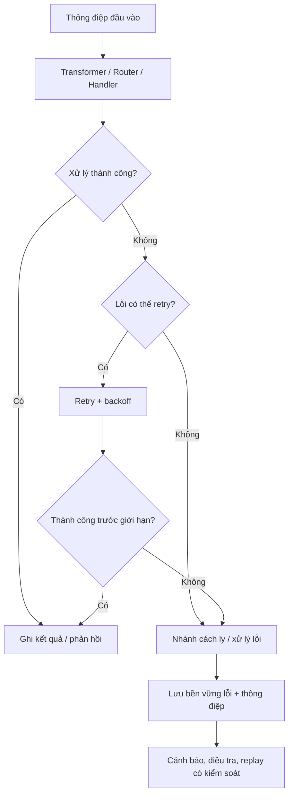

# Mẫu xử lý lỗi, độ tin cậy và giao dịch

## 1. Vì sao luồng thông điệp cần chiến lược xử lý lỗi?

Trong **Spring Integration**, một thông điệp thường đi qua nhiều *Enterprise Integration Patterns* (EIP): Channel Adapter nhận dữ liệu, Transformer chuẩn hóa, Router chọn nhánh, Service Activator gọi nghiệp vụ, rồi Outbound Adapter gửi kết quả ra hệ thống khác. Mỗi bước có thể thất bại: thông điệp sai định dạng, database tạm mất kết nối, API trả HTTP 429, broker ngắt kết nối hoặc tiến trình dừng khi đang xử lý.

Điều quan trọng không chỉ là *bắt exception*, mà là xác định **điều gì phải xảy ra với thông điệp và trạng thái nghiệp vụ sau lỗi**. Ví dụ, dịch vụ thanh toán đã trừ tiền nhưng ứng dụng mất kết nối trước khi ghi nhận kết quả. Nếu xử lý lại không kiểm soát, một đơn hàng có thể bị trừ tiền hai lần.

Bài học thuộc chương **Nhập môn** của module **SPRING_INTEGRATION_PATTERN**. Mục tiêu là học cách phối hợp *Router, Filter, Transformer, Splitter, Aggregator, Gateway, retry, error channel và correlation* để xây dựng luồng thông điệp ít phụ thuộc, dễ mở rộng, đồng thời kiểm thử và theo dõi các nhánh xử lý. Ở đây, ta tập trung vào ba câu hỏi xuyên suốt:

1. **Lỗi đi đâu?** Cơ chế lan truyền exception, ErrorMessage, error channel và nhánh phục hồi.
2. **Khi nào thử lại?** Retry có giới hạn, backoff, phân loại lỗi và nơi lưu thông điệp thất bại.
3. **Dữ liệu có nhất quán không?** Ranh giới transaction, cơ chế ghi nhận xử lý, thông điệp trùng lặp và phục hồi sau sự cố.

Một cách phân loại thực tế:

| Loại sự cố | Ví dụ | Cách xử lý thường phù hợp |
| --- | --- | --- |
| **Tạm thời** | Timeout, mạng chập chờn, HTTP 503, deadlock DB | Retry có giới hạn, backoff, cảnh báo nếu quá ngưỡng |
| **Dữ liệu không hợp lệ** | Thiếu mã đơn hàng, sai schema, không qua kiểm tra nghiệp vụ | Không retry vô ích; từ chối, cách ly và trả lỗi rõ ràng |
| **Không xác định đã hoàn tất hay chưa** | Gọi API thanh toán bị timeout sau khi phía đối tác có thể đã xử lý | Tra cứu trạng thái theo khóa nghiệp vụ; idempotency trước khi gửi lại |
| **Lỗi hạ tầng kéo dài** | Broker ngừng hoạt động, storage không truy cập được | Giảm tải, giãn retry, lưu thông điệp bền vững, cảnh báo vận hành |
| **Xử lý thành công nhưng mất xác nhận** | Consumer ghi DB thành công rồi dừng trước khi ACK | Chấp nhận khả năng nhận lại; thiết kế consumer idempotent |

## 2. Cơ chế lỗi: exception, ErrorMessage và error channel

### 2.1. Lỗi đồng bộ và bất đồng bộ khác nhau

Với **DirectChannel**, bên gửi và handler thường chạy cùng luồng thực thi. Khi handler ném exception, lỗi thường được truyền ngược về bên gọi (có thể được bọc trong `MessagingException`). Nếu Gateway đang chờ phản hồi, bên gọi có thể nhận lỗi hoặc kết quả được ánh xạ từ nhánh xử lý lỗi.

Với **ExecutorChannel**, hàng đợi và các endpoint có poller, việc xử lý có thể diễn ra trên luồng khác hoặc sau thời điểm gửi. Exception không còn được truyền trực tiếp về ngăn xếp lệnh ban đầu. Spring Integration có thể xuất bản một **ErrorMessage** qua *error channel* do endpoint, header hoặc cấu hình chung xác định. Hành vi cụ thể phụ thuộc loại endpoint và cách cấu hình error handler; không nên mặc định rằng mọi exception đều tự động trở thành ErrorMessage.

| Thành phần | Vai trò | Điều cần kiểm tra |
| --- | --- | --- |
| `MessagingException` | Exception trong hạ tầng thông điệp; có thể mang `failedMessage` | Lấy nguyên nhân gốc qua `getCause()` và thông điệp gốc nếu có |
| `ErrorMessage` | Một `Message<Throwable>` để chuyển lỗi qua channel | Payload là lỗi, không phải payload nghiệp vụ ban đầu |
| `errorChannel` | Channel lỗi mặc định trong application context | Subscriber, chính sách logging và độ bền của dữ liệu lỗi |
| Error channel riêng | Nhánh xử lý lỗi cho một flow/endpoint | Tránh trộn lỗi nhiều nghiệp vụ; xác định người chịu trách nhiệm xử lý |
| `errorChannel` header | Gợi ý đích trả lỗi cho một thông điệp | Chỉ có tác dụng ở những thành phần thực sự phát hành ErrorMessage |

Một flow có thể chủ động tách lỗi theo nguồn, mức độ và cách phục hồi:



**Lưu ý:** Sơ đồ mô tả chính sách thiết kế. Spring Integration cung cấp các building block; bạn phải cấu hình đường đi và nơi lưu thất bại thực tế. Nếu chỉ ghi log lỗi rồi trả về, thông điệp có thể không còn cơ hội xử lý lại.

### 2.2. Error channel nên chứa những gì?

Nhánh lỗi hữu ích cần giữ đủ ngữ cảnh để vận hành và khôi phục:

- **Định danh**: `messageId`, mã đơn hàng, correlation ID, tên nguồn, tên bước lỗi.
- **Nguyên nhân**: loại exception, mã lỗi nghiệp vụ/hạ tầng, thời điểm và số lần thử.
- **Thông điệp có thể phát lại**: payload cần thiết hoặc tham chiếu tới bản lưu bền vững.
- **Trạng thái xử lý**: chờ retry, đang điều tra, bị cách ly, đã replay, đã hoàn tất.

Không mặc định `failedMessage` luôn tồn tại hoặc có thể khôi phục nguyên vẹn sau khi serialize. Với payload nhạy cảm, lưu tham chiếu được bảo vệ thay vì ghi thẳng dữ liệu khách hàng hoặc token vào log.

## 3. Retry: xử lý lỗi tạm thời có giới hạn

**Retry** hữu ích khi nguyên nhân có khả năng biến mất mà không cần sửa dữ liệu, chẳng hạn timeout mạng ngắn hoặc database bị khóa tạm thời. Trong Spring Integration, `RequestHandlerRetryAdvice` có thể bao quanh một handler và sử dụng **Spring Retry** (`RetryTemplate`) để gọi lại handler theo chính sách cấu hình.

Ba quyết định phải rõ ràng:

1. **Retry lỗi nào?** Timeout, HTTP 502/503, khóa DB có thể retry; payload sai schema hoặc bị từ chối nghiệp vụ thường không nên retry.
2. **Thử bao nhiêu lần và cách nhau bao lâu?** Giới hạn lần thử, thời gian backoff; dùng exponential backoff và jitter khi có nhiều worker cùng retry nhằm tránh đồng loạt tạo tải.
3. **Hết số lần thử thì sao?** Chuyển lỗi sang nhánh recovery có lưu bền vững, cảnh báo và quy trình phát lại.

**Ví dụ Spring Integration Java DSL**: nhận đơn hàng qua `ordersIn`, xử lý tối đa ba lần (*một lần ban đầu + hai lần thử lại*), cách nhau 500 ms, sau đó gửi ErrorMessage đến `ordersFailed`.

```java
import org.springframework.beans.factory.annotation.Qualifier;
import org.springframework.context.annotation.Bean;
import org.springframework.context.annotation.Configuration;
import org.springframework.integration.channel.DirectChannel;
import org.springframework.integration.config.EnableIntegration;
import org.springframework.integration.dsl.IntegrationFlow;
import org.springframework.integration.handler.advice.ErrorMessageSendingRecoverer;
import org.springframework.integration.handler.advice.RequestHandlerRetryAdvice;
import org.springframework.messaging.MessageChannel;
import org.springframework.messaging.support.ErrorMessage;
import org.springframework.retry.backoff.FixedBackOffPolicy;
import org.springframework.retry.policy.SimpleRetryPolicy;
import org.springframework.retry.support.RetryTemplate;

record Order(String id, String description) {}

interface OrderService {
    void process(Order order);
}

// Repository do ứng dụng tự triển khai, phải lưu lỗi bền vững.
interface FailedOrderStore {
    void save(ErrorMessage error);
}

@Configuration
@EnableIntegration
class OrdersIntegrationConfig {

    @Bean("ordersIn")
    MessageChannel ordersIn() {
        return new DirectChannel();
    }

    @Bean("ordersFailed")
    MessageChannel ordersFailed() {
        return new DirectChannel();
    }

    @Bean
    RequestHandlerRetryAdvice orderRetryAdvice(
            @Qualifier("ordersFailed") MessageChannel errors) {
        var retryTemplate = new RetryTemplate();
        retryTemplate.setRetryPolicy(new SimpleRetryPolicy(3));

        var backoff = new FixedBackOffPolicy();
        backoff.setBackOffPeriod(500);
        retryTemplate.setBackOffPolicy(backoff);

        var advice = new RequestHandlerRetryAdvice();
        advice.setRetryTemplate(retryTemplate);
        advice.setRecoveryCallback(new ErrorMessageSendingRecoverer(errors));
        return advice;
    }

    @Bean
    IntegrationFlow ordersFlow(
            @Qualifier("ordersIn") MessageChannel input,
            OrderService service,
            RequestHandlerRetryAdvice orderRetryAdvice) {
        return IntegrationFlow.from(input)
                .handle(Order.class, (order, headers) -> {
                    service.process(order);
                    return null; // Không tạo reply khi xử lý xong.
                }, endpoint -> endpoint.advice(orderRetryAdvice))
                .get();
    }

    @Bean
    IntegrationFlow failedOrdersFlow(
            @Qualifier("ordersFailed") MessageChannel errors,
            FailedOrderStore store) {
        return IntegrationFlow.from(errors)
                .handle(message -> store.save((ErrorMessage) message))
                .get();
    }
}
```

`ordersFailed` ở ví dụ là **DirectChannel chạy trong bộ nhớ**. Chính `FailedOrderStore` mới có trách nhiệm ghi lỗi vào DB hoặc một nơi lưu bền vững. Nếu `store.save` cũng lỗi thì phải để sự cố được bộc lộ và giám sát; không được giả định rằng đã lưu thành công. Ví dụ tập trung vào handler và cơ chế recovery; khi triển khai thực tế cần thêm Spring Retry, các dependency Spring Integration phù hợp và lớp hiện thực của hai interface.

Trong ví dụ, cấu hình `SimpleRetryPolicy(3)` thử lại cả những exception mà handler ném ra theo chính sách mặc định. Với hệ thống thật cần **phân loại exception** để tránh lặp lại lỗi validation; đồng thời tránh retry hoạt động không idempotent nếu chưa có cơ chế chống thực thi trùng.

**Điểm dễ bỏ sót:** `ErrorMessageSendingRecoverer` phát hành lỗi tới channel recovery rồi có thể kết thúc lượt xử lý mà không ném tiếp exception ban đầu. Bên gửi vì thế có thể nhìn thấy việc xử lý đã “hoàn tất” dù nghiệp vụ thất bại. Nếu nguồn yêu cầu ACK/NACK theo trạng thái nghiệp vụ, hãy thiết kế quan hệ giữa recovery, ghi lỗi bền vững và ACK một cách tường minh.

### 3.1. Retry ngay hay retry về sau?

| Cách làm | Ưu điểm | Giới hạn |
| --- | --- | --- |
| Retry ngay tại handler | Đơn giản; phù hợp lỗi thoáng qua | Giữ tài nguyên/luồng đang xử lý; backoff dài làm giảm throughput |
| Retry trễ qua broker/queue | Giảm tải, có thể khôi phục sau restart nếu lưu bền vững | Phải xử lý trùng lặp, thứ tự thông điệp và số lần delivery |
| Recovery / dead-letter | Tách thông điệp không thể xử lý khỏi luồng chính | Phải có quy trình giám sát, phân tích và phát lại |

Đối với lỗi HTTP 429, cân nhắc `Retry-After`; đối với API bên ngoài, áp dụng rate limit/circuit breaker khi phù hợp. Circuit breaker không thay thế retry: nó tạm ngăn gọi tiếp khi đích lỗi kéo dài, trong khi retry thử lại một thao tác.

## 4. Transaction: ranh giới nhất quán đến đâu?

Một transaction bảo đảm tính nguyên tử **trong phạm vi tài nguyên cùng tham gia giao dịch**. Nếu handler ghi hai bảng trong cùng database qua cùng transaction manager, có thể rollback cả hai khi thất bại. Nhưng transaction DB thông thường **không thể hoàn tác** email đã gửi, lệnh HTTP đã thực hiện hoặc một thay đổi ở dịch vụ từ xa.

| Thành phần / ranh giới | Điều có thể bảo đảm | Điều không nên suy diễn |
| --- | --- | --- |
| `DirectChannel` + handler đồng bộ | Các bước xử lý cùng thread có thể tham gia transaction hiện hữu | Channel tự tạo transaction hoặc mọi tác vụ ngoài DB đều rollback |
| Polling endpoint + `TransactionInterceptor` | Có thể bao việc lấy và xử lý thông điệp trong transaction được cấu hình | Mọi nguồn dữ liệu / outbound adapter đều tham gia cùng transaction |
| `ExecutorChannel` | Chuyển xử lý sang executor theo cấu hình | Transaction gắn với thread bên gửi tự động đi theo thread mới |
| `QueueChannel` trong bộ nhớ | Đệm và tách tốc độ producer/consumer | Đảm bảo thông điệp còn sau khi ứng dụng restart |
| Queue/broker hoặc `MessageStore` bền vững | Có thể phục hồi thông điệp theo semantics của nguồn lưu | Tự có exactly-once end-to-end hoặc xử lý không trùng |

Ví dụ poller có transaction advice (giả định `MessageSource` và tài nguyên liên quan đã được cấu hình phù hợp):

```java
@Bean
IntegrationFlow polledWorkFlow(
        org.springframework.integration.core.MessageSource<?> source,
        org.springframework.transaction.PlatformTransactionManager transactionManager,
        WorkHandler handler) {
    return IntegrationFlow.from(source, endpoint -> endpoint
                    .poller(org.springframework.integration.dsl.Pollers
                            .fixedDelay(1000)
                            .transactional(transactionManager)
                            .maxMessagesPerPoll(1)))
            .handle(handler, "process")
            .get();
}

// WorkHandler là bean nghiệp vụ do ứng dụng triển khai,
// có phương thức process phù hợp với payload của MessageSource.
```

Đoạn cấu hình chỉ **đặt transaction trên hoạt động poll**. Hiệu quả rollback còn phụ thuộc nguồn (ví dụ JDBC, JMS), transaction manager và những thao tác thực sự tham gia transaction. Khi có executor hoặc hệ thống từ xa, phải xác định lại ranh giới.

### 4.1. Một tình huống cần tránh

Giả sử flow xử lý đơn hàng:

```text
Nhận OrderCreated
  → Ghi orders.status = PROCESSING vào DB
  → Gọi API thu tiền
  → Ghi orders.status = PAID
  → ACK thông điệp
```

Nếu API thu tiền thành công nhưng ứng dụng dừng trước khi cập nhật `PAID`, rollback DB **không thu hồi khoản tiền đã trừ**. Broker có thể gửi lại thông điệp. Cần kết hợp **idempotency key** ở phía thanh toán, truy vấn trạng thái giao dịch trước khi retry, và quy trình đối soát/bù trừ (*compensation*) khi trạng thái hai bên khác nhau.

### 4.2. Transactional outbox và idempotent consumer

**Transactional outbox** giải quyết tình huống ghi database thành công nhưng không gửi được sự kiện:

1. Trong **một DB transaction**, ghi thay đổi nghiệp vụ và một bản ghi vào bảng `outbox`.
2. Một worker khác đọc những bản ghi outbox chưa phát, gửi lên broker và đánh dấu trạng thái.
3. Nếu worker dừng giữa gửi và đánh dấu, nó có thể gửi lại; consumer cần chống xử lý trùng.

**Idempotent consumer** kiểm tra một khóa nghiệp vụ ổn định (ví dụ `eventId` hoặc `paymentId`). Việc đánh dấu đã xử lý và cập nhật dữ liệu phải **nguyên tử**, thường thông qua unique constraint hoặc lệnh insert có điều kiện trong cùng DB transaction:

```text
BEGIN TRANSACTION
  INSERT processed_events(event_id) VALUES (:eventId)
    -- Nếu khóa đã có: bỏ qua xử lý lặp.
  UPDATE business_state ...
COMMIT
```

Nếu cập nhật nghiệp vụ thất bại, transaction rollback luôn bản ghi `processed_events`, nhờ đó lần nhận lại vẫn có thể thực hiện hợp lệ. Với lệnh gọi ra ngoài DB, phải bổ sung idempotency bên đích hoặc cơ chế đối soát; mẫu SQL trên không tự làm thao tác HTTP trở nên nguyên tử.

**Phân biệt semantics phân phối:**

- **At-most-once:** có thể mất thông điệp, thường không xử lý trùng.
- **At-least-once:** ít mất thông điệp hơn nếu nguồn lưu bền vững và retry đúng, nhưng có thể nhận lặp.
- **Effectively-once:** kết quả nghiệp vụ không đổi khi thông điệp bị phát lại nhờ idempotency, khóa duy nhất và giao dịch phù hợp.

Không tuyên bố *exactly-once end-to-end* chỉ vì có `@Transactional`, `QueueChannel` hay retry. Cần xem toàn bộ tuyến từ nguồn, database, broker đến hệ thống bên ngoài.

## 5. Thiết kế recovery và dead-letter có thể vận hành

Một nhánh thất bại đủ tin cậy không chỉ in stack trace. Nó phải trả lời được: thông điệp nào, thất bại ở đâu, có thể phát lại hay không và ai có quyền phát lại?

Với **dead-letter queue (DLQ)** hoặc bảng lỗi bền vững, nên lưu tối thiểu:

| Trường | Ví dụ / ý nghĩa |
| --- | --- |
| `eventId` / `businessKey` | Khóa duy nhất để đối chiếu và tránh replay trùng |
| `source`, `channel`, `flow` | Nguồn và nhánh phát sinh |
| `errorType`, `errorMessage` | Phân nhóm lỗi, tránh đưa bí mật vào dữ liệu vận hành |
| `attempts`, `firstFailedAt`, `lastFailedAt` | Lịch sử retry và thời gian |
| `payloadRef` / payload được bảo vệ | Dữ liệu cần thiết để tái xử lý |
| `status` | `PENDING`, `QUARANTINED`, `REPLAYING`, `RESOLVED` |

Khi phát lại (*replay*), tái sử dụng định danh nghiệp vụ và correlation ID nếu chúng vẫn mang đúng ý nghĩa; ghi nhận một attempt ID mới để theo dõi. Xác định thứ tự replay khi các sự kiện phụ thuộc nhau. Với **Splitter/Aggregator**, kiểm tra correlation key, số lượng phần tử mong đợi, timeout và cách xử lý khi một mảnh thất bại: việc phát lại một mảnh có thể khiến Aggregator nhận bản trùng hoặc nhóm bị giữ lại mãi nếu cấu hình thiếu expiration.

Với **Gateway** kiểu request-reply, người gọi thường có timeout. Một flow có thể tiếp tục chạy sau khi người gọi hết thời gian chờ; vì vậy callback muộn, retry từ client và reply trùng cần được dự tính. Với **Router/Filter**, cần phân biệt thông điệp được loại bỏ theo chính sách (hợp lệ) với lỗi xử lý thực sự để tránh đưa mọi trường hợp vào DLQ.

## 6. Theo dõi và kiểm thử các nhánh lỗi

Các chỉ số nên theo dõi theo **flow / channel / loại lỗi**, tối thiểu gồm: số thông điệp thành công, số lần retry, tỷ lệ thất bại sau retry, backlog queue/DLQ, tuổi thông điệp lỗi lâu nhất, thời gian xử lý (latency) và thời gian từ khi nhận đến khi phục hồi. Cảnh báo khi backlog hoặc tuổi thông điệp vượt ngưỡng; không chỉ cảnh báo khi exception xuất hiện.

Khi log, gắn `correlationId`, `eventId` và một trace ID nhất quán giữa các bước. Không dùng riêng `MessageHeaders.ID` làm khóa idempotency xuyên hệ thống nếu thông điệp có thể được tái tạo với ID mới.

Bộ tình huống kiểm thử có ích:

| Kịch bản | Kết quả mong đợi |
| --- | --- |
| Handler thành công ngay | Ghi nghiệp vụ một lần; không tạo ErrorMessage |
| Timeout hai lần, thành công lần ba | Tổng cộng ba lần gọi; không đưa vào recovery |
| Lỗi tạm thời kéo dài quá giới hạn | Chuyển vào nhánh lỗi và lưu bền vững đúng một bản ghi logic |
| Payload sai validation | Bỏ qua retry theo chính sách phân loại; ghi lý do từ chối |
| Consumer ghi DB xong nhưng chưa ACK rồi bị ngắt | Lần gửi lại không nhân đôi tác động nghiệp vụ |
| DB transaction rollback | Không còn trạng thái nghiệp vụ dở dang hoặc dấu `processed_events` sai |
| Recovery store bị lỗi | Lỗi lưu được bộc lộ/giám sát; không âm thầm coi là đã cách ly thành công |
| Hai thông điệp cùng `eventId` đến đồng thời | Chỉ một transaction áp dụng thay đổi nhờ ràng buộc nguyên tử |
| Aggregator thiếu một phần, hoặc nhận lại phần đã có | Timeout, release và chống trùng hoạt động theo chính sách xác định |

Để kiểm thử, thay handler và hệ thống ngoài bằng fake/mock có thể điều khiển số lần thất bại; kiểm tra số lần gọi, trạng thái database, nội dung ErrorMessage, thứ tự sự kiện và kết quả sau replay. Các ca mất ACK, crash giữa hai thao tác và nhận thông điệp song song nên được thực hiện trong integration test với broker/database thực hoặc môi trường thử nghiệm tương đương.

## 7. Checklist thiết kế cho một flow mới

Trước khi đưa flow vào vận hành, trả lời lần lượt:

1. Flow chạy **đồng bộ hay bất đồng bộ**? Khi exception xảy ra, ai nhận được thông báo?
2. Lỗi nào có thể retry, **tối đa bao nhiêu lần**, backoff ra sao, và khi nào phải dừng?
3. Recovery có ghi **bền vững** dữ liệu đủ để điều tra/replay trước khi ACK không?
4. **Ranh giới transaction** nằm ở đâu? Tác vụ nào không thể rollback cùng DB?
5. Nếu thông điệp được gửi lại, **khóa idempotency** và unique constraint nào ngăn tác động trùng?
6. Nếu một hệ thống ngoài đã xử lý nhưng phản hồi mất, cách **tra cứu/đối soát/bù trừ** là gì?
7. Có metric, log correlation và cảnh báo cho **DLQ/backlog/tuổi lỗi** không?

Ba cơ chế **error channel**, **retry/recovery** và **transaction/idempotency** giải quyết các phần khác nhau của độ tin cậy. Error channel tạo đường đi để quan sát và xử lý thất bại; retry ứng phó với lỗi tạm thời; transaction giữ nhất quán trong ranh giới của nó; còn lưu trữ bền vững và idempotency giúp ứng dụng phục hồi khi thông điệp bị gửi lại hoặc tiến trình bị gián đoạn. Thiết kế đúng cả chuỗi này mới giúp luồng EIP có hành vi dự đoán được khi sự cố thật xảy ra.
