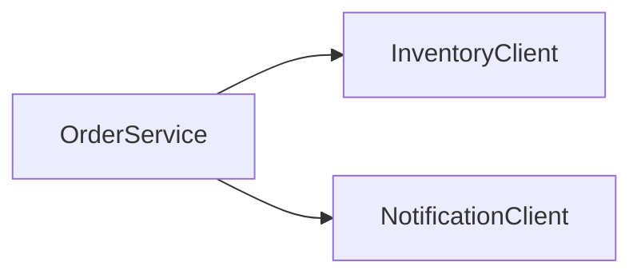
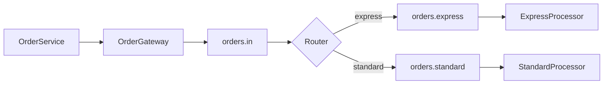

# Khi pattern giúp giảm coupling và khi pattern tạo gián tiếp

Khi xây dựng hệ thống tích hợp, một lời gọi trực tiếp giữa hai thành phần thường là giải pháp ngắn nhất. Tuy nhiên, khi số hệ thống, định dạng dữ liệu, quy tắc điều hướng và tình huống lỗi tăng lên, những lời gọi trực tiếp có thể khiến một thay đổi nhỏ lan ra nhiều nơi. Các **Enterprise Integration Patterns (EIP)** giúp diễn đạt luồng trao đổi dưới dạng message, channel và các bước xử lý có trách nhiệm rõ ràng.

Trong **Spring Integration**, các pattern như **Gateway, Router, Filter, Transformer, Splitter, Aggregator** được triển khai bằng những thành phần có thể ghép thành một integration flow. Chúng có thể làm giảm coupling, nhưng mỗi tầng trung gian cũng tạo ra **indirection** (sự gián tiếp): người đọc phải lần theo channel, router và handler mới biết message đi đâu. Mục tiêu không phải dùng càng nhiều pattern càng tốt, mà là chọn **mức gián tiếp có lợi hơn chi phí của nó**.

Sau bài này, bạn có thể phân biệt các loại coupling, nhận ra khi nào nên dùng EIP, giải thích tại sao thêm channel chưa chắc tạo bất đồng bộ và đưa ra quyết định có căn cứ giữa lời gọi trực tiếp với integration flow.

## 1. Coupling là gì trong một luồng tích hợp?

**Coupling** là mức độ một thành phần phải biết hoặc phụ thuộc vào thành phần khác để hoạt động đúng. Nó không chỉ nằm ở câu lệnh gọi một phương thức.

| Loại coupling | Biểu hiện | Câu hỏi kiểm tra |
| --- | --- | --- |
| Phụ thuộc mã nguồn | Service cần biết lớp cụ thể hoặc API bên nhận | Đổi thư viện hoặc adapter có phải sửa service gọi không? |
| Phụ thuộc hợp đồng dữ liệu | Hai bên dùng chung cấu trúc payload, field và ý nghĩa nghiệp vụ | Đổi schema có làm bên khác hỏng không? |
| Phụ thuộc thời gian | Bên gọi phải đợi bên nhận xử lý xong | Bên nhận chậm có kéo chậm request ban đầu không? |
| Phụ thuộc lỗi | Lỗi của bên nhận làm hỏng xử lý ở bên gọi | Bên nhận ngừng hoạt động thì bên gọi có tiếp tục được không? |
| Phụ thuộc điều phối | Bên gọi tự quyết định người nhận và thứ tự các bước | Thêm nhánh xử lý có buộc sửa nơi khởi tạo yêu cầu không? |
| Phụ thuộc triển khai/vận hành | Các thành phần phải sẵn sàng, mở rộng hoặc phát hành cùng nhau | Có thể triển khai, thay đổi năng lực xử lý độc lập không? |

Một lớp gọi qua interface đã giảm phụ thuộc vào **implementation**, nhưng nó vẫn có thể phụ thuộc vào **thời gian phản hồi**, **kiểu lỗi** và **hợp đồng của phương thức**. Tương tự, chuyển lời gọi sang message không tự động loại bỏ mọi coupling: producer và consumer vẫn cần thống nhất ý nghĩa message.

### Ví dụ: lời gọi trực tiếp

```java
class OrderService {
    private final InventoryClient inventory;
    private final NotificationClient notification;

    OrderService(InventoryClient inventory, NotificationClient notification) {
        this.inventory = inventory;
        this.notification = notification;
    }

    void place(Order order) {
        inventory.reserve(order);
        notification.sendConfirmation(order);
    }
}
```



Cách này dễ đọc và hoàn toàn phù hợp khi luồng nhỏ, các bước cần đồng bộ và không có yêu cầu thay đổi độc lập. Nhưng `OrderService` hiện biết cả **người nhận**, **thứ tự** và **cách gọi**. Nếu phải chọn kho theo vùng, gửi xác nhận qua kênh khác nhau hoặc xử lý retry riêng, logic tích hợp sẽ dần tràn vào service nghiệp vụ.

## 2. Pattern giảm coupling bằng cách nào?

EIP chỉ mang lại lợi ích khi tầng trung gian **sở hữu một quyết định có khả năng thay đổi**.

- **Gateway** tạo ranh giới giữa mã nghiệp vụ và cơ chế messaging: bên gọi biết một interface mang ý nghĩa nghiệp vụ, không cần thao tác trực tiếp với `MessageChannel`.
- **Router** đưa quyết định chọn người nhận ra khỏi producer: thêm quy tắc định tuyến có thể tập trung tại integration flow.
- **Filter** tách quy tắc chấp nhận hoặc loại bỏ message khỏi từng consumer. Quy tắc bỏ message cần được xác định rõ để tránh mất dữ liệu không chủ ý.
- **Transformer** chuyển đổi hợp đồng ở ranh giới hệ thống: mỗi phía giữ được model phù hợp với mình.
- **Splitter/Aggregator** hữu ích khi một yêu cầu thật sự phải chia thành nhiều phần độc lập rồi ghép kết quả, với chính sách correlation, completion và timeout xác định.
- **Channel cùng cơ chế xử lý phù hợp** có thể giảm phụ thuộc thời gian hoặc hấp thụ tải, nhưng tác dụng cụ thể phụ thuộc loại channel và hạ tầng vận chuyển.

Hãy hình dung một luồng đặt hàng cần định tuyến theo loại đơn:



Lúc này `OrderService` chỉ cần yêu cầu “xử lý đơn hàng”. Việc chọn handler nằm ở router. Sự phụ thuộc vào từng implementation giảm đi, đổi lại hệ thống cần duy trì hợp đồng `OrderCommand` và tên channel.

### Ví dụ với Spring Integration Java DSL

Ví dụ sau dùng Java record (Java 17+) và các API của Spring Integration. Hai processor là những bean nghiệp vụ được cấu hình trong ứng dụng.

```java
import org.springframework.context.annotation.Bean;
import org.springframework.context.annotation.Configuration;
import org.springframework.integration.annotation.Gateway;
import org.springframework.integration.annotation.MessagingGateway;
import org.springframework.integration.config.EnableIntegration;
import org.springframework.integration.dsl.IntegrationFlow;

record OrderCommand(String orderId, boolean express) {}

interface ExpressProcessor {
    void process(OrderCommand command);
}

interface StandardProcessor {
    void process(OrderCommand command);
}

@MessagingGateway
interface OrderGateway {
    @Gateway(requestChannel = "orders.in")
    void submit(OrderCommand command);
}

@Configuration
@EnableIntegration
class OrderIntegrationConfig {

    @Bean
    IntegrationFlow routeOrders() {
        return IntegrationFlow.from("orders.in")
            .route(OrderCommand.class,
                order -> order.express() ? "express" : "standard",
                spec -> spec
                    .channelMapping("express", "orders.express")
                    .channelMapping("standard", "orders.standard"))
            .get();
    }

    @Bean
    IntegrationFlow expressOrders(ExpressProcessor processor) {
        return IntegrationFlow.from("orders.express")
            .handle(OrderCommand.class, (command, headers) -> {
                processor.process(command);
                return null; // handler một chiều; không tạo reply
            })
            .get();
    }

    @Bean
    IntegrationFlow standardOrders(StandardProcessor processor) {
        return IntegrationFlow.from("orders.standard")
            .handle(OrderCommand.class, (command, headers) -> {
                processor.process(command);
                return null;
            })
            .get();
    }
}
```

Một service khác có thể inject `OrderGateway` và gọi `gateway.submit(command)` mà không biết `ExpressProcessor` hay `StandardProcessor`. Khi xuất hiện loại đơn mới, có thể cập nhật logic định tuyến và thêm flow tương ứng.

**Giới hạn quan trọng:** Trong cấu hình này, các channel được tạo theo tên và mặc định thực thi theo cơ chế dispatch đồng bộ (`DirectChannel`). `submit(...)` vẫn có thể phải đợi processor, và exception từ processor vẫn có thể quay về caller. **Đưa logic vào flow không đồng nghĩa với biến nó thành bất đồng bộ**. Chỉ khi chọn loại channel, executor, queue hoặc broker phù hợp thì mới thay đổi được đặc tính thời gian và cách lan truyền lỗi.

Đồng thời, việc đặt một lời gọi qua gateway **không** tự tạo bảo đảm lưu bền message, giao dịch xuyên hệ thống hay khả năng gửi đúng một lần. Các yêu cầu đó cần thiết kế riêng.

## 3. Khi nào mức gián tiếp là đáng giá?

### 3.1. Có nhiều đích xử lý hoặc chính sách định tuyến thay đổi

Nếu đơn hàng phải đến kho khác nhau theo quốc gia, kênh bán hoặc mức ưu tiên, một **Router** có thể tập trung quy tắc chọn đích. Producer không phải biết danh sách kho. Lợi ích lớn nhất xuất hiện khi chính sách này thay đổi thường xuyên hoặc được dùng bởi nhiều luồng.

Ngược lại, nếu cả ứng dụng chỉ có hai nhánh `if/else` cố định trong một phương thức ngắn, router mới có thể chỉ khiến đường đi khó theo dõi hơn.

### 3.2. Hai hệ thống có model dữ liệu khác nhau

Ví dụ hệ thống bán hàng phát `OrderPlaced`, còn API kho yêu cầu `ReserveInventoryRequest`. **Transformer** làm nhiệm vụ chuyển đổi tại ranh giới tích hợp. Khi API kho đổi tên field hoặc phiên bản schema, nơi phải sửa thường được giới hạn ở adapter/transformer.

Tuy nhiên, transformer không xóa phụ thuộc hợp đồng: phải xác định rõ field bắt buộc, giá trị mặc định, phiên bản payload và cách xử lý dữ liệu không hợp lệ. Nếu chỉ đổi tên một biến trong cùng domain, thêm transformer riêng có thể vô ích.

### 3.3. Cần tách chính sách lỗi và năng lực chịu tải

Một tác vụ gửi email không nhất thiết phải chặn bước xác nhận đặt hàng. Có thể đưa tác vụ sang kênh bất đồng bộ hoặc hàng đợi có cơ chế retry, điều tiết tải và theo dõi lỗi.

Các lựa chọn trong Spring Integration mang ý nghĩa vận hành khác nhau:

| Cơ chế | Tính chất cần nhớ | Hệ quả |
| --- | --- | --- |
| `DirectChannel` | Chuyển message đến subscriber trong luồng thực thi của caller | Tách cấu trúc code, nhưng vẫn phụ thuộc thời gian và exception |
| `ExecutorChannel` | Dispatch bằng `TaskExecutor` | Có thể trả quyền điều khiển sớm; lỗi xảy ra ở worker cần xử lý riêng, phụ thuộc năng lực executor |
| `QueueChannel` | Giữ message để consumer nhận về sau | Cần consumer/poller; queue trong bộ nhớ không tự bảo đảm bền vững qua restart |
| `PublishSubscribeChannel` | Phân phối một message tới nhiều subscriber | Nếu không cấu hình executor, các subscriber thường được gọi đồng bộ; fan-out không mặc nhiên là bất đồng bộ |
| Broker/hàng đợi bên ngoài | Có thể tách process và cung cấp cơ chế lưu trữ, retry theo tính năng được cấu hình | Thêm hạ tầng, hợp đồng message, quy tắc redelivery và vận hành |

Ví dụ, chuyển sang `ExecutorChannel` có thể giảm thời gian chờ ở caller nhưng **không tự tạo durability**. Nếu tiến trình chết sau khi caller được phản hồi, một tác vụ chỉ nằm trong bộ nhớ có thể mất. Với công việc bắt buộc không được mất, cần xem xét broker bền vững, transactional outbox hoặc giải pháp tương đương theo yêu cầu hệ thống.

### 3.4. Muốn kiểm thử quyết định tích hợp độc lập

Một flow có trách nhiệm rõ ràng cho phép kiểm thử riêng: message có trường `express = true` phải đến nhánh express; message không hợp lệ phải được filter hoặc đưa tới nơi xử lý lỗi theo thiết kế. Điều này hữu ích khi quy tắc định tuyến hoặc biến đổi đủ quan trọng để có bộ kiểm thử riêng.

Nếu việc kiểm thử bắt buộc khởi động toàn bộ integration context chỉ để chứng minh một phép tính đơn giản, mức trừu tượng có thể đã quá cao.

## 4. Khi nào pattern chỉ thêm indirection?

**Indirection** là việc thay đường đi trực tiếp bằng một hoặc nhiều bước trung gian. Nó không xấu tự thân, nhưng là một chi phí thực tế.

### 4.1. Một hành động bị chia thành nhiều bước không có trách nhiệm riêng

Ví dụ:

```text
checkout()
  -> checkout.input
  -> passThroughTransformer
  -> alwaysTrueFilter
  -> constantRouter
  -> checkout.handler
  -> CheckoutService.place()
```

Nếu transformer trả nguyên payload, filter luôn chấp nhận và router luôn chọn cùng một nhánh, hệ thống có nhiều tên cần truy vết nhưng **không có quyết định được tách ra**. Những bước này nên được gộp hoặc loại bỏ, trừ khi chúng phục vụ một ràng buộc cụ thể đã được nêu rõ, chẳng hạn điểm chặn bảo mật hoặc chính sách kiểm toán.

### 4.2. Coupling chỉ chuyển từ Java sang cấu hình và chuỗi ký tự

`"orders.express"` là một phần hợp đồng routing. Đổi tên channel mà không cập nhật publisher/subscriber có thể làm message không tới đích. Payload `OrderCommand` cũng là hợp đồng chung. Khi dùng pattern cần quản lý tên channel, schema, xử lý trường hợp không khớp định tuyến và các ràng buộc tương thích, thay vì tuyên bố coupling đã biến mất.

### 4.3. Khó quan sát hơn chi phí thay đổi mà nó tiết kiệm

Lời gọi trực tiếp cho phép lần theo stack trace. Một flow dài có thể trải qua gateway, nhiều channel, router, executor và handler khác luồng. Để điều tra lỗi phải biết message ID, correlation ID, tên endpoint, nhánh router đã chọn, retry và nơi xử lý exception.

Nếu team chưa có logging/metrics/tracing đủ để tìm điểm dừng của message, thêm nhiều hop có thể khiến thời gian xử lý sự cố tăng mạnh.

### 4.4. Đổi ngữ nghĩa nghiệp vụ một cách không chủ ý

Chuyển một lệnh đồng bộ sang hàng đợi có thể làm thay đổi điều mà API cam kết. Trước đây `placeOrder()` trả về khi kho đã giữ hàng; sau khi dùng queue, hàm có thể trả về khi **chỉ mới nhận yêu cầu**. Điều này ảnh hưởng UI, trạng thái đơn hàng, tính nhất quán dữ liệu và cách báo lỗi.

Tách thời gian xử lý là quyết định về **hợp đồng nghiệp vụ**, không chỉ là lựa chọn kỹ thuật. Cần phân biệt rõ “accepted”, “processing”, “completed” và “failed”.

## 5. Cách chọn pattern cho từng nhu cầu

| Tình huống | Cách tiếp cận thường hợp lý | Lý do và điều cần kiểm tra |
| --- | --- | --- |
| Một service gọi một dependency ổn định, cần kết quả ngay | Lời gọi trực tiếp qua interface | Luồng dễ đọc, hợp đồng và lỗi rõ ràng |
| Nhiều đích nhận tùy thuộc thuộc tính message | Router | Tách chính sách điều phối; cần nhánh mặc định hoặc xử lý giá trị không hợp lệ |
| Đầu vào có điều kiện cho phép đi tiếp | Filter hoặc guard trực tiếp | Dùng Filter khi chính sách thuộc luồng tích hợp; xác định cách ghi nhận message bị loại |
| Hai hệ thống dùng schema khác nhau | Transformer/adapter | Giới hạn chuyển đổi ở biên; kiểm thử tương thích schema |
| Một thông điệp cần được gửi tới nhiều subscriber | Publish-Subscribe Channel | Xác định mỗi subscriber có được phép thất bại độc lập không và cơ chế thực thi |
| Công việc chậm, không cần hoàn tất trước response | Executor/Queue Channel hoặc broker phù hợp | Xác định khi nào trả acknowledgment, cách retry và durability |
| Một yêu cầu chia thành nhiều việc rồi ghép kết quả | Splitter + Aggregator | Cần correlation, release strategy, timeout và xử lý phần kết quả thiếu |
| Chỉ có một bước chuyển tiếp không biến đổi, không lựa chọn | Bỏ bớt endpoint trung gian | Giảm số hop và cấu hình cần bảo trì |

**Nguyên tắc thực hành:** Mỗi pattern được đưa vào flow nên trả lời được ba câu: (1) nó sở hữu quyết định hoặc ranh giới nào, (2) quyết định đó thay đổi độc lập với thành phần nào, (3) ta sẽ quan sát và xử lý lỗi tại đây ra sao? Nếu không trả lời được, nên cân nhắc viết một phương thức thông thường.

## 6. Hai tình huống đối chiếu

### Tình huống A: Hệ thống xử lý đơn đa vùng — dùng Router có giá trị

Ban đầu ứng dụng chỉ có một kho. Sau đó bổ sung kho theo vùng, ưu tiên kho gần nhất và phương án dự phòng khi kho quá tải. Nếu logic nằm trong controller hoặc order service, mỗi thay đổi về vùng sẽ tác động vào luồng nhận đơn.

Giải pháp có thể là:

1. Producer phát một command có hợp đồng ổn định, ví dụ `ReserveStock(orderId, region, priority)`.
2. Router chọn nhánh theo `region` và chính sách đã được xác nhận.
3. Mỗi nhánh có adapter gọi một hệ thống kho cụ thể; transformer chuyển model khi cần.
4. Quy định rõ trường hợp vùng chưa được hỗ trợ, timeout, retry và xử lý đơn trùng.

Ở đây indirection **mua được khả năng thay đổi độc lập**: producer không cần biết từng API kho. Dù vậy, chính sách chọn kho vẫn cần owner và kiểm thử, vì thay đổi sai có thể chuyển đơn tới sai nơi.

### Tình huống B: Dịch vụ nội bộ chỉ tính phí giao hàng — giữ lời gọi trực tiếp

Một module có `ShippingFeeCalculator` thuần Java, nhận `Weight` và `Destination` rồi trả về `Money` ngay trong tiến trình; không có network call, định tuyến, queue hay tương tác với hệ thống ngoài. Bọc nó trong gateway → channel → transformer → service activator khiến luồng khó đọc hơn mà không giảm coupling có ý nghĩa.

Một interface phù hợp cùng unit test là đủ:

```java
interface ShippingFeeCalculator {
    Money calculate(Weight weight, Destination destination);
}
```

Nếu sau này phải gọi nhiều nhà vận chuyển, chuyển đổi schema khác nhau hoặc áp dụng chính sách fallback, lúc đó có cơ sở để bổ sung integration flow.

## 7. Những câu hỏi cần trả lời trước khi đưa flow vào vận hành

**Message đã đến nghĩa là đã xử lý xong chưa?** Với channel đồng bộ và handler một chiều, caller có thể chờ tới khi handler kết thúc; với xử lý bất đồng bộ, lời gọi có thể chỉ xác nhận đã nhận/đưa vào hàng đợi. Tên phương thức và response cần thể hiện đúng cam kết này.

**Nếu xử lý thất bại thì ai biết?** Lỗi đồng bộ có thể lan về caller; lỗi bất đồng bộ phải được ghi nhận và chuyển tới cơ chế xử lý phù hợp, ví dụ error channel, retry advice hoặc dead-letter flow. Cần giới hạn số lần retry và nhận diện lỗi không thể phục hồi.

**Message bị xử lý hai lần có an toàn không?** Khi dùng retry hoặc broker có redelivery, handler cần xem xét idempotency. Có thể dùng business key như `orderId` để ngăn giữ kho hoặc gửi thông báo trùng.

**Nếu một nhánh xử lý chậm thì sao?** Cần theo dõi độ dài queue, số tác vụ đang chạy, thời gian xử lý, khả năng backpressure và giới hạn tài nguyên. Thêm queue không làm bottleneck biến mất; nó chuyển nơi bottleneck thể hiện.

**Có truy vết được đường đi không?** Nên đưa message ID/correlation ID và thông tin nhánh điều hướng vào log/trace, đo độ trễ và số lỗi tại các endpoint. Với Splitter/Aggregator, đặc biệt phải có chính sách nhóm, điều kiện hoàn thành, timeout và dọn dẹp trạng thái.

**Hợp đồng message có phiên bản rõ ràng không?** Khi producer/consumer triển khai độc lập, cần quy tắc thay đổi schema tương thích, xử lý field thiếu hoặc thừa, và kiểm thử contract tại ranh giới.

## 8. Bài tập tự đánh giá

Xem xét một API đặt vé. Sau khi đặt vé thành công, hệ thống cần (a) xác nhận thanh toán để quyết định có cấp vé hay không, (b) gửi email xác nhận, (c) cập nhật dữ liệu phân tích.

- **Bước a:** Nếu cấp vé phụ thuộc vào kết quả thanh toán ngay lập tức, hãy giữ hợp đồng đồng bộ rõ ràng cho bước xác nhận; thêm channel đồng bộ chỉ có ích khi cần một ranh giới tích hợp thật sự.
- **Bước b:** Có thể tách gửi email ra khỏi đường phản hồi chính, nhưng phải quyết định dùng executor, queue hay broker; xác định retry, idempotency và cách xem trạng thái gửi.
- **Bước c:** Có thể phát event cho subscriber phân tích qua Publish-Subscribe Channel hoặc hạ tầng event phù hợp. Kiểm tra khả năng mất message và cách phân tích chịu được xử lý trùng.

Hãy tự trả lời: nếu service gửi email ngừng hoạt động trong 30 phút, API có còn cấp vé được không; message email được lưu ở đâu; khách hàng thấy trạng thái nào; vận hành sẽ tìm message lỗi bằng mã nào? Những câu hỏi đó quyết định kiến trúc thực tế hơn việc lựa chọn tên pattern.

## Ghi nhớ

**Pattern giảm coupling khi chúng đặt một ranh giới ổn định xung quanh quyết định có khả năng thay đổi:** chọn đích, chuyển đổi dữ liệu, phân phối message hoặc xử lý thời gian và lỗi. **Pattern tạo indirection thuần túy khi thêm các bước trung gian nhưng không tách được trách nhiệm hay yêu cầu độc lập nào.**

Với Spring Integration, hãy đánh giá đồng thời ba lớp: **hợp đồng message**, **cấu trúc luồng xử lý** và **ngữ nghĩa thực thi của channel**. Nhờ vậy, bạn có thể tận dụng Router, Filter, Transformer, Splitter, Aggregator, Gateway và cơ chế retry/error channel đúng lúc, trong khi vẫn giữ hệ thống dễ hiểu, dễ kiểm thử và dễ vận hành.

