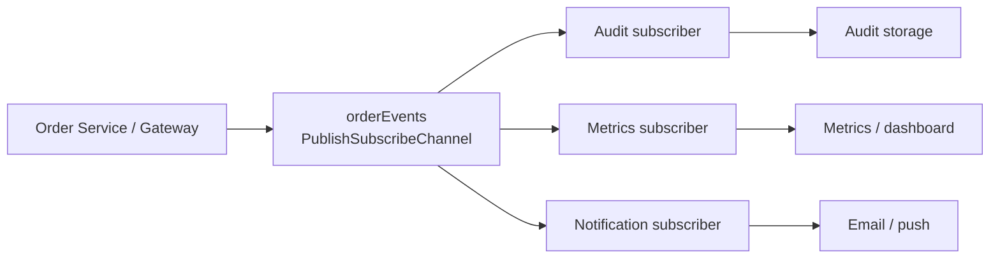
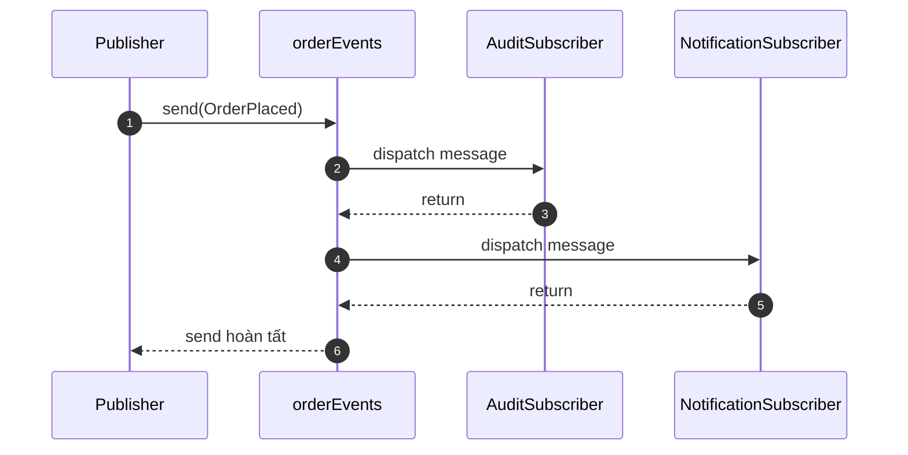
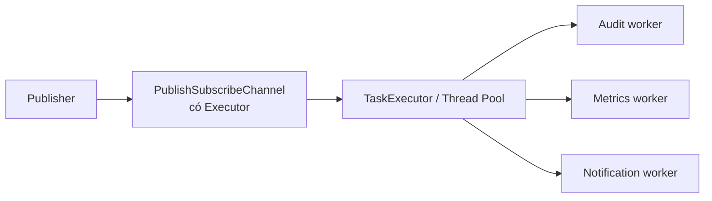
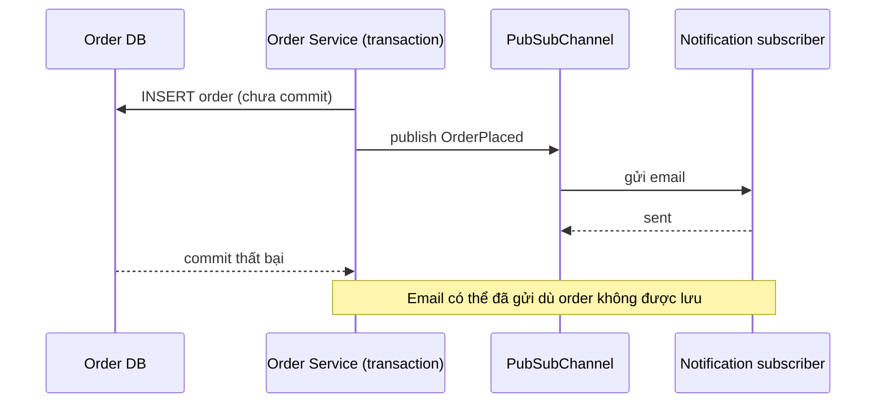
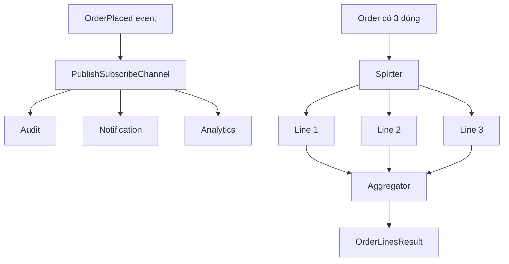
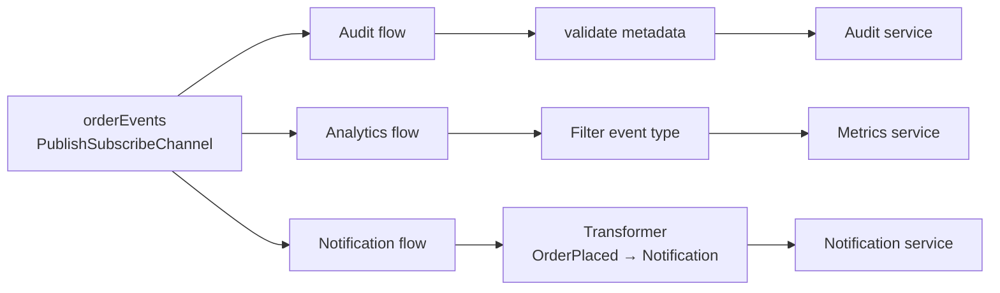

# Publish-Subscribe Channel và nhiều subscriber trong Spring Integration

> **Chương:** Publish subscribe  
> **Bài học:** Publish-Subscribe Channel và nhiều subscriber  
> **Phạm vi:** Xây dựng Enterprise Integration Patterns (EIP) với Spring Integration; phối hợp nhiều nhánh xử lý ít phụ thuộc, cùng các Router, Filter, Transformer, Splitter, Aggregator, Gateway, retry, error channel, correlation và công cụ theo dõi vận hành.

## 1. Bài toán: một sự kiện, nhiều bên cùng quan tâm

Khi khách hàng tạo đơn hàng thành công, hệ thống có thể cần thực hiện nhiều việc:

- Ghi dấu vết audit.
- Cập nhật thống kê vận hành.
- Gửi thông báo đến khách hàng.
- Phát tín hiệu cho một dịch vụ xử lý tiếp theo.

Nếu service nhận đơn trực tiếp gọi cả ba hoặc bốn service kia, nó sẽ phải biết tất cả bên tiêu thụ. Mỗi lần thêm một chức năng, phải chỉnh logic phát sự kiện hoặc code điều phối ở service gốc.

**Publish-Subscribe Channel** cho phép một producer phát message vào **một channel**, còn **nhiều subscriber** cùng nhận message đó. Publisher không cần biết số lượng hay triển khai cụ thể của subscriber.



Đây là kiểu phân phối **fan-out/broadcast**: một sự kiện có thể kích hoạt nhiều nhánh độc lập về mục đích. Tuy nhiên, “mỗi subscriber đều nhận” còn phụ thuộc vào việc subscriber đã đăng ký, channel có gửi thành công, cách xử lý lỗi và executor có nhận task hay không.

### Sau bài học, bạn có thể

1. Phân biệt `PublishSubscribeChannel` với `DirectChannel`, `ExecutorChannel` và `QueueChannel`.
2. Cấu hình một publisher và nhiều subscriber bằng Spring Integration Java DSL.
3. Giải thích khi nào các subscriber chạy đồng bộ, khi nào chạy song song.
4. Kiểm thử sự kiện được phân phối đến nhiều handler nhưng payload vẫn giữ đúng hợp đồng.
5. Nhận diện giới hạn về thứ tự, transaction, retry, error channel và khả năng lưu bền vững.
6. Dùng correlation metadata để theo dõi từng nhánh và kết hợp với Splitter/Aggregator khi cần thu thập kết quả.

## 2. Publish-Subscribe là mô hình gì?

Enterprise Integration Pattern *Publish-Subscribe Channel* định nghĩa một kênh có nhiều bên đăng ký. Khi một message được publish, channel phân phối tới các subscriber đã đăng ký phù hợp tại thời điểm gửi.

```text
Publisher
   |
   | send(OrderPlaced)
   v
Publish-Subscribe Channel
   |          |           |
   v          v           v
Audit       Metrics     Notification
```

Trong Spring Integration, lớp thường dùng cho trường hợp này là `org.springframework.integration.channel.PublishSubscribeChannel`. Nó là một `SubscribableChannel`, nhận message từ publisher và dispatch tới các `MessageHandler` đã subscribe.

Nên phân biệt ba vai trò:

| Vai trò | Trách nhiệm | Ví dụ |
| --- | --- | --- |
| **Publisher** | Phát message, không cần biết từng subscriber | Flow nhận `OrderPlaced` |
| **PublishSubscribeChannel** | Chuyển message đến các subscriber | `orderEvents` |
| **Subscriber** | Thực hiện một trách nhiệm khi nhận message | Audit handler, notification handler |

Một subscriber thường được đăng ký khi Spring Integration tạo endpoint từ `IntegrationFlow` hoặc `@ServiceActivator`. Không cần để publisher tự gọi `auditService.record(...)` rồi tiếp tục gọi `notificationService.send(...)`.

### Điều gì được tách phụ thuộc?

Publisher chỉ cần biết hợp đồng của **sự kiện** và **channel**. Các subscriber mới có thể đăng ký mà không thay đổi code phát sự kiện, miễn là payload và headers ổn định. Ngược lại, thay đổi schema của sự kiện có thể ảnh hưởng tất cả subscriber, vì vậy cần quản lý hợp đồng và phiên bản dữ liệu.

**Điều không được tự suy ra:** channel trong JVM không phải message broker bền vững. `PublishSubscribeChannel` không tự lưu event vào Kafka/RabbitMQ hay đảm bảo event vẫn còn sau khi tiến trình bị dừng đột ngột.

## 3. So sánh các Message Channel

Bảng sau giúp lựa chọn đúng loại channel cho một mục tiêu.

| Channel | Số subscriber nhận một message | Thread điển hình | Cách sử dụng |
| --- | --- | --- | --- |
| `DirectChannel` | Một subscriber được chọn | Thường cùng thread gửi | Point-to-point đồng bộ |
| `ExecutorChannel` | Một subscriber được chọn | Dispatch qua `TaskExecutor` | Point-to-point có ranh giới thread |
| **`PublishSubscribeChannel`** | Nhiều subscriber được dispatch | Đồng bộ mặc định; có thể dùng executor | Broadcast/fan-out trong ứng dụng |
| `QueueChannel` | Consumer chủ động poll message | Thread của poller | Hàng đợi, phân phối khi consumer lấy ra |
| `FluxMessageChannel` | Theo mô hình reactive tương ứng | Theo reactive stream/scheduler | Khi hệ thống được thiết kế theo reactive flow |

Một `DirectChannel` có nhiều handler được subscribe **không** có nghĩa mọi handler đều nhận mỗi message; nó là cơ chế unicast, lựa chọn một handler cho mỗi lần dispatch. Khi mục tiêu là broadcast tới nhiều bên, dùng `PublishSubscribeChannel`.

Tương tự, `ExecutorChannel` giúp chuyển việc sang executor nhưng vẫn mang ngữ nghĩa dispatch **một subscriber**. Muốn **vừa broadcast vừa xử lý song song**, cấu hình executor cho Publish-Subscribe Channel hoặc bố trí ranh giới bất đồng bộ trong các nhánh.

### Nhận diện yêu cầu nghiệp vụ

- “Một đơn hàng do đúng một worker xử lý” → thường là point-to-point/competing consumers.
- “Mỗi đơn hàng phải được audit và đồng thời kích hoạt metrics, notification” → publish-subscribe.
- “Lưu event để nhiều ứng dụng ở nhiều tiến trình khác nhau đọc lại sau restart” → broker/topic hoặc cơ chế lưu bền vững bên ngoài, với adapter phù hợp.
- “Tách message thành nhiều phần để tính toán rồi ghép kết quả” → Splitter/Aggregator; publish-subscribe có thể hỗ trợ fan-out nhưng không thay thế grouping và release strategy.

## 4. Message nào được gửi đến subscriber?

Một `Message<T>` chứa:

- **Payload**: ví dụ `OrderPlaced(orderId, amount)`.
- **Headers**: ví dụ `businessCorrelationId`, `sourceSystem`, `traceId` và các header kỹ thuật.

Trong flow publish-subscribe thông thường, mỗi subscriber được dispatch thông điệp mang payload sự kiện đó. Channel không tự biến nó thành một loại payload nghiệp vụ mới. Mỗi subscriber có thể gọi một Service Activator hoặc Transformer riêng sau khi nhận.

```text
OrderPlaced("ORD-101", 1250000)
  headers:
    businessCorrelationId = "order:ORD-101"
    sourceSystem = "checkout-api"

                     |
                     v
              orderEvents
            /      |       \
           v       v        v
       Audit    Metrics  Notification
       đọc      đọc     đọc payload
       event    event   rồi xử lý
```

**Cẩn thận với payload mutable:** nhiều subscriber có thể giữ tham chiếu tới cùng object. Nếu một subscriber sửa `OrderPlaced` mutable, subscriber khác có thể thấy dữ liệu đã bị sửa; với executor, còn có thể tạo race condition. Nên dùng event bất biến, ví dụ Java record với các field bất biến, hoặc defensive copy cho những thành phần có collection mutable.

`MessageHeaders` không cho phép sửa trực tiếp như một `Map` thông thường; nhưng điều đó **không tự làm payload bất biến**.

## 5. Ví dụ Java DSL: một publisher và hai subscriber

Ví dụ dưới đây dùng một cấu hình Spring Integration với ba flow:

1. Flow tiếp nhận và publish event vào `orderEvents`.
2. Flow audit subscribe `orderEvents`.
3. Flow notification cũng subscribe `orderEvents`.

Để tập trung vào cách phân phối, hai subscriber ghi message vào danh sách trong bộ nhớ. Trong ứng dụng thực, chúng sẽ gọi service/adapter tương ứng.

### 5.1. Cấu hình Spring Integration

```java
package example.integration;

import java.math.BigDecimal;
import java.util.List;
import java.util.concurrent.CopyOnWriteArrayList;

import org.springframework.context.annotation.Bean;
import org.springframework.context.annotation.Configuration;
import org.springframework.integration.channel.DirectChannel;
import org.springframework.integration.channel.PublishSubscribeChannel;
import org.springframework.integration.config.EnableIntegration;
import org.springframework.integration.dsl.IntegrationFlow;
import org.springframework.messaging.Message;
import org.springframework.messaging.MessageChannel;

@Configuration
@EnableIntegration
public class OrderPubSubConfig {

    public record OrderPlaced(String orderId, BigDecimal amount) {}

    @Bean
    public MessageChannel ordersInput() {
        return new DirectChannel();
    }

    @Bean
    public PublishSubscribeChannel orderEvents() {
        return new PublishSubscribeChannel();
    }

    @Bean
    public AuditSubscriber auditSubscriber() {
        return new AuditSubscriber();
    }

    @Bean
    public NotificationSubscriber notificationSubscriber() {
        return new NotificationSubscriber();
    }

    // Publisher: gửi message tới channel broadcast.
    @Bean
    public IntegrationFlow incomingOrdersFlow() {
        return IntegrationFlow.from("ordersInput")
            .channel("orderEvents")
            .get();
    }

    // Subscriber thứ nhất: xử lý audit.
    @Bean
    public IntegrationFlow auditFlow(AuditSubscriber auditSubscriber) {
        return IntegrationFlow.from("orderEvents")
            .handle(auditSubscriber, "record")
            .get();
    }

    // Subscriber thứ hai: xử lý thông báo.
    @Bean
    public IntegrationFlow notificationFlow(
            NotificationSubscriber notificationSubscriber) {

        return IntegrationFlow.from("orderEvents")
            .handle(notificationSubscriber, "notifyOrder")
            .get();
    }

    public static class AuditSubscriber {

        private final CopyOnWriteArrayList<Message<OrderPlaced>> received =
            new CopyOnWriteArrayList<>();

        public void record(Message<OrderPlaced> message) {
            received.add(message);
            // Thực tế: ghi audit với timeout và chính sách lỗi.
        }

        public List<Message<OrderPlaced>> received() {
            return List.copyOf(received);
        }
    }

    public static class NotificationSubscriber {

        private final CopyOnWriteArrayList<Message<OrderPlaced>> received =
            new CopyOnWriteArrayList<>();

        public void notifyOrder(Message<OrderPlaced> message) {
            received.add(message);
            // Thực tế: gửi thông báo có idempotency.
        }

        public List<Message<OrderPlaced>> received() {
            return List.copyOf(received);
        }
    }
}
```

Trong ví dụ:

- `ordersInput` dùng `DirectChannel` để nhận message từ adapter hoặc caller.
- `incomingOrdersFlow` chuyển message tới bean `orderEvents`.
- `orderEvents` là `PublishSubscribeChannel` không có executor, do đó dispatch mặc định là **đồng bộ**.
- `auditFlow` và `notificationFlow` đều bắt đầu từ cùng channel và đăng ký hai handler độc lập.
- Hai method subscriber trả `void` để thực hiện xử lý một chiều. Chúng không tạo các reply payload cạnh tranh.
- `CopyOnWriteArrayList` được dùng để quan sát trong ví dụ; đây **không** phải cơ chế lưu event bền vững.

Các `public record` và class riêng có thể được tách thành các file Java phù hợp nếu dự án muốn tổ chức package rõ ràng hơn.

### 5.2. Phát một event

Giả sử `ordersInput` được inject dưới dạng `MessageChannel`:

```java
import java.math.BigDecimal;

import org.springframework.messaging.Message;
import org.springframework.messaging.support.MessageBuilder;

OrderPubSubConfig.OrderPlaced event =
    new OrderPubSubConfig.OrderPlaced(
        "ORD-101", new BigDecimal("1250000"));

Message<OrderPubSubConfig.OrderPlaced> message =
    MessageBuilder.withPayload(event)
        .setHeader("businessCorrelationId", "order:ORD-101")
        .setHeader("sourceSystem", "checkout-api")
        .build();

boolean accepted = ordersInput.send(message);
```

Với cấu hình đồng bộ đơn giản, khi không phát sinh lỗi ở subscriber, cả hai handler thường đã được gọi khi `send(...)` trả về. Nếu một handler ném exception, diễn biến có thể khác; điều đó được bàn chi tiết ở phần xử lý lỗi.

**Không đồng nhất `accepted=true` với “mọi tác dụng phụ bên ngoài đã được commit”.** Handler có thể ghi log trong bộ nhớ, gọi dịch vụ ngoài hoặc phát message tiếp; mức hoàn tất phải xác định theo hợp đồng riêng.

### 5.3. Sơ đồ thực thi



Sơ đồ trên minh họa **một thứ tự dispatch có thể xảy ra** khi channel đồng bộ. Không nên biến vị trí Audit trước Notification trong sơ đồ thành hợp đồng thứ tự nghiệp vụ. Nếu cần một bước luôn chạy sau một bước khác, nối chúng tuần tự trong **một flow** thay vì xem các subscriber độc lập là pipeline có thứ tự.

## 6. Kiểm thử nhiều subscriber cùng nhận event

Chỉ unit test `AuditSubscriber.record(...)` không chứng minh rằng Spring Integration đã nối đúng hai subscriber vào channel. Cần kiểm thử qua kênh đầu vào.

```java
package example.integration;

import static org.junit.jupiter.api.Assertions.*;

import java.math.BigDecimal;

import org.junit.jupiter.api.Test;
import org.springframework.beans.factory.annotation.Autowired;
import org.springframework.beans.factory.annotation.Qualifier;
import org.springframework.messaging.Message;
import org.springframework.messaging.MessageChannel;
import org.springframework.messaging.support.MessageBuilder;
import org.springframework.test.context.junit.jupiter.SpringJUnitConfig;

@SpringJUnitConfig(OrderPubSubConfig.class)
class OrderPubSubTest {

    @Autowired
    @Qualifier("ordersInput")
    private MessageChannel ordersInput;

    @Autowired
    private OrderPubSubConfig.AuditSubscriber auditSubscriber;

    @Autowired
    private OrderPubSubConfig.NotificationSubscriber notificationSubscriber;

    @Test
    void publishesTheSameEventToBothSubscribers() {
        var event = new OrderPubSubConfig.OrderPlaced(
            "ORD-101", new BigDecimal("1250000"));

        Message<OrderPubSubConfig.OrderPlaced> input =
            MessageBuilder.withPayload(event)
                .setHeader(
                    "businessCorrelationId", "order:ORD-101")
                .build();

        assertTrue(ordersInput.send(input));

        assertEquals(1, auditSubscriber.received().size());
        assertEquals(1, notificationSubscriber.received().size());

        Message<OrderPubSubConfig.OrderPlaced> audit =
            auditSubscriber.received().get(0);
        Message<OrderPubSubConfig.OrderPlaced> notification =
            notificationSubscriber.received().get(0);

        assertSame(event, audit.getPayload());
        assertSame(event, notification.getPayload());

        assertEquals("order:ORD-101",
            audit.getHeaders().get("businessCorrelationId"));
        assertEquals("order:ORD-101",
            notification.getHeaders().get("businessCorrelationId"));
    }
}
```

Đoạn test chứng minh trong flow nội bộ đồng bộ:

- Một message đầu vào được gửi tới **cả hai subscriber**.
- Cả hai thấy payload cùng nội dung và cùng đối tượng trong ví dụ không có bước copy/serialization.
- Header tương quan nghiệp vụ có thể được đọc ở mỗi handler.
- Các subscriber không cần biết nhau để cùng nhận event.

Khi thay đổi sang executor bất đồng bộ, **không được** dùng các assertion ngay sau `send(...)` để kết luận subscriber đã chạy xong. Khi đó dùng `CountDownLatch`, Awaitility hoặc cơ chế chờ có timeout.

**Giới hạn của test:** không kiểm tra gửi email thành công, transaction database, độ bền qua restart hoặc fan-out qua broker. Những yêu cầu đó cần integration test ở các ranh giới tương ứng.

## 7. Đồng bộ mặc định: một subscriber chậm ảnh hưởng publisher

`PublishSubscribeChannel` không có executor thường dispatch trên thread gọi. Nếu một subscriber mất 800 ms để gửi email và subscriber khác mất 100 ms để ghi audit, publisher có thể phải chờ thời gian xử lý của các handler đồng bộ.

```text
Caller thread
  |
  +---> PublishSubscribeChannel
          |
          +---> Subscriber A (audit, 100 ms)
          |
          +---> Subscriber B (notification, 800 ms)
          |
          +---> Hoàn tất dispatch
```

Điều này có những ưu điểm:

- Dễ theo dõi call stack.
- Trong một số cấu hình, các handler có thể tham gia transaction đang gắn với cùng thread.
- Kiểm thử đơn giản hơn vì subscriber đồng bộ thường chạy trước khi lời gọi gửi trở về.

Nhưng cũng có hạn chế:

- Một subscriber chậm giữ thread đầu vào lâu hơn.
- Một exception từ subscriber có thể làm lần gửi thất bại và ảnh hưởng quá trình dispatch của các subscriber khác.
- Không phù hợp nếu publisher cần phản hồi nhanh và các việc phụ mất nhiều thời gian.
- Tăng số subscriber có thể tăng chi phí dispatch và độ trễ trên luồng gửi.

**Không dùng fan-out đồng bộ để thay thế chuỗi bước bắt buộc có thứ tự.** Khi Notification phụ thuộc kết quả Audit, hãy biểu diễn quan hệ đó thành các bước tuần tự hoặc event tiếp theo, thay vì hy vọng thứ tự đăng ký subscriber luôn ổn định.

## 8. Dùng TaskExecutor để broadcast bất đồng bộ

Một `PublishSubscribeChannel` có thể nhận `Executor`. Khi đó việc gọi subscriber được dispatch qua executor, thường chạy trên các worker thread khác với thread publisher.



Ví dụ **thay thế** bean `orderEvents` ở mục 5 bằng cấu hình executor:

```java
import java.util.concurrent.Executor;
import java.util.concurrent.ThreadPoolExecutor;

import org.springframework.beans.factory.annotation.Qualifier;
import org.springframework.context.annotation.Bean;
import org.springframework.integration.channel.PublishSubscribeChannel;
import org.springframework.scheduling.concurrent.ThreadPoolTaskExecutor;

@Bean
public ThreadPoolTaskExecutor orderEventsExecutor() {
    ThreadPoolTaskExecutor executor = new ThreadPoolTaskExecutor();
    executor.setCorePoolSize(2);
    executor.setMaxPoolSize(4);
    executor.setQueueCapacity(100);
    executor.setThreadNamePrefix("order-fanout-");
    executor.setRejectedExecutionHandler(
        new ThreadPoolExecutor.AbortPolicy());
    return executor;
}

@Bean
public PublishSubscribeChannel orderEvents(
        @Qualifier("orderEventsExecutor") Executor executor) {

    return new PublishSubscribeChannel(executor);
}
```

Spring quản lý vòng đời cho `ThreadPoolTaskExecutor` được khai báo là bean. Đây là **biến thể cấu hình**: trong ứng dụng chỉ giữ **một** bean mang tên `orderEvents`.

Với executor có worker và capacity thích hợp, publisher có thể tiếp tục sau khi các task dispatch được **chấp nhận**, trong khi subscriber xử lý trên worker thread. Nhưng cần ghi nhớ:

1. `send(...)` không phải tín hiệu mọi subscriber đã hoàn thành.
2. Thứ tự chạy và hoàn tất giữa các subscriber **không được đảm bảo**.
3. Khi queue và pool đầy, việc submit task có thể bị từ chối.
4. Một chính sách như `CallerRunsPolicy` có thể khiến task chạy trên chính thread gửi, phá vỡ giả định “luôn chạy trên worker”.
5. Executor queue nằm trong bộ nhớ không bảo đảm message còn sau khi tiến trình chết.

### Giới hạn pool và hàng đợi

Với `corePoolSize=2`, `maxPoolSize=4` và `queueCapacity=100`, khi các worker lõi đang bận, task có thể được xếp vào queue. Chỉ sau khi queue đầy, executor mới có thể mở thêm worker tới giới hạn `maxPoolSize`. Vì thế, tăng `maxPoolSize` nhưng giữ queue rất lớn không nhất thiết làm pool tăng concurrency sớm.

Cần quan sát số active worker, queue depth, thời gian chờ, retry và rejection. Một subscriber gọi API chậm có thể chiếm worker lâu, làm các subscriber khác xếp hàng. Fan-out bất đồng bộ làm thread publisher ít bị chặn hơn trong điều kiện bình thường, **không khiến hệ thống đích tự xử lý nhanh hơn**.

## 9. Một subscriber lỗi thì các subscriber khác có nhận được không?

Đây là điểm cần xác định rõ, vì “publish-subscribe” không đồng nghĩa “gửi tới mọi người bằng mọi giá”.

### Trường hợp đồng bộ

Nếu subscriber đầu tiên ném exception trong lúc dispatch đồng bộ, exception có thể dừng quá trình gửi và các subscriber phía sau có thể không được gọi. Phụ thuộc vào cấu hình dispatcher, thứ tự subscribe và chính sách xử lý lỗi, không nên giả định tất cả subscriber còn lại vẫn chạy.

```text
Publisher
  |
  v
PublishSubscribeChannel
  |--> Audit: OK
  |--> Notification: throws
  x--> Analytics: có thể chưa được gọi
```

Một số phiên bản/thành phần cung cấp lựa chọn xử lý lỗi theo kiểu bỏ qua failure hoặc tiếp tục dispatch; cần đọc đúng API và cấu hình đang sử dụng. Dù có tiếp tục dispatch, đó cũng không tự đảm bảo transaction hoặc delivery bền vững.

### Trường hợp bất đồng bộ

Mỗi subscriber có thể được thực thi trong task riêng. Một task thất bại không nhất thiết làm các task khác dừng, nhưng cũng có thể bị từ chối khi submit hoặc lỗi không quay trở lại thread publisher. Muốn theo dõi lỗi, cần error handler/error channel và cơ chế quan sát phù hợp với `PublishSubscribeChannel` và executor.

**Đừng coi exception của một subscriber là lý do tự động retry toàn bộ event từ publisher.** Nếu audit thành công mà notification lỗi, retry lại lần phát ban đầu có thể khiến audit được ghi trùng. Hãy quyết định retry theo từng nhánh và đảm bảo idempotency.

### Chiến lược thiết kế lỗi theo nhánh

| Subscriber | Lỗi thường gặp | Hướng phục hồi |
| --- | --- | --- |
| Audit | Database tạm không khả dụng | Retry có giới hạn, lưu bền vững nếu audit bắt buộc |
| Metrics | Backend metric chậm | Drop có quan sát hoặc buffer tùy SLA |
| Notification | Email provider timeout | Retry theo notification ID, idempotency |
| Business handler | Lỗi nghiệp vụ hoặc transaction | Error flow, trạng thái thất bại, outbox/broker nếu cần |

Các nhánh có mức quan trọng khác nhau không nên vô tình chia sẻ một chính sách retry và độ bền duy nhất. Với event bắt buộc đối soát, cần thiết kế delivery guarantee ở transport hoặc lưu trữ ngoài `PublishSubscribeChannel`.

## 10. Mối quan hệ giữa publish-subscribe và transaction

Khi channel dispatch **đồng bộ**, subscriber có thể chạy trong cùng thread gửi. Nếu transaction được mở tại điểm phù hợp và handler tham gia transaction đó theo cấu hình, một số thao tác database có thể cùng chịu commit/rollback.

Nhưng cần phân biệt:

- Transaction ở cùng thread không tự bao trùm mọi hệ thống ngoài.
- Một email gửi ra ngoài không thể tự “rollback” vì database transaction thất bại.
- Nếu một subscriber commit độc lập, rollback của subscriber khác không nhất thiết hoàn tác kết quả đã commit.
- Khi chuyển sang executor bất đồng bộ, transaction context gắn với thread gửi **không tự đi theo worker thread**.

Ví dụ rủi ro:



### Khi cần publish chỉ sau commit

Có thể phát sự kiện sau commit cho những trường hợp cho phép mất sự kiện khi tiến trình sập. Nếu yêu cầu **không mất event** và **ghi dữ liệu với event một cách nhất quán**, cân nhắc **transactional outbox**:

1. Trong cùng DB transaction, ghi dữ liệu nghiệp vụ và bản ghi outbox.
2. Sau commit, một publisher độc lập đọc outbox.
3. Publisher chuyển event đến broker/topic hoặc hệ thống xử lý phù hợp.
4. Subscriber xử lý với idempotency và cơ chế acknowledgement riêng.
5. Xác nhận outbox/event theo hợp đồng sau khi publish thành công.

`PublishSubscribeChannel` là công cụ điều phối trong ứng dụng, có thể nằm trong kiến trúc đó nhưng không tự cung cấp atomicity giữa database, broker và nhiều subscriber.

## 11. Correlation và trace khi một event tách thành nhiều nhánh

Với nhiều subscriber, việc tìm nguyên nhân lỗi phải dựa trên metadata có ý nghĩa ổn định.

Ví dụ:

```text
Event: OrderPlaced("ORD-101")
  eventId               = EVT-501
  businessCorrelationId = order:ORD-101
  traceId               = trace-abc
       |
       +-- Audit        eventId=EVT-501, businessCorrelationId=order:ORD-101
       +-- Metrics      eventId=EVT-501, businessCorrelationId=order:ORD-101
       +-- Notification eventId=EVT-501, businessCorrelationId=order:ORD-101
```

| Header | Mục đích | Lưu ý |
| --- | --- | --- |
| `eventId` | Định danh event để phát hiện xử lý trùng | Không dùng chung cho các event nghiệp vụ khác nhau |
| `businessCorrelationId` | Liên kết các bước thuộc cùng đơn/yêu cầu | Duy trì qua retry và các nhánh |
| `traceId` | Theo dõi phân tán | Ưu tiên hệ thống tracing hiện có |
| `MessageHeaders.id` | ID của message được tạo bởi framework | Không thay thế business correlation |
| `correlationId` | Có thể là ID nhóm của Splitter/Aggregator | Không ghi đè để phục vụ log |
| `replyChannel` / `errorChannel` | Đường reply/lỗi của framework | Không sao chép tùy tiện ra transport khác |

Trong flow publish-subscribe, các subscriber có thể ghi log cùng `businessCorrelationId` và `eventId`, nhưng mỗi nhánh cần thêm tên subscriber, trạng thái và số lần thử để biết bước nào thành công.

Ví dụ log:

```text
eventId=EVT-501 correlation=order:ORD-101 subscriber=audit        status=SUCCESS
eventId=EVT-501 correlation=order:ORD-101 subscriber=metrics      status=SUCCESS
eventId=EVT-501 correlation=order:ORD-101 subscriber=notification status=RETRYING attempt=2
```

Không đưa token, dữ liệu thẻ, thông tin cá nhân nhạy cảm hoặc toàn bộ payload vào log. Với Micrometer Observation/OpenTelemetry, dùng propagation của hệ thống tracing thay vì tự giả lập một `traceId` không tương thích.

### ThreadLocal không tự được sao chép

Khi dùng executor, correlation header vẫn đi cùng message nếu flow giữ metadata phù hợp. Nhưng MDC, security context và transaction gắn với thread gửi không tự xuất hiện ở worker. Nếu cần, dùng context propagation hoặc `TaskDecorator` phù hợp và dọn context sau xử lý.

## 12. Publish-subscribe khác Splitter/Aggregator

Hai pattern có thể cùng tạo nhiều nhánh, nhưng mục tiêu khác nhau.

**Publish-Subscribe Channel** chuyển **một message** tới **nhiều subscriber**. Mỗi subscriber có thể làm một công việc khác nhau trên cùng sự kiện.

**Splitter** tạo ra **nhiều message con** từ nội dung một message; **Aggregator** gom các kết quả theo correlation/release strategy.



Nếu muốn **chờ tất cả subscriber trả kết quả** rồi tổng hợp, cần kiến trúc request-reply/fan-out và Aggregator được cấu hình rõ. Publish-Subscribe Channel tự nó **không phải Aggregator** và không tự tạo một kết quả tổng hợp.

### Apply sequence khi cần aggregation

Publish-Subscribe Channel có khả năng áp dụng sequence metadata trong một số cấu hình, giúp các message tới subscriber mang thông tin nhóm/thứ tự để downstream tổng hợp. Cấu hình này không phải yêu cầu mặc định cho mọi event broadcast.

Khi thiết kế aggregation, phải biết rõ:

- Có bao nhiêu nhánh dự kiến đóng góp kết quả?
- Subscriber nào có thể từ chối/lọc bỏ message?
- Mỗi nhánh trả một reply hay nhiều reply?
- Ai quản lý `correlationId`, `sequenceNumber` và `sequenceSize`?
- Nhánh nào thất bại hoặc timeout thì nhóm được release/expire thế nào?

Không ghi đè correlation/sequence do Splitter hoặc flow grouping khác đã đặt, đặc biệt trong các pipeline có nhóm lồng nhau. Nếu chỉ muốn audit và gửi thông báo, hãy giữ fan-out một chiều đơn giản.

## 13. Gateway request-reply và nhiều subscriber

Một Messaging Gateway có thể chờ **một** reply. Nhưng Publish-Subscribe Channel có thể chuyển request tới **nhiều** subscriber.

Giả sử hai subscriber đều trả dữ liệu:

```text
OrderGateway.submit(...)
         |
         v
    PubSubChannel
       /     \
      v       v
 Handler A  Handler B
 return X   return Y
       \     /
        ? reply
```

Không có quy tắc mặc định “cộng hai reply lại thành một response nghiệp vụ”. Nếu cả hai nhánh cùng gửi reply tới một nơi, kết quả có thể gây tranh chấp, reply muộn hoặc hành vi không phù hợp với hợp đồng caller.

**Chọn một trong các thiết kế rõ ràng:**

1. **Event fan-out một chiều:** Gateway hoặc service phát một event và không mong các subscriber cùng trả reply; các handler thực hiện xử lý `void`.
2. **Một nhánh là chủ reply:** chỉ một thành phần tạo kết quả cho request-reply; các nhánh phụ không làm thay đổi reply contract.
3. **Fan-out rồi aggregate:** thiết kế Collector/Aggregator, correlation và completion strategy để tạo **một** reply tổng hợp có nghĩa rõ.

Nếu Gateway chỉ cần trả “đã tiếp nhận”, phải quy định trạng thái đó nghĩa là message đã vào memory channel, đã ghi outbox hay đã được broker xác nhận. Đừng dùng “đã xử lý hoàn tất” khi các subscriber còn đang chạy bất đồng bộ.

## 14. Tổ chức subscriber thành những flow riêng

Với các thành phần độc lập như audit, analytics, notification, nên để mỗi subscriber sở hữu flow và error policy riêng. Ví dụ:



Cách tổ chức này giúp:

- Audit có thể xử lý tất cả event.
- Analytics chỉ quan tâm một số event và chủ động Filter trong **flow của mình**.
- Notification có Transformer riêng để tạo command phù hợp.
- Publisher không cần thay đổi khi thêm hoặc bỏ một subscriber.

**Một Filter trong nhánh Analytics** loại message ở nhánh đó; nó không nhất thiết loại message của nhánh Audit hay Notification. Tách riêng flow giúp mỗi subscriber tự quyết định dữ liệu quan tâm.

Tuy nhiên, các flow cùng bắt đầu từ `PublishSubscribeChannel` vẫn chia sẻ ngữ nghĩa phát hiện subscriber và chính sách dispatch ở channel. Các yêu cầu độ bền hay cô lập lỗi mạnh có thể cần broker/topic và các consumer group/subscription độc lập.

### Thêm subscriber mới

Nếu muốn thêm một `SearchIndexSubscriber`, tạo một flow mới subscribe cùng `orderEvents`. Không cần đổi publisher. Nhưng cần đánh giá lại chi phí fan-out, SLA, error policy và schema event vì subscriber mới có thể làm tăng độ trễ khi channel đang đồng bộ.

## 15. Thứ tự, duplicate, backpressure và tính đúng đắn

### 15.1. Không dùng thứ tự subscriber như quy tắc nghiệp vụ

Ngay cả khi một cấu hình đồng bộ có thứ tự gọi quan sát được, thứ tự đó có thể phụ thuộc vào cách đăng ký, order của endpoint và thay đổi khi mở rộng. Trong executor bất đồng bộ, thứ tự hoàn tất còn dễ thay đổi hơn.

Nếu Notification **phải** chờ Audit commit, mô hình hóa thành luồng tuần tự rõ ràng:

```text
AuditHandler → auditCompletedEvent → NotificationHandler
```

Đó là quan hệ phụ thuộc nghiệp vụ, không phải hai subscriber độc lập xử lý một event.

### 15.2. Mỗi subscriber phải tính đến xử lý trùng

Trong hệ thống thực, event có thể được phát lại sau retry, restart hoặc redelivery của transport. Mỗi nhánh có quy tắc idempotency riêng: gửi email dùng notification ID; cập nhật search index dùng event version; audit dùng event ID có unique constraint nếu cần.

### 15.3. Quá tải

Một subscriber chậm có thể kéo dài thời gian dispatch đồng bộ. Với executor chung, nó có thể chiếm thread/queue và ảnh hưởng nhánh khác. Giải pháp gồm timeout, bounded executor, rate limit, backpressure hoặc tách tài nguyên theo subscriber khi SLA khác nhau.

### 15.4. Độ bền

Một event được gửi vào `PublishSubscribeChannel` trong JVM có thể bị mất khi tiến trình dừng trước khi mọi handler hoàn tất. Khi yêu cầu không mất message, cần lưu event vào outbox hoặc broker bền vững và chỉ coi là tiếp nhận chắc chắn sau bước xác nhận phù hợp.

### 15.5. Bảo mật metadata

Không xem header `tenantId` hoặc `sourceSystem` do client tùy ý gửi là quyền truy cập hợp lệ. Subscriber phải xác thực ngữ cảnh tại ranh giới thích hợp; message có nhiều người nhận càng cần kiểm soát thông tin nhạy cảm theo nhu cầu từng nhánh.

## 16. Quan sát từng nhánh trong vận hành

Fan-out tăng số bước xử lý từ một event thành nhiều kết quả. Cần theo dõi không chỉ “publisher đã gửi”, mà còn “mỗi subscriber đã hoàn tất”.

| Metric / log | Ý nghĩa |
| --- | --- |
| Event published count | Có bao nhiêu event được đưa vào channel |
| Subscriber invocation count | Mỗi nhánh được gọi bao nhiêu lần |
| Per-subscriber latency | Nhánh nào đang chậm |
| Per-subscriber failure/retry count | Nhánh nào cần điều tra hoặc tối ưu |
| Executor active threads / queue depth | Pool và hàng chờ có bị nghẽn |
| Rejection count | Task có bị từ chối khi quá tải |
| Event age / backlog | Event còn chờ xử lý bao lâu, nếu có hàng đợi |
| End-to-end completion state | Các nghĩa vụ nghiệp vụ có hoàn tất không |

Một báo cáo theo `businessCorrelationId` có thể ghi:

```text
order:ORD-101
  published    : 10:00:00.010
  audit        : SUCCESS 10:00:00.030
  metrics      : SUCCESS 10:00:00.045
  notification : FAILED  10:00:01.200, retry scheduled
```

Cách ghi này phân biệt trạng thái của từng subscriber; không gộp thành “event xử lý thất bại hoàn toàn” khi chỉ nhánh notification gặp lỗi.

## 17. Kiểm thử mở rộng: bất đồng bộ và lỗi

Đoạn test ở mục 6 dùng dispatch đồng bộ. Khi đổi channel sang executor, cách kiểm thử phải đổi:

```java
import java.util.concurrent.CountDownLatch;
import java.util.concurrent.TimeUnit;
import java.util.concurrent.atomic.AtomicInteger;

CountDownLatch bothHandled = new CountDownLatch(2);
AtomicInteger processed = new AtomicInteger();

// Trong subscriber A:
processed.incrementAndGet();
bothHandled.countDown();

// Trong subscriber B:
processed.incrementAndGet();
bothHandled.countDown();

// Trong test sau khi gửi một event:
assertTrue(bothHandled.await(5, TimeUnit.SECONDS));
assertEquals(2, processed.get());
```

Đây là **mẫu phối hợp kiểm thử**, không phải một class chạy độc lập. Cần đặt latch/handler trong fixture của bài test và đảm bảo sau mỗi lần chạy test có dữ liệu riêng. Không dùng `Thread.sleep(...)` rồi giả định subscriber đã hoàn tất.

Các tình huống quan trọng nên kiểm tra:

1. **Cả hai subscriber đều chạy** khi channel phát một message.
2. **Một subscriber thất bại:** xác minh hành vi của các subscriber còn lại theo chính sách lỗi đã cấu hình.
3. **Executor quá tải:** quan sát rejection và cách trả lỗi hoặc retry khi không submit được task.
4. **Không có subscriber:** xác định `send` cần fail-fast, ghi nhận hay chấp nhận bỏ event theo contract.
5. **Event trùng:** mỗi nhánh không thực hiện side effect không mong muốn hai lần.
6. **Headers:** `eventId`, `businessCorrelationId` và metadata cần thiết còn trong từng nhánh.
7. **Shutdown/restart:** nếu yêu cầu durable delivery, kiểm thử broker/outbox; test riêng `PublishSubscribeChannel` không thể chứng minh tính bền vững.

### Lỗi phát sinh từ một subscriber không tự là lỗi của mọi subscriber

Trong test nên ghi nhận riêng kết quả nhánh Audit và Notification. Nếu giả lập Notification ném exception, xác nhận cơ chế error flow và retry của Notification, đồng thời chứng minh Audit không bị ghi trùng bởi một retry quá rộng. Nếu retry toàn event là chủ đích, giải thích rõ idempotency của cả hai nhánh.

## 18. Bài thực hành: một OrderPlaced event, ba subscriber

**Bối cảnh:** ứng dụng học Spring Integration nhận `OrderPlaced(orderId, customerId, amount)`. Khi một đơn được đặt, hệ thống cần ghi audit, tính chỉ số kinh doanh và phát lệnh gửi thông báo.

**Yêu cầu:**

1. Tạo `ordersInput` là `DirectChannel` và `orderEvents` là `PublishSubscribeChannel`.
2. Tạo `OrderPlaced` immutable và một flow đưa message từ input sang channel broadcast.
3. Đăng ký `AuditFlow`, `MetricsFlow` và `NotificationFlow` với `orderEvents`.
4. Mỗi flow nhận nguyên event và đọc `businessCorrelationId`; không sửa trực tiếp payload.
5. Thêm Filter ở nhánh Metrics chỉ nhận đơn có số tiền dương, nhưng không cản Audit và Notification.
6. Viết test một sự kiện làm cả ba subscriber được gọi đúng kỳ vọng.
7. Giả lập subscriber Notification ném lỗi; thiết kế cách ghi nhận và retry từng nhánh.
8. Chuyển channel sang dispatch bất đồng bộ, dùng latch để kiểm thử completion.
9. Đánh giá thứ tự, transaction và độ bền của event nếu tiến trình chết khi một nhánh chưa xong.
10. Đề xuất một kiến trúc outbox + broker/topic nếu audit và notification bắt buộc phải khôi phục được sau restart.

### Bảng kết quả mong đợi

| Tình huống | Kết quả |
| --- | --- |
| Phát một event hợp lệ, đồng bộ | Audit, Metrics và Notification đều nhận |
| Metrics Filter loại event | Audit và Notification không bị loại theo |
| Thêm subscriber mới | Publisher không cần đổi code |
| Chuyển sang executor | Publisher có thể trả về trước khi subscriber hoàn tất |
| Notification timeout | Có trạng thái lỗi/retry riêng cho Notification |
| Event có `businessCorrelationId` | Mỗi subscriber ghi nhận cùng ID liên kết |
| Restart trước khi hoàn tất | Không thể dựa vào PubSubChannel trong RAM để bảo đảm khôi phục |
| Hai nhánh đều trả reply cho Gateway | Phải thiết kế một reply owner hoặc Aggregator rõ ràng |

### Câu hỏi tự đánh giá

**Câu 1.** Vì sao `DirectChannel` có ba subscriber không tương đương `PublishSubscribeChannel`?

*Vì DirectChannel là unicast: một message được dispatch cho một subscriber được chọn; PublishSubscribeChannel có mục đích phân phối tới nhiều subscriber.*

**Câu 2.** Khi không cấu hình executor, publisher có thể bị chậm bởi Notification subscriber không?

*Có. Các subscriber thường được dispatch đồng bộ trên thread gửi, nên handler chậm có thể làm thao tác publish lâu hơn.*

**Câu 3.** Khi đã dùng executor, `send(...)` thành công có nghĩa tất cả subscriber đã gửi email/ghi DB xong chưa?

*Chưa. Nó có thể chỉ thể hiện việc bàn giao task được chấp nhận; cần theo dõi kết quả từng subscriber.*

**Câu 4.** Có thể coi PublishSubscribeChannel là broker bền vững không?

*Không. Đây là channel trong ứng dụng; cần outbox/broker/store phù hợp nếu có yêu cầu không mất event qua restart.*

**Câu 5.** Nếu muốn thu thập kết quả từ tất cả subscriber rồi trả về Gateway, cần thêm gì?

*Cần thiết kế correlation, completion/release strategy và cơ chế Aggregator/request-reply tạo một kết quả tổng hợp rõ nghĩa.*

## 19. Checklist triển khai thực tế

- **Nghĩa của event:** payload và schema ổn định, có versioning khi cần.
- **Subscriber:** mỗi nhánh có trách nhiệm rõ, không buộc publisher biết triển khai nội bộ.
- **Fan-out:** xác định ai phải nhận event và chính sách khi subscriber chưa đăng ký.
- **Đồng bộ/bất đồng bộ:** chọn executor và giới hạn thread/queue theo SLA.
- **Lỗi:** thiết kế failure isolation, retry có giới hạn và kết quả từng subscriber.
- **Idempotency:** tránh side effect trùng khi redelivery/retry.
- **Transaction:** không giả định nhiều subscriber cùng commit nguyên tử hoặc transaction tự đi qua worker thread.
- **Độ bền:** dùng outbox/broker nếu event không được phép mất khi crash.
- **Correlation:** dùng event ID và business correlation ổn định, giữ metadata nhóm của Aggregator đúng vai trò.
- **Request-reply:** tránh nhiều subscriber cùng tạo reply cạnh tranh; xác định owner hoặc Aggregator.
- **Quan sát:** log/metrics theo subscriber, correlation ID và trạng thái hoàn tất.
- **Kiểm thử:** xác minh fan-out, payload/headers, nhánh lỗi, quá tải và phục hồi theo hợp đồng.

**Ghi nhớ:** `PublishSubscribeChannel` giải quyết bài toán *một message cho nhiều subscriber* trong Spring Integration. Nó giúp thêm hoặc thay đổi nhánh Audit, Metrics, Notification mà không sửa logic publisher. Đổi lại, người thiết kế phải xác định rõ đồng bộ hay bất đồng bộ, cách xử lý một nhánh thất bại, mức bảo đảm delivery và việc liên kết kết quả giữa các nhánh. Khi kết hợp đúng với Filter, Transformer, Service Activator, Gateway, retry, error channel và correlation, mô hình này tạo ra các luồng tích hợp dễ mở rộng và quan sát.
