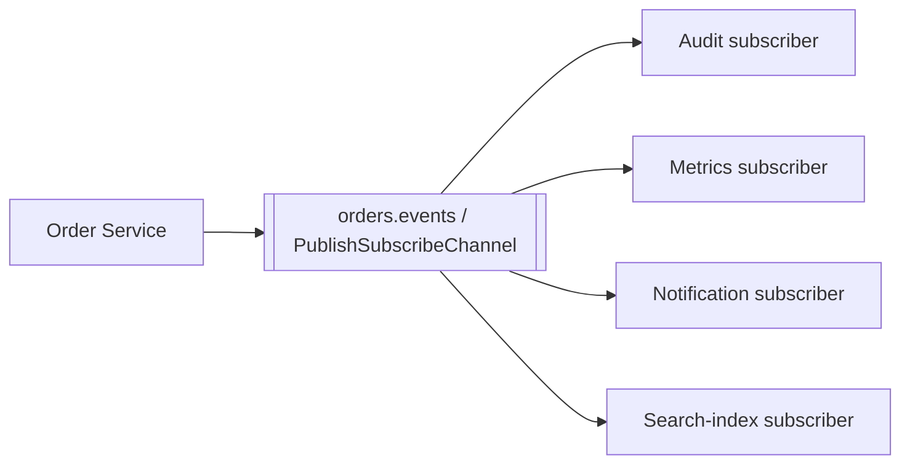
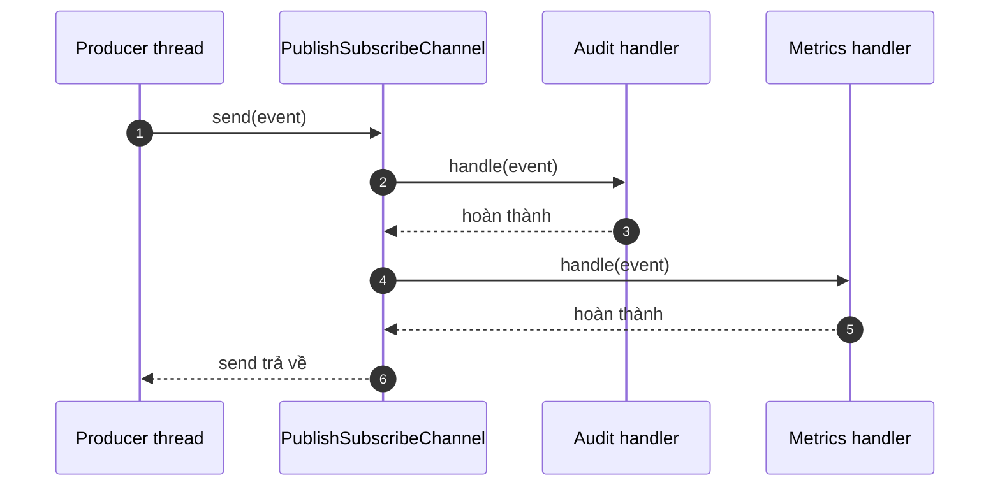
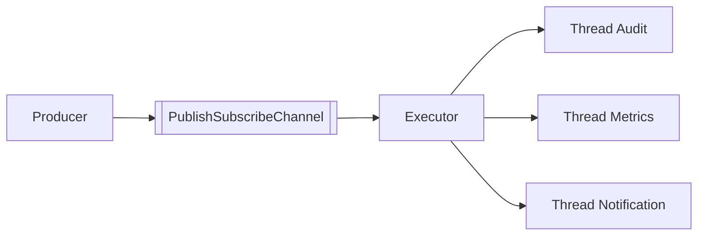
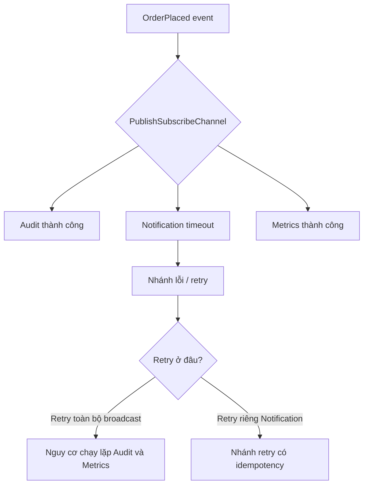
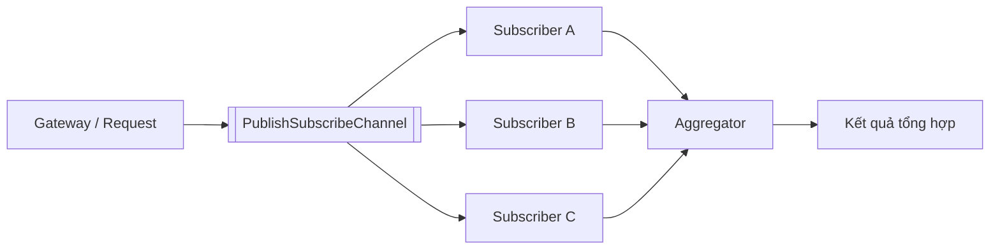

# Một message được phát cho nhiều consumer

Trong hệ thống tích hợp doanh nghiệp, một sự kiện **đặt hàng thành công** có thể đồng thời liên quan đến nhiều chức năng: ghi audit, cập nhật chỉ số, phát thông báo và đồng bộ dữ liệu sang hệ thống khác. Nếu producer gọi trực tiếp từng dịch vụ, thêm hoặc xóa một chức năng sẽ làm mã producer thay đổi, tăng phụ thuộc và khiến quản lý lỗi khó hơn.

**Publish–Subscribe** là mẫu **Enterprise Integration Patterns (EIP)** cho phép producer **phát một message vào một kênh**, rồi kênh phân phối message đó đến **nhiều subscriber** đang đăng ký. Trong **Spring Integration**, thành phần tiêu biểu để thể hiện ý tưởng này là `PublishSubscribeChannel`.

Bài **“Một message được phát cho nhiều consumer”** thuộc chương **Publish subscribe** trong module `SPRING_INTEGRATION_PATTERN`. Bài tập trung vào cách fan-out hoạt động, khác biệt với channel point-to-point, đồng bộ và bất đồng bộ, ranh giới lỗi và retry, correlation, kiểm thử các subscriber, cũng như cách phối hợp Publish–Subscribe với Router, Filter, Transformer, Splitter, Aggregator và Gateway để xây dựng luồng thông điệp ít phụ thuộc, dễ mở rộng và quan sát được.

> **Ý chính:** Producer gửi **một message** đến `PublishSubscribeChannel`. Kênh có thể **dispatch message cho tất cả subscriber đã đăng ký**, thay vì chỉ một subscriber như channel point-to-point. Tuy nhiên, việc **bàn giao/dispatch** không tự bảo đảm mỗi subscriber đã hoàn thành nghiệp vụ, message đã được lưu bền hoặc mọi nhánh thành công như một transaction duy nhất.

## 1. Vì sao một message cần đến nhiều consumer?

Giả sử application service đã xác định một đơn hàng vừa được tạo:

```json
{
  "eventId": "evt-demo-101",
  "orderId": "ORD-101",
  "eventType": "ORDER_PLACED",
  "totalItems": 3
}
```

Đây là dữ liệu giả lập. Các tác vụ phía sau có trách nhiệm khác nhau:

| Consumer | Mục tiêu | Có cần ảnh hưởng trực tiếp đến nghiệp vụ tạo đơn? |
| --- | --- | --- |
| **Audit subscriber** | Ghi nhận sự kiện phục vụ kiểm tra hoạt động. | Tùy yêu cầu tuân thủ và transaction. |
| **Metrics subscriber** | Cập nhật phép đo số đơn được tạo. | Thường không nên làm chậm nghiệp vụ chính. |
| **Notification subscriber** | Khởi tạo tác vụ thông báo khách hàng. | Có thể xử lý bất đồng bộ, có retry riêng. |
| **Search-index subscriber** | Cập nhật chỉ mục tìm kiếm. | Thường chấp nhận nhất quán cuối cùng. |

Nếu producer phải biết tất cả các consumer, việc thêm một subscriber mới sẽ khiến producer bị sửa dù **hợp đồng sự kiện** không thay đổi. Publish–Subscribe tạo một ranh giới:



Producer chỉ gửi tới `orders.events`. Từng subscriber quan tâm đến việc xử lý sự kiện theo mục tiêu của mình; topology có thể thay đổi mà không cần producer import service của từng consumer.

**Lưu ý:** Sự tách biệt này là ở cấp **hợp đồng message/channel**. Producer và consumer vẫn cần thống nhất về payload schema, tính hợp lệ của dữ liệu, tác dụng phụ và ý nghĩa event.

## 2. Publish–Subscribe khác point-to-point như thế nào?

Một tên channel không đủ để kết luận có fan-out hay không. **Kiểu channel** quyết định cách message được phân phối.

| Channel / Pattern | Cách phân phối điển hình | Khi nào dùng |
| --- | --- | --- |
| **`DirectChannel`** | Mỗi lần gửi được dispatch đến **một** subscriber được chọn theo cơ chế channel, và thường chạy đồng bộ. | Một message cần một handler xử lý. |
| **`QueueChannel`** | Message được lưu trong queue để **một lần receive** lấy ra; nhiều consumer cạnh tranh lấy dữ liệu. | Công việc point-to-point có buffer/polling. |
| **`ExecutorChannel`** | Dispatch thông qua executor đến handler theo mô hình point-to-point. | Tách thread cho một tuyến xử lý; không tự là fan-out. |
| **`PublishSubscribeChannel`** | Broadcast cho **nhiều subscriber đang đăng ký**. | Một sự kiện cần kích hoạt nhiều xử lý độc lập. |
| **Recipient List Router** | Router chọn **danh sách channel đích** tường minh, có thể theo điều kiện. | Mỗi message có tập recipient do policy chọn. |
| **Splitter** | Chia **payload** thành nhiều phần/message con. | Một batch cần xử lý từng dòng hàng. |

### 2.1. Point-to-point: nhiều consumer có thể cạnh tranh cùng một message

```text
                  +--> Consumer A
Producer -> QueueChannel
                  +--> Consumer B

Một message được một consumer lấy ra, không phải cả A và B nhận bản riêng.
```

### 2.2. Publish–Subscribe: mỗi subscriber được dispatch message

```text
                            +--> Consumer A
Producer -> PublishSubscribeChannel --> Consumer B
                            +--> Consumer C

Một lần gửi → các subscriber đang đăng ký có cơ hội nhận message.
```

Điểm khác biệt không nằm ở việc có “nhiều consumer” trong topology, mà ở **semantics phân phối**: **competing consumers** khác với **broadcast to subscribers**.

### 2.3. Không nhầm với Kafka hoặc broker pub/sub

Một `PublishSubscribeChannel` thường là **channel nội bộ trong ứng dụng Spring**. Nó không tự là Kafka topic, RabbitMQ exchange hay hệ thống phân phối xuyên nhiều process. Nếu muốn consumer nằm ở service khác, cần **outbound adapter** để publish tới hạ tầng ngoài, sau đó mỗi service dùng inbound adapter/consumer theo cơ chế broker.

Với Kafka, việc mỗi consumer group nhận một bản ghi có semantics riêng của topic/partition/group và retention. Không nên lấy toàn bộ semantics của Kafka áp đặt cho một `PublishSubscribeChannel` trong JVM, hoặc ngược lại.

## 3. “Một message” nghĩa là một bản ghi, một tham chiếu hay nhiều bản sao?

Về mặt pattern, producer đưa **một sự kiện logic** vào kênh. Nhiều subscriber cùng nhận thông tin về sự kiện ấy. Điều đó **không có nghĩa** framework bảo đảm tạo một **deep copy độc lập** của toàn bộ payload cho mỗi subscriber.

Ví dụ:

```java
import org.springframework.messaging.Message;
import org.springframework.messaging.support.MessageBuilder;

record OrderPlaced(String eventId, String orderId) {}

Message<OrderPlaced> message = MessageBuilder
    .withPayload(new OrderPlaced("evt-101", "ORD-101"))
    .build();
```

Payload `OrderPlaced` là record bất biến về mặt trường dữ liệu ở ví dụ này, nên các subscriber có thể đọc an toàn mà không cần sửa message.

### 3.1. Rủi ro với mutable payload

Không nên gửi:

```java
// Ví dụ cấu trúc có thể bị thay đổi, KHÔNG khuyến nghị cho fan-out.
class MutableOrder {
    String status;
}
```

rồi để Audit subscriber đổi `status` trước khi Notification subscriber đọc. Nếu các subscriber cùng nhìn thấy một object mutable hoặc những bản sao chia sẻ reference, kết quả có thể phụ thuộc thứ tự thực thi, thread hoặc ranh giới serialization.

**Khuyến nghị:** Dùng **immutable DTO/event**, không để subscriber sửa payload/header được chia sẻ, và tách dữ liệu riêng cho từng đích bằng Transformer nếu các subscriber có hợp đồng khác nhau.

### 3.2. Header cũng là một phần của hợp đồng

Message có thể mang `id`, `timestamp`, `correlationId`, trace context và một số metadata phục vụ reply/sequence. Một số cơ chế broadcast có thể thêm hoặc thay header phục vụ việc gom kết quả **khi được cấu hình**, nên không nên viết test dựa trên giả định mọi subscriber luôn nhận **cùng reference object** hoặc mọi header đều bất biến giữa tất cả ranh giới.

Đặc biệt, không gắn access token, cookie, email hoặc dữ liệu cá nhân thừa vào headers rồi fan-out cho mọi subscriber. Fan-out làm **mở rộng phạm vi tiếp xúc dữ liệu**, nên cần data minimization và kiểm soát quyền.

## 4. Ví dụ hoàn chỉnh với PublishSubscribeChannel và hai subscriber

Ví dụ sau dùng Java có hỗ trợ `record`, Spring Framework, Spring Integration và Spring Test/JUnit 5 tương thích. Ta tạo một kênh `orders.events`; Audit và Metrics là hai flow subscriber độc lập.

### 4.1. Event và hai handler

```java
import java.util.List;
import java.util.concurrent.CopyOnWriteArrayList;
import java.util.concurrent.atomic.AtomicInteger;

record OrderPlaced(String eventId, String orderId) {}

class AuditEventHandler {
    private final List<String> processedEventIds =
        new CopyOnWriteArrayList<>();

    public void accept(OrderPlaced event) {
        processedEventIds.add(event.eventId());
    }

    public List<String> processedEventIds() {
        return List.copyOf(processedEventIds);
    }
}

class MetricsEventHandler {
    private final AtomicInteger total = new AtomicInteger();

    public void accept(OrderPlaced event) {
        total.incrementAndGet();
    }

    public int total() {
        return total.get();
    }
}
```

Các handler này **chỉ dùng cho minh họa**. `AuditEventHandler` giữ danh sách trong bộ nhớ và `MetricsEventHandler` giữ biến đếm trong JVM; chúng không thay thế audit store hoặc metrics backend thật.

### 4.2. Đăng ký channel và hai IntegrationFlow subscriber

```java
import org.springframework.context.annotation.Bean;
import org.springframework.context.annotation.Configuration;
import org.springframework.integration.channel.PublishSubscribeChannel;
import org.springframework.integration.config.EnableIntegration;
import org.springframework.integration.dsl.IntegrationFlow;

@Configuration
@EnableIntegration
public class OrderPubSubConfiguration {

    @Bean("orders.events")
    PublishSubscribeChannel orderEventsChannel() {
        return new PublishSubscribeChannel();
    }

    @Bean
    AuditEventHandler auditEventHandler() {
        return new AuditEventHandler();
    }

    @Bean
    MetricsEventHandler metricsEventHandler() {
        return new MetricsEventHandler();
    }

    @Bean
    IntegrationFlow auditSubscriber(AuditEventHandler audit) {
        return IntegrationFlow.from("orders.events")
            .handle(audit, "accept")
            .get();
    }

    @Bean
    IntegrationFlow metricsSubscriber(MetricsEventHandler metrics) {
        return IntegrationFlow.from("orders.events")
            .handle(metrics, "accept")
            .get();
    }
}
```

Ở cấu hình này:

1. `@Bean("orders.events")` đăng ký **`PublishSubscribeChannel`** có tên rõ ràng.
2. `auditSubscriber(...)` đăng ký một endpoint tiêu thụ message từ kênh đó.
3. `metricsSubscriber(...)` đăng ký **một endpoint thứ hai** cùng subscribe vào `orders.events`.
4. Khi có message `OrderPlaced`, hai endpoint là hai subscriber nhận được thông tin để gọi các method `accept(...)` tương ứng.

**Điểm then chốt:** Nếu thay `PublishSubscribeChannel` bằng một channel point-to-point mà vẫn giữ hai flow consumer, **không còn bảo đảm cả hai được dispatch cùng một message**. Kiểu channel là phần quan trọng của hợp đồng, không chỉ có chuyện “hai flow cùng đọc một channel name”.

### 4.3. Gửi một message

```java
import org.springframework.messaging.MessageChannel;
import org.springframework.messaging.support.MessageBuilder;

// context là ApplicationContext đang chạy với OrderPubSubConfiguration.
MessageChannel channel =
    context.getBean("orders.events", MessageChannel.class);

channel.send(MessageBuilder
    .withPayload(new OrderPlaced("evt-101", "ORD-101"))
    .build());
```

`context` trong đoạn này là một `ApplicationContext` đã được khởi tạo bởi Spring; đây là phần minh họa cách caller gửi vào kênh, **không phải class độc lập có thể chạy khi chưa có context**. Trong ứng dụng thật, có thể inject `MessageChannel` theo tên bean hoặc dùng `@MessagingGateway` để caller khỏi phải tự tạo message.

## 5. Kiểm thử: cả hai consumer đều nhận cùng một sự kiện

JUnit 5 test dưới đây tạo Spring context từ cấu hình ở mục 4, gửi **một message** và khẳng định **cả hai subscriber** đã nhận dữ liệu.

```java
import static org.junit.jupiter.api.Assertions.*;

import org.junit.jupiter.api.Test;
import org.springframework.beans.factory.annotation.Autowired;
import org.springframework.context.ApplicationContext;
import org.springframework.messaging.MessageChannel;
import org.springframework.messaging.support.MessageBuilder;
import org.springframework.test.context.junit.jupiter.SpringJUnitConfig;

@SpringJUnitConfig(OrderPubSubConfiguration.class)
class OrderPublishSubscribeTest {

    @Autowired ApplicationContext context;
    @Autowired AuditEventHandler audit;
    @Autowired MetricsEventHandler metrics;

    @Test
    void oneMessageIsDispatchedToBothSubscribers() {
        MessageChannel channel =
            context.getBean("orders.events", MessageChannel.class);

        OrderPlaced event = new OrderPlaced("evt-201", "ORD-201");
        assertTrue(channel.send(
            MessageBuilder.withPayload(event).build()));

        assertEquals(
            java.util.List.of("evt-201"),
            audit.processedEventIds());
        assertEquals(1, metrics.total());
    }
}
```

**Vì sao test có thể assert ngay sau `send(...)`?** Ví dụ sử dụng `PublishSubscribeChannel` **không gắn executor**; trong đường dispatch đồng bộ thông thường, handler hoàn thành trước khi lời gọi gửi trả về. Nếu chuyển kênh sang xử lý bất đồng bộ bằng executor, test phải **chờ theo điều kiện có timeout** thay vì assert ngay.

### 5.1. Test cần xác minh thêm gì?

| Tình huống | Kết quả cần quan sát |
| --- | --- |
| Hai subscriber đang hoạt động | Mỗi handler nhận sự kiện theo contract. |
| Chỉ có một subscriber | Một message chỉ được gửi đến subscriber đã đăng ký; không chờ subscriber không tồn tại. |
| Không có subscriber | Ứng xử của channel phải theo **min-subscribers policy** được cấu hình và kiểm thử. |
| Một subscriber ném exception | Xác minh nhánh còn lại có được gọi không theo cấu hình sync/async. |
| Payload mutable | Kiểm tra tác dụng của dùng chung reference hoặc đổi sang DTO bất biến. |
| Channel chuyển sang executor | Test phải đợi hoàn thành; hiểu send success không phải business success. |
| Message được retry | Các subscriber có side effect không bị nhân đôi ngoài hợp đồng. |
| Subscriber xử lý chậm | Đo latency/bão hòa và chính sách timeout/backpressure. |

Đừng chỉ kiểm tra `channel.send(...) == true` rồi kết luận fan-out đã hoạt động. Giá trị trả về cần được diễn giải theo **semantics channel/dispatcher**; test **hiệu ứng ở từng subscriber** mới chứng minh yêu cầu của bài.

### 5.2. Cẩn thận với state dùng chung trong test

Nếu Spring Test cache context và test chạy đồng thời, handler giữ `List` hoặc `AtomicInteger` có thể tích lũy dữ liệu từ test khác. Ví dụ chỉ có một test; khi mở rộng, cần reset fixture an toàn, tạo context/test instance cô lập hoặc dùng các ID khác nhau cùng cách assertion không phụ thuộc thứ tự chạy.

Đồng thời, một test in-memory không chứng minh cơ chế durable delivery, transaction xuyên nhiều service hoặc lỗi của adapter HTTP/Kafka.

## 6. Đồng bộ mặc định và bất đồng bộ qua executor

Một trong những yếu tố quyết định hành vi quan trọng nhất của `PublishSubscribeChannel` là **cách dispatch**.

### 6.1. Không gắn executor: fan-out đồng bộ

Với kiểu sử dụng thông thường `new PublishSubscribeChannel()`, việc dispatch cho subscriber có thể diễn ra **đồng bộ trên thread của sender**.



**Hệ quả:**

- Các subscriber đồng bộ có thể làm tăng thời gian phản hồi của producer.
- Một subscriber chậm có thể khiến `send(...)` chậm.
- Một exception có thể ảnh hưởng đến các recipient khác và caller tùy chính sách dispatcher/error handling.
- Không nên suy ra việc khai báo hai subscriber tạo ra hai thread riêng.

**Thứ tự Audit/Metrics trong sơ đồ chỉ là minh họa**, không cam kết order luôn như vậy. Nếu nghiệp vụ có phụ thuộc “Audit phải commit trước Notification”, cần thiết kế ràng buộc điều phối/transaction riêng thay vì suy từ thứ tự đăng ký.

### 6.2. Có executor: dispatch bất đồng bộ

Spring Integration cho phép xây `PublishSubscribeChannel` với một `Executor` thích hợp để thực hiện broadcast bằng thread pool. Ví dụ **cấu hình thay thế** cho kênh trong mục 4:

```java
import org.springframework.context.annotation.Bean;
import org.springframework.integration.channel.PublishSubscribeChannel;
import org.springframework.scheduling.concurrent.ThreadPoolTaskExecutor;

@Bean
ThreadPoolTaskExecutor fanoutExecutor() {
    ThreadPoolTaskExecutor executor = new ThreadPoolTaskExecutor();
    executor.setCorePoolSize(2);
    executor.setMaxPoolSize(4);
    executor.setQueueCapacity(32);
    executor.setThreadNamePrefix("orders-fanout-");
    executor.initialize();
    return executor;
}

@Bean("orders.events")
PublishSubscribeChannel asynchronousOrdersChannel(
        ThreadPoolTaskExecutor fanoutExecutor) {
    return new PublishSubscribeChannel(fanoutExecutor);
}
```

Không đăng ký **đồng thời** bean `orders.events` ở ví dụ này với bean cùng tên tại mục 4. Đây là hai lựa chọn cấu hình thay thế. Trong ứng dụng thực, quản lý lifecycle/shutdown của executor, giới hạn queue và chính sách từ chối tác vụ cần được thiết kế thêm.



**Hệ quả quan trọng:**

- Sender có thể trả về **trước khi các handler hoàn thành**.
- Không có bảo đảm thứ tự hoàn tất giữa các nhánh.
- Exception trong thread worker không nhất thiết trở về caller giống mô hình đồng bộ.
- Executor có thể bão hòa hoặc từ chối task; cần quan sát và cấu hình error handling.
- “Async” không tự tạo lưu trữ bền vững hoặc cơ chế replay sau restart.

### 6.3. So sánh hai chế độ

| Tiêu chí | Đồng bộ | Qua executor |
| --- | --- | --- |
| Thread xử lý subscriber | Thường caller thread. | Thread từ executor. |
| Caller chờ handler? | Có thể chờ mỗi handler hoàn tất. | Thường không chờ toàn bộ business processing. |
| Thứ tự kết thúc | Phụ thuộc dispatcher/order/error, có tính tuần tự hơn. | Có thể xen kẽ giữa các thread. |
| Cách lỗi tới caller | Exception đồng bộ có thể lan về caller. | Cần xử lý lỗi của async dispatch/handler. |
| Rủi ro quá tải | Tăng latency/block caller. | Pool/queue bão hòa, task rejection. |
| Tính bền vững | Không mặc định. | Cũng không mặc định. |

Đừng chọn executor chỉ vì “mọi thứ sẽ nhanh hơn”. Nó **chuyển vị trí hàng đợi và chi phí tài nguyên**, có thể làm khó việc xác định message nào đã hoàn thành và message nào đang chờ.

## 7. Không có subscriber và subscriber không sẵn sàng

Với một topic broker bền vững, một bản ghi có thể còn trong log để nhóm consumer đọc lại. Với một `PublishSubscribeChannel` nội bộ, cần hiểu rõ **ai đang subscribe ở thời điểm gửi**.

### 7.1. Không có subscriber

Nếu producer gửi khi **không có subscriber nào**, không được mặc định message sẽ nằm chờ để subscriber tương lai tự đọc lại. `PublishSubscribeChannel` không phải message store. Một số cấu hình/phiên bản cho phép định nghĩa **số subscriber tối thiểu (`minSubscribers`)** cần có để việc gửi được coi là thỏa điều kiện.

Đặt câu hỏi thiết kế:

1. Có được phép gửi khi chưa có consumer không?
2. Khi thiếu consumer, cần fail fast, cảnh báo hay lưu bền để xử lý sau?
3. Có kiểm tra lúc startup rằng các flow subscriber đã đăng ký đúng không?
4. Một consumer vừa restart có cần nhận lại những event xảy ra khi nó vắng mặt không?

Nếu yêu cầu là **replay event sau khi consumer nghỉ**, một channel broadcast trong bộ nhớ **không đủ**; cần giải pháp lưu bền, broker hoặc event store phù hợp.

### 7.2. Subscriber chậm

Một subscriber chậm có thể giữ sender ở chế độ đồng bộ, hoặc chiếm executor/queue ở chế độ async. Không thể giải quyết triệt để bằng việc tăng `sendTimeout` một cách tùy tiện: **send timeout** không mặc nhiên là deadline cho một handler gọi HTTP mất 10 giây.

Hãy theo dõi **latency mỗi subscriber**, queue capacity, thread pool saturation, số task bị từ chối và thời gian chờ end-to-end.

### 7.3. Subscriber fail

Khi handler ném exception:

- Ở luồng đồng bộ, lỗi có thể truyền về producer và ảnh hưởng những subscriber chưa được dispatch.
- Ở luồng async, lỗi có thể được xử lý bởi **ErrorHandler/error flow phù hợp** mà không trở lại caller theo cùng hình thức.
- Chính sách tiếp tục thử các subscriber khác khi một subscriber thất bại có thể phụ thuộc cấu hình dispatcher/ignore-failures của phiên bản Spring Integration.

**Không được mặc định** “A thất bại nhưng B và C vẫn chắc chắn chạy” hoặc “A thất bại thì mọi subscriber đều rollback”. Phải kiểm chứng hành vi mong muốn bằng integration test với các loại channel và error handling đã cấu hình.

## 8. Một message tới nhiều consumer có tương đương một giao dịch không?

**Không.** Nếu Audit hoàn thành và Notification thất bại, Publish–Subscribe tự thân không bảo đảm rollback dữ liệu Audit hoặc retry đúng một nhánh thất bại.



Để thiết kế an toàn:

1. **Chia trách nhiệm xử lý lỗi theo từng subscriber.**
2. **Dùng event ID ổn định** và idempotency ở handler có tác dụng phụ.
3. Phân biệt **chấp nhận message**, **hoàn thành một nhánh**, **hoàn thành toàn bộ quy trình**.
4. Nếu cần đảm bảo event không mất qua restart, dùng **durable transport/store** và transaction/outbox khi phù hợp.
5. Nếu consumer ngoài hệ thống thực hiện tác vụ không thể đảo ngược, cân nhắc trạng thái nghiệp vụ và bước bù trừ.

### 8.1. Idempotency theo từng subscriber

Một chiến lược thường gặp là lưu trạng thái xử lý bằng khóa:

```text
(eventId, subscriberId)

(evt-101, audit)
(evt-101, notification)
(evt-101, metrics)
```

Khi cùng sự kiện được replay, mỗi subscriber quyết định riêng liệu tác dụng phụ của nó đã hoàn tất chưa. Việc chống trùng phải có tính nguyên tử và lưu bền phù hợp; chỉ kiểm tra một biến `Set` trong memory **không đủ** cho nhiều instance hoặc restart.

### 8.2. Nếu yêu cầu “mọi consumer phải thành công”

Đó là một **workflow/business contract** vượt ra ngoài chức năng broadcast. Có thể cần:

- Lưu riêng trạng thái xử lý từng subscriber.
- Retry độc lập và đưa lỗi không thể khôi phục vào quarantine/DLQ có kiểm soát.
- Gửi thông điệp hoàn thành/thất bại từ các nhánh về một nơi tập hợp.
- Dùng Aggregator hoặc một orchestration service để tổng hợp kết quả.
- Có timeout/expiry, partial result và cơ chế xử lý nhánh không phản hồi.

Recipient List/Publish–Subscribe chỉ giải quyết **chuyển message tới nhiều đích**; chúng không tự bảo đảm **atomic all-or-nothing**.

## 9. Correlation, sequence và Aggregator sau broadcast

Khi một message được phát cho ba subscriber rồi mỗi subscriber trả kết quả, ta có một mẫu gần **scatter–gather**:



Với kiến trúc này, có một số vấn đề phải giải quyết **tường minh**:

| Vấn đề | Câu hỏi cần trả lời |
| --- | --- |
| **Correlation ID** | Ba phản hồi thuộc request/batch nào? |
| **Sequence size** | Dự kiến có bao nhiêu phần/nhánh trả lời? |
| **Sequence number** | Mỗi message được đánh số/nhận diện ra sao? |
| **Release strategy** | Bao giờ đủ kết quả để Aggregator phát output? |
| **Timeout/expiry** | Một subscriber không phản hồi thì xử lý thế nào? |
| **Late arrival** | Reply đến sau khi group đã release/expired được xử lý ra sao? |
| **Duplicate reply** | Retry một nhánh có khiến Aggregator tính lặp kết quả không? |

### 9.1. `applySequence` là gì?

`PublishSubscribeChannel` có tùy chọn hỗ trợ **thêm thông tin sequence/correlation khi broadcast** để thuận tiện cho một số mẫu tổng hợp downstream. **Không nên mặc định** tất cả flow đều bật `applySequence`, rằng metadata ấy qua mọi adapter không đổi, hoặc rằng bật một tùy chọn là Aggregator tự biết completion policy.

Khi cần scatter–gather:

- Chọn một correlation ID ổn định cho request/batch.
- Xác minh cách broadcast tạo/giữ sequence headers trên **phiên bản đang dùng**.
- Nếu subscriber là tùy chọn, xác định số response mong đợi theo **số recipient thực sự được chọn**.
- Thiết kế release strategy và timeout tường minh.
- Kiểm thử nhánh thiếu, nhánh trả trễ và duplicate reply.

### 9.2. Broadcast khác Splitter

Splitter tạo message con từ **các phần của payload**: một đơn 5 dòng hàng có thể thành 5 message `OrderLine`. Publish–Subscribe phát **cùng sự kiện logic** cho nhiều subscriber: một `OrderPlaced` đến Audit và Metrics. Hai pattern có thể kết hợp, nhưng không đồng nhất.

Ví dụ:

```text
Order(batch of 5 lines)
    -> Splitter -> 5 OrderLine messages
    -> PublishSubscribeChannel
       -> Inventory subscriber
       -> Pricing subscriber
    -> Aggregator (chỉ khi có thiết kế correlation/reply đầy đủ)
```

Nếu các message con từ Splitter lại được broadcast cho nhiều subscriber, số kết quả có thể lớn hơn số phần ban đầu. **Đừng lấy `sequenceSize` ban đầu một cách máy móc** làm số phản hồi kỳ vọng khi đã phát thêm các nhánh.

## 10. Gateway, Router, Filter và Transformer phối hợp ra sao?

### 10.1. Gateway làm facade cho producer

Producer có thể gọi một interface thay vì tự tạo `Message<?>`:

```java
import org.springframework.integration.annotation.MessagingGateway;

@MessagingGateway(defaultRequestChannel = "orders.events")
public interface OrderEventsGateway {
    void publish(OrderPlaced event);
}
```

Trong ứng dụng thực, cần bật/đăng ký gateway proxy theo cấu hình Spring Integration và package scan phù hợp. `void` nghĩa là caller **không nhận một kết quả nghiệp vụ qua return value**, nhưng **không bảo đảm** việc gửi bất đồng bộ, xử lý bền vững hay không có lỗi đồng bộ.

Với gateway **request–reply**, fan-out không mặc định tạo ra một kết quả duy nhất. Nếu cần tổng hợp trả lời, phải thiết kế nhánh reply, Aggregator và deadline; nếu chỉ cần thông báo “đã chấp nhận sự kiện”, nên đặt hợp đồng accepted rõ ràng, không gọi đó là “mọi consumer đã hoàn tất”.

### 10.2. Filter trước broadcast

Một Filter trước `PublishSubscribeChannel` có thể chặn các event không hợp lệ/không được phép, tránh phát tán dữ liệu sai cho nhiều consumer:

```text
Inbound -> Deserialize/Validate -> Filter chung
        -> PublishSubscribeChannel
        -> Audit / Metrics / Notification
```

Nếu Filter ở **sau** broadcast, mỗi subscriber tự áp dụng điều kiện riêng; điều này hữu ích khi mỗi consumer có chính sách khác nhau. Tuy nhiên, đừng bỏ qua validation/security chung ở biên vì “đã có Filter ở mỗi nhánh”.

### 10.3. Transformer trước và trong từng nhánh

Một event chuẩn, tối thiểu có thể được broadcast trước. Sau đó mỗi subscriber chuyển thành payload riêng: Audit lưu bản ghi theo schema của mình, Notification tạo lệnh gửi email, Analytics tính phép đo.

Nếu broadcaster gửi toàn bộ object khách hàng hoặc token cho cả ba subscriber chỉ để mỗi nhánh tự lọc dữ liệu thừa, phạm vi rủi ro đã tăng. Hãy **tối thiểu hóa event trước broadcast** và cấp quyền/DTO phù hợp trong từng nhánh.

### 10.4. Router trước broadcast

Content-Based Router có thể chọn nhánh sự kiện (`orders.created` hoặc `orders.cancelled`), rồi mỗi nhánh dùng `PublishSubscribeChannel` để fan-out tới nhiều chức năng. Recipient List Router là lựa chọn khác khi cần **chọn danh sách đích dựa trên policy tường minh** thay vì một tập subscriber cố định.

## 11. Error channel, retry và timeout: không trộn các ranh giới

Trong luồng có broadcast, cùng một loại lỗi có thể xuất hiện ở nhiều tầng:

| Tình huống | Nơi lỗi bắt đầu | Lưu ý |
| --- | --- | --- |
| Không có subscriber | Cấu hình channel/subscription | Kiểm tra chính sách `minSubscribers` và startup wiring. |
| Một handler ném exception | Subscriber | Phân biệt sync propagation và async error handler. |
| Executor hết chỗ | Hạ tầng dispatch | Có thể reject task; cần backpressure và cảnh báo. |
| Outbound HTTP timeout | Adapter trong một nhánh | Chưa chắc bên nhận chưa xử lý; cần idempotency. |
| Retry toàn bộ broadcast | Retry boundary | Có nguy cơ lặp tác vụ ở các nhánh đã thành công. |
| Publish không có reply | Gateway request–reply | Broadcast không tự tổng hợp kết quả; cần thiết kế reply. |
| Aggregator thiếu một phản hồi | Scatter–gather group | Cần completion/expiry, không sửa được chỉ bằng send timeout. |

**Error channel** không phải bộ thu mọi lỗi tự động ở mọi channel. Exception đồng bộ có thể trả về caller; lỗi trong ranh giới bất đồng bộ/poller/adapter có thể thành `ErrorMessage` nếu hệ thống được cấu hình phù hợp. Phải test **đường lỗi thực tế** cho từng kiểu dispatch.

### 11.1. Vì sao `sendTimeout` không phải thời gian xử lý tối đa?

Nếu handler đồng bộ gọi ERP mất 7 giây, một tham số send timeout 100 ms **không tự cắt ngang lời gọi ERP**. Trên bounded queue, send timeout có thể giới hạn thời gian chờ chỗ trống. Trên executor, cần xét queue capacity/rejection, còn thời gian HTTP client và deadline nghiệp vụ là những giới hạn riêng.

Tương tự, `receiveTimeout` thuộc các thao tác nhận pollable; `PublishSubscribeChannel` là channel kiểu subscribe, **không phải một `QueueChannel` để mỗi subscriber gọi `receive(timeout)`**.

### 11.2. Retry có kiểm soát

Khi Notification gặp lỗi tạm thời, có thể retry **riêng việc gửi thông báo**, không phát lại toàn bộ event vào broadcast nếu không cần thiết. Sử dụng exponential backoff/jitter khi phù hợp, giới hạn số lần retry, phân loại lỗi và giữ idempotency key ổn định.

Nếu một event được gửi lại sau sự cố toàn hệ thống, Audit, Metrics và Notification cũng cần quy định rõ liệu có được xử lý lặp không. Một số metric đếm không idempotent có thể bị cộng hai lần; cần thiết kế deduplication hoặc đếm dựa trên nguồn dữ liệu chuẩn nếu yêu cầu chính xác.

## 12. Tính an toàn dữ liệu trong fan-out

Vì **nhiều consumer cùng nhận event**, phạm vi nơi lưu trữ/log/truy vết dữ liệu tăng so với một handler duy nhất.

| Nguy cơ | Biện pháp |
| --- | --- |
| Event mang email, token hoặc dữ liệu thanh toán không cần thiết | Tối thiểu hóa payload trước broadcast, không gửi bí mật trong header. |
| Mỗi subscriber log toàn bộ message | Chỉ log event type, kết quả, mã lỗi và correlation ID mờ. |
| Một subscriber chỉ cần metadata nhưng được đọc cả payload | Thiết kế DTO/adapter riêng hoặc ranh giới phân quyền phù hợp. |
| ErrorMessage/stack trace chứa failed message | Redaction, phân quyền, retention và kiểm thử đường lỗi. |
| Correlation ID chứa thông tin cá nhân | Dùng ID mờ, không tự tạo từ email hoặc token. |
| Dữ liệu được phát ra broker ngoài | Chỉ ánh xạ header cho phép, mã hóa và ACL theo yêu cầu. |

**Không dùng việc các subscriber chạy trong cùng JVM làm lý do bỏ qua data classification.** Một thư viện logging, tracing hoặc một outbound adapter có thể gửi dữ liệu sang hệ thống ngoài ngay từ nhánh riêng.

## 13. Quan sát từng subscriber thay vì chỉ quan sát producer

Theo dõi **số lần send vào channel** là chưa đủ để biết fan-out hoạt động. Dashboard nên phân biệt:

1. **Published events:** số sự kiện logic vào `orders.events`.
2. **Registered subscribers:** số subscriber đang đăng ký/hoạt động.
3. **Dispatched deliveries:** số lần giao tới từng subscriber.
4. **Handler results:** số thành công, thất bại, retry hoặc timeout theo handler.
5. **Executor health:** active threads, task queue depth, rejection (nếu async).
6. **End-to-end outcome:** khi nào nghiệp vụ được xem là hoàn tất.

Ví dụ log an toàn:

```text
event=pubsub_subscriber_completed
channel=orders.events
subscriber=audit
event_type=ORDER_PLACED
outcome=success
duration_ms=8
correlation_id=5aa37df4-d57b-4834-80a1-df631e0ce482
```

Đây là **định dạng minh họa**, không phải output mặc định của Spring Integration. Các tên subscriber/channel nên là tập hữu hạn, đã được cấu hình. Không đưa event ID/correlation ID duy nhất của từng message, email hoặc token vào **metric labels** gây độ biến thiên cao; có thể dùng ID mờ trong log/trace với quyền truy cập phù hợp.

### 13.1. Cách đọc một sự cố cụ thể

Giả sử producer ghi `published=100`, Audit có 100 kết quả, Metrics có 100 nhưng Notification chỉ có 97:

- Xác minh Notification có **subscribe** vào đúng channel ở thời điểm phát không.
- Nếu dùng executor, kiểm tra task rejection, queue saturation và exception handler.
- Nếu dùng broker/adapter phía sau Notification, kiểm tra xác nhận gửi, retry, DLQ và timeout ở adapter.
- Xác minh 3 message còn thiếu đang chờ, thất bại hay đã xử lý nhưng metrics chưa được cập nhật.
- Xác minh không có message trùng do retry, và số đo dùng cùng mẫu số/thời gian quan sát.

Không kết luận chỉ từ `channel.send == true` rằng 100 email đã gửi thành công.

## 14. Những nhầm lẫn thường gặp

### Nhầm lẫn 1 — “Có hai consumer của QueueChannel thì cả hai nhận mọi message”

**Sai.** Hai consumer trên queue thường **cạnh tranh** lấy message. Muốn broadcast trong JVM, dùng `PublishSubscribeChannel` hoặc một topology fan-out phù hợp.

### Nhầm lẫn 2 — “PublishSubscribeChannel mặc định tạo thread cho từng subscriber”

**Sai.** Không gắn executor thì dispatch thường đồng bộ. Muốn async, cấu hình executor và quản lý resource/error riêng.

### Nhầm lẫn 3 — “Gửi một lần thì chắc chắn tất cả subscriber hoàn thành”

**Sai.** Cần phân biệt dispatch, completion, failure và transaction scope; async còn có thể trả trước khi handler chạy xong.

### Nhầm lẫn 4 — “Channel nội bộ giống Kafka topic bền vững”

**Sai.** PublishSubscribeChannel trong memory không tự giữ event cho subscriber offline hoặc replay qua restart.

### Nhầm lẫn 5 — “Recipient List và Publish–Subscribe hoàn toàn như nhau”

**Không.** Recipient List Router quản lý **danh sách channel nhận** theo policy, còn PublishSubscribeChannel quản lý **các subscriber của một channel**. Hai cách có thể đạt fan-out nhưng phù hợp cấu hình/vận hành khác nhau.

### Nhầm lẫn 6 — “Có thể sửa mutable payload trong từng subscriber”

**Nguy hiểm.** Một số đường dispatch có thể chia sẻ reference; chỉnh sửa ở một nhánh có thể ảnh hưởng nhánh khác. Dùng immutable event và Transformer riêng.

### Nhầm lẫn 7 — “Một subscriber lỗi thì framework rollback tất cả”

**Sai.** Broadcast không phải transaction phân tán; cần retry/idempotency và state management theo từng nhánh.

### Nhầm lẫn 8 — “Bật applySequence là có Aggregator hoàn chỉnh”

**Sai.** Sequence metadata chỉ hỗ trợ correlation; còn phải có release strategy, timeout/expiry, reply path và xử lý kết quả muộn/trùng.

## 15. Bài tập thực hành

**Bài 1 — Thêm subscriber.** Bổ sung `SearchIndexEventHandler` và `IntegrationFlow.from("orders.events")`. Viết JUnit test xác nhận **một message** được ba handler ghi nhận. Không sửa code producer.

**Bài 2 — So sánh channel.** Đổi bean `orders.events` sang `DirectChannel` trong một test cô lập, giữ hai subscriber. Quan sát vì sao hai handler không còn cùng nhận một event như PublishSubscribeChannel.

**Bài 3 — Chạy bất đồng bộ.** Dùng `ThreadPoolTaskExecutor` có giới hạn queue. Test có cơ chế chờ (chẳng hạn latch hoặc await theo điều kiện) và kiểm tra trường hợp executor từ chối tác vụ.

**Bài 4 — Subscriber không sẵn sàng.** Tạo channel không có subscriber. Kiểm tra hành vi thực tế của cấu hình mặc định và khi đặt chính sách số subscriber tối thiểu phù hợp với phiên bản. Nêu khi nào cần durable transport thay thế.

**Bài 5 — Retry từng nhánh.** Giả lập Notification lỗi sau khi Audit hoàn thành. Thiết kế cách retry Notification mà không làm Audit ghi trùng, sử dụng `eventId` + subscriber name làm khóa idempotency.

**Bài 6 — Gateway + Aggregator.** Caller cần kết quả từ Audit và Notification. Thiết kế reply path, correlation, sequence, release strategy, timeout và xử lý một reply đến muộn; giải thích vì sao `PublishSubscribeChannel` riêng lẻ chưa đủ.

**Bài 7 — Bảo vệ dữ liệu.** Payload có email và token truy cập không cần cho Analytics. Thiết kế contract event tối thiểu, Transformer/adapter riêng nếu cần và test để Analytics không ghi dữ liệu nhạy cảm ra log.

**Bài 8 — Metrics.** Xây các metric `published_total`, `subscriber_dispatch_total`, `subscriber_failure_total`, `subscriber_duration`. Nêu vì sao `correlationId` không nên là label của metrics dù hữu ích cho tracing.

## 16. Checklist trước khi đưa fan-out vào production

| Câu hỏi | Điều cần xác minh |
| --- | --- |
| Một message cần tới một hay nhiều consumer? | Chọn đúng point-to-point hoặc Publish–Subscribe. |
| Channel có đúng loại `PublishSubscribeChannel`? | Subscriber nhận cùng sự kiện theo topology mong muốn. |
| Có subscriber nào chưa đăng ký/lifecycle chưa active? | Kiểm tra wiring và chính sách min subscribers. |
| Broadcast chạy đồng bộ hay async? | Có quyết định rõ về executor, thread, order và chi phí latency. |
| Một subscriber chậm hoặc lỗi làm gì? | Đã test exception/dispatch và chính sách retry theo từng nhánh. |
| Handler có mutable shared state/payload? | Dùng event bất biến hoặc bảo vệ concurrency phù hợp. |
| Có yêu cầu lưu bền/replay không? | Có broker/store/outbox nếu cần, không dựa vào channel in-memory. |
| Có cần mọi subscriber cùng thành công? | Có workflow kết quả, idempotency, compensation/aggregation khi cần. |
| Có request–reply Gateway không? | Đã thiết kế reply/timeout/correlation, không mặc định broadcast tự trả kết quả. |
| Có Splitter/Aggregator không? | Có sequence, group completion, timeout/expiry và late reply. |
| Error channel/retry có đặt đúng ranh giới? | Có phân biệt sync/async, không retry toàn broadcast một cách mù quáng. |
| Có bảo vệ payload/header nhạy cảm? | Fan-out chỉ gửi dữ liệu tối thiểu, logging và adapter được kiểm soát. |
| Có test tất cả subscriber không? | Có happy path, missing subscriber, failure, async và replay. |
| Quan sát được kết quả từng nhánh không? | Có metrics/log theo subscriber, executor, retry và kết quả cuối. |

## Kết luận

**Một message được phát cho nhiều consumer** là bản chất của **Publish–Subscribe**. Với Spring Integration, `PublishSubscribeChannel` cung cấp một điểm phát chung và dispatch thông điệp đến nhiều subscriber đã đăng ký, giúp producer không phải phụ thuộc trực tiếp vào Audit, Notification, Metrics hay các handler khác. Đây là nền tảng hữu ích để xây dựng luồng thông điệp theo **Enterprise Integration Patterns** có thể thêm bớt chức năng mà vẫn giữ hợp đồng sự kiện ổn định.

Tuy nhiên, **fan-out không đồng nghĩa giao dịch nguyên tử, bất đồng bộ, bền vững hay exactly-once**. Hệ thống phải quyết định cụ thể **đồng bộ hay executor, hành vi khi subscriber thiếu/lỗi, giới hạn tài nguyên, retry và idempotency của từng nhánh, bảo vệ dữ liệu, correlation và observability**. Khi phối hợp đúng với Filter, Transformer, Router, Gateway, Splitter và Aggregator, Publish–Subscribe giúp kiến trúc tích hợp **ít phụ thuộc, dễ kiểm thử và đủ khả năng xử lý khi một consumer chậm hoặc gặp sự cố**.
