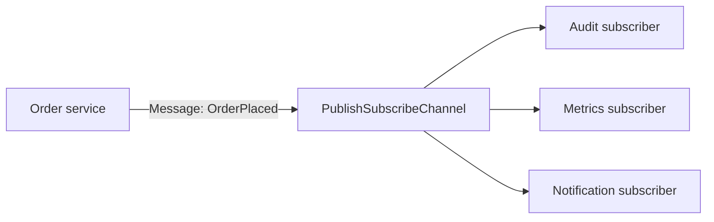
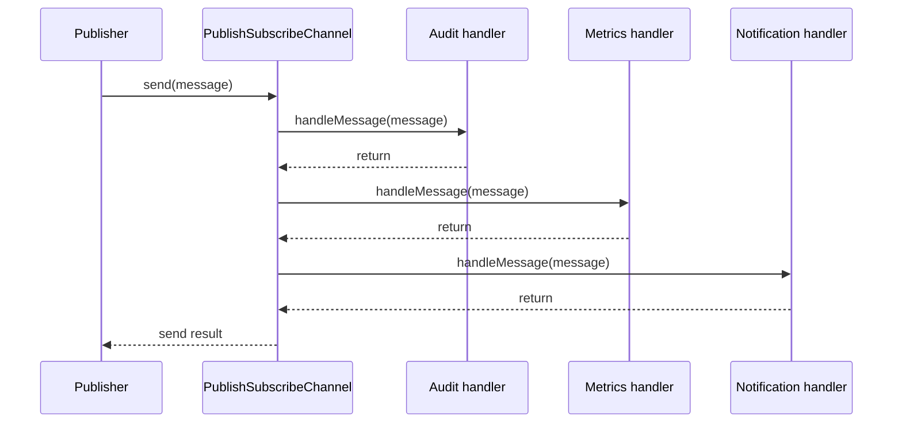
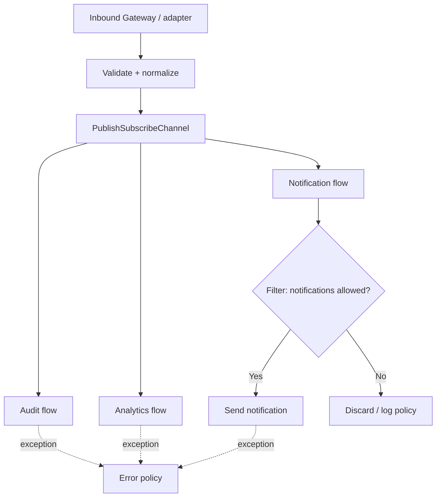
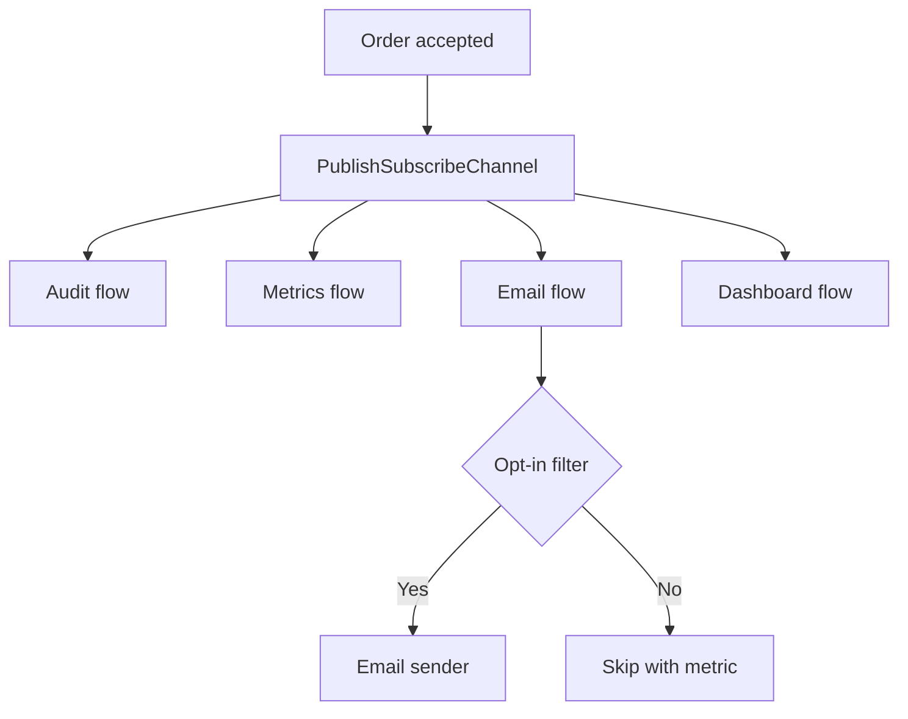
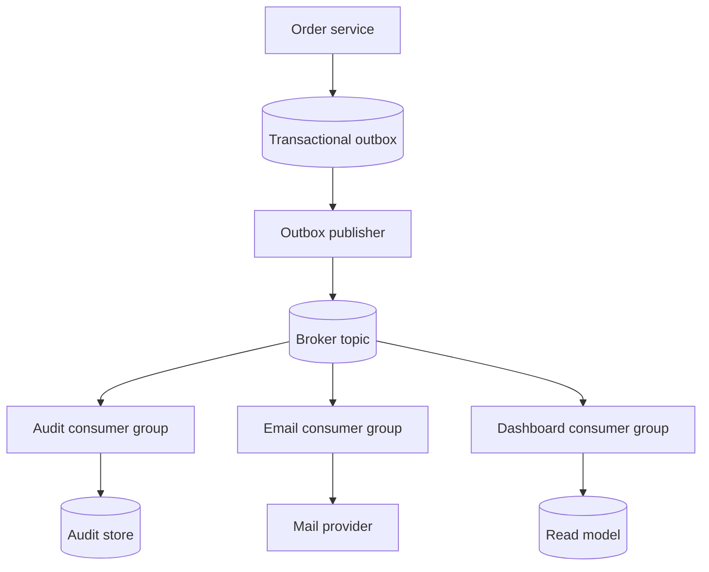

# Broadcasting trong cùng process

Trong **Spring Integration**, một message có thể cần đi tới **nhiều bộ xử lý độc lập**: khi đơn hàng được tạo, hệ thống vừa cập nhật chỉ số vận hành, vừa ghi audit, vừa gửi thông báo. Nếu tất cả các bước đều chạy **trong cùng một ứng dụng/JVM**, ta có thể sử dụng **Publish–Subscribe Channel** để *broadcast* một message tới những subscriber đã đăng ký.

Đây là nội dung của chương **Publish subscribe** trong module `SPRING_INTEGRATION_PATTERN`: học triển khai Enterprise Integration Patterns (EIP) bằng Spring Integration để các luồng thông điệp ít phụ thuộc và dễ mở rộng, kết hợp Filter, Router, Transformer, Splitter, Aggregator, Gateway, retry, error channel, correlation, kiểm thử và quan sát từng nhánh. Bài này tập trung vào **fan-out trong cùng process**, không đồng nhất với việc phát sự kiện qua Kafka, RabbitMQ hay một broker phân tán.

Sau bài này, bạn có thể:

- Giải thích **broadcasting**, subscriber, publisher và phạm vi *in-process* của `PublishSubscribeChannel`.
- Phân biệt cách vận chuyển một message tới nhiều subscriber với **point-to-point channel** và broker pub/sub.
- Cấu hình một `PublishSubscribeChannel` và nhiều `IntegrationFlow` để cùng nhận một sự kiện.
- Dự đoán tác động của xử lý **đồng bộ** so với dùng `Executor` tới thời gian gửi, lỗi và thứ tự.
- Thiết kế chính sách retry, error flow, correlation và idempotency khi có nhiều nhánh độc lập.
- Kiểm thử rằng **mỗi subscriber mong đợi** đã nhận message, không chỉ rằng `send()` trả thành công.

## 1. Broadcasting là gì?

**Broadcasting** là hành động phát cùng một thông điệp tới **nhiều bên nhận**. Thay vì bắt publisher gọi trực tiếp ba service, publisher chỉ gửi **một Spring `Message<?>`** vào channel. Channel phân phối message cho các subscriber đã đăng ký.



Ở đây, publisher **không cần biết** hiện có bao nhiêu subscriber hoặc chúng dùng class/service nào. Một consumer mới có thể được gắn vào channel mà không cần sửa đoạn gửi message, miễn là hợp đồng payload và headers vẫn tương thích.

Tuy vậy, sự tách rời này chỉ nằm ở **mức code và channel nội bộ**. `PublishSubscribeChannel` thuần túy không tự cung cấp khả năng lưu bền vững, phát lại sau restart, giao nhận xuyên JVM hay đảm bảo subscriber cuối cùng đã hoàn tất tác vụ nghiệp vụ.

### Các thuật ngữ chính

| Thuật ngữ | Ý nghĩa trong ví dụ |
| --- | --- |
| **Publisher** | Thành phần gửi một `Message<OrderPlaced>` tới `orderEvents`. |
| **Publish–Subscribe Channel** | `PublishSubscribeChannel` giữ danh sách subscriber và dispatch message. |
| **Subscriber** | Endpoint/handler được đăng ký để nhận message từ channel. |
| **Broadcast** | Cùng một sự kiện được gửi tới mỗi subscriber được chọn theo cấu hình channel. |
| **In-process** | Các bên nhận chạy trong cùng tiến trình ứng dụng/JVM, không cần broker mạng. |
| **Fan-out** | Một message đầu vào tạo nhiều đường xử lý độc lập. |

**Ví dụ nghiệp vụ:** `OrderPlaced(eventId, orderId, totalCents)` có thể được một nhánh dùng để cập nhật bộ đếm đơn hàng, nhánh khác ghi audit, nhánh khác phát lệnh gửi email. Mỗi nhánh nên xác định rõ **điều gì được coi là hoàn thành** và **điều gì sẽ xảy ra nếu nó thất bại**.

## 2. PublishSubscribeChannel khác những channel khác thế nào?

Spring Integration có nhiều channel, nhưng không phải channel nào cũng broadcasting:

| Channel hoặc cơ chế | Mô hình giao nhận chính | Điểm khác biệt |
| --- | --- | --- |
| `DirectChannel` | Point-to-point tới một handler trong số subscriber khả dụng. | Mặc định xử lý trên thread gửi; **không** phát tới mọi subscriber. |
| `ExecutorChannel` | Point-to-point được điều phối bằng executor. | Có thể tách thread, nhưng **không** mặc định fan-out tới toàn bộ handler. |
| `QueueChannel` | Message được đưa vào queue cho consumer poll. | Các consumer cùng queue thường tranh nhau lấy message; không phải mỗi consumer có một bản. |
| **`PublishSubscribeChannel`** | Một message được dispatch tới **nhiều subscriber**. | Phù hợp cho sự kiện nội bộ cần nhiều side effect hoặc bước xử lý độc lập. |
| `FluxMessageChannel` | Kết nối `MessageChannel` với Reactive Streams publisher/subscriber. | Chú trọng reactive consumption; không nên suy diễn hành vi fan-out từ tên `Flux`. |
| Broker pub/sub (Kafka, AMQP, v.v.) | Phân phối qua tiến trình/máy khác theo contract broker. | Có cơ chế topic/queue, lưu trữ/ack/retention riêng; không phải một channel in-memory. |

Một nhầm lẫn phổ biến là đăng ký hai handler vào `DirectChannel` rồi kỳ vọng cả hai đều nhận message. **Point-to-point không phải broadcasting**. Nếu yêu cầu là một sự kiện cần được hai nhánh độc lập xử lý, hãy chọn `PublishSubscribeChannel`, một cơ chế fan-out tương đương, hoặc một broker nếu cần vượt ranh giới process.

### Một channel, nhiều subscriber; không phải nhiều bản sao nghiệp vụ độc lập

Spring `Message<?>` giữ payload và headers. Khi broadcast, các subscriber có thể cùng thấy **một payload object hoặc các tham chiếu tới cùng dữ liệu**, không có bảo đảm framework sẽ **deep-copy** mọi đối tượng mutable cho từng nhánh. Vì vậy, nên thiết kế event payload **bất biến** (ví dụ `record` Java chứa những field bất biến phù hợp) và không để subscriber A sửa dữ liệu rồi làm subscriber B nhìn thấy trạng thái ngoài ý muốn.

Nếu một nhánh cần biến đổi payload, hãy tạo message/kết quả riêng **bên trong nhánh đó** bằng Transformer hoặc logic phù hợp, thay vì thay đổi dữ liệu chia sẻ.

## 3. Mặc định broadcast đồng bộ trong cùng thread

Khi tạo `PublishSubscribeChannel` **không truyền `Executor`**, quá trình gọi subscriber thông thường diễn ra **đồng bộ trên thread của bên gửi**. Đây là điểm rất quan trọng để hiểu latency và exception propagation.



Sơ đồ mô tả trường hợp **không có lỗi** và xử lý đồng bộ. Không dựa vào thứ tự tên bean để xác định thứ tự dispatch; nếu ứng dụng cần một thứ tự handler cụ thể, phải dùng cơ chế ordering được hỗ trợ hoặc, rõ ràng hơn, đặt những bước phụ thuộc vào nhau **trong cùng một flow tuần tự**.

### Hệ quả của chế độ đồng bộ

1. **Độ trễ bị cộng dồn:** nếu audit mất 40 ms, metrics 5 ms và notification 200 ms, lời gọi gửi có thể phải chờ các xử lý đó trong chế độ đồng bộ. Đây là ví dụ minh họa, không phải cam kết số liệu thực tế.
2. **Subscriber blocking chặn publisher:** gọi HTTP/JDBC blocking ở một subscriber có thể kéo dài thời gian `send()` và làm chậm nguồn vào.
3. **Lỗi có thể ngắt dispatch:** một exception chưa được xử lý từ handler có thể lan về publisher và làm một số subscriber khác **chưa được gọi**. Không mặc định “đã phát” đồng nghĩa tất cả nhánh đều hoàn thành.
4. **Một channel không phải transaction phân tán:** một subscriber có thể đã ghi audit thành công trong khi subscriber tiếp theo thất bại. Retry cả message có nguy cơ lặp tác dụng phụ của nhánh đã hoàn thành.

Trong luồng cần side effect độc lập, hãy xác định **failure policy** cho từng subscriber. Không nên chỉ dựa vào boolean từ `MessageChannel.send(...)` để kết luận công việc của tất cả consumer đã thành công trên hệ thống bên ngoài.

## 4. Cấu hình Java DSL: một event, hai IntegrationFlow

Ví dụ sau dùng Spring Integration, Java 17+ và hai nhánh xử lý sự kiện `OrderPlaced`. Publisher chỉ biết bean `orderEvents`. Hai `IntegrationFlow` khác nhau đều đăng ký nhận từ **cùng `PublishSubscribeChannel`**.

### 4.1. Định nghĩa payload và nơi quan sát kết quả

```java
import java.util.List;
import java.util.concurrent.CopyOnWriteArrayList;

record OrderPlaced(String eventId, String orderId, long totalCents) {}

final class OrderEventSink {
    private final List<String> audited = new CopyOnWriteArrayList<>();
    private final List<String> notified = new CopyOnWriteArrayList<>();

    void recordAudit(OrderPlaced event) {
        audited.add(event.eventId());
    }

    void recordNotification(OrderPlaced event) {
        notified.add(event.eventId());
    }

    List<String> auditedIds() {
        return List.copyOf(audited);
    }

    List<String> notifiedIds() {
        return List.copyOf(notified);
    }
}
```

`OrderEventSink` chỉ là **test-friendly in-memory sink** để minh họa. Nó không thay thế audit store bền vững, dịch vụ email hay broker. `CopyOnWriteArrayList` giúp việc đọc và ghi an toàn hơn trong ví dụ có thể chạy bất đồng bộ; với production, lựa chọn cấu trúc dữ liệu phải phù hợp tải và contract giao nhận.

### 4.2. Đăng ký channel và hai subscriber

```java
import org.springframework.context.annotation.Bean;
import org.springframework.context.annotation.Configuration;
import org.springframework.integration.channel.PublishSubscribeChannel;
import org.springframework.integration.dsl.IntegrationFlow;

@Configuration
class OrderBroadcastConfiguration {

    @Bean
    PublishSubscribeChannel orderEvents() {
        return new PublishSubscribeChannel(); // Mặc định không có Executor.
    }

    @Bean
    OrderEventSink orderEventSink() {
        return new OrderEventSink();
    }

    @Bean
    IntegrationFlow auditOrders(OrderEventSink sink) {
        return IntegrationFlow.from("orderEvents")
                .handle(OrderPlaced.class, (event, headers) -> {
                    sink.recordAudit(event);
                    return null; // Subscriber một chiều, không tạo reply.
                })
                .get();
    }

    @Bean
    IntegrationFlow notifyOrders(OrderEventSink sink) {
        return IntegrationFlow.from("orderEvents")
                .handle(OrderPlaced.class, (event, headers) -> {
                    sink.recordNotification(event);
                    return null; // Subscriber một chiều, không tạo reply.
                })
                .get();
    }
}
```

**Điểm mấu chốt:** Cả hai flow đều có `IntegrationFlow.from("orderEvents")`. Vì `orderEvents` là `PublishSubscribeChannel`, hai flow là **hai subscriber** vào cùng channel và mỗi flow sẽ nhận message được broadcast khi đã đăng ký và đang hoạt động. Hai lời gọi `.handle(...)` là endpoint cuối của từng nhánh; `return null` từ handler kiểu request–reply ở đây nghĩa là **không có output message**, không phải Spring message mới có payload null.

Nếu thay `orderEvents` bằng `DirectChannel`, ví dụ **không còn đảm bảo hai nhánh đều nhận message**. Nếu thay bằng broker, cần cấu hình inbound/outbound adapter riêng; chỉ đổi kiểu channel không tự mang giao nhận sang nhiều JVM.

### 4.3. Publisher gửi message

```java
import org.springframework.integration.channel.PublishSubscribeChannel;
import org.springframework.messaging.support.MessageBuilder;

class OrderEventPublisher {
    private final PublishSubscribeChannel orderEvents;

    OrderEventPublisher(PublishSubscribeChannel orderEvents) {
        this.orderEvents = orderEvents;
    }

    void publish(OrderPlaced event) {
        boolean accepted = orderEvents.send(
                MessageBuilder.withPayload(event)
                        .setHeader("traceId", "trace-101")
                        .build()
        );
        // accepted không phải xác nhận cả audit và notification
        // đã hoàn thành bền vững ở hệ thống ngoài.
    }
}
```

Trong ví dụ chạy đồng bộ, hai handler trong cùng JVM được gọi theo cơ chế dispatch của channel. Đoạn mã **không** tạo một hàng đợi lưu trữ chờ xử lý sau khi ứng dụng restart. Khi không có subscriber hoặc khi subscriber được đăng ký/hủy theo lifecycle, hành vi của `send()` còn phụ thuộc cấu hình channel và phiên bản Spring Integration. Cần kiểm thử trường hợp **không có subscriber đang hoạt động**, đặc biệt nếu publisher có thể phát sớm khi startup.

### Cấu hình bằng DSL ngay trong một flow

Ngoài cách chia thành các flow độc lập, Spring Integration Java DSL còn cho phép khai báo một nhánh **publish–subscribe** trong flow. Ví dụ minh họa ý tưởng:

```java
IntegrationFlow.from("orderInbound")
        .publishSubscribeChannel(spec -> spec
                .subscribe(flow -> flow
                        .handle(OrderPlaced.class, (event, headers) -> {
                            auditService.audit(event);
                            return null;
                        }))
                .subscribe(flow -> flow
                        .handle(OrderPlaced.class, (event, headers) -> {
                            notificationService.notifyOrder(event);
                            return null;
                        })))
        .get();
```

`auditService` và `notificationService` ở đây là dependency **do ứng dụng tự cung cấp**; đoạn mã mang tính minh họa topology, không phải một bean hoàn chỉnh. Với cấu hình production, nên chọn cách tổ chức để subscriber có lifecycle, error policy, metrics và kiểm thử độc lập. **Không ghép hai cấu hình demo vào một application context mà không chủ động thiết kế topology**, vì điều đó có thể tạo thêm subscriber ngoài ý muốn.

## 5. Dùng Executor: fan-out bất đồng bộ thay vì chờ từng subscriber

Khi mỗi subscriber có I/O chậm hoặc công việc tương đối độc lập, có thể dùng `PublishSubscribeChannel` với một `Executor`. Việc này cho phép dispatch đến các handler thông qua thread của executor thay vì buộc mọi callback chạy tuần tự trên thread của sender.

```java
import java.util.concurrent.Executor;

import org.springframework.context.annotation.Bean;
import org.springframework.integration.channel.PublishSubscribeChannel;
import org.springframework.scheduling.concurrent.ThreadPoolTaskExecutor;

@Bean
ThreadPoolTaskExecutor broadcastExecutor() {
    ThreadPoolTaskExecutor executor = new ThreadPoolTaskExecutor();
    executor.setCorePoolSize(2);
    executor.setMaxPoolSize(4);
    executor.setQueueCapacity(100);
    executor.setThreadNamePrefix("broadcast-");
    return executor;
}

@Bean
PublishSubscribeChannel orderEvents(Executor broadcastExecutor) {
    return new PublishSubscribeChannel(broadcastExecutor);
}
```

**Đây là phương án thay thế** bean `orderEvents()` ở mục 4, không khai báo hai bean cùng tên trong một cấu hình. Khi dùng đoạn cấu hình này trong Spring, cần đặt nó trong class cấu hình hợp lệ và quản lý lifecycle của executor theo Spring.

### Khác biệt khi chuyển sang async

| Vấn đề | Không có Executor | Có Executor |
| --- | --- | --- |
| Thread thực thi handler | Thường là thread của publisher. | Thread do executor cấp theo cấu hình. |
| Thời gian lời gọi `send()` | Có thể bao gồm thời gian chạy handler. | Có thể kết thúc sau bước dispatch/schedule, trước khi handler xử lý xong. |
| Thứ tự và thời điểm hoàn tất | Có thể quan sát trình tự tuần tự khi không có lỗi. | Các nhánh có thể chạy và hoàn tất khác thứ tự. |
| Exception | Có thể lan về caller đồng bộ. | Thường được xử lý trong ngữ cảnh async/error handler; không mặc nhiên lan về thread của sender. |
| Áp lực tải | Handler chậm làm chậm publisher. | Áp lực chuyển sang queue và thread pool; cần capacity, rejection policy và giám sát. |
| Kiểm thử | Có thể kiểm tra sau lời gọi gửi ở flow đồng bộ. | Cần chờ có điều kiện/latch/timeout trước khi assert kết quả nhánh. |

**Async không tự bảo đảm chịu tải vô hạn.** Nếu publisher gửi nhanh hơn tổng năng lực các subscriber, executor queue sẽ tăng, task có thể bị từ chối hoặc latency sẽ tăng. Phải cấu hình thread pool có giới hạn, chính sách khi queue đầy và giám sát các chỉ số như queue depth, active threads, thời gian xử lý từng subscriber. Nếu yêu cầu **không mất sự kiện** khi process chết, một executor in-memory vẫn **không thay thế** broker/persistent queue.

### Điều gì xảy ra nếu subscriber ném exception?

Với synchronous dispatch, một exception chưa được xử lý có thể làm `send()` thất bại hoặc ngăn các handler tiếp theo được gọi. Với async dispatch, exception nằm trong task/thread của executor và cách xử lý phụ thuộc error handler/channel/error policy của framework và endpoint. **Không mặc định** mọi lỗi subscriber sẽ xuất hiện trên `errorChannel`, hoặc rằng `send()` trả `true` có nghĩa mọi task đã hoàn thành.

Trong production, hãy xác định riêng cho **mỗi subscriber**: retry lỗi tạm thời như thế nào; có cần lưu event trước khi chạy không; ai thông báo trạng thái failure; và điều gì xảy ra nếu nhánh còn lại đã có side effect thành công.

## 6. Broadcasting và một message bất biến

Broadcasting làm tăng nguy cơ **shared mutable state** khi payload là một object có thể bị sửa. Ví dụ không nên dùng:

```java
class MutableOrderEvent {
    String orderId;
    String status;
}

// Subscriber A có thể sửa status;
// Subscriber B có thể đọc cùng object ở thời điểm khác.
```

Sử dụng record hoặc đối tượng bất biến cho thông điệp sự kiện:

```java
record OrderPlaced(String eventId, String orderId, long totalCents) {}
```

**Lưu ý:** `record` chỉ bảo đảm các trường là `final`; nếu một record chứa `List` mutable hoặc object con mutable, phải tạo bản sao/bất biến phù hợp. Khi mỗi nhánh cần biểu diễn khác nhau, dùng Transformer riêng cho từng nhánh thay vì chỉnh sửa payload chia sẻ.

Metadata cũng cần được bảo toàn có chủ đích. Các header như `traceId`, `correlationId` và event ID phục vụ mục đích khác nhau: `traceId` để quan sát, `correlationId` để gom nhóm, còn `eventId` ổn định trong hợp đồng nghiệp vụ có thể được dùng để khử trùng lặp khi retry.

## 7. Broadcasting khác Publish–Subscribe qua broker

Tên **Publish–Subscribe** thường xuất hiện trong Kafka, RabbitMQ/AMQP, MQTT và những công nghệ khác. Nhưng một `PublishSubscribeChannel` **không tự động là topic của broker**.

| Yêu cầu | PublishSubscribeChannel nội bộ | Broker/topic bên ngoài |
| --- | --- | --- |
| Phát tới nhiều handler trong cùng JVM | Phù hợp. | Có thể làm được nhưng phát sinh phụ thuộc mạng/hạ tầng. |
| Phát tới các instance khác nhau | Không tự hỗ trợ. | Có thể hỗ trợ theo topology broker và subscription/consumer group. |
| Lưu khi process dừng | Không có lưu trữ bền vững tích hợp theo nghĩa broker. | Phụ thuộc broker, retention/persistence và cấu hình. |
| Replay lịch sử | Không có cơ chế replay bền vững mặc định. | Có thể có, tùy giao thức/broker và retention. |
| Ack/commit theo từng consumer | Không tự mang contract ack bền vững. | Nhiều broker cung cấp cơ chế ack/offset theo nhóm consumer hoặc subscription. |
| Triển khai đơn giản trong một ứng dụng | Ít thành phần, độ trễ nội bộ thấp. | Phải quản lý network, broker, schema, retry và hạ tầng. |

### Khi mở rộng từ một instance lên nhiều instance

Giả sử dịch vụ `orders` chạy **ba JVM** sau load balancer. Mỗi JVM có một `PublishSubscribeChannel` và hai subscriber audit/notification. Nếu request đi vào **instance A**, message chỉ được broadcast cho subscriber trong **instance A**. Nó không tự phát sang B hoặc C.

Điều này **khác** với yêu cầu “mọi instance đều cần nhận sự kiện”. Đối với phát sự kiện liên tiến trình, phải thiết kế broker/topology subscription phù hợp. Với Kafka, mỗi consumer group thường nhận một lần xử lý cho mỗi record theo phân bổ partition, còn các group khác có thể nhận độc lập; những chi tiết này là contract của Kafka, **không phải tính năng tự có của `PublishSubscribeChannel`**.

Nếu sự kiện phải được lưu chắc chắn trước khi phát, có thể xem xét **transactional outbox** kết hợp broker hoặc một cơ chế giao nhận bền vững tương đương; không nên thay bằng một `send()` in-memory rồi coi như đủ đảm bảo.

## 8. Fan-out không đồng nghĩa mọi nhánh phải thành công cùng nhau

Trong nhiều bài toán, subscriber độc lập có **mức độ quan trọng khác nhau**:

| Nhánh | Ý nghĩa nghiệp vụ | Chính sách gợi ý |
| --- | --- | --- |
| Audit bắt buộc | Lưu bằng chứng hoạt động để kiểm toán. | Bền vững, lỗi phải được nhận biết; cân nhắc outbox/transaction phù hợp. |
| Metrics | Quan sát hệ thống. | Cho phép mất một số phép đo tùy SLA; không nên chặn nghiệp vụ chính. |
| Email notification | Thông báo cho người dùng. | Retry có giới hạn, idempotency theo `eventId` + loại thông báo. |
| Cập nhật search index | Cập nhật read model cuối cùng. | Chấp nhận eventual consistency, có cơ chế rebuild/replay nếu cần. |

Không phải mọi subscriber đều cần chạy trong **cùng transaction**. Nếu nghiệp vụ đòi hỏi “audit thành công là điều kiện trước khi chấp nhận đơn”, một fan-out đồng bộ đơn thuần vẫn có thể để lại tình trạng **audit thành công nhưng notification lỗi**, hoặc ngược lại. Cần thiết kế ranh giới transaction và các bước phụ thuộc bằng một workflow rõ ràng.

### Một ngoại lệ có thể ảnh hưởng các subscriber còn lại

Ví dụ người xử lý audit ném exception sau khi ghi audit nhưng trước khi return. Publisher retry toàn bộ message và **audit có thể bị ghi hai lần**, trong khi notification có thể chưa được gọi ở lần đầu. Vì thế:

1. Đừng coi một lần `send()` như một giao dịch nguyên tử trên mọi side effect.
2. Dùng **event ID bền vững** làm cơ sở idempotency khi consumer có thể chạy lại.
3. Không retry vô hạn mọi exception; phân biệt lỗi network tạm thời và dữ liệu sai contract.
4. Đo status theo **từng subscriber**, không chỉ theo số lần publisher gọi `send()`.
5. Nếu không được phép mất message, đặt điểm ghi bền vững **trước** những side effect cần có khả năng phục hồi.

## 9. applySequence, correlation và Aggregator trong fan-out

Một số luồng cần fan-out thành **nhiều công việc con rồi gom kết quả**. Trong Spring Integration, `PublishSubscribeChannel` có tùy chọn **`applySequence`** để bổ sung metadata nhóm/chuỗi khi dispatch message tới các subscriber. Điều này có thể hỗ trợ Aggregator biết các bản phát tới subscriber nào thuộc cùng một lượt fan-out.

```text
                      Message<OrderPlaced>
                              |
                              v
                   PublishSubscribeChannel
                        (applySequence)
                        /           \
                       v             v
                Risk check       Tax calculation
                       |             |
                       v             v
                    Result 1      Result 2
                        \           /
                         v         v
                     Aggregator group
```

**Cần phân biệt rõ:**

- `applySequence` liên quan tới các **headers correlation/sequence** của các message được dispatch. Nó **không tự tạo Aggregator** và không bảo đảm mọi subscriber nhất định sẽ trả một kết quả.
- `correlationId` để nhận diện **cùng một nhóm fan-out**; không dùng một giá trị cố định như `AUDIT` cho mọi sự kiện.
- `sequenceNumber` và `sequenceSize` hỗ trợ theo dõi số lượng, nhưng **một nhánh lọc mất message hoặc không trả reply** có thể làm Aggregator không nhận đủ dữ liệu.
- Một nhánh xử lý side effect không tạo reply (ví dụ `.handle(...){ return null; }`) **không cung cấp một kết quả** để Aggregator gom. Phải thiết kế các nhánh **request–reply/result-producing** nếu cần tổng hợp.
- Nếu các subscriber có thể thay đổi theo cấu hình/lifecycle, hãy kiểm thử điều kiện release và các trường hợp thiếu kết quả, timeout, partial-result hoặc failure result.

### Ví dụ cấu hình tùy chọn

Trong phần cấu hình channel, có thể lựa chọn:

```java
@Bean
PublishSubscribeChannel orderEvents() {
    PublishSubscribeChannel channel = new PublishSubscribeChannel();
    channel.setApplySequence(true);
    return channel;
}
```

Đây là **thay thế** cho bean `orderEvents()` của ví dụ trước nếu bài toán thực sự cần sequence metadata. Không nên bật chỉ vì muốn fan-out thông thường: metadata do pattern sinh phải được giữ nguyên khi qua Transformer/Router/adapter, và Aggregator cần một release strategy có nghĩa theo nghiệp vụ.

## 10. Kết hợp Filter, Router, Gateway và error flow

Broadcasting chỉ là một phần của kiến trúc EIP. Sau khi subscriber nhận message, mỗi nhánh có thể có Filter, Transformer hoặc Router riêng.



### Filter trong một subscriber không phải Filter của toàn bộ broadcast

Nếu `Notification flow` có Filter chỉ gửi email cho khách đồng ý nhận thông báo, message bị Filter loại ở nhánh này **không nhất thiết** ngăn `Audit flow` hoặc `Analytics flow`. Tuy nhiên, khi dispatch đồng bộ, exception chưa được xử lý có thể ảnh hưởng cách các subscriber khác được gọi. **Predicate trả `false` và exception là hai tình huống khác nhau**.

### Router khác fan-out

Header-based Router có thể chọn `expressChannel` hay `regularChannel` cho **một** message; Publish–Subscribe Channel phát message đến **tất cả subscriber cần nhận**. Nếu cần phát có điều kiện tới *một tập recipient*, dùng **Recipient List Router** hoặc thiết kế fan-out có điều kiện; không giả định `PublishSubscribeChannel` tự hiểu business routing key.

### Gateway và request–reply

Nếu caller gọi Gateway đồng bộ chờ **một kết quả**, phát request tới nhiều subscriber có thể tạo **nhiều reply** hoặc **không có reply** tùy loại endpoint. Không nên mặc định Gateway sẽ tự chờ và gom mọi phản hồi. Nếu cần nhiều kết quả, hãy thiết kế **Splitter/Recipient List → worker results → Aggregator → reply** với correlation/release strategy rõ ràng, hoặc một orchestration service có contract tương đương.

### Error channel và error handling

`errorChannel`/`ErrorMessage` chỉ tham gia khi có cơ chế **chuyển lỗi thành message** được cấu hình ở endpoint/flow phù hợp. Với synchronous channel, exception có thể lan ngược về thread gửi; với executor async, lỗi có thể được xử lý ở thread worker theo error handler. **Không mặc định** tất cả subscriber exception đều được gom vào một `errorChannel` hay tự làm những nhánh đã chạy rollback.

## 11. Kiểm thử broadcasting đồng bộ bằng Spring Test

Unit test một handler không chứng minh publisher đã gửi đến **tất cả subscriber**. Test nên khởi động context, đăng ký hai flow và gửi message qua channel thật. Ví dụ dưới đây sử dụng cấu hình `OrderBroadcastConfiguration` ở mục 4.

```java
import static org.junit.jupiter.api.Assertions.assertEquals;
import static org.junit.jupiter.api.Assertions.assertTrue;

import org.junit.jupiter.api.Test;
import org.springframework.beans.factory.annotation.Autowired;
import org.springframework.integration.channel.PublishSubscribeChannel;
import org.springframework.messaging.support.MessageBuilder;
import org.springframework.test.context.junit.jupiter.SpringJUnitConfig;

@SpringJUnitConfig(OrderBroadcastConfiguration.class)
class PublishSubscribeBroadcastTest {

    @Autowired
    PublishSubscribeChannel orderEvents;

    @Autowired
    OrderEventSink sink;

    @Test
    void broadcastsEventToBothSubscribers() {
        OrderPlaced event = new OrderPlaced("evt-11", "ORD-11", 500_000);

        assertTrue(orderEvents.send(
                MessageBuilder.withPayload(event).build()));

        // Không dùng Executor: các handler chạy đồng bộ theo dispatch.
        assertEquals(1, sink.auditedIds().size());
        assertEquals(1, sink.notifiedIds().size());
        assertEquals("evt-11", sink.auditedIds().get(0));
        assertEquals("evt-11", sink.notifiedIds().get(0));
    }
}
```

Ví dụ minh họa **broadcast tới hai subscriber** trong cùng JVM, không kiểm tra mạng hoặc broker. Cần có Spring Integration, Spring Test và JUnit 5 trong dự án thực tế. Nếu các test chạy chung context có thể thay đổi sink, nên bảo đảm isolation hoặc reset trạng thái theo fixture; không dựa vào số lượng phần tử còn sót từ test khác.

### Kiểm thử khi có Executor

Với channel bất đồng bộ, không nên assert ngay sau `send()` vì task của một nhánh có thể chưa chạy. Có thể sử dụng `CountDownLatch`, Awaitility hoặc các điều kiện chờ có **timeout rõ ràng**.

```java
import java.util.concurrent.CountDownLatch;
import java.util.concurrent.TimeUnit;

CountDownLatch handled = new CountDownLatch(2);

// Mỗi handler sau khi xử lý xong một event:
// handled.countDown();

boolean bothFinished = handled.await(5, TimeUnit.SECONDS);
// assertTrue(bothFinished) trong test, rồi kiểm tra kết quả riêng từng nhánh.
```

Đoạn `CountDownLatch` là **mẫu đồng bộ kiểm thử**, cần nối vào hai handler của fixture thực. Nó không thay thế xác nhận nghiệp vụ bền vững và không được dùng làm policy xử lý message production.

### Ma trận kiểm thử nên bổ sung

| Tình huống | Điều cần xác minh |
| --- | --- |
| Hai subscriber hoạt động | Mỗi subscriber được dự kiến nhận đúng event, giữ `eventId`/payload. |
| Chưa có subscriber khi gửi | Hành vi theo channel/config/version rõ ràng; không mặc định message được giữ chờ. |
| Một subscriber dùng Filter để từ chối | Nhánh đó bỏ qua theo policy; nhánh độc lập khác vẫn xử lý như thiết kế. |
| Một subscriber ném exception | Quan sát lỗi, thứ tự side effect, hành vi của các subscriber còn lại và caller. |
| Executor queue đầy | Hành vi task rejection, metrics, retry và khả năng bảo toàn dữ liệu. |
| Hai subscriber cập nhật cùng object | Không có race/shared mutable state; payload bất biến hoặc có bản sao hợp lý. |
| Fan-out rồi Aggregator | Correlation/sequence và điều kiện hoàn tất đúng, có chính sách timeout. |
| Process restart | Không mặc định replay; kiểm chứng persistence/outbox nếu contract yêu cầu. |
| Ba instance của dịch vụ | Không kỳ vọng `PublishSubscribeChannel` trong A phát tới subscriber của B/C. |
| Subscriber ghi side effect rồi retry | Idempotency dựa trên event ID, không gây gửi email/ghi audit lặp ngoài kiểm soát. |

## 12. Metrics, tracing và khả năng quan sát nhánh

Ở fan-out, số lần publisher gửi message và số lần handler xử lý **không bằng nhau**. Một message được gửi tới ba subscriber có thể tạo ba lần xử lý; nếu một subscriber retry, số lần thực thi còn nhiều hơn.

Nên theo dõi tối thiểu:

| Chỉ số minh họa | Ý nghĩa |
| --- | --- |
| `broadcast_published_total` | Số message được publisher đưa vào channel. |
| `broadcast_dispatched_total{subscriber}` | Số lần dispatch theo subscriber (nếu được instrument). |
| `subscriber_processed_total{subscriber,outcome}` | Số lần xử lý thành công/thất bại của từng nhánh. |
| `subscriber_duration{subscriber}` | Độ trễ xử lý của từng subscriber. |
| `executor_queue_depth` | Áp lực chờ khi dùng executor async. |
| `subscriber_retry_total{subscriber}` | Số lần retry theo nhánh để nhận diện lỗi lặp. |

Đây là **các tên metric minh họa**, không phải bảo đảm Spring Integration tự cung cấp đúng tên này. Cần instrument bằng Micrometer/observability hoặc interceptor phù hợp; nếu retry/fan-out, định nghĩa rõ mẫu số và thời điểm tăng counter để không báo sai.

Với distributed tracing, dùng thông tin `traceId`/trace context được propagate có chủ đích qua các endpoint. Khi chạy trên executor hoặc reactive boundary, một `ThreadLocal`/MDC từ thread publisher **không chắc** có mặt trên worker thread. Không đưa `orderId`, `eventId` hoặc dữ liệu cá nhân vào **metric labels** vì nguy cơ high cardinality và rò rỉ; log ID có kiểm soát khi cần truy vết.

## 13. Sai lầm thường gặp

**Sai lầm 1 — Dùng DirectChannel và mong mọi handler đều được gọi.** `DirectChannel` là point-to-point theo dispatcher của nó. **Khắc phục:** dùng `PublishSubscribeChannel` cho broadcasting nội bộ.

**Sai lầm 2 — Nghĩ broadcast trong JVM cũng phát tới instance khác.** Channel nội bộ chỉ quản lý subscriber của process hiện tại. **Khắc phục:** dùng broker hay cơ chế liên tiến trình nếu yêu cầu phát sự kiện xuyên instance.

**Sai lầm 3 — Coi `send()` thành công là mọi consumer đã ghi bền vững.** Đặc biệt sai khi dùng executor async. **Khắc phục:** định nghĩa confirmation/ACK ở đúng ranh giới nghiệp vụ hoặc transport.

**Sai lầm 4 — Một subscriber lỗi làm toàn bộ kết quả khó dự đoán.** Đồng bộ có thể ngừng dispatch; async khó quan sát bằng caller. **Khắc phục:** thiết kế error policy, retry, thứ tự và idempotency cho từng nhánh.

**Sai lầm 5 — Retry toàn bộ message dù một số nhánh đã có side effect.** Có thể ghi audit hoặc gửi email trùng. **Khắc phục:** dùng event ID ổn định và nhánh idempotent; tách những xử lý có yêu cầu delivery khác nhau.

**Sai lầm 6 — Dùng payload mutable chia sẻ giữa subscribers.** Hai nhánh có thể đọc dữ liệu không nhất quán khi chạy đồng thời. **Khắc phục:** ưu tiên immutable event, dùng Transformer tạo dữ liệu riêng cho từng nhánh.

**Sai lầm 7 — Cho Executor queue tăng vô hạn.** Hệ thống trông như không blocking, nhưng memory và độ trễ tăng. **Khắc phục:** bounded executor, rejection/backpressure policy và cảnh báo backlog.

**Sai lầm 8 — Bật applySequence rồi tin Aggregator tự hoàn tất.** Nhánh không tạo reply hoặc bị Filter loại có thể khiến nhóm thiếu dữ liệu. **Khắc phục:** thiết kế kết quả của từng nhánh và release/timeout strategy.

**Sai lầm 9 — Đăng ký subscriber trùng trong context.** Một event có thể bị xử lý nhiều lần ngoài ý muốn. **Khắc phục:** kiểm tra lifecycle, bean wiring, số subscriber và integration test.

**Sai lầm 10 — Gắn tất cả side effect quan trọng vào fan-out in-memory.** Crash có thể làm mất công việc chưa hoàn tất. **Khắc phục:** dùng transaction/outbox/broker/persistent store khi yêu cầu phục hồi là bắt buộc.

## 14. Bài tập thiết kế: phát sự kiện đơn hàng tới nhiều nhánh

**Bối cảnh:** Khi khách tạo một đơn hàng, hệ thống cần:

- Ghi audit bắt buộc với `eventId`, `orderId` và thời gian nghiệp vụ.
- Tăng chỉ số số đơn theo ngày.
- Gửi email sau khi đơn được chấp nhận.
- Tạo dữ liệu cho dashboard, có thể cập nhật trễ.
- Hỗ trợ triển khai nhiều instance và khả năng khôi phục sau restart trong tương lai.

### Thiết kế giai đoạn 1: tất cả trong một JVM



Chọn đồng bộ nếu công việc ngắn, cần dễ debug và có thể chấp nhận publisher chờ. Chọn executor async nếu các nhánh độc lập và có I/O chậm, nhưng phải kiểm soát capacity và error policy. Nếu audit bắt buộc phải tồn tại trước khi người dùng được thông báo đơn thành công, **đừng coi một nhánh fan-out in-memory là đủ đảm bảo**: thiết kế lưu audit/transaction thích hợp.

### Thiết kế giai đoạn 2: phát sự kiện xuyên instance



Sơ đồ này là **một phương án kiến trúc**, không phải cấu hình mà Spring tự sinh. Outbox, broker, consumer group, offset/ack và retention phải được triển khai theo contract từng hệ thống. Mỗi consumer cần idempotency thích hợp vì broker redelivery hoặc retry có thể xảy ra.

### Câu hỏi tự đánh giá

1. Nếu thêm `Email subscriber` vào channel đang có audit và metrics, publisher có cần gọi trực tiếp email service không? **Không**, publisher vẫn gửi message tới channel; subscriber mới tự đăng ký và xử lý theo topology.
2. Nếu email lỗi trong fan-out đồng bộ, có chắc audit và metrics đều đã chạy không? **Không thể giả định** khi chưa xét thứ tự dispatch và chính sách exception.
3. Nếu `send()` trả `true` trong async mode, có thể báo mọi email đã được gửi không? **Không**, task có thể còn chờ trong executor.
4. Nếu application restart, liệu một `PublishSubscribeChannel` mới có tự phát lại event trước đó không? **Không**, channel in-memory không cung cấp replay bền vững mặc định.
5. Nếu cần gom hai kết quả tính toán sau broadcast, có chỉ cần bật `applySequence` không? **Không**, phải thiết kế những nhánh tạo result, correlation, release strategy và timeout.

## Tổng kết

- **Broadcasting trong cùng process** bằng `PublishSubscribeChannel` cho phép một publisher phát message tới **nhiều subscriber** trong cùng ứng dụng/JVM, giảm kết dính giữa nơi gửi và các nhánh xử lý.
- Mặc định **không có Executor**, dispatch thường **đồng bộ**; khi thêm Executor, các nhánh có thể chạy **bất đồng bộ** nhưng cần giới hạn tài nguyên và quản lý lỗi.
- `PublishSubscribeChannel` **không phải broker**: không tự lưu bền vững, replay, ACK theo consumer hoặc phát tới instance khác.
- Message/payload nên **bất biến** để tránh shared mutable state; mỗi nhánh có thể Filter, Transformer hoặc xử lý nghiệp vụ riêng.
- Khi cần tổng hợp kết quả, hãy dùng correlation/sequence và **Aggregator có release/timeout policy**; `applySequence` tự nó không bảo đảm mọi nhánh trả lời.
- Cần phân biệt **dispatch thành công**, **subscriber hoàn tất** và **nghiệp vụ/transport đã xác nhận**, đồng thời thiết kế error flow, retry, idempotency, kiểm thử fan-out và observability theo từng nhánh.
